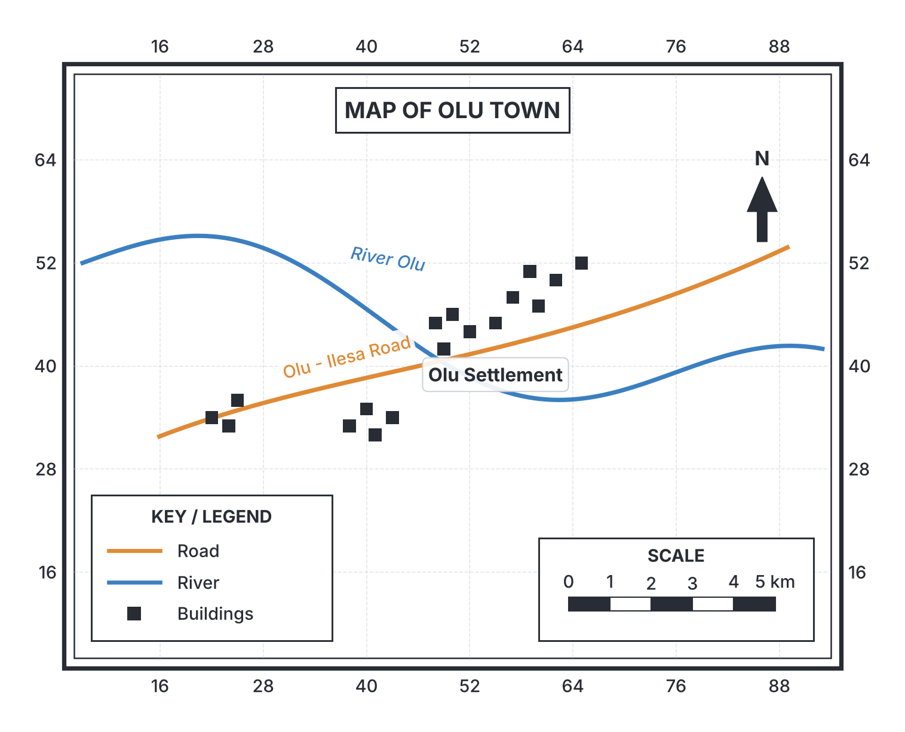
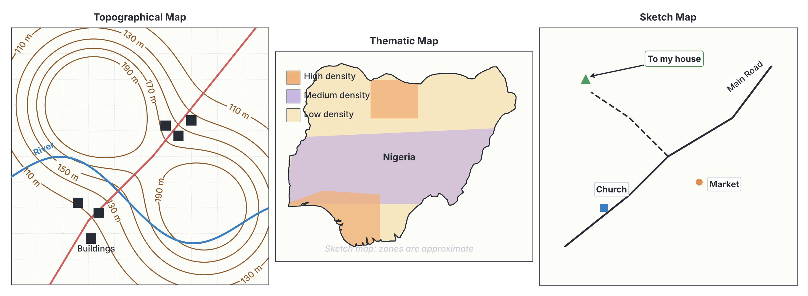

# JAMB Geography Notes: Maps

## What JAMB expects

This topic is Section I (Practical Geography), Topic A of the JAMB Geography syllabus: Maps. It has no numbered content items.

By the end of these notes, you should be able to:

1. Define and identify different types and uses of maps.

**Note on the syllabus wording:** This topic covers the foundation of practical geography. It requires you to know what a map is, the essential features that make a map readable, how maps are grouped (by scale and by purpose), how to identify them, and what each type is used for. Detailed calculations on maps are covered in `A2-scale-and-measurement.md`, and how to interpret map features is covered in `A3-map-reading-and-interpretation.md`.

## Defining a map

**Objective i: define and identify different types and uses of maps.**

A **map** is a representation of the earth's surface, or a part of it, drawn on a flat surface (such as paper or a computer screen) according to a specific **scale**. 

Because the earth is spherical (a 3D globe) and a map is flat (2D), cartographers (people who make maps) use mathematical methods called map projections to draw the earth on paper. Unlike a photograph taken from the sky, a map does not show everything; it uses **symbols** to represent selected natural features (like rivers, mountains, and vegetation) and human-made features (like roads, settlements, and boundaries).

### The essential features of a map

To be considered a true, useful map, the drawing must have certain standard features. These are often called the **essentials of a map**. When you look at any map in an exam, checking for these features is the first step to identifying what the map is showing.

1. **Title:** Every map must have a heading that tells you what the map is about and the area it covers (for example, "Topographical Map of Ilesha" or "Population Density of Nigeria in 2006").
2. **Scale:** This shows the relationship between the distance on the map and the actual distance on the ground. Without a scale, a map is just a sketch.
3. **Key (or Legend):** A box containing the list of symbols, colours, and signs used on the map, along with their meanings. Because a map cannot use real words or pictures for everything, the key unlocks the map's meaning.
4. **Direction (North Arrow):** A sign, usually an arrow pointing to True North, which helps the reader orient the map and determine bearings and directions.
5. **Grid lines (Latitudes and Longitudes):** A network of intersecting vertical and horizontal lines. In atlas maps, these are latitudes and longitudes (measured in degrees, °). In topographical maps, they are rectangular grid lines (Eastings and Northings) used to locate places accurately.
6. **Margin or Border:** An outer frame that encloses the map, making it neat and defining the limit of the mapped area.

## Classification and types of maps

Maps are generally classified in two main ways: **by scale** and **by purpose (or content)**.

### 1. Classification of maps by scale

The scale of a map determines how much detail can be shown and the size of the area covered. 

**Textbook variation:** Different textbooks and mapping agencies define the exact boundaries of scale sizes differently. The ranges given below are the most widely accepted standard in Nigerian secondary school Geography.

*   **Large-scale maps:** These maps show a **small area of the earth's surface in great detail**. Because the area mapped is small (like a village, a school compound, or a farm), there is enough room on the paper to draw individual buildings, small roads, and minor streams. The scale fraction is a large number. Examples include scales from $1:1$ (life-size) up to $1:50,000$. Cadastral maps and town plans are typical large-scale maps.
*   **Medium-scale maps:** These show a moderately sized area with moderate detail. Most standard topographical exercise maps used in WAEC and JAMB fall here or on the boundary of large scales. Examples range from $1:50,000$ to $1:250,000$.
*   **Small-scale maps:** These maps show a **very large area of the earth's surface with very little detail**. A whole country, continent, or the entire world is squeezed onto a single page. Consequently, only major features like large cities, major rivers, and national borders can be shown. The scale fraction is a small number. Examples include scales like $1:1,000,000$ or $1:20,000,000$. Atlas maps and wall maps are small-scale maps.

#### Comparing Large-scale and Small-scale maps

| Feature | Large-scale map | Small-scale map |
| :--- | :--- | :--- |
| **Area covered** | Small area (e.g., a town, a local government area) | Large area (e.g., a country, Africa, the World) |
| **Amount of detail** | Very detailed (shows streets, single buildings, minor streams) | Very little detail (shows only major cities, big rivers, country borders) |
| **Scale fraction value** | The fraction is larger (e.g., $1/10,000$) | The fraction is smaller (e.g., $1/1,000,000$) |
| **Examples of Scale** | $1:5,000$ or $1:25,000$ | $1:2,000,000$ or $1:50,000,000$ |
| **Types of map** | Cadastral maps, town plans, topographical maps | Atlas maps, wall maps, world maps |

*Note: Students often get confused by the denominator. A scale of $1:10,000$ is a **larger scale** than $1:1,000,000$. If you cut a pie into 10,000 pieces, each piece is much larger than if you cut it into 1,000,000 pieces!*

### 2. Classification of maps by purpose (Types of maps)

When JAMB asks you to identify different types of maps, they are usually referring to what the map is designed to show.

#### A. Topographical Maps
These are detailed maps that show both the **natural (physical) features** and **cultural (human-made) features** of a place. 
*   *Physical features shown:* Relief (hills, valleys, mountains shown using contour lines), drainage (rivers, lakes, swamps), and natural vegetation.
*   *Human features shown:* Settlements (towns, villages), transport routes (roads, railways, footpaths), farmlands, and boundaries.
*   **Identification:** Look for brown contour lines (showing the height and shape of the land), blue lines for rivers, and red or black symbols for roads and towns. They are typically drawn on a large or medium scale (e.g., $1:50,000$).

#### B. Thematic (or Statistical) Maps
A thematic map focuses on one specific subject or "theme". Instead of showing general features like roads and hills, it shows the distribution of a single geographical element.
*   *Examples of themes:* Population distribution, rainfall amounts, temperature, soil types, vegetation zones, or mineral deposits in Nigeria.
*   **Identification:** They usually have a very specific title (e.g., "Annual Rainfall of West Africa"). The legend will show colours, dots, or shading patterns that represent statistics or categories. (You will learn more about dot maps and choropleth maps in `A4-statistical-data-maps-and-diagrams.md`).

#### C. Cadastral Maps
These are extremely large-scale maps (often $1:1,000$ to $1:5,000$) used primarily to show the exact boundaries of landed properties, plots, and estates.
*   **Identification:** They look like architectural plans. They show property lines, plot numbers, and street layouts, but rarely show relief (hills or valleys).
*   **Uses:** Used by town planners, estate agents, and governments for land registration, taxation, and legal boundary disputes. 

#### D. Atlas or Chorographical Maps
An atlas is a collection of maps bound together in a book. Atlas maps are small-scale maps that show vast areas like a whole country, a continent, or the world.
*   **Identification:** The scale is very small. They use colours to show different countries or broad physical features (like green for lowlands and brown for highlands over a whole continent). Only capital cities and major rivers (like the Niger or Benue rivers) are named.

#### E. Sketch Maps
A sketch map is a roughly drawn map that shows the relative position of places. It is drawn from memory or rapid observation.
*   **Identification:** It lacks strict accuracy. It might not have an exact mathematical scale, and the lines may be hand-drawn without surveying instruments. It is used to quickly guide someone from one place to another.

#### F. Route or Road Maps
These are maps designed specifically for navigation and transport. 
*   **Identification:** They highlight road networks, railways, airports, and distances between towns. Other features like hills are left out to keep the map clean and easy to read for drivers and tourists.

#### G. Weather Maps (Synoptic Charts)
These maps show the meteorological conditions of an area at a specific time.
*   **Identification:** They are covered in specific weather symbols (like isobars, which are lines joining places of equal atmospheric pressure), cloud cover circles, and wind direction arrows.

## Step-by-step: How to identify a map type

When you are given a map in an examination and asked to identify its type, follow these steps:

**Step 1: Read the Title.** 
The title often gives the answer away. If it says "Average Annual Rainfall in Nigeria", it is a *Thematic Map*. If it says "Survey of Plot 45, Victoria Island", it is a *Cadastral Map*.

**Step 2: Check the Scale.**
Look at the scale fraction. If it is huge, like $1:2,000,000$, it is a *Small-scale map* (likely an Atlas map). If it is $1:50,000$, it is a *Medium/Large-scale map* (likely a Topographical map). If it is $1:1,000$, it is a very *Large-scale map* (like a Cadastral map or town plan).

**Step 3: Examine the features and the Legend.**
*   Are there brown contour lines showing hills, blue rivers, and red roads? It is a **Topographical map**.
*   Does it only show dots to represent 1,000 cattle each? It is a **Thematic (Statistical) map**.
*   Does it show property plot lines and numbers with no hills or rivers? It is a **Cadastral map**.
*   Does it show isobars and wind arrows? It is a **Weather map (Synoptic chart)**.

## The uses of maps

**Objective i: identify different types and uses of maps.**

Maps are essential tools in geography and everyday life. Different professionals use different maps for various purposes.

### General uses of maps
1. **Locating places:** Maps help us find the absolute location (using latitudes and longitudes) and relative location of towns, rivers, and mountains.
2. **Navigation:** They help people find their way from one place to another.
3. **Showing distributions:** They show how things like rainfall, vegetation, or population are spread across an area.
4. **Measuring distance and area:** By using the map scale, we can calculate the distance between two towns without physically travelling there.
5. **Understanding the landscape:** Contour maps allow geographers and engineers to visualize hills, valleys, and slopes on a flat piece of paper.

### Specific uses of map types

| Type of Map | Main Uses | Primary Users |
| :--- | :--- | :--- |
| **Topographical Maps** | Planning road construction, military operations, geographical fieldwork, route marching, siting dams. | Geographers, engineers, military personnel, regional planners. |
| **Cadastral Maps** | Defining land boundaries, registering land ownership, assessing property taxes, town planning. | Surveyors, estate managers, town planners, lawyers. |
| **Thematic Maps** | Analysing data patterns, planning resource distribution, studying climate change or disease spread. | Demographers, agriculturalists, economists, epidemiologists. |
| **Route/Road Maps** | Navigating highways, planning road trips, finding tourist centres, calculating travel times. | Drivers, tourists, logistics companies, cyclists. |
| **Weather Maps** | Forecasting weather, issuing storm warnings, flight planning. | Meteorologists, pilots, sailors, farmers. |
| **Atlas Maps** | General education, studying global relationships, comparing country sizes and locations. | Students, teachers, general public. |
| **Aeronautical/Nautical Charts** | Specialized maps for navigating aircraft through airspace or ships through water bodies safely. | Pilots, ship captains (mariners). |

## Key terms

| Term | Meaning |
| :--- | :--- |
| **Map** | A representation of the earth's surface drawn on a flat surface to a specific scale. |
| **Scale** | The ratio of distance on a map to the actual distance on the ground. |
| **Legend (Key)** | A box on a map that explains the symbols, colours, and lines used. |
| **Large-scale map** | A map that shows a small area in great detail (e.g., $1:10,000$). |
| **Small-scale map** | A map that shows a large area with little detail (e.g., $1:1,000,000$). |
| **Topographical map** | A map showing detailed physical features (relief) and human features. |
| **Thematic map** | A map focused on a specific subject or theme (e.g., population or rainfall). |
| **Cadastral map** | A very large-scale map showing property boundaries and land ownership. |
| **Atlas map** | A small-scale map found in a bound book, showing whole countries or continents. |
| **Synoptic chart** | A weather map showing meteorological conditions at a specific time. |

## Exam tips and common mistakes

*   **Scale trap:** The most common mistake in geography exams is mixing up large and small scales. Remember: **Large scale = small denominator (e.g., $1:5,000$) = small area = high detail.** **Small scale = large denominator (e.g., $1:2,000,000$) = large area = low detail.** 
*   **Confusing topographical and thematic maps:** If an exam asks for a map showing both natural and human features, the answer is a topographical map. If it asks for a map showing *only* the distribution of a single feature (like soil types), it is a thematic map.
*   **Missing essentials:** Always remember that a sketch becomes a map only when a **scale** is applied.
*   **Cadastral map uses:** Questions often ask which map a town planner or land surveyor uses to settle property disputes. The answer is always a cadastral map.

## Quick summary

1. A map is a flat representation of the earth's surface drawn to scale.
2. The essential features of a map are the Title, Scale, Key (Legend), North Arrow, Grid lines, and Margin.
3. Maps are classified by scale into large, medium, and small scales. Large-scale maps show small areas in great detail; small-scale maps show large areas with little detail.
4. Topographical maps show both physical features (like hills and rivers) and human features (like roads and settlements).
5. Thematic maps focus on a specific topic, such as rainfall, population density, or vegetation.
6. Cadastral maps are very large-scale maps used to show property boundaries and land ownership.
7. Maps are vital tools used by various professionals, including surveyors (cadastral maps), meteorologists (weather maps), and engineers (topographical maps).

## Practice questions

**1. A map showing the distribution of average annual rainfall in Nigeria is best described as a:**
- A. Topographical map
- B. Cadastral map
- C. Thematic map
- D. Sketch map

**Answer: C.** A thematic map (or statistical map) focuses on a specific theme or subject, such as the distribution of rainfall, population, or vegetation.

**2. Which of the following is a feature of a large-scale map?**
- A. It covers a very vast area of land like a continent.
- B. It shows a small area with great detail.
- C. Its representative fraction has a very large denominator, like $1:5,000,000$.
- D. It shows only major cities and national boundaries.

**Answer: B.** A large-scale map covers a small area (like a town or a farm) and provides a large amount of detail (such as individual buildings and minor roads). 

**3. Which of these scale fractions represents the smallest scale map?**
- A. $1:20,000$
- B. $1:50,000$
- C. $1:250,000$
- D. $1:1,000,000$

**Answer: D.** The smallest scale has the largest denominator. A scale of $1:1,000,000$ means one unit on the map represents one million units on the ground, meaning it covers a vast area with very little detail.

**4. A surveyor employed to define the exact boundaries of a disputed plot of land in Abuja will rely primarily on a:**
- A. Cadastral map
- B. Topographical map
- C. Synoptic chart
- D. Wall map

**Answer: A.** Cadastral maps are extremely large-scale maps used specifically for showing property boundaries and land ownership.

**5. The feature on a map that explains the meaning of the various symbols, lines, and colours used is called the:**
- A. Grid line
- B. Margin
- C. Scale
- D. Legend (Key)

**Answer: D.** The legend (or key) unlocks the map by defining what every symbol, shading, or colour stands for.

**6. Which type of map combines both the natural features (such as relief and drainage) and human-made features (such as settlements and roads)?**
- A. Weather map
- B. Topographical map
- C. Chorographical map
- D. Atlas map

**Answer: B.** Topographical maps are detailed maps that display both the physical (natural) and cultural (human) features of an area.

**7. A drawing of an area that gives relative locations but is not drawn to an accurate mathematical scale is known as a:**
- A. Thematic map
- B. Cadastral map
- C. Sketch map
- D. Topographical map

**Answer: C.** A sketch map is roughly drawn, often from memory, and lacks a precise scale.

**8. Which of the following professionals relies most heavily on a synoptic chart?**
- A. Estate surveyor
- B. Meteorologist
- C. Highway engineer
- D. Town planner

**Answer: B.** A synoptic chart is a weather map showing meteorological conditions. Meteorologists use them to forecast the weather.

**9. The network of vertical and horizontal lines on a map that help in accurately locating places are known as:**
- A. Contour lines
- B. Grid lines
- C. Isobars
- D. Margins

**Answer: B.** Grid lines (which can be latitudes/longitudes or eastings/northings) intersect to form a coordinate system used to locate places accurately.

**10. What is the primary disadvantage of using a small-scale map, such as a map of Africa in an atlas?**
- A. It cannot be used to find the general direction of a country.
- B. It lacks detailed features such as minor roads, small towns, and streams.
- C. It does not possess a title or a key.
- D. It is too heavy to carry around.

**Answer: B.** Because a small-scale map covers a very large area on a small piece of paper, many details must be omitted, making it impossible to see minor roads or local streams.

<!-- COVERAGE
obj i | Defining a map
obj i | The uses of maps
-->
