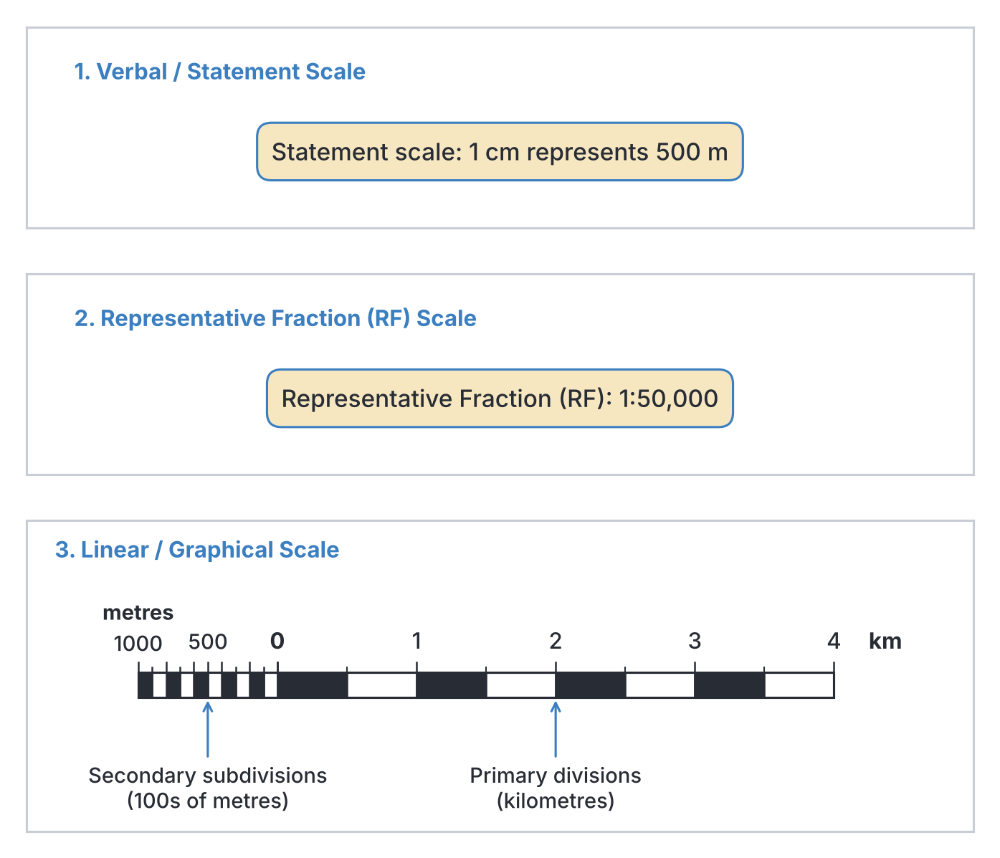
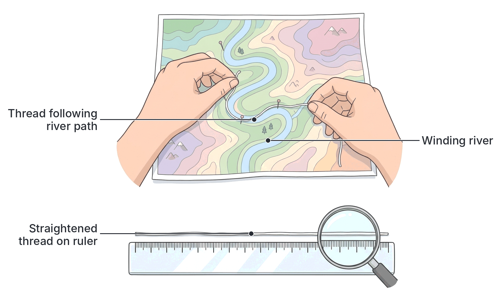
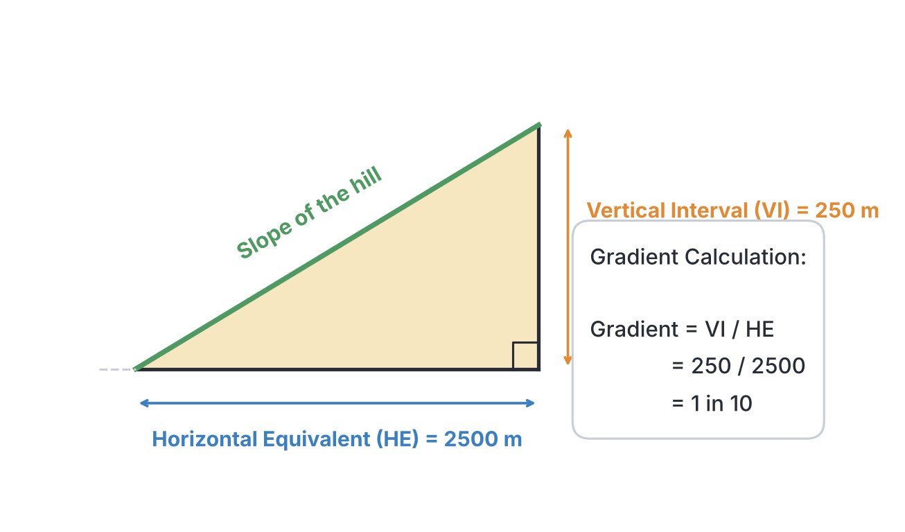
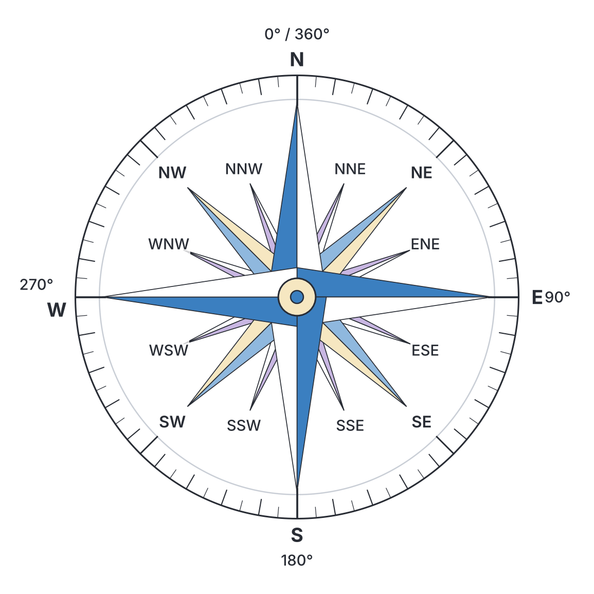

# JAMB Geography Notes: Scale and Measurement

## What JAMB expects

This topic covers the essential map reading skills found in Section I (Practical Geography) of the JAMB Geography syllabus. It explains how to interpret map scales, convert them, measure distances and areas, and calculate gradients, map reductions and enlargements, as well as determine directions and bearings. 

By the end of these notes, you should be able to:
1. apply the different types of scale to distances and area measurement;
2. understand conversion of scales;
3. apply the knowledge of scale to gradients, map reduction and enlargement;
4. apply the knowledge of directions and bearings to geographical features.

---

## Application of map scales to distance and area

**Objective i: apply the different types of scale to distances and area measurement.**

A **map scale** is the ratio between a distance on a map and the actual distance on the ground. Because it is impossible to draw a large area like Nigeria on a piece of paper at its real size, map makers shrink the area accurately using a scale. 

### Types of map scales

There are three main ways a scale is represented on a topographical map:

1. **Statement Scale:** 
   This expresses the scale in words. For example, "One centimetre to one kilometre" means that a distance of $1 \text{ cm}$ on the map represents a real-world distance of $1 \text{ km}$ on the ground.

2. **Representative Fraction (RF):** 
   This shows the scale as a fraction or ratio where the numerator is always 1. Both sides of the ratio are in the same unit (usually centimetres). 
   For example, $1:100,000$ or $\frac{1}{100,000}$. This means $1 \text{ cm}$ on the map represents $100,000 \text{ cm}$ on the ground. 

3. **Linear Scale:** 
   This is a special ruler drawn at the bottom of the map, marked with actual ground distances in kilometres or metres. It usually has a **primary section** (major divisions reading to the right of zero) and a **secondary section** (subdivisions reading to the left of zero for measuring smaller fractions of a kilometre).

### Measurement of distances

Distances on a map can be either straight lines (like a pipeline or a straight road) or curved/winding lines (like the River Niger or a winding bush path). 

**How to measure a straight line:**
1. Place a straight-edged ruler between the two points (e.g., Town A to Town B).
2. Read the measurement in centimetres (cm). 
3. Multiply by the map's scale to get the actual ground distance.

**How to measure a winding line (e.g., a river):**
1. Use a piece of flexible **thread or twine** (or the straight edge of a piece of paper marked as you pivot it).
2. Place the end of the thread at the starting point.
3. Carefully trace the thread along all the bends and curves of the river or road until you reach the destination.
4. Mark the endpoint on the thread, then stretch it straight along a ruler to find the map distance in cm.
5. Multiply by the map scale to find the actual ground distance.

**Worked Example:**
If the map distance along a winding road is $15.6 \text{ cm}$ on a topographical map with a scale of $1:50,000$, what is the actual distance in kilometres?

**Step 1:** Note the scale. $1:50,000$ means $1 \text{ cm} = 50,000 \text{ cm}$ on the ground.
**Step 2:** Convert the scale to a statement scale for easier calculation. Since $100,000 \text{ cm} = 1 \text{ km}$, $50,000 \text{ cm} = 0.5 \text{ km}$. Therefore, $1 \text{ cm}$ represents $0.5 \text{ km}$.
**Step 3:** Multiply the map distance by the ground equivalent.
$\text{Actual distance} = 15.6 \text{ cm} \times 0.5 \text{ km/cm} = 7.8 \text{ km}$.

### Measurement of areas

Maps are often used to measure the area of geographical features like a farm, a lake, or a settlement. 

**Regular shapes (e.g., rectangular farm):**
Use the mathematical formula for the shape. For a rectangle, $\text{Area} = \text{Length} \times \text{Width}$. Find the real-world length and width first, then multiply them. 
*Example:* A rectangular farm is $4 \text{ cm}$ long and $3 \text{ cm}$ wide on a $1:50,000$ map. 
Real length = $4 \text{ cm} \times 0.5 \text{ km} = 2 \text{ km}$. 
Real width = $3 \text{ cm} \times 0.5 \text{ km} = 1.5 \text{ km}$. 
Real Area = $2 \text{ km} \times 1.5 \text{ km} = 3 \text{ km}^2$.

**Irregular shapes (The Grid Square Method):**
Topographical maps (such as standard Nigerian survey maps) are covered with a grid of vertical and horizontal lines. Commonly, at a $1:50,000$ scale, these grid squares measure exactly $2 \text{ cm}$ by $2 \text{ cm}$ on the paper.
* Calculate the real area of one square: Since $1 \text{ cm} = 0.5 \text{ km}$, a $2 \text{ cm}$ side is $1 \text{ km}$. Thus, $1 \text{ grid square} = 1 \text{ km} \times 1 \text{ km} = 1 \text{ km}^2$ on the ground.
* To find the area of an irregular shape (like a lake), use this method:
  1. Count the number of **full squares** completely inside the shape.
  2. Count the number of **partial (incomplete) squares** the shape crosses.
  3. Divide the partial squares by 2 (assuming on average they are half-full).
  4. Add the full squares and the halved partial squares to get the total area in $\text{km}^2$.

**Worked Example:** A lake covers 12 full grid squares and 8 partial grid squares on a 1:50,000 map (where 1 square = $1 \text{ km}^2$).
$\text{Total Area} = 12 + \frac{8}{2} = 12 + 4 = 16 \text{ km}^2$.

---

## Conversion of map scales

**Objective ii: understand conversion of scales.**

In JAMB, you will frequently be asked to convert scales between Statement and Representative Fraction (RF). To do this, you must memorise the metric conversion: 
**$1 \text{ kilometre (km)} = 1,000 \text{ metres (m)} = 100,000 \text{ centimetres (cm)}$.**

### Converting a Statement Scale to RF
**Example:** Convert "1 cm represents 2 km" to RF.
**Step 1:** Write it as an equation: $1 \text{ cm on map} = 2 \text{ km on ground}$.
**Step 2:** Convert the ground distance to centimetres. Since $1 \text{ km} = 100,000 \text{ cm}$, multiply by $100,000$.
$2 \text{ km} \times 100,000 = 200,000 \text{ cm}$.
**Step 3:** Write it as a ratio without units. 
**Answer:** $1:200,000$.

### Converting RF to a Statement Scale
**Example:** Convert the RF $1:250,000$ to a statement scale in km.
**Step 1:** Interpret the ratio: $1 \text{ cm on map} = 250,000 \text{ cm on ground}$.
**Step 2:** Convert the ground distance to kilometres by dividing by $100,000$.
$250,000 \div 100,000 = 2.5 \text{ km}$.
**Step 3:** Write the statement out.
**Answer:** $1 \text{ cm}$ represents $2.5 \text{ km}$.

---

## Gradients, map reduction and enlargement

**Objective iii: apply the knowledge of scale to gradients, map reduction and enlargement.**

### Gradients on topographical maps

**Gradient** is the steepness or slope of the land between two points. It tells us how much the land rises or falls over a specific horizontal distance. It is expressed as a fraction or ratio (e.g., "1 in 20", meaning the land rises $1 \text{ metre}$ vertically for every $20 \text{ metres}$ travelled horizontally).

To calculate gradient, you need two values:
1. **Vertical Interval (VI):** The difference in height (elevation) between the two points. You get this by subtracting the lower contour height from the higher contour height. It is usually measured in metres (m).
2. **Horizontal Equivalent (HE):** The real-world horizontal distance between the two points. You find this by measuring the map distance in cm and converting it to real distance in metres using the map scale.

The formula is:
$$\text{Gradient} = \frac{\text{Vertical Interval (VI)}}{\text{Horizontal Equivalent (HE)}}$$
*(Note: VI and HE must be in the same unit, usually metres, before dividing!)*

**Worked Example:**
Point X is on the $400 \text{ m}$ contour line and Point Y is on the $150 \text{ m}$ contour line. The map distance between X and Y is $5 \text{ cm}$. If the map scale is $1:50,000$, calculate the gradient.

**Step 1:** Calculate VI. 
$\text{VI} = 400 \text{ m} - 150 \text{ m} = 250 \text{ m}$.
**Step 2:** Find the map distance in cm. 
$\text{Map distance} = 5 \text{ cm}$.
**Step 3:** Calculate HE (ground distance) in metres.
At a scale of $1:50,000$, $1 \text{ cm} = 50,000 \text{ cm} = 500 \text{ m}$.
$\text{HE} = 5 \text{ cm} \times 500 \text{ m/cm} = 2,500 \text{ m}$.
**Step 4:** Apply the formula.
$$\text{Gradient} = \frac{\text{VI}}{\text{HE}} = \frac{250}{2500} = \frac{1}{10}$$
**Answer:** The gradient is 1 in 10 (or 1:10).

### Map reduction and enlargement

Sometimes, a cartographer needs to change the physical size of a map to fit a book or a wall chart. 

**Map Reduction:**
When a map is reduced in size, the features become smaller on paper, which means it covers the same real-world area on a smaller piece of paper. This makes the scale *smaller*. Since the scale is a fraction, **a smaller scale has a larger denominator**.
* **Rule for Reduction:** Multiply the denominator of the old scale by the number of times it is reduced.
* *Example:* Reduce a $1:50,000$ map by half (2 times). 
  $\text{New scale} = 1 : (50,000 \times 2) = 1:100,000$.

**Map Enlargement:**
When a map is enlarged, the features are drawn bigger on the paper, meaning the scale is *larger*. A larger fraction has a **smaller denominator**.
* **Rule for Enlargement:** Divide the denominator of the old scale by the number of times it is enlarged.
* *Example:* Enlarge a $1:100,000$ map by 4 times.
  $\text{New scale} = 1 : (100,000 \div 4) = 1:25,000$.

**Note on area change:** 
If you reduce a map's linear dimensions by half ($\frac{1}{2}$), the new map's *area* becomes the square of the reduction factor: $(\frac{1}{2})^2 = \frac{1}{4}$ of the original size on paper. 

---

## Directions and bearings

**Objective iv: apply the knowledge of directions and bearings to geographical features.**

### Cardinal points and directions

Direction is simply the position of one point in relation to another. It is determined using the points of a compass. 
* **4-point compass:** North (N), South (S), East (E), West (W).
* **8-point compass:** Adds North-East (NE), South-East (SE), South-West (SW), North-West (NW).
* **16-point compass:** Adds intermediate points like North-North-East (NNE), East-North-East (ENE), etc.

### Bearings

Direction is often not precise enough, so we use **bearings**, which express direction as an angle in degrees.
* Bearings are always measured from the **North line (000°)**.
* They are always measured in a **clockwise** direction.
* They are given as a three-digit number (e.g., $045^\circ$ for NE).

**How to find the bearing of Town B from Town A:**
1. **Pay attention to the word "FROM".** The starting point is Town A.
2. Draw a straight line connecting Town A to Town B.
3. Draw a vertical line representing North through the starting point (Town A).
4. Place the center of your protractor exactly on Town A, with the $0^\circ$ mark pointing North.
5. Read the angle clockwise from North to the line connecting to Town B.

### Forward bearing and Back bearing

* **Forward Bearing (FB):** The bearing from your starting point to your destination (e.g., from A to B).
* **Back Bearing (BB):** The bearing from your destination back to your starting point (e.g., from B to A).

There is a simple mathematical rule to find the Back Bearing if you know the Forward Bearing:
* If the Forward Bearing is **less than $180^\circ$**, add $180^\circ$.
  $\text{BB} = \text{FB} + 180^\circ$
* If the Forward Bearing is **greater than $180^\circ$**, subtract $180^\circ$.
  $\text{BB} = \text{FB} - 180^\circ$

**Worked Example:**
If the bearing of Kano from Abuja is $035^\circ$, what is the bearing of Abuja from Kano?
**Step 1:** Identify the FB. $\text{FB} = 035^\circ$.
**Step 2:** Since $035^\circ$ is less than $180^\circ$, we add $180^\circ$.
$\text{BB} = 035^\circ + 180^\circ = 215^\circ$.
**Answer:** The bearing of Abuja from Kano is $215^\circ$.

### Types of North and Magnetic Declination

On topographical maps, you will often see a small diagram in the margin showing three different "Norths":
1. **True North:** The direction pointing exactly to the geographic North Pole of the Earth. (Usually shown with a star).
2. **Grid North:** The direction that the vertical grid lines on the map point towards.
3. **Magnetic North:** The direction a magnetic compass needle points. It moves slightly every year because of shifts in the Earth's magnetic field. (Usually shown with a half-arrow).

**Magnetic Declination (or Magnetic Variation):**
This is the angle between **True North** and **Magnetic North**. Because Magnetic North shifts every year, older maps state the annual change (e.g., "declining by 5 minutes West annually"). To find the current magnetic bearing for navigation, a surveyor must calculate the current declination and adjust the true bearing accordingly.

---

## Key terms

| Term | Meaning |
| --- | --- |
| Map Scale | The ratio between a distance on the map and the corresponding actual distance on the ground. |
| Representative Fraction (RF) | A map scale expressed as a mathematical fraction or ratio (e.g., $1:50,000$). |
| Gradient | The steepness of a slope, calculated as the ratio of Vertical Interval to Horizontal Equivalent. |
| Vertical Interval (VI) | The difference in vertical height (elevation) between two points on a map. |
| Horizontal Equivalent (HE) | The real-world horizontal distance between two points on a map, usually in metres. |
| Bearing | Direction expressed as an angle measured in degrees clockwise from North. |
| Forward Bearing | The angle measured clockwise from North from a starting point to a destination. |
| Back Bearing | The angle measured clockwise from North from the destination back to the starting point. |
| Magnetic Declination | The angle difference between True North and Magnetic North. |
| True North | The direction of the Earth's geographic North Pole. |

## Exam tips and common mistakes

* **Mixing up VI and HE:** When calculating gradient, the vertical difference in height (from contours) goes on *top* as the numerator (VI). The physical map distance converted to ground distance goes on the *bottom* (HE).
* **Mismatched units in gradient:** Always make sure both VI and HE are in the same unit (metres) before you divide. If you divide a VI in metres by an HE in kilometres, your answer will be entirely wrong.
* **Misunderstanding "From":** A classic JAMB trick is asking "What is the bearing of X *from* Y?" Students often measure from X. Always put your cross/protractor on the point following the word **"from"**.
* **Map reduction vs scale denominator:** Making a map physically smaller (reducing it) means making the scale fraction smaller. Since it's a fraction, you *multiply* the denominator. To reduce a $1:50,000$ map by half, the new scale is $1:100,000$ (not $1:25,000$). 
* **Winding distances:** Always look for the option involving a "piece of thread" or "twine" when asked about measuring winding rivers or roads. 

## Quick summary

1. A scale tells you how much a real-world area has been shrunk to fit on paper. It is shown as a statement, a representative fraction (RF), or a linear scale.
2. To convert from RF to a statement scale in km, divide the denominator by $100,000$.
3. Straight lines on maps are measured with a ruler, while winding lines (like rivers) are measured using a flexible piece of thread.
4. The area of irregular shapes on topographical maps is found by counting full grid squares (adding partial squares divided by 2), and multiplying by the area of one square.
5. Gradient is the slope between two points, calculated as $\frac{\text{Vertical Interval (VI)}}{\text{Horizontal Equivalent (HE)}}$. Both must be in metres.
6. Enlarging a map gives it a larger scale (smaller RF denominator); reducing a map gives it a smaller scale (larger RF denominator).
7. Bearings are measured clockwise from North in degrees (000° to 360°).
8. The Back Bearing is found by adding 180° to the Forward Bearing (if FB < 180°) or subtracting 180° (if FB > 180°).

## Practice questions

**1. A map scale is given as $1:250,000$. Which of the following is its statement scale?**
- A. $1 \text{ cm}$ represents $0.25 \text{ km}$
- B. $1 \text{ cm}$ represents $2.5 \text{ km}$
- C. $1 \text{ cm}$ represents $25 \text{ km}$
- D. $1 \text{ cm}$ represents $250 \text{ km}$

**Answer: B.**
Step 1: The RF means $1 \text{ cm}$ on the map represents $250,000 \text{ cm}$ on the ground. Step 2: Divide $250,000$ by $100,000$ to convert to kilometres. $250,000 \div 100,000 = 2.5$. Thus, $1 \text{ cm}$ represents $2.5 \text{ km}$.

**2. The distance between Town P and Town Q on a $1:50,000$ map is $8 \text{ cm}$. What is the actual distance on the ground?**
- A. $0.4 \text{ km}$
- B. $4 \text{ km}$
- C. $40 \text{ km}$
- D. $400 \text{ km}$

**Answer: B.**
Step 1: Multiply map distance by the scale factor: $8 \text{ cm} \times 50,000 = 400,000 \text{ cm}$. Step 2: Convert to kilometres by dividing by $100,000$. $400,000 \text{ cm} \div 100,000 = 4 \text{ km}$. A common mistake is stopping at 400 or dividing incorrectly.

**3. Which of the following is the most appropriate instrument for measuring the length of a winding river on a topographical map?**
- A. A straight ruler
- B. A piece of thread
- C. A pair of dividers
- D. A protractor

**Answer: B.**
A flexible piece of thread or twine is best because it can be bent to follow the exact twists and turns of the river before being pulled straight against a ruler to find the map length.

**4. The bearing of Point X from Point Y is $115^\circ$. What is the bearing of Point Y from Point X?**
- A. $025^\circ$
- B. $115^\circ$
- C. $295^\circ$
- D. $065^\circ$

**Answer: C.**
You are looking for the Back Bearing. Since the Forward Bearing ($115^\circ$) is less than $180^\circ$, you add $180^\circ$. $115^\circ + 180^\circ = 295^\circ$. Option D is a mistake resulting from subtracting from $180^\circ$.

**5. Point A is on the $600 \text{ m}$ contour line and Point B is on the $200 \text{ m}$ contour line. The map distance between them is $4 \text{ cm}$ and the scale is $1:100,000$. Calculate the gradient.**
- A. 1 in 4
- B. 1 in 10
- C. 1 in 20
- D. 1 in 40

**Answer: B.**
Step 1: VI = $600 \text{ m} - 200 \text{ m} = 400 \text{ m}$. Step 2: HE map distance = $4 \text{ cm}$. At $1:100,000$, $1 \text{ cm} = 1 \text{ km}$, so $4 \text{ cm} = 4 \text{ km}$. Step 3: Convert HE to metres. $4 \text{ km} = 4,000 \text{ m}$. Step 4: Gradient = $\text{VI} \div \text{HE} = 400 \div 4,000 = 1/10$. The gradient is 1 in 10.

**6. A rectangular farm measures $4 \text{ cm}$ by $3 \text{ cm}$ on a topographical map drawn to a scale of $1:50,000$. What is the area of the farm on the ground?**
- A. $3 \text{ km}^2$
- B. $6 \text{ km}^2$
- C. $12 \text{ km}^2$
- D. $30 \text{ km}^2$

**Answer: A.**
Step 1: Convert dimensions to ground distance first. At $1:50,000$ ($1 \text{ cm} = 0.5 \text{ km}$). Length = $4 \text{ cm} \times 0.5 = 2 \text{ km}$. Width = $3 \text{ cm} \times 0.5 = 1.5 \text{ km}$. Step 2: Multiply them. $2 \text{ km} \times 1.5 \text{ km} = 3 \text{ km}^2$. Option C is a mistake of just multiplying $4 \times 3$ without applying the scale factor properly.

**7. If a map with a scale of $1:100,000$ is reduced to half its original size, what will be the new scale?**
- A. $1:50,000$
- B. $1:100,000$
- C. $1:200,000$
- D. $1:400,000$

**Answer: C.**
Reducing a map physically means the features become smaller, creating a smaller scale. A smaller fraction means the denominator must be multiplied. Reduce by half = $100,000 \times 2 = 200,000$. New scale = $1:200,000$. 

**8. An irregular lake on a $1:50,000$ map (where $2 \text{ cm}$ by $2 \text{ cm}$ grids equal $1 \text{ km}^2$) covers 5 full grid squares and 6 partial grid squares. What is the approximate area of the lake?**
- A. $5.5 \text{ km}^2$
- B. $8 \text{ km}^2$
- C. $11 \text{ km}^2$
- D. $32 \text{ km}^2$

**Answer: B.**
Step 1: Count full squares = 5. Step 2: Divide partial squares by 2. $6 \div 2 = 3$. Step 3: Add them together. $5 + 3 = 8$ squares. Since 1 grid square = $1 \text{ km}^2$, the total area is $8 \text{ km}^2$.

**9. Magnetic declination is best defined as the angular difference between**
- A. True North and Grid North
- B. Magnetic North and Grid North
- C. True North and Magnetic North
- D. Forward bearing and Back bearing

**Answer: C.**
Magnetic declination (or variation) is the angle measured between the direction of the geographic North Pole (True North) and the direction a compass needle points (Magnetic North).

**10. A strong wind blowing directly from a bearing of $225^\circ$ is coming from which compass direction?**
- A. North-East
- B. South-East
- C. South-West
- D. North-West

**Answer: C.**
On a compass rose, North is $0^\circ/360^\circ$, East is $090^\circ$, South is $180^\circ$, and West is $270^\circ$. Exactly halfway between South ($180^\circ$) and West ($270^\circ$) is South-West ($225^\circ$). 

<!-- COVERAGE
obj i | Application of map scales to distance and area
obj ii | Conversion of map scales
obj iii | Gradients, map reduction and enlargement
obj iv | Directions and bearings
-->
