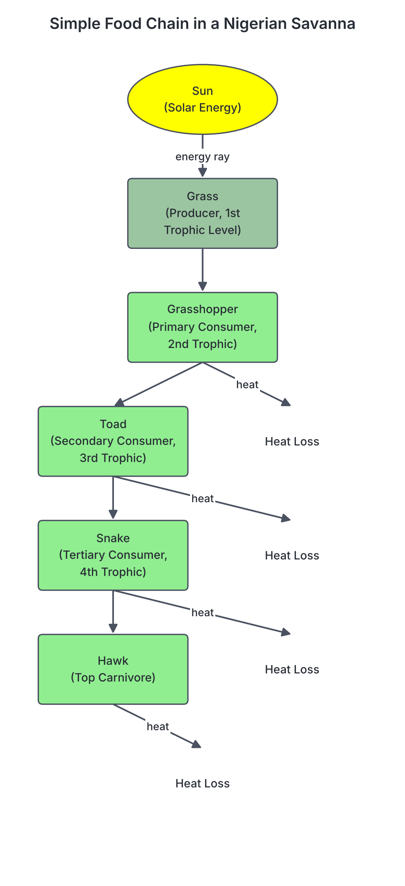
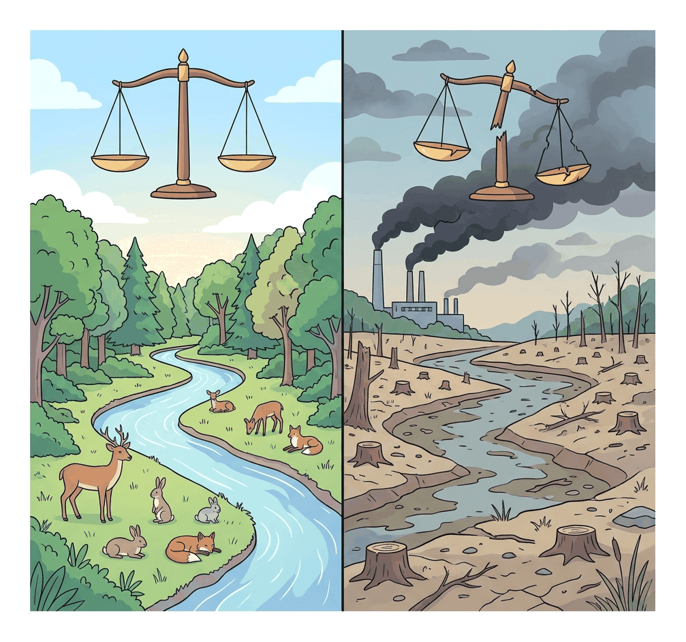

# JAMB Geography Notes: Environmental Interaction

## What JAMB expects

This topic is Section II, Topic J of the JAMB Geography syllabus: Environmental interaction. It covers the following content items:
- i. Land ecosystem
- ii. Environmental balance and human interaction
- iii. Effects of human activities on land ecosystem

By the end of these notes, you should be able to:
1. identify the components of land ecosystem;
2. establish the interrelationship within the ecosystem;
3. interpret the concept of environmental balance;
4. analyse the effects of human activities on land ecosystem.

## The Land Ecosystem

An **ecosystem** is a self-sustaining unit made up of living organisms (plants, animals, and microbes) interacting with one another and with their non-living physical environment. Ecology is the science that studies these interactions. 

Ecosystems can be aquatic (water-based, such as ponds, rivers, and oceans) or terrestrial (land-based). A **land ecosystem** refers specifically to a terrestrial environment, such as a tropical rainforest, a savanna grassland, or a desert. 

**Note on the spheres of the earth:** The environment is made up of overlapping spheres. While some parts of the JAMB syllabus only list three spheres (atmosphere, biosphere, and hydrosphere) when discussing natural cycles, textbooks agree that the ecosystem actually involves four spheres interacting:
1. **Biosphere:** all living things.
2. **Lithosphere:** the solid earth, rocks, and soil.
3. **Atmosphere:** the air surrounding the earth.
4. **Hydrosphere:** the water bodies and moisture in the environment.

### Components of the Land Ecosystem

**Objective i: identify the components of land ecosystem.**

Every land ecosystem is made up of two main components: **abiotic** (non-living) and **biotic** (living).

#### 1. Abiotic Components
These are the physical and chemical factors that create the environment in which organisms live. They determine which types of plants and animals can survive in a specific area.

- **Climatic factors:** Sunlight (the primary source of energy), temperature, rainfall, wind, and humidity. For example, high rainfall and temperatures support the lush vegetation of the rainforest in southern Nigeria, while lower rainfall supports the savanna in the north.
- **Edaphic (soil) factors:** Soil texture, soil structure, soil pH (acidity or alkalinity), topography (the shape of the land), and soil moisture.
- **Inorganic substances:** Basic elements and compounds such as carbon, nitrogen, oxygen, phosphorus, and water that cycle through the ecosystem.
- **Organic substances:** Dead decaying matter (humus) from plants and animals that links the living and non-living components.

#### 2. Biotic Components
These are the living parts of the ecosystem. They are grouped based on how they obtain their food.

| Component | Role in the Ecosystem | Examples |
| --- | --- | --- |
| **Producers (Autotrophs)** | They manufacture their own food from simple inorganic substances using sunlight (photosynthesis). They bring energy into the ecosystem. | Guinea grass, Iroko trees, shrubs, algae |
| **Consumers (Heterotrophs)** | They cannot make their own food, so they eat other organisms to survive. They are divided into levels (primary, secondary, tertiary). | Grasshoppers, antelopes (Primary); Lizards, snakes (Secondary); Hawks, lions (Tertiary) |
| **Decomposers (Saprophytes)** | They break down the bodies of dead producers and consumers, releasing the nutrients back into the soil for plants to reuse. | Bacteria, fungi, earthworms, termites |

## Interrelationships within the Ecosystem

**Objective ii: establish the interrelationship within the ecosystem.**

The abiotic and biotic components of an ecosystem are deeply interconnected. This relationship is maintained through two major processes: **the flow of energy** and **the cycling of nutrients**. 

### 1. Energy Flow

Energy in an ecosystem flows in **one direction** (it is unidirectional). It enters as sunlight, is captured by plants, passes through animals, and is eventually lost as heat. It does not cycle back to the sun.

- **Food Chain:** A linear sequence showing who eats whom, and how energy passes from one organism to another. 
  - *Example:* Grass $\rightarrow$ Grasshopper $\rightarrow$ Toad $\rightarrow$ Snake $\rightarrow$ Hawk.
- **Food Web:** In nature, animals eat more than one type of food. A food web is a complex network of interconnected food chains.
- **Trophic Levels:** Each feeding step in a food chain is a trophic level. Producers form the first trophic level, primary consumers the second, secondary consumers the third, and so on.
- **The 10% Rule:** As energy moves from one trophic level to the next, only about 10% is stored in the animal's body to be passed on to the next predator. The remaining 90% is used for life processes (movement, respiration) or lost as heat and waste. Because energy is rapidly lost, food chains rarely have more than four or five trophic levels.

### 2. Nutrient Cycling (Biogeochemical Cycles)

Unlike energy, matter (nutrients) is never lost; it cycles continuously between the living (biotic) and non-living (abiotic) environments. 

**The Carbon Cycle step by step:**
1. **Photosynthesis:** Plants absorb carbon (IV) oxide (CO₂) from the air to make carbohydrates.
2. **Consumption:** Animals eat the plants, taking carbon into their bodies.
3. **Respiration:** Both plants and animals break down food for energy, breathing out CO₂ back into the atmosphere.
4. **Decomposition:** When organisms die, decomposers break them down, releasing stored carbon as CO₂.
5. **Combustion:** Burning wood, bush, or fossil fuels releases trapped carbon into the air as CO₂.

**The Nitrogen Cycle step by step:**
1. **Nitrogen Fixation:** Most organisms cannot use nitrogen gas (N₂) from the air. Lightning and nitrogen-fixing bacteria (like *Rhizobium* in the root nodules of legumes) change nitrogen gas into nitrates in the soil.
2. **Assimilation:** Plants absorb these nitrates through their roots to build plant proteins.
3. **Consumption:** Animals eat plants to get the nitrogen they need for their own proteins.
4. **Ammonification:** When plants and animals die or produce waste, decomposers turn the nitrogen compounds into ammonia.
5. **Nitrification:** Special soil bacteria convert the ammonia back into nitrites, and then into nitrates for plants to use again.
6. **Denitrification:** Other bacteria break down excess nitrates and release nitrogen gas back into the atmosphere, completing the cycle.

**The Water (Hydrological) Cycle step by step:**
1. **Evaporation and Transpiration:** The sun heats lakes, rivers, and oceans, turning water into vapour (evaporation). Plants also release water vapour through their leaves (transpiration).
2. **Condensation:** As the water vapour rises into the atmosphere, it cools and turns into tiny water droplets, forming clouds.
3. **Precipitation:** When the clouds get heavy, the water falls back to the land ecosystem as rain, dew, or hail.
4. **Runoff and Infiltration:** Rainwater flows over the ground into rivers (runoff) or soaks deep into the soil to become groundwater (infiltration), ready to be used by plants.

## Environmental Balance and Human Interaction

**Objective iii: interpret the concept of environmental balance.**

### What is Environmental Balance?

**Environmental balance** (also called ecological equilibrium) is a state of stability in an ecosystem. In a balanced ecosystem, the relationships between living organisms and their physical environment are stable, and the sizes of different populations remain relatively constant over time. Nature maintains this balance through processes like homeostasis and carrying capacity.

- **Carrying Capacity:** This is the maximum number of individuals of a particular species that the environment can support indefinitely, based on the available food, water, and space.
- **Predator-Prey Relationships:** Predators prevent herbivores from multiplying too much and eating all the plants. If antelopes multiply too fast, lions get more food and their population grows, which then reduces the antelope population back to a manageable size.
- **Recycling of materials:** The exact amount of carbon and nitrogen used by living things is naturally replaced by the decomposition of dead things, meaning no waste builds up permanently.

### Human Interaction with the Environment

Humans are a part of the ecosystem, but our interaction is unique.
- **Early Human Interaction:** In the past, human populations were small. Humans lived as hunters and gatherers, and their impact was minimal. The ecosystem could easily heal itself and maintain its balance.
- **Modern Human Interaction:** As human population and technology grew, our interaction changed from mere *adaptation* to massive *modification* of the environment. We extract resources faster than nature can replace them, and we produce waste faster than nature can absorb it. When human extraction or pollution exceeds the ecosystem's limits, the environmental balance is **disrupted**, leading to environmental degradation.

## Effects of Human Activities on the Land Ecosystem

**Objective iv: analyse the effects of human activities on land ecosystem.**

Human activities have profound effects on the land ecosystem. While we often focus on the negative effects (disruption), humans also engage in positive activities to protect and restore the ecosystem.

### Negative Effects (Disrupting the Ecosystem)

| Human Activity | How it disrupts the land ecosystem | Nigerian Examples |
| --- | --- | --- |
| **Deforestation** | Cutting down trees for timber, firewood, or agriculture without replanting. It destroys wildlife habitats, reduces biodiversity, accelerates soil erosion, and disrupts the water cycle (reducing rainfall). | Rapid loss of the tropical rainforests in southern Nigeria; advancing desertification in the far north. |
| **Agriculture (Poor practices)** | Practices like bush burning destroy soil organic matter and beneficial microbes. Shifting cultivation with very short fallow periods degrades soil fertility. Overuse of chemical fertilisers pollutes water bodies through agricultural runoff (eutrophication). | Annual dry-season bush burning across the savanna belt. |
| **Overgrazing** | Keeping too many cattle, sheep, or goats on a piece of land. The animals eat the vegetation down to the roots and their hooves compact the soil. This prevents water infiltration and exposes the land to severe wind and water erosion. | Widespread in the Sahel savanna of northern Nigeria, worsening desertification. |
| **Mining and Quarrying** | Removing the topsoil and rocks to extract minerals. It permanently alters the topography, destroys vegetation, creates dangerous artificial pits, and pollutes soil and water with heavy metals. | Tin and columbite mining in the Jos Plateau, which left behind barren landscapes and deep, hazardous ponds. |
| **Urbanisation and Industrialisation** | Clearing land for cities, roads, and factories destroys natural habitats. Covering the ground with concrete and asphalt prevents rainwater from soaking into the soil, leading to flash floods. | Flooding in highly urbanised cities like Lagos and Port Harcourt. |
| **Pollution** | Indiscriminate disposal of solid waste (plastics) and liquid waste into the land. Oil spills destroy soil fertility, kill soil organisms, and ruin the livelihoods of farmers. | Frequent crude oil spills from pipelines in the Niger Delta region. |

### Positive Effects (Restoring the Ecosystem)

Humans can also act as caretakers of the land ecosystem through deliberate environmental conservation efforts.

1. **Afforestation and Reforestation:** **Afforestation** is the planting of trees in an area that previously had no forest, while **reforestation** is the replanting of trees in a deforested area. Trees act as windbreaks, prevent soil erosion, and absorb carbon (IV) oxide.
2. **Conservation Areas:** The government sets aside protected areas where human activities like hunting (poaching) and farming are banned. This allows biodiversity to thrive undisturbed. Examples include the **Yankari Game Reserve** in Bauchi State and the **Cross River National Park**.
3. **Sustainable Agriculture:** Using farming methods that protect the soil, such as crop rotation, contour ploughing (to stop erosion on slopes), terracing, and the use of organic manure instead of harsh chemical fertilisers.
4. **Environmental Laws and Education:** Enacting laws that penalise illegal logging, poaching, and reckless waste disposal, alongside educating the public on the importance of maintaining ecological balance.
5. **Pollution Control:** Treating industrial effluents before discharging them, and recycling solid wastes like paper and plastics to reduce the burden on landfills.

## Key terms

| Term | Meaning |
| --- | --- |
| **Ecosystem** | A community of living organisms interacting with one another and with their physical (non-living) environment. |
| **Abiotic factors** | The non-living components of an ecosystem, such as temperature, rainfall, soil, and sunlight. |
| **Biotic factors** | The living components of an ecosystem, including producers, consumers, and decomposers. |
| **Producers (Autotrophs)** | Green plants that can manufacture their own food using sunlight. |
| **Consumers (Heterotrophs)** | Organisms (mainly animals) that obtain their energy by eating other organisms. |
| **Decomposers** | Microorganisms (bacteria, fungi) that break down dead organic matter and release nutrients back into the soil. |
| **Food web** | A complex network of interconnected food chains in an ecosystem. |
| **Trophic level** | A specific feeding stage or step in a food chain or food web. |
| **Environmental balance** | A state of dynamic equilibrium where ecosystem components interact stably and population sizes remain relatively constant. |
| **Carrying capacity** | The maximum population of a species that a specific environment can support sustainably. |
| **Afforestation** | The deliberate planting of trees to create a forest in an area where there was none. |

## Exam tips and common mistakes

- **Mixing up unidirectional and cyclic flow:** Remember that **energy flows in one direction** (it is unidirectional and lost as heat), but **nutrients cycle** continuously (they are recycled).
- **Misunderstanding the 10% rule:** Students often think energy increases or stays the same up the food chain. In reality, energy *decreases* drastically at each trophic level. This is why top predators are fewer in number than herbivores.
- **Confusing abiotic and biotic:** Abiotic means non-living (e.g., soil pH, wind, sunlight). Biotic means living (e.g., fungi, trees, insects). Fungi are living things (decomposers), not abiotic factors.
- **Ignoring positive human impacts:** Exam questions often ask for a *positive* human impact on the environment. Do not just pick deforestation or mining out of habit; look for answers like afforestation or wildlife conservation.
- **Confusing afforestation and deforestation:** Deforestation is cutting down trees (negative); afforestation is planting trees (positive).
- **The primary source of energy:** If asked for the ultimate source of energy for the ecosystem, the answer is always **sunlight** (the sun).

## Quick summary

1. A land ecosystem consists of interacting abiotic (non-living) and biotic (living) components.
2. The biotic components are classified into producers (plants), consumers (animals), and decomposers (bacteria and fungi).
3. Energy flows through the ecosystem in one direction, from the sun to producers, then to consumers, with about 90% of energy lost at each trophic level.
4. Nutrients like carbon, nitrogen, and water do not flow in one direction; they are continuously recycled between the biotic and abiotic parts of the ecosystem.
5. Environmental balance is a state of natural stability in an ecosystem, maintained by factors like carrying capacity and predator-prey relationships.
6. Negative human activities like deforestation, bush burning, overgrazing, and mining severely disrupt the environmental balance and degrade the land.
7. Positive human activities like afforestation, sustainable agriculture, and the creation of game reserves help to restore and maintain environmental balance.

## Practice questions

**1. The primary source of energy for all terrestrial ecosystems is:**
- A. decomposers
- B. chemical fertilisers
- C. the sun
- D. groundwater
 
**Answer: C.** Sunlight (the sun) provides the initial energy that producers (plants) capture during photosynthesis, which then flows to all other organisms.

**2. Which of the following is an abiotic component of the land ecosystem?**
- A. Fungi
- B. Topography
- C. Termites
- D. Grasshoppers
 
**Answer: B.** Topography (the shape of the land) is a physical, non-living factor. Fungi, termites, and grasshoppers are all living (biotic) organisms.

**3. In an ecosystem, the flow of energy from one trophic level to the next is:**
- A. multidirectional
- B. unidirectional
- C. bidirectional
- D. cyclic
 
**Answer: B.** Energy flows in only one direction (unidirectional)—from the sun, through the food chain, and is ultimately lost as heat. It does not cycle back.

**4. The continuous circulation of elements like carbon and nitrogen between living organisms and their physical environment is known as:**
- A. succession
- B. environmental balance
- C. nutrient cycling
- D. a food web
 
**Answer: C.** Nutrient cycling (or biogeochemical cycling) refers to the continuous movement of matter between the abiotic environment and biotic organisms.

**5. Which of the following human activities is highly responsible for the devastated landscape and dangerous artificial ponds in the Jos Plateau?**
- A. Crude oil spillage
- B. Intensive overgrazing
- C. Tin mining
- D. Shifting cultivation
 
**Answer: C.** Tin and columbite mining in the Jos Plateau severely disrupted the land ecosystem, leaving behind a scarred topography and open pits.

**6. Environmental balance is best described as a condition where:**
- A. only producers and primary consumers exist in a habitat
- B. an ecosystem maintains a state of dynamic equilibrium
- C. energy flows in a continuous cycle
- D. human activities completely control nature
 
**Answer: B.** Environmental balance (ecological equilibrium) is a stable, self-regulating state where species populations and nutrient cycles remain relatively constant.

**7. A common negative effect of the dry season bush burning practiced by farmers in tropical Africa is that it:**
- A. increases the moisture content of the topsoil
- B. destroys soil organic matter and beneficial microbes
- C. permanently prevents soil erosion
- D. increases the population of decomposers
 
**Answer: B.** While bush burning may temporarily release ash, it destroys vital humus (organic matter) and kills soil organisms, eventually degrading the soil and exposing it to erosion.

**8. Why do natural food chains rarely exceed four or five trophic levels?**
- A. Animals at higher trophic levels reproduce too quickly
- B. Decomposers consume most of the available food
- C. Too much energy is lost at each level, leaving very little for top predators
- D. There is not enough physical space in the ecosystem
 
**Answer: C.** According to the 10% rule, 90% of energy is lost at each step (as heat, respiration, and waste), so higher trophic levels cannot be supported by the small amount of remaining energy.

**9. Which of the following represents a positive human intervention in the land ecosystem?**
- A. Afforestation
- B. Urbanisation
- C. Overgrazing
- D. Deforestation
 
**Answer: A.** Afforestation (planting trees) restores habitats, prevents soil erosion, and helps maintain the environmental balance. The others disrupt the ecosystem.

**10. Organisms that break down the bodies of dead plants and animals to release nutrients back into the soil are called:**
- A. primary consumers
- B. autotrophs
- C. decomposers
- D. top carnivores
 
**Answer: C.** Decomposers (like bacteria and fungi) act on dead organic matter, ensuring that nutrients are recycled into the abiotic environment for producers to use again.

<!-- COVERAGE
obj i | Components of the Land Ecosystem
obj ii | Interrelationships within the Ecosystem
obj iii | Environmental Balance and Human Interaction
obj iv | Effects of Human Activities on the Land Ecosystem
item i | The Land Ecosystem
item ii | Environmental Balance and Human Interaction
item iii | Effects of Human Activities on the Land Ecosystem
-->
