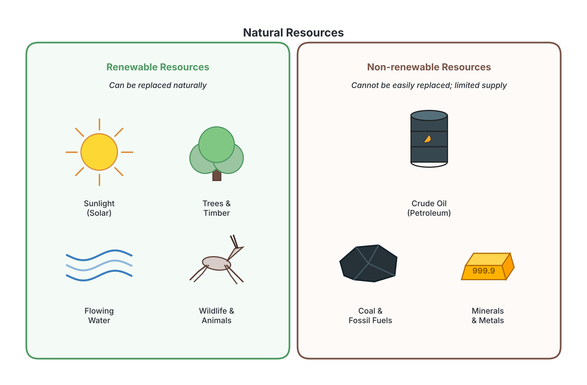
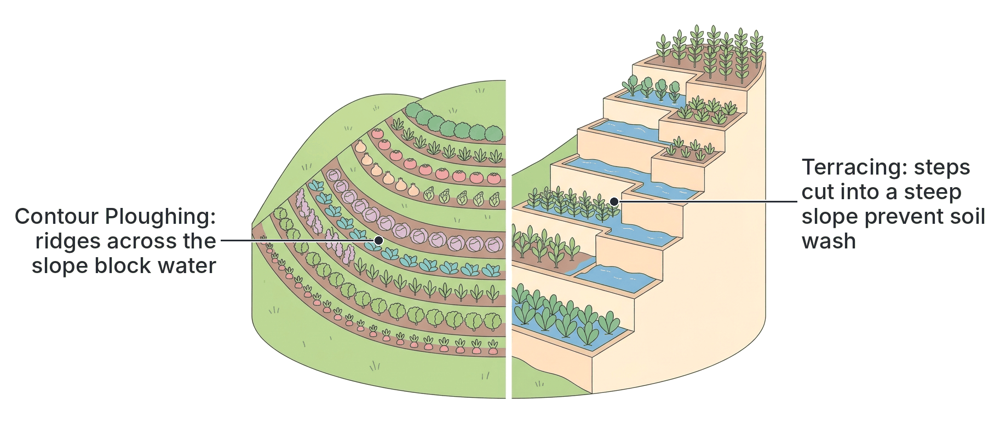

# JAMB Geography Notes: Environmental Conservation

## What JAMB expects

This topic is Section II, Topic L of the JAMB Geography syllabus: Environmental Conservation. It covers the following content items:

* i. Need for environmental conservation
* ii. Resources for conservation
* iii. Method of conservation
* iv. Problems and difficulties

By the end of these notes, you should be able to:

1. explain with examples environmental conservation;
2. identify the resources for conservation;
3. discuss the different methods of environmental conservation;
4. explain the need/importance of environmental conservation.

## Objective i: Explain with examples environmental conservation

**Environmental conservation** is the rational use, careful management, and protection of the natural environment and its resources. The goal is to prevent the destruction, degradation, and total depletion of these resources so that they can be used continuously by present and future generations.

In simple terms, conservation means using natural wealth wisely. It does not mean we stop using resources entirely. Instead, we use them in a **sustainable** way—taking what we need without destroying the source.

### Conservation vs. Preservation

Students often confuse conservation with preservation in exams. They are related but have different meanings:

| Feature | Environmental Conservation | Environmental Preservation |
| :--- | :--- | :--- |
| **Meaning** | The sustainable and wise use of natural resources. | Keeping natural resources completely untouched and protected from human use. |
| **Human Activity** | Allowed, but strictly regulated and managed. | Banned or highly restricted. |
| **Goal** | To use resources continuously without exhausting them. | To maintain the environment exactly as it is in its natural state. |
| **Example** | Allowing loggers to cut mature trees only if they plant new ones to replace them. | Fencing off a forest area so no one can cut any trees or hunt any animals at all. |

### Examples of environmental conservation in practice

1. **Forestry:** Instead of cutting down all trees in an area for timber (indiscriminate logging), a timber company only cuts mature trees and immediately plants new seedlings. This ensures the forest survives.
2. **Energy:** Using a solar cooker or cooking gas instead of cutting down local bushes for firewood to cook food. 
3. **Wildlife:** Banning the killing of endangered animals, like the Cross River gorilla, and setting up the Cross River National Park where they can live and breed safely.
4. **Water:** Fixing leaking pipes in homes and treating dirty factory water before it is released into the Niger River, so it does not kill the fish.

## Content ii: Resources for conservation

The environment provides a wide variety of materials and forces that humans use to survive and create wealth. These are called **environmental resources** (covered in detail in `B9-environmental-resources.md`). Because human populations are growing rapidly, these resources are under heavy pressure, making them the primary targets for conservation.

Resources can be broadly divided into two groups:

1. **Renewable resources:** These are resources that can naturally replace or regenerate themselves within a reasonable human timeframe if managed well (e.g., plants, animals, water, solar energy). However, if they are heavily abused, they can be destroyed (e.g., a forest can become a desert if completely cleared).
2. **Non-renewable resources:** These are resources that cannot replace themselves once they are used, or take millions of years to form (e.g., crude oil, coal, minerals). Once they are mined and used, they are gone forever. 

### Objective ii: Identify the resources for conservation

To effectively practice conservation, we must correctly identify the specific natural resources that need protecting. The major resources targeted for conservation include:

1. **Forest and Vegetation Resources:** These include all the plants, trees, and grasses in the environment. Forests provide timber, medicinal plants, and firewood, while grasses provide pasture for livestock. Forests are vital because they absorb carbon (IV) oxide, release oxygen, and protect the soil from erosion.
2. **Wildlife Resources:** This refers to all wild animals, birds, insects, and fishes living in their natural habitats. Wildlife is important for maintaining food chains, providing bushmeat, and supporting tourism.
3. **Water Resources:** These are bodies of water such as oceans, rivers, lakes, and underground water. In Nigeria, major water resources include the River Niger, River Benue, and Lake Chad. Water is conserved to ensure a steady supply for drinking, agriculture (irrigation), fishing, and hydroelectric power generation.
4. **Soil (Land) Resources:** Soil is the top layer of the earth's crust where plants grow. It is the foundation of agriculture. Soil must be conserved to prevent it from being washed away by erosion or losing its fertility.
5. **Mineral Resources:** These are valuable substances buried in the earth, such as crude oil (in the Niger Delta), tin and columbite (on the Jos Plateau), limestone, and coal (in Enugu). Because they are non-renewable, they must be mined efficiently and used without waste.
6. **Air (Atmosphere):** Clean air is vital for the survival of all living things. The atmosphere must be conserved by preventing air pollution from factories and vehicle exhausts, which can cause climate change and respiratory diseases.

## Content i: Need for environmental conservation

Human beings depend entirely on the environment for survival. However, human activities such as industrialization, farming, mining, and urbanization are rapidly destroying the environment. Without deliberate action, the resources we rely on will run out, and the environment will become uninhabitable. 

The necessity to protect the environment has become a global emergency. Governments and international bodies like the United Nations constantly campaign for environmental protection because failing to conserve our environment leads to severe environmental hazards (which are detailed in `B11-environmental-hazards.md`).

### Objective iv: Explain the need/importance of environmental conservation

There are several compelling reasons why environmental conservation is essential. You must be able to explain these points in an exam:

1. **To prevent resource depletion:** If we do not conserve resources like timber, fish, and minerals, they will dry up. Conservation ensures that these resources are available for the future generations (a concept known as **sustainable development**).
2. **To maintain ecological balance:** Plants, animals, and the physical environment interact in a delicate balance. Plants produce oxygen for animals, while animals produce carbon (IV) oxide for plants. Conserving the environment keeps food webs intact and maintains this natural balance.
3. **To preserve biodiversity:** "Biodiversity" means the variety of plant and animal life. Conservation prevents endangered species (like the African elephant or the pangolin) from going extinct, preserving the genetic variety of life on Earth.
4. **For economic survival and tourism:** Many African economies rely heavily on their natural environment. Conserved natural areas, like the **Yankari National Park** in Bauchi State, attract thousands of tourists, bringing in foreign exchange and creating jobs for the local population.
5. **To prevent environmental degradation and hazards:** Removing forests and exposing soil leads to severe problems. Conserving forests prevents **desertification** (a major problem in the Sahel region of northern Nigeria), stops soil erosion (common in south-eastern Nigeria), and reduces the risk of flooding.
6. **To protect human health:** Conserving water bodies from industrial pollution and the air from toxic smoke ensures that human beings do not suffer from waterborne diseases (like cholera) or respiratory diseases (like asthma).
7. **To regulate the climate:** Forests act as "carbon sinks" by absorbing carbon (IV) oxide, a greenhouse gas. Conserving forests helps to fight global warming and climate change, which cause irregular rainfall and extreme heat.

## Content iii: Method of conservation

Environmental conservation requires deliberate and organized methods. Because different resources have different characteristics, the methods used to protect a forest are completely different from the methods used to protect a mineral resource.

### Objective iii: Discuss the different methods of environmental conservation

Below are the specific methods used to conserve different types of environmental resources:

#### 1. Methods of Forest and Vegetation Conservation
*   **Afforestation:** This is the planting of trees in an area that previously had no trees, creating a new forest.
*   **Reforestation:** This is the replanting of trees in an area where the original forest has been cut down or destroyed.
*   **Establishment of Forest Reserves:** Governments set aside specific areas of land where tree cutting is strictly regulated. Examples include the **Omo Forest Reserve** in Ogun State and the **Sapoba Forest Reserve** in Edo State.
*   **The Taungya System:** This is an agricultural system where farmers are allowed to plant their food crops on a piece of cleared forest land while simultaneously planting tree seedlings. When the trees grow tall enough to shade the crops, the farmers move to a new plot. This helps reforest the area while providing farmers with land for food.
*   **Regulating Logging:** Passing laws that make it illegal to cut down trees without a license, and enforcing the rule that for every tree cut down, new ones must be planted.
*   **Public Education:** Educating the public on the dangers of bush burning, which destroys massive areas of vegetation during the dry season.

#### 2. Methods of Wildlife Conservation
*   **National Parks and Game Reserves:** Creating protected areas where wild animals can live and breed without human interference. Examples include the **Kainji Lake National Park** and the **Cross River National Park**.
*   **Banning Poaching:** Enacting strict laws to prevent the illegal hunting and killing of wild animals (poaching). 
*   **Regulating Hunting Seasons:** Allowing hunting only during specific seasons of the year, to ensure animals have a chance to reproduce.
*   **Captive Breeding:** Taking endangered animals into zoos or special facilities to breed them safely, and then releasing their young back into the wild.

#### 3. Methods of Soil Conservation
*   **Cover Cropping:** Planting fast-growing, creeping plants (like melon or cowpea) to cover the bare soil, protecting it from the direct impact of rain and wind.
*   **Crop Rotation:** Planting different types of crops on the same piece of land in different seasons (e.g., maize this year, beans next year). This stops specific nutrients from being completely drained from the soil.
*   **Contour Ploughing:** Ploughing across the slope of a hill rather than up and down it. The ridges act as barriers that slow down rainwater, preventing it from washing the soil away.
*   **Terracing:** Cutting wide, flat steps into the sides of steep hills to slow down water runoff and prevent erosion.
*   **Controlled Grazing:** Limiting the number of livestock (cattle, sheep, goats) feeding in an area to prevent them from eating all the grass and exposing the soil to erosion (overgrazing).

#### 4. Methods of Water Conservation
*   **Dam Construction:** Building concrete walls across rivers to trap and store water in a reservoir for the dry season. Examples include the **Kainji Dam** on the River Niger and the **Shiroro Dam**.
*   **Water Treatment:** Treating industrial wastewater and sewage with chemicals to remove toxic substances before dumping it into rivers or oceans.
*   **Rainwater Harvesting:** Collecting rainwater from roofs and storing it in large tanks for domestic and agricultural use, reducing the pressure on natural rivers and ground reservoirs.
*   **Watershed Management:** Protecting the highland areas where rivers start (sources) by planting trees and preventing human settlement, ensuring the rivers do not dry up.

#### 5. Methods of Mineral Conservation
*   **Recycling:** Collecting used mineral-based products (like scrap iron, aluminum cans, and copper wires) and melting them down to make new products, instead of mining fresh ore.
*   **Finding Alternatives:** Using alternative sources of energy, such as solar power, wind power, and hydroelectricity, to reduce the rapid consumption of non-renewable fossil fuels like coal and crude oil.
*   **Efficient Extraction Technology:** Using modern, advanced mining machines that ensure all the valuable minerals are extracted without wasting any left in the ground.

## Content iv: Problems and difficulties

Despite the importance of environmental conservation, developing nations, particularly in tropical Africa, face numerous challenges in attempting to protect their environments. 

### Major problems facing environmental conservation

1. **Poverty:** This is one of the biggest challenges in Nigeria and Africa. Many rural dwellers rely directly on the environment for their daily survival. For example, people cut down trees for firewood because they cannot afford cooking gas or electricity.
2. **Overpopulation:** As the human population grows rapidly, the demand for food, housing, and resources increases. This leads to the clearing of forests to build settlements and farms, putting massive pressure on natural resources.
3. **Ignorance and Lack of Education:** Many people do not understand the long-term effects of their actions. A farmer might practice bush burning or cut down trees without knowing that it causes soil erosion and desertification.
4. **Poor Enforcement of Laws:** Many African countries have excellent environmental laws on paper, but enforcement is weak. Corruption, lack of manpower, and poor policing allow illegal loggers and poachers to operate freely.
5. **Inadequate Funding and Capital:** Conservation programs, maintaining national parks, and developing alternative energy sources (like solar panels) are very expensive. Many developing countries lack the financial resources to fund these properly.
6. **Over-dependence on Primary Resources:** The economies of many developing nations rely almost entirely on extracting natural resources. Nigeria, for instance, relies heavily on crude oil exports. It is difficult to conserve a resource when the country's survival depends on selling it continuously.
7. **Natural Disasters:** Factors beyond human control, such as droughts, floods, and global climate change, can destroy forests, dry up water bodies, and ruin conservation efforts.

## Key terms

| Term | Meaning |
| :--- | :--- |
| **Conservation** | The careful, rational, and sustainable use of natural resources. |
| **Preservation** | Protecting resources by keeping them strictly untouched by humans. |
| **Renewable resource** | A resource that can naturally regenerate or replace itself (e.g., water, forest). |
| **Non-renewable resource** | A resource that cannot be replaced once used up (e.g., crude oil, minerals). |
| **Afforestation** | Planting trees to create a forest in an area where none existed before. |
| **Reforestation** | Replanting trees to replace those that have been cut down or destroyed. |
| **Taungya system** | A system where farmers plant food crops alongside tree seedlings until the tree canopy closes. |
| **Poaching** | The illegal hunting, capturing, or killing of wild animals. |
| **Biodiversity** | The variety of plant and animal life in a particular habitat or in the world. |
| **Terracing** | Cutting step-like flat areas into steep slopes to slow down water and conserve soil. |

## Exam tips and common mistakes

*   **Conservation vs. Preservation:** Exams frequently test this difference. Conservation allows *sustainable use*; preservation means *no use*.
*   **Afforestation vs. Reforestation:** Do not mix these up. Afforestation is creating a completely *new* forest; reforestation is *replacing* an old one.
*   **Categorizing Resources:** Soil and water are generally considered *renewable* resources, even though they can be degraded. Minerals (petroleum, coal, gold) are strictly *non-renewable*.
*   **The Taungya System:** Remember that it is both a method of agriculture and a method of **forest conservation**. It solves the problem of farmers fighting for forest land.
*   **Read the options carefully:** If a question asks for a method of *soil* conservation, do not choose "poaching laws" (which is for wildlife) or "recycling" (which is for minerals). 
*   **Identify the biggest problem:** In exams, if asked for the major hindrance to conservation in Africa, options like **poverty**, **ignorance**, or **overpopulation** are usually the correct answers.

## Quick summary

1. Environmental conservation is the careful and sustainable use of natural resources, ensuring they remain available for the future. 
2. Resources are divided into renewable (water, plants, animals) and non-renewable (crude oil, coal, minerals).
3. We need conservation to prevent resource exhaustion, preserve biodiversity, maintain the natural ecological balance, and protect human health and economies.
4. Forests are conserved through afforestation, reforestation, and the Taungya system.
5. Soil is conserved using crop rotation, cover cropping, terracing, and contour ploughing.
6. Wildlife is conserved by creating National Parks (e.g., Yankari) and enacting laws against poaching.
7. Mineral resources are conserved through recycling and finding alternative energy sources.
8. Major difficulties in environmental conservation include poverty, rapid population growth, ignorance, and weak enforcement of laws.

## Practice questions

**1. The primary aim of environmental conservation is to**
- A. stop human beings from using any natural resources
- B. ensure the sustainable use of resources for present and future generations
- C. export all natural resources to developed countries
- D. replace all non-renewable resources with artificial materials

**Answer: B.** Conservation focuses on using resources wisely and sustainably so they do not run out, ensuring they are available for both the present and the future. Option A describes strict preservation.

**2. Which of the following is an example of a non-renewable resource?**
- A. Solar energy
- B. Forest timber
- C. Crude oil
- D. River water

**Answer: C.** Crude oil is a mineral fuel that takes millions of years to form. Once it is extracted and burnt, it cannot be replaced.

**3. The agricultural practice where farmers cultivate crops on the same piece of land alongside newly planted tree seedlings is known as**
- A. crop rotation
- B. terracing
- C. contour ploughing
- D. the Taungya system

**Answer: D.** The Taungya system integrates agriculture with forestry. Farmers grow food alongside tree seedlings, aiding reforestation while securing food.

**4. A method of conserving mineral resources is by**
- A. afforestation
- B. recycling scrap metals
- C. contour ploughing
- D. banning poaching

**Answer: B.** Recycling involves melting down used minerals (like metal and aluminum) to create new products, reducing the need to mine fresh ore.

**5. Which of the following practices is specifically used to conserve soil on a steep slope?**
- A. Terracing
- B. Irrigation
- C. Afforestation
- D. Captive breeding

**Answer: A.** Terracing involves cutting step-like structures into a steep slope. This slows down the flow of rainwater and prevents the soil from being washed away.

**6. Planting trees in an area where a forest has never existed before is termed**
- A. deforestation
- B. reforestation
- C. afforestation
- D. selective logging

**Answer: C.** Afforestation is the creation of a new forest. Reforestation (Option B) is the replanting of an area that was previously forested.

**7. Which of the following is a major obstacle to environmental conservation in developing African countries?**
- A. Overabundance of wildlife
- B. Excessive foreign aid
- C. Poverty and ignorance
- D. Too many conservation laws

**Answer: C.** Poverty forces people to exploit resources unsustainably (like cutting trees for firewood), and ignorance prevents them from understanding the long-term damage of their actions.

**8. The establishment of the Yankari National Park is a method aimed primarily at the conservation of**
- A. mineral resources
- B. wildlife resources
- C. atmospheric resources
- D. oceanic resources

**Answer: B.** National Parks and Game Reserves are established primarily to protect wild animals (fauna) and their natural habitats from poachers and human destruction.

**9. The illegal hunting and killing of wild animals in a protected area is known as**
- A. logging
- B. grazing
- C. poaching
- D. harvesting

**Answer: C.** Poaching refers to the illegal hunting, killing, or capturing of wildlife. It is a major threat to biodiversity.

**10. Why is the conservation of forests crucial in combating global climate change?**
- A. Forests provide habitat for wild animals
- B. Forests absorb carbon (IV) oxide from the atmosphere
- C. Forests are sources of valuable timber
- D. Forests prevent soil erosion

**Answer: B.** While all options are benefits of forests, their specific role in fighting climate change is acting as "carbon sinks" by absorbing carbon (IV) oxide, which is a major greenhouse gas.

<!-- COVERAGE
obj i | Objective i: Explain with examples environmental conservation
obj ii | Objective ii: Identify the resources for conservation
obj iii | Objective iii: Discuss the different methods of environmental conservation
obj iv | Objective iv: Explain the need/importance of environmental conservation
item i | Content i: Need for environmental conservation
item ii | Content ii: Resources for conservation
item iii | Content iii: Method of conservation
item iv | Content iv: Problems and difficulties
-->
