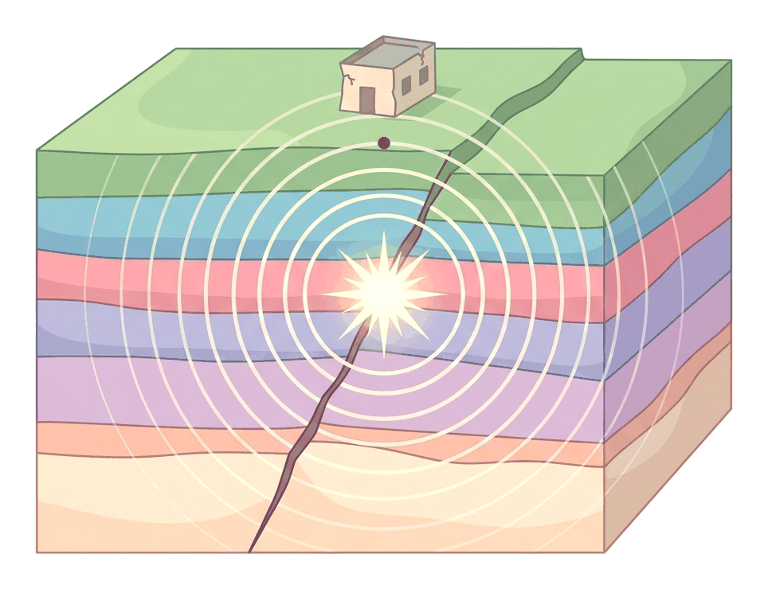
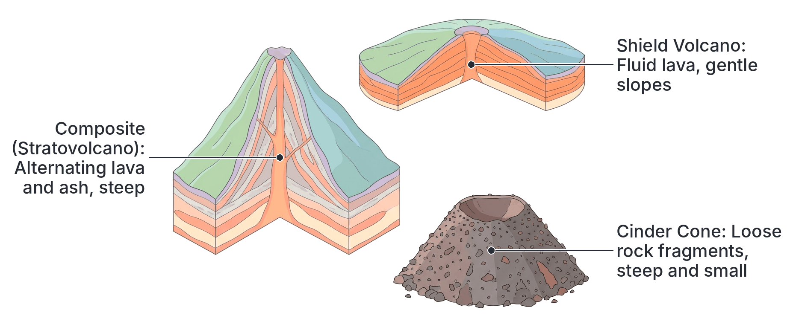
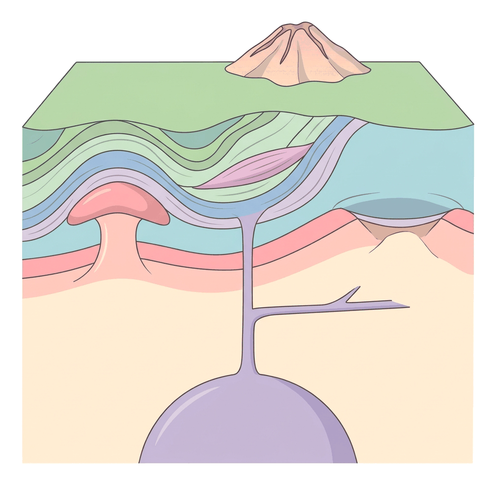

# JAMB Geography Notes: Volcanism and Earthquakes

## What JAMB expects

This topic is Part II (Physical Geography), Topic C of the JAMB Geography syllabus: Volcanism and Earthquakes.

It covers the following content items:
* i. Landforms associated with volcanic activities
* ii. Landforms of Igneous Rocks
* iii. Origin and types of Volcanoes
* iv. Some volcanic eruptions and earthquakes.

By the end of these notes, you should be able to:
1. explain the processes of volcanic eruptions and earthquakes;
2. describe the different landforms associated with both volcanic eruptions and earthquakes;
3. give examples of major volcanic eruptions and earthquakes in the world.

**Note:** Earthquakes and volcanic eruptions also appear later in the syllabus under "Environmental Hazards" (Topic B11). In this section, we focus purely on their physical origins, the processes involved, and the physical landforms they create on the earth's surface.

---

## Processes of volcanic eruptions and earthquakes

**Objective i: explain the processes of volcanic eruptions and earthquakes.**

Volcanism and earthquakes are both sudden, powerful natural events caused by forces deep within the earth (endogenetic forces). They are closely related to the movement of the earth's tectonic plates.

### The process of a volcanic eruption

A **volcanic eruption** occurs when hot, molten rock (magma), gases, and ash are forced out from the earth's interior onto the surface. 

**Step-by-step process of an eruption:**
1. **Magma formation:** Deep in the earth's mantle (the asthenosphere), extreme heat (often above 1,000 °C) melts rock to form a thick, glowing liquid called **magma**.
2. **Pressure build-up:** Gases (like water vapour and carbon (IV) oxide) dissolve in the magma. As more magma melts, it expands, and extreme pressure builds up underground in a **magma chamber**.
3. **Upward movement:** Magma is lighter than the solid rock around it, so it naturally rises. It forces its way up through cracks, faults, or lines of weakness in the earth's crust. The main pipe it travels through is called the **vent**.
4. **The Eruption:** When the magma reaches the surface, the pressure is suddenly released. The magma explodes or flows out onto the surface. Once magma reaches the surface, it is called **lava**. 
5. **Cooling and solidifying:** The lava, ash, and rocks cool down in the open air, eventually solidifying to form various igneous rocks and volcanic landforms, such as a cone-shaped mountain.

### The process of an earthquake

An **earthquake** is a sudden, violent shaking of the ground, caused by a rapid release of energy in the earth's crust. 

**Step-by-step process of an earthquake:**
1. **Tectonic stress:** The earth's crust is broken into massive blocks called tectonic plates. These plates constantly move. As they push together, pull apart, or slide past each other, their rough edges get stuck due to friction.
2. **Energy accumulation:** Even though the edges are stuck, the plates keep trying to move. This builds up massive elastic strain (stress) in the rocks over many years.
3. **Sudden rupture (faulting):** When the stress becomes too great for the rocks to bear, the rock suddenly snaps or slips along a crack called a **fault line**. 
4. **Energy release:** The stored energy is released instantly as shockwaves, known as **seismic waves**. The exact point underground where the rock snaps is called the **focus** (or hypocenter). The point on the earth's surface directly above the focus is the **epicenter**.
5. **The Shaking:** The seismic waves radiate outward from the focus in all directions, causing the violent shaking of the ground that we feel as an earthquake.

#### Seismic waves
There are three main types of seismic waves generated during the process:
* **Primary (P) waves:** The fastest waves. They travel through both solids and liquids and push/pull the rock like a sound wave.
* **Secondary (S) waves:** Slower than P-waves. They travel only through solid rock and move side-to-side.
* **Surface (L) waves:** The slowest waves, but they cause the most damage because they travel along the surface of the earth, rolling the ground like ocean waves.

---

## Origin and types of Volcanoes

**Content iii: Origin and types of Volcanoes.**

### Origin of Volcanoes
Volcanoes do not happen everywhere. They originate mainly in three specific tectonic zones:
1. **Convergent plate boundaries (Subduction zones):** Where two tectonic plates collide, one is pushed deep into the hot mantle. It melts, creating magma that rises to form volcanoes. The "Pacific Ring of Fire" is a giant circle of subduction zones around the Pacific Ocean where most of the world's volcanoes are found.
2. **Divergent plate boundaries:** Where plates pull apart (like the Mid-Atlantic Ridge), magma from the mantle easily rises to fill the gap, creating underwater volcanoes or volcanic islands.
3. **Hotspots:** These are exceptionally hot areas deep in the mantle that are far from plate boundaries. As a tectonic plate moves slowly over a stationary hotspot, the heat melts the crust, creating a chain of volcanoes. The Hawaiian Islands originated this way.

### Types of Volcanoes based on their shape (structure)

The shape of a volcano depends heavily on the type of lava it erupts. 

| Feature | Composite Volcano (Stratovolcano) | Shield Volcano | Cinder Cone |
| :--- | :--- | :--- | :--- |
| **Shape** | Tall, steep-sided, cone-shaped mountain. | Very broad, wide, gently sloping, like a warrior's shield on the ground. | Small, steep, and bowl-shaped crater at the top. |
| **Lava type** | **Acidic lava** (viscous/thick). It does not flow far before solidifying. | **Basic lava** (fluid/runny). It flows great distances before cooling. | Mostly erupts ash, cinders (small rocks), and pyroclastic material. |
| **Composition** | Made of **alternating layers** of ash and lava from many eruptions. | Made of layers of solid lava flows. | Made of loose volcanic fragments (cinders) piled up. |
| **Eruption style** | Highly explosive and dangerous. | Quiet, gentle, and continuous. | Short, localized explosive bursts. |
| **Examples** | Mt. Vesuvius (Italy), Mt. Cameroon (Cameroon), Mt. Kilimanjaro (Tanzania). | Mauna Loa (Hawaii), Mount Nyamuragira (DR Congo). | Parícutin (Mexico). |

### Types of Volcanoes based on their activity

We also classify volcanoes by how frequently they erupt.

1. **Active Volcanoes:** These are volcanoes that have erupted recently and are expected to erupt again. E.g., **Mount Cameroon** in West Africa (erupted in 1999 and 2000), Mount Nyiragongo (DR Congo).
2. **Dormant Volcanoes:** Also known as "sleeping" volcanoes. These have not erupted for a very long time (hundreds of years) but still have signs of activity underneath and could erupt in the future. E.g., Mount Kilimanjaro (Tanzania).
3. **Extinct Volcanoes:** These are "dead" volcanoes. They have not erupted in recorded human history, and there is no magma supply left beneath them. They are heavily eroded by weather. E.g., Mount Kenya, the Jos Plateau volcanic cones in Nigeria.

---

## Landforms associated with both volcanic eruptions and earthquakes

**Objective ii: describe the different landforms associated with both volcanic eruptions and earthquakes.**

When we talk about landforms created by earth movements, we divide them into those caused by volcanic activity (which includes intrusive and extrusive igneous landforms) and those caused by the faulting of earthquakes.

### Landforms associated with volcanic activities

**Content i: Landforms associated with volcanic activities.**

These are features formed on the **surface of the earth** when lava and volcanic materials are expelled. They are also known as **extrusive landforms**.

1. **Volcanic Mountains (Cones):** 
   As lava and ash erupt from a vent, they pile up around it, gradually building a mountain. These can be tall composite cones (like Mt. Kilimanjaro) or broad shield cones.
2. **Craters:** 
   A crater is the funnel-shaped hollow or depression at the very top of a volcanic cone, formed by the explosive removal of rock during an eruption. If a crater fills with rainwater, it becomes a **crater lake**.
3. **Calderas:** 
   A caldera is an unusually large, massive crater. It forms when a volcanic eruption is so violent that the entire top of the mountain blows off, or when the magma chamber empties and the top of the volcano collapses inward. E.g., the Ngorongoro Caldera in Tanzania.
4. **Lava Plateaus (Lava Plains):** 
   Sometimes fluid, basic lava erupts not from a single pipe, but from a long crack (fissure) in the earth. The runny lava spreads out over a huge area, filling in valleys and covering hills to form a high, flat lava plateau. E.g., the **Biu Plateau** in Borno State, Nigeria, and the Deccan Plateau in India.
5. **Geysers and Hot Springs:** 
   In areas with volcanic activity, groundwater is heated by underground magma. If the hot water reaches the surface gently, it forms a **hot spring** (e.g., Ikogosi Warm Springs in Ekiti State, Nigeria—though primarily a geothermal feature). If the hot water builds up pressure and violently shoots into the air at intervals, it is a **geyser** (e.g., Old Faithful in the USA).

### Landforms of Igneous Rocks

**Content ii: Landforms of Igneous Rocks.**

Igneous rocks are formed from the cooling and solidification of magma or lava. When magma fails to reach the surface, it gets trapped inside the earth's crust, slowly cooling into solid rock over thousands of years. These create **intrusive igneous landforms** (or plutonic landforms). 

Because they form deep underground, we only see these landforms after millions of years, when denudation (weathering and erosion) washes away the softer rocks above them.

| Intrusive Landform | Description and Shape |
| :--- | :--- |
| **Batholith** | A massive, deep-seated dome of igneous rock. It forms the core of many mountain ranges. When exposed by erosion, it creates huge, rounded hills. Many granitic rocks of the **Jos Plateau** in Nigeria are parts of batholiths. |
| **Laccolith** | A mushroom-shaped or dome-shaped mass of magma. It pushes the overlying sedimentary rock layers upward into a dome before solidifying. |
| **Lopolith** | A large, **saucer-shaped** or shallow basin-like mass of igneous rock. It forms when heavy magma sags downwards. |
| **Phacolith** | A lens-shaped mass of igneous rock that forms at the crest (top) of an anticline or the trough (bottom) of a syncline in folded rocks. |
| **Sill** | A flat, **horizontal** sheet of igneous rock formed when magma squeezes horizontally between layers of older sedimentary rocks. |
| **Dyke (or Dike)** | A vertical or steeply inclined wall of igneous rock formed when magma cuts vertically across older rock layers. When the surrounding rock erodes, the harder dyke often stands up like a ruined brick wall. |

### Earthquake landforms

Earthquakes do not build mountains out of lava, but the severe faulting (cracking) of the crust that causes earthquakes can dramatically change the landscape, creating specific structural landforms.

1. **Fault Scarps (Escarpments):** 
   When an earthquake causes a block of land to suddenly drop or rise vertically along a fault line, it creates a steep cliff face called a fault scarp.
2. **Rift Valleys (Graben):** 
   When two parallel fault lines occur in the crust, the block of land in the middle can sink downwards during tectonic movements, forming a deep, steep-sided valley. E.g., The **Great East African Rift Valley**. Earthquakes are highly frequent along this valley today.
3. **Block Mountains (Horsts):** 
   If the land on the outside of two fault lines sinks, or the middle block is pushed up, a flat-topped mountain with steep sides is left standing. E.g., The Vosges and the Black Forest mountains in Europe.

---

## Examples of major volcanic eruptions and earthquakes in the world

**Objective iii: give examples of major volcanic eruptions and earthquakes in the world.**

**Content iv: Some volcanic eruptions and earthquakes.**

Both volcanic eruptions and earthquakes have caused immense changes to the environment and human history. JAMB expects you to recognize prominent global and African examples.

### Some volcanic eruptions

1. **Mount Vesuvius, Italy (79 AD):** One of the most famous composite volcano eruptions in history. It erupted violently, burying the Roman cities of Pompeii and Herculaneum in deep layers of hot ash, preserving the cities and their people perfectly.
2. **Krakatoa, Indonesia (1883):** The eruption of this volcanic island was so explosive that it blew the island apart (creating a huge caldera). The sound was heard over 4,800 km away, and the resulting tsunami killed over 36,000 people. Ash in the atmosphere lowered global temperatures.
3. **Mount St. Helens, USA (1980):** A massive eruption in Washington state that triggered a massive landslide, removing the entire north face of the mountain.
4. **Mount Cameroon, Cameroon:** The most active volcano in West Africa. It is a composite volcano that erupted significantly in **1999 and 2000**, with lava flows cutting across major highways in the region.
5. **Mount Nyiragongo, DR Congo (2002, 2021):** An active stratovolcano known for having one of the world's most fluid lava lakes. In 2002, rapid lava flows destroyed a large part of the city of Goma.

### Some major earthquakes

Earthquakes are measured by instruments called **seismographs**. Their intensity (damage caused) is measured on the **Mercalli scale**, while their energy or magnitude is measured on the **Richter scale**. A magnitude above 7.0 is highly destructive.

1. **San Francisco, USA (1906):** A massive earthquake along the San Andreas Fault measuring 7.9 on the Richter scale. The shaking and resulting fires destroyed over 80% of the city.
2. **The Indian Ocean Earthquake (2004):** A massive underwater earthquake (magnitude 9.1–9.3) off the coast of Sumatra, Indonesia. The faulting displaced the ocean floor, creating a deadly **tsunami** (giant sea wave) that killed over 227,000 people across 14 countries.
3. **Haiti (2010):** A devastating 7.0 magnitude earthquake struck near the capital, Port-au-Prince. Due to poor building structures, over 200,000 people lost their lives, making it one of the deadliest earthquakes in modern history.
4. **Tohoku, Japan (2011):** A magnitude 9.0 earthquake off the coast of Japan triggered a massive tsunami. It moved Japan's main island eastward by 2.4 meters and caused a severe nuclear disaster at the Fukushima power plant.
5. **Turkey-Syria (2023):** A recent massive double earthquake (magnitudes 7.8 and 7.5) along a major fault line caused widespread destruction, highlighting how stress builds up along tectonic plate boundaries.

---

## Key terms

| Term | Meaning |
| :--- | :--- |
| **Magma** | Molten, liquid rock deep *inside* the earth's crust. |
| **Lava** | Magma that has reached the *surface* of the earth. |
| **Active Volcano** | A volcano that has erupted recently and may erupt again. |
| **Extinct Volcano** | A dead volcano with no magma left; it will never erupt again. |
| **Focus (Hypocenter)** | The exact point underground where an earthquake originates. |
| **Epicenter** | The point on the earth's surface directly above the focus of an earthquake. |
| **Seismic Waves** | Shockwaves of energy released by an earthquake (P, S, and L waves). |
| **Batholith** | A huge, dome-shaped intrusive igneous landform formed deep underground. |
| **Sill** | A horizontal sheet of intrusive igneous rock. |
| **Dyke** | A vertical wall of intrusive igneous rock cutting across other layers. |
| **Caldera** | An oversized volcanic crater formed by collapse or a massive explosion. |

---

## Exam tips and common mistakes

* **Mixing up Focus and Epicenter:** The **focus** is deep underground where the rocks snap. The **epicenter** is on the surface where the shaking is first felt. Do not interchange them!
* **Magma vs. Lava:** Magma is below ground; lava is above ground.
* **Intrusive vs. Extrusive:** Intrusive landforms (batholith, sill, dyke) are formed *inside* the earth. Extrusive landforms (lava plateau, caldera, cinder cone) are formed *outside* (on the surface). 
* **Knowing shapes:** Memorize the shapes of intrusive landforms. JAMB often tests these: Lopolith = saucer; Laccolith = dome/mushroom; Phacolith = lens; Sill = horizontal; Dyke = vertical.
* **Caldera formation:** A caldera is not just a crater; it is a massive depression formed when a volcano collapses into its empty magma chamber or blows its top off.
* **Types of Volcanoes:** Remember that Shield volcanoes have fluid basic lava and gentle slopes. Composite volcanoes have thick acidic lava, explosive eruptions, and steep slopes.

---

## Quick summary

1. Volcanic eruptions occur when underground magma builds pressure and forces its way to the surface through vents, becoming lava.
2. Earthquakes are caused by tectonic plates getting stuck, building stress, and suddenly slipping along a fault line, releasing seismic waves.
3. Volcanoes are classified by activity (active, dormant, extinct) and by shape (composite/stratovolcano, shield, cinder cone).
4. Extrusive volcanic landforms include volcanic cones, craters, calderas, lava plateaus (e.g., Biu Plateau), geysers, and hot springs.
5. Intrusive igneous landforms form when magma cools underground, producing batholiths (huge domes), laccoliths (mushroom shapes), lopoliths (saucer shapes), sills (horizontal), and dykes (vertical).
6. Earthquakes create landforms primarily through faulting, resulting in fault scarps, block mountains (horsts), and rift valleys.
7. Major global volcanic eruptions include Vesuvius, Krakatoa, and West Africa's Mount Cameroon. Devastating earthquakes include San Francisco, Haiti, and the Indian Ocean tsunami-causing earthquake.

---

## Practice questions

**1. The point on the earth's surface located directly above the origin of an earthquake is called the:**
- A. focus
- B. fault line
- C. epicenter
- D. caldera

**Answer: C.** The epicenter is the point on the surface directly above the underground origin (focus). A common mistake is choosing "focus", which is the underground starting point.

**2. Which of the following is an intrusive igneous landform?**
- A. Lava plateau
- B. Crater
- C. Dyke
- D. Cinder cone

**Answer: C.** A dyke is a vertical wall of magma that cools inside the earth's crust (intrusive). The others are extrusive landforms that form on the earth's surface.

**3. A volcano that is composed of alternating layers of hardened lava and volcanic ash is a:**
- A. shield volcano
- B. composite volcano
- C. cinder cone
- D. caldera

**Answer: B.** Composite volcanoes (stratovolcanoes) are built by alternating explosive ash eruptions and thick lava flows, creating alternating layers.

**4. A large, saucer-shaped mass of igneous rock formed deep in the earth's crust is called a:**
- A. lopolith
- B. batholith
- C. laccolith
- D. phacolith

**Answer: A.** A lopolith is saucer-shaped (sags downward). A laccolith is dome or mushroom-shaped (pushes upward).

**5. Which of the following volcanic features is well represented by the Biu Plateau in Nigeria?**
- A. A crater lake
- B. A caldera
- C. An intrusive batholith
- D. A lava plateau

**Answer: D.** The Biu Plateau in Borno State is an excellent Nigerian example of a lava plateau, formed by fluid lava erupting from fissures and spreading over a wide area.

**6. Which instrument is used to record the vibrations of an earthquake?**
- A. Barometer
- B. Seismograph
- C. Hygrometer
- D. Anemometer

**Answer: B.** A seismograph records the seismic waves of an earthquake. A common mistake is to confuse it with the Richter scale, which is the unit of measurement for magnitude, not the instrument itself.

**7. Mount Cameroon is an example of an:**
- A. extinct volcano
- B. active volcano
- C. dormant volcano
- D. intrusive landform

**Answer: B.** Mount Cameroon is an active composite volcano in West Africa, having erupted recently (1999 and 2000). 

**8. An earthquake is most likely to result in the formation of:**
- A. a batholith
- B. a rift valley
- C. a composite cone
- D. a lopolith

**Answer: B.** Earthquakes involve tectonic faulting (cracking) of the crust, which can drop blocks of land to form rift valleys (like the East African Rift Valley). The other options are igneous/volcanic landforms.

**9. The main difference between magma and lava is:**
- A. magma is cold, lava is hot
- B. magma is found underground, lava is found on the surface
- C. magma is solid rock, lava is liquid gas
- D. magma only forms in shield volcanoes, lava in composite volcanoes

**Answer: B.** They are the exact same molten rock material; it is called magma when it is trapped underground and lava once it reaches the surface. 

**10. A massive volcanic depression formed when a volcano collapses into its empty magma chamber is known as a:**
- A. vent
- B. crater
- C. caldera
- D. geyser

**Answer: C.** A caldera is a massive depression formed by the collapse or blowing off of a volcano's top. A crater is just the normal vent opening, which is much smaller than a caldera.

<!-- COVERAGE
obj i | Processes of volcanic eruptions and earthquakes
obj ii | Landforms associated with both volcanic eruptions and earthquakes
obj iii | Examples of major volcanic eruptions and earthquakes in the world
item i | Landforms associated with volcanic activities
item ii | Landforms of Igneous Rocks
item iii | Origin and types of Volcanoes
item iv | Some volcanic eruptions and earthquakes
-->
