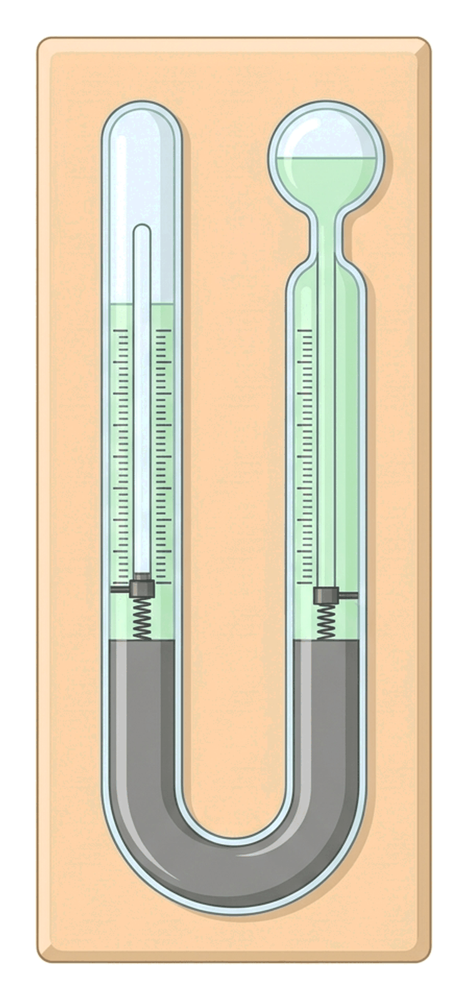
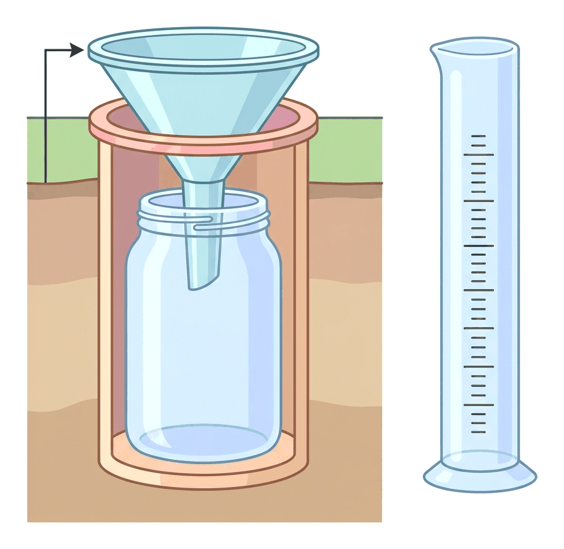
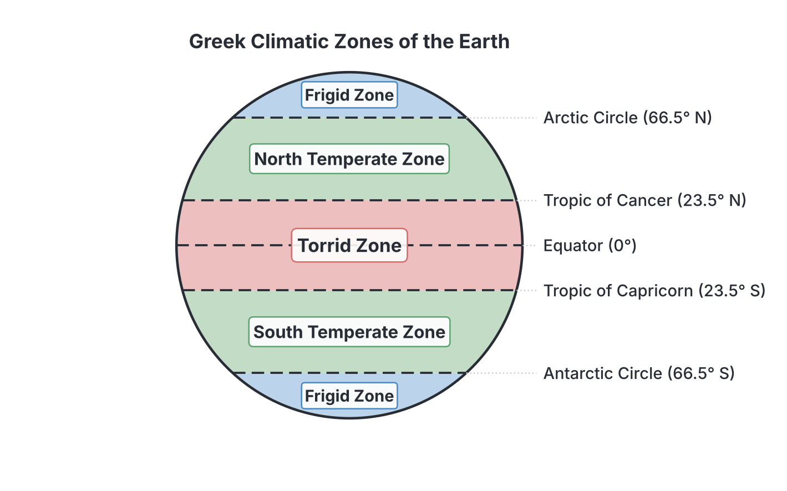

# JAMB Geography Notes: Weather and Climate

## What JAMB expects

This topic is Part II (Physical Geography), Topic F of the JAMB Geography syllabus: Weather and Climate. It covers the fundamental concepts of the atmosphere, how we measure its changes, and the long-term patterns that define the climate of different regions. 

It covers the following content items:
* i. Concept of weather and climate
* ii. Elements of weather and climate
* iii. Factors controlling weather and climate (pressure, air mass, altitude, continentality and winds)
* iv. Classification of climate (Greek and Koppen).
* v. Major climate types (Koppen), their characteristics and distribution.
* vi. Measuring and recording weather parameters and instruments used.
* vii. The basic science of climate change.

By the end of these notes, you should be able to:
* i. differentiate between weather and climate;
* ii. identify the elements of weather and climate;
* iii. identify the factors controlling weather and climate;
* iv. compare Koppen’s and Greek’s classifications;
* v. identify the major types of climate according to Koppen;
* vii. relate the weather instruments to their uses;
* viii. define climate change;
* ix. understand the causes of climate change;
* x. understand the effects and remedies of climate change.

> **Note on the syllabus wording:** You might notice that the syllabus objectives jump from "v" to "vii", skipping "vi". However, objective "vii" (relating instruments to their uses) perfectly matches content item "vi" (measuring and recording weather parameters), so they are taught together in these notes. Also, the syllabus mentions "Greek's classification." This does not refer to a modern scientist named Greek, but rather to the ancient Greek system of dividing the world into temperature zones (Torrid, Temperate, and Frigid zones). Textbooks vary slightly on whether they credit ancient philosophers like Parmenides, Aristotle, or Ptolemy for this, but the zones themselves are universally accepted in school geography.

## Concept of weather and climate

**Content i: Concept of weather and climate**
**Objective i: differentiate between weather and climate**

The atmosphere is a dynamic envelope of gases surrounding the earth. Its condition is constantly changing. We describe these conditions using two related but distinct concepts: weather and climate.

**Weather** is the state of the atmosphere at a **specific place** over a **short period of time** (such as hours, days, or a week). For example, it might be raining heavily in Lagos on a Tuesday morning, but sunny by the afternoon. Weather changes quickly and frequently.

**Climate**, on the other hand, is the **average weather conditions** of a place, observed and recorded over a **long period of time**, typically **30 to 35 years**. For example, we say the climate of the Niger Delta is "hot and wet all year round" because decades of records show this consistent pattern, even if there happens to be a dry, cool day occasionally.

### Differences between weather and climate

| Feature | Weather | Climate |
| :--- | :--- | :--- |
| **Time scale** | Short period (hours, days, or weeks) | Long period (usually 30 to 35 years) |
| **Area covered** | Small, specific area (e.g., a city or town) | Large region (e.g., a country or continent) |
| **Variability** | Changes constantly from hour to hour or day to day | Relatively stable and permanent over centuries |
| **Observation** | What is happening right now in the atmosphere | The average summary of past atmospheric conditions |
| **Scientific study** | **Meteorology** (studied by meteorologists) | **Climatology** (studied by climatologists) |
| **Example** | "It is very windy and cloudy in Kano today." | "The Sahel region has a semi-arid climate with short rainy seasons." |

*Note: While they differ in time and scale, weather and climate are described using the exact same elements (temperature, rainfall, etc.) and measured using the same instruments.*

## Elements of weather and climate

**Content ii: Elements of weather and climate**
**Objective ii: identify the elements of weather and climate**

The conditions of the atmosphere are made up of several measurable parts. These are called the **elements of weather and climate**. If you want to describe the weather of a place, you must measure these elements:

1. **Temperature:** The degree of hotness or coldness of the atmosphere.
2. **Precipitation (Rainfall):** Any form of moisture falling from the atmosphere to the earth's surface. In Nigeria, this is almost entirely rainfall, but globally it includes snow, hail, and sleet.
3. **Atmospheric Pressure:** The weight of the air pressing down on the earth's surface.
4. **Wind:** Air in motion. It has two parts that must be measured: **wind direction** (where it is blowing from) and **wind speed** (how fast it is blowing).
5. **Humidity:** The amount of water vapour (invisible moisture) in the air.
6. **Sunshine:** The duration and intensity of direct sunlight reaching the earth.
7. **Cloud Cover:** The amount of the sky covered by clouds.

## Measuring and recording weather parameters and instruments used

**Content vi: Measuring and recording weather parameters and instruments used**
**Objective vii: relate the weather instruments to their uses**

Meteorologists measure weather elements at a **weather station**. It is crucial to measure these accurately using specific instruments.

### 1. Temperature: Thermometers and the Stevenson Screen

Temperature is measured in **degrees Celsius (°C)** or **degrees Fahrenheit (°F)** using a **thermometer**. For daily weather records, a **Six's Maximum and Minimum Thermometer** is used because it records the highest and lowest temperatures reached during a 24-hour period.

**How Six's Thermometer works:**
1. It is a U-shaped glass tube containing both mercury and alcohol. It has two arms: one for the maximum temperature and one for the minimum.
2. Inside each arm is a small metal index (a tiny metal marker).
3. As the day gets hotter, the alcohol expands and pushes the mercury, which in turn pushes the metal index up the "Maximum" arm.
4. When the temperature drops at night, the alcohol contracts. The mercury is pulled back, pushing the metal index up the "Minimum" arm.
5. The temperatures are read daily from the bottom of each metal index. After reading, a magnet is used to drag the metal indices back down to rest on the mercury columns, resetting the instrument for the next day.

**The Stevenson Screen:**
To get the true temperature of the air, thermometers must be protected from direct sunlight, rain, and strong winds. Therefore, they are kept inside a special wooden box called a **Stevenson Screen**.
* It is raised about **1.2 metres (4 feet)** above the ground on legs to avoid heat radiating from the soil.
* It is painted **white** to reflect the sun's heat.
* It has **louvred sides** (slats like window blinds) to allow air to circulate freely while keeping direct sunlight out.
* The roof is double-layered to insulate the inside.

**Important temperature calculations:**
* **Mean Daily Temperature:** $\frac{\text{Maximum Temperature} + \text{Minimum Temperature}}{2}$
* **Daily Temperature Range:** $\text{Maximum Temperature} - \text{Minimum Temperature}$
* **Mean Monthly Temperature:** The sum of the mean daily temperatures for the month divided by the number of days in the month.
* **Mean Annual Temperature Range:** The mean temperature of the hottest month minus the mean temperature of the coldest month.

**Worked Example:**
If the maximum temperature in Abuja on a particular day is 34 °C and the minimum temperature is 22 °C, calculate the mean daily temperature and the daily range.
* **Step 1:** State the formula for Mean Daily Temperature: $\frac{\text{Max} + \text{Min}}{2}$
* **Step 2:** Substitute the values: $\frac{34 + 22}{2} = \frac{56}{2} = 28\text{ °C}$. The mean daily temperature is 28 °C.
* **Step 3:** State the formula for Daily Range: $\text{Max} - \text{Min}$
* **Step 4:** Substitute the values: $34 - 22 = 12\text{ °C}$. The daily temperature range is 12 °C.

### 2. Rainfall: The Rain Gauge

Rainfall is measured using a **Rain Gauge**, in units of **millimetres (mm)** or inches.

**How it works and is sited:**
1. A rain gauge consists of a copper or plastic cylinder containing a glass collection jar and a funnel.
2. It must be sited in an **open space**, away from trees and buildings, so that leaves do not block the rain or drip extra water into it.
3. It is partially buried in the ground so that the rim of the funnel is exactly **30 cm above the ground**. This height is chosen to prevent rainwater from splashing off the ground into the funnel.
4. Rain falls into the funnel and trickles into the glass jar.
5. Every 24 hours (usually at 09:00 GMT), the observer takes out the jar and pours the collected water into a specially graduated measuring cylinder.
6. The reading is taken at eye level. The water is then emptied, and the gauge is put back.

### 3. Humidity: The Hygrometer

Humidity is measured using a **Hygrometer** (specifically a **Wet and Dry Bulb Thermometer**). It measures **Relative Humidity**, which is expressed as a percentage (%).

**How it works:**
1. It consists of two ordinary thermometers kept side by side in the Stevenson Screen.
2. The **Dry Bulb** measures the normal air temperature.
3. The **Wet Bulb** has its bulb wrapped in a piece of muslin cloth, which dips into a small cup of distilled water, keeping the bulb constantly wet.
4. As water evaporates from the wet cloth, it cools the wet bulb. (Evaporation causes cooling).
5. If the air is very dry, lots of water evaporates, the wet bulb cools significantly, and there is a **large difference** between the dry and wet bulb readings.
6. If the air is very humid (close to rain), little water evaporates, and the **difference is very small**.
7. The observer reads both temperatures, finds the difference, and uses a special chart (humidity table) to find the Relative Humidity percentage.

### 4. Atmospheric Pressure: The Barometer

Pressure is measured using a **Barometer**, with units in **millibars (mb)**, **hectopascals (hPa)**, or millimetres of mercury (mmHg). The two main types are the **Mercury Barometer** and the **Aneroid Barometer**.

**How they work:**
* **Mercury Barometer:** A glass tube filled with mercury is inverted into a cup of mercury. The pressure of the air pushing down on the cup forces the mercury up the tube. Normal sea-level pressure holds the mercury at about 760 mm (1013 mb).
* **Aneroid Barometer:** This contains no liquid ("aneroid" means without fluid). It uses a small, flexible, vacuum-sealed metal box (capsule). As air pressure increases, the box is squeezed inward; as pressure decreases, it expands. These tiny movements are transferred by levers to a pointer on a dial.

### 5. Wind Direction: The Wind Vane

Wind direction is indicated by a **Wind Vane** and is recorded using the cardinal points (North, South, East, West).

**How it works:**
1. It is a rotating metal arrow mounted on a tall pole in an open area.
2. Below the arrow are fixed arms pointing to N, S, E, and W to serve as a compass reference.
3. The tail of the arrow is wider than the tip. When the wind blows, it catches the wide tail and swings it away, forcing the tip of the arrow to point **into the wind**.
4. The wind vane always points to the direction the wind is blowing **from**. For example, if the arrow points South, it is a South wind.

### 6. Wind Speed: The Anemometer

Wind speed is measured using an **Anemometer**, typically a **Cup Anemometer**. The unit is **knots**, **km/h**, or m/s.

**How it works:**
1. It consists of three or four hollow metal cups attached to horizontal arms mounted on a vertical shaft.
2. The wind catches the open side of the cups, causing the shaft to spin.
3. The stronger the wind, the faster the cups spin.
4. A meter at the base counts the rotations and translates this into the wind speed, much like a speedometer in a car.

### 7. Sunshine: The Campbell-Stokes Recorder

Sunshine duration is measured using a **Campbell-Stokes Sunshine Recorder** in hours and minutes.

**How it works:**
1. It uses a solid glass sphere that acts like a magnifying glass.
2. A piece of special chemically treated card is placed on a curved metal frame behind the sphere.
3. When the sun shines, the glass sphere focuses the sun's rays into an intense pinpoint of heat that burns a trace (a scorched line) into the card.
4. As the sun moves across the sky, the burn mark moves along the card.
5. If a cloud covers the sun, the burning stops. At the end of the day, the observer takes out the card and measures the total length of the burn marks to find the exact hours of bright sunshine.

### 8. Cloud Cover: Observation

Cloud cover is estimated by the human eye rather than a mechanical instrument (though a mirror device called a **nephoscope** can be used to track cloud movement). It is measured in **oktas** (eighths of the sky). If half the sky is covered in clouds, the cloud cover is recorded as 4 oktas. 

## Factors controlling weather and climate

**Content iii: Factors controlling weather and climate**
**Objective iii: identify the factors controlling weather and climate**

Why does Kano have a different climate from Lagos? Why is the Jos Plateau cooler than the surrounding states? Weather and climate vary from place to place due to several controlling factors. The syllabus specifically requires you to know: **pressure, air mass, altitude, continentality and winds**.

### 1. Atmospheric pressure

Atmospheric pressure variations are the primary cause of wind. Air always moves from areas of **High Pressure** to areas of **Low Pressure**. 
* The earth has permanent pressure belts (e.g., the Equatorial Low-Pressure Belt, the Sub-Tropical High-Pressure Belts).
* The movement of air between these belts creates the global wind systems that bring distinct weather patterns to different latitudes. For example, the Equatorial Low-pressure belt (the Doldrums) draws in moist air, leading to rising air, condensation, and heavy equatorial rainfall.

### 2. Air mass

An air mass is a large body of air that has a uniform temperature and humidity, taken from the region where it formed (its source region). As an air mass moves, it brings its weather to new areas.
Nigeria's climate is primarily controlled by two major air masses:
1. **The Tropical Maritime (mT) air mass:** This originates over the Atlantic Ocean. It is warm and heavily laden with moisture. When it blows over Nigeria (driven by the South-West winds), it brings clouds and heavy **rainfall**.
2. **The Tropical Continental (cT) air mass:** This originates over the Sahara Desert. It is hot, very dry, and dusty. When it blows over Nigeria (driven by the North-East Trade winds), it brings the dry, dusty **Harmattan** weather.

The boundary where these two air masses meet is called the **Inter-Tropical Convergence Zone (ITCZ)** or Inter-Tropical Discontinuity (ITD). The seasonal movement of the ITCZ north and south determines Nigeria's wet and dry seasons.

### 3. Altitude (Relief)

Altitude refers to height above sea level. The rule of altitude is simple: **the higher you go, the cooler it becomes**. 
The atmosphere is mostly heated from below by the earth's surface (terrestrial radiation), not directly by incoming sunlight. Furthermore, air at higher altitudes is thinner and holds less heat. 

* The rate at which temperature drops with altitude is called the **Environmental Lapse Rate**.
* The normal environmental lapse rate is **6.5 °C for every 1,000 metres** of ascent.

Because of altitude, places on high mountains or plateaus have much cooler climates than places on the plains at the same latitude. This is why the **Jos Plateau** in Nigeria, and **Mount Cameroon**, have remarkably cool and pleasant climates compared to the hot lowlands surrounding them. Snow can even be found on top of Mount Kilimanjaro in East Africa, despite it being right next to the equator!

**Worked Example on Lapse Rate:**
A coastal city at sea level (0 m) has a temperature of 32 °C. What is the expected temperature of a mountain peak 2,000 m directly above the city? (Assume an environmental lapse rate of 6.5 °C per 1,000 m).
* **Step 1:** State the rule: Temperature drops by 6.5 °C for every 1,000 m.
* **Step 2:** Find the height difference. The mountain is 2,000 m above the city.
* **Step 3:** Calculate the temperature drop. If it drops 6.5 °C for 1,000 m, then for 2,000 m the drop is $\frac{2000}{1000} \times 6.5 = 2 \times 6.5 = 13\text{ °C}$.
* **Step 4:** Subtract the drop from the starting temperature. $32 - 13 = 19\text{ °C}$. The temperature at the mountain peak is 19 °C.

### 4. Continentality (Distance from the sea)

Continentality refers to how far a place is from a large body of water (like an ocean). 
* **Water** has a high specific heat capacity. It heats up very slowly in the summer and cools down very slowly in the winter.
* **Land** heats up very quickly in the summer and loses its heat very quickly in the winter.

**Coastal areas (Maritime climates):** Places near the sea, like Lagos or Port Harcourt, have their temperatures moderated by the ocean. The sea breeze cools them in the hot season, and the warm ocean keeps them mild in the cool season. They experience a **small annual temperature range** (the difference between the hottest and coldest months is small).

**Inland areas (Continental climates):** Places far from the sea, like Kano, Maiduguri, or central Sahara, do not have this moderating effect. Their landmass heats up intensely during the summer months and cools drastically during the winter months. They experience a **large annual temperature range** (very hot summers and cold winters).

### 5. Winds

Winds act as transport vehicles for temperature and moisture. 
* **Onshore winds:** Winds that blow from the ocean onto the land carry abundant moisture and bring rain (e.g., the South-West Trade winds in West Africa).
* **Offshore winds:** Winds that blow from the land out to sea are usually dry and do not bring rain (e.g., the North-East Trade winds).
* Local winds, such as sea and land breezes, or mountain and valley winds, also influence daily local weather.

## Classification of climate (Greek and Köppen)

**Content iv: Classification of climate (Greek and Koppen).**
**Objective iv: compare Koppen’s and Greek’s classifications.**

To make sense of the world's varying climates, scholars have attempted to classify them into groups. The two classifications you must know are the ancient Greek system and Wladimir Köppen's modern system.

### The Greek classification

This is the earliest known attempt at climate classification, developed by ancient Greek philosophers (often credited to Parmenides or Aristotle). They based their classification **entirely on latitude and temperature** (how the sun's rays hit the earth). They divided the world into three broad temperature zones:

1. **Torrid Zone:** The hot area between the Tropic of Cancer (23.5°N) and the Tropic of Capricorn (23.5°S). The sun is high overhead here, so it is hot all year round. The Greeks believed it was too hot for human habitation.
2. **Temperate Zones:** Two zones located between the Tropics and the Polar Circles (66.5°N and S). These areas experience moderate temperatures and distinct seasonal changes.
3. **Frigid Zones:** Two zones from the Polar Circles (66.5°N and S) to the North and South Poles (90°N and S). The sun's rays arrive at a very low slant, resulting in extreme, freezing cold all year.

**Limitations of the Greek system:** It is too simple. It ignores precipitation (rainfall), altitude, and air masses. For instance, both the humid Amazon rainforest and the dry Sahara Desert fall into the "Torrid Zone", even though their climates are completely different.

### Köppen's classification

Wladimir Köppen, a German climatologist, introduced a much more accurate and scientific system in 1918. His classification is **quantitative and empirical**—it is based on exact measurements of **mean monthly temperature and mean monthly precipitation (rainfall)**, and it directly relates these to the types of **native vegetation** found in the area.

Köppen used capital letters to represent the five major climatic groups:
* **A:** Tropical Climates
* **B:** Dry Climates
* **C:** Mild Temperate Climates
* **D:** Snow (Microthermal) Climates
* **E:** Polar Climates

He added lowercase letters to indicate the seasonal distribution of rainfall:
* **f:** No dry season (rain all year)
* **w:** Winter is dry (summer rain)
* **s:** Summer is dry (winter rain)
* **m:** Monsoon (heavy seasonal rain)

### Comparing Greek and Köppen classifications

| Feature | Greek Classification | Köppen's Classification |
| :--- | :--- | :--- |
| **Basis of classification** | Temperature (based solely on latitude) | Temperature, precipitation (rainfall), and vegetation |
| **Number of major groups** | Three (Torrid, Temperate, Frigid) | Five (A, B, C, D, E) |
| **Approach** | Descriptive, theoretical, and simplistic | Quantitative, empirical, using exact weather data |
| **Precipitation (Rainfall)** | Completely ignored | A central factor defining the zones |
| **Usefulness** | Historically interesting, but not used in modern science | Highly detailed, accurate, and widely used globally |

## Major climate types (Köppen), their characteristics and distribution

**Content v: Major climate types (Koppen), their characteristics and distribution.**
**Objective v: identify the major types of climate according to Koppen.**

You must be able to identify the major climate groups (A, B, C, D, E) and their sub-types, especially those found in Africa.

### 1. Tropical Climates (A)
Found between the Tropics. All months have an average temperature above 18 °C. There is no winter.
* **Af (Tropical Rainforest / Equatorial Climate):** Hot and wet all year round. No dry season. Annual rainfall exceeds 2,000 mm. **Distribution:** The Amazon Basin, the Congo Basin, and coastal southern Nigeria (e.g., the Niger Delta).
* **Aw (Tropical Savanna Climate):** Hot all year, with a distinct wet season (summer) and a distinct dry season (winter). The natural vegetation is tall grasses and scattered trees. **Distribution:** The middle belt and northern regions of Nigeria (like Kano and Jos), central Brazil, and the East African plains.
* **Am (Tropical Monsoon Climate):** Similar to the savanna but has a highly pronounced, intensely heavy rainy season brought by monsoon winds, followed by a short dry season. **Distribution:** Coastal West Africa (like Guinea and Sierra Leone) and the Indian subcontinent.

### 2. Dry Climates (B)
These are regions where evaporation exceeds precipitation. They are dry.
* **BWh (Hot Desert Climate):** Extremely dry with less than 250 mm of rain annually. Temperatures are very high during the day but drop sharply at night (high daily temperature range). **Distribution:** The Sahara Desert (North Africa), the Kalahari (Southern Africa), and the Arabian Desert.
* **BSh (Hot Steppe / Semi-arid Climate):** A transition zone bordering the deserts. It is hot and dry, but receives just enough rain (250–500 mm) during a short season to support short grasses. **Distribution:** The Sahel region of West Africa (immediately south of the Sahara) and parts of Australia.

### 3. Mild Temperate Climates (C)
These areas experience distinct seasons with a mild winter. The coldest month is below 18 °C but above -3 °C.
* **Csa / Csb (Mediterranean Climate):** Famous for having a **hot, dry summer and a mild, wet winter** (the opposite of most other climates). **Distribution:** The coast of North Africa (Morocco, Algeria), Cape Town in South Africa, California, and the shores of the Mediterranean Sea.
* **Cfa (Humid Subtropical Climate):** Hot, humid summers and mild winters, with rain all year. **Distribution:** South-eastern USA, eastern China.
* **Cfb (Marine West Coast Climate):** Mild summers and cool winters, with rain all year, moderated by ocean currents. **Distribution:** Western Europe (like the UK).

### 4. Snow / Microthermal Climates (D)
These have severe winters. The warmest month is above 10 °C, but the coldest month drops below -3 °C, meaning snow stays on the ground for months.
* **Distribution:** Only found in the Northern Hemisphere over large landmasses, such as Canada, Russia, and northern China (Humid Continental and Subarctic climates).

### 5. Polar Climates (E)
Extremely cold all year round. The warmest month never goes above 10 °C.
* **ET (Tundra Climate):** Very short, cool summers where the top layer of soil thaws just enough to grow mosses and lichens. **Distribution:** Northern fringes of Canada and Russia.
* **EF (Ice Cap Climate):** Average temperature is below freezing (0 °C) every single month. The land is permanently covered in ice. **Distribution:** Antarctica and Greenland.

## The basic science of climate change

**Content vii: The basic science of climate change.**

Climate is naturally stable over human lifespans, but modern scientific data shows that the earth's global climate is rapidly shifting.

### Defining climate change
**Objective viii: define climate change.**

**Climate change** is a significant, long-term alteration in the global or regional climate patterns—most notably, a long-term increase in the earth's average temperature and drastic shifts in precipitation patterns.

### Causes of climate change
**Objective ix: understand the causes of climate change.**

Climate change is driven by both natural forces and human activities, though human activities are currently the dominant cause.

**1. Human (Anthropogenic) Causes:**
Human activities release excessive amounts of **Greenhouse Gases (GHGs)** into the atmosphere, such as Carbon (IV) oxide (CO₂), Methane (CH₄), and Nitrous oxide (N₂O). These gases act like a blanket around the earth, trapping the sun's heat (the **Greenhouse Effect**).
* **Burning fossil fuels:** The combustion of coal, oil, and natural gas for electricity, industry, and vehicles releases massive amounts of CO₂.
* **Deforestation:** Cutting down forests (which naturally absorb CO₂) means more CO₂ remains in the atmosphere.
* **Agriculture and Livestock:** Rearing cattle and cultivating rice paddies release large amounts of methane, a very potent greenhouse gas. Use of chemical fertilizers releases nitrous oxide.
* **Industrial processes:** Manufacturing cement and using synthetic refrigerants (like CFCs and HFCs) release powerful industrial GHGs.

**2. Natural Causes:**
* **Volcanic eruptions:** Massive eruptions release ash and sulphur dioxide into the stratosphere, which can temporarily block sunlight and cool the earth.
* **Variations in solar radiation:** Slight changes in the energy output of the sun over time.
* **Orbital changes (Milankovitch cycles):** Very slow changes in the earth's tilt and orbit around the sun that occur over tens of thousands of years, causing natural ice ages.

### Effects of climate change
**Objective x: understand the effects and remedies of climate change.**

The warming of the earth has severe consequences globally and locally in Nigeria:
* **Global Warming:** Average global temperatures are rising, leading to deadly heatwaves.
* **Melting Ice Caps and Sea-Level Rise:** As polar ice melts and ocean water expands from heat, sea levels rise. This causes severe coastal flooding, threatening low-lying areas like **Victoria Island (Lagos)** and communities in the **Niger Delta**.
* **Desertification:** In northern Nigeria (states like Sokoto, Katsina, and Borno), changing rainfall patterns and prolonged droughts are causing the Sahara Desert to expand southward. This destroys arable land, leading to food insecurity and conflicts between farmers and migrating nomadic herdsmen.
* **Extreme Weather Events:** Increased frequency and intensity of storms, hurricanes, and severe flooding.
* **Loss of Biodiversity:** Many plant and animal species cannot adapt fast enough to the changing temperatures and face extinction.

### Remedies for climate change

To combat climate change, humanity must focus on **mitigation** (reducing the causes) and **adaptation** (adjusting to the effects):
* **Transition to Renewable Energy:** Moving away from fossil fuels to clean energy sources like solar, wind, and hydroelectric power.
* **Afforestation and Reforestation:** Planting trees in barren areas (afforestation) and replanting deforested areas (reforestation) to absorb CO₂ from the air. A good example is the Great Green Wall project in northern Nigeria and the Sahel.
* **Energy Efficiency:** Designing vehicles, factories, and buildings that use less energy.
* **Sustainable Agriculture:** Reducing methane emissions from livestock and improving fertilizer use.
* **International Agreements:** Global treaties where countries commit to reducing their greenhouse gas emissions, such as the **Kyoto Protocol** and the **Paris Agreement**.

## Key terms

| Term | Meaning |
| :--- | :--- |
| **Weather** | The state of the atmosphere at a specific place over a short period (hours/days). |
| **Climate** | The average weather conditions of a place recorded over a long period (30–35 years). |
| **Stevenson Screen** | A white, louvred wooden box used to house thermometers to protect them from direct sunlight and wind while allowing air circulation. |
| **Six's Thermometer** | A U-shaped thermometer used to measure both maximum and minimum daily temperatures. |
| **Hygrometer** | An instrument (often a wet and dry bulb thermometer) used to measure relative humidity. |
| **Lapse Rate** | The rate at which temperature decreases with an increase in altitude (6.5 °C per 1,000 m). |
| **Continentality** | The climatic effect of a location being far inland, leading to hotter summers, colder winters, and a large annual temperature range. |
| **Torrid Zone** | The ancient Greek term for the hot equatorial and tropical region between the Tropic of Cancer and the Tropic of Capricorn. |
| **Köppen System** | A modern climate classification system based on temperature, precipitation, and vegetation (A, B, C, D, E). |
| **Greenhouse Effect** | The trapping of the sun's warmth in a planet's lower atmosphere by greenhouse gases like CO₂. |
| **Desertification** | The process by which fertile land becomes desert, often driven by climate change and human activities; a major threat in northern Nigeria. |

## Exam tips and common mistakes

* **Mixing up weather and climate:** Weather is *short-term* and *specific*; climate is *long-term* and *average*. 
* **Confusing wind instruments:** Remember: the Wind **Vane** measures direction; the **Anemometer** measures speed (remember "Anemo-meter" sounds like "Auto-meter" for speed).
* **Wind Vane direction:** The wind vane arrow points to where the wind is blowing **FROM**, not where it is going to.
* **Forgetting the Stevenson Screen height:** It is placed **1.2 m (about 4 feet)** above the ground to avoid heat radiating directly from the soil.
* **Misunderstanding Lapse Rate calculation:** For every 1,000 metres you go UP, you must **SUBTRACT** 6.5 °C from the sea-level temperature, because it gets colder. Do not add it!
* **Greek vs. Köppen:** The Greek system is based *only* on temperature/latitude. Köppen includes *rainfall and vegetation*.
* **Köppen's 'A' sub-types:** Know the difference between **Af** (Equatorial, wet all year, e.g., Niger Delta) and **Aw** (Savanna, distinct wet and dry seasons, e.g., Kano).
* **Relative Humidity calculation source:** The difference between the dry bulb and wet bulb temperatures tells us the humidity. A *large difference* means the air is very dry; a *small difference* means the air is very humid.

## Quick summary

1. Weather describes short-term atmospheric conditions; climate is the long-term average over 30 to 35 years.
2. Weather elements include temperature, rainfall, pressure, wind speed/direction, humidity, sunshine, and cloud cover.
3. Essential instruments: Rain gauge (rainfall), Six's thermometer (temperature), hygrometer (humidity), barometer (pressure), anemometer (wind speed), wind vane (wind direction), and Campbell-Stokes recorder (sunshine).
4. Major factors controlling climate are pressure, air mass, altitude (temperatures drop 6.5 °C per 1,000 m), continentality (inland areas have higher temperature ranges), and winds.
5. The Greek classification divides the earth based on temperature alone (Torrid, Temperate, Frigid). Wladimir Köppen's classification is quantitative, using temperature, precipitation, and vegetation (Groups A, B, C, D, E).
6. In Köppen's system, Tropical (A) climates include Af (Rainforest) and Aw (Savanna). Dry (B) climates include deserts and steppes.
7. Climate change is a long-term shift in temperature and weather patterns, largely caused by human emissions of greenhouse gases like CO₂ and methane. 
8. Climate change causes global warming, sea-level rise (flooding coasts), and desertification, and requires remedies like renewable energy and afforestation.

## Practice questions

**1. The main difference between weather and climate is based on:**
- A. the instruments used to measure them
- B. the time scale and duration of observation
- C. the altitude at which they are measured
- D. the amount of rainfall received

**Answer: B.** Weather is the condition over a short period (hours/days), whereas climate is the average condition over a long period (30–35 years). They use the exact same instruments.

**2. A coastal city at sea level has a temperature of 32 °C. What is the expected temperature of a mountain peak 2,000 m above the city? (Assume an environmental lapse rate of 6.5 °C per 1,000 m).**
- A. 19 °C
- B. 25.5 °C
- C. 38.5 °C
- D. 45 °C

**Answer: A.** 
* Step 1: Lapse rate is a drop of 6.5 °C per 1,000 m.
* Step 2: The mountain is 2,000 m high, so the drop is $2 \times 6.5 = 13\text{ °C}$.
* Step 3: Subtract the drop from the sea level temperature: $32 - 13 = 19\text{ °C}$. 
*(Mistake B occurs if you forget to multiply by 2 for the 2,000 m. Mistakes C and D occur if you incorrectly add the lapse rate instead of subtracting it, forgetting that higher altitudes are colder).*

**3. The highest mean monthly temperature of a station is 34 °C (in April), and the lowest mean monthly temperature is 22 °C (in January). What is the mean annual temperature range?**
- A. 12 °C
- B. 17 °C
- C. 28 °C
- D. 56 °C

**Answer: A.** 
* Step 1: State the formula for annual temperature range: $\text{Highest monthly mean} - \text{Lowest monthly mean}$.
* Step 2: Subtract: $34 - 22 = 12\text{ °C}$. 
*(Mistake C calculates the average of the two instead of the range. Mistake D adds them together. Mistake B divides the max temperature by two).*

**4. Which of the following is a major limitation of the Greek classification of climate?**
- A. It uses too many complex equations.
- B. It relies entirely on native vegetation.
- C. It completely ignores precipitation (rainfall).
- D. It divides the world into five groups.

**Answer: C.** The ancient Greek system (Torrid, Temperate, Frigid) was based solely on latitude and temperature. It ignored precipitation, which is a major flaw compared to the modern Köppen system.

**5. The instrument used to measure relative humidity is the:**
- A. Barometer
- B. Anemometer
- C. Campbell-Stokes recorder
- D. Hygrometer

**Answer: D.** A hygrometer (often consisting of a wet and dry bulb thermometer) measures the amount of water vapour in the air (humidity). The barometer measures pressure, the anemometer measures wind speed, and the Campbell-Stokes recorder measures sunshine.

**6. In Wladimir Köppen's classification of climate, the 'Aw' climate represents:**
- A. Tropical Rainforest
- B. Tropical Savanna
- C. Hot Desert
- D. Mediterranean Climate

**Answer: B.** In the Köppen system, 'A' stands for Tropical, and 'w' stands for winter dry (a distinct dry season). This combination represents the Tropical Savanna, common in the Nigerian middle belt and north.

**7. Why does Kano experience a larger annual temperature range than Lagos?**
- A. Lagos is closer to the equator.
- B. Kano is located at a much higher altitude than Lagos.
- C. Kano experiences the effect of continentality due to its distance from the sea.
- D. Lagos receives more sunshine hours than Kano.

**Answer: C.** Continentality means that places far inland (like Kano) heat up and cool down much faster than coastal areas (like Lagos), leading to hotter summers, colder winters, and a larger temperature range.

**8. Which of the following greenhouse gases is released in large quantities by both cattle rearing and rice cultivation?**
- A. Carbon (IV) oxide
- B. Methane
- C. Sulphur dioxide
- D. Chlorofluorocarbons (CFCs)

**Answer: B.** Methane (CH₄) is a potent greenhouse gas heavily emitted by the digestive processes of livestock (like cattle) and by anaerobic bacteria in flooded rice paddies.

**9. For accurate temperature readings, the Stevenson Screen must have louvred sides primarily to:**
- A. prevent thieves from stealing the thermometers
- B. allow rainwater to wash the instruments
- C. permit the free circulation of air while blocking direct sunlight
- D. trap heat inside the box during cold nights

**Answer: C.** The louvred sides (slats) let air flow freely around the thermometers so they measure the true temperature of the air, not the heat of the sun shining directly on the glass.

**10. A wind vane pointing East indicates that the wind is:**
- A. blowing from the East to the West
- B. blowing from the West to the East
- C. about to change its direction to the South
- D. increasing in speed

**Answer: A.** A wind vane always points *into* the wind. Therefore, if the arrow points East, the wind is blowing from the East.

<!-- COVERAGE
obj i | Concept of weather and climate
obj ii | Elements of weather and climate
obj iii | Factors controlling weather and climate
obj iv | Classification of climate (Greek and Köppen)
obj v | Major climate types (Köppen), their characteristics and distribution
obj vii | Measuring and recording weather parameters and instruments used
obj viii | Defining climate change
obj ix | Causes of climate change
obj x | Effects of climate change
item i | Concept of weather and climate
item ii | Elements of weather and climate
item iii | Factors controlling weather and climate
item iv | Classification of climate (Greek and Köppen)
item v | Major climate types (Köppen), their characteristics and distribution
item vi | Measuring and recording weather parameters and instruments used
item vii | The basic science of climate change
-->
