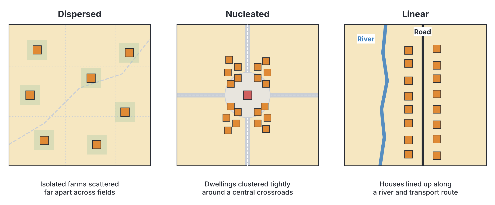
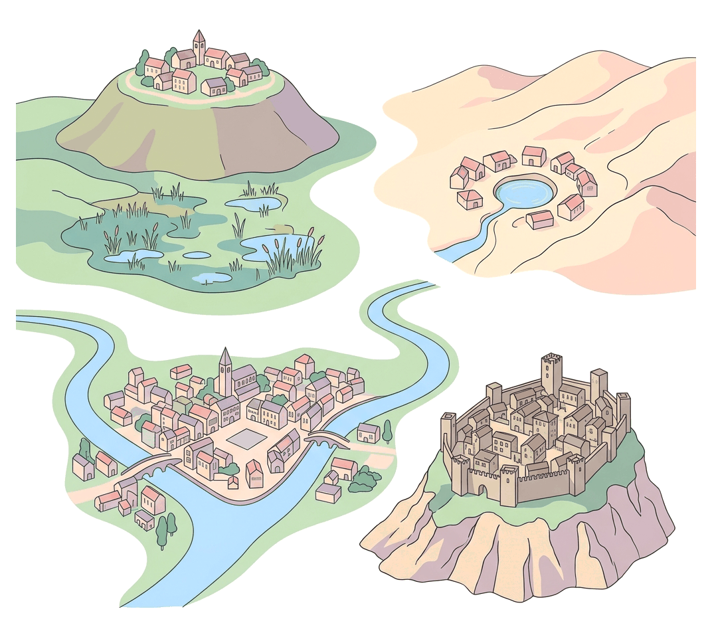
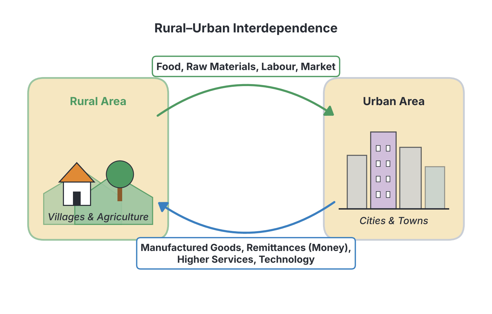

# JAMB Geography Notes: Settlement

## What JAMB expects

This topic is Section III, Topic B of the JAMB Geography syllabus: Settlement. It covers:

- **i.** Types and patterns: rural and urban, dispersed, nucleated and linear;
- **ii.** Rural settlement: classification, factors of growth and functions;
- **iii.** Urban settlement – classification, factors of growth and functions.
- **iv.** Factor of settlement location
- **v.** Problems of urban centres
- **vi.** Interrelationship between rural and urban settlements.

By the end of these notes, you should be able to:

1. differentiate between types of settlements; (rural and urban);
2. classify the patterns and functions of rural settlements;
3. classify the patterns and functions of urban settlements;
4. identify the factors of settlement location
5. identify the problems of urban centres;
6. establish the interrelationship between rural and urban settlements.

**Note on the syllabus wording:** Content item iv says "Factor of settlement location" which is a typographical error for "Factors" (as written in the objective). The syllabus also specifically asks you to study this topic with particular reference to **Western Europe, the USA, the Middle East and West Africa**. Examples from these regions are used throughout the notes.

## Types of Settlements and Patterns

A **settlement** is any place where humans live, ranging from a single isolated house to a massive, sprawling city. The study of settlements looks at their type, pattern, size, and function.

### Types of Settlements
Settlements are broadly divided into two main types:
- **Rural settlements:** Villages and hamlets, mostly involved in primary economic activities like farming, fishing, and lumbering.
- **Urban settlements:** Towns and cities, mostly involved in secondary and tertiary economic activities like manufacturing, commerce, and services.

### Settlement Patterns
The **pattern** of a settlement refers to the arrangement or layout of its buildings. These patterns can be seen in both rural and urban areas, but they are easiest to identify in rural areas.

1. **Dispersed (Isolated) Pattern:**
   Buildings are scattered and widely spaced apart, separated by large areas of farmland, forests, or harsh terrain. 
   - **Why it forms:** Large-scale commercial farming (where each farmer lives on their own extensive farm), harsh climates, or difficult mountainous terrain.
   - **Examples:** The Great Plains of the **USA** (large wheat farms), the Scottish Highlands in **Western Europe**, and nomadic grazing areas in the **Middle East**.

2. **Nucleated (Clustered) Pattern:**
   Buildings are grouped closely together around a central point, such as a crossroads, a market square, a church, or a water source.
   - **Why it forms:** For defense, strong social and cultural ties, or because everyone needs to share a single scarce resource like a well.
   - **Examples:** Traditional farming villages in **West Africa** (like Hausa and Yoruba towns clustered around a central market or palace; textbooks differ, and many place traditional Igbo settlements under the dispersed pattern) and oasis settlements in the **Middle East** where water is scarce.

3. **Linear (Ribbon) Pattern:**
   Buildings are arranged in a long, narrow line.
   - **Why it forms:** People build along a physical feature or a transport route, such as a road, railway, river, or coastline, to enjoy easy access and transport.
   - **Examples:** Fishing villages along the West African coast, settlements strung out along a major highway, or villages along the River Rhine in **Western Europe**.

## Differentiating Between Types of Settlements (Rural and Urban)

Although there is a continuum between rural and urban areas (meaning they blend into each other), geographers use several differences to separate them.

**Textbook variation:** The exact population number that makes a settlement "urban" varies widely between countries. In Nigeria, a settlement with 20,000 or more people is generally classified as urban. In the **USA**, it is often 2,500 people, while some countries in **Western Europe** use thresholds as low as 1,000. Do not memorise a single global number, but rather understand the general differences.

| Feature | Rural Settlements (Villages, Hamlets) | Urban Settlements (Towns, Cities) |
| --- | --- | --- |
| **Population size and density** | Low population size; sparse population density. | Large population size; high population density. |
| **Primary economic activities** | Mainly **primary** activities (agriculture, fishing, lumbering, mining). | Mainly **secondary and tertiary** activities (manufacturing, commerce, administration). |
| **Built environment** | Plenty of open space, farmland, and natural vegetation; often unpaved roads. | Highly built-up, congested with buildings, paved roads, and concrete structures. |
| **Social interaction** | Homogeneous (similar culture or ethnic group), intimate, close-knit relationships. | Heterogeneous (mixed cultures), impersonal, anonymous relationships. |
| **Infrastructure and amenities** | Few and basic amenities (e.g., small local clinics, primary schools, boreholes). | Complex and abundant amenities (universities, teaching hospitals, airports, banks, piped water). |

## Rural Settlement: Classification, Patterns, Growth and Functions

### Classification of Rural Settlements
Rural settlements are usually classified by their size and complexity, from the smallest to the largest:
1. **Homestead:** A single family residence or compound isolated from others.
2. **Farmstead:** A homestead that includes the associated farm buildings (such as barns or silos).
3. **Hamlet:** A small cluster of houses. It is smaller than a village and usually lacks a central place of worship, a school, or a regular market.
4. **Village:** A distinct nucleated settlement larger than a hamlet. It usually has basic social amenities like a primary school, a village hall, a local market, and a place of worship.

### Patterns of Rural Settlements
As discussed earlier, rural settlements usually take on a **dispersed** (isolated farms), **nucleated** (clustered village), or **linear** (strung along a road or river) pattern.

### Factors of Growth
Rural settlements generally grow slowly. Their growth depends heavily on the natural environment:
- Availability of **fertile soil** for farming.
- A reliable **water supply**.
- Natural population increase (births exceeding deaths).
- Occasionally, the introduction of a new road or railway can cause a hamlet to grow rapidly into a village.

### Functions of Rural Settlements
Rural functions are almost entirely based on extracting natural resources (primary production):
- **Agricultural:** Producing food crops, cash crops, and rearing livestock (e.g., farming villages in the agricultural Midwest of the **USA** or the savanna region of **West Africa**).
- **Fishing:** Catching fish in coastal or riverine areas (e.g., fishing villages in the Niger Delta of Nigeria).
- **Lumbering:** Harvesting timber (e.g., rural settlements in the tropical rainforests of **West Africa**).
- **Mining:** Sometimes a small rural settlement springs up simply because a local mineral (like limestone or gold) is discovered and extracted on a small scale.
- **Cultural/Religious:** Some rural villages serve a specific cultural function, housing important shrines or traditional rulers.

## Urban Settlement: Classification, Patterns, Growth and Functions

### Classification of Urban Settlements
Urban settlements are classified based on their population size, geographical spread, and economic importance:
1. **Town:** Larger than a village, with thousands of people. It provides more complex services such as banks, secondary schools, and large markets.
2. **City:** A very large town with great economic, cultural, and political importance (e.g., Kano, Ibadan, London, New York).
3. **Conurbation:** Formed when expanding cities and towns merge physically into one massive continuous urban area. Although they physically join, the original towns may keep their own local government identities.
   - *Examples:* The Ruhr Valley in **Western Europe** (Germany); Greater London; or Lagos continuously expanding into neighbouring Ogun State in **West Africa**.
4. **Megalopolis:** A gigantic, unbroken stretch of urban development formed by the merging of several conurbations and major cities.
   - *Example:* The "BosWash" corridor in the **USA** (a continuous urban stretch from Boston through New York and Philadelphia to Washington D.C.).

### Patterns of Urban Settlements
While they may start as a simple linear or nucleated pattern, cities grow into complex shapes:
- **Grid-iron pattern:** Streets cross each other at right angles (common in modern planned cities like New York in the **USA**).
- **Radial pattern (Star-shaped):** Roads radiate outwards from a central point.
- **Concentric ring pattern:** The city grows outwards in circular zones from a central business district (CBD).

### Factors of Growth
Urban centres grow much faster than rural ones. The main factors pulling migrants and driving growth are:
- **Industrialisation:** The building of factories creates thousands of jobs.
- **Commercial Nodality:** Places where major trade routes cross (crossroads, seaports, river confluences) naturally grow into large trading cities.
- **Administration:** When a town is chosen as a state or national capital, government jobs and infrastructure cause explosive growth (e.g., Abuja in Nigeria; Riyadh in the **Middle East**; Washington D.C. in the **USA**).

### Functions of Urban Settlements
Cities perform complex, higher-order functions:
- **Commercial:** Centres of trade and banking (e.g., Onitsha, Lagos, New York).
- **Industrial:** Manufacturing hubs (e.g., Detroit in the **USA** for cars; Aba in Nigeria).
- **Administrative:** Government centres (e.g., London in **Western Europe**; Abuja).
- **Socio-cultural and Religious:** Centres of faith and culture. The **Middle East** has highly significant religious cities like Jerusalem and Mecca.
- **Mining:** Large urban centres built primarily around major mineral extraction (e.g., Jos for tin; Enugu for coal).
- **Port Functions:** Cities built around shipping and harbours (e.g., Port Harcourt in **West Africa**; Rotterdam in **Western Europe**).

## Factors of Settlement Location

Why does a settlement start exactly where it does? The specific patch of land a settlement is built on is called its **site**, while its position in relation to the surrounding area is its **situation**. Several factors influence this location:

1. **Water Supply:** Water is essential for drinking, cooking, farming, and industry. Settlements often cluster around rivers, springs, or oases (especially in the arid **Middle East**). A site chosen specifically for its reliable water source in a dry area is called a **wet-point site**.
2. **Relief and Topography:** People prefer flat or gently sloping land because it is easier to build houses and construct roads. Steep mountain slopes and deep valleys are generally avoided.
3. **Avoidance of Flooding:** In marshy or flood-prone areas, settlements are built on slightly raised, dry land. This is known as a **dry-point site**.
4. **Defense:** Historically, settlements were built where they could be easily defended against enemies. This included hilltops (e.g., Idanre Hills in Nigeria), inside the sharp bends of a river, or on islands (e.g., the original site of Paris on an island in the River Seine).
5. **Fertile Soil:** Agricultural settlements locate on or near deep, rich alluvial soils to ensure good crop yields.
6. **Nodality (Communication Routes):** Settlements thrive where transport routes meet, making travel and trade easy. Lokoja in Nigeria is a classic example, located at the confluence of the Rivers Niger and Benue.
7. **Presence of Minerals/Resources:** A settlement will quickly grow anywhere a valuable resource is discovered, such as oil in the Niger Delta or coal in Enugu.

## Problems of Urban Centres

As cities grow rapidly—a process called **urbanisation**—they attract more people than they can handle. This causes severe problems, especially in developing regions like **West Africa**, though cities in the **USA** and **Western Europe** face some of these challenges too.

1. **Traffic Congestion:** A huge number of vehicles on poorly planned or narrow roads leads to terrible traffic jams (e.g., the famous "go-slows" in Lagos or heavy traffic in London).
2. **Slum Development and Poor Housing:** Because migrants arrive faster than houses can be built, people are forced to live in overcrowded, illegal squatter settlements, slums, and shanty towns with poor sanitation (e.g., Makoko in Lagos).
3. **Environmental Pollution:** The concentration of factories, vehicles, and humans causes severe air, water, and noise pollution. Managing solid waste (refuse) becomes overwhelming, leading to blocked drains and diseases.
4. **Unemployment and Underemployment:** There are simply not enough formal jobs for the millions of people migrating to the city. This leads to poverty and forces many into the informal sector (e.g., street hawking).
5. **High Crime Rates:** Poverty, anonymity (people not knowing their neighbours), and unemployment breed high rates of crime, armed robbery, pickpocketing, and social vices.
6. **Pressure on Amenities:** Basic facilities are stretched to breaking point. Schools become overcrowded, hospitals run out of beds, and there are frequent shortages of pipe-borne water and electricity.

## Interrelationship Between Rural and Urban Settlements

Rural and urban areas are not totally separate; they are **interdependent**. This means they rely on each other to survive and develop.

### What Rural Areas Provide to Urban Areas
1. **Food Supply:** Urban dwellers do not grow their own food. Rural farmers supply yams, cassava, grains, meat, and vegetables to feed the cities.
2. **Raw Materials:** Rural areas provide agricultural produce (like cocoa, cotton, and rubber) and minerals for urban factories to process.
3. **Labour:** Rural areas provide a constant stream of mostly unskilled and semi-skilled workers who migrate to the cities to work in construction, factories, and markets.
4. **Market for Goods:** The rural population acts as a massive market, buying the manufactured goods produced in the cities.

### What Urban Areas Provide to Rural Areas
1. **Manufactured Goods:** Cities supply rural areas with processed foods, clothing, building materials (cement, roofing sheets), and farming tools (tractors, fertilisers).
2. **Higher-order Services:** Cities provide services that villages cannot support, such as specialist healthcare (teaching hospitals), higher education (universities), banking, and advanced administrative services.
3. **Capital and Remittances:** People who migrate to the city often send money (remittances) back to their families in the village. This capital is used to build houses, pay school fees, or start small rural businesses.
4. **New Ideas and Technology:** Innovations, modern farming techniques, and new cultural ideas spread out from the cities into the rural areas.

## Key terms

| Term | Meaning |
| --- | --- |
| **Settlement** | Any form of human habitation, from a single isolated house to a large city. |
| **Rural settlement** | A settlement (village, hamlet) involved mainly in primary activities like farming and fishing. |
| **Urban settlement** | A settlement (town, city) involved mainly in secondary and tertiary activities like manufacturing and commerce. |
| **Dispersed pattern** | A settlement layout where buildings are widely scattered and separated by land. |
| **Nucleated pattern** | A settlement layout where buildings are tightly clustered together. |
| **Linear pattern** | A settlement layout where buildings are arranged in a line, usually along a road, railway, or river. |
| **Conurbation** | A large continuous urban area formed by the physical merging of expanding towns and cities. |
| **Megalopolis** | A massive, unbroken stretch of urban development formed by merging conurbations. |
| **Wet-point site** | A settlement location chosen specifically for its reliable water supply in an otherwise dry area. |
| **Dry-point site** | A settlement location chosen on raised land to avoid flooding in a marshy or wet area. |
| **Nodality** | The advantage of a location where major transport routes meet or cross, encouraging settlement growth. |

## Exam tips and common mistakes

- **Do not confuse conurbation and megalopolis.** A conurbation is formed by merging cities/towns (like Lagos expanding into Ogun State). A megalopolis is much larger, formed by merging whole conurbations (like BosWash in the USA).
- **Wet-point vs Dry-point.** This is a frequent exam trap. Remember: you seek a *wet* point in a *dry* area (for drinking water), and you seek a *dry* point in a *wet* area (to avoid flooding).
- **Functions.** If an exam asks for the primary function of rural settlements, the answer is always related to agriculture or extracting raw materials.
- **Interdependence.** Remember that the relationship is two-way. Cities need villages just as much as villages need cities.
- **Regions.** When questions mention specific regions based on the syllabus: the Ruhr Valley (Western Europe) is famous for industrial conurbations; BosWash (USA) is a megalopolis; the Middle East is noted for oasis (wet-point) settlements and religious cities.

## Quick summary

1. Settlements are broadly classified into rural (villages/hamlets involved in primary production) and urban (towns/cities involved in secondary and tertiary activities).
2. The main settlement patterns are dispersed (scattered), nucleated (clustered), and linear (strung along a line like a road or river).
3. Rural settlements grow slowly and are classified from smallest to largest as homestead, farmstead, hamlet, and village.
4. Urban settlements are classified as town, city, conurbation, and megalopolis. They grow rapidly due to industrialisation, trade, and administration.
5. Factors influencing where a settlement is located include water supply (wet-point), avoidance of flooding (dry-point), defense, soil fertility, nodality, and mineral resources.
6. Rapid urbanisation causes severe problems in cities, including traffic congestion, slum development, pollution, unemployment, crime, and overstretched amenities.
7. Rural and urban settlements are mutually interdependent: rural areas provide food, raw materials, and labour, while urban areas provide manufactured goods, higher services, and capital.

## Practice questions

**1. Which of the following is a primary characteristic of a rural settlement?**
- A. High population density
- B. Engagement in secondary activities
- C. Homogeneous population
- D. Presence of complex infrastructure

**Answer: C.** Rural settlements tend to have a homogeneous population (people sharing similar culture, background, and close social ties), whereas urban areas are largely heterogeneous.

**2. A settlement pattern where buildings are arranged along a transport route, such as a road or river, is known as**
- A. nucleated
- B. linear
- C. dispersed
- D. isolated

**Answer: B.** A linear (or ribbon) pattern forms when houses are built in a line along a physical feature or transport route for easy access and movement.

**3. Which of the following best describes a megalopolis?**
- A. A small farming village
- B. A single large town with an administrative function
- C. A continuous stretch of merged conurbations and cities
- D. A settlement located at a river confluence

**Answer: C.** A megalopolis is a massive, unbroken urban region formed when multiple conurbations and cities merge together, such as the BosWash corridor in the USA.

**4. The location of an ancient settlement on a hilltop or inside a sharp river bend was most likely influenced by**
- A. the need for a reliable water supply
- B. defense purposes
- C. the presence of fertile soil
- D. proximity to a railway line

**Answer: B.** Historically, elevated areas (like hilltops) or areas surrounded by water were chosen because they were easy to defend against enemy attacks. 

**5. Which of the following cities in the Middle East is best known globally for its religious function?**
- A. Dubai
- B. Riyadh
- C. Mecca
- D. Tel Aviv

**Answer: C.** Mecca is the holiest city in Islam and millions travel there for pilgrimage, making its religious function its most prominent feature globally.

**6. The interdependence between rural and urban settlements is best demonstrated by**
- A. urban areas providing raw materials to rural areas
- B. rural areas supplying manufactured goods to urban areas
- C. rural areas supplying food to urban areas
- D. urban areas providing unskilled farm labour

**Answer: C.** Rural areas provide food, raw materials, and labour to cities, while cities provide manufactured goods and services back to rural areas. Option C correctly describes one side of this relationship.

**7. Which of the following is a major problem of urban centres in West Africa?**
- A. Underpopulation and labour shortages
- B. Lack of modern manufactured goods
- C. Traffic congestion and slum development
- D. Dispersed settlement patterns making communication hard

**Answer: C.** Rapid urbanisation in West Africa outpaces infrastructure, leading to severe traffic jams, overcrowded slums, and pollution.

**8. In Western Europe, the Ruhr Valley is an example of a settlement area that grew primarily due to**
- A. industrial and mining functions
- B. religious functions
- C. agricultural functions
- D. fishing functions

**Answer: A.** The Ruhr Valley in Germany developed into a massive conurbation because of its rich coal deposits and the heavy industries that were built around them.

**9. A dry-point site is typically chosen to avoid**
- A. enemy attacks
- B. steep mountain slopes
- C. flooding in marshy areas
- D. drought conditions

**Answer: C.** A dry-point site is an area of raised, dry land in a generally wet, marshy, or flood-prone area. A common mistake is confusing it with a wet-point site, which is chosen to avoid drought.

**10. When several expanding towns and cities merge physically but retain their separate local governments, they form a**
- A. hamlet
- B. village
- C. conurbation
- D. homestead

**Answer: C.** A conurbation is formed when growing urban areas merge into one continuous built-up area, even if they keep their local government identity. An example is Greater London or Lagos expanding into Ogun State.

<!-- COVERAGE
obj i | Differentiating Between Types of Settlements (Rural and Urban)
obj ii | Rural Settlement: Classification, Patterns, Growth and Functions
obj iii | Urban Settlement: Classification, Patterns, Growth and Functions
obj iv | Factors of Settlement Location
obj v | Problems of Urban Centres
obj vi | Interrelationship Between Rural and Urban Settlements
item i | Types of Settlements and Patterns
item ii | Rural Settlement: Classification, Patterns, Growth and Functions
item iii | Urban Settlement: Classification, Patterns, Growth and Functions
item iv | Factors of Settlement Location
item v | Problems of Urban Centres
item vi | Interrelationship Between Rural and Urban Settlements
-->
