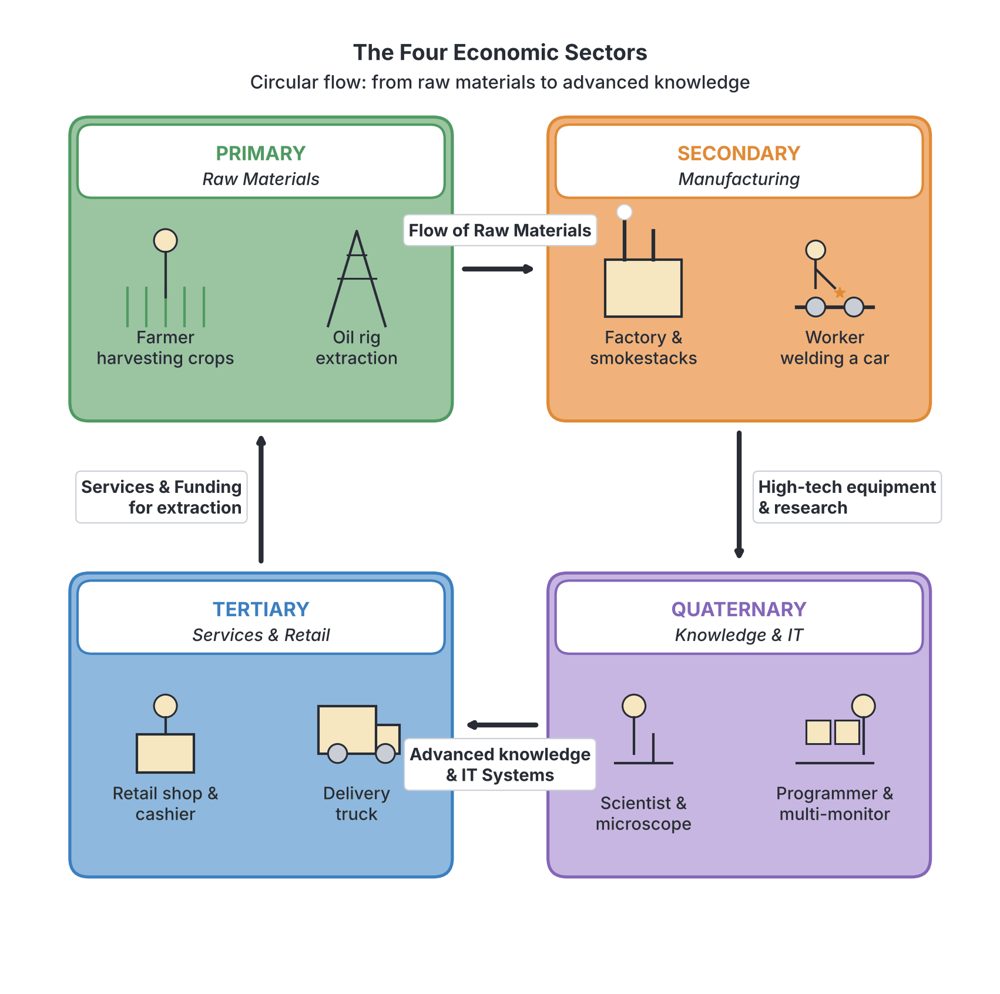
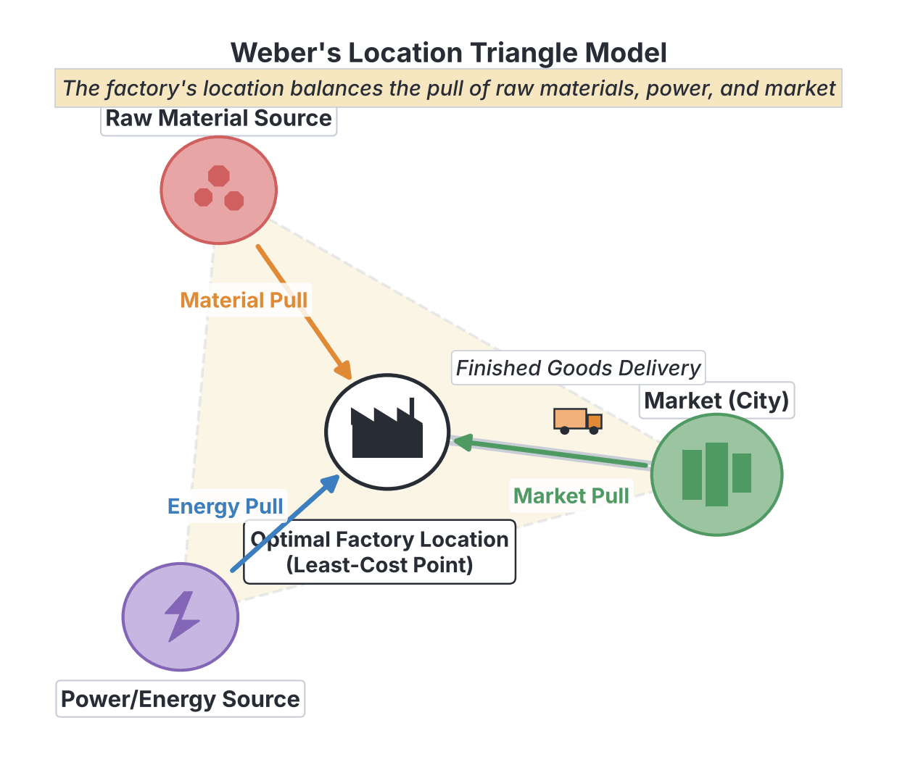
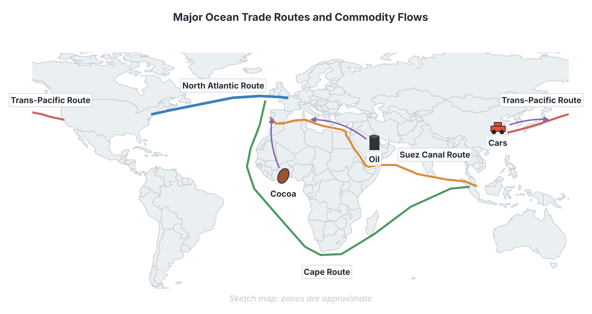

# JAMB Geography Notes: Selected Economic Activities

## What JAMB expects

This topic is Section III, Topic C of the JAMB Geography syllabus: Selected Economic Activities. It covers six main content items:

*   **i. Types of economic activities:** primary, secondary, tertiary and quartnary.
*   **ii. Agriculture:** types, system, factors and problems.
*   **iii. Manufacturing industries:** types, locational factors, distribution and socio-economic importance and problems of industrialization in tropical Africa.
*   **iv. Transportation and Communication:** types, roles in economic development and communication in tropical Africa.
*   **v. World trade:** factors and pattern of world trade, major commodities (origin, routes and destinations).
*   **vi. Tourism:** definition, importance, location, problems and solutions.

By the end of these notes, you should be able to:
1.  Identify the types of economic activities.
2.  Differentiate between the types of economic activities.
3.  Assess the importance and problems of agriculture as an economic activity.
4.  Compare the types of manufacturing industries.
5.  Identify the factors of industrial location.
6.  Examine the socio-economic importance of manufacturing industries.
7.  Give reasons for the problems of industrialization in tropical Africa.
8.  Differentiate between the modes of transportation and communication.
9.  Assess the economic importance of transportation.
10. Give reasons for the problems of transportation in tropical Africa.
11. Relate the factors to the pattern of world trade.
12. Classify the major commodities of trade in terms of their origins, routes and destination.
13. Analyse tourism as an economic activity.
14. Identify the problems of tourism and their solutions.

**Note on the syllabus wording:** The syllabus spells the fourth type of economic activity as "quartnary"; the correct spelling used globally and in textbooks is **quaternary**. Also, under Content iv, it lists "communication in tropical Africa," but based on Objective x, the focus is on the *problems* of both transportation and communication in the region.

## Types of economic activities

An **economic activity** is any action that involves producing, distributing, or consuming goods and services to satisfy human wants and earn a living. Human occupations and industries are grouped into four main categories based on the kind of work being done.

### Identifying the types of economic activities

1.  **Primary economic activities:** These involve the direct extraction, harvesting, or collection of natural resources from the earth (land, water, or forests). People engaged in primary activities work directly with nature. Examples include agriculture (farming), fishing, lumbering (forestry), hunting, and mining.
2.  **Secondary economic activities:** These involve processing raw materials extracted by primary activities into finished or semi-finished products. This sector adds value to raw materials. Examples include manufacturing (such as textile mills, car assembly plants, and cement factories), food processing, and construction.
3.  **Tertiary economic activities:** These involve providing services rather than producing physical goods. They help to distribute goods from producers to consumers and provide essential services to society. Examples include trading, transportation, banking, teaching, healthcare, and policing.
4.  **Quaternary economic activities:** These are specialized, high-level services that involve information generation, sharing, research, and advanced technology. This is the "knowledge sector." Examples include research and development (R&D), software engineering, financial consultancy, and high-level management.

### Differentiating the types of economic activities

To fully understand these sectors, we must compare them based on their relationship with nature, the nature of the product, and the typical examples. Historically, workers in these sectors were given "collar" color designations.

| Feature | Primary Activities | Secondary Activities | Tertiary Activities | Quaternary Activities |
| --- | --- | --- | --- | --- |
| **Relationship to Nature** | Direct extraction from the natural environment | Modifies natural resources (adds value) | Facilitates the movement and use of goods/services | Focuses on knowledge, information, and innovation |
| **Nature of Output** | Raw materials and unprocessed food | Finished or semi-finished physical goods | Intangible services and distribution | High-tech information, research, and specialized skills |
| **Worker Classification** | Red-collar workers (outdoor work) | Blue-collar workers (factory/manual labor) | White-collar workers (office/service jobs) | Gold-collar workers (highly skilled professionals) |
| **Dominance by Economy** | Dominates in developing countries (e.g., many African nations) | Dominates in industrializing or newly industrialized countries | Dominates in developed countries | Found mostly in highly advanced economies |
| **Examples in Nigeria** | Cocoa farming in Ondo, crude oil drilling in Rivers State | Dangote Cement in Obajana, food canning | Banking in Lagos, teaching in public schools | Medical research at LUTH, software development in Yaba |

## Agriculture

Agriculture is the primary economic activity of growing crops and rearing animals for food, raw materials, and economic gain. It employs the largest percentage of the workforce in tropical Africa.

### Types and systems of agriculture

Farming is practiced in various ways depending on the level of technology, land availability, and purpose.

**1. Subsistence Agriculture:**
Farming mainly to feed the farmer and their family, with little or no surplus for sale. It uses simple tools (cutlasses, hoes) and relies on family labor.
*   **Shifting Cultivation:** The farmer clears a piece of land, farms it until the soil loses its fertility (usually 2-3 years), and then abandons both the farm and their settlement to move to a entirely new, virgin forest area. This is rare today due to population growth.
*   **Rotational Bush Fallow:** Similar to shifting cultivation, but the farmer does *not* relocate their settlement. They just rotate their farming plots around a fixed village, leaving the exhausted land to rest (fallow) for a few years to regain fertility naturally.
*   **Sedentary Tillage:** The farmer cultivates the same piece of land continuously year after year. Soil fertility is maintained using crop rotation, manure, or fertilizers. It is common in densely populated areas like Kano (using animal manure).

**2. Commercial Agriculture:**
Farming on a large scale primarily for sale and profit. It requires huge capital, large land sizes, hired labor, and machinery.
*   **Plantation Agriculture:** A large farm (estate) that specializes in cultivating a single cash crop (monoculture) for export or industrial use. Examples include cocoa, rubber, and oil palm plantations in southern Nigeria, and tea plantations in Kenya.
*   **Extensive Grain Farming:** Mechanized cultivation of grain crops (wheat, maize) on massive tracts of land, common in the North American Prairies and Russian Steppes.

**3. Mixed Farming:**
The cultivation of crops and the rearing of animals on the *same piece of land*. It is very efficient because the animals provide manure for the crops, and the crop residues serve as feed for the animals.

**4. Pastoral Farming (Animal Rearing):**
*   **Nomadic Herding:** A subsistence system where herdsmen (e.g., the Fulani in West Africa, the Maasai in East Africa) move constantly with their livestock (cattle, sheep, goats) in search of water and pasture.
*   **Livestock Ranching:** A commercial system where large numbers of animals are kept on a permanent, fenced expanse of land (a ranch). They are scientifically managed for meat, milk, or wool (e.g., Obudu Cattle Ranch in Nigeria).

### Factors affecting agriculture

Several factors determine what type of agriculture can be practiced in an area:
*   **Physical factors:** 
    *   **Climate:** Temperature and rainfall dictate crop types. Rubber and cocoa need high rainfall and temperature (equatorial climate), while wheat thrives in temperate regions.
    *   **Soil:** Deep, fertile loamy soils support crops better than sandy or highly acidic soils.
    *   **Relief:** Flat plains and gentle slopes are best for farming and mechanization. Steep mountain slopes face rapid soil erosion.
*   **Economic factors:** Availability of capital (money for inputs), proximity to large markets, and efficient transport networks.
*   **Social and Cultural factors:** The land tenure system (how land is owned). In Nigeria, communal land ownership often fragments land into small plots, making large-scale commercial farming difficult.

### Importance and problems of agriculture

**Importance of agriculture as an economic activity:**
1.  **Provision of Food:** It is the primary source of food (carbohydrates, proteins) for the population.
2.  **Employment Generation:** It is the largest employer of labor in many developing countries, including Nigeria.
3.  **Source of Raw Materials:** Supplies inputs for secondary industries (e.g., cotton for textiles, cocoa for chocolate, rubber for tires).
4.  **Foreign Exchange Earnings:** Exporting cash crops (like cocoa, sesame seeds, and cashew nuts) generates revenue for the government.
5.  **Market for Industrial Goods:** Farmers buy manufactured goods like fertilizers, tractors, and pesticides, thereby supporting the industrial sector.

**Problems of agriculture:**
Despite its importance, agriculture in tropical Africa faces severe challenges:
1.  **Poor Transportation:** Bad rural roads make it difficult to move farm produce to urban markets, leading to high post-harvest losses.
2.  **Land Tenure System:** Traditional systems fragment land into small, scattered plots, preventing mechanization.
3.  **Inadequate Capital:** Farmers lack access to bank loans and credit facilities to buy modern equipment or quality seeds.
4.  **Use of Crude Tools:** Heavy reliance on the hoe and cutlass keeps yields low and discourages the youth from farming.
5.  **Unpredictable Climate:** Dependence on rain-fed agriculture means droughts or sudden floods can destroy entire harvests.
6.  **Pests and Diseases:** Insects (like locusts), birds, and diseases (like cassava mosaic or swine fever) reduce crop and livestock output.

## Manufacturing industries

Manufacturing is the secondary economic activity that turns raw materials into finished or semi-finished products using machines, tools, and labor.

### Types of manufacturing industries

Manufacturing industries can be grouped by the weight/bulk of their raw materials and products, or by the intended user of their products.

**1. Heavy vs. Light Industries**

| Feature | Heavy Industries | Light Industries |
| --- | --- | --- |
| **Nature of Materials** | Use bulky, heavy raw materials | Use relatively light raw materials |
| **Capital Requirement** | Require massive capital investment | Require relatively smaller capital |
| **Size of Plant** | Large sprawling factories, massive machinery | Smaller factories, lighter machinery |
| **Location** | Usually located near the source of raw materials or major ports | Often located near the market or where labor is available |
| **Examples** | Iron and steel (Ajaokuta), cement manufacturing (Obajana, Ewekoro), petroleum refining, ship building | Textile production (Kano), food processing, electronics, shoe making, printing |

**2. Consumer Goods vs. Capital Goods Industries**
*   **Consumer Goods Industries:** Manufacture products directly used by the final consumer. Examples: Bakeries, soap factories, textile mills, breweries.
*   **Capital Goods (Basic) Industries:** Manufacture goods that are used by *other* industries to make more goods. Examples: Machine tool factories, factories making industrial chemicals, or tractor manufacturing.

### Factors of industrial location

Why is a factory built in one town and not another? The decision is based on several locational factors:

1.  **Proximity to Raw Materials:** Industries that use bulky raw materials that lose weight during processing (**weight-losing industries**) must locate near the raw material source to save transport costs. For example, a cement factory must be near limestone deposits, and a sawmill must be near a forest.
2.  **Proximity to the Market:** Industries whose final products are heavier, more fragile, or more perishable than their raw materials (**weight-gaining industries**) locate near the consumers. Examples include soft drink bottling (water is added at the market), bakeries (bread is perishable), and glass manufacturing.
3.  **Availability of Power:** Reliable electricity or fuel is needed to run heavy machinery. Early industries located near coal fields; today, they locate near power stations or natural gas pipelines.
4.  **Labor Supply:** Industries require skilled and unskilled workers. High-tech industries (quaternary/secondary) look for areas with universities and skilled labor, while textile mills look for abundant cheap labor.
5.  **Transportation and Communication:** A good network of roads, railways, or ports is vital for bringing in materials and shipping out finished goods. Coastal cities like Lagos and Port Harcourt attract industries due to their seaports.
6.  **Government Policy:** Governments can force or encourage industries to locate in rural or less developed areas to create jobs (industrial decentralization) by offering tax holidays or free land.

### Distribution of manufacturing industries

Globally, manufacturing is highly concentrated.
*   **Major Global Industrial Regions:** North-eastern USA (the Rust Belt, historically), Western Europe (the Ruhr region in Germany, the UK), Japan (Tokyo-Yokohama region), and increasingly China and Southeast Asia.
*   **Industrial Regions in Africa:** Manufacturing is concentrated in a few hubs. In Nigeria, major centers include the Lagos-Ikeja axis (the most industrialized region in West Africa), the Kano-Kaduna axis (textiles, food processing), and the Port Harcourt-Aba axis (oil refining, plastics). In South Africa, the Gauteng region (Johannesburg/Pretoria) is the continent's largest industrial hub.

### Socio-economic importance of manufacturing industries

1.  **Creation of Employment:** Factories employ thousands of workers, from machine operators to managers, reducing unemployment.
2.  **Improved Standard of Living:** By creating jobs and paying wages, industries increase people's purchasing power. They also provide goods that make life easier.
3.  **Diversification of the Economy:** An industrialized country does not have to rely only on agriculture or raw minerals (like Nigeria's over-reliance on crude oil) for its income.
4.  **Infrastructural Development:** The presence of industries forces the development of roads, electricity, water supply, and ports in an area.
5.  **Foreign Exchange Earnings:** Exporting manufactured goods brings in more money than exporting raw agricultural produce, as manufactured goods have higher value in world trade.

### Problems of industrialization in tropical Africa

Despite the benefits, tropical Africa is the least industrialized region in the world due to:
1.  **Inadequate Capital:** There is a lack of funds to import expensive heavy machinery and build massive factory structures.
2.  **Poor Power Supply:** Erratic electricity forces companies to run heavily on diesel generators, dramatically increasing the cost of production.
3.  **Lack of Skilled Manpower:** A shortage of highly trained engineers, technicians, and managers to operate and maintain modern automated machines.
4.  **Narrow (Small) Market:** Even though the population is large, widespread poverty means the purchasing power is low. People cannot afford to buy manufactured goods in large quantities.
5.  **Competition from Foreign Goods:** Local industries often collapse because they cannot compete with cheaper, mass-produced goods imported from Asia or Europe.
6.  **Political Instability:** Frequent changes in government, inconsistent policies, and insecurity (e.g., insurgency) scare away foreign investors.

## Transportation and Communication

Transportation is the movement of people, goods, and services from one place to another. Communication is the transmission of information, ideas, and messages. Both are crucial tertiary economic activities.

### Modes of transportation and communication

**1. Modes of Transportation (Comparison)**

| Mode | Characteristics | Advantages | Disadvantages |
| --- | --- | --- | --- |
| **Road** | Movement by cars, buses, and trucks on paved or unpaved paths. | Provides **door-to-door service**; highly flexible; route can be changed easily. | Limited carrying capacity; prone to traffic jams and high accident rates. |
| **Railway** | Movement of trains on steel tracks. | Best for transporting **bulky goods over long distances on land**; cheap; less prone to accidents. | Inflexible (trains can only go where tracks are); high cost of construction and maintenance. |
| **Water (Inland & Ocean)** | Movement on rivers, lakes (inland), and oceans using boats, ferries, and ships. | The **cheapest mode** overall; carries the heaviest and largest volume of goods (e.g., crude oil, vehicles) in world trade. | It is the **slowest mode** of transport; oceans can have severe storms. |
| **Air** | Movement by airplanes and helicopters. | The **fastest mode** of transport; crosses difficult terrain easily; great for perishable or urgent goods. | The **most expensive mode**; limited carrying capacity for bulky goods; highly dependent on weather. |
| **Pipeline** | Movement through laid pipes. | Excellent for transporting liquids and gases (crude oil, natural gas, water); low maintenance once built. | Very inflexible; can only carry specific fluids; prone to sabotage or leakage (e.g., oil theft in the Niger Delta). |

**2. Modes of Communication**
Communication is broadly divided into:
*   **Telecommunications:** Phones (mobile networks like MTN, Airtel), internet, emails, and satellite communications. This is the fastest growing sector in Africa.
*   **Mass Media:** Radio, television, newspapers, and magazines. They reach millions of people simultaneously.
*   **Postal Services:** Traditional movement of physical letters and parcels via post offices.

### Economic importance of transportation

1.  **Movement of Goods and People:** It moves raw materials to factories and finished goods to markets, bridging the gap between producers and consumers.
2.  **Opening Up New Lands:** Building roads or railways into remote areas allows those lands to be used for agriculture or mining.
3.  **Promotes Trade:** Both domestic and international trade depend entirely on efficient transport (especially ocean and air transport).
4.  **Employment Generation:** It provides jobs for drivers, pilots, sailors, mechanics, and logistics managers.
5.  **Reduces Waste:** Fast transport (like air freight or refrigerated trucks) prevents perishable agricultural goods (tomatoes, fish, flowers) from spoiling before they reach the market.

### Problems of transportation in tropical Africa

**Problems of Transportation:**
1.  **Difficult Physical Terrain:** Dense tropical rainforests, vast deserts, deep valleys, and extensive swamps (like the Niger Delta) make building roads and railways extremely difficult and expensive.
2.  **Poor Maintenance:** Many roads are unpaved or riddled with potholes. Railway tracks are often outdated (narrow gauge) and poorly maintained.
3.  **Seasonal Variations:** During the rainy season, many untarred roads become impassable mud. Inland waterways (rivers) may flood in the wet season and dry up, becoming unnavigable, in the dry season.
4.  **Inadequate Capital:** Governments lack the huge funds required to purchase modern aircraft, ships, or to dualize major highways.
5.  **Shortage of Spare Parts and Expertise:** A reliance on imported vehicles and trains means a lack of local spare parts keeps damaged fleets grounded.

**Problems of Communication:**
1.  **Poor Network Infrastructure:** Rural areas lack mobile network coverage and internet access.
2.  **Vandalism:** The theft of cables, batteries, and the destruction of telecom masts heavily disrupt services.
3.  **Unstable Power Supply:** Telecom base stations are forced to rely on diesel generators, making calls and data expensive.

## World trade

World trade (or international trade) is the exchange of capital, goods, and services across international borders or territories.

### Factors affecting the pattern of world trade

Why do countries trade with each other instead of producing everything themselves?
1.  **Differences in Natural Resources:** No single country has all the resources it needs. Nigeria trades crude oil for products it lacks; Japan imports almost all its raw minerals.
2.  **Differences in Climate:** Climate determines agricultural output. Temperate countries (like the UK) cannot grow tropical crops (like cocoa, rubber, palm oil), so they must import them from tropical Africa or Asia.
3.  **Differences in Technology and Industrialization:** Highly industrialized nations (USA, Germany, China) mass-produce machinery, electronics, and vehicles, which they export to developing nations that lack the technology to make them.
4.  **Political Ties and Trade Blocs:** Countries trade more with political allies or members of their economic group. For example, Nigeria trades heavily within ECOWAS (Economic Community of West African States), while European nations trade heavily within the EU.
5.  **Foreign Exchange Rates:** The value of a country's currency affects its trade. If a country's currency is weak, its exports are cheaper for foreigners to buy, but its imports become expensive.

### Major commodities of world trade

World trade commodities are broadly classified into Agricultural Products, Minerals, and Manufactured Goods. Water transport (ocean shipping) handles the vast majority of these commodities.

| Commodity Class | Examples | Major Origins (Exporters) | Main Trade Routes Used | Major Destinations (Importers) |
| --- | --- | --- | --- | --- |
| **Agricultural Products** | Cocoa, Coffee, Rubber, Palm oil, Tea, Cotton | Tropical Africa (Nigeria, Ivory Coast, Kenya), Southeast Asia (Malaysia), South America (Brazil) | Trans-Atlantic Route, Cape Route (around Southern Africa) | Western Europe, North America, Japan |
| **Minerals** | Crude oil, Gold, Copper, Diamond, Iron ore | Middle East (Saudi Arabia), Africa (Nigeria, DRC, South Africa), Russia, Australia | Suez Canal Route, Cape Route, Trans-Pacific Route | USA, China, Western Europe, Japan |
| **Manufactured Goods** | Cars, Electronics, Machinery, Textiles, Medicines | China, Japan, USA, Germany, South Korea | Trans-Pacific Route, North Atlantic Route (busiest route globally) | Developing nations in Africa, South America, and globally among themselves |

## Tourism

**Tourism** is the practice of traveling for recreation, leisure, business, medical, or educational purposes, usually for a limited duration. A tourist is a person who travels to a place outside their usual environment for at least one night.

### Tourism as an economic activity

Tourism is heavily promoted by governments because it is a massive tertiary economic activity. It is often called an **"invisible export"** because it brings in foreign money just like exporting physical goods, but nothing physical leaves the country.

**Importance of Tourism:**
1.  **Source of Foreign Exchange:** International tourists spend foreign currencies (Dollars, Euros) on hotels, food, and souvenirs, enriching the host country.
2.  **Employment Generation:** It creates millions of jobs globally for tour guides, hotel staff, drivers, and artisans.
3.  **Infrastructural Development:** To attract tourists, governments build good roads, airports, stable electricity, and water supplies in tourist areas, which also benefit the local people.
4.  **Conservation of Wildlife and Culture:** Tourism gives a financial reason to protect endangered animals (e.g., in national parks) and preserve cultural heritage (e.g., traditional festivals, historical monuments).
5.  **Promotion of International Understanding:** It fosters peace and cultural exchange between people of different nations.

**Locations of Tourist Centers:**
*   **In Nigeria:** Yankari Game Reserve (Bauchi), Obudu Mountain Resort (Cross River), Olumo Rock (Ogun), Erin Ijesha Waterfalls (Osun), Ikogosi Warm Springs (Ekiti).
*   **In Africa:** The Pyramids of Giza (Egypt), Victoria Falls (Zambia/Zimbabwe), Kruger National Park (South Africa), Serengeti National Park (Tanzania).

### Problems of tourism and their solutions

**Problems:**
1.  **Insecurity and Terrorism:** Kidnapping, armed robbery, and insurgency scare tourists away. This is a major problem in parts of Nigeria and other African countries.
2.  **Poor Transportation:** Bad roads and lack of comfortable domestic flights make reaching remote tourist sites (like waterfalls or reserves) stressful.
3.  **Inadequate Facilities:** Many tourist centers lack world-class hotels, clean water, steady electricity, and modern recreational equipment.
4.  **Poor Publicity:** Lack of proper advertising and marketing of tourist sites on the global stage. Many potential visitors simply do not know what the country has to offer.
5.  **Poor Management and Funding:** Governments often neglect tourist sites, leaving them dilapidated and unappealing.

**Solutions:**
1.  **Improving Security:** Governments must invest heavily in securing tourist routes and centers using trained police and advanced technology.
2.  **Infrastructure Upgrade:** Massive investment in constructing access roads, steady power supply, and standard accommodation.
3.  **Publicity and Advertisement:** Utilizing the internet, social media, and international travel agencies to showcase tourist attractions.
4.  **Private Sector Involvement:** Encouraging private companies to invest in and manage tourist centers for better efficiency and profitability.
5.  **Training of Personnel:** Training hotel staff, tour guides, and park rangers to meet international hospitality standards.

## Key terms

| Term | Meaning |
| --- | --- |
| **Primary Activity** | Economic activity involving direct extraction of raw materials from nature (e.g., farming, mining). |
| **Secondary Activity** | Processing of raw materials into finished or semi-finished goods (e.g., manufacturing). |
| **Tertiary Activity** | Provision of services and distribution of goods (e.g., transport, banking). |
| **Quaternary Activity** | Knowledge-based services involving research, IT, and high-level management. |
| **Shifting Cultivation** | A farming system where both the farm plot and the settlement are relocated when soil fertility drops. |
| **Rotational Bush Fallow** | A farming system where farm plots are rotated around a fixed settlement to allow exhausted soil to recover. |
| **Heavy Industry** | Manufacturing that uses bulky raw materials, large machines, and massive capital (e.g., iron and steel). |
| **Weight-losing Industry** | An industry whose raw materials are heavier/bulkier than the finished product; usually locates near raw materials. |
| **Weight-gaining Industry** | An industry whose finished product is heavier/bulkier than its raw materials; usually locates near the market. |
| **Invisible Export** | A service (like tourism or banking) that brings in foreign exchange without physically exporting a solid good. |
| **Tourism** | Traveling outside one's usual environment for leisure, business, or education. |

## Exam tips and common mistakes

*   **Quaternary vs. Tertiary:** Remember that standard services (teaching, driving, retail) are tertiary. Highly specialized knowledge, R&D, and IT are quaternary.
*   **Shifting Cultivation vs. Rotational Bush Fallow:** The key difference is the settlement. In shifting cultivation, the farmer moves their *home*. In bush fallow, the home is fixed, only the farm plot rotates.
*   **Weight-losing vs. Weight-gaining:** This is a very frequent exam topic. If the raw material loses weight during processing (e.g., sugarcane to sugar, timber to paper), the factory must be near the raw material. If it gains weight (e.g., adding water to syrup for soft drinks), it must be near the market.
*   **Transport Modes:** The *cheapest* overall for bulky goods over long distances is **Water**. The best for bulky goods *on land* is **Rail**. The most *flexible* (door-to-door) is **Road**.
*   **Tourism as an export:** Do not be confused if an exam asks what type of export tourism is. It is an **invisible export**.

## Quick summary

1. Economic activities are divided into primary (extraction), secondary (manufacturing), tertiary (services), and quaternary (knowledge/research).
2. Agriculture provides food, jobs, and raw materials, but in tropical Africa, it suffers from poor tools, bad transport, and unpredictable climate.
3. Manufacturing industries are classified into heavy/light and consumer/capital goods. Their location is determined by raw materials, market, power, labor, and transport.
4. Transportation bridges the gap between producers and consumers. Road offers door-to-door flexibility, rail is best for bulky goods on land, water is the cheapest overall, and air is the fastest.
5. World trade is driven by differences in resources, climate, and technology. Major commodities like cocoa and crude oil flow from developing nations to industrialized ones in exchange for manufactured goods.
6. Tourism is a vital tertiary activity acting as an invisible export. Its main challenges in Africa include insecurity, poor transport, and lack of publicity, which can be solved through better funding and infrastructure.

## Practice questions

**1. Which of the following is a primary economic activity?**

- A. Teaching
- B. Manufacturing automobiles
- C. Cultivating cocoa
- D. Software development

**Answer: C.** Cultivating cocoa is agriculture, which involves the direct extraction/harvesting of resources from nature. Teaching is tertiary, manufacturing is secondary, and software development is quaternary.

**2. An industry that uses bulky raw materials that lose weight during processing is best located near the:**

- A. market
- B. raw material source
- C. administrative capital
- D. international airport

**Answer: B.** A weight-losing industry locates near the raw material source to save on the high cost of transporting bulky waste materials.

**3. The fundamental difference between shifting cultivation and rotational bush fallow is that in rotational bush fallow:**

- A. the land is never left to rest
- B. the farmer relies entirely on irrigation
- C. only cash crops are grown
- D. the farmer's settlement remains permanent

**Answer: D.** In rotational bush fallow, the farm plots rotate but the village or settlement stays in one place. In shifting cultivation, both the farm and the settlement are relocated.

**4. Tourism is economically vital to a country mainly because it:**

- A. encourages the mass importation of foreign goods
- B. serves as an invisible export that earns foreign exchange
- C. increases the population of the rural areas permanently
- D. replaces the primary sector of the economy

**Answer: B.** Tourism brings foreign currency into the country without exporting physical goods, making it a highly profitable "invisible export".

**5. The most flexible mode of transportation that provides door-to-door service is:**

- A. Rail transport
- B. Road transport
- C. Water transport
- D. Air transport

**Answer: B.** Road transport is the only mode that can pick up goods right at the factory door and deliver them directly to the consumer's door, as vehicles can navigate varied local streets.

**6. Which of the following is NOT a problem hindering industrialization in tropical Africa?**

- A. Inadequate capital
- B. Availability of large market purchasing power
- C. Erratic power supply
- D. Shortage of skilled manpower

**Answer: B.** A large market with *high purchasing power* would be an advantage, not a problem. The problem in tropical Africa is a *narrow market* due to poverty and low purchasing power.

**7. A soft drink bottling company is usually located near the market because:**

- A. the raw materials are highly perishable
- B. it uses heavy machinery
- C. the finished product is heavier and bulkier than the main raw materials
- D. it requires a very large expanse of land

**Answer: C.** Soft drink manufacturing is a weight-gaining industry because water is added to the syrup. Transporting the heavier final product over long distances is expensive, so it locates near consumers.

**8. Which ocean route is generally considered the busiest and most important for manufactured goods?**

- A. Cape Route
- B. Trans-Pacific Route
- C. Suez Canal Route
- D. North Atlantic Route

**Answer: D.** The North Atlantic Route connects two of the world's most highly industrialized regions (North-eastern USA and Western Europe), making it historically the busiest route for manufactured goods.

**9. The tertiary sector of the economy is primarily concerned with:**

- A. transforming raw materials into finished goods
- B. providing services and distributing goods
- C. extracting minerals from the earth
- D. advanced scientific research and development

**Answer: B.** Tertiary activities include trading, transportation, banking, and general services. Advanced research is quaternary, manufacturing is secondary, and extraction is primary.

**10. Mixed farming is highly advantageous because:**

- A. it involves farming on an extremely large scale for export only
- B. crops and animals are mutually beneficial on the same land
- C. the farmer does not need to stay in one settlement
- D. it requires zero capital to start

**Answer: B.** In mixed farming, animals provide manure to fertilize the crops, and crop residues are used to feed the animals, making the system highly efficient.

<!-- COVERAGE
obj i | Identifying the types of economic activities
obj ii | Differentiating the types of economic activities
obj iii | Importance and problems of agriculture
obj iv | Types of manufacturing industries
obj v | Factors of industrial location
obj vi | Socio-economic importance of manufacturing industries
obj vii | Problems of industrialization in tropical Africa
obj viii | Modes of transportation and communication
obj ix | Economic importance of transportation
obj x | Problems of transportation in tropical Africa
obj xi | Factors affecting the pattern of world trade
obj xii | Major commodities of world trade
obj xiii | Tourism as an economic activity
obj xiv | Problems of tourism and their solutions
item i | Types of economic activities
item ii | Agriculture
item iii | Manufacturing industries
item iv | Transportation and Communication
item v | World trade
item vi | Tourism
-->
