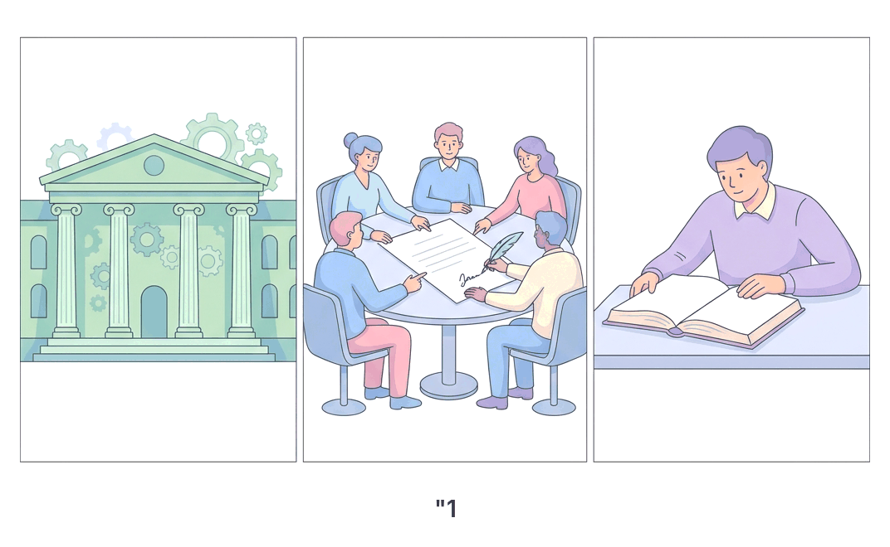
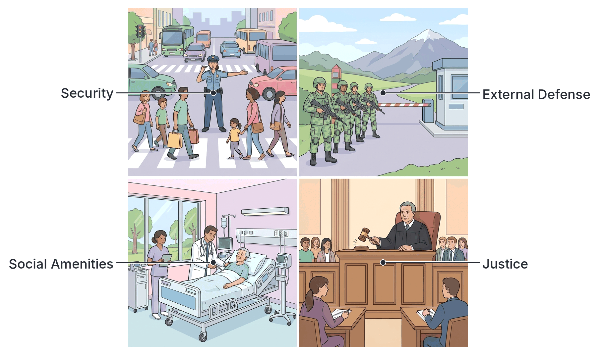

# JAMB Government Notes: Definition and Scope of Government

## What JAMB expects

This topic is Section A, Topic 1 of the JAMB Government syllabus: Definition and Scope of Government. It has no separate contents listed in the syllabus, but covers the meaning, nature and broad scope of the subject. 

By the end of these notes, you should be able to:
1. define Government as an institution;
2. state the characteristics of Government;
3. explain the functions of Government.

## The definitions and scope of Government

The word "government" is used in three different ways in textbooks and examinations. To fully understand its scope, you must know how to define government as an **institution of the state**, as a **process or art of governing**, and as an **academic field of study**.

**Objective i: define Government as an institution**

### 1. Government as an institution of the State
When we define government as an institution, we mean the **machinery, agency or body** through which the will of the state is formulated, expressed and carried out. 

A state (like Nigeria or Ghana) is an abstract concept; it cannot speak or act for itself. The government is the physical group of institutions and people that acts on behalf of the state. It is the organized structure that manages the affairs of the state. This machinery is traditionally divided into three arms:
*   **The Legislature:** The institution that makes the laws (e.g., the National Assembly in Nigeria).
*   **The Executive:** The institution that implements and enforces the laws (e.g., the President, Ministers, and civil service).
*   **The Judiciary:** The institution that interprets the laws and punishes offenders (e.g., the courts).

### 2. Government as a process or art of governing
As a process, government is defined as the act of ruling or administering a human society. It involves the procedures, methods and policies used in managing a state. 

When you hear people talk about "good government" or say "the government of the country is difficult," they are referring to government as a process. This includes how elections are conducted, how policies (like the removal of fuel subsidy or the introduction of a new currency) are implemented, and how rules are enforced to maintain law and order.

### 3. Government as an academic field of study
As an academic subject (often called **Political Science** at the university level), government is the study of political institutions, ideas, values, and the behavior of people in a society. 

When you sit in a classroom to learn about the Constitution, political parties, and international relations, you are treating government as a field of study. In Nigerian universities (such as the University of Ibadan or Ahmadu Bello University), studying government involves branches like:
*   **Public Administration:** How the civil service and government agencies run.
*   **International Relations:** How nations interact with each other.
*   **Political Theory/Ideologies:** The ideas behind forms of government (like democracy, socialism or fascism).

## Characteristics of Government

**Objective ii: state the characteristics of Government**

For an entity to be recognized as a government, it must possess certain key features:

1.  **Periodic Change:** Government is not permanent; it changes periodically. In a democracy like Nigeria, the government changes through periodic elections (usually every four years), while in a military regime, it might change through a coup d'état. 
2.  **Power and Authority:** Government has the recognized power and authority to give commands, make laws, and enforce them. Without power, a government cannot compel citizens to obey laws.
3.  **Legitimacy:** This is the acceptance and recognition of the government by the people. A government has legitimacy when the citizens accept its right to rule, usually because it came into power through a recognized, lawful process (like a free and fair election).
4.  **Revenue Generation:** Every government needs money to function. A key characteristic of government is its ability to generate revenue through taxation, tariffs, and exploiting natural resources (such as crude oil in Nigeria).
5.  **Machinery (Institutions):** Government operates through established institutions or arms. It must have a legislature to make laws, an executive to enforce them, and a judiciary to interpret them.
6.  **A Constitution:** A government operates based on a set of rules. In most modern states, there is a constitution (written or unwritten) that guides how the government functions and outlines the rights of the citizens.
7.  **Jurisdiction:** A government's authority is limited to a specific geographical territory. The Nigerian government, for example, can only enforce laws within the borders of Nigeria; it has no jurisdiction in neighboring Benin Republic.

### Comparing the State and the Government

A very common mistake is to use the words "State" and "Government" as if they mean exactly the same thing. In Political Science, they are different. Because JAMB frequently tests this difference (especially regarding permanence), you must know how to contrast them:

| Feature | The State | The Government |
| :--- | :--- | :--- |
| **Permanence** | **Permanent:** The State exists indefinitely unless conquered or dissolved. Nigeria as a state remains, year after year. | **Temporary:** The Government changes periodically (e.g., through elections or coups). |
| **Nature** | **Abstract:** The State is an invisible concept made up of territory, population, government, and sovereignty. | **Concrete:** The Government is the visible physical machinery and the people occupying offices. |
| **Membership** | **Everybody:** All citizens of a country are members of the State. | **Few people:** Only a small group of people (politicians, civil servants, judges) make up the government. |
| **Sovereignty** | Possesses supreme and absolute power (Sovereignty belongs to the State). | Exercises power on behalf of the State. It is merely an agent of the State. |

## Functions of Government

**Objective iii: explain the functions of Government**

Governments exist to perform certain essential duties for the well-being of the society. The core functions include:

1.  **Law Making:** Society needs rules to function smoothly. The government (through the legislature) formulates laws to guide the conduct of citizens and organizations.
2.  **Maintenance of Law and Order:** The government is responsible for ensuring internal peace and security. It does this through security agencies like the Nigerian Police Force, which prevents crimes and arrests offenders.
3.  **Protection of Lives and Property:** This is widely considered the most basic and fundamental duty of any government. If a government fails to protect its citizens from harm, it is considered a failed state.
4.  **Defense against External Aggression:** The government protects the territorial integrity of the state from foreign attacks. This is the duty of the Armed Forces (e.g., the Nigerian Army, Navy, and Air Force).
5.  **Provision of Social Amenities:** To improve the standard of living, the government provides infrastructure and social welfare services. This includes building roads, public hospitals, schools, electricity, and clean water supply.
6.  **Economic Regulation and Development:** The government manages the economy to prevent hardship. It regulates trade, controls the national currency (through the Central Bank), fights inflation, creates jobs, and plans for the country's economic development.
7.  **Administration of Justice:** Through the judiciary, the government interprets laws, settles disputes between citizens (or between citizens and the state), and punishes those who break the law. This ensures equity and fairness in society.
8.  **Conduct of Foreign Relations:** No country is an island. The government manages the state's relationship with other countries and international organizations (like the UN, AU, and ECOWAS). This is done through diplomacy, embassies, and the Ministry of Foreign Affairs.

## Key terms

| Term | Meaning |
| :--- | :--- |
| **Institution** | The established organization or machinery through which the state carries out its duties. |
| **State** | A politically organized body of people occupying a definite territory, living under a government, and possessing sovereignty. |
| **Legitimacy** | The widespread acceptance and recognition of a government's right to rule by the citizens. |
| **Sovereignty** | The supreme and independent power of a state to make and enforce laws within its territory without external interference. |
| **Jurisdiction** | The geographical territory or limits within which a government has the authority to exercise its power. |
| **Political Science** | The academic study of government, political behavior, and political systems. |

## Exam tips and common mistakes

*   **State vs. Government:** This is a classic JAMB trap. Remember that the **State is permanent**, while the **Government is temporary** and changes periodically. If a question asks which entity is permanent, the answer is the State.
*   **The three definitions:** JAMB often asks questions requiring you to identify which definition of government is being described. 
    *   If the question mentions "machinery", "agency", or "arms (executive, legislature, judiciary)", the answer is government as an **institution**.
    *   If it mentions "act of ruling", "administration", or "policies", it is referring to government as a **process**.
    *   If it mentions "field of study" or "university subject", it is referring to government as an **academic discipline**.
*   **Protection of lives:** When asked to identify the *primary* or most basic function of a government, "protection of lives and property" is the correct choice.
*   **Legitimacy vs. Power:** Power is the *ability* to force obedience, but legitimacy is the citizens' *willingness* to accept the government. A dictator has power, but might lack legitimacy.

## Quick summary

1. Government can be defined in three ways: as an institution of the state, as a process or art of governing, and as an academic field of study.
2. As an institution, government is the machinery or agency (Legislature, Executive, Judiciary) that acts on behalf of the state.
3. As a process, government refers to the act of administering a state and implementing policies.
4. As an academic subject, it is the study of political science, institutions, and political behavior.
5. Key characteristics of government include periodic change, power, authority, legitimacy, revenue generation, a constitution, and territorial jurisdiction.
6. The State is a permanent, abstract entity to which all citizens belong, whereas the Government is a temporary, physical machinery operated by a few people.
7. The primary functions of government include making laws, protecting lives and property, maintaining law and order, defending the territory against external attack, and providing social amenities.
8. The government also manages the economy, administers justice through the courts, and conducts foreign relations with other countries.

## Practice questions

**1. Government as an institution of the state can best be defined as the**
- A. act of voting during periodic elections
- B. machinery through which the will of the state is formulated and expressed
- C. academic study of political behavior in universities
- D. supreme power of a state to make laws for its citizens

**Answer: B.** When defined as an institution, government is the physical machinery or agency (such as the executive, legislature, and judiciary) that acts on behalf of the abstract state.

**2. Which of the following is a major difference between the State and the Government?**
- A. The State is temporary while the Government is permanent.
- B. The State consists of only politicians while the Government consists of everyone.
- C. The State is permanent while the Government changes periodically.
- D. The State has no territory while the Government has a territory.

**Answer: C.** The State remains indefinitely (e.g., Nigeria remains Nigeria), whereas the Government changes through elections, resignations, or military coups.

**3. The study of Public Administration and International Relations in the university is an example of government as**
- A. an institution
- B. a process of ruling
- C. a social contract
- D. an academic field of study

**Answer: D.** When government is studied as a subject (Political Science) to understand institutions, policies, and foreign relations, it is being defined as an academic field of study.

**4. The most fundamental function of a government is the**
- A. protection of lives and property
- B. construction of bridges and roads
- C. provision of free education for all citizens
- D. conduct of foreign relations with neighboring states

**Answer: A.** While all options are functions of a modern government, the primary and most fundamental reason governments exist is to protect the lives and property of citizens. 

**5. One characteristic of government in a democratic society is**
- A. unlimited use of military force
- B. periodic change of leadership
- C. lack of a constitution
- D. concentration of power in one person

**Answer: B.** In democracies, a key characteristic of the government is that it is not permanent; leadership changes periodically through elections.

**6. When citizens accept and recognize the right of a government to rule them, the government is said to possess**
- A. power
- B. jurisdiction
- C. sovereignty
- D. legitimacy

**Answer: D.** Legitimacy refers to the citizens' acceptance and recognition of the government's lawful right to govern them. A tempting wrong option is 'power', but power is merely the ability to compel, not necessarily the citizens' acceptance.

**7. Which of the following is responsible for defending a country against external aggression?**
- A. The Police Force
- B. The Civil Service
- C. The Armed Forces
- D. The Judiciary

**Answer: C.** The Armed Forces (Army, Navy, Air Force) are responsible for protecting the state's territorial integrity from external attacks. The Police handle internal law and order.

**8. When we say that a government has a defined limit within which it can exercise its authority, we are referring to its**
- A. periodic change
- B. jurisdiction
- C. revenue generation
- D. legitimacy

**Answer: B.** Jurisdiction refers to the specific territorial limits within which a government's authority and laws are recognized and can be enforced.

**9. The formulation and implementation of policies to manage the affairs of a state describes government as a**
- A. machinery
- B. process or art of governing
- C. field of study
- D. permanent entity

**Answer: B.** The act of ruling, administering, and implementing state policies refers to the definition of government as a process or art of governing.

**10. Which of the following is NOT a characteristic of government?**
- A. Generation of revenue
- B. Permanence
- C. Possession of a constitution
- D. Power and authority

**Answer: B.** Permanence is a characteristic of the *State*, not the *Government*. Governments change periodically, but the State remains.
