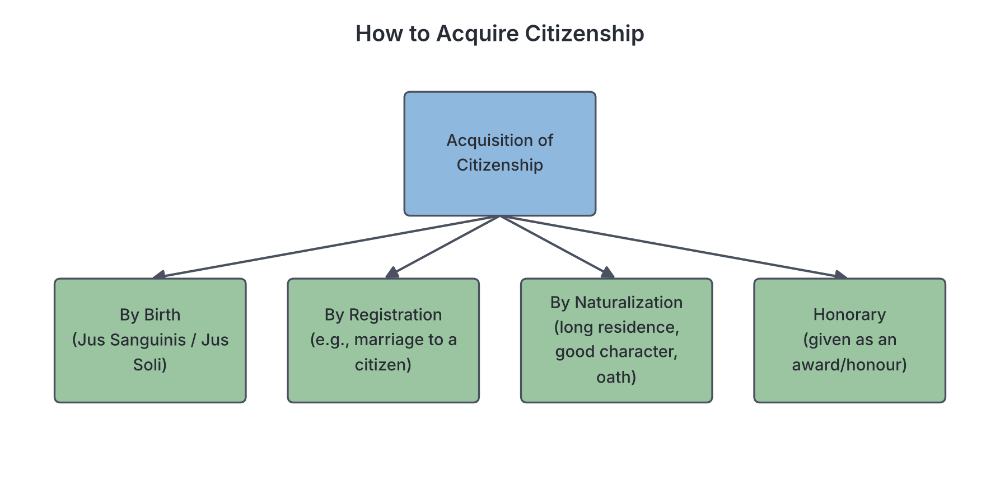
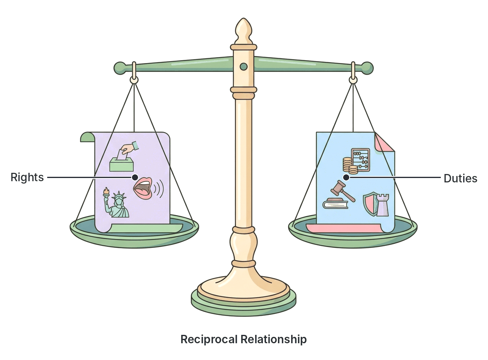

# JAMB Government Notes: Citizenship

## What JAMB expects

This topic is Section A, Topic 11 of the JAMB Government syllabus: Citizenship. It covers the following content items:

- **a.** Meaning, types;
- **b.** Citizenship rights;
- **c.** Dual citizenship, renunciation, deprivation;
- **d.** Duties and obligations of citizens;
- **e.** Duties and obligations of the state.

By the end of these notes, you should be able to:

1. **differentiate between the various methods of acquiring citizenship;**
2. **specify the rights and responsibilities of a citizen;**
3. **assess the obligations of the state.**

## Meaning and Types of Citizenship

**Content a: Meaning, types.**

### What is citizenship?
**Citizenship** is the legal status of being a recognized member of a particular state or country. A **citizen** is a person who legally belongs to a state, enjoys the full rights and privileges provided by its constitution (such as the right to vote), and owes loyalty and certain duties (such as paying taxes) to that state. 

In any state, the people living there can usually be divided into two main groups:
1. **Citizens:** Legal members of the state who enjoy full political and civil rights.
2. **Aliens (Foreigners):** People who live in a state but are citizens of another country. Aliens enjoy basic civil rights (like the right to life and protection) but do not have political rights (they cannot vote or hold major political offices). They can be expelled or deported if they break the law. 

There is also a third, very rare category known as **stateless persons**. These are people who are not recognized as citizens by any country in the world.

### Types of Citizenship
The "types" of citizenship generally refer to the ways or methods by which a person becomes a citizen. For example, a person can be a citizen by birth (natural-born) or a citizen by naturalization (acquired later in life). 

## Methods of Acquiring Citizenship

**Objective i: differentiate between the various methods of acquiring citizenship.**

A person can acquire citizenship through several methods. The laws governing these methods differ from country to country. Below are the standard methods commonly tested in JAMB.

### 1. Citizenship by Birth (Natural Citizenship)
This is the most common way of becoming a citizen. It happens automatically when a person is born. There are two main principles of citizenship by birth:

- **Jus Sanguinis (Right of Blood or Descent):** Under this principle, a child inherits the citizenship of their parents, regardless of where the child is born. For example, if two Nigerian citizens travel to France and have a baby there, the baby is a Nigerian citizen by blood. Under the 1999 Constitution (as amended), Nigeria relies heavily on this principle. You are a Nigerian citizen by birth if your parents or grandparents belong to an indigenous Nigerian community, or if they were citizens of Nigeria.
- **Jus Soli (Right of Soil or Territory):** Under this principle, a person acquires the citizenship of the country where they are physically born, regardless of the parents' nationality. For example, if a Nigerian couple travels to the United States and has a baby there, the baby automatically becomes an American citizen because the US practices *jus soli*. 

### 2. Citizenship by Registration
This method is usually designed for people who have a close legal or family tie to a citizen but are not citizens by birth. In Nigeria, for example, citizenship by registration can be granted to:
- A foreign woman who marries a Nigerian man.
- A person of full age and capacity born outside Nigeria, any of whose grandparents is a Nigerian citizen.

The applicant must prove they are of good character and have a clear intention to live in the country.

### 3. Citizenship by Naturalization
**Naturalization** is a legal process by which a foreigner (alien) who has lived in a country for a long period applies to become a citizen. Because the applicant has no automatic blood or birth tie to the country, the conditions are usually very strict. 

While the exact conditions vary by country, common conditions for naturalization (like those in Nigeria's constitution) include:
- **Age and capacity:** The applicant must be of full age (usually 18 or above) and of sound mind.
- **Long residence:** The person must have lived in the country for a continuous, specified number of years (often 15 years in Nigeria, though the exact figure is subject to constitutional amendments).
- **Good character:** They must have a clean criminal record.
- **Acceptability:** They must be acceptable to the local community where they live.
- **Contribution:** They must be capable of making a useful contribution to the advancement or progress of the country.
- **Oath of Allegiance:** They must swear an oath of loyalty to their new country.

### 4. Citizenship by Conquest or Annexation
When a country defeats another country in a war or annexes (takes over) a territory, the people living in the conquered territory may be forced or permitted to become citizens of the conquering state.

### 5. Honorary Citizenship
This is a ceremonial form of citizenship granted by a state to a distinguished foreigner as a mark of honour. It is usually given to individuals who have made exceptional contributions to the world or to that specific country (for example, famous scientists, humanitarians, or sports figures).

### Comparison of Methods of Acquiring Citizenship

| Feature | Citizenship by Birth | Citizenship by Registration | Citizenship by Naturalization | Honorary Citizenship |
| --- | --- | --- | --- | --- |
| **Who gets it?** | Anyone born to citizen parents (blood) or within the territory (soil). | Usually foreign spouses of citizens, or descendants born abroad. | Foreigners (aliens) with no direct family ties to the country. | Distinguished foreigners. |
| **Is it automatic?** | Yes, it happens automatically at birth. | No, the person must apply and meet criteria. | No, it involves a rigorous legal application process. | No, it is offered by the government as a gift. |
| **Duration required** | None (instant at birth). | Short or no residency requirement, depending on marriage/ties. | Long residency requirement (often 10–15 years). | None. |
| **Can it be revoked?** | Very rarely (usually cannot be revoked in Nigeria). | Yes, if obtained by fraud or for disloyalty. | Yes, if the person commits treason, fraud, or serious crimes. | Yes, if the person brings the country into disrepute. |

## Dual Citizenship, Renunciation and Deprivation

**Content c: Dual citizenship, renunciation, deprivation.**

### Dual Citizenship
**Dual citizenship** (or dual nationality) occurs when a person is legally recognized as a citizen of two different countries at the same time. 

- **How it happens:** A person might be born to Nigerian parents (acquiring Nigerian citizenship by *jus sanguinis*) but be born in the United States (acquiring American citizenship by *jus soli*). 
- **Nigerian law:** The laws on dual citizenship change depending on the constitution and amendments. Under the 1999 Constitution of Nigeria (as amended), dual citizenship is generally allowed **only** if the person is a Nigerian citizen by birth. If a foreigner applies to become a Nigerian citizen by naturalization or registration, they may be required to renounce their original citizenship. 

### Renunciation of Citizenship
**Renunciation** is the voluntary act of giving up one's citizenship. 
If a citizen of a country decides they no longer want to belong to that country (for example, because they want to take up the citizenship of a country that does not allow dual nationality), they can formally declare that they are giving up their citizenship. 

To renounce citizenship, the person usually must:
1. Be of full age (an adult) and of sound mind.
2. Register a formal declaration of renunciation with the government. 
*(Note: A government may sometimes refuse or delay a renunciation during a time of war.)*

### Deprivation of Citizenship
While renunciation is voluntary, **deprivation** is forced. It is the legal process by which a government strips a person of their citizenship. 

In many countries, including Nigeria, a citizen by **birth** cannot be deprived of their citizenship. However, a person who became a citizen by **registration** or **naturalization** can be stripped of it if they:
1. **Commit fraud:** If they provided false information or fake documents during their application.
2. **Show disloyalty:** If they show by act or speech that they are disloyal to the country.
3. **Commit treason:** If they assist the enemy during a war against their new country.
4. **Are imprisoned:** If, within a few years of naturalizing (e.g., within 5 to 7 years), they are sentenced to a long term of imprisonment (e.g., 3 years or more).

## Citizenship Rights

**Content b: Citizenship rights.**
**Objective ii: specify the rights and responsibilities of a citizen.**

**Rights** are the fundamental privileges, freedoms, and benefits that a citizen enjoys in a state, which are backed and protected by the law (usually entrenched in the constitution as Fundamental Human Rights). The state has a duty to ensure citizens can enjoy these rights.

Rights are generally grouped into three main categories:

### 1. Civil (or Personal) Rights
These are basic rights needed to exist as a free human being. They are usually enjoyed by both citizens and aliens living in the country. Examples include:
- **Right to life:** No one can be killed arbitrarily.
- **Right to personal liberty:** Freedom from unlawful arrest, slavery, or forced labour.
- **Freedom of expression and the press:** The right to speak and write freely.
- **Freedom of religion and thought:** The right to practice any religion.
- **Freedom of movement:** The right to move freely across the country.
- **Right to a fair hearing:** The right to defend oneself in an impartial court of law.

### 2. Political Rights
These rights allow a person to participate in the government and political process of the state. **Political rights are strictly reserved for citizens.** Aliens cannot enjoy them. Examples include:
- **Franchise (Right to vote):** The right to cast a ballot in elections.
- **Right to be voted for:** The right to contest for political offices (like Governor or President).
- **Right to hold public office:** The right to be appointed as a minister, judge, or civil servant.
- **Right to join a political party:** The right to associate politically.

### 3. Economic and Social Rights
These rights relate to the economic well-being and social security of the citizen. Examples include:
- **Right to own property:** Citizens can buy and own land or goods anywhere in the country.
- **Right to work and earn a living:** The freedom to choose a legal profession.
- **Right to education and healthcare:** (Though in many developing nations, these are objectives of state policy rather than strictly enforceable legal rights).

### Limitations to Citizens' Rights
A common exam concept is that **rights are not absolute**. This means rights have boundaries to prevent people from harming others or threatening the state. Rights can be limited or denied under certain conditions:
- **Right to life** can be taken away if a person is sentenced to death by a competent court for a capital offence (like murder).
- **Right to personal liberty** can be restricted if a person is convicted of a crime and sent to prison, or if they have a highly infectious disease and must be quarantined.
- **Freedom of expression** does not permit slander (speaking lies to damage someone's reputation), libel (writing lies to damage reputation), or inciting public violence.
- **State of Emergency:** During a war or severe crisis, the government can suspend certain rights (like freedom of movement) to restore order.

## Duties and Obligations of Citizens

**Content d: Duties and obligations of citizens.**
**Objective ii: specify the rights and responsibilities of a citizen.**

Citizenship is a two-way street. It is a **reciprocal relationship**: just as the state gives the citizen rights, the citizen owes the state certain duties and obligations. **Duties** are the responsibilities a citizen is expected to perform for the growth, peace, and survival of the state. 

Key duties of a citizen include:
1. **Payment of taxes:** Citizens must pay their taxes (such as income tax and VAT) promptly. This provides the government with the revenue needed to build roads, schools, and hospitals.
2. **Obedience to the law:** Citizens must obey the constitution and all laws made by the government to ensure peace and order.
3. **Defending the country:** Citizens must be willing to defend the nation against internal subversion and external aggression. In some countries, this includes mandatory military service.
4. **Voting in elections:** It is a civic responsibility (though not legally forced in Nigeria) for adult citizens to register and vote for good leaders.
5. **Respect for national symbols:** Citizens must respect symbols of national unity, such as the National Flag, the National Anthem, the National Pledge, and the currency (e.g., the Naira).
6. **Assisting law enforcement:** Citizens should help the police by reporting crimes and giving evidence in court.
7. **National service:** Participating in schemes designed to build the nation. For example, in Nigeria, university and polytechnic graduates must participate in the **National Youth Service Corps (NYSC)** for one year.
8. **Protection of public property:** Citizens must not vandalize public infrastructure like electricity cables, pipelines, or public school buildings.

## Duties and Obligations of the State

**Content e: Duties and obligations of the state.**
**Objective iii: assess the obligations of the state.**

Just as citizens have duties, the government (representing the state) has obligations it must fulfill for the people. If the state fails in these duties, the citizens suffer, and the government may lose its legitimacy. 

The major obligations of the state include:
1. **Protection of life and property:** This is the primary duty of any state. The government must provide armed forces (Army, Navy, Air Force) to defend against external attacks, and a Police Force to prevent internal crime.
2. **Provision of social amenities:** The state is obliged to provide basic infrastructure and welfare services, such as good roads, clean water, electricity, hospitals, and schools.
3. **Maintenance of law, order, and justice:** The state must set up a fair judicial system (courts) to resolve disputes, punish offenders, and ensure that no one is oppressed.
4. **Economic development and employment:** The state must create a favorable economic environment that encourages businesses, provides jobs, and controls inflation, ensuring citizens can earn a decent living.
5. **Protection of fundamental human rights:** The state must respect and protect the constitutional rights of its citizens, preventing abuse of power by security agents or wealthy individuals.
6. **Fostering national unity:** In a diverse country like Nigeria, the state must promote policies that encourage harmony, integration, and a sense of belonging among all ethnic and religious groups.
7. **Maintaining good foreign relations:** The state must defend its citizens living abroad and maintain peaceful, profitable relations with other countries and international organizations.

## Key terms

| Term | Meaning |
| --- | --- |
| **Citizenship** | The legal status of being a recognized member of a state, with full rights and duties. |
| **Citizen** | A legal member of a state who owes allegiance to it and is entitled to its protection and political rights. |
| **Alien (Foreigner)** | A person living in a country who is a citizen of another country. They lack political rights. |
| **Jus Sanguinis** | Citizenship by right of blood or descent (inheriting citizenship from parents). |
| **Jus Soli** | Citizenship by right of the soil (acquiring citizenship based on the country of birth). |
| **Naturalization** | The legal process by which a foreigner becomes a citizen of another country after fulfilling certain strict conditions (like long residence). |
| **Dual Citizenship** | The status of being a legally recognized citizen of two different countries at the same time. |
| **Renunciation** | The voluntary act of giving up one's citizenship. |
| **Deprivation** | The legal and forceful removal of a person's citizenship by the government (usually applies to naturalized citizens). |
| **Franchise** | The political right to vote in an election. |

## Exam tips and common mistakes

- **Political rights are for citizens only:** A very common JAMB trick is to ask which right an alien does *not* have. The answer is always a political right (voting, contesting elections, holding public office). Aliens do have civil rights (right to life, movement, fair hearing).
- **Jus Sanguinis vs. Jus Soli:** Memorize the difference. *Sanguinis* means blood (parents). *Soli* means soil (place of birth). 
- **Deprivation rules:** Remember that a citizen by *birth* cannot easily be deprived of their citizenship by the government. Deprivation usually targets citizens by *naturalization* or *registration* who commit treason, fraud, or serious crimes.
- **Renunciation vs. Deprivation:** Renunciation is *voluntary* (you choose to give it up). Deprivation is *involuntary* (the government takes it away from you).
- **Rights are not absolute:** If a question asks if human rights are absolute, the answer is no. They can be limited by laws (e.g., imprisonment for crimes, or curfews during emergencies).
- **Reciprocal relationship:** Always remember that citizenship is a two-way street. The state provides rights and protection; the citizen provides duties and loyalty.

## Quick summary

1. Citizenship is the legal membership of a state. A state is made up of citizens (who have full rights) and aliens (who have civil rights but no political rights).
2. Citizenship can be acquired by birth (blood/descent or soil/territory), registration (marriage/ties), naturalization (long residence and good character), conquest, or as an honorary award.
3. Dual citizenship means holding the passport/nationality of two countries. Renunciation is voluntarily giving up citizenship, while deprivation is the state forcefully taking it away.
4. Citizens enjoy civil rights (life, liberty), political rights (voting), and economic rights (working). These rights are not absolute and can be restricted legally (e.g., imprisonment for a crime).
5. Citizens owe the state duties such as paying taxes, obeying laws, defending the nation, and respecting national symbols.
6. The state has obligations to its citizens, primarily the protection of life and property, maintaining law and order, and providing social amenities.

## Practice questions

**1. A person who is legally recognized as a member of a state and enjoys full constitutional rights is a**

- A. refugee
- B. citizen
- C. alien
- D. stateless person

**Answer: B.** A citizen is a legal member of a state who enjoys full rights, including political rights, and owes duties to the state.

**2. The principle of acquiring citizenship through the nationality of one's parents is known as**

- A. *jus soli*
- B. naturalization
- C. *jus sanguinis*
- D. honorary citizenship

**Answer: C.** *Jus sanguinis* means "right of blood", meaning citizenship is inherited from the parents. *Jus soli* refers to the place of birth.

**3. Which of the following rights is strictly reserved for citizens and denied to aliens?**

- A. Right to life
- B. Freedom of religion
- C. Right to fair hearing in court
- D. Right to vote and be voted for

**Answer: D.** The right to vote and contest elections (franchise) is a political right, which is the major difference in rights between citizens and aliens.

**4. A naturalized citizen can be deprived of his citizenship if he**

- A. refuses to vote in a local election
- B. is found guilty of treason against the state
- C. travels out of the country for a vacation
- D. marries a foreigner

**Answer: B.** Treason (disloyalty to the state) or providing false information during application are grounds for depriving a naturalized person of their citizenship. 

**5. The process by which a citizen voluntarily gives up his citizenship of a country is called**

- A. deprivation
- B. deportation
- C. renunciation
- D. naturalization

**Answer: C.** Renunciation is the voluntary giving up of citizenship. Deprivation is when the state forces the removal of citizenship.

**6. Which of the following is NOT a condition for acquiring citizenship by naturalization?**

- A. The applicant must be of good character
- B. The applicant must have resided in the country for a specified long period
- C. The applicant must be related by blood to a citizen
- D. The applicant must swear an oath of allegiance

**Answer: C.** Blood relationship is not required for naturalization; that applies to citizenship by birth. Naturalization is for foreigners who have lived in the country for a long time.

**7. Fundamental human rights are not absolute because**

- A. the constitution changes every year
- B. they can be restricted to protect public peace and the rights of others
- C. the police can arrest anyone they dislike
- D. aliens do not have rights

**Answer: B.** Rights are limited to ensure that one person's freedom does not harm society or infringe on the rights of other people. 

**8. Which of the following is a primary obligation of the state to its citizens?**

- A. Paying taxes to the citizens
- B. Protection of lives and property
- C. Forcing citizens to join a political party
- D. Arresting political opponents

**Answer: B.** The fundamental duty of any government is the security and welfare of its people, which means protecting life and property.

**9. The relationship between a citizen and the state is said to be reciprocal because**

- A. both the citizen and the state have identical powers
- B. the citizen pays taxes and the state keeps the money
- C. the state provides protection and rights, while the citizen performs duties and obligations
- D. the state only protects citizens who vote for the ruling party

**Answer: C.** Reciprocal means mutual; the state gives rights and protection, and in return, the citizen gives loyalty and performs duties (like paying taxes).

**10. A foreigner who is granted citizenship as a mark of distinction for their immense contribution to humanity receives**

- A. honorary citizenship
- B. citizenship by conquest
- C. dual citizenship
- D. citizenship by birth

**Answer: A.** Honorary citizenship is a ceremonial award given to distinguished individuals by a state as a mark of honour.

<!-- COVERAGE
obj i | Methods of Acquiring Citizenship
obj ii | Citizenship Rights
obj ii | Duties and Obligations of Citizens
obj iii | Duties and Obligations of the State
item a | Meaning and Types of Citizenship
item b | Citizenship Rights
item c | Dual Citizenship, Renunciation and Deprivation
item d | Duties and Obligations of Citizens
item e | Duties and Obligations of the State
-->
