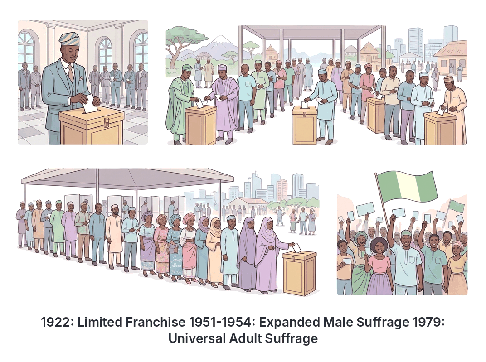
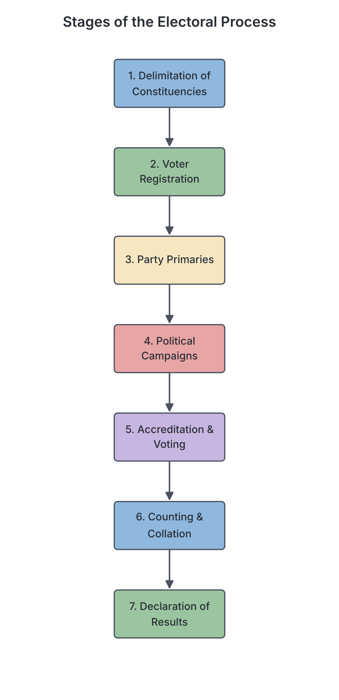

# JAMB Government Notes: The Electoral Process

## What JAMB expects

This topic is Section A, Topic 12 of the JAMB Government syllabus: The Electoral Process.

This file covers the following content items:
- **a. Suffrage** – evolution, types;
- **b. Election** – types, ingredients of free and fair election, pre- and post-election crisis;
- **c. Electoral System** - types, advantages and disadvantages of each;
- **d. Electoral Commission** – functions, problems.

By the end of these notes, you should be able to:
1. distinguish the different types of franchise; (Objective i)
2. identify and explain the types of electoral systems; (Objective ii)
3. analyse the various electoral processes. (Objective iii)

**Note on the syllabus wording:** In Government, the words **suffrage** and **franchise** mean exactly the same thing. The syllabus uses "suffrage" in the contents and "franchise" in the objectives. You should treat them as interchangeable.

---

## Suffrage (Franchise)

**Objective i: distinguish the different types of franchise.**
**Content a: Suffrage – evolution, types.**

**Suffrage** (or **franchise**) is the legal right of a citizen to vote in political elections and to be voted for into public office. 

### Evolution of Suffrage

Throughout history, the right to vote was not given to everyone. It usually evolved through struggle and constitutional changes.

1. **Early restrictions:** In many early democracies (like ancient Greece) and pre-20th-century Europe, voting was restricted to wealthy men who owned land. Women, slaves, and poor people could not vote.
2. **Evolution in Nigeria:** 
   - Before 1922, Nigerians had no voting rights under British colonial rule.
   - The **Clifford Constitution of 1922** introduced the "elective principle" for the first time, but it was a **limited franchise**. Only adult males in Lagos (3 seats) and Calabar (1 seat) who earned a gross income of at least £100 a year and had lived there for a year could vote. 
   - The **Macpherson Constitution of 1951** and **Lyttelton Constitution of 1954** expanded voting rights, but it was still restricted in many areas. For example, in Northern Nigeria, only men could vote (male adult suffrage).
   - The **1979 Constitution** finally introduced fully nationwide **Universal Adult Suffrage**, giving voting rights to all eligible adult citizens, including women in Northern Nigeria, for the first time.

### Types of Suffrage (Franchise)

There are two main types of suffrage: **Limited (Restricted) Franchise** and **Universal Adult Franchise**.

#### 1. Limited (Restricted) Franchise
This is a system where only certain groups of people are allowed to vote, based on specific qualifications. 
- **Property/Income qualification:** Only people who own a certain amount of property or earn a specific income can vote (e.g., Nigeria in 1922).
- **Educational qualification:** Only people who can read and write, or hold a certain level of education, are allowed to vote.
- **Gender qualification:** Voting rights are given to only one sex (usually men), excluding the other.
- **Racial qualification:** Voting rights are given based on race or skin colour (e.g., the apartheid system in South Africa before 1994).

| Advantages of Limited Franchise | Disadvantages of Limited Franchise |
| --- | --- |
| It ensures that only mature, educated, or responsible citizens make political decisions. | It is highly undemocratic and discriminates against the poor, women, or minorities. |
| It reduces the chance of uneducated voters being manipulated by deceitful politicians. | It causes political apathy among the excluded groups and can lead to violent protests. |
| Property owners are believed to have a higher stake in the economy and will vote responsibly. | It makes the government unaccountable to the majority of the population. |

#### 2. Universal Adult Suffrage
This is the system where **every adult citizen** of a country is legally allowed to vote and be voted for, regardless of their sex, religion, race, wealth, or education, provided they meet the minimum voting age (which is 18 years in Nigeria). Note that lunatics, imprisoned criminals, and bankrupt individuals may still be excluded.

| Advantages of Universal Adult Suffrage | Disadvantages of Universal Adult Suffrage |
| --- | --- |
| It guarantees political equality (one man, one vote). | Uneducated or uninformed citizens can easily be misled by sweet-talking politicians. |
| It makes the government truly representative and accountable to all the people. | Elections become very expensive and difficult to organize due to the massive number of voters. |
| It prevents discrimination and protects the rights of minority and vulnerable groups. | It can lead to the election of popular but incompetent leaders. |

---

## Elections

**Content b: Election – types, ingredients of free and fair election, pre- and post-election crisis.**
**Objective iii: analyse the various electoral processes.**

An **election** is the formal process through which eligible citizens vote to choose their political leaders or representatives to hold public office.

### Types of Elections

1. **Direct Election:** Voters cast their ballots directly for the candidates they want to represent them. For example, Nigerians directly vote for their President, Governors, and lawmakers.
2. **Indirect Election:** Voters elect a small group of representatives (an **electoral college**), and this small group then votes to choose the final leader. The United States uses an electoral college system for its presidential elections.
3. **By-election:** An election held to fill a political office that has become vacant *before* the next general election. This happens if the officeholder dies, resigns, or is recalled by the voters.
4. **General Election:** A nationwide election held at regular intervals (e.g., every four years in Nigeria) to elect leaders for all or most political offices at the same time.
5. **Run-off Election (Second Ballot):** An election held between the top two candidates from a previous election because no candidate met the required percentage of votes to win outright. 
6. **Primary Election:** An internal party election where members of a political party vote to choose the candidate who will represent the party in the main general election.
7. **Referendum (Plebiscite):** Not an election for a person, but a direct "Yes" or "No" vote by the electorate on a major national issue or government policy (e.g., creating a new state or approving a new constitution).

### Ingredients of a Free and Fair Election

For an election to be considered acceptable and democratic, certain conditions must be met:
- **An Independent Electoral Commission:** The body organizing the election must not be controlled by the ruling party or the government.
- **Universal Adult Suffrage:** All eligible adult citizens must be allowed to vote without discrimination.
- **Secret Ballot System:** Voters must be able to cast their votes in secret, so no one can intimidate or punish them for their choice.
- **Impartial Judiciary and Security Agencies:** The police must protect all citizens equally, and the courts must resolve election disputes fairly without taking bribes.
- **Multi-party System:** There must be more than one political party to give the voters real choices.
- **Equal Access to Mass Media:** All political parties must have equal opportunities to campaign on radio, television, and in newspapers.
- **Periodic Elections:** Elections must be held regularly at clearly defined intervals (e.g., every four years) to prevent leaders from staying in power forever.

### Electoral Crises: Pre- and Post-Election

Elections in developing nations often face severe problems, broadly divided into crises that happen before voting and those that happen after.

**Pre-Election Crises (Before and during campaigns):**
- **Voter Register Manipulation:** Deliberately removing names of voters in opposition strongholds or registering underage voters and foreigners.
- **Campaign Violence and Intimidation:** Thugs attacking the rallies of opposition candidates or assassinating political rivals.
- **Unequal playing field:** The ruling party using government money and state media for its campaigns, while denying the same to the opposition.
- **Hijacking of electoral materials:** Stealing ballot papers or sensitive materials before they reach the polling units.

**Post-Election Crises (During counting and after announcement):**
- **Ballot stuffing and snatching:** Thugs stealing ballot boxes or filling them with illegally thumb-printed papers.
- **Falsification of results (Rigging):** Changing the actual vote counts at the collation centers before the final announcement.
- **Violent protests and riots:** When voters feel the election was rigged, they may take to the streets, leading to loss of life and destruction of property. 

*Historical Nigerian Examples:* The Western Region election crisis of 1964/1965 (which led to the "Operation Wetie" riots), the massively rigged 1983 general elections, and the crisis following the annulment of the June 12, 1993 presidential election.

---

## Electoral Systems

**Objective ii: identify and explain the types of electoral systems.**
**Content c: Electoral System - types, advantages and disadvantages of each.**

An **electoral system** is the set of rules and methods that determine how elections are conducted, how votes are cast, and how those votes are translated into seats in government.

### 1. Simple Plurality / First-Past-The-Post (FPTP) System
In this system, the country is divided into single-member constituencies. The candidate who gets the **highest number of votes** wins the election, even if they do not get more than half (50%) of the total votes. 
*Example:* If Candidate A gets 40%, Candidate B gets 35%, and Candidate C gets 25%, Candidate A wins all the power, even though 60% of people voted against them. Nigeria uses FPTP for legislative elections (Senate and House of Representatives).

| Advantages of FPTP | Disadvantages of FPTP |
| --- | --- |
| It is very simple to understand and operate. | It does not reflect the exact wishes of the majority (a winner can win with a minority of total votes). |
| It is cheap and fast; results can be calculated quickly without complex maths. | It encourages a two-party system and squeezes out smaller, minority parties. |
| It usually produces a clear winner and a stable single-party government. | Many votes are "wasted" because voting for a losing candidate yields no representation. |

### 2. Absolute Majority System
In this system, a candidate must win **more than 50% (half) of the total votes cast** to be declared the winner. If no candidate gets more than 50% in the first round, a **run-off election (second ballot)** is held between the top two candidates.

*Nigerian Context:* Nigeria uses a modified absolute majority system for the President and Governors. A presidential candidate must not only win the highest votes but also secure at least 25% of the votes in two-thirds of the states to ensure they have widespread national support.

| Advantages of Absolute Majority | Disadvantages of Absolute Majority |
| --- | --- |
| The winner has the clear support of the majority of the voters, making them truly representative. | It is very expensive and time-consuming because it often requires a second election (run-off). |
| It prevents a widely disliked candidate from slipping into power just because the opposition was divided. | It can cause voter fatigue, leading to low turnout in the second round. |

### 3. Proportional Representation (PR) System
This system is used for electing a legislature (parliament). Seats are awarded to political parties **in proportion to the percentage of votes they receive**. If a party gets 30% of the total national vote, it gets 30% of the seats in parliament. It is used in countries like Israel and South Africa.

| Advantages of Proportional Representation | Disadvantages of Proportional Representation |
| --- | --- |
| It is the fairest system because no vote is wasted; every vote counts towards a seat. | It is mathematically complex and difficult for uneducated voters to understand. |
| It gives minority parties representation in government. | It often leads to a coalition government (no single party has a majority), which can be weak and unstable. |
| It discourages election rigging at local levels since total national votes matter. | The bond between the voter and their local representative is lost, as people often vote for a party list, not an individual. |

[IMAGE: A comparative graphic showing FPTP vs Proportional Representation (PR). On the left (FPTP): A bar chart where Party A gets 40% of votes but takes 100% of a district's single seat (a large trophy icon). On the right (PR): A pie chart of votes (Party A 40%, Party B 35%, Party C 25%) next to a Parliament seating chart colored exactly to match the pie chart (40% blue seats, 35% red seats, 25% green seats). Labels to add later: "First-Past-The-Post: Winner takes all", "Proportional Representation: Seats match vote percentage". Clean flat textbook style, white background.]

### 4. Alternative Vote (Preferential Voting) System
Voters do not just mark one candidate. They rank the candidates in order of preference (1st choice, 2nd choice, 3rd choice). If no one gets an absolute majority of 1st choices, the candidate with the fewest votes is eliminated, and their votes are transferred to the voters' 2nd choices, until someone reaches 50%.

---

## Electoral Commissions and the Electoral Process

**Objective iii: analyse the various electoral processes.**
**Content d: Electoral Commission – functions, problems.**

An **Electoral Commission** is the official, independent government body responsible for organizing, conducting, and supervising elections in a country. In Nigeria, this body is the **Independent National Electoral Commission (INEC)** for federal and state elections, while State Independent Electoral Commissions (SIECs) handle local government elections.

### Functions of an Electoral Commission

1. **Voter Registration:** Registering eligible voters and maintaining an accurate voters' register.
2. **Registration of Political Parties:** Screening and officially recognizing political parties to participate in elections.
3. **Delimitation of Constituencies:** Dividing the country or state into electoral districts (constituencies) to ensure equal representation based on population.
4. **Provision of Electoral Materials:** Printing and distributing ballot papers, ballot boxes, and voting cubicles to all polling units.
5. **Screening of Candidates:** Checking the credentials of candidates nominated by parties to ensure they meet constitutional requirements.
6. **Conducting Elections:** Managing the actual voting process on election day.
7. **Collation and Announcement of Results:** Counting votes accurately and officially declaring the winners.
8. **Voter Education:** Educating citizens on their electoral rights and how to vote properly to reduce void (invalid) votes.

### Analysis of the Electoral Process (Step-by-Step)
How exactly does an election happen?
1. **Delimitation:** The country is divided into constituencies.
2. **Voter Registration:** Citizens register to get their Permanent Voter Cards (PVCs).
3. **Party Primaries:** Parties choose their candidates.
4. **Campaigns:** Candidates travel to convince voters.
5. **Accreditation and Voting:** On election day, voters' identities are verified (e.g., using card readers or BVAS), and they cast their votes in secret.
6. **Sorting and Counting:** Votes are counted at the polling unit in front of party agents.
7. **Collation and Declaration:** Results from units are grouped together at ward, local government, state, and national levels until the final winner is declared.

### Problems Facing Electoral Commissions in Developing Nations

- **Lack of True Independence:** The executive branch usually appoints the chairman and funds the commission, allowing the ruling party to manipulate the commission's decisions.
- **Inadequate Funding:** Electoral commissions often do not receive funds on time, leading to poor preparation.
- **Logistical Challenges:** Bad roads and poor transport networks cause late arrival of election materials to remote areas, disenfranchising voters.
- **Electoral Violence and Intimidation:** Ad-hoc staff (like NYSC members in Nigeria) are often attacked or kidnapped by political thugs, making it dangerous to conduct elections.
- **Corruption of Officials:** Some electoral officers accept bribes from politicians to falsify results or allow underage voting.
- **Voter Apathy:** Because of a history of rigging, many citizens refuse to register or vote, feeling that their votes will not count.

---

## Key terms

| Term | Meaning |
| --- | --- |
| **Suffrage / Franchise** | The legal right of citizens to vote and be voted for in an election. |
| **Universal Adult Suffrage** | The right of all eligible adult citizens to vote, regardless of sex, race, wealth, or education. |
| **Constituency** | A geographical area divided for the purpose of electing a representative. |
| **Delimitation** | The process of dividing a country into electoral constituencies. |
| **Electoral College** | A body of representatives elected by the voters to cast the final votes for a specific office (indirect election). |
| **First-Past-The-Post (FPTP)** | An electoral system where the candidate with the highest number of votes wins, even if it's not a 50% majority (simple plurality). |
| **Proportional Representation** | An electoral system where parties gain seats in proportion to the number of votes cast for them. |
| **By-election** | An election held to fill a political office that has become vacant between general elections. |
| **Run-off Election** | A second election held between the top candidates when no one achieves the required absolute majority in the first round. |
| **Referendum (Plebiscite)** | A direct vote by the electorate on a specific political question or public policy, rather than for a candidate. |

---

## Exam tips and common mistakes

*   **Franchise vs Suffrage:** These mean the same thing. Do not let questions confuse you by using "franchise" when you memorized "suffrage".
*   **By-election vs Run-off:** A *by-election* fills a sudden vacancy (someone died or resigned). A *run-off (or rerun)* happens because the first election did not produce a legally valid winner (no one got 50%).
*   **FPTP vs Absolute Majority:** *First-Past-The-Post* only requires a candidate to get the *highest* votes (plurality). *Absolute majority* requires *more than 50%*. Know the difference perfectly.
*   **Delimitation:** Remember that this is a core function of the Electoral Commission. It simply means drawing electoral boundaries.
*   **Universal Adult Suffrage:** A common trick is to ask what this system ignores. Answer: It ignores property, gender, and educational qualifications, but it *does* require a minimum age (adulthood).

---

## Quick summary

1. **Suffrage (Franchise)** is the right to vote and be voted for. It evolved from limited franchise (based on property, education, gender) to universal adult suffrage.
2. **Universal Adult Suffrage** grants voting rights to all eligible adults and ensures political equality, though it faces challenges with an uneducated electorate.
3. An **election** can be direct, indirect, a by-election (to fill a vacancy), or a run-off (if no clear winner emerges).
4. **Free and fair elections** require an independent electoral commission, a secret ballot, universal suffrage, and an impartial judiciary.
5. **Electoral Systems** define how votes translate to seats. **First-Past-The-Post** awards victory to the candidate with the most votes. **Absolute Majority** requires over 50%. **Proportional Representation** divides seats based on a party's total vote percentage.
6. The **Electoral Commission** (like INEC) handles voter registration, party registration, delimitation of constituencies, and conducting elections.
7. Electoral commissions face problems like political interference, poor funding, logistical failures, corruption, and electoral violence.

---

## Practice questions

**1. The legal right of citizens to vote and be voted for is known as**
- A. enfranchisement
- B. suffrage
- C. constitutionalism
- D. human rights

**Answer: B.** Suffrage (or franchise) is specifically the political right to vote and run for office. 

**2. An electoral system in which the candidate with the highest number of votes is declared the winner is called**
- A. proportional representation
- B. absolute majority system
- C. first-past-the-post system
- D. alternative vote system

**Answer: C.** In the first-past-the-post (or simple plurality) system, the candidate with the most votes wins, even if they do not secure an absolute majority (over 50%).

**3. An election conducted to fill a vacant seat in the legislature before a general election is called a**
- A. primary election
- B. run-off election
- C. by-election
- D. plebiscite

**Answer: C.** A by-election fills a vacancy caused by death, resignation, or recall. A common mistake is choosing "run-off election," but a run-off is a second round of voting to decide a tied or inconclusive first election.

**4. A major advantage of proportional representation is that it**
- A. produces a strong, single-party government
- B. ensures no vote is wasted, giving minority parties a voice
- C. is very easy for uneducated voters to understand
- D. eliminates the need for an electoral commission

**Answer: B.** Proportional representation allocates seats according to vote percentage, ensuring that even smaller parties get representation, so no vote is totally "wasted."

**5. Which of the following is an essential ingredient of a free and fair election?**
- A. A one-party system
- B. An open ballot system where choices are seen
- C. An independent electoral commission
- D. Property qualification for voters

**Answer: C.** An electoral body free from government manipulation is crucial. Open ballots and one-party systems are undemocratic, and property qualifications violate universal suffrage.

**6. The process of dividing a country into electoral districts is known as**
- A. constituency delimitation
- B. voter registration
- C. electoral gerrymandering
- D. political socialization

**Answer: A.** Delimitation is the legal and constitutional process of drawing the boundaries of electoral districts (constituencies) by the electoral commission.

**7. In Nigeria, the 1922 Clifford Constitution introduced an electoral system characterized by**
- A. universal adult suffrage
- B. limited franchise based on income
- C. female adult suffrage
- D. proportional representation

**Answer: B.** The 1922 Constitution limited voting to men in Lagos and Calabar who earned a gross income of at least £100 annually, making it a property/income-restricted franchise.

**8. When voters elect a set of representatives who then vote on their behalf to choose the president, the system is known as**
- A. direct election
- B. proportional representation
- C. a referendum
- D. indirect election

**Answer: D.** This is an indirect election, utilizing an electoral college. The citizens do not vote directly for the final leader.

**9. A major problem that often causes post-election crises in developing countries is**
- A. delimitation of constituencies
- B. the registration of political parties
- C. falsification of election results at collation centres
- D. the use of a secret ballot system

**Answer: C.** Rigging and falsification of results immediately after counting are direct triggers for post-election violence. Options A, B, and D are standard electoral procedures.

**10. Universal adult suffrage is highly democratic because it**
- A. ensures that only educated people make choices
- B. guarantees political equality among all citizens
- C. prevents military coups
- D. makes elections less expensive

**Answer: B.** Universal adult suffrage ensures that all eligible adults have an equal voice (one man, one vote) regardless of wealth, gender, or status, which is the foundation of political equality.

<!-- COVERAGE
obj i | Suffrage (Franchise)
obj ii | Electoral Systems
obj iii | Elections
obj iii | Electoral Commissions and the Electoral Process
item a | Suffrage (Franchise)
item b | Elections
item c | Electoral Systems
item d | Electoral Commissions and the Electoral Process
-->
