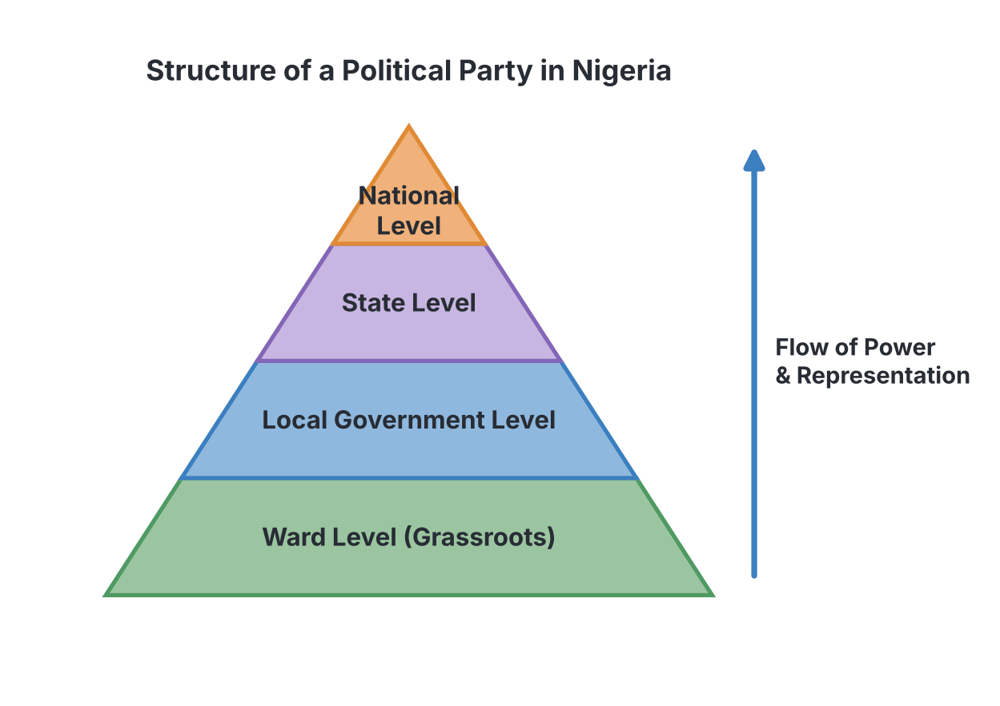
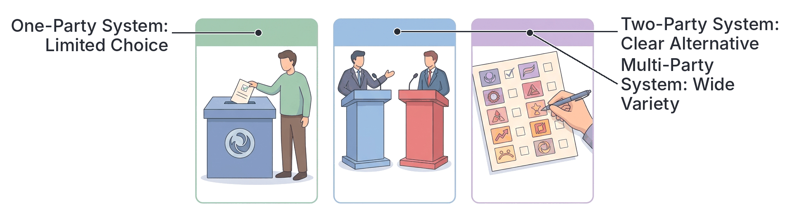

# JAMB Government Notes: Political Parties and Party Systems

## What JAMB expects

This topic is Topic 13 of the JAMB Government syllabus: Political Parties and Party Systems. It is a very important part of democratic governance.

This file covers the following content items:
- **a. Political parties:** Definition, organization, functions.
- **b. Party Systems:** Definition, organization, functions, merits and demerits.

By the end of these notes, you should be able to:
1. assess the role of political parties;
2. distinguish between types of party systems.

*Note:* This file explains the general theory of political parties and party systems. For details on specific political parties in Nigeria’s history (such as the NNDP, AG, NCNC, NPN, PDP, or APC), please refer to `B8-political-parties-and-party-politics-in-post-independence-nigeria.md`.

---

## What is a Political Party?

**Content a: Political parties – Definition**

A **political party** is an organized group of individuals who share similar political beliefs, ideologies, and interests, and who come together for the primary purpose of contesting elections to win and control the machinery of government.

Unlike a social club or a pressure group (which only seeks to influence government policies), a political party's ultimate goal is to **take over power** and run the government according to its stated plans and policies. 

### Key Features of a Political Party
1. **Primary Aim:** To win elections and control the government.
2. **Organization:** It is highly organized from the grassroots (local) level to the national level.
3. **Ideology/Manifesto:** It has a set of guiding principles and a written document called a **manifesto**, which outlines its promises and programmes to the citizens if voted into power.
4. **Broad Membership:** It seeks to attract as many members and voters as possible from different parts of the country.

---

## Organization of Political Parties

**Content a: Political parties – Organization**

To win elections in a country as large as Nigeria, a political party must be highly organized. Power and responsibilities are shared across different levels and organs.

### Levels of Organization
Political parties are usually structured hierarchically, much like a pyramid, starting from the smallest unit to the whole country:

1. **The Ward Level:** This is the smallest organizational unit. A ward usually covers a few streets, a village, or a neighbourhood. The party has a ward executive committee that mobilizes local residents to register and vote.
2. **The Local Government Level:** All the wards in a Local Government Area (LGA) report to this level. The party holds meetings here to select candidates for local council elections.
3. **The State Level:** This level coordinates party activities across all LGAs in a state. It is responsible for organizing campaigns for the governorship and state house of assembly elections.
4. **The National Level:** This is the peak of the party's structure. The national headquarters coordinates the party across the entire country and prepares for federal elections (like the presidency and the national assembly).

### Key Organs of a Political Party
At the national and state levels, parties operate through specific committees and bodies:

- **The National Convention:** This is the highest decision-making body (the supreme organ) of the party. It is a massive meeting of delegates from all over the country. The convention elects the party’s national executives, amends the party constitution, and officially nominates the party's presidential candidate.
- **National Executive Committee (NEC):** This group runs the daily affairs of the party at the national level. It includes the National Chairman, Secretary, Treasurer, and other key officials.
- **Board of Trustees (BoT):** This is often made up of the elders, founders, and most experienced politicians in the party. They act as the "conscience" of the party and resolve major internal disputes.
- **Working Committees:** Smaller groups (like the National Working Committee - NWC) that handle urgent administrative duties on behalf of the larger NEC.

---

## The Functions and Role of Political Parties

**Content a: Political parties – Functions | Objective i: assess the role of political parties**

Political parties are the lifeblood of modern democracy. Without them, organizing voters and running a government would be chaotic. Their major roles and functions include:

1. **Contesting Elections:** This is their most important function. Parties provide the platform for individuals to run for political office. They print posters, hold rallies, and campaign to win the votes of the electorate.
2. **Political Education:** During campaigns, parties educate the citizens about their rights, important national issues, and how the government works. They help the masses understand complex government policies.
3. **Political Recruitment:** Parties identify, train, and present capable individuals for political leadership. They serve as a training ground for future leaders.
4. **Forming the Government:** If a party wins the majority of seats in an election, it forms the government and appoints its members to key positions (like ministers and commissioners) to implement its manifesto.
5. **Acting as an Opposition (The Watchdog):** The party or parties that lose the election do not just disappear. They form the **opposition**. Their role is to strictly monitor the ruling party, criticize its mistakes, expose corruption, and provide alternative solutions. This keeps the ruling party on its toes.
6. **Aggregating Interests:** In a diverse country like Nigeria, citizens want different things (e.g., better roads, free education, agricultural loans). A political party gathers all these different demands (interests) and combines them into one national programme or manifesto.
7. **Promoting National Integration:** By establishing branches in every state and recruiting members from different ethnic and religious groups, political parties help to unite the country. (In Nigeria, the constitution actually requires a party to have a national spread before it can be registered by INEC).

### Common Mistake
Students often confuse **political parties** with **pressure groups**. Remember: a political party wants to **win elections and form the government**. A pressure group (like a trade union or a student union) only wants to **influence the government** to pass favorable laws; it does not field candidates for elections.

---

## Party Systems: Definition and Organization

**Content b: Party Systems – Definition, organization, functions**

A **party system** refers to the pattern or arrangement of political parties operating within a country's political system. It is usually defined by the number of political parties that have a realistic, genuine chance of winning elections and forming the government.

A party system is not just about how many parties exist on paper; it is about how many actually compete effectively for power. The organization and functions of a party system depend heavily on which type of system is in operation. 

---

## Types of Party Systems (Merits and Demerits)

**Content b: Party Systems – merits and demerits | Objective ii: distinguish between types of party systems**

There are four main types of party systems. We will look at how each is organized, its merits (advantages), and its demerits (disadvantages).

### 1. One-Party System

In a one-party system, only a single political party is legally allowed to exist, or only one party has a realistic chance of holding power. 

- ***De jure* one-party system:** The law or constitution expressly forbids the existence of any other party (e.g., the Communist Party in China, or Cuba).
- ***De facto* one-party system:** The law allows multiple parties, but in reality, one party is so dominant that it wins every major election for decades (e.g., the True Whig Party in Liberia historically, or the ANC in South Africa which has dominated since 1994, though SA is officially multi-party).

**Merits of a One-Party System:**
- **Political Stability:** Because there is no fierce competition between different parties, the government is highly stable.
- **Fast Decision-Making:** The government can pass laws and execute policies quickly without wasting time arguing with an opposition party.
- **Promotes National Unity:** It forces everyone to work together under one umbrella, minimizing ethnic or religious divisions that multiple parties might exploit.
- **Cost-Effective:** Elections are cheaper to conduct since there is no massive inter-party campaigning.

**Demerits of a One-Party System:**
- **Leads to Dictatorship:** Because there is no opposition to check its excesses, the ruling party often becomes tyrannical and oppressive.
- **Lack of Choice:** Voters are forced to accept the candidates presented by the single party, denying them true democratic choice.
- **Suppression of Human Rights:** Freedom of speech, association, and the press are often severely restricted to prevent people from challenging the ruling party.
- **Political Apathy:** Citizens may lose interest in voting because they know the outcome of the election is already decided.

### 2. Two-Party System

A two-party system is one in which two major political parties dominate the political landscape. While small, minor parties may exist, only the two dominant parties have a realistic chance of winning the majority and forming the government. Power usually alternates between these two.

Examples: 
- **The United States:** Democrats and Republicans.
- **The United Kingdom:** Conservative Party and Labour Party.
- **Nigeria (Historical):** During the aborted Third Republic (1989–1993), the military government of Ibrahim Babangida decreed a strict two-party system, creating the Social Democratic Party (SDP) and the National Republican Convention (NRC).

**Merits of a Two-Party System:**
- **Clear Choice for Voters:** Voters have a simple, straightforward choice between two distinct sets of policies and leadership.
- **Strong and Stable Government:** One party usually wins a clear majority, allowing it to govern effectively without needing to form unstable coalitions.
- **Effective Opposition:** The party that loses becomes a strong, unified opposition ready to hold the government accountable and offer itself as a "government-in-waiting."
- **Broad-based Policies:** To win, both parties must appeal to the center and create policies that benefit a wide range of citizens, rather than focusing on narrow ethnic interests.

**Demerits of a Two-Party System:**
- **Divides the Nation:** It can polarize the country into two hostile, opposing camps.
- **Limits Democratic Choice:** Citizens whose views do not fit neatly into either of the two major parties are left without a real voice.
- **Neglects Minorities:** Small minority groups may be ignored by both large parties.

### 3. Multi-Party System

A multi-party system is one where three or more political parties have the capacity to gain control of government, either separately or in a coalition. This is the most common system in modern democracies.

Examples:
- **Nigeria:** Currently operates a multi-party system with major parties like APC, PDP, LP, NNPP, and many smaller ones.
- **Other countries:** India, Israel, Italy, France.

**Merits of a Multi-Party System:**
- **Wider Democratic Choice:** It provides voters with a wide variety of ideologies, candidates, and programmes to choose from.
- **Prevents Dictatorship:** Power is dispersed among several groups, making it very difficult for one party or individual to become a dictator.
- **Caters to Diverse Interests:** Every group, no matter how small or specific (e.g., environmentalists, specific ethnic groups), can form a party to represent their interests.

**Demerits of a Multi-Party System:**
- **Political Instability:** No single party may win an absolute majority, leading to a **coalition government** (where two or more parties join together to form a government). Coalitions frequently collapse if the parties disagree, causing the government to fall.
- **Expensive:** It costs a lot of money for the electoral commission (like INEC) to print long ballot papers and manage elections for many parties.
- **Encourages Ethnic Politics:** In countries like Nigeria, a multi-party system can lead to the formation of parties based strictly on tribal, religious, or regional lines, which threatens national unity.

### 4. Zero-Party System

A zero-party (or no-party) system is one in which political parties are completely banned or do not exist. Candidates stand for elections entirely on their own individual merit, character, and personal popularity, rather than on a party platform.

Examples:
- Traditional pre-colonial African societies.
- Some absolute monarchies today, like Saudi Arabia and Oman.
- In Nigeria, some past local government elections under military rule were conducted on a zero-party basis.

**Merits:** Focuses on the real character of the candidate; eliminates violent party rivalries and the high costs of party campaigns.
**Demerits:** Lacks organized structures to check leaders; makes passing laws in parliament difficult because there is no organized "ruling party" block to support policies.

---

## Distinguishing Between Types of Party Systems

**Objective ii: distinguish between types of party systems**

To help you compare and distinguish these systems for the exam, use this table:

| Feature | One-Party System | Two-Party System | Multi-Party System |
| :--- | :--- | :--- | :--- |
| **Number of dominant parties** | Only One | Two major parties | Three or more |
| **Choice available to voters** | Very limited / None | Clear choice between two options | Very wide and diverse choice |
| **Government Stability** | Very high (often forced) | High (clear majority usually won) | Low (coalitions can easily collapse) |
| **Role of Opposition** | None (illegal or heavily suppressed) | Very strong, unified, and active | Fragmented among several smaller parties |
| **Risk of Dictatorship** | Extremely high | Very low | Very low |
| **Cost of Elections** | Very low | Moderate | Very high (due to many parties) |
| **Example** | China, Cuba | USA, UK (effectively) | Nigeria, India, Israel |

---

## Key terms

| Term | Meaning |
| :--- | :--- |
| **Political Party** | An organized group of people seeking to win elections and control the government. |
| **Party System** | The pattern or number of political parties that compete effectively for power in a country. |
| **Manifesto** | A written document containing the proposed policies, promises, and programmes of a political party. |
| **National Convention** | The highest decision-making organ of a political party. |
| **Opposition** | The political party (or parties) that did not win the election and whose job is to monitor and criticize the ruling party. |
| **Coalition Government** | A government formed jointly by two or more political parties when no single party wins an absolute majority. |
| **De jure** | According to the law. |
| **De facto** | In practice or reality (even if not strictly by law). |
| **Zero-Party System** | An electoral system where no political parties are allowed, and candidates run purely on personal merit. |

---

## Exam tips and common mistakes

- **The primary aim of a party:** If a JAMB question asks for the primary function of a political party, always look for the option that mentions **"winning elections"** or **"controlling the government"**.
- **Political Party vs. Pressure Group:** A common trap. Remember that pressure groups do *not* contest elections to form the government; they only seek to influence it. 
- **The UK and USA have minor parties:** Students often think the USA and UK *only* have two parties. They have many small parties, but they operate a **two-party system** because only the two major ones have a realistic chance of winning national power.
- **Nigeria's Third Republic:** Questions often ask which system Babangida created in 1989. It was a **two-party system** (SDP and NRC). Currently, Nigeria operates a **multi-party system**.
- **Coalitions belong to multi-party systems:** If a question asks which system features coalition governments, the answer is always the multi-party system.

---

## Quick summary

1. A political party is an organized group aiming to capture political power and form the government by winning elections.
2. Political parties are organized from the grassroots (ward level) up to the national level, with the National Convention being the supreme organ.
3. The major functions of political parties include contesting elections, recruiting political leaders, educating the masses, aggregating interests, and providing a healthy opposition.
4. A party system is the arrangement and number of political parties competing for power in a country.
5. A one-party system offers stability but leads to dictatorship and lacks democratic choice.
6. A two-party system provides a clear choice and strong opposition but can divide the country into two extreme camps.
7. A multi-party system offers wide choices and prevents dictatorship but is expensive to run and can lead to unstable coalition governments.
8. A zero-party system allows candidates to run on their own merit without party backing.

---

## Practice questions

**1. The primary objective of a political party is to**
- A. educate the citizens on their fundamental rights
- B. win elections and control the government
- C. influence the government to pass favorable laws
- D. provide financial assistance to its members

**Answer: B.** The defining characteristic of a political party is its desire to capture political power and run the government, unlike a pressure group which merely influences government (Option C).

**2. The highest decision-making body of a political party is usually the**
- A. Board of Trustees
- B. National Working Committee
- C. National Convention
- D. Ward Executive Committee

**Answer: C.** The National Convention is the supreme organ, where delegates from across the country meet to elect executives and choose presidential candidates. 

**3. The document that outlines the programmes, policies, and promises of a political party is known as the**
- A. constitution
- B. white paper
- C. gazette
- D. manifesto

**Answer: D.** A manifesto is the document a party presents to voters explaining what it intends to do if voted into power.

**4. A major advantage of a two-party system is that it**
- A. creates a strong and recognized opposition
- B. allows for the formation of coalition governments
- C. gives everyone in the country their own specific party
- D. leads to a dictatorship

**Answer: A.** In a two-party system, the party that loses immediately becomes a strong, unified opposition. Option B is a feature of a multi-party system.

**5. Which of the following party systems often leads to the formation of a coalition government?**
- A. Zero-party system
- B. One-party system
- C. Two-party system
- D. Multi-party system

**Answer: D.** In a multi-party system, it is common that no single party wins an absolute majority, forcing two or more parties to join together (form a coalition) to run the government.

**6. A system in which political parties are completely banned and candidates run based on their personal merit is a**
- A. totalitarian system
- B. zero-party system
- C. de facto one-party system
- D. dictatorial system

**Answer: B.** A zero-party system is one without political parties; individuals contest elections purely on their own popularity and character.

**7. In Nigeria, the aborted Third Republic under General Ibrahim Babangida operated a**
- A. multi-party system
- B. one-party system
- C. zero-party system
- D. two-party system

**Answer: D.** The military government legally decreed a strict two-party system, creating only the SDP and the NRC for the elections.

**8. Which of the following is a major demerit of a one-party system?**
- A. It makes decision-making too slow
- B. It leads to dictatorial governance and lack of choice
- C. It causes massive political instability
- D. It is too expensive to conduct elections

**Answer: B.** Because there is no opposition to challenge the ruling party, a one-party system usually strips citizens of true democratic choice and breeds dictatorship. Decision-making is actually fast (Option A is incorrect) and it is usually highly stable (Option C is incorrect).

**9. The function of aggregating interests by political parties implies that they**
- A. force voters to accept a single ideology
- B. combine the different demands of citizens into a broad national policy
- C. collect money from interest groups to fund campaigns
- D. merge multiple small parties into one large party

**Answer: B.** Aggregating interests means listening to the diverse needs of different groups in society and wrapping them up into a single, comprehensive manifesto or plan.

**10. When a ruling party is constantly criticized and monitored to ensure it delivers on its promises, this is the function of the**
- A. electoral commission
- B. ruling cabinet
- C. opposition party
- D. civil service

**Answer: C.** The opposition party acts as a "watchdog," scrutinizing government policies, exposing flaws, and providing alternative solutions.

<!-- COVERAGE
obj i | The Functions and Role of Political Parties
obj ii | Distinguishing Between Types of Party Systems
item a | What is a Political Party?
item a | Organization of Political Parties
item a | The Functions and Role of Political Parties
item b | Party Systems: Definition and Organization
item b | Types of Party Systems (Merits and Demerits)
-->
