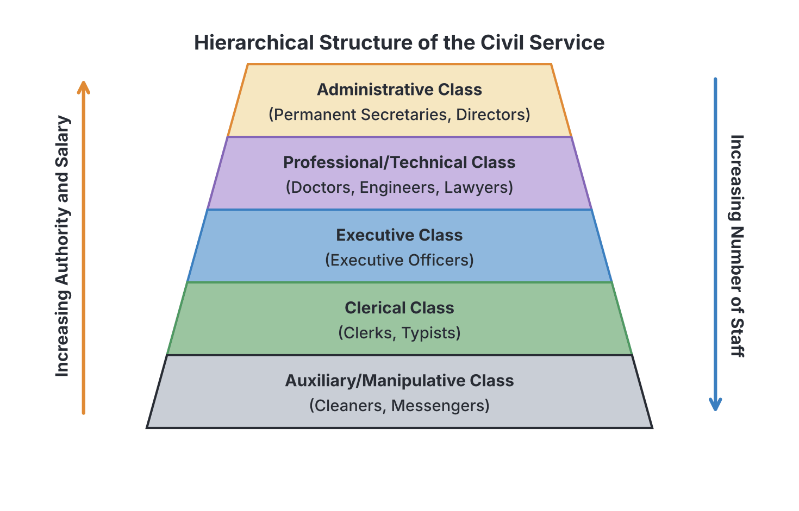

# JAMB Government Notes: The Civil Service and Public Service

## What JAMB expects

This topic is Section A, Topic 16 of the JAMB Government syllabus: The Civil Service/Public Service. It covers the following content areas:

*   **a.** Definition, characteristics, functions, structure, control and problems of the civil service.
*   **b.** Definition, characteristics, functions, structure, control and problems of the public service.

By the end of these notes, you should be able to:

1.  Analyse the significance of civil service in governance.
2.  Distinguish between the civil service and public service.

## The Civil Service

**Content a: Definition, characteristics, functions, structure, control and problems of the civil service.**

### Definition of the Civil Service
The **civil service** is the body of permanent, professional government workers employed in government ministries and extra-ministerial departments to help the executive arm of government formulate and implement policies. 

Workers in the civil service are called **civil servants**. Examples of civil service institutions include the Ministry of Education, the Ministry of Health, and the Ministry of Finance. 

Crucially, the civil service does **not** include members of the armed forces (army, navy, air force), the police, the judiciary, or political appointees like Ministers and Commissioners. It is strictly the administrative engine of the government ministries.

### Characteristics of the Civil Service
JAMB frequently tests the core principles that guide the civil service. These include:

1.  **Permanence (Security of Tenure):** Civil servants enjoy permanent employment until they reach retirement age (usually 60 years of age or 35 years of service in Nigeria, though this varies for specific sectors like education). They do not lose their jobs when a government is voted out of power.
2.  **Political Neutrality (Impartiality):** Civil servants must not participate in partisan politics. They cannot campaign for political parties, wear party uniforms, or contest in elections. They must loyally serve whatever political party forms the government.
3.  **Anonymity:** Civil servants work behind the scenes. They are neither publicly praised for good policies nor publicly blamed for bad ones—the political head (the Minister) takes all the glory or the blame. Furthermore, a civil servant cannot speak to the press or publish articles about government matters without official permission.
4.  **Meritocracy:** Recruitment and promotion are meant to be based on educational qualifications, skills, and performance in competitive examinations, not on personal connections. (In Nigeria, this is balanced with the **Federal Character** principle to ensure all regions are represented).
5.  **Hierarchical Organization:** The civil service is structured like a pyramid, with a clear chain of command flowing from the highest official (the Permanent Secretary) down to the lowest rank (messengers and cleaners).
6.  **Framework of Rules:** Civil servants operate under strict, written regulations known as the **Public Service Rules** (formerly called General Orders), which guide their conduct, leave, promotion, and discipline.

### Functions of the Civil Service
1.  **Policy Implementation:** The primary function of the civil service is to execute (carry out) the laws and policies made by the government. 
2.  **Policy Formulation Advice:** Civil servants (especially those in the top administrative class) have years of experience. They advise political heads (Ministers) on the best ways to create and design government policies.
3.  **Preparation of the Budget:** The civil service compiles the financial needs of all government departments to help the executive prepare the annual budget.
4.  **Drafting of Bills:** Technical experts in the civil service, such as legal draftsmen in the Ministry of Justice, help write the bills that the executive submits to the legislature.
5.  **Continuity of Government:** Because civil servants are permanent, they provide institutional memory. When a new government takes over, the civil service teaches them how the government runs and ensures that essential services do not stop.
6.  **Revenue Generation:** Departments within the civil service are responsible for collecting taxes, customs duties, and other revenues for the government.

### Structure of the Civil Service
The civil service is divided into distinct classes based on educational qualifications and functions. 

1.  **The Administrative Class:** This is the highest class. It consists of Permanent Secretaries, Directors, and Deputy Directors. They advise Ministers on policy formulation, coordinate the ministry, and make high-level decisions. **Qualification:** A good university degree and success in competitive civil service exams.
2.  **The Professional/Technical Class:** This class consists of specialists whose jobs require specific technical training, such as medical doctors, engineers, lawyers, architects, and accountants. They provide expert advice and execute specialized projects. **Qualification:** A university degree in a specific professional field, often with professional certification.
3.  **The Executive Class:** These are middle-level managers (Executive Officers, Senior Executive Officers). They are responsible for the day-to-day implementation of government policies and supervising the clerical staff. **Qualification:** Usually a Higher National Diploma (HND), Ordinary National Diploma (OND), or sometimes a first degree.
4.  **The Clerical Class:** This class includes clerks, typists, secretaries, and record keepers. They handle the routine paperwork, filing, sorting of mail, and typing of documents. **Qualification:** Senior School Certificate Examination (SSCE), GCE, or NECO.
5.  **The Manipulative/Auxiliary/Messengerial Class:** This is the lowest class. It consists of cleaners, drivers, messengers, and security guards who perform manual labour and keep the environment orderly. **Qualification:** First School Leaving Certificate (FSLC) or lower secondary education.

### Control of the Civil Service
To prevent civil servants from abusing their power or becoming inefficient, they are controlled both internally and externally:

*   **Internal Control:**
    *   **Civil Service Commission:** An executive body that handles the recruitment, promotion, transfer, and discipline (including dismissal) of civil servants.
    *   **Ministry of Finance:** Controls the release of funds to various ministries. If a ministry does not follow financial rules, its funding can be restricted.
    *   **Hierarchical Control:** Senior officers can issue queries, warnings, or suspensions to junior officers.
    *   **Public Service Rules:** The strict code of conduct every civil servant must obey.
*   **External Control:**
    *   **Legislative Control:** The legislature can summon top civil servants to explain how money was spent or how policies are being managed. They also approve the budget.
    *   **Judicial Control:** Citizens can take civil servants or government departments to court if their rights are violated.
    *   **Public Complaints Commission (The Ombudsman):** An independent body established to investigate complaints of administrative injustice, abuse of power, or unfair treatment by civil servants against ordinary citizens.

### Problems of the Civil Service
Despite its importance, the civil service in Nigeria and many other developing nations faces several challenges:
1.  **Red-tapism (Bureaucracy):** This is the excessive adherence to official rules, protocols, and paperwork. It causes frustrating delays in decision-making and project execution.
2.  **Corruption and Bribery:** Some civil servants demand bribes from citizens to process files, or they embezzle public funds.
3.  **Tribalism and Nepotism:** Favouring people from one's own ethnic group or family during recruitment and promotion, which destroys meritocracy.
4.  **Over-staffing and Ghost Workers:** Ministries are often bloated with unproductive workers. Sometimes, names of non-existent or deceased people ("ghost workers") are kept on the payroll to siphon salaries.
5.  **Political Interference:** Politicians frequently interfere in the promotion and posting of civil servants, punishing those who disagree with them and rewarding loyalists, which destroys political neutrality.
6.  **Poor Conditions of Service:** Low salaries, delayed payment of pensions, and poorly equipped offices lead to low morale, frequent strikes, and a negative attitude to work.

## The Public Service

**Content b: Definition, characteristics, functions, structure, control and problems of the public service.**

### Definition of the Public Service
The **public service** is a broad term that encompasses all workers employed in government-owned institutions, agencies, and corporations at the local, state, and federal levels. 

The public service includes the civil service, but goes much further. It includes workers in:
*   Government Ministries (the Civil Service).
*   The Armed Forces (Army, Navy, Air Force) and the Police.
*   Public Corporations and Parastatals (e.g., Nigerian National Petroleum Corporation Limited, Federal Airports Authority of Nigeria).
*   Government-owned schools, universities, and hospitals.
*   Agencies and Commissions (e.g., INEC, EFCC).

**Textbook variation:** Because the civil service is a *subset* of the public service, people sometimes use the words interchangeably in everyday conversation. However, for JAMB, you must remember that **all civil servants are public servants, but not all public servants are civil servants.**

### Characteristics of the Public Service
The public service shares many characteristics with the civil service (such as being created by law and funded largely by the government), but there are differences depending on the specific institution:
*   **Varying Degrees of Neutrality and Anonymity:** While a ministry clerk must remain anonymous, the Managing Director of a public corporation or the spokesperson for the Police regularly speaks to the press and defends their organization publicly.
*   **Profit Motive (in some cases):** While the civil service is purely for public welfare, some public service institutions (like public corporations) are established to make a profit or generate significant commercial revenue.
*   **Different Terms of Service:** While civil servants enjoy strict permanence, political appointees who head public boards or agencies often leave when a new government comes to power.

### Functions of the Public Service
While the civil service focuses on advising the government and administrative policy work, the broader public service provides direct essential services to the citizens. Its functions include:
1.  **Provision of Amenities:** Supplying electricity, water, and public transport through specific agencies.
2.  **Maintenance of Law and Order:** Carried out by the police and armed forces.
3.  **Economic Development:** Driving specific economic sectors (like oil exploration via the NNPC).
4.  **Social Welfare:** Providing public education and healthcare.

### Structure of the Public Service
Unlike the civil service, which uses the uniform Administrative-to-Auxiliary class structure, the structure of the broader public service varies by institution:
*   **Public Corporations:** Headed by a Board of Directors appointed by the President or Governor, with a Managing Director or Director-General handling daily operations.
*   **Universities:** Headed by a Vice-Chancellor, structured into academic and non-academic staff.
*   **The Military/Police:** Structured by strict ranks (e.g., General, Colonel, Inspector, Sergeant) rather than administrative classes.

### Control of the Public Service
The public service is controlled similarly to the civil service (Legislature, Judiciary, Ombudsman), but with some specific additions:
*   **Ministerial Control:** A specific public corporation is usually supervised by a government ministry. For example, the Federal Ministry of Aviation controls the Federal Airports Authority of Nigeria (FAAN).
*   **Board of Directors:** Internal control and discipline for parastatals are handled by their appointed boards, not the Civil Service Commission.

### Problems of the Public Service
The public service faces the same problems as the civil service—red-tapism, corruption, poor funding, tribalism, and ghost workers. Additional problems include:
*   **Monopoly Complacency:** Many public corporations are monopolies (they have no competitors). This lack of competition often leads to inefficiency and poor customer service.
*   **Conflicting Objectives:** Public corporations are often torn between the government's demand to provide cheap social services to the masses and the economic need to make a profit.

## Significance of the civil service in governance

**Objective i: analyse the significance of civil service in governance.**

The civil service is often described as the **"engine room"** or the **"bureaucratic backbone"** of the executive arm of government. Its significance in governance cannot be overstated:

1.  **Translating Promises into Action:** Politicians win elections by making promises (manifestos). However, politicians usually lack the technical expertise or workforce to build schools, implement tax reforms, or run healthcare systems. The civil service is significant because it translates political promises into actual, workable policies. Without it, governance would stall.
2.  **Ensuring Institutional Stability:** In a democracy, governments change frequently through elections. Ministers come and go. The civil service provides stability and continuity. They hold the records, know the procedures, and keep the country running smoothly during election transitions or political crises. 
3.  **Guiding Inexperienced Politicians:** Newly appointed Ministers often know very little about the inner workings of their ministries. The highly experienced Administrative Class (Permanent Secretaries) guides them, preventing the government from making illegal or disastrous administrative blunders.
4.  **Maintaining National Unity:** Through principles like the Federal Character, the civil service brings together workers from all ethnic and religious backgrounds, fostering a sense of national inclusion and unity in governance.

## Distinguishing between the Civil Service and Public Service

**Objective ii: distinguish between the civil service and public service.**

To master JAMB questions on this topic, you must clearly separate the two concepts. Use the comparison table below.

| Feature | Civil Service | Public Service |
| :--- | :--- | :--- |
| **Scope and Definition** | A narrow term. Refers **only** to workers in government ministries and extra-ministerial departments. | A broad term. Refers to **all** government workers, including the civil service, military, police, schools, and corporations. |
| **Administrative Head** | Headed overall by the **Head of Civil Service**; individual ministries are headed by a **Permanent Secretary**. | Headed by various authorities (e.g., Managing Directors, Vice-Chancellors, Inspectors-General, Boards of Directors). |
| **Examples of Institutions** | Ministry of Education, Ministry of Defence, Ministry of Health, Ministry of Finance. | The Army, the Police, NNPC, Central Bank of Nigeria (CBN), public universities, FAAN. |
| **Anonymity and Neutrality** | Strictly observed. Civil servants must not speak to the press or engage in politics. | Less strictly observed in some parts. Heads of agencies or corporations often grant press interviews and defend their agencies publicly. |
| **Recruitment Body** | Exclusively recruited and disciplined by the **Civil Service Commission**. | Recruited by various specific boards (e.g., Police Service Commission, University Governing Councils, Parastatal Boards). |
| **Profit Motive** | Purely service-oriented. Never designed to make a commercial profit. | Some arms (like public corporations) are expected to generate revenue or make a profit. |

## Key terms

| Term | Meaning |
| :--- | :--- |
| **Civil Service** | The body of government workers employed in ministries to formulate and implement policies. |
| **Public Service** | All workers employed by the government, including ministries, military, police, and parastatals. |
| **Red-tapism** | Excessive bureaucracy and strict adherence to official rules, leading to frustrating delays. |
| **Anonymity** | The principle that civil servants work behind the scenes and cannot be praised, blamed, or speak to the press publicly. |
| **Neutrality** | The principle that civil servants must not engage in partisan politics and must serve any government loyally. |
| **Permanence** | Security of tenure; civil servants do not lose their jobs when the government changes. |
| **Civil Service Commission** | The body responsible for recruiting, promoting, and disciplining civil servants. |
| **Ombudsman** | Also known as the Public Complaints Commission; it investigates citizen complaints against administrative abuses by public officials. |
| **Permanent Secretary** | The highest-ranking career civil servant and administrative head of a ministry. |
| **Ghost Workers** | Fake or deceased names kept on a government payroll so corrupt officials can steal their salaries. |

## Exam tips and common mistakes

*   **Common mistake:** Confusing **anonymity** with **neutrality**. Remember: Neutrality means "no party politics". Anonymity means "no public blame/praise and no press interviews".
*   **Military and Police:** JAMB loves to ask where a soldier or police officer belongs. They are **Public Servants**, but they are **NOT Civil Servants**. 
*   **The highest class:** The highest class of the civil service is the **Administrative Class** (where you find Permanent Secretaries). 
*   **Recruitment vs. Finance:** The Civil Service Commission handles employment and discipline, but the Ministry of Finance controls the money.
*   **Who takes the blame?** If a ministry fails, the **Minister** takes the blame publicly, not the Permanent Secretary or the civil servants (due to the principle of anonymity).
*   **Red-tapism:** This is the most frequently tested problem of the civil service. If a question describes "too much paperwork" or "delayed decision making," the answer is red-tapism or bureaucracy.

## Quick summary

1.  The civil service consists of permanent, non-partisan workers in government ministries who implement policies.
2.  The public service is a broader term that includes the civil service, the armed forces, police, public corporations, and government agencies.
3.  Core characteristics of the civil service include permanence, anonymity, political neutrality, meritocracy, and hierarchy.
4.  The civil service is highly significant in governance because it translates political promises into action and ensures continuity when governments change.
5.  The civil service is divided into five classes: Administrative, Professional, Executive, Clerical, and Manipulative/Auxiliary.
6.  Internal controls include the Civil Service Commission and Public Service Rules; external controls include the Legislature, the Judiciary, and the Ombudsman.
7.  Major problems affecting the civil and public service include red-tapism, corruption, tribalism, political interference, and ghost workers.

## Practice questions

**1. The principle of anonymity in the civil service implies that civil servants**
- A. must not belong to any political party.
- B. are not allowed to vote in national elections.
- C. work behind the scenes and do not receive public praise or blame.
- D. cannot be sacked by a new government.

**Answer: C.** Anonymity means civil servants are shielded from public glory or blame; the Minister takes responsibility. Option A refers to political neutrality.

**2. Which of the following is a public servant but NOT a civil servant?**
- A. A Director in the Ministry of Education.
- B. A typist in the Ministry of Finance.
- C. A Permanent Secretary.
- D. An officer in the Nigerian Police Force.

**Answer: D.** The police, military, and workers in public corporations are public servants, but they do not work in government ministries, so they are not civil servants.

**3. The highest class in the civil service structure is the**
- A. Professional class
- B. Executive class
- C. Administrative class
- D. Clerical class

**Answer: C.** The Administrative class is the highest. It consists of Permanent Secretaries and Directors who advise ministers and oversee the ministries.

**4. The frustrating delay in decision-making caused by strict adherence to official rules in the civil service is known as**
- A. autocracy
- B. red-tapism
- C. nepotism
- D. federal character

**Answer: B.** Red-tapism (or excessive bureaucracy) refers to delays caused by too much paperwork and strict adherence to protocol.

**5. The body primarily responsible for the recruitment, promotion, and discipline of civil servants is the**
- A. Ministry of Finance
- B. Public Complaints Commission
- C. Civil Service Commission
- D. Judicial Service Commission

**Answer: C.** The Civil Service Commission is exclusively tasked with the employment, promotion, transfer, and discipline of civil servants.

**6. A major significance of the civil service in governance is that it**
- A. makes laws for the country.
- B. ensures continuity and stability when governments change.
- C. appoints ministers and ambassadors.
- D. sentences corrupt politicians to prison.

**Answer: B.** Because civil servants enjoy permanence, they remain in office when politicians lose elections, ensuring that government administration continues smoothly. 

**7. An institution established to investigate complaints of administrative injustice against citizens by civil servants is the**
- A. Code of Conduct Bureau
- B. Civil Service Commission
- C. Ombudsman
- D. Electoral Commission

**Answer: C.** The Ombudsman (known in Nigeria as the Public Complaints Commission) protects ordinary citizens from the abuse of power by government officials.

**8. The requirement that a civil servant must serve any political party in power loyally is known as**
- A. anonymity
- B. permanence
- C. meritocracy
- D. neutrality

**Answer: D.** Political neutrality (or impartiality) means civil servants must not engage in partisan politics and must implement the policies of whichever party forms the government.

**9. Workers who implement the day-to-day policies of the government and supervise clerical staff belong to the**
- A. Manipulative class
- B. Executive class
- C. Administrative class
- D. Professional class

**Answer: B.** The Executive class consists of middle-level manpower (often holding HNDs or ONDs) who handle the daily, practical implementation of government policies.

**10. Which of the following correctly distinguishes the civil service from the broader public service?**
- A. The civil service aims to make a profit, while the public service does not.
- B. The civil service consists only of workers in government ministries, while the public service includes ministries, parastatals, and the military.
- C. The civil service is headed by the President, while the public service is headed by the Permanent Secretary.
- D. Civil servants can contest in elections, but public servants cannot.

**Answer: B.** The civil service is a narrow subset covering only ministries. The public service is the broad umbrella covering all government employees, including the military, police, and public corporations. Option A is backwards (some public parastatals aim for profit, ministries never do).

<!-- COVERAGE
item a | ## The Civil Service
item b | ## The Public Service
obj i | ## Significance of the civil service in governance
obj ii | ## Distinguishing between the Civil Service and Public Service
-->
