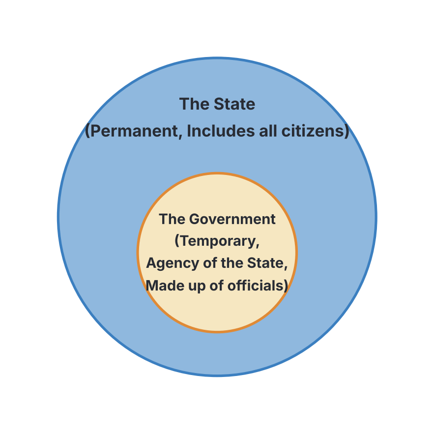

# JAMB Government Notes: Basic Concepts of Government

## What JAMB expects

This topic is Section A, Topic 2 of the JAMB Government syllabus: Basic Concepts of Government. It covers three main content items:

- **a.** Power, Influence, Authority, Legitimacy, Sovereignty.
- **b.** Society, State, Nation, Nation-State.
- **c.** Political Processes: Political Socialization, Political Participation, Political Culture.

By the end of these notes, you should be able to:

1. Identify the fundamental concepts in governance.
2. Analyse various political processes.
3. Explain the relationship of the state to Government.

## Fundamental concepts in governance: Power, Influence, Authority, Legitimacy, Sovereignty

**Objective i: identify the fundamental concepts in governance.**
**Content a: Power, Influence, Authority, Legitimacy, Sovereignty.**

To understand how societies are governed, we must first understand the basic tools and concepts of politics. These terms describe how individuals and governments get things done, how they command obedience, and why citizens obey them.

### 1. Power

**Power** is the ability to compel or force others to do what they would not otherwise do, regardless of their own wishes. It is the capacity to enforce obedience, often through the threat or use of punishment, coercion, or sanctions.

**Types of Power:**
- **Physical or Military Power (Naked Power):** The use of physical force, weapons, or violence to compel obedience. An example is a military regime taking over the government by force (a coup d'état), or the police subduing a riot.
- **Political Power:** The power exercised by those who hold government offices to make and enforce laws and policies. It is usually derived from the constitution and the mandate of the people.
- **Economic Power:** The ability to influence people or government decisions through the control of wealth, resources, and means of production. Wealthy individuals or powerful multinational corporations often wield economic power.
- **Ideological Power:** The ability to influence people's behaviour by controlling ideas, beliefs, and information (e.g., through mass media, religion, or political doctrines).

### 2. Influence

**Influence** is the ability to persuade, convince, or manipulate people to change their behaviour or opinions without the use of force or threats.

While power relies on coercion, influence relies on persuasion. A person with influence does not have the legal or physical right to force obedience, but people willingly follow them because of their wealth, age, wisdom, moral character, or status in society. 

*Nigerian Example:* A respected religious leader or a wealthy business tycoon might not have political or legal power to make laws, but their opinions can heavily influence how citizens vote during elections.

### 3. Authority

**Authority** is the *legal right* to use power. It is recognized and accepted power. When power is backed by the constitution, tradition, or law, and is accepted by the citizens, it becomes authority. 

The famous sociologist **Max Weber** identified three main types of authority:
1. **Traditional Authority:** This is the right to rule based on customs, traditions, and long-standing historical practices. Obedience is owed to the traditional ruler.
   - *Nigerian Example:* The authority of the Alaafin of Oyo, the Sultan of Sokoto, or the Obi of Onitsha is traditional.
2. **Charismatic Authority:** This is the right to rule based on the exceptional personal qualities, heroism, or magnetism of a leader. The followers obey because they are deeply inspired by the leader's personality.
   - *Nigerian Example:* Nationalist leaders like Nnamdi Azikiwe, Obafemi Awolowo, and Aminu Kano possessed strong charismatic authority, drawing massive crowds and passionate loyalty.
3. **Legal-Rational Authority:** This is the right to rule based on a system of well-defined laws, rules, and the constitution. Obedience is owed to the office, not the person. If the person leaves the office, they lose the authority.
   - *Nigerian Example:* The President of Nigeria or a State Governor exercises legal-rational authority derived from the 1999 Constitution (as amended).

### 4. Legitimacy

**Legitimacy** is the general acceptance and recognition by the citizens that a government, leader, or law has the right to exist and be obeyed. While authority is the *right* to rule, legitimacy is the people's *acceptance* of that right. A government that rules by force without the people's support lacks legitimacy.

**Factors that promote legitimacy include:**
- **Free and fair elections:** When leaders are chosen transparently by the people.
- **Good governance:** When a government provides security, welfare, and economic stability.
- **Respect for the rule of law:** When the government obeys the constitution and respects human rights.
- **Ideology and custom:** When a government's actions align with the cultural or ideological beliefs of the society.

### 5. Sovereignty

**Sovereignty** is the supreme, absolute, and unlimited power of a state to make and enforce laws within its territory without any external interference or control. 

The concept of sovereignty was first comprehensively developed by the French political philosopher **Jean Bodin** in the 16th century. He defined it as the supreme power over citizens and subjects, unrestrained by law.

**Characteristics of Sovereignty:**
- **Indivisibility:** Sovereignty cannot be divided; it belongs entirely to the state.
- **Absoluteness:** The power of the state is supreme and unquestionable within its borders.
- **Permanence:** As long as the state exists, its sovereignty exists. It does not die when a particular government changes.
- **Comprehensiveness (All-inclusive):** The sovereign power extends over every person, group, and association within the state.
- **Inalienability:** Sovereignty cannot be given away or transferred without destroying the state itself.

**Types of Sovereignty:**
- **Internal Sovereignty:** The supreme power of the state to make and enforce laws over everyone within its physical borders.
- **External Sovereignty:** The independence of a state from foreign control, and its equality with other sovereign states in the international community.
- **Legal Sovereignty:** The supreme law-making body in the state. For example, the National Assembly in Nigeria or the Parliament in Britain.
- **Political (Popular) Sovereignty:** This rests with the people/citizens who have the power to choose and remove the government through elections. The electorate is the political sovereign.
- **De Jure Sovereignty:** Sovereignty recognized by law. It is the legal right to rule.
- **De Facto Sovereignty:** Sovereignty based on actual physical control, even if it is not legally recognized. For example, a military junta that has successfully overthrown a legal government possesses de facto sovereignty because it controls the state by force.

**Limitations on Sovereignty:**
Although theoretically absolute, in reality, a state's sovereignty is limited by:
- **International Law:** Treaties and conventions (e.g., United Nations charters) limit what a state can do.
- **Membership of International Organizations:** Joining bodies like ECOWAS or the African Union (AU) requires states to give up a small portion of their sovereignty to obey the organization's rules.
- **Public Opinion:** The fear of riots, protests, or losing the next election prevents a government from acting totally arbitrarily.
- **The Constitution:** In a democratic state, the constitution limits the powers of the government.

### Comparison: Power, Authority, and Influence

| Feature | Power | Authority | Influence |
| --- | --- | --- | --- |
| **Definition** | The ability to compel or force obedience. | The legitimate, legal right to command and be obeyed. | The ability to persuade others to change their mind voluntarily. |
| **Basis** | Coercion, force, threats, sanctions. | Law, constitution, tradition. | Wealth, status, morality, wisdom, charisma. |
| **Presence of Force** | High; relies on the threat of punishment. | Backed by legal force, but usually accepted without resistance. | None; relies entirely on persuasion. |
| **Legitimacy** | Can exist without legitimacy (e.g., armed robbers have power, not authority). | Always legitimate (accepted by the people). | Depends on respect, not legal legitimacy. |

## Society, State, Nation, Nation-State

**Objective i: identify the fundamental concepts in governance.**
**Content b: Society, State, Nation, Nation-State.**

It is easy to confuse terms like "state" and "nation," but in political science, they have very strict, distinct meanings.

### 1. Society
A **society** is the broadest concept. It is a large group of human beings living together, interacting, and sharing common social, cultural, or economic relationships. A society does not necessarily have a formal government or strict political boundaries.

### 2. State
A **State** is a politically organized body of people living within a defined geographical territory, having a sovereign government free from external control. 

*Note on terminology:* In political science, "State" (often with a capital S) refers to an independent country, like Nigeria, Ghana, or France. Do not confuse this with the "states" that make up a federation, such as Kano State, Lagos State, or Texas. These component units are not sovereign, so they are not States in the international sense.

**Four Characteristics of a State:**
1. **Population:** A state must have people. An empty island cannot be a state.
2. **Territory:** A state must have defined and recognized physical boundaries (land, water, and airspace).
3. **Government:** A state must have an organized machinery (government) to make laws, maintain order, and provide services.
4. **Sovereignty:** A state must have supreme power over its territory and be independent of foreign control. (This is what a colony lacks).

### 3. Nation
A **Nation** is a sociological and cultural concept. It refers to a large group of people who share a strong sense of common identity based on shared language, culture, history, ancestry, or religion. 
A nation exists in the minds of the people (a psychological bond). A nation does not need to have a government or sovereign borders. 

*Nigerian Example:* The Yoruba people constitute a "nation" because of their shared language, history, and culture, but they do not have a separate sovereign country. The same applies to the Igbo nation, the Hausa nation, and the Ijaw nation.

### 4. Nation-State
A **Nation-State** is an ideal political entity where a single, culturally unified nation has its own independent sovereign state. In a pure nation-state, the political boundaries of the state perfectly match the cultural boundaries of the nation. 
Examples like Japan or Iceland come close, as almost everyone in the state shares the same culture and language. 

In reality, most modern countries, including Nigeria, are **multinational states**. Nigeria is a single sovereign State made up of over 250 distinct ethnic nations.

### Comparison: State vs. Nation

| Feature | State | Nation |
| --- | --- | --- |
| **Nature** | A political and legal concept. | A sociological, cultural, and psychological concept. |
| **Requirements** | Must have territory, population, government, and sovereignty. | Based on shared feelings of identity (language, culture, history). |
| **Sovereignty** | Sovereignty is strictly required. | Sovereignty is not required. |
| **Creation** | Can be created artificially (e.g., by colonial powers drawing borders on a map). | Evolves naturally over hundreds of years of shared history. |
| **Examples** | Nigeria, Canada, France, Ghana. | The Yoruba, the Kurds, the Scottish, the Igbo. |

## The Relationship of the State to Government

**Objective iii: explain the relationship of the state to Government.**

A very common JAMB trap is testing whether students understand the difference between the State and the Government. Although people use the words interchangeably in everyday speech, they are fundamentally different.

- **The State** is the overall corporate entity (e.g., the Federal Republic of Nigeria). 
- **The Government** is simply the *machinery*, *agency*, or *tool* used by the State to achieve its goals. 

Think of a State like a school. The school (buildings, students, alumni, reputation) remains permanent. The Government is like the principal and the teachers; they manage the school, but they eventually retire and are replaced by others, while the school remains.

### Comparison: State vs. Government

| Feature | The State | The Government |
| --- | --- | --- |
| **Permanence** | **Permanent.** The State of Nigeria exists continuously, surviving coups and elections. | **Temporary.** Governments change frequently through elections, deaths, or coups. |
| **Membership** | Consists of **all citizens** living within the territory. | Consists of only a **few elected or appointed officials** running the state. |
| **Sovereignty** | Possesses original **sovereignty**. | Exercises sovereign power **on behalf of** the State. |
| **Nature** | An abstract, invisible concept. | A physical, visible reality (we can see the President, ministers, lawmakers). |
| **Territory** | Requires a defined territory to exist. | Does not own the territory; it merely administers it. |

## Political Processes

**Objective ii: analyse various political processes.**
**Content c: Political Processes: Political Socialization, Political Participation, Political Culture.**

Political processes refer to the ways in which citizens interact with their political system, how they learn about it, and the attitudes they hold toward it.

### 1. Political Socialization

**Political socialization** is the continuous process through which individuals learn and acquire their political beliefs, values, attitudes, and knowledge. It is how political culture is passed down from one generation to the next.

For example, how does a child in Nigeria grow up to believe in democracy, or support a particular political party, or become apathetic towards elections? They learn this through political socialization.

**Agents of Political Socialization:**
These are the institutions or groups that teach us political values.
1. **The Family:** This is the first and most important agent. Children usually absorb the political views, party affiliations, and social attitudes of their parents. 
2. **The School / Educational Institutions:** Schools teach civic education, national history, the national anthem, and respect for authorities. Students learn leadership through student unions and class prefect systems.
3. **Peer Groups:** As children grow, their friends and age-mates heavily influence their views on government, policies, and societal norms.
4. **Mass Media:** Newspapers, television, radio, and social media shape public opinion by the way they report news, criticize the government, or praise political leaders.
5. **Religious Institutions:** Churches and Mosques influence political behaviour. Religious leaders often guide their followers on moral issues related to politics and sometimes advise them on the qualities of the candidate to vote for.
6. **Political Parties:** During rallies, campaigns, and manifestos, political parties educate the public about political issues, hoping to shape their beliefs and win their votes.
7. **Pressure Groups / Civil Society:** Labour unions, student groups, and human rights organizations educate their members and the public about their rights and government policies.

### 2. Political Participation

**Political participation** refers to the various ways in which citizens voluntarily involve themselves in the political activities and decision-making processes of their country. 

**Forms of Political Participation:**
- **Voting:** The most common form of participation is casting a ballot during elections.
- **Contesting Elections:** Seeking political office.
- **Joining a Political Party:** Registering as a card-carrying member of a party and attending party meetings.
- **Financial Contributions:** Donating money to support a candidate or political party.
- **Protests and Demonstrations:** Engaging in peaceful marches (e.g., the EndSARS protests in Nigeria) to influence government policy.
- **Debates and Discussions:** Writing articles, calling into radio shows, or debating politics on social media.

**Factors Affecting Political Participation:**
Not everyone participates equally. Participation depends on:
- **Education:** Highly educated citizens are generally more aware of their rights and more likely to participate than illiterates.
- **Income/Wealth:** People struggling for daily survival may have less time for politics, whereas wealthier individuals might fund campaigns. (Though sometimes, the poor participate massively to vote for change).
- **Political System:** A democracy encourages participation, while a military dictatorship bans political activities and suppresses participation.
- **Political Apathy:** This is a lack of interest in politics. It is caused by unfulfilled promises by politicians, election rigging, and political violence. When people feel their votes do not count, they stay away.
- **Violence and Thuggery:** The threat of violence at polling booths scares many citizens away from participating.

### 3. Political Culture

**Political culture** refers to the shared beliefs, attitudes, values, and sentiments that citizens of a country hold regarding their political system and their role within it. 
While political *socialization* is the *process* of learning, political *culture* is the *result* (what is actually learned). 

The American political scientists **Gabriel Almond** and **Sidney Verba** identified three main types of political culture:

1. **Parochial Political Culture:** 
   - Citizens have low or no awareness of the national political system.
   - They do not expect anything from the central government and do not feel they have any role to play in it. 
   - This is mostly found in isolated, traditional, or rural societies where people only care about local tribal or religious leadership.
2. **Subject Political Culture:** 
   - Citizens are fully aware of the government and its policies.
   - However, they see themselves merely as "subjects" who must obey the law. They are passive.
   - They know what the government does, but they do not feel they have the power to influence it (often seen in dictatorships or military regimes).
3. **Participant Political Culture:** 
   - Citizens have a high level of awareness and actively take part in the political process.
   - They believe they can influence the government, so they vote, join parties, protest, and hold leaders accountable. 
   - This is the ideal culture for a healthy democracy.

*Note on mixed cultures:* No country is purely one type. Nigeria, for example, is a mix. It has elements of a *participant* culture among the politically active youth and urban elites, a *subject* culture among those who feel powerless to change corrupt systems, and a *parochial* culture in highly remote areas.

## Key terms

| Term | Meaning |
| --- | --- |
| **Power** | The ability to compel or force others to obey, often through coercion or threat. |
| **Authority** | The recognized, legitimate, and legal right to exercise power. |
| **Influence** | The ability to persuade others to change their minds or actions without using force. |
| **Legitimacy** | The widespread acceptance by citizens that a government has the right to rule. |
| **Sovereignty** | The supreme and absolute power of a state to make and enforce laws without external control. |
| **State** | A politically organized body of people in a defined territory, with a sovereign government. |
| **Nation** | A group of people sharing a common culture, history, and language, forming a strong psychological bond. |
| **Government** | The machinery, agency, or group of officials that makes and enforces laws on behalf of the State. |
| **Political Socialization** | The process through which individuals learn and acquire their political beliefs and values. |
| **Political Participation** | The involvement of citizens in the political activities and decision-making of their country. |
| **Political Culture** | The overall attitudes, beliefs, and values that a society holds regarding politics. |
| **Political Apathy** | Total lack of interest in political activities, usually caused by bad governance or violence. |

## Exam tips and common mistakes

- **Trap: State vs. Government.** JAMB loves asking questions to see if you confuse these two. Always remember: The State is permanent, the Government is temporary. The State is made up of everyone; the Government is just a few officials.
- **Trap: Power vs. Authority.** If a question mentions "legal right," "legitimate," or "constitutional," the answer is **Authority**. If it mentions "force," "coercion," or "compel," the answer is **Power**.
- **Trap: De jure vs. De facto sovereignty.** *De jure* is by law (the elected president). *De facto* is by fact/force (the military dictator who took over by force).
- **Focus on Authors:** Remember **Jean Bodin** (the father of the concept of Sovereignty), **Max Weber** (classified types of authority: Traditional, Charismatic, Legal-Rational), and **Almond and Verba** (types of political culture).
- **Nation vs. State:** Do not choose "State" if the question asks for a group based on *culture, language, and history*. That is a **Nation**. A State must have sovereignty.
- **Agents of Socialization:** If asked for the *first* or *primary* agent of political socialization, always choose **the family**. 

## Quick summary

1. **Power** is the ability to force obedience; **Influence** uses persuasion; **Authority** is the legitimate, legal right to use power.
2. **Legitimacy** occurs when citizens accept the government's right to rule, usually achieved through free elections and good governance.
3. **Sovereignty**, a concept introduced by Jean Bodin, is the supreme, indivisible, and absolute power of the state over its territory, free from foreign control.
4. A **State** is a political entity with population, territory, government, and sovereignty. A **Nation** is a cultural entity sharing a common identity.
5. The **Government** is temporary and acts as an agent of the permanent **State**.
6. **Political socialization** is how people learn political values; the family is the most important primary agent.
7. **Political participation** ranges from voting to protesting, but can be hindered by political apathy and violence.
8. **Political culture** (parochial, subject, participant) describes the collective attitude of the citizens toward their political system.

## Practice questions

**1. The primary distinction between power and authority is that authority**

- A. relies strictly on the use of physical force
- B. is recognized as legitimate and lawful
- C. cannot be exercised by a single individual
- D. is found only in military governments

**Answer: B.** Authority is the legitimate, legal right to command. While power can be wielded by force (e.g., an armed robber), authority is accepted by the people as lawful.

**2. The supreme and independent power of a state over its citizens and territory is known as**

- A. nationalism
- B. constitutionalism
- C. sovereignty
- D. authority

**Answer: C.** Sovereignty is defined as the supreme, absolute, and unlimited power of a state to make laws without external interference.

**3. Which of the following scholars is widely credited with formulating the theory of sovereignty?**

- A. Max Weber
- B. Gabriel Almond
- C. A.V. Dicey
- D. Jean Bodin

**Answer: D.** The French philosopher Jean Bodin was the first to comprehensively define and write about the concept of sovereignty in the 16th century.

**4. The political culture in which citizens are completely unaware of the central government and feel they have no role to play in it is called**

- A. participant culture
- B. subject culture
- C. parochial culture
- D. authoritarian culture

**Answer: C.** In a parochial political culture, people have little or no awareness of the national political system and are primarily focused on their local or traditional communities. 

**5. The most important difference between the State and the Government is that**

- A. the State is temporary while the Government is permanent
- B. the State is permanent while the Government is temporary
- C. the Government has sovereignty while the State does not
- D. the Government includes all citizens while the State includes only politicians

**Answer: B.** A frequent JAMB trap. The State remains intact continuously (permanent), while governments change regularly through elections or coups (temporary). Option C is wrong because the State possesses original sovereignty.

**6. A country made up of different ethnic groups, each with its own distinct culture, but united under one sovereign political entity is best described as a**

- A. pure nation-state
- B. stateless nation
- C. multinational state
- D. homogenous society

**Answer: C.** Most modern countries, like Nigeria, consist of multiple nations (ethnic groups with distinct cultures) existing within one sovereign State. 

**7. When political authority is based on the exceptional personal magnetism, heroism, or appeal of a leader, it is classified by Max Weber as**

- A. charismatic authority
- B. traditional authority
- C. legal-rational authority
- D. coercive authority

**Answer: A.** Charismatic authority relies on the leader's personal qualities that inspire intense loyalty, unlike traditional (based on custom) or legal-rational (based on laws) authority.

**8. The first and most significant agent of political socialization in a person's life is the**

- A. mass media
- B. school
- C. political party
- D. family

**Answer: D.** The family is the primary unit of society where children first learn basic values, attitudes, and political affiliations before other agents like schools or the media take effect.

**9. The reluctance of citizens to vote or involve themselves in politics because they feel their participation will not make any difference is termed**

- A. political culture
- B. political socialization
- C. political apathy
- D. political franchise

**Answer: C.** Political apathy is the lack of interest or withdrawal from political activities, often caused by rigged elections, unfulfilled promises, or violence.

**10. A military regime that overthrows a democratically elected government through a coup d'état immediately exercises**

- A. de jure sovereignty
- B. de facto sovereignty
- C. legal-rational authority
- D. popular sovereignty

**Answer: B.** De facto sovereignty refers to actual, physical control of the state by force, even if it is not legally recognized (de jure) or based on popular vote.

<!-- COVERAGE
obj i | Fundamental concepts in governance: Power, Influence, Authority, Legitimacy, Sovereignty
obj i | Society, State, Nation, Nation-State
obj ii | Political Processes
obj iii | The Relationship of the State to Government
item a | Fundamental concepts in governance: Power, Influence, Authority, Legitimacy, Sovereignty
item b | Society, State, Nation, Nation-State
item c | Political Processes
-->
