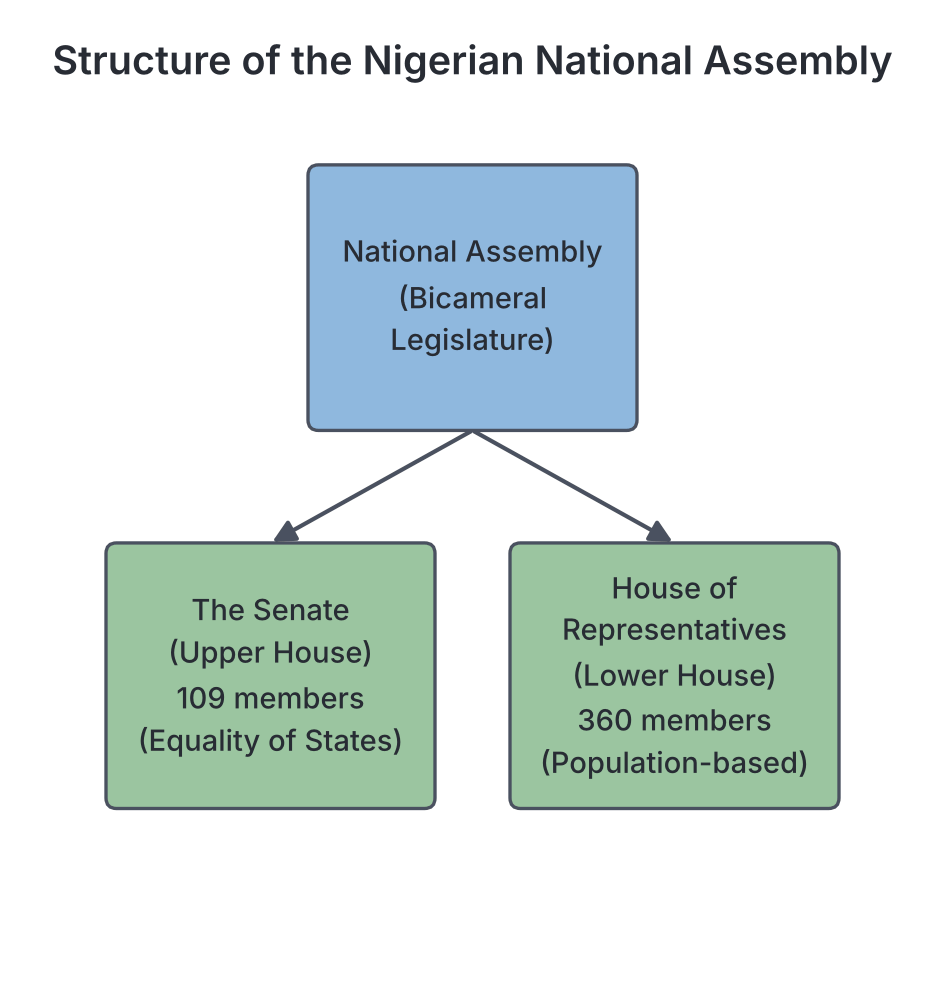
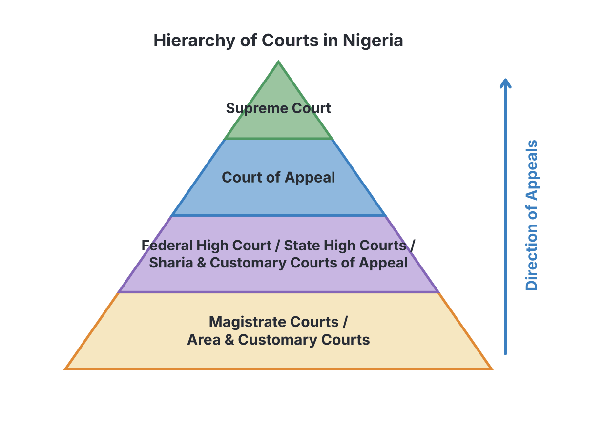

# JAMB Government Notes: Arms of Government

## What JAMB expects

This topic is Section A, Topic 4 of the JAMB Government syllabus: Arms of Government. It covers the three main branches that make up a government.

- **a. The Legislature:** types, structure, functions, powers.
- **b. The Executive:** types, functions, powers.
- **c. The Judiciary:** functions, powers, components.
- **d. Their relationships.**

By the end of these notes, you should be able to:

1. Identify the duties and obligations of the various arms of government and their agencies.
2. Relate each arm to its functions.
3. Appreciate how these arms interrelate.

**Note on the syllabus wording:** The syllabus for objective (iii) says "appreciate how these arms interrelates." This contains a small grammatical error and should read "interrelate". Also, while this file explains how the arms relate to one another (Checks and Balances), the deeper theory of the *Separation of Powers* is covered in `A9-principles-of-democratic-government.md`. How the legislature actually makes laws is covered step-by-step in `A10-processes-of-legislation.md`.

## Introduction to the Arms of Government

A government is too large and powerful for all its work to be done by one person or group. Therefore, modern democratic governments are divided into three distinct branches or **arms**. Each arm has its own specific duties, powers, and personnel. 

The three arms of government are:
1. **The Legislature:** The arm that **makes** the laws.
2. **The Executive:** The arm that **implements** (executes or carries out) the laws and runs the daily affairs of the state.
3. **The Judiciary:** The arm that **interprets** the laws and punishes offenders.

**Objective i & ii: identify the duties of the arms of government and relate each arm to its functions.**

## The Legislature

**Content a: The Legislature – types, structure, functions, powers.**

The **legislature** is the law-making body of a country. It is composed of elected (and sometimes appointed) representatives of the people. In a democracy, the legislature is often seen as the most direct voice of the citizens. Different countries give their legislature different names: in Nigeria, it is called the **National Assembly**; in the UK, the **Parliament**; and in the USA, the **Congress**.

### Structure and Types of Legislature

The structure of a legislature refers to how many "houses" or "chambers" it has. Based on this, there are two types of legislature: **Unicameral** and **Bicameral**.

#### 1. Unicameral Legislature
A unicameral legislature has only **one chamber or house** that makes laws. All members sit together to debate and pass bills. This type is common in smaller countries or unitary states (e.g., Ghana, Senegal, New Zealand). In Nigeria, the **State Houses of Assembly** (the legislature at the state level) are unicameral.

#### 2. Bicameral Legislature
A bicameral legislature is divided into **two separate chambers or houses**: usually an Upper House and a Lower House. For a bill to become law, it must normally be passed by both houses. This is the most common system in federal states because the two houses represent different interests (usually, the lower house represents the population, and the upper house represents the states or regions equally). 

In Nigeria, the federal legislature (the National Assembly) is bicameral:
*   **The Senate (Upper House):** Under the 1999 Constitution (as amended), it has 109 members (three from each of the 36 states, plus one from the Federal Capital Territory, Abuja).
*   **The House of Representatives (Lower House):** It has 360 members, representing constituencies based on population size.

#### Comparison: Unicameral vs Bicameral Legislature

| Feature | Unicameral Legislature | Bicameral Legislature |
| :--- | :--- | :--- |
| **Number of chambers** | One | Two (Upper and Lower Houses) |
| **Speed of law-making** | Fast, as bills only pass through one house. | Slower, as bills must be debated and passed by both houses. |
| **Cost** | Cheaper to maintain (fewer lawmakers and staff). | Expensive to run (salaries, allowances, and facilities for two houses). |
| **Quality of laws** | Hasty or ill-considered laws may be passed quickly. | Thorough debate in two chambers prevents hasty and bad laws. |
| **Representation** | May not adequately represent all minority groups in a diverse country. | Allows for better representation (e.g., the Upper House protects minority/state equality). |
| **Suitability** | Best for small, homogeneous, or unitary states. | Best for large, diverse, or federal states. |

### Functions and Powers of the Legislature

1. **Law-making (Legislation):** This is the primary duty of the legislature. It debates proposed laws (bills) and passes them for the good governance of the country.
2. **Financial Control (Power of the Purse):** The legislature controls public funds. The executive cannot spend government money or collect new taxes unless the legislature approves the annual budget (Appropriation Bill).
3. **Approval of Appointments:** The legislature screens and approves major appointments made by the executive, such as Ministers, Ambassadors, and the Chief Justice. In Nigeria, this is done by the Senate.
4. **Oversight and Investigative Powers:** The legislature investigates the activities of government ministries and agencies to expose corruption, inefficiency, or waste. They can summon public officials for questioning.
5. **Impeachment:** The legislature has the power to remove the President, Vice President, or a Governor from office if they commit a gross violation of the constitution.
6. **Amending the Constitution:** The legislature plays a major role in changing or updating the constitution, usually requiring a special majority (like two-thirds of the members).

## The Executive

**Content b: The Executive – types, functions, powers.**

The **executive** is the arm of government responsible for implementing (carrying out) the laws made by the legislature, enforcing them, and running the daily administration of the state. 

### Agencies of the Executive
The executive arm is vast. It is not just the President or Governor. It relies on various **agencies** to fulfill its duties (Objective i):
*   **The Civil Service and Public Service:** The body of permanent government workers who implement government policies in ministries, departments, and agencies (MDAs).
*   **The Police Force:** Enforces law and order internally.
*   **The Armed Forces (Army, Navy, Air Force):** Defends the nation from external aggression.
*   **Specialised Agencies:** Such as customs, immigration, and anti-corruption bodies.

### Types of Executive

Textbooks classify the executive in several ways depending on how power is held and where it comes from:

#### 1. Presidential vs Parliamentary Executive
*   **Presidential Executive:** The head of the executive (the President) is elected separately from the legislature. The President is both the Head of State and the Head of Government. (Example: Nigeria under the 1979 and 1999 Constitutions, USA).
*   **Parliamentary (Cabinet) Executive:** The executive is drawn from the legislature. The leader of the majority party in parliament becomes the Prime Minister (Head of Government). (Example: Nigeria in the First Republic 1960–1966, United Kingdom).

#### 2. Real vs Titular (Nominal) Executive
*   **Real Executive:** This is an executive who holds actual political power and makes the day-to-day decisions. For example, the Prime Minister in a parliamentary system or the President in a presidential system.
*   **Titular (Nominal) Executive:** A ceremonial Head of State who has no real political or executive power, but performs ceremonial duties like welcoming foreign diplomats or signing state papers. For example, the British Monarch, or Nigeria's President Nnamdi Azikiwe during the 1963 First Republic (while Prime Minister Tafawa Balewa held the real power).

#### 3. Single vs Plural (Collegial) Executive
*   **Single Executive:** Executive power is concentrated in one person (the President), who takes ultimate responsibility for all executive decisions, even if they have ministers to advise them. (Example: Nigeria, USA).
*   **Plural (Collegial) Executive:** Executive power is shared equally among a group of people or a council. No single person has ultimate authority. (Example: The Federal Council in Switzerland).

### Functions and Powers of the Executive

1. **Policy Implementation and Administration:** The executive executes the laws passed by the legislature and formulates policies to run the country effectively.
2. **Maintenance of Law and Order:** Through agencies like the police, the executive ensures the internal security and safety of citizens.
3. **Defense of the Nation:** The Head of the Executive (President) is usually the Commander-in-Chief of the Armed Forces, responsible for defending the country against external attacks.
4. **Preparation of the Budget:** The executive prepares the annual budget (estimates of revenue and expenditure) and presents it to the legislature for approval.
5. **Foreign Relations (Diplomacy):** The executive represents the country internationally, negotiates treaties, and appoints ambassadors.
6. **Prerogative of Mercy (Pardon):** The Head of State has the power to pardon convicted criminals or reduce their sentences, usually on the advice of a special council.
7. **Assent to Bills:** A bill passed by the legislature cannot become law until the executive (President or Governor) signs it (assent). 

## The Judiciary

**Content c: The Judiciary – functions, powers, components.**

The **judiciary** is the arm of government responsible for interpreting the law, settling disputes, and administering justice. It is the "last hope of the common man" because it protects the rights of citizens against the government and other powerful individuals.

### Components of the Judiciary

The judiciary is made up of a hierarchy of **courts** and the **personnel** who run them. 

1. **Personnel:** The judiciary is made up of trained legal professionals. This includes the Chief Justice, Justices (judges in higher courts), Judges, and Magistrates.
2. **Hierarchy of Courts (The Court System):** In Nigeria, the courts are arranged in a ladder-like structure. If a person is unhappy with a judgment in a lower court, they can appeal to a higher court.
   *   **The Supreme Court:** The highest court in the land. Its decisions are final and cannot be appealed. It is headed by the Chief Justice of Nigeria (CJN).
   *   **The Court of Appeal:** Hears appeals from the High Courts. 
   *   **The High Courts:** Includes the Federal High Court and State High Courts. They handle serious criminal and civil cases.
   *   **Customary and Sharia Courts of Appeal:** Handle appeals concerning customary (traditional) law and Islamic personal law, respectively.
   *   **Magistrate Courts and Customary/Area Courts:** The lower courts that handle minor civil and criminal cases.

### Functions and Powers of the Judiciary

1. **Interpretation of Laws:** The primary duty of the judiciary is to explain the exact meaning of the constitution and the laws passed by the legislature when there is confusion or a dispute.
2. **Settlement of Disputes:** The courts settle conflicts between individuals, between individuals and the state, and between different levels of government (e.g., between the Federal and State governments).
3. **Punishment of Offenders:** The judiciary conducts trials and determines the appropriate punishment (fines, imprisonment, or even death) for those who break the law.
4. **Protection of Rights:** The judiciary safeguards the fundamental human rights of citizens from being violated by the executive or legislature.
5. **Judicial Review:** This is a very powerful function. The judiciary has the power to declare any law passed by the legislature, or any action taken by the executive, as **unconstitutional** (null and void) if it goes against the constitution.

## Relationship Between the Arms of Government

**Content d: Their relationships.**
**Objective iii: appreciate how these arms interrelate.**

In a democracy, the three arms of government must work together, but they must also watch each other to prevent abuse of power. The relationship between the arms is guided by two main concepts: **Separation of Powers** and **Checks and Balances**.

### Separation of Powers

First proposed by the French philosopher **Baron de Montesquieu** in 1748, the theory of Separation of Powers states that the three arms of government (Legislature, Executive, and Judiciary) should be kept separate and independent. The same people should not belong to more than one arm, and one arm should not control the others. 

*Why?* If the President (Executive) also makes the laws (Legislature) and punishes offenders (Judiciary), they will become a dictator. Separating them protects citizens' liberty.

### Checks and Balances

While the arms are separate, they cannot be totally isolated, or government would come to a standstill. Therefore, the constitution creates a system of **Checks and Balances**. This means each arm of government is given some powers to check (control, limit, or oversee) the activities of the other two arms, ensuring a balance of power.

Here is how the arms interrelate and check each other:

#### 1. How the Legislature checks the Executive
*   **Approval of the Budget:** The legislature can refuse to approve the executive's budget or reduce it, limiting what the executive can spend.
*   **Approval of Appointments:** The legislature can reject the President's nominees for ministerial or ambassadorial positions.
*   **Impeachment:** The legislature can remove the President from office for gross misconduct.
*   **Overriding a Veto:** If the President refuses to sign a bill (a veto), the legislature can override the veto with a two-thirds majority, making it law without the President's signature.
*   **Investigative Panels:** Summoning ministers to explain government policies or account for missing funds.

#### 2. How the Legislature checks the Judiciary
*   **Approval of Judges:** The legislature must approve the appointment of top judges (like the Chief Justice).
*   **Removal of Judges:** The legislature can approve the removal of a judge for misconduct (usually requiring a two-thirds majority).
*   **Altering Court Structures:** The legislature can pass laws to create new courts or alter the number of judges.

#### 3. How the Executive checks the Legislature
*   **Veto Power:** The President can refuse to sign (assent to) a bill passed by the legislature, stopping it from becoming law.
*   **Recommending Legislation:** The executive drafts many of the bills (Executive Bills) that the legislature debates, including the budget.
*   **Dissolving Parliament:** In a parliamentary system (not presidential), the Prime Minister (Executive) can advise the Head of State to dissolve the legislature and call for fresh elections.

#### 4. How the Executive checks the Judiciary
*   **Appointment of Judges:** The Head of the Executive (President/Governor) formally appoints judges, though usually on the recommendation of a judicial council.
*   **Prerogative of Mercy:** The President can pardon a person who has been convicted and sentenced by the judiciary, effectively overriding the court's punishment.

#### 5. How the Judiciary checks the Legislature and Executive
*   **Judicial Review:** The courts can declare a law passed by the legislature, or an action taken by the executive, as illegal and unconstitutional.
*   **Interpretation:** The judiciary can interpret laws in a way that limits the powers of the executive or legislature.
*   **Trial of Officials:** The courts can try and sentence members of the legislature or executive if they commit crimes (unless they have temporary constitutional immunity while in office).

## Key terms

| Term | Meaning |
| :--- | :--- |
| **Legislature** | The arm of government responsible for making laws. |
| **Executive** | The arm of government responsible for implementing laws and formulating policies. |
| **Judiciary** | The arm of government responsible for interpreting laws and settling disputes. |
| **Unicameral** | A legislature with only one house or chamber. |
| **Bicameral** | A legislature with two houses or chambers (e.g., Senate and House of Representatives). |
| **Titular Executive** | A ceremonial head of state who holds no real political power (e.g., a constitutional monarch). |
| **Real Executive** | The person or body that holds actual, day-to-day political power to run the government. |
| **Judicial Review** | The power of the judiciary to declare laws or executive actions unconstitutional. |
| **Prerogative of Mercy** | The power of the executive to pardon convicted offenders or reduce their sentences. |
| **Impeachment** | The constitutional process by which the legislature removes an executive or judicial official for misconduct. |
| **Veto** | The power of the executive to refuse to sign a bill passed by the legislature. |
| **Checks and balances** | A system where each arm of government exercises some control over the others to prevent abuse of power. |

## Exam tips and common mistakes

*   **Common mistake:** Confusing the roles of the arms. Remember the 3 "I"s: Legislature **I**nitiates/Makes laws, Executive **I**mplements laws, Judiciary **I**nterprets laws.
*   **Common mistake:** Assuming passing a bill makes it a law instantly. A bill passed by the legislature is *not* a law until the executive (President/Governor) gives **assent** (signs it).
*   **Know your Nigerian examples:** The Nigerian National Assembly is **bicameral**. The State Houses of Assembly are **unicameral**.
*   **Titular vs Real:** Always remember that in the 1963 Republic, Nigeria had a parliamentary system. Nnamdi Azikiwe was the Titular (Ceremonial) executive, and Abubakar Tafawa Balewa was the Real executive.
*   **Judicial Review:** This is a very frequent JAMB question. When you see "power to declare laws unconstitutional", the answer is Judicial Review.
*   **Prerogative of Mercy:** Note that this is an *executive* check on the *judiciary*, not a judicial function.

## Quick summary

1. The three arms of government are the Legislature (makes laws), the Executive (implements laws), and the Judiciary (interprets laws).
2. A unicameral legislature has one chamber, while a bicameral legislature has two (like Nigeria's Senate and House of Representatives).
3. The executive arm includes the President/Prime Minister and agencies like the civil service, police, and armed forces.
4. Executives can be presidential or parliamentary, real (holds actual power) or titular (ceremonial), and single or plural.
5. The judiciary consists of a hierarchy of courts (headed by the Supreme Court) and personnel like judges and magistrates.
6. The judiciary protects human rights, settles disputes, and exercises judicial review to declare unconstitutional laws null and void.
7. Separation of powers keeps the personnel and functions of the three arms separate to prevent tyranny.
8. Checks and balances allow each arm to monitor and limit the powers of the others (e.g., the executive can veto bills, the legislature can impeach, and the judiciary can strike down laws).

## Practice questions

**1. The primary function of the legislature in a democratic state is to**

- A. implement government policies
- B. interpret the constitution
- C. formulate and pass laws
- D. arrest and punish lawbreakers

**Answer: C.** The primary function of the legislature is law-making (legislation) for the good governance of the state.

**2. A system of government where the executive power is vested in a ceremonial Head of State who does not take active part in daily administration is known as having a**

- A. real executive
- B. single executive
- C. plural executive
- D. titular executive

**Answer: D.** A titular (or nominal) executive has ceremonial duties but no real political power, such as the Queen of England or Nigeria's President in 1963. 

**3. The power of the court to declare a law passed by the legislature as unconstitutional is known as**

- A. judicial independence
- B. judicial review
- C. prerogative of mercy
- D. veto power

**Answer: B.** Judicial review is the power of the judiciary to examine the actions of the legislative and executive arms and declare them unconstitutional if they violate the constitution.

**4. One major advantage of a bicameral legislature over a unicameral one is that it**

- A. passes laws much faster
- B. is cheaper to maintain
- C. prevents the passage of hasty and ill-considered laws
- D. concentrates all power in one house

**Answer: C.** Because a bill must be debated in two separate chambers, a bicameral legislature takes more time, which helps prevent rushed or poorly thought-out laws.

**5. Which of the following is an agency of the executive arm of government?**

- A. The Court of Appeal
- B. The Senate
- C. The Civil Service
- D. The Magistrate Court

**Answer: C.** The Civil Service is the body of permanent workers who help the executive implement government policies. The others belong to the judiciary or legislature.

**6. Under the principle of checks and balances, the legislature checks the executive by**

- A. declaring executive actions unconstitutional
- B. refusing to approve the annual budget
- C. pardoning convicted criminals
- D. appointing new judges

**Answer: B.** The legislature controls the "power of the purse". By refusing to approve or by cutting the budget, it checks the executive. Option A is a judicial check, and C is an executive check.

**7. The power known as the "prerogative of mercy" is exercised by the**

- A. Chief Justice
- B. Senate President
- C. Head of the Executive
- D. Attorney General

**Answer: C.** The prerogative of mercy (the power to pardon convicted criminals) is exercised by the Head of the Executive (President or Governor).

**8. Impeachment is a constitutional tool used primarily by the**

- A. judiciary to remove corrupt police officers
- B. executive to dismiss civil servants
- C. legislature to remove the President or Governor
- D. citizens to recall poor-performing lawmakers

**Answer: C.** Impeachment is the process by which the legislature formally charges and removes a high executive official (like a President or Governor) for gross misconduct.

**9. The highest court of appeal in Nigeria's judiciary is the**

- A. Federal High Court
- B. Supreme Court
- C. Court of Appeal
- D. Sharia Court of Appeal

**Answer: B.** The Supreme Court is the apex (highest) court in Nigeria. Its decisions are final and cannot be appealed to any other court.

**10. The concept of checks and balances was introduced to ensure that**

- A. the executive is more powerful than the legislature
- B. no single arm of government becomes too powerful or dictatorial
- C. the judiciary can rewrite the constitution
- D. lawmakers can arrest the president at any time

**Answer: B.** Checks and balances ensure that each arm of government can limit the powers of the others, creating a balance of power and preventing tyranny.
