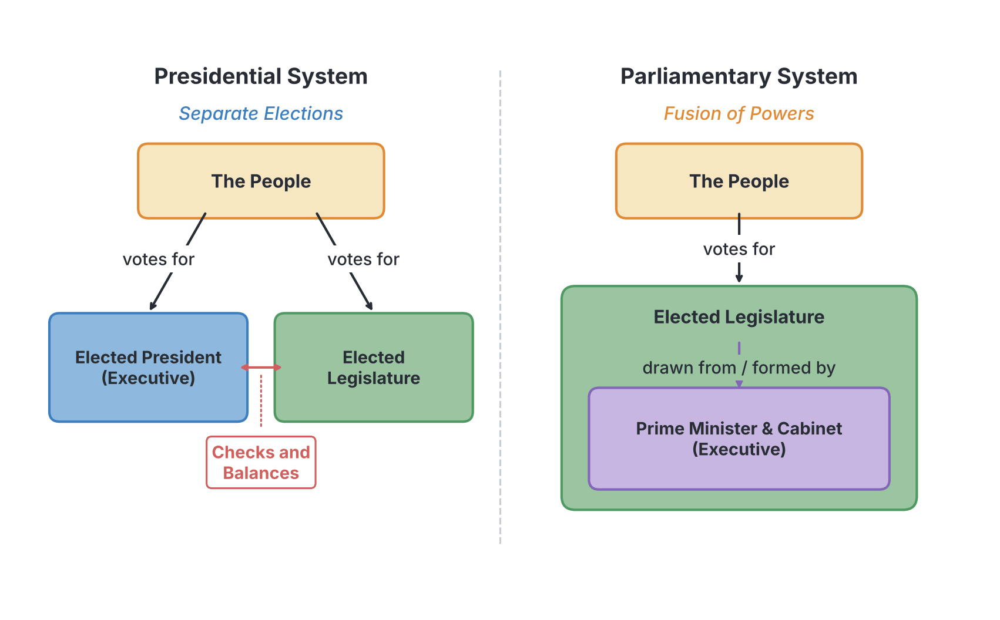

# JAMB Government Notes: Systems of Governance

## What JAMB expects

This topic is Section A, Topic 6 of the JAMB Government syllabus: Systems of Governance. It covers the Presidential, Parliamentary, and Monarchical systems.

By the end of these notes, you should be able to:
1. distinguish between the different systems of governance;
2. analyse the features, merits and demerits of each system of governance.

**Note on textbook variations:** In Government, textbooks often group topics into "Forms", "Systems", and "Structures" of government. A *form* of government usually describes *who* holds the power (e.g., Democracy, Oligarchy, Aristocracy), which we covered in `A3-forms-of-government.md`. A *system* of governance usually describes *how* the executive and legislative branches relate to each other (e.g., Presidential vs. Parliamentary). However, the JAMB syllabus includes "Monarchical" here under systems, even though many textbooks classify it as a form of government. For your exam, simply study it as presented here.

## Understanding Systems of Governance

**Objective i: distinguish between the different systems of governance.**

A **system of governance** refers to the arrangement and relationship between the different organs of government, particularly the **Executive** (which implements laws) and the **Legislature** (which makes laws). 

The two major modern systems of governance are the **Presidential** and **Parliamentary** systems. The main way to distinguish between them is to look at two things:
1. **The Head of State vs. Head of Government:** Are they the same person, or two different people?
2. **Separation of Powers:** Are the executive and legislative branches strictly separated, or are they fused together?

The **Monarchical** system, on the other hand, is distinguished by how the leader gets into power—usually by inheritance (birth) rather than by election.

## The Presidential System of Governance

**Objective ii: analyse the features, merits and demerits of each system of governance (Presidential).**

A **presidential system** is a system of government in which the powers of the executive and the legislature are strictly separated, and the **Head of State** is also the **Head of Government** and the Commander-in-Chief of the armed forces. 

The president is elected directly or indirectly by the people, not by the legislature. **Nigeria** (since the 1979 Constitution) and the **United States of America** are classic examples of presidential systems.

### Features of the Presidential System
1. **Single Executive:** The President serves as both the Head of State (performing ceremonial duties) and the Head of Government (running the day-to-day administration).
2. **Separation of Powers:** The executive, legislature, and judiciary are distinct arms. The President and their ministers are **not** members of the parliament (legislature).
3. **Fixed Term of Office:** The President is elected for a fixed period (e.g., four years in Nigeria and the USA) and cannot be removed simply because the legislature disagrees with their policies.
4. **Principle of Checks and Balances:** Because the branches are separate, they are given powers to check one another. For example, the legislature must approve the President's budget and ministerial nominees, while the President can veto (reject) laws passed by the legislature.
5. **Individual Responsibility of Ministers:** Ministers are appointed by the President and are responsible to the President, not to the parliament. 
6. **Impeachment:** The President can only be removed before their term ends through a complex legal and political process called **impeachment**, usually for "gross misconduct" or constitutional violations.
7. **Direct Popular Mandate:** The whole country serves as a single constituency for the election of the President.

### Merits of the Presidential System
* **Stability:** Because the President has a fixed term and does not rely on a legislative majority to stay in power, the government is very stable.
* **Clear Leadership:** Executive power is concentrated in one person. The "buck stops" at the President's desk, making decision-making faster during emergencies.
* **Effective Checks and Balances:** The strict separation of powers prevents any one arm of government from becoming too powerful or dictatorial.
* **National Unity:** Since the President is voted for by the entire nation, they serve as a unifying figure for the country, rather than representing just one small constituency.
* **Use of Experts:** The President is free to appoint talented experts as ministers from outside the legislature, as ministers do not have to be elected lawmakers.

### Demerits of the Presidential System
* **Expensive to Run:** It involves huge costs because elections for the executive and legislature are held separately, and maintaining separate branches creates administrative duplication.
* **Friction and Gridlock:** Strict separation of powers can lead to constant conflict between the President and the legislature, especially if different political parties control them. This can delay the passing of the budget or important laws.
* **Prone to Dictatorship:** Because so much power is concentrated in a single executive, a bad President can abuse this power and act like a dictator.
* **Difficult to Remove a Bad Leader:** The impeachment process is very long, political, and difficult to achieve. A poor-performing President often remains in power until their term expires.

## The Parliamentary (Cabinet) System of Governance

**Objective ii: analyse the features, merits and demerits of each system of governance (Parliamentary).**

A **parliamentary system** (or cabinet system) is a system of government in which the executive is drawn from the legislature, and the Head of State is different from the Head of Government. 

In this system, the **Prime Minister** (Head of Government) and their ministers must be elected members of the parliament. **Britain (the UK)** is the model for this system. **Nigeria** practiced this system during the First Republic (1960–1966), where Nnamdi Azikiwe was the ceremonial Head of State and Abubakar Tafawa Balewa was the Prime Minister.

### Features of the Parliamentary System
1. **Dual Executive:** There are two distinct leaders. The **Head of State** (a monarch or a ceremonial president) performs ceremonial duties, while the **Head of Government** (the Prime Minister or Chancellor) wields real executive power.
2. **Fusion of Powers:** There is no strict separation between the executive and the legislature. The Prime Minister and the cabinet ministers are also active members of the parliament.
3. **Collective Responsibility:** The cabinet acts as a single team. All ministers must publicly support government decisions. If the government is defeated on a major issue in parliament, the entire cabinet must resign.
4. **Vote of No Confidence:** The parliament can remove the Prime Minister and the cabinet at any time by passing a "vote of no confidence".
5. **Party Discipline:** Lawmakers from the ruling party are expected to vote strictly according to their party's instructions to ensure the government does not fall.
6. **Official Opposition:** There is an officially recognised opposition party in parliament, led by a "Shadow Cabinet", ready to take over if the ruling government falls.
7. **Parliamentary Supremacy:** The parliament is the supreme organ of government, holding ultimate power over the executive.

### Merits of the Parliamentary System
* **Harmony and Cooperation:** Because the executive is formed from the majority party in the legislature, there is less friction between the two arms. Laws and budgets are passed more easily than in a presidential system.
* **Cheaper to Run:** It is less expensive because the executive and legislative elections are combined; the Prime Minister and ministers are simply elected lawmakers given extra duties.
* **Easy to Remove a Bad Government:** If the Prime Minister performs poorly, parliament can remove them swiftly through a vote of no confidence, without waiting for the term to end.
* **Prevents Dictatorship:** Power is shared among the cabinet members (collective responsibility) and the Prime Minister is closely monitored by the parliament on a daily basis.
* **Strong Opposition:** The presence of an official opposition keeps the government on its toes and provides a ready alternative government.

### Demerits of the Parliamentary System
* **Instability:** Governments can fall at any time if a vote of no confidence is passed or if a ruling coalition breaks down. This leads to frequent elections and policy changes (common in Italy and Israel).
* **Weak Separation of Powers:** The fusion of powers means the executive can easily dominate the legislature, especially if the Prime Minister has a large majority, turning the parliament into a "rubber stamp".
* **Ministers may Lack Expertise:** The Prime Minister is restricted to choosing ministers only from elected members of parliament, which might exclude highly qualified experts who did not run for office.
* **Divided Loyalty:** The Prime Minister is primarily loyal to their political party and their local constituency, rather than having a direct mandate from the entire nation.
* **Unsuitable for Diverse Societies:** In highly fragmented societies with many small parties, no single party may win a majority. This forces a coalition government, which is often weak and prone to internal fighting.

## Distinguishing Presidential and Parliamentary Systems

To clearly master **Objective i (distinguish between the different systems)**, use the comparison table below. This is one of the most frequently tested areas in JAMB.

| Feature | Presidential System | Parliamentary System |
| :--- | :--- | :--- |
| **Executive Structure** | **Single executive:** One person is both Head of State and Head of Government. | **Dual executive:** One person is Head of State (ceremonial), another is Head of Government (Prime Minister). |
| **Separation of Powers** | **Strict:** The executive and legislature are separate. | **Fused:** The executive is drawn from and sits inside the legislature. |
| **Cabinet Membership** | Ministers are usually **not** members of the parliament. | Ministers **must** be members of the parliament. |
| **Term of Office** | Fixed term (e.g., 4 years). | No fixed term; depends on keeping the parliament's support. |
| **Removal from Office** | Difficult; requires **impeachment** for serious offenses. | Easier; requires a **vote of no confidence** by a simple majority. |
| **Responsibility** | **Individual:** Ministers answer to the President. | **Collective:** The whole cabinet shares blame and falls together if defeated. |
| **Election of Leader** | President is elected by the whole country (direct mandate). | Prime Minister is appointed because they lead the majority party in parliament. |

## The Monarchical System of Governance

**Objective ii: analyse the features, merits and demerits of each system of governance (Monarchical).**

A **monarchy** is a system of government where political power is vested in a single individual (the monarch), usually a king, queen, emperor, or emir, who rules for life and usually gains the position by hereditary right. 

### Types of Monarchy
1. **Absolute Monarchy:** The monarch has supreme, unlimited power. Their word is law, and they are not bound by a constitution. Examples in history include the French kings before the revolution, and today, countries like Saudi Arabia and Eswatini (Swaziland) lean towards absolute monarchy.
2. **Constitutional Monarchy:** The monarch's powers are strictly limited by a constitution. The monarch usually serves only as a ceremonial Head of State, while real executive power is held by an elected Prime Minister. The **United Kingdom**, **Japan**, and **Morocco** are modern examples.

### Features of the Monarchical System
1. **Hereditary Succession:** Leadership is usually passed down within a single royal family (from father to child, or along specific traditional bloodlines).
2. **Life Tenure:** The monarch rules for life, only leaving the throne upon death or abdication (voluntary resignation).
3. **Source of Authority:** The monarch's authority comes from tradition, custom, or the belief in the "divine right of kings" (the idea that God chose them to rule).
4. **Reverence and Prestige:** The monarch is highly respected and treated as a sacred symbol of the state. In constitutional monarchies, they are seen as above party politics.

### Merits of the Monarchical System
* **Continuity and Stability:** Rule for life and clear hereditary succession prevent the frequent power struggles and chaotic elections seen in some democracies.
* **National Unity:** Because a monarch (especially a constitutional one) does not belong to a political party, they serve as a neutral, unifying figure for all citizens.
* **Preservation of Tradition:** Monarchy helps to preserve the cultural heritage, customs, and history of the people.
* **Quick Decision-Making (Absolute):** In an absolute monarchy, decisions can be made swiftly in emergencies because the monarch does not need to consult a legislature.

### Demerits of the Monarchical System
* **Undemocratic:** Power is based on birth, not merit or the choice of the people. The citizens have no say in who rules them.
* **Risk of Tyranny:** In an absolute monarchy, the lack of checks and balances can easily lead to dictatorship and oppression.
* **Difficult to Remove:** If a monarch is incompetent, cruel, or mentally unfit, it is almost impossible to remove them peacefully without a revolution or assassination.
* **Resistance to Change:** Monarchies often rely heavily on tradition and may oppose modern ideas, social reforms, or progressive economic policies.
* **Nepotism:** Important state positions and wealth are often distributed among members of the royal family and their close nobles.

## Key terms

| Term | Meaning |
| :--- | :--- |
| **System of Governance** | The way power is organized and shared between the organs of government, especially the executive and legislature. |
| **Separation of Powers** | Dividing government power among the executive, legislature, and judiciary so no single group has total control. |
| **Fusion of Powers** | A feature of the parliamentary system where the executive and legislative branches overlap and share members. |
| **Impeachment** | The formal constitutional process of charging and removing a President (or other high officials) for serious misconduct. |
| **Vote of No Confidence** | A parliamentary vote showing that the majority of lawmakers no longer support the Prime Minister, forcing the government to resign. |
| **Collective Responsibility** | The principle in a parliamentary system where all cabinet ministers must publicly support government decisions or resign. |
| **Dual Executive** | Having a Head of State (for ceremonies) and a separate Head of Government (for actual administration), typical in parliamentary systems. |
| **Single Executive** | One person performing the functions of both Head of State and Head of Government, typical in presidential systems. |
| **Constitutional Monarchy** | A system where a king or queen is the Head of State but their powers are strictly limited by a constitution, with real power held by elected officials. |

## Exam tips and common mistakes

* **Common mistake:** Confusing "Separation of Powers" with "Fusion of Powers". Remember: **Presidential = Separation**; **Parliamentary = Fusion**.
* **Common mistake:** Thinking a President can be removed by a vote of no confidence. They cannot. A President is removed by **impeachment**. A Prime Minister is removed by a **vote of no confidence**.
* **Cabinet responsibility:** In a parliamentary system, the cabinet is responsible to the **legislature** (parliament). In a presidential system, ministers are responsible to the **President**.
* **Nigeria's History:** JAMB often asks about Nigeria. Remember that Nigeria practiced a **Parliamentary system** in the First Republic (1960–1966) and switched to a **Presidential system** in the Second Republic (1979).
* **Head of State vs. Head of Government:** If a question asks which system has a ceremonial leader distinct from the active leader, the answer is the parliamentary (or cabinet) system.

## Quick summary

1. A **system of governance** describes the relationship between the executive and legislative branches.
2. In a **Presidential system**, there is a single executive (Head of State is also Head of Government), strict separation of powers, and the President has a fixed term.
3. The Presidential system is praised for stability and clear leadership but criticized for being expensive and prone to executive-legislative friction.
4. In a **Parliamentary system**, there is a dual executive (Head of State is separate from the Head of Government) and a fusion of powers, as ministers are drawn from the parliament.
5. The Parliamentary system promotes harmony between branches and allows for the easy removal of a bad government (vote of no confidence), but it can suffer from instability.
6. The **Monarchical system** vests power in a single individual who rules for life, usually by hereditary succession.
7. An absolute monarch has unlimited power, while a constitutional monarch’s power is limited by laws, usually serving only as a ceremonial Head of State.

## Practice questions

**1. The system of government in which the Head of State is distinct from the Head of Government is the**
- A. presidential system
- B. monarchical system
- C. parliamentary system
- D. federal system

**Answer: C.** In a parliamentary system (dual executive), one person performs ceremonial duties (Head of State) while another runs the government (Prime Minister).

**2. A major feature of the presidential system of government is the**
- A. fusion of powers
- B. principle of collective responsibility
- C. separation of powers
- D. presence of an official opposition

**Answer: C.** The presidential system is defined by a strict separation of powers between the executive and the legislature. The other options are features of the parliamentary system.

**3. In a parliamentary system, the executive can be removed from office through**
- A. a vote of no confidence
- B. impeachment by the judiciary
- C. a national referendum
- D. a decree by the Head of State

**Answer: A.** The parliament can dismiss the Prime Minister and cabinet at any time by passing a vote of no confidence by a simple majority. Impeachment applies to the presidential system.

**4. The principle of collective responsibility implies that**
- A. all citizens are responsible for government actions
- B. the cabinet stands or falls together as a single team
- C. the legislature and executive share power equally
- D. the President must consult the judiciary before acting

**Answer: B.** Collective responsibility means that cabinet ministers must publicly defend all government policies. If a major policy is defeated in parliament, the entire cabinet must resign.

**5. Which of the following is a disadvantage of the presidential system of government?**
- A. It is very cheap to operate
- B. It leads to frequent changes in government
- C. It can cause friction between the executive and the legislature
- D. The executive is easily controlled by the parliament

**Answer: C.** Because the two branches are separate and independently elected, they often disagree, leading to political gridlock. It is expensive, not cheap, and it is usually very stable (does not lead to frequent changes).

**6. Nigeria practiced the parliamentary system of government during the**
- A. Second Republic (1979-1983)
- B. First Republic (1960-1966)
- C. Third Republic (1992-1993)
- D. Fourth Republic (1999-present)

**Answer: B.** Nigeria operated a parliamentary system inherited from the British during the First Republic, with a ceremonial President (Nnamdi Azikiwe from 1963) and an executive Prime Minister (Abubakar Tafawa Balewa).

**7. In an absolute monarchy, the source of political authority is usually based on**
- A. a rigid constitution
- B. democratic elections
- C. tradition and hereditary right
- D. a vote of no confidence

**Answer: C.** Absolute monarchs inherit their power through their royal bloodline and tradition, not through democratic elections or constitutional mandates.

**8. Fusion of powers is a mechanism closely associated with the**
- A. presidential system
- B. parliamentary system
- C. autocracy
- D. oligarchy

**Answer: B.** In a parliamentary system, the executive (cabinet) is drawn from and remains part of the legislature, fusing their powers together.

**9. One major merit of a constitutional monarchy is that the monarch**
- A. exercises absolute power in times of war
- B. acts as a non-partisan, unifying figure for the nation
- C. can dissolve the parliament without a prime minister's advice
- D. is elected by popular vote

**Answer: B.** Because a constitutional monarch is above party politics and ceremonial, they serve as a symbol of national unity that all citizens can respect.

**10. Impeachment as a constitutional process is used primarily to**
- A. remove a Prime Minister in a cabinet system
- B. force a cabinet to resign due to collective responsibility
- C. remove a President for gross misconduct before their term expires
- D. allow a monarch to abdicate the throne

**Answer: C.** Impeachment is the formal process used by the legislature in a presidential system to remove the executive for constitutional violations or gross misconduct.

<!-- COVERAGE
obj i | Understanding Systems of Governance
obj i | Distinguishing Presidential and Parliamentary Systems
obj ii | The Presidential System of Governance
obj ii | The Parliamentary (Cabinet) System of Governance
obj ii | The Monarchical System of Governance
Presidential | The Presidential System of Governance
Parliamentary | The Parliamentary (Cabinet) System of Governance
-->
