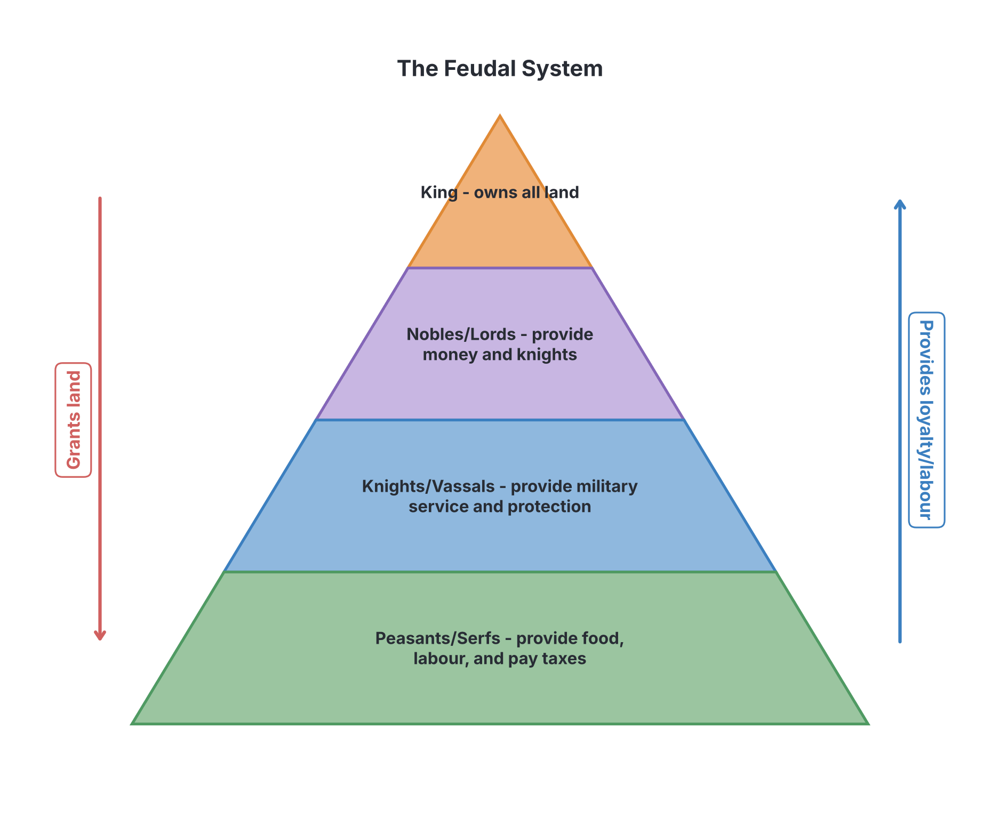
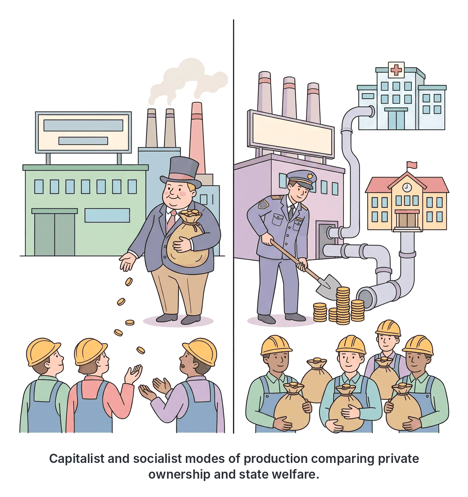

# JAMB Government Notes: Political Ideologies

## What JAMB expects

This topic is Section A, Topic 7 of the JAMB Government syllabus: Political Ideologies. It covers major political and economic ideas that have shaped human societies and governments. 

The syllabus lists the following ideologies: Communalism, Feudalism, Capitalism, Socialism, Communism, Totalitarianism, Fascism, Nazism, and Liberalism.

By the end of these notes, you should be able to:
1. Differentiate between the major political ideologies.
2. Contrast their modes of production.

**Note on textbook variations:** In political science, some of these terms (like Capitalism and Socialism) are strictly *economic* systems, while others (like Totalitarianism and Fascism) are *systems of government*. However, the JAMB syllabus groups them all together under "Political Ideologies". An ideology is simply a system of ideas, beliefs, and ideals that forms the basis of economic or political theory and policy. 

## Differentiating the major political ideologies

**Objective i: differentiate between the major political ideologies.**

To differentiate these ideologies, we must look at what they value most, how they believe society should be governed, and who they think should hold power. 

### Communalism

**Communalism** is a system where a community collectively shares property, resources, and work. It is based on the principle of togetherness, kinship, and mutual support. 

*   **Core idea:** The community is greater than the individual. Wealth and land belong to the community as a whole, not to private individuals.
*   **Nigerian example:** Before the arrival of the British, many traditional African societies (such as the pre-colonial Igbo village societies) practised communalism. Land was held in trust by the community or family heads, and people cleared farms, built houses, and harvested crops together using cooperative labour.
*   **Features:** Strong family ties, absence of distinct social classes (classless society), collective ownership of land, and mutual cooperation.

### Feudalism

**Feudalism** was a political and economic system common in medieval Europe (and in some pre-colonial African empires) based on the ownership of land and personal loyalty. 

*   **Core idea:** Land is exchanged for military service, loyalty, and agricultural labour.
*   **How it worked:** The King owned all the land. He granted large portions (called **fiefs**) to powerful lords (nobles). In return, the lords promised loyalty and military support to the King. The lords then allowed poor farmers (called **serfs** or peasants) to live on and farm the land. In exchange, the serfs had to give most of their crops to the lord and work for free.
*   **Nigerian example:** The pre-colonial Hausa-Fulani Emirate system had strong feudal characteristics. The Emir was the absolute ruler who distributed territories to district heads (*Hakimi*), while the commoners (*Talakawa*) paid taxes and tributes to them.
*   **Features:** It is highly hierarchical (unequal), wealth is based entirely on land, and birth determines a person's social class.

### Capitalism

**Capitalism** is an ideology where the means of production (factories, land, businesses) are owned and controlled by private individuals or companies, rather than by the government. 

*   **Core idea:** The main goal of production is to make a **profit**. Prices and wages are determined by the free market (the forces of demand and supply), not by government planning.
*   **Features:** Private property ownership, free enterprise, competition between businesses, profit motive, and a system of wage labour (people work for a salary). 
*   **Examples:** The United States is a prime example of a capitalist society. Today, Nigeria also operates a mostly capitalist (or mixed-capitalist) economy, where private businesses drive most of the economy.

### Socialism

**Socialism** is a system where the government (representing the state/people) owns and controls the *major* means of production, distribution, and exchange to ensure wealth is shared more equally.

*   **Core idea:** Wealth should be distributed equitably, and the gap between the rich and the poor should be closed. Production is for *use* and public welfare, rather than for private profit.
*   **Features:** State ownership of key industries (like electricity, railways, and heavy manufacturing), provision of free or heavily subsidised social services (education, healthcare), and central economic planning. Note that modern democratic socialism still allows for some private small businesses.
*   **Historical context:** Julius Nyerere of Tanzania famously introduced a form of African socialism called *Ujamaa* in the 1960s, focusing on rural communal farming.

### Communism

**Communism** is an extreme, revolutionary form of socialism based on the ideas of the German philosopher Karl Marx. Marx believed that the working class (the *proletariat*) must violently overthrow the wealthy business owners (the *bourgeoisie*).

*   **Core idea:** The ultimate goal is a completely **stateless and classless society** where all property is publicly owned. The guiding principle is: *"From each according to his ability, to each according to his need."*
*   **Features:** No private property whatsoever, a one-party state, central command economy, and the elimination of social classes. 
*   **Examples:** The Soviet Union (USSR), China, and Cuba attempted to build communist societies, though political scientists note that a "pure" stateless communist society has never actually been achieved.

### Totalitarianism

**Totalitarianism** is a system of government where the state holds total, absolute authority over the society and seeks to control all aspects of public and private life.

*   **Core idea:** The individual has no rights; the state is everything. 
*   **Features:** A single ruling political party led by a dictator, widespread use of secret police and terror, total control of the media and education (propaganda), and a ban on any political opposition.
*   **Examples:** Joseph Stalin's rule in the Soviet Union and modern-day North Korea are classic examples of totalitarianism.

### Fascism

**Fascism** is an extreme right-wing, totalitarian ideology that glorifies the nation and often a specific race above the individual. 

*   **Core idea:** Ultra-nationalism, military strength, and unquestioning obedience to a single dictatorial leader. Fascists hate democracy, liberalism, and communism. 
*   **Features:** Glorification of war and the military, suppression of opposition by force, strict control of the economy (businesses remain in private hands but are directed by the state to serve national goals), and intense national pride.
*   **Examples:** Benito Mussolini's Italy in the 1920s and 1930s.

### Nazism

**Nazism** (National Socialism) is the specific brand of fascism developed by Adolf Hitler in Germany from 1933 to 1945. 

*   **Core idea:** Like fascism, it is totalitarian and ultra-nationalist, but Nazism's unique defining feature is **biological racism and anti-Semitism** (hatred of Jews). 
*   **Features:** Belief in the supremacy of an "Aryan master race", the desire to conquer living space (*Lebensraum*) for this race, and the systematic elimination of people they considered "inferior" (which led to the Holocaust).
*   **Difference from Fascism:** While all Nazism is a form of fascism, not all fascism involves the extreme racial theories found in Nazism.

### Liberalism

**Liberalism** is an ideology built on the principles of individual liberty, freedom, equality before the law, and human rights.

*   **Core idea:** Government exists to protect the rights of the individual. Government power should be limited by a constitution, and leaders should be chosen through democratic elections.
*   **Features:** Freedom of speech, freedom of religion, regular multi-party elections, rule of law, and a free-market capitalist economy. Modern liberalism also supports government welfare programmes to help the poor, balancing free markets with social justice.

## Contrasting their modes of production

**Objective ii: contrast their modes of production.**

A **mode of production** is a term (popularised by Karl Marx) that describes how a society organises its economy to produce the things it needs to survive (food, housing, goods). It is made up of two things:
1.  **Means of production:** The land, factories, tools, and raw materials used to make things.
2.  **Relations of production:** How people are organised around these tools—who owns them, who does the hard work, and who gets the profit or produce.

Because the syllabus specifically asks you to *contrast* these modes of production, the table below provides a clear, side-by-side comparison of how wealth is created and shared under each major ideology.

| Ideology | Who owns the means of production? | Who does the labour (work)? | How is wealth/profit distributed? | Core economic motive |
| :--- | :--- | :--- | :--- | :--- |
| **Communalism** | The entire community or family unit holds the land in trust. | Everyone in the community works cooperatively (e.g., age grades, family units). | Produce is shared among members based on participation and need. | Survival and well-being of the whole community. |
| **Feudalism** | The King and the nobles/lords own all the land. | Serfs and peasants (who are tied to the land and cannot easily leave). | The lords take the majority of the surplus crops; serfs keep only enough to survive. | Maintenance of the hierarchical social and military order. |
| **Capitalism** | Private individuals and private corporations. | Wage labourers (workers who sell their time and skills for a salary). | The private owners take the profit; workers receive only their agreed wages. | Private profit and accumulation of wealth. |
| **Socialism** | The State (government) owns the major, vital industries on behalf of the public. | Workers employed primarily by state-owned enterprises. | The state uses profits to provide social services (free education, healthcare) to reduce inequality. | Public welfare and equitable distribution of resources. |
| **Communism** | The community/society as a whole (a stateless society in pure theory). | Everyone works voluntarily according to their natural abilities. | Goods are distributed purely based on need ("to each according to his needs"). | A classless society with total equality; elimination of profit. |
| **Fascism & Nazism** | Private individuals still own businesses, but the state strictly controls them. | Workers whose trade unions are banned and replaced by state-controlled labour fronts. | Capitalists keep profits, but must produce exactly what the dictator/state demands. | National glory, military preparation, and state dominance. |
| **Liberalism** | Private individuals (it relies on a Capitalist mode of production). | Free wage labourers who have protected rights (e.g., right to form trade unions). | Driven by the free market, but the state taxes wealth to provide a basic safety net for the poor. | Individual prosperity, free trade, and economic liberty. |

*(Note: Totalitarianism is not included in this economic table as it is strictly a political system of total control; a totalitarian state can use either a communist mode of production (like the USSR) or a fascist one (like Nazi Germany).)*

## Key terms

| Term | Meaning |
| :--- | :--- |
| **Ideology** | A system of ideas, ideals, and beliefs that forms the basis of a political or economic system. |
| **Mode of Production** | The way a society organises its economy, including who owns the tools/land and who does the labour. |
| **Means of Production** | The physical, non-human inputs used in production—factories, machines, tools, land, and raw materials. |
| **Proletariat** | In Marxist theory, the working class who do not own property and must sell their labour to survive. |
| **Bourgeoisie** | In Marxist theory, the capitalist class who own most of society's wealth and means of production. |
| **Serf** | An agricultural labourer in the feudal system who is tied to working on his lord's estate. |
| **Laissez-faire** | An economic policy under capitalism where the government does not interfere in the free market. |
| **Anti-Semitism** | Hostility, prejudice, or discrimination against Jewish people (a core pillar of Nazism). |
| **Totalitarianism** | A system where the government demands total obedience and controls every aspect of citizens' lives. |

## Exam tips and common mistakes

*   **Communalism vs Communism:** Do not confuse these two! Communalism refers to traditional, pre-colonial village societies sharing land and working together. Communism is a modern, industrial ideology developed by Karl Marx involving the violent overthrow of capitalists.
*   **Socialism vs Communism:** Socialism allows for a state (government) to control wealth on behalf of the people and permits some private property. Communism's ultimate goal is the complete destruction of the state and total absence of private property.
*   **Fascism vs Nazism:** Both are extreme, right-wing, totalitarian dictatorships. However, Nazism includes extreme biological racism and anti-Semitism. If an exam question mentions a "master race," the answer is Nazism.
*   **Capitalism's Mode of Production:** Remember that capitalism is driven by the *profit motive* and the free market forces of *demand and supply*. 
*   **Feudalism keywords:** Look out for words like *land, lord, vassal, serf, fief,* and *hierarchy*. The Hausa-Fulani pre-colonial administration is the standard Nigerian example of a feudal system.

## Quick summary

1.  **Political ideologies** are sets of beliefs that dictate how a society should be run economically and politically.
2.  **Communalism** involves community ownership of land and cooperative labour, typical of pre-colonial African societies.
3.  **Feudalism** is a hierarchical system where land is exchanged for loyalty and military service, worked by serfs.
4.  **Capitalism** features private ownership of the means of production, wage labour, and a drive for private profit.
5.  **Socialism** advocates for state ownership of major industries to ensure the equitable distribution of wealth.
6.  **Communism** aims for a stateless, classless society where all property is publicly owned and wealth is distributed according to need.
7.  **Totalitarianism, Fascism, and Nazism** are highly dictatorial systems that suppress individual freedom, though Fascism/Nazism are ultra-nationalistic, and Nazism involves extreme racism.
8.  **Liberalism** promotes individual rights, democracy, the rule of law, and free-market economics.

## Practice questions

**1. A political ideology that advocates for the complete elimination of private property and the establishment of a classless society is known as:**
- A. Fascism
- B. Communism
- C. Liberalism
- D. Capitalism

**Answer: B.** Communism advocates for a classless, stateless society where all property is publicly owned. Fascism and Liberalism both allow private property.

**2. Which of the following is a core characteristic of the capitalist mode of production?**
- A. Means of production are owned by the state
- B. Production is strictly for the welfare of the masses
- C. Means of production are privately owned for profit
- D. Goods are distributed according to individual needs

**Answer: C.** Under capitalism, private individuals or corporations own the means of production, and their primary motive is to generate profit.

**3. The economic system widely practised in pre-colonial African societies where land was held in trust and farmed cooperatively is:**
- A. Feudalism
- B. Communalism
- C. Socialism
- D. Totalitarianism

**Answer: B.** Communalism was the dominant system in many pre-colonial African societies (like the Igbo), characterised by collective ownership of land and cooperative labour.

**4. In which political ideology is the state glorified above the individual, led by a dictator, and private businesses are allowed but tightly directed to serve national and military goals?**
- A. Fascism
- B. Communism
- C. Liberalism
- D. Communalism

**Answer: A.** Fascism glorifies the nation and state above the individual. Unlike communism, it allows private property, but the state strictly directs what businesses must do.

**5. The major difference between Fascism and Nazism is that Nazism:**
- A. Allows for democratic elections
- B. Promotes a free-market economy
- C. Incorporates extreme biological racism and anti-Semitism
- D. Rejects the use of military force

**Answer: C.** Nazism (practised in Hitler's Germany) is a form of fascism, but its defining unique feature is its focus on the supremacy of an "Aryan" race and hatred of Jews (anti-Semitism).

**6. Under the feudal mode of production, the lowest class of people who provided agricultural labour and were tied to the land were called:**
- A. Vassals
- B. Proletariat
- C. Bourgeoisie
- D. Serfs

**Answer: D.** Serfs (or peasants) were the lowest class in the feudal system. They worked the land owned by the lords. Proletariat and Bourgeoisie are terms related to capitalism and communism.

**7. A system of government that seeks to exercise absolute control over every aspect of public and private life, including media, education, and religion, is termed:**
- A. Totalitarianism
- B. Liberalism
- C. Feudalism
- D. Communalism

**Answer: A.** Totalitarianism is the political system where the state recognizes no limits to its authority and strives to regulate every aspect of public and private life.

**8. Which of the following statements best describes the socialist mode of production?**
- A. The forces of demand and supply solely determine prices.
- B. The major means of production are owned and controlled by the state for equitable distribution.
- C. Society is entirely stateless and classless.
- D. Land is owned by the King and distributed to nobles.

**Answer: B.** In a socialist mode of production, the government (state) controls key industries to prevent extreme inequality and provide for public welfare.

**9. The political ideology that places the highest value on individual freedom, human rights, and the rule of law is:**
- A. Totalitarianism
- B. Communism
- C. Fascism
- D. Liberalism

**Answer: D.** Liberalism is founded on the ideas of liberty, equality, and the protection of individual rights against excessive government power.

**10. "From each according to his ability, to each according to his need" is the guiding slogan of which ideology?**
- A. Capitalism
- B. Communism
- C. Fascism
- D. Feudalism

**Answer: B.** This slogan, popularised by Karl Marx, is the ultimate goal of Communism, where wealth is distributed based on human need, rather than on who owns the factories (capitalism) or who is strongest.

<!-- COVERAGE
obj i | Differentiating the major political ideologies
obj ii | Contrasting their modes of production
Communalism | Communalism
Feudalism | Feudalism
-->
