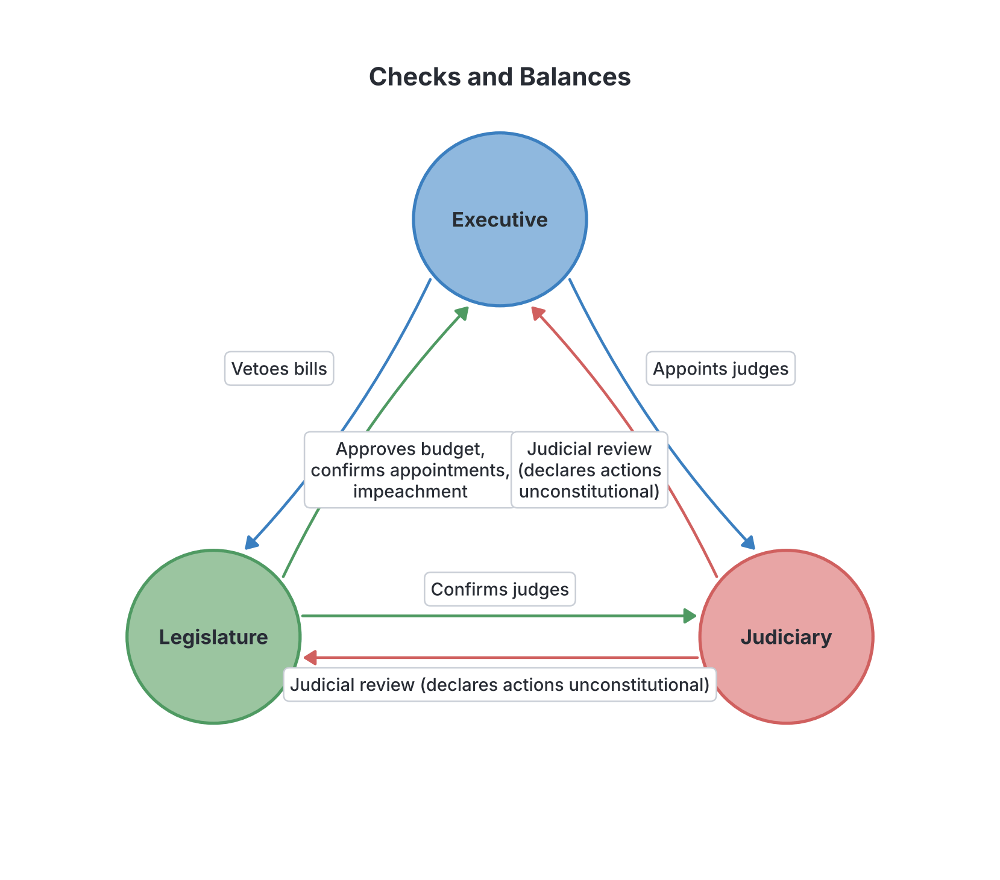
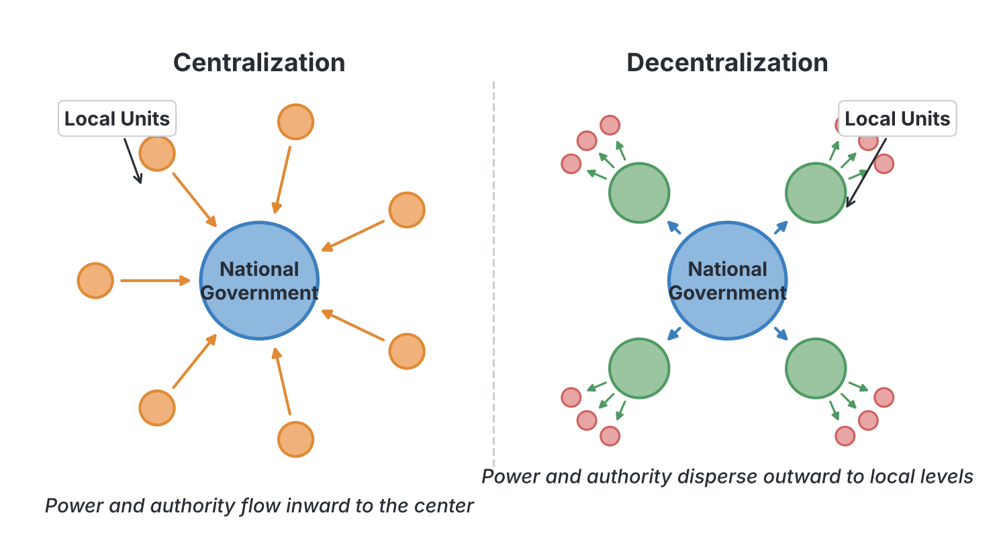

# JAMB Government Notes: Principles of Democratic Government

## What JAMB expects

This topic is Section A, Topic 9 of the JAMB Government syllabus: Principles of Democratic Government. It covers several foundational ideas that make a government democratic, accountable, and limited in its power.

In this file, we cover the following content items:
- Ethics and Accountability in Public Office
- Separation of Power
- Checks and Balances
- Individual and Collective Responsibility
- Constitutionalism
- Rule of Law
- Representative Government
- Centralization and Decentralization of Government

By the end of these notes, you should be able to:
1. Identify the principles of democratic government.
2. Determine the application of these principles.

**Note on the syllabus wording:** The syllabus uses the singular term "Separation of Power", but this is almost universally called "Separation of Powers" in political science and JAMB textbooks. These notes will use the standard plural form.

Democracy is often defined as the government of the people, by the people, and for the people. However, for a democracy to actually work and not turn into a dictatorship, it relies on specific **principles**. The following sections identify each of these principles and explain how they are applied in government.

---

## Ethics and Accountability in Public Office

**Objective i & ii: Identify and apply the principles of democratic government (Ethics and Accountability).**

### Identifying the principle
**Ethics** refers to the moral principles and rules of conduct that guide the behaviour of public officials. It is about knowing what is right and wrong, and choosing to do what is right (e.g., honesty, integrity, fairness, and avoiding corruption). 

**Accountability** is the principle that public officials (elected or appointed) must be answerable for their actions, decisions, and the way they spend public money. In a democracy, leaders are servants of the people; therefore, they must explain and justify their actions to the citizens.

### Application of Ethics and Accountability
In modern governments, ethics and accountability are applied through various institutions and rules:
1. **Code of Conduct:** Many countries have a set of rules governing the behaviour of public servants. In Nigeria, the **Code of Conduct Bureau (CCB)** and the **Code of Conduct Tribunal (CCT)** enforce these rules. Public officials are expected to declare their assets before taking office and after leaving, to prove they have not stolen public funds.
2. **Periodic Elections:** The ultimate form of accountability is the ballot box. If leaders perform poorly or act unethically, the citizens can vote them out in the next election.
3. **Auditing of Public Accounts:** The Auditor-General audits government spending to ensure money was used properly. The legislature often has a **Public Accounts Committee** to review these audit reports and question government ministries.
4. **The Ombudsman:** This is an independent official appointed to investigate citizens' complaints against government agencies or public officers. In Nigeria, this function is performed by the **Public Complaints Commission**.
5. **Anti-Corruption Agencies:** Specialized agencies are created to investigate and prosecute corrupt officials. Nigerian examples include the **Economic and Financial Crimes Commission (EFCC)** and the **Independent Corrupt Practices and Other Related Offences Commission (ICPC)**.
6. **Press Freedom:** A free press investigates government activities and exposes corruption, forcing officials to be accountable to the public.

---

## Separation of Powers

**Objective i & ii: Identify and apply the principles of democratic government (Separation of Powers).**

### Identifying the principle
The principle of **Separation of Powers** states that the political power of a state should be divided among three distinct arms (or organs) of government: the **Executive**, the **Legislature**, and the **Judiciary**. 

The concept was made famous by the French political philosopher **Baron de Montesquieu** in his 1748 book, *The Spirit of the Laws* (*L'Esprit des Lois*). Montesquieu argued that if all government power is concentrated in the hands of one person or one group, it will lead to tyranny and the abuse of citizens' liberties.

To prevent this:
- The **Legislature** should only make the laws.
- The **Executive** should only implement and enforce the laws.
- The **Judiciary** should only interpret the laws and punish offenders.

### Application of Separation of Powers
The way this principle is applied depends on the system of government:
- **In a Presidential System (e.g., Nigeria, USA):** Separation of powers is applied **strictly**. The President (Executive) is not a member of the National Assembly (Legislature). Cabinet ministers cannot be members of the legislature; if a lawmaker is appointed as a minister, they must resign from the legislature.
- **In a Parliamentary System (e.g., UK, Nigeria's First Republic):** Separation of powers is **fused or weak**. The Prime Minister and the cabinet ministers are also members of the parliament (the legislature). They make the laws and also implement them. 

*Note: You can learn more about the specific roles of each arm in `A4-arms-of-government.md`.*

---

## Checks and Balances

**Objective i & ii: Identify and apply the principles of democratic government (Checks and Balances).**

### Identifying the principle
**Checks and Balances** is a mechanism built into the constitution that allows each arm of government to monitor, control, or limit the powers of the other two arms. 

While Separation of Powers divides the government so no one has all the power, Checks and Balances ensure that the divided powers do not act like independent dictatorships. The two principles work together.

### Application of Checks and Balances
Here is a step-by-step look at how the arms of government check each other, using the Nigerian presidential system as an example:

1. **How the Legislature checks the Executive:**
   - **Approval of Appointments:** The President nominates ministers, ambassadors, and top officials, but the Senate must screen and confirm them.
   - **Power of the Purse (Budget):** The Executive cannot spend public money unless the Legislature passes the budget (Appropriation Bill).
   - **Impeachment:** The Legislature can remove the President or Vice President for gross misconduct.
   - **Veto Override:** If the President refuses to sign a bill into law (veto), the Legislature can override the veto with a two-thirds majority vote, making it law without the President's signature.

2. **How the Executive checks the Legislature:**
   - **Veto Power:** The President can refuse to sign a bill passed by the Legislature.
   - **Execution of Laws:** The Legislature relies on the Executive (police, agencies) to actually enforce the laws they make.

3. **How the Judiciary checks the Legislature and Executive:**
   - **Judicial Review:** The Supreme Court has the power to declare any law passed by the Legislature or action taken by the Executive as **unconstitutional** (null and void) if it goes against the Constitution.

4. **How the Executive and Legislature check the Judiciary:**
   - **Appointment:** Judges are appointed by the Executive (the President) but must be confirmed by the Legislature (the Senate).
   - **Removal:** The President can remove the Chief Justice, but usually only with the approval of a two-thirds majority of the Senate.
   - **Pardon:** The Executive can grant a state pardon to a person convicted by the Judiciary (Prerogative of Mercy).

### Comparing Separation of Powers and Checks and Balances

| Feature | Separation of Powers | Checks and Balances |
| :--- | :--- | :--- |
| **Main Idea** | Divides government into three separate arms. | Gives each arm the power to oversee the others. |
| **Purpose** | To prevent the concentration of power in one place. | To prevent any single arm from abusing its separated power. |
| **Analogy** | Giving three different workers three completely different jobs. | Allowing the three workers to inspect each other's work to ensure quality. |

---

## Individual and Collective Responsibility

**Objective i & ii: Identify and apply the principles of democratic government (Individual and Collective Responsibility).**

### Identifying the principle
These are core principles of the **parliamentary (cabinet) system of government**. They define how government ministers are held accountable.

1. **Individual Responsibility:** This means that every minister is personally accountable for the actions, successes, and failures of their specific ministry. If a major scandal or failure occurs in the Ministry of Health, the Minister of Health is expected to take the blame and resign, without dragging the rest of the government down.
2. **Collective Responsibility:** This means that all cabinet members (ministers) are jointly responsible for the decisions and policies of the government as a whole. 
   - Decisions are made secretly in the cabinet. Once a decision is reached, every minister must support it in public and in parliament.
   - If a minister strongly disagrees with a government policy, they cannot criticize it publicly; they must resign.
   - If the parliament passes a **vote of no confidence** against the government, the Prime Minister and the entire cabinet must resign together ("they stand or fall together").

### Application of Individual and Collective Responsibility
- **In a Parliamentary System (e.g., UK):** These principles are fully applied. Ministers answer directly to the parliament and must resign if they lose the parliament's support.
- **In a Presidential System (e.g., Nigeria):** The principle of collective parliamentary responsibility does *not* apply. Ministers are appointed by the President (not from the parliament) and they answer only to the President. The parliament cannot pass a vote of no confidence to remove the whole cabinet. However, individual responsibility still informally applies, as a minister who fails can be fired by the President.

---

## Constitutionalism

**Objective i & ii: Identify and apply the principles of democratic government (Constitutionalism).**

### Identifying the principle
**Constitutionalism** is the principle that the power of the government is **limited** by a constitution, and that government officials must rule according to the laws of the land, not according to their own personal wishes. 

It is the opposite of dictatorship or absolute monarchy. Under constitutionalism, nobody is above the law, and human rights are respected.

### Application of Constitutionalism
Constitutionalism is applied through:
1. **Written Constitutions:** The rules limiting government power are clearly documented.
2. **Fundamental Human Rights:** These rights are entrenched in the constitution, meaning the government cannot easily take them away.
3. **Independent Judiciary:** A fearless judiciary interprets the constitution and stops the government from acting arbitrarily.
4. **Regular Elections:** Ensuring that leaders who breach the constitution can be removed peacefully.

**Common Mistake:** Do not confuse "Constitution" with "Constitutionalism". A *Constitution* is the document or set of rules (even dictators can have a constitution). *Constitutionalism* is the actual practice of strictly obeying those rules and limiting government power.

---

## Rule of Law

**Objective i & ii: Identify and apply the principles of democratic government (Rule of Law).**

### Identifying the principle
The **Rule of Law** means that the law is supreme, and everyone in the state, including the rulers and the ruled, is subject to the same laws. 

The concept was popularized by the British legal scholar **A.V. Dicey** in his 1885 book, *Introduction to the Study of the Law of the Constitution*. According to Dicey, the Rule of Law rests on three pillars:

1. **Supremacy of the Law:** No one can be punished or made to suffer except for a distinct breach of the law, established in an ordinary court. The government cannot arrest people just because it feels like it (arbitrary rule).
2. **Equality before the Law:** The law applies equally to everyone, regardless of their wealth, social status, religion, or political position. A rich politician and a poor farmer must face the same justice.
3. **Fundamental Human Rights (or Civil Liberties):** The rights of citizens (e.g., right to life, fair hearing, freedom of speech) must be protected by the laws and the courts.

### Application of the Rule of Law
In a democratic state, the Rule of Law is applied by ensuring courts are independent, accused persons have a right to a lawyer, and the police cannot hold a person indefinitely without charging them to court (habeas corpus).

#### Limitations (Exceptions) to the Rule of Law
In reality, the rule of law is not perfectly applied everywhere. There are lawful exceptions where people are treated differently:
- **Diplomatic Immunity:** Ambassadors and diplomats cannot be sued or prosecuted in the courts of their host country. (If they commit a crime, they are deported to face justice in their home country).
- **Executive Immunity:** In many countries (including Nigeria, under Section 308 of the 1999 Constitution as amended), the President, Vice President, Governors, and Deputy Governors cannot be taken to court for criminal or civil offenses while they are in office.
- **Parliamentary Immunity:** Lawmakers cannot be sued for things they say during debates inside the parliament chamber.
- **State of Emergency:** During a war or severe crisis, the government can suspend certain rights and laws to restore order.
- **Special Tribunals:** Sometimes military personnel are tried by Court Martial, not ordinary courts.

---

## Representative Government

**Objective i & ii: Identify and apply the principles of democratic government (Representative Government).**

### Identifying the principle
A **Representative Government** is a system of indirect democracy where citizens elect a few people (representatives) to make laws, formulate policies, and run the government on their behalf. 

In ancient Athens (Greece), citizens practiced *direct democracy*, where every male citizen gathered in the town square to vote on every law. In modern countries with millions of people, this is impossible. Therefore, the people delegate their sovereign power to elected leaders.

### Application of Representative Government
For a government to be truly representative, it must apply the following elements:
1. **Universal Adult Suffrage:** Every adult citizen of sound mind (e.g., aged 18 and above in Nigeria) must have the right to vote, regardless of race, sex, or wealth.
2. **Periodic Free and Fair Elections:** Representatives must not rule forever. They are given a mandate for a fixed term (e.g., four years), after which elections must be held.
3. **Political Parties:** There must be multiple political parties presenting different candidates and manifestos, giving voters real choices.
4. **Majority Rule with Minority Rights:** The candidates who win the most votes get to govern, but the rights and voices of those who lost must still be protected.
5. **Freedom of Association and Press:** Citizens must be free to gather, debate, and receive accurate information to make informed choices when electing representatives.

---

## Centralization and Decentralization of Government

**Objective i & ii: Identify and apply the principles of democratic government (Centralization vs Decentralization).**

### Identifying the principles
Governments must decide how to organize power geographically. 

**Centralization** is the concentration of political and administrative power at the center (the national government). The central authority makes all major decisions, and any local authorities only take orders from the center.

**Decentralization** is the transfer or sharing of political and administrative power from the central government to lower levels of government (such as states, regions, or local government councils).

Decentralization takes three main forms:
1. **Deconcentration (Administrative Decentralization):** The central government keeps the political power but moves some of its administrative offices to local areas (e.g., the Federal Ministry of Education opening branch offices in all 36 states).
2. **Devolution (Political Decentralization):** Power is legally transferred to sub-national units (states or local governments). These units have their own elected leaders and the power to make their own laws on certain issues. This is the foundation of a **federal system**.
3. **Delegation:** The central government assigns a specific task to an agency or lower tier, but can take that power back at any time.

### Application of Centralization and Decentralization
- **Centralization applied:** It is commonly applied in **Unitary systems of government** (like Britain, Ghana, or France), where the central government holds all constitutional power. It is also heavily applied during **Military Regimes**, which run the country using a rigid, top-down chain of command.
  - *Advantages of Centralization:* Promotes national unity, uniform laws, and cheaper governance (no duplication of offices).
  - *Disadvantages:* The center gets overloaded, and local needs are often ignored.
- **Decentralization applied:** It is commonly applied in **Federal systems** (like Nigeria, the USA, and Germany). In Nigeria, power is devolved to 36 States and 774 Local Government Areas. 
  - *Advantages of Decentralization:* Brings government closer to the people, allows for local development, and reduces the workload of the central government.
  - *Disadvantages:* It is expensive to run (many governors, houses of assembly, local councils) and can sometimes cause regional conflicts or threats of secession.

### Comparison Table: Centralization vs Decentralization

| Feature | Centralization | Decentralization |
| :--- | :--- | :--- |
| **Location of Power** | Concentrated at the center. | Shared among center, states, and local units. |
| **System of Government** | Typical of Unitary systems. | Typical of Federal and Confederal systems. |
| **Speed of Action** | Usually faster, as only one body makes decisions. | Often slower, as consultation is needed. |
| **Local Participation** | Very low. | Very high; grassroots are involved. |
| **Best suited for** | Small countries with homogeneous (similar) populations. | Large countries with diverse ethnic or religious groups. |

---

## Key terms

| Term | Meaning |
| --- | --- |
| **Ethics** | Moral principles that govern a public official's behavior (honesty, fairness). |
| **Accountability** | The principle that leaders must be answerable for their actions and use of public funds. |
| **Separation of Powers** | Dividing government power among the Executive, Legislature, and Judiciary to prevent tyranny (Montesquieu). |
| **Checks and Balances** | Mechanisms allowing each arm of government to monitor and limit the powers of the other arms. |
| **Individual Responsibility** | A minister is personally answerable for the failures of their own ministry (Parliamentary system). |
| **Collective Responsibility** | The cabinet makes decisions together and must resign as a whole if they lose a vote of no confidence. |
| **Constitutionalism** | The practice of limiting government power according to a constitution; ruling by law, not by force. |
| **Rule of Law** | The principle that the law is supreme and applies equally to everyone (A.V. Dicey). |
| **Representative Government** | A system where citizens elect leaders to make decisions on their behalf (indirect democracy). |
| **Centralization** | The concentration of political and administrative power in the national/central government. |
| **Decentralization** | The transfer of power from the central government to local or state governments. |
| **Devolution** | The legal transfer of political power to sub-national units (a form of decentralization). |
| **Judicial Review** | The power of the courts to declare laws or executive actions unconstitutional. |

---

## Exam tips and common mistakes

- **Separation of Powers vs Division of Powers:** This is a very common JAMB trap. **Separation of powers** refers to the arms of government (Executive, Legislature, Judiciary). **Division of powers** refers to federalism—sharing power among levels of government (Federal, State, Local).
- **Know the Authors:** Always remember Montesquieu for Separation of Powers (1748) and A.V. Dicey for Rule of Law (1885).
- **Exceptions to the Rule of Law:** JAMB frequently tests this. Remember that diplomatic immunity and executive immunity (Section 308) are legal limitations to equality before the law.
- **Constitution vs Constitutionalism:** A constitution is just the document. Constitutionalism is the *limitation of power* to prevent dictatorship. A military dictator might suspend the constitution, which destroys constitutionalism.
- **Collective Responsibility is for Parliamentary Systems:** If a question asks which system features collective responsibility, the answer is the Parliamentary (Cabinet) system. It does not exist in a Presidential system.

---

## Quick summary

1. Ethics and accountability ensure public officials act morally and answer to the people (e.g., through asset declaration and auditing).
2. Separation of Powers (Montesquieu) divides government into the Legislature, Executive, and Judiciary to prevent dictatorship.
3. Checks and balances allow each arm to monitor the others, such as the legislature approving the executive's budget, or the judiciary reviewing laws.
4. In a parliamentary system, ministers bear individual responsibility for their ministries and collective responsibility for all government decisions.
5. Constitutionalism is the principle that government power must be strictly limited by written laws and respect for rights.
6. The Rule of Law (A.V. Dicey) ensures supremacy of the law, equality before the law, and protection of fundamental human rights, though exceptions like diplomatic immunity exist.
7. Representative government allows citizens to elect leaders to govern on their behalf, supported by universal suffrage and free elections.
8. Centralization concentrates power at the center (Unitary systems), while decentralization (devolution) shares power with lower levels like states and local governments (Federal systems).

---

## Practice questions

**1. The concept of Separation of Powers was popularized by**
- A. A.V. Dicey
- B. Thomas Hobbes
- C. Baron de Montesquieu
- D. John Locke

**Answer: C.** Baron de Montesquieu popularized the concept in his 1748 book, *The Spirit of the Laws*. A.V. Dicey is associated with the Rule of Law.

**2. Which of the following is an example of the legislature checking the executive?**
- A. The President vetoing a bill
- B. The Supreme Court declaring a law unconstitutional
- C. The Senate refusing to confirm a ministerial nominee
- D. The President granting a state pardon

**Answer: C.** The Senate (legislature) has the power to screen and confirm (or reject) nominees submitted by the President (executive), acting as a check on executive appointments. Options A and D are executive powers; Option B is a judicial power.

**3. The principle that states that government power is limited by a set of documented rules is known as**
- A. Separation of powers
- B. Constitutionalism
- C. Devolution
- D. Federalism

**Answer: B.** Constitutionalism is the principle that government authority is derived from and limited by a body of fundamental law (the constitution), preventing arbitrary rule.

**4. A major limitation to the principle of equality before the law is**
- A. the existence of multiple political parties
- B. diplomatic immunity
- C. periodic elections
- D. universal adult suffrage

**Answer: B.** Diplomatic immunity protects foreign ambassadors from being prosecuted in the host country's courts, which is an exception to the rule that the law applies equally to everyone.

**5. In a parliamentary system, the principle of collective responsibility means that**
- A. all citizens are responsible for government policies
- B. the legislature and the judiciary must work together
- C. the cabinet stands or falls together on government decisions
- D. the prime minister makes decisions without consulting the cabinet

**Answer: C.** Collective responsibility means all ministers must publicly support cabinet decisions, and if a vote of no confidence is passed by the parliament, the entire cabinet must resign together.

**6. Which of the following best describes decentralization?**
- A. Concentrating power in the hands of the President
- B. Fusing the executive and legislative arms
- C. Transferring powers from the central government to local units
- D. Allowing the judiciary to interpret all laws

**Answer: C.** Decentralization is the sharing or transferring of political and administrative powers from the central government to lower levels, such as states or local government councils.

**7. A.V. Dicey's theory of the Rule of Law emphasizes all the following EXCEPT**
- A. supremacy of the law
- B. arbitrary use of power
- C. equality before the law
- D. protection of fundamental human rights

**Answer: B.** The rule of law actively *opposes* the arbitrary use of power. Dicey's three pillars are supremacy of the law, equality before the law, and fundamental human rights.

**8. The fundamental difference between separation of powers and division of powers is that**
- A. separation of powers relates to federalism, while division of powers relates to the arms of government
- B. separation of powers relates to the arms of government, while division of powers relates to levels of government
- C. separation of powers only exists in a unitary state
- D. division of powers only exists in a presidential system

**Answer: B.** Separation of powers divides power horizontally among the Executive, Legislature, and Judiciary. Division of powers divides power vertically between the Federal, State, and Local governments (federalism).

**9. The primary purpose of representative government is to**
- A. allow every single citizen to vote directly on every law
- B. empower traditional rulers to make modern laws
- C. delegate the people's sovereign power to elected officials
- D. centralize power in the hands of the military

**Answer: C.** Because direct democracy (everyone voting on every law) is impossible in modern large states, representative government allows citizens to elect officials to make decisions and govern on their behalf.

**10. Which body in Nigeria is primarily responsible for ensuring the ethical behaviour and asset declaration of public officers?**
- A. Independent National Electoral Commission (INEC)
- B. Public Complaints Commission
- C. Code of Conduct Bureau (CCB)
- D. National Judicial Council (NJC)

**Answer: C.** The Code of Conduct Bureau (CCB) is constitutionally mandated to establish and maintain a high standard of public morality and accountability, including processing the asset declarations of public officers.
