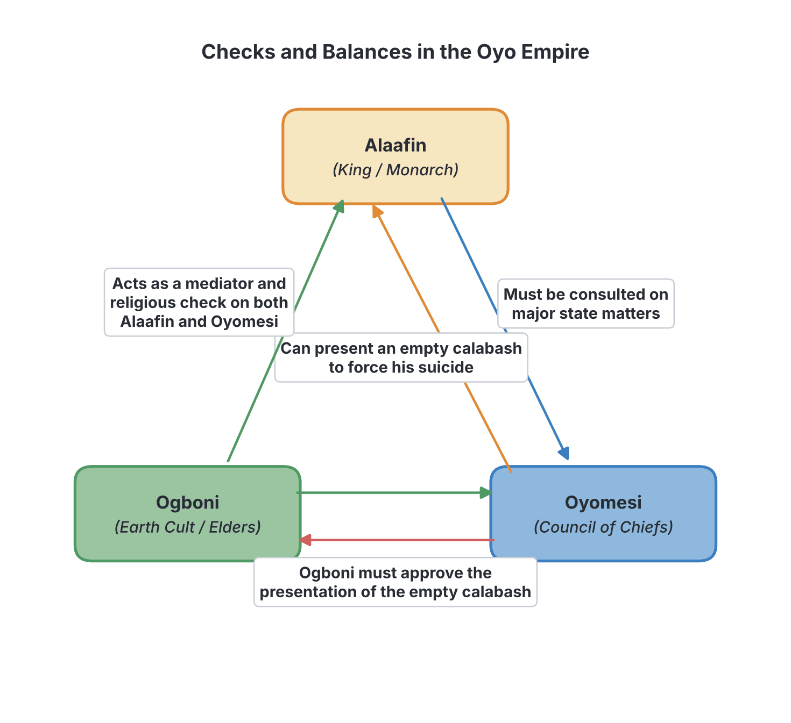
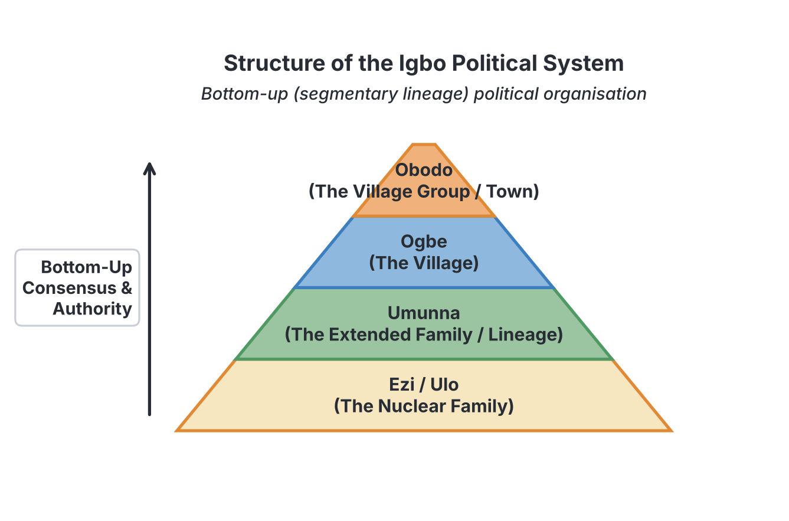

# JAMB Government Notes: Pre-colonial Polities

## What JAMB expects

This topic is Section B, Topic 1 of the JAMB Government syllabus: Pre-colonial Polities. It covers the structural organisation and the functions of the political institutions of four major pre-colonial Nigerian societies. 

THIS FILE COVERS:
- **a. Their structural organization;** (Pre-jihad Hausa/Fulani Emirate, Tiv, Igbo, Yoruba)
- **b. The functions of their various political institutions.** (Pre-jihad Hausa/Fulani Emirate, Tiv, Igbo, Yoruba)

By the end of these notes, you should be able to:
1. Appreciate the effectiveness of the pre-colonial political systems. (Objective i)
2. Compare pre-colonial systems of governance. (Objective ii)

**Note on the syllabus wording:** The syllabus groups "Pre-jihad Hausa/Fulani Emirate" as one phrase. Historically, the "Pre-jihad Hausa" systems (the Habe states) existed *before* 1804, while the "Fulani Emirate" system was created *after* the 1804 Islamic Jihad by Uthman Dan Fodio. Because JAMB exams heavily test both the original Hausa administration and the highly structured Fulani Emirate that replaced it, these notes will explain both to ensure you are fully prepared.

---

## Pre-jihad Hausa and the Fulani Emirate System

**Content a & b: Structural organization and functions of institutions in the Hausa/Fulani system.**

Before the arrival of the British, the northern part of present-day Nigeria was dominated by the Hausa city-states, which were later conquered and transformed into the Fulani Emirate system.

### The Pre-jihad Hausa System (The Habe System)
Before the 1804 Jihad, the Hausa people were organised into fourteen independent city-states. Seven were considered the original, pure Hausa states (**Hausa Bakwai**), namely Kano, Katsina, Zazzau (Zaria), Daura, Gobir, Rano, and Biram. The other seven were the "bastard" or assimilated states (**Banza Bakwai**), such as Ilorin, Nupe, Yauri, and Kebbi.

**Structural Organization and Functions:**
*   **The Sarki (King):** Each state was ruled by a king known as the *Sarki*. He was the supreme political and religious leader.
*   **Council of State:** The Sarki was advised by a council of title-holders who represented noble families. This council served as a check on the powers of the Sarki, ensuring he did not become a dictator.
*   **Village Heads:** The capital city was surrounded by farming villages. Each village was administered by a village head appointed by the Sarki, responsible for collecting taxes and maintaining local order.
*   **Religion:** While Islam had been introduced by traders centuries earlier, many pre-jihad Hausa rulers mixed Islamic practices with traditional African religions.

### The Fulani Emirate System (Post-1804)
In 1804, the Fulani scholar **Uthman Dan Fodio** led an Islamic holy war (Jihad) that overthrew the Hausa Habe kings. He established the **Sokoto Caliphate**, a massive and highly centralised Islamic empire. 

The Caliphate was divided into two main empires:
1.  **The Eastern Empire:** Headquartered in Sokoto and ruled by Uthman Dan Fodio's son, Muhammad Bello.
2.  **The Western Empire:** Headquartered in Gwandu and ruled by Uthman Dan Fodio's brother, Abdullahi.

#### Structural Organization of the Emirate
The Fulani political system was **highly centralised**, **authoritarian**, and **theocratic** (ruled by religious laws, specifically Islamic Sharia). The conquered states were turned into *Emirates*.

[IMAGE: An organisational chart of the Fulani Emirate System. At the top is a box for the 'Emir'. Below it, a horizontal row of boxes connected to the Emir: 'Waziri (Prime Minister)', 'Madawaki (Army Commander)', 'Galadima (Capital Administrator)', 'Maaji (Treasurer)', 'Sarkin Fada (Head of Palace Workers)', 'Sarkin Yan Doka (Police Chief)', and 'Alkali (Judge)'. Further down, arrows lead from the Emir to 'Hakimi (District Head)', then to 'Dagaci (Village Head)'. Style: Clean flat textbook illustration, white background, crisp boxes and lines.]

#### Functions of the Political Institutions

**1. The Emir:**
*   He was the supreme political, administrative, and religious head of the Emirate.
*   He was an absolute monarch, meaning his word was law, provided it did not contradict the Quran or the directives of the Sultan of Sokoto or Gwandu.
*   He appointed all major officials, executed laws, and presided over the Emir's court (the highest court of appeal in the Emirate).

**2. The Advisory Council (Council of Advisers):**
To help him rule, the Emir appointed a cabinet of senior officials. Unlike the Yoruba system, this council could only *advise* the Emir; they could not force him to act or remove him from office. Their titles and functions are frequently tested by JAMB:
*   **Waziri:** The Prime Minister and the most senior official. He was the head of the civil administration and the Emir's chief adviser.
*   **Madawaki (or Madaki):** The Commander-in-Chief of the cavalry (the army). He was responsible for the defence of the Emirate and leading troops in wars of expansion.
*   **Galadima:** The administrator of the capital city. He ensured order was maintained in the central town where the Emir lived.
*   **Magaji (or Maaji):** The Treasurer. He was in charge of the Emirate's treasury, collecting taxes, tributes, and keeping financial records.
*   **Sarkin Fada:** The head of the palace workers. He organised the internal running of the Emir's palace.
*   **Sarkin Ruwa:** The minister in charge of water resources, fishing, and rivers.
*   **Sarkin Pawa:** The head of the butchers (who were an important economic guild).

**3. District Administration (Hakimi):**
*   The Emirate was divided into districts to make tax collection easier. The Emir appointed a District Head called the **Hakimi**.
*   The Hakimi lived in the capital city but administered his district through appointed representatives.
*   **Taxes collected included:** *Jangali* (cattle tax on nomadic herdsmen), *Kharaj* (land tax), and *Jizya* (poll tax levied on non-Muslim subjects).

**4. The Judicial System (Alkali Courts):**
*   The judicial system was based strictly on **Sharia** (Islamic law).
*   Judges called the **Alkali** presided over Alkali courts. They judged cases based on Islamic jurisprudence.
*   The Emir's court was the highest court in the land, dealing with severe cases like murder, land disputes, and disputes between high-ranking officials.

**5. Law Enforcement:**
*   **Sarkin Yan Doka:** The Chief of Police.
*   **Dogari:** The traditional police force. They wore distinctive uniforms (often red and green) and served as the Emir's bodyguards and law enforcers, arresting offenders and executing the orders of the Alkali courts.

---

## The Pre-colonial Yoruba Political System

**Content a & b: Structural organization and functions of institutions in the Yoruba system.**

The pre-colonial Yoruba political system was **centralised** but operated with a complex and highly effective system of **checks and balances**. Unlike the absolute power of the Fulani Emirs, Yoruba kings ruled constitutionally. The **Oyo Empire** is the standard model used in JAMB to illustrate the Yoruba political system.

#### Structural Organization and Functions of Political Institutions

**1. The Alaafin (The King):**
*   The Alaafin was the supreme ruler of the Oyo Empire. He was highly revered and seen as the companion of the gods (*Ekeji Orisa*).
*   **Functions:** He was the political, executive, and spiritual head of the empire. He made major state decisions, declared wars, and signed treaties.
*   **Limitation of Power:** Despite his supreme title, the Alaafin was *not* an absolute dictator. He could not rule without the advice of his council, and if he became tyrannical, he could be removed.

**2. The Oyomesi (The Council of Kingmakers):**
*   The Oyomesi was a council of seven prominent chiefs, led by a Prime Minister called the **Bashorun**. 
*   **Functions:** They served as the executive cabinet and the main check on the Alaafin's power. They advised the Alaafin on day-to-day administration and had the sole power to select a new Alaafin when a ruling king died.
*   **The Empty Calabash:** If the Alaafin became a tyrant, oppressive, or unpopular, the Oyomesi had the constitutional power to reject him. The Bashorun would present the Alaafin with an empty calabash (or sometimes a calabash containing parrot eggs). This was a message saying, "The gods reject you, the earth rejects you, and the people reject you." By tradition, an Alaafin presented with this calabash had to commit suicide.

**3. The Ogboni Cult (The Secret Society):**
*   The Ogboni was a powerful secret society composed of wealthy, elderly, and spiritually influential men and women. It was headed by the **Oluwo**.
*   **Functions:** The Ogboni served as a check on both the Alaafin and the Oyomesi. To prevent the Oyomesi from abusing their power and killing the Alaafin without good reason, the Oyomesi's decision to present the empty calabash had to be approved by the Ogboni.
*   They also handled matters of traditional religion, judged cases involving shedding of blood or treason, and mediated disputes between the Alaafin and the Oyomesi.

**4. The Eso (The Military):**
*   The Eso was the military class, responsible for defending the empire and expanding its territories.
*   **Aare Ona Kakanfo:** This was the Generalissimo (Commander-in-Chief) of the Yoruba army.
*   **Checks on the Military:** To prevent military coups, the Aare Ona Kakanfo was legally forbidden from living in the capital city (Oyo). He lived in a border province. Furthermore, if he led the Oyo army into a war and was defeated, tradition dictated that he must not return home alive; he had to commit suicide.

**5. Provincial Administration (Baale and Oba):**
*   The Oyo Empire was vast, so it was divided into provinces.
*   Provinces were ruled by lesser kings (Obas) or provincial chiefs (Baales). They paid annual tributes to the Alaafin and supplied troops to the Oyo army during wartime.
*   The Alaafin maintained control over these provinces by placing his personal representatives, known as the **Ilari**, in the provinces to monitor the Baales and ensure they remained loyal.

---

## The Pre-colonial Igbo Political System

**Content a & b: Structural organization and functions of institutions in the Igbo system.**

The pre-colonial Igbo political system was completely different from the Hausa/Fulani and Yoruba systems. It was **decentralised**, **acephalous** (headless/stateless), **republican**, and **egalitarian**. 

"Acephalous" means there was no central king or single ruler wielding authority over the entire society. Instead, political power was spread among families, elders, age grades, and title holders. Decisions were made by consensus (general agreement) rather than by royal decree.

*(Note: A few Igbo communities, like Onitsha and Oguta, had kings called Obi, but this was due to the influence of the neighbouring Benin Empire. The classic Igbo system tested in JAMB is the acephalous model).*

#### Structural Organization and Functions of Political Institutions

**1. The Family and Lineage (Ezi and Umunna):**
*   The smallest political unit was the nuclear family (*Ezi*), headed by the father, who held the family's *Ofo* (a sacred staff representing truth, justice, and ancestral authority).
*   Several families formed an extended family or kindred (*Umunna*). The oldest man in the Umunna (the *Okpara*) was the leader. He settled internal family disputes and represented the kindred at the village level.

**2. The Council of Elders (Ama-ala / Ndichie):**
*   The village was the highest effective level of political organisation. The village was governed by a Council of Elders, consisting of the heads of the various *Umunna* (kindreds) and other respected individuals, especially **Ofo title holders** (Ndi Nze na Ozo).
*   **Functions:** They acted as the executive and judicial branch. They prepared agendas for village meetings, settled serious disputes (like land and murder cases), and formulated policies based on custom and tradition (Omenala).

**3. The Village Assembly (Oha-na-eze):**
*   This was the supreme legislative body in the Igbo political system. It was a general assembly of all adult males in the village, usually held in the village square (Ilo).
*   **Functions:** Every adult male had the right to speak and participate in decision-making (demonstrating its republican and democratic nature). The Council of Elders would present proposals, and the assembly would debate them until a consensus was reached. Once a decision was agreed upon, it became binding law.

**4. Age Grades (Ebiri or Uke):**
*   An Age Grade consisted of young men born within a specific period (usually a 3 to 5-year bracket).
*   **Functions:** They were the executive and law enforcement arm of the village. They acted as the police force, defending the village against external attacks, executing the laws passed by the Village Assembly, collecting fines, and carrying out communal labour (like clearing paths and building markets).

**5. Umuada (or Ndiyom):**
*   The *Umuada* was a powerful association of all the adult daughters of a village, whether married within the village or married away to other villages.
*   **Functions:** They were a very strong pressure group. They enforced public morality, settled disputes among women, and could intervene in violent quarrels among the men when the elders failed to resolve them. They were highly respected and feared.

**6. Secret Societies and Oracles:**
*   **Secret Societies (e.g., Mmanwu/Masquerade, Ekpe):** They were used to enforce laws, especially those laws that people were afraid to enforce openly. They were seen as the spirits of the ancestors disciplining the living.
*   **Oracles (e.g., The Long Juju of Arochukwu, Agbala of Awka):** Oracles served as the supreme court of appeal. If a dispute could not be resolved by the elders, or if there was a complex mystery (like suspected witchcraft), the case was taken to the oracle, whose decision was final and unquestionable.

---

## The Pre-colonial Tiv Political System

**Content a & b: Structural organization and functions of institutions in the Tiv system.**

The Tiv political system (located in present-day Benue State) was similar to the Igbo system because it was also **decentralised**, **acephalous**, and **egalitarian**. However, the Tiv system was uniquely based on a **segmentary lineage system**. 

The entire Tiv society saw themselves as descendants of one common ancestor named **Tiv**. There were no traditional chiefs, kings, or central government before the British arrived.

*(Note for exams: The title "Tor Tiv" (King of the Tiv) did not exist in pre-colonial times; it was created by the British colonial administration in 1946 to make indirect rule easier).*

#### Structural Organization and Functions of Political Institutions

**1. The Compound (Ya):**
*   The smallest unit was the compound (*Ya*), consisting of a man, his wives, children, and sometimes brothers.
*   **The Orya:** This was the head of the compound. He settled minor domestic quarrels and directed the farming activities of the compound.

**2. The Kindred (Ipaven) and the Lineage/Territory (Tar):**
*   Several compounds tracing descent from the same ancestor formed a kindred (*Ipaven*). 
*   A group of kindreds occupying a specific geographical area formed a **Tar** (territory). The *Tar* is the most important political and social unit tested in JAMB for the Tiv system.

**3. The Council of Elders:**
*   The Tiv system did not have a formal assembly like the Igbo *Oha-na-eze*. Instead, political power was held by a Council of Elders who were the heads of the various compounds in the *Tar*.
*   **Functions:** They met to resolve disputes (especially over land and marriage), perform religious rituals, and take decisions concerning war and peace.

**4. Tsav and Swem (Religious and Judicial Authority):**
*   Because there were no police or prisons, the elders maintained law and order using traditional religion and the fear of the supernatural.
*   **Tsav:** This was a mystical power or witchcraft. Elders were believed to possess *Tsav*, which gave them the wisdom and spiritual power to govern, protect the community, and punish evil-doers. To disrespect an elder was to risk being cursed by their *Tsav*.
*   **Swem:** This was a sacred pot containing ashes and herbs. It was used for oath-taking and to dispense justice. Suspects in serious crimes were made to swear on the *Swem*; it was believed that anyone who swore falsely would suffer a terrible supernatural death.

**5. Age Sets:**
*   Like the Igbo, the Tiv grouped men of similar ages into Age Sets.
*   **Functions:** They were responsible for defending the territory during tribal wars, providing communal labour (farming, building huts), and providing a system of mutual help for their members.

---

## Objective i: Appreciate the effectiveness of pre-colonial political systems

**How effective were these systems?**
JAMB expects you to understand that long before European colonisation, Nigerian societies had highly effective ways of governing themselves. They were not "primitive" or chaotic; they were structured, functional, and tailored to the needs of the people.

1. **Maintenance of Law and Order:** Without modern police forces or prisons, these systems effectively prevented crime. In the Emirate, the *Dogari* and strict *Sharia* law deterred crime. In the Igbo and Tiv societies, the fear of the ancestors, oracles, and the *Swem* ensured people obeyed the laws.
2. **Effective Checks and Balances:** The pre-colonial systems, especially the Yoruba and Igbo, had brilliant constitutional mechanisms to prevent dictatorship. The Alaafin could be forced to commit suicide by the Oyomesi if he became a tyrant, ensuring leaders remained accountable to the people.
3. **Economic Organisation:** Taxation systems were highly developed. The Hausa/Fulani *Jangali* (cattle tax) and the Yoruba tribute systems funded vast empires, maintained standing armies, and paid for public administration.
4. **Democratic Participation:** The Igbo *Oha-na-eze* (Village Assembly) was an excellent example of direct democracy where every adult male had a voice in government, making the citizens feel deeply involved in their own governance.
5. **Delegation of Power:** Large empires were effectively managed. The Sokoto Caliphate and Oyo Empire were too large for one man to rule, so power was effectively delegated to Emirs, Hakimis, Obas, and Baales, creating a working system of provincial administration.

---

## Objective ii: Compare pre-colonial systems of governance

JAMB frequently asks questions that require you to contrast the different pre-colonial systems. Use this table to understand their core differences.

| Feature | Hausa/Fulani Emirate | Yoruba (Oyo Empire) | Igbo Society | Tiv Society |
| :--- | :--- | :--- | :--- | :--- |
| **System Type** | Highly Centralised (Empire) | Centralised (Empire) | Decentralised / Acephalous | Decentralised (Segmentary Lineage) |
| **Executive Head** | Emir (Absolute Monarch) | Alaafin (Constitutional Monarch) | None (Council of Elders) | None (Council of Elders / Orya) |
| **Concentration of Power** | Very high. The Emir had absolute power over life and property. | Moderate. The Alaafin had great power but was checked by other bodies. | None. Power was dispersed among families, elders, and age grades. | None. Power lay in the lineage groups and elders. |
| **Checks and Balances** | Very weak. The Council of Advisers (Waziri, etc.) could only advise, not dismiss the Emir. | Very strong. Oyomesi and Ogboni could remove/check the Alaafin. | Very strong. No single person had power; decisions required consensus. | Strong. No individual had power to enforce rules alone. |
| **Legislature** | Based on Islamic law (Sharia). Emir issued decrees. | The Alaafin and the Oyomesi made laws. | Village Assembly (*Oha-na-eze*); everyone participated. | Council of Elders acting on tradition. |
| **Judicial System** | Alkali courts presided over by Alkali judges. Strict Islamic law. | Alaafin's court, Ogboni (for serious crimes), Baales (local disputes). | Council of Elders, Age Grades, and Oracles (supreme court). | Council of Elders using the sacred *Swem* for oaths. |
| **Law Enforcement** | *Dogari* (traditional police) and *Sarkin Yan Doka*. | *Eso* (Military) and *Ilari* (King's messengers). | Age Grades and Secret Societies (Masquerades). | Age Sets. |

---

## Key terms

| Term | Meaning |
| :--- | :--- |
| **Pre-colonial** | The period before a country was taken over by a foreign power (before British rule in Nigeria). |
| **Centralised system** | A political system where power and authority are concentrated at a single centre or in a single ruler (e.g., Hausa/Fulani, Yoruba). |
| **Decentralised (Acephalous) system** | A political system without a single central ruler; power is shared among various groups and elders (e.g., Igbo, Tiv). |
| **Theocratic** | A system of government guided by religious laws and religious leaders (e.g., the Fulani Emirate using Sharia). |
| **Oyomesi** | The seven-member council of kingmakers in the pre-colonial Oyo Empire, led by the Bashorun. |
| **Oha-na-eze** | The supreme village assembly in the pre-colonial Igbo system where all adult males debated and made laws. |
| **Tar** | The primary political and territorial unit in the pre-colonial Tiv society, representing a lineage group. |
| **Umuada** | The powerful association of daughters/women in the pre-colonial Igbo society that acted as a pressure group. |
| **Waziri** | The Prime Minister and most senior official in the Fulani Emirate administration. |
| **Empty Calabash** | A symbolic object presented by the Oyomesi to a tyrannical Alaafin, ordering him to commit suicide. |

---

## Exam tips and common mistakes

*   **Confusing the Waziri and the Bashorun:** Both act like "Prime Ministers," but the *Waziri* is for the Hausa/Fulani Emirate, and the *Bashorun* is the head of the Oyomesi in the Yoruba Oyo Empire.
*   **Assuming the Igbo had kings:** A very common JAMB trap. Unless the question specifically mentions towns influenced by Benin (like Onitsha), you must always classify the Igbo system as acephalous, republican, and lacking central chiefs.
*   **Misunderstanding the Emir's power:** JAMB often asks about checks and balances. Remember that the Emir's council (Waziri, Madawaki, etc.) *cannot* remove the Emir. The Emir was an absolute ruler, checked only by Sharia law and the Sultan. 
*   **The Tiv "Tor Tiv" trap:** Never choose "Tor Tiv" as a pre-colonial institution. It was created by the British. The pre-colonial Tiv system relied on the *Tar* (territory) and elders.
*   **The Aare Ona Kakanfo rule:** Remember that the commander of the Oyo army was not allowed to live in the capital city, to prevent military coups.

---

## Quick summary

1. Before colonialism, Nigerian societies had effective, well-structured political systems.
2. The pre-jihad Hausa system (Habe) was ruled by the Sarki, which was later overthrown by Uthman Dan Fodio's jihad in 1804.
3. The Fulani Emirate was highly centralised and authoritarian. The Emir ruled absolutely, assisted by officials like the Waziri (Prime Minister) and Madawaki (Army Commander), using Sharia law.
4. The Yoruba (Oyo Empire) system was centralised but had strict checks and balances. The Alaafin was the king, but he could be deposed (forced to commit suicide) by the Oyomesi (kingmakers), who were in turn checked by the Ogboni cult.
5. The Igbo political system was decentralised, acephalous, and republican. Power was shared among the Council of Elders (Ama-ala), the Village Assembly (Oha-na-eze), and Age Grades, with Oracles acting as the highest court.
6. The Tiv system was a decentralised, segmentary lineage system. It had no central kings; power was based on the lineage unit (Tar) and exercised by elders using religious authority (Tsav and Swem).
7. These systems were highly effective at maintaining law and order, raising taxes, and defending their territories without modern European institutions.

---

## Practice questions

**1. Which of the following pre-colonial systems of government was completely acephalous?**
- A. The Hausa/Fulani Emirate
- B. The Oyo Empire
- C. The Igbo political system
- D. The Benin Empire

**Answer: C.** The Igbo political system was acephalous (headless/stateless), meaning it had no centralised king or absolute ruler, unlike the Hausa, Yoruba, or Benin systems.

**2. In the pre-colonial Oyo Empire, an autocratic Alaafin could be forced to commit suicide by the**
- A. Aare Ona Kakanfo
- B. Ogboni cult
- C. Oyomesi
- D. Ilari

**Answer: C.** The Oyomesi (the council of kingmakers led by the Bashorun) had the constitutional power to reject a tyrannical Alaafin by presenting him with an empty calabash, forcing his suicide.

**3. The highest court of appeal in the pre-colonial Igbo political system was the**
- A. Council of Elders
- B. Oha-na-eze
- C. Age grades
- D. Oracle

**Answer: D.** While the Council of Elders handled most disputes, matters that were too complex to resolve or required spiritual intervention were taken to the Oracles (like the Long Juju of Arochukwu), whose verdict was final.

**4. The official responsible for the administration of the capital city in the Fulani Emirate system was the**
- A. Waziri
- B. Galadima
- C. Madawaki
- D. Maaji

**Answer: B.** The Galadima was the administrator of the capital city. (The Waziri was the Prime Minister, the Madawaki was the army commander, and the Maaji was the treasurer).

**5. The most important political and territorial unit in the pre-colonial Tiv society was the**
- A. Ya
- B. Orya
- C. Tar
- D. Swem

**Answer: C.** The *Tar* (territory) was the fundamental political and social unit, representing a group of kindreds occupying a specific area.

**6. Which of the following best describes the pre-colonial Yoruba political system?**
- A. A highly centralised system with absolute monarchy
- B. A centralised system with strong checks and balances
- C. A decentralised system based on segmentary lineages
- D. An egalitarian system with no executive head

**Answer: B.** The Yoruba system (Oyo Empire) was centralised (had a king), but the Alaafin was not absolute; he was strictly checked by the Oyomesi and Ogboni.

**7. In the Hausa/Fulani Emirate, taxes collected from cattle rearers were known as**
- A. Kharaj
- B. Jizya
- C. Zakat
- D. Jangali

**Answer: D.** *Jangali* was the livestock/cattle tax paid by nomadic herdsmen. *Kharaj* was land tax, and *Jizya* was the tax on non-Muslims.

**8. The executive and police functions in the pre-colonial Igbo society were largely performed by the**
- A. Ndichie
- B. Umuada
- C. Age grades
- D. Ofo title holders

**Answer: C.** The Age grades acted as the executive arm of the village. They enforced the laws passed by the assembly, acted as the police force, and carried out communal labour.

**9. To prevent military dictatorships in the Oyo Empire, the Commander-in-Chief of the army (Aare Ona Kakanfo) was required to**
- A. Consult the oracle before any war
- B. Reside outside the capital city
- C. Swear an oath of allegiance to the Oyomesi
- D. Hand over his weapons during peacetime

**Answer: B.** The Aare Ona Kakanfo was forbidden by tradition from living in the capital city (Oyo) to prevent him from using the army to overthrow the Alaafin.

**10. The pre-colonial political system of the Hausa/Fulani was described as theocratic because**
- A. The Emir was appointed by the Sultan of Sokoto
- B. The society was divided into Emirates
- C. The administration was based on Islamic laws and religious principles
- D. The Waziri acted as the chief priest

**Answer: C.** A theocracy is a system of government in which priests rule in the name of God or religious laws govern the state. The Emirate used Islamic Sharia law as its constitution.

<!-- COVERAGE
obj i | Objective i: Appreciate the effectiveness of pre-colonial political systems
obj ii | Objective ii: Compare pre-colonial systems of governance
item a | Pre-jihad Hausa and the Fulani Emirate System
item b | Pre-jihad Hausa and the Fulani Emirate System
item a | The Pre-colonial Yoruba Political System
item b | The Pre-colonial Yoruba Political System
item a | The Pre-colonial Igbo Political System
item b | The Pre-colonial Igbo Political System
item a | The Pre-colonial Tiv Political System
item b | The Pre-colonial Tiv Political System
-->
