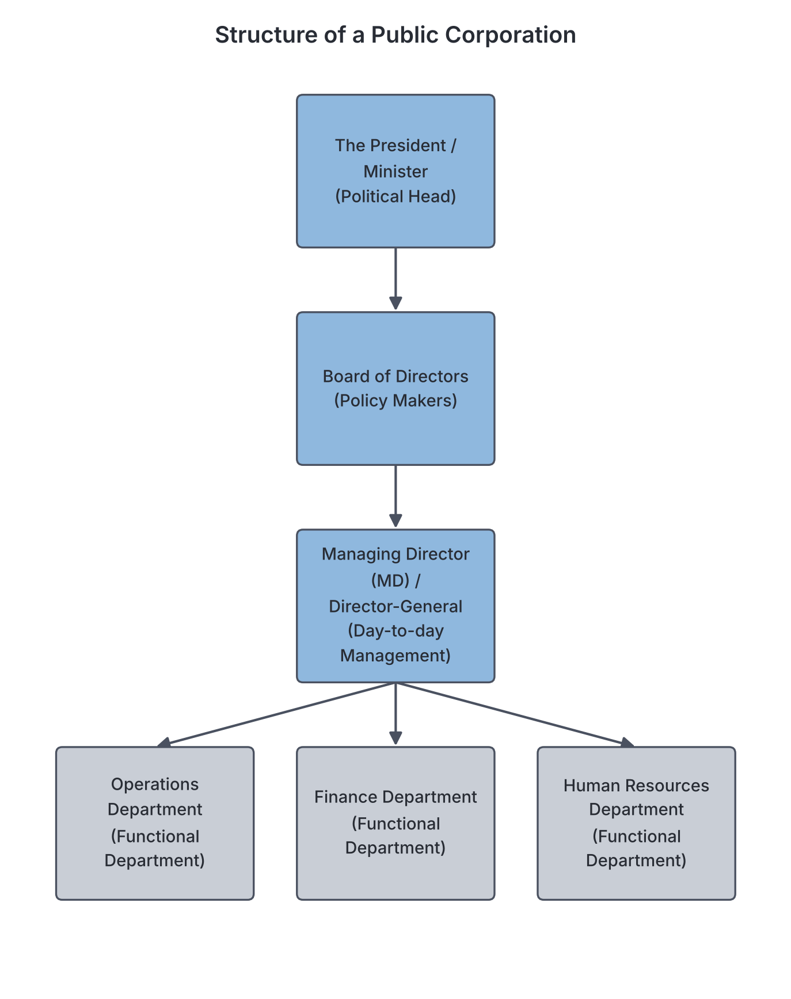
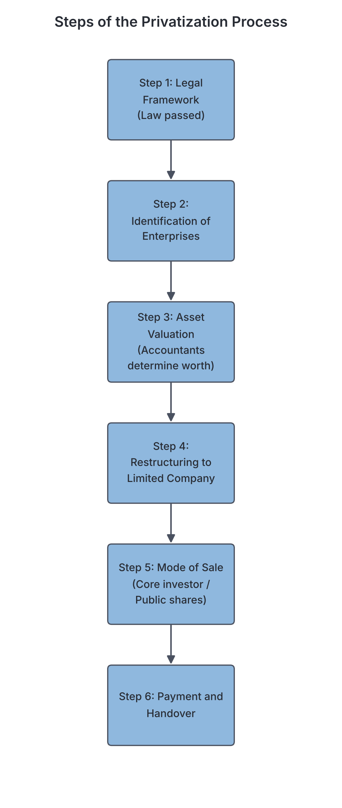

# JAMB Government Notes: Public Corporations and Parastatals

## What JAMB expects

This topic is Section B, Topic 10 of the JAMB Government syllabus: Public Corporations and Parastatals. It covers the following content items:

- **a.** Definition, types, purpose and functions;
- **b.** Finance, control and problems;
- **c.** Deregulation, Privatization and Commercialization – objectives, features, merits and demerits;
- **d.** Comparison between Public Corporations and parastatals.

By the end of these notes, you should be able to:
1. examine the operations of public corporations and parastatals;
2. identify the processes involved in privatization and commercialization;
3. assess the economic importance of privatization and commercialization.

**Note on textbook variations:** In everyday language and even in some textbooks, the words "public corporation" and "parastatal" are used to mean the same thing. However, because the JAMB syllabus explicitly asks you to *compare* them, these notes will explain the standard textbook distinction: public corporations are usually set up to provide business-like utility services, while parastatals often refer to regulatory, research, or administrative agencies attached to government ministries. 

## Definition, types, purpose and functions

**Content a: Definition, types, purpose and functions;**

### Definition

A **Public Corporation** (also called a statutory corporation) is a large-scale business organization established, owned, and fully financed by the government through an Act of Parliament (or a military decree) to provide essential services to the public, rather than purely to make a profit. 
*Nigerian examples:* Nigerian Railway Corporation (NRC), Federal Radio Corporation of Nigeria (FRCN), and historically, the Nigerian Electric Power Authority (NEPA) and Nigerian Telecommunications Limited (NITEL).

A **Parastatal** is a government-owned agency, board, or commission established to perform specific administrative, regulatory, socio-economic, or educational functions. They are usually attached to a government ministry.
*Nigerian examples:* Joint Admissions and Matriculation Board (JAMB), National Agency for Food and Drug Administration and Control (NAFDAC), and Independent National Electoral Commission (INEC).

### Types of Public Corporations

Public corporations are generally grouped into four types based on what they do:

1. **Public Utilities:** These provide essential infrastructural services like electricity, water, and transport. Examples include State Water Boards and the Nigerian Railway Corporation (NRC).
2. **Commercial/Industrial Corporations:** These are set up to operate like businesses, producing goods or services, and they compete with or operate alongside private companies. An example is the Nigerian National Petroleum Corporation (NNPC)—which has recently been transitioning into a limited liability company (NNPC Limited).
3. **Financial Corporations:** These provide financial, banking, and insurance services to the public or government. Examples include the Central Bank of Nigeria (CBN), Bank of Industry (BOI), and Nigeria Deposit Insurance Corporation (NDIC).
4. **Social Service / Welfare Corporations:** These provide services aimed at improving the social well-being of the citizens, such as education, health, and information. Examples include the Nigerian Television Authority (NTA) and the National Health Insurance Authority (NHIA).

### Purpose (Reasons for establishment)

Governments set up public corporations and parastatals for several vital reasons:
- **To provide essential services:** Some services, like clean water and rural electricity, are too important to be left to private companies who might only serve rich areas.
- **Huge capital requirements:** Some projects (like building railways or seaports) require billions of naira, which only the government can easily afford.
- **To prevent foreign domination:** Establishing state-owned enterprises ensures that the vital sectors of the economy (like oil and security printing) are controlled by citizens, not foreigners.
- **To prevent private monopoly:** If a private individual controls the only power company, they can exploit the public. Government ownership protects citizens from high prices.
- **Employment generation:** Public corporations provide jobs for thousands of citizens.
- **Revenue generation:** While profit is not the main goal, the money they make helps boost the government's revenue.

### Functions

- **Service Delivery:** They provide affordable essential services like transportation, electricity, and water.
- **Economic Development:** They stimulate the economy by building infrastructure that other businesses (like factories) need to survive.
- **Implementation of Government Policies:** Parastatals help carry out government policies (e.g., NAFDAC enforces food and drug safety policies).
- **Standardization:** They help set and maintain national standards in education (e.g., WAEC, NECO) and manufacturing (e.g., Standards Organisation of Nigeria, SON).

## Examining the operations of public corporations and parastatals

**Objective i: examine the operations of public corporations and parastatals.**

Unlike a civil service ministry (which is run strictly by a Minister and a Permanent Secretary), public corporations operate differently so they can be more flexible and business-like.

1. **Legal Status:** A public corporation is a **legal entity** (an artificial person). This means it can sue people, it can be sued in court, and it can own property in its own name.
2. **Board of Directors:** At the top of the operation is a Board of Directors appointed by the government (usually the President or Governor, often through a Minister). The Board makes the major policies and decisions. 
3. **Management Team:** The day-to-day running of the corporation is handled by a management team, headed by a Managing Director (MD) or a Director-General (DG). 
4. **Employees:** The workers in a public corporation are called **public servants**, not civil servants. Their salaries, promotions, and conditions of service are decided by the corporation's Board, not by the Civil Service Commission. 
5. **Autonomy:** They have administrative autonomy (freedom) to make quick business decisions without waiting for the slow bureaucratic processes of government ministries. 

## Finance, control and problems

**Content b: Finance, control and problems;**

### Finance (Sources of Funds)

Public corporations get their money from several sources:
- **Government Subventions/Grants:** The government gives them money (take-off grants or yearly budget allocations) to run their operations.
- **Loans:** They can borrow money from domestic banks, international financial institutions (like the World Bank), or directly from the government.
- **Internally Generated Revenue (IGR):** They make money by charging the public for their services (e.g., selling electricity, train tickets, or issuing licenses).

### Control

Because public corporations use taxpayers' money, they must be controlled to prevent abuse of power and financial waste. They are controlled in five main ways:

1. **Ministerial / Executive Control:** Every corporation is attached to a government ministry. The Minister can issue policy directives, and the Executive (President/Governor) has the power to appoint or sack the Board of Directors.
2. **Parliamentary / Legislative Control:** The legislature (National Assembly or State House of Assembly) controls them by approving or rejecting their annual budgets. The lawmakers can also summon the Managing Director to answer questions or set up committees to investigate the corporation.
3. **Judicial Control:** Because a public corporation is a legal entity, citizens or businesses can sue it in a court of law if it breaches a contract or causes harm.
4. **Financial Control:** Their financial records must be audited regularly by external auditors, and the report is submitted to the Auditor-General to check for fraud or waste.
5. **Public Control:** The public controls them through consumer boycotts, protests, media criticism, and public opinion. 

### Problems

Despite their good intentions, public corporations in Nigeria and many developing countries face severe problems:
- **Inefficiency and Mismanagement:** Because they do not face competition, they often provide poor services (e.g., the historical "epileptic" power supply by NEPA).
- **Corruption and Embezzlement:** Funds meant for projects are often stolen or mismanaged by the management team or politicians.
- **Political Interference:** Ministers and politicians frequently interfere in the day-to-day running, forcing the corporation to hire unqualified political supporters (nepotism) or site projects in unprofitable locations.
- **Inadequate Funding:** The government often fails to release funds on time, and the corporations are sometimes forced to charge prices too low to cover their costs.
- **Monopoly problems:** Being the only provider of a service makes them arrogant and unresponsive to consumer complaints.

## Deregulation, Privatization and Commercialization

**Content c: Deregulation, Privatization and Commercialization – objectives, features, merits and demerits;**

Because of the massive failure and constant financial drain caused by public corporations, governments introduced economic reforms in the 1980s and 1990s. In Nigeria, the Structural Adjustment Programme (SAP) in 1986 kicked off these major reforms.

### 1. Deregulation

**Deregulation** is the removal of government laws, rules, and strict controls in a particular sector of the economy to allow private companies to enter and compete freely. 
*Example:* The deregulation of the Nigerian telecommunications sector in 2001 allowed private companies like MTN, Airtel, and Globacom to operate, ending NITEL's monopoly. 

- **Objectives:** To encourage competition, reduce monopoly, encourage foreign investment, and improve the quality of goods and services.
- **Features:** Removal of government subsidies, allowing market forces (demand and supply) to determine prices, and multiple private companies operating in one sector.
- **Merits:** Leads to better quality services due to competition; gives consumers choices; creates new jobs in the private sector; attracts foreign investors.
- **Demerits:** Can lead to high prices for consumers (since government subsidies are removed); weak local businesses might be crushed by powerful foreign companies; profit is prioritized over citizen welfare.

### 2. Privatization

**Privatization** is the transfer of ownership, control, and management of public corporations from the government to private individuals or companies. It can be **full** (government sells all its shares) or **partial** (government sells some shares but remains a part-owner).

- **Objectives:** To stop the waste of public funds; to make the enterprises more efficient and profitable; to generate revenue for the government through the sale of the assets; to reduce the size of government.
- **Features:** Sale of government shares to the public; private individuals take over the Board of Directors and management; the company is now run purely for profit.
- **Merits:** Efficiency and productivity increase; reduces the financial burden on the government; removes political interference in business; encourages innovation and better customer service.
- **Demerits:** It often leads to **retrenchment** (massive job losses as private owners fire redundant workers); creates a gap between the rich and the poor (only wealthy people can buy the companies); essential services become too expensive for the poor.

### 3. Commercialization

**Commercialization** is the reorganization of a government-owned enterprise to make it operate as a profit-making commercial venture, *without* the government selling its ownership. The government still owns it, but stops giving it financial subventions.

- **Objectives:** To make the corporation self-sustaining; to promote efficiency; to eliminate reliance on government budgets.
- **Features:** Government retains 100% ownership; removal of government subventions; the corporation is forced to charge market prices to survive; it operates exactly like a private company.
- **Merits:** Saves the government money; improves efficiency and service delivery; the government continues to own national assets.
- **Demerits:** Services become expensive (e.g., high electricity tariffs or toll gates); the primary goal shifts from public welfare to profit-making.

## Processes involved in privatization and commercialization

**Objective ii: identify the processes involved in privatization and commercialization.**

Privatizing or commercializing a huge government company is a complex process. In Nigeria, the body responsible for this is the **Bureau of Public Enterprises (BPE)**, guided by the **National Council on Privatisation (NCP)**. The historical steps are:

1. **Establishment of Legal Framework:** The government passes a law to back the process. For example, in 1988, Nigeria established the Technical Committee on Privatisation and Commercialisation (TCPC), which later became the BPE.
2. **Identification and Classification:** The government reviews all its corporations and decides which ones should be fully privatized, partially privatized, fully commercialized, or partially commercialized.
3. **Asset Valuation:** Experts and accountants are hired to value the assets (buildings, machinery, debts) of the corporation to determine how much the company is actually worth.
4. **Restructuring and Incorporation:** If the corporation was created by an Act, it is legally converted into a Public Limited Liability Company (Plc) so its shares can be sold.
5. **Mode of Sale (Bidding and Offers):** The government decides how to sell it. This can be through:
    - **Core Investor Sale:** Selling a large chunk of shares to a single capable private company that has the technical and financial power to run it.
    - **Public Offer:** Selling shares to ordinary citizens through the Nigerian Stock Exchange.
    - **Concessioning:** Giving a private company the right to run the facility (like a seaport or airport terminal) for a number of years, while government retains the actual land/asset ownership.
6. **Payment and Handover:** The winning bidders pay the agreed amount into the government's account, and the management of the enterprise is officially handed over to the new private owners.

## Economic importance of privatization and commercialization

**Objective iii: assess the economic importance of privatization and commercialization.**

How do these policies affect the economy of a country? They bring both positive and negative impacts.

**Positive Economic Importance:**
- **Attraction of Foreign Direct Investment (FDI):** When state monopolies are broken, foreign companies bring in dollars, equipment, and technology. The GSM revolution in Nigeria is the best example.
- **Reduction of Government Expenditure:** The billions of naira previously wasted on funding unprofitable public corporations can be redirected to building roads, schools, and hospitals.
- **Stock Market Growth:** Selling government companies through the stock exchange deepens the capital market, giving citizens more places to invest their money.
- **Increased Government Revenue:** The government makes immediate money from selling the companies, and later collects huge corporate taxes from them once they become profitable private companies.
- **Efficiency and Technology Transfer:** Private companies bring modern technology, better management skills, and efficiency into the economy.

**Negative Economic Importance:**
- **Unemployment (Retrenchment):** To cut costs and make profits, private owners usually fire thousands of workers when they take over. 
- **Inflation and High Cost of Living:** Commercialization forces agencies to stop subsidizing services. When the price of petrol or electricity goes up, the price of everything else goes up.
- **Capital Flight:** If foreign companies buy the national assets, they may take the majority of their profits back to their home countries instead of reinvesting it in Nigeria.

## Comparison between Public Corporations and parastatals

**Content d: Comparison between Public Corporations and parastatals.**

Although often confused, standard academic classifications separate them by their purpose and how they are funded.

| Feature | Public Corporation | Parastatal |
| --- | --- | --- |
| **Primary Goal** | To provide essential services (utilities/commercial) and sometimes make a profit. | To perform administrative, regulatory, research, or socio-economic duties. |
| **Funding** | Expected to generate internal revenue to fund themselves; less dependent on government over time. | Relies heavily on annual government budgets (subventions) to survive. |
| **Nature of Activities** | Business-like and commercial (e.g., refining oil, running trains, providing electricity). | Administrative, standard-setting, or conducting exams (e.g., regulating drugs, organizing elections). |
| **Autonomy** | Has a high degree of administrative and financial independence. | Has less independence; closely tied to the policies of the parent ministry. |
| **Examples** | Nigerian Railway Corporation (NRC), Federal Radio Corporation of Nigeria (FRCN). | NAFDAC, JAMB, INEC, Code of Conduct Bureau. |

## Key terms

| Term | Meaning |
| --- | --- |
| **Public Corporation** | A large-scale organization owned by the government to provide essential services to the public. |
| **Parastatal** | A government agency or board established for specific administrative, regulatory, or educational functions. |
| **Statute** | A written law passed by a legislative body. Public corporations are established by statute. |
| **Legal Entity** | An organization that has legal rights and duties, such as the ability to sue, be sued, and own property. |
| **Subvention** | A grant of money provided by the government to help fund a public corporation or parastatal. |
| **Deregulation** | The removal of government controls and laws in an economic sector to allow free competition. |
| **Privatization** | The transfer of ownership and control of a public enterprise from the government to private individuals. |
| **Commercialization** | Reorganizing a government-owned enterprise to operate for profit without government financial support, while the government retains ownership. |
| **BPE** | Bureau of Public Enterprises; the agency responsible for privatization in Nigeria. |
| **Retrenchment** | The act of reducing the number of employees, often seen during privatization. |

## Exam tips and common mistakes

- **Understand the difference between Privatization and Commercialization:** This is one of the most common JAMB traps. If ownership is *transferred/sold*, it is **privatization**. If ownership is *kept by the government* but the company is told to run for profit and stop taking subventions, it is **commercialization**.
- **Legal status:** Always remember that public corporations can sue and be sued. This is a very common exam question.
- **Public Servants vs. Civil Servants:** Workers in a ministry are civil servants. Workers in a public corporation (like NRC or NTA) are public servants. (Note: "Public service" is the broader term that includes the civil service, military, police, and public corporations).
- **Who appoints the Board?** The President (or Minister acting on their behalf) appoints the Board of Directors. The Board does not appoint itself.
- **Why privatize?** If a question asks for the main reason for privatization, look for options about "promoting efficiency," "reducing waste of public funds," or "encouraging private investment."

## Quick summary

1. A public corporation is a government-owned organization established by an Act of Parliament to provide essential services, while a parastatal usually performs specific regulatory or administrative functions.
2. Public corporations are managed by a Board of Directors appointed by the government, and their day-to-day operations are run by a Managing Director or Director-General.
3. They are funded through government subventions, loans, and internally generated revenue, and are controlled by the executive, legislature, judiciary, auditors, and the public.
4. Public corporations suffer from mismanagement, political interference, corruption, and inefficiency.
5. Deregulation removes government controls to allow private competition (e.g., telecom sector).
6. Privatization involves selling government-owned businesses to private individuals to increase efficiency and reduce government spending.
7. Commercialization is reorganizing a public enterprise to operate strictly for profit without government funding, while the government still owns it.
8. The processes of privatization include setting a legal framework (like BPE), identifying assets, valuation, choosing a mode of sale (like core investor or public offer), and handover. 

## Practice questions

**1. A public corporation is legally established by**

- A. the President's personal decree
- B. an Act of Parliament
- C. the Chief Justice of the Federation
- D. the Civil Service Commission

**Answer: B.** A public corporation is established by an Act of Parliament (a statute) or a military decree.

**2. The primary reason for establishing public corporations is to**

- A. maximize profit for the government
- B. provide employment for political party supporters
- C. provide essential services to the citizens
- D. compete aggressively with private businesses

**Answer: C.** The main goal of public corporations is to provide essential services to the public, usually at an affordable rate, rather than to maximize profit.

**3. Which of the following is a major difference between a public corporation and a government ministry?**

- A. A public corporation is headed by a Minister, while a ministry is headed by a Director-General.
- B. A public corporation can sue and be sued, while a ministry cannot independently sue or be sued.
- C. A public corporation relies entirely on taxes, while a ministry relies on loans.
- D. Workers in a public corporation are civil servants, while workers in a ministry are public servants.

**Answer: B.** A public corporation is a distinct legal entity (an artificial person) that can sue and be sued in its own name, unlike a regular government department. Option D has the worker terms reversed.

**4. The policy of transferring the ownership of a state-owned enterprise to private investors is known as**

- A. deregulation
- B. commercialization
- C. nationalization
- D. privatization

**Answer: D.** Privatization is the transfer of ownership from the government to private individuals. Commercialization (Option B) involves running for profit but keeping government ownership.

**5. One of the main negative economic consequences of privatization is**

- A. increase in government subventions
- B. massive retrenchment of workers
- C. decrease in foreign direct investment
- D. reduction in the prices of goods

**Answer: B.** Private investors often fire redundant workers (retrenchment) to cut costs and maximize profits, leading to high unemployment. 

**6. Which body is primarily responsible for the privatization of public enterprises in Nigeria?**

- A. Code of Conduct Bureau
- B. Bureau of Public Enterprises
- C. Central Bank of Nigeria
- D. Federal Civil Service Commission

**Answer: B.** The Bureau of Public Enterprises (BPE) is the agency responsible for implementing the privatization and commercialization programme in Nigeria.

**7. In a public corporation, the formulation of major policies is the responsibility of the**

- A. General Manager
- B. Board of Directors
- C. Shareholders
- D. Trade Union

**Answer: B.** The Board of Directors makes the broad policies and decisions, while the Managing Director/General Manager handles day-to-day implementation.

**8. When a public corporation is fully commercialized, it is expected to**

- A. rely heavily on government grants for survival
- B. offer free services to all citizens
- C. operate purely as a profit-making business without government subventions
- D. sell all its shares to foreign investors

**Answer: C.** Commercialization means the enterprise must become self-sustaining and operate for profit without relying on government financial support, though the government still owns it. 

**9. The control exercised by the National Assembly over a public corporation through the approval of its annual budget is an example of**

- A. judicial control
- B. executive control
- C. legislative control
- D. public control

**Answer: C.** The National Assembly is the legislature, so its control (via budgets or summoning executives) is legislative control.

**10. A good example of deregulation in the Nigerian economy is the**

- A. creation of more local governments in 1996
- B. establishment of the Nigerian Railway Corporation
- C. removal of monopoly and entry of private companies into the telecommunications sector
- D. government takeover of private mission schools

**Answer: C.** Deregulation removes government rules and state monopolies, allowing private companies (like MTN and Airtel) to enter and compete freely in sectors like telecommunications.

<!-- COVERAGE
obj i | Examining the operations of public corporations and parastatals
obj ii | Processes involved in privatization and commercialization
obj iii | Economic importance of privatization and commercialization
item a | Definition, types, purpose and functions
item b | Finance, control and problems
item c | Deregulation, Privatization and Commercialization
item d | Comparison between Public Corporations and parastatals
-->
