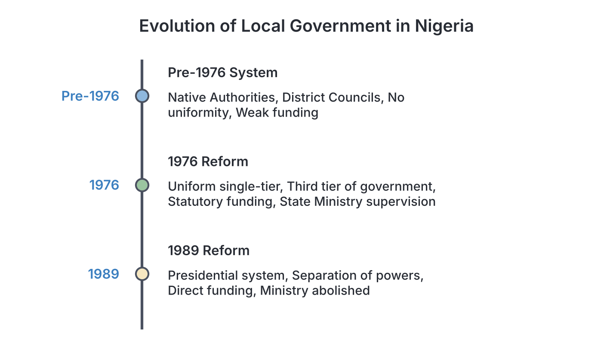

# JAMB Government Notes: Local Government

## What JAMB expects

This topic is Section B, Topic 11 of the JAMB Government syllabus: Local Government. It covers the following content items:

- **a.** Local Government Administration prior to 1976;
- **b.** Features of Local Government Reforms (1976, 1989) – structure, functions, finance and inter-governmental relations;
- **c.** Traditional Rulers and Local Governments;
- **d.** Problems of Local Government Administration in Nigeria.

By the end of these notes, you should be able to:

1. trace the evolution and structure of Local Government;
2. identify the major problems faced by Local Governments;
3. analyse the roles of Traditional Rulers in the Local Government system in Nigeria.

## Evolution and structure of Local Government

**Objective i: trace the evolution and structure of Local Government.**

**Local government** is government at the grassroots level of a nation, established by law to exercise specific powers and perform specific functions within a defined local area. It is the tier of government closest to the people.

To understand how local government works in Nigeria today, we must trace its evolution from the period before the major 1976 reform.

### Local Government Administration prior to 1976

**Content a: Local Government Administration prior to 1976.**

Before the famous 1976 reform, local government administration in Nigeria went through several phases and lacked a uniform structure across the country.

#### 1. The Colonial Era: The Native Authority System
During British colonial rule, local administration was carried out through the **Indirect Rule** system, which created **Native Authorities**. 
- In Northern Nigeria, the Native Authorities were built around powerful Emirs (the "Sole Native Authority"). 
- In Western Nigeria, Obas and their councils formed the Native Authorities.
- In Eastern Nigeria, where there were no strong traditional kings, the British appointed "Warrant Chiefs," which led to much resistance (such as the 1929 Aba Women's Riot).

The Native Authorities were mainly responsible for maintaining law and order and collecting taxes for the colonial government. They were not democratic.

#### 2. The 1950s: Introduction of Elected Councils
In the 1950s, the Eastern and Western Regions began to reform the Native Authority system by introducing British-style local government councils. 
- They introduced **multi-tier structures** (e.g., County Councils, District Councils, and Local Councils). 
- Council members were elected rather than appointed by tradition.
- However, Northern Nigeria largely retained the traditional Native Authority system until much later.

#### 3. Post-Independence (1960–1975): Regional and State Variations
After independence in 1960, and especially after the military took over in 1966, local governments became extremely weak. 
- **No uniformity:** Each region (and later, each state) had its own type of local government system. 
- **State interference:** State governments easily dissolved local councils, seized their funds, and appointed political loyalists as "Caretaker Committees."
- **Lack of funds:** Local governments had no direct funding from the federal government, making them completely dependent on state governments.
- **Weak personnel:** They could not attract educated or skilled workers because pay was poor and job security was low.

Because of this chaotic system, the military government under General Olusegun Obasanjo decided to reorganize local governments entirely in 1976.

> **Common mistake:** Students often think there were no local governments before 1976. Local administration did exist (like the Native Authorities and District Councils), but they were disorganised, undemocratic, and lacked a uniform structure across the country.

## Features of Local Government Reforms (1976, 1989)

**Content b: Features of Local Government Reforms (1976, 1989) – structure, functions, finance and inter-governmental relations.**

### The 1976 Local Government Reform
The 1976 reform is the most important milestone in the history of Nigerian local government. It completely restructured the system and made it uniform across the country.

**1. Structure**
- **Uniformity:** It introduced a uniform **single-tier** multi-purpose local government system throughout Nigeria. The confusing county and district councils were abolished.
- **Third Tier of Government:** For the first time, local government was officially recognized as the **third tier of government** (after the Federal and State governments).
- **Population criteria:** To be created, a local government area (LGA) had to have a population of between 150,000 and 800,000 people to ensure it was economically viable.
- **Democratisation:** The reform mandated that local government councils be democratically elected, with a Chairman as the executive head and Councillors representing different wards.

**2. Functions**
The reform clearly defined the functions of local governments (which were later written into the Fourth Schedule of the 1979 Constitution). These included:
- Construction and maintenance of local roads, streets, and drains.
- Establishment and maintenance of markets, motor parks, and public conveniences.
- Registration of births, deaths, and marriages.
- Collection of local rates, radio/television licenses, and market fees.
- Provision of primary health care and primary education.

**3. Finance**
- **Statutory Allocations:** The 1976 reform legally guaranteed local governments a share of the national revenue. They were given a statutory allocation directly from the **Federation Account**, as well as a mandatory percentage of the internally generated revenue of their State governments.
- This was meant to give them financial independence and the ability to carry out their new functions.

**4. Inter-governmental relations**
- While recognized as a third tier, local governments were still placed under the supervision of the State governments through the **Ministry of Local Government**.
- The State Ministry of Local Government approved their budgets and monitored their activities, which meant they were not completely autonomous.

### The 1989 Local Government Reform
During the military regime of General Ibrahim Babangida, another major reform was introduced in 1989 to address the ongoing weaknesses of local governments, particularly their lack of autonomy from state governments.

**1. Structure**
- **Presidential System:** The 1989 reform introduced the **presidential system of government** at the local level. This meant there was a strict **separation of powers** between the Executive and the Legislature.
- **The Executive:** Consisted of the democratically elected Local Government Chairman (who acted as the Chief Executive and Accounting Officer), the Vice-Chairman, and Supervisory Councillors.
- **The Legislature:** Consisted of the elected Councillors, who formed the Local Government Legislative Council. They were given the power to make bye-laws, approve budgets, and even impeach the Chairman.

**2. Functions**
- The functions remained largely the same as those outlined in 1976, but the reform emphasized giving local governments more direct responsibility for primary education and primary healthcare without state interference.

**3. Finance**
- **Direct Funding:** To increase financial autonomy, the federal government began paying statutory allocations **directly** into the accounts of the local governments, bypassing the state governments.
- The percentage of the Federation Account allocated to local governments was also increased.

**4. Inter-governmental relations**
- **Abolition of Ministries:** The reform **abolished the State Ministries of Local Government**, which state governors had been using to control and frustrate local councils.
- In their place, less powerful Departments or Inspectorates of Local Government were created merely to guide and advise, granting local councils true executive autonomy.

### Comparison Table: 1976 vs 1989 Reforms

| Feature | 1976 Reform | 1989 Reform |
| --- | --- | --- |
| **System/Structure** | Uniform single-tier system introduced. | Presidential system introduced (separation of powers). |
| **Executive/Legislature** | Combined. The Chairman and Councillors sat in the same council. | Separated. Chairman (Executive) and Councillors (Legislature) operated independently. |
| **State Control** | Controlled by the State Ministry of Local Government. | State Ministries of Local Government were abolished. |
| **Funding flow** | Federal allocations passed through state governments. | Federal allocations were paid directly to local governments. |
| **Main Achievement** | Recognized LG as the 3rd tier of government. | Granted LGs full executive autonomy and separation of powers. |

> **Common mistake:** Students often mix up what each reform achieved. Always remember: **1976** means "Uniform single-tier system and 3rd tier recognition". **1989** means "Presidential system and separation of powers at the local level".

## Traditional Rulers and Local Governments

**Content c: Traditional Rulers and Local Governments.**

Traditional rulers are the recognized custodians of the customs, traditions, and cultural heritage of the people (for example, the Sultan of Sokoto, the Ooni of Ife, the Obi of Onitsha, and the Oba of Benin).

In the pre-colonial and colonial eras (under the Native Authority system), traditional rulers had executive, legislative, and judicial powers. However, modern local government reforms—starting from 1976—stripped traditional rulers of executive powers. 

### Roles of Traditional Rulers in the Local Government system

**Objective iii: analyse the roles of Traditional Rulers in the Local Government system in Nigeria.**

Today, their roles in local government are purely **advisory** and **cultural**.

1. **Advisory Role on Customary Laws:** Traditional rulers advise the local government on matters concerning customary law, culture, and traditional practices.
2. **Conflict Resolution:** They play a massive role in maintaining peace. They settle minor land disputes, family disagreements, and communal clashes using traditional methods, which reduces the burden on local courts.
3. **Mobilization of the People:** Because they are highly respected, local governments rely on them to mobilize citizens for government programmes. For instance, traditional rulers are crucial in convincing parents to bring their children for polio immunization and in encouraging citizens to pay their taxes and levies.
4. **Security at the Grassroots:** Traditional rulers know their domains well. They help local government chairmen and security agencies identify strangers and criminal elements within their communities.
5. **Traditional Councils:** Under the current system, every local government area (or a group of them) has a **Traditional Rulers Council**. The Chairman of the Local Government often consults this council on chieftaincy matters and community development projects.

> **Common mistake:** Do not write that traditional rulers collect taxes for the local government, make bye-laws, or control the local government budget. Since 1976, they have no executive or legislative powers; their role is strictly advisory and for community mobilization.

## Problems of Local Government Administration in Nigeria

**Content d: Problems of Local Government Administration in Nigeria.**

Despite the reforms intended to make local governments a strong third tier, they face massive operational problems in Nigeria today.

### Major problems faced by Local Governments

**Objective ii: identify the major problems faced by Local Governments.**

**1. Lack of Financial Autonomy (The Joint Account problem)**
The 1999 Constitution (as amended) created the **State Joint Local Government Account (SJLGA)**, into which all federal allocations meant for local governments in a state are paid. Many State Governors use this account to withhold, delay, or divert funds meant for local councils, leaving the local governments starved of the money needed for development. 

**2. Undue Political Interference by State Governments**
State Governors frequently interfere in the running of local governments. Under the constitution, state Houses of Assembly can make laws regulating local governments. Governors often exploit this to arbitrarily dissolve democratically elected local councils before their tenure ends and replace them with un-elected loyalists called **Caretaker Committees**.

**3. Corruption and Mismanagement of Funds**
Many local government officials view the council as an opportunity to enrich themselves. Funds meant for building rural roads, markets, and healthcare centres are often embezzled or mismanaged by the Chairman and Councillors.

**4. Shortage of Qualified Personnel**
Local governments struggle to attract and retain highly skilled professionals (like doctors, engineers, and accountants) because of poor salaries, lack of modern facilities in rural areas, and poor job security. As a result, the civil service at the local level is often inefficient.

**5. Poor Internal Revenue Generation**
Local governments depend too heavily on the monthly allocation from the Federal Government. They fail to efficiently collect internal revenues (like market tolls, motor park fees, and property rates) due to poor databases, corrupt tax collectors, and citizens' refusal to pay.

**6. Apathy and Lack of Citizen Participation**
Many citizens do not participate in local government elections or hold their local officials accountable. People often focus their political attention entirely on the State and Federal governments, allowing local politicians to perform poorly without consequences.

**7. Constitutional Ambiguities**
There is a clash between Section 7 of the 1999 Constitution (which guarantees a system of democratically elected local government councils) and Section 162 (which places their funding in a Joint Account managed by the State). *Note: The exact number of constitutionally recognized Local Government Areas in Nigeria is 774, but state governors' attempts to create new ones (Local Council Development Areas or LCDAs) have caused political and legal friction.*

> **Common mistake:** In exams, if asked for the primary reason local governments cannot execute their projects, the most accurate answer usually relates to **lack of financial autonomy** or **insufficient funds** (often due to state interference).

## Key terms

| Term | Meaning |
| --- | --- |
| **Local Government** | The third tier of government in Nigeria, situated at the grassroots level to provide local services. |
| **Native Authority** | The system of local administration used by the British during the colonial era, relying on traditional rulers. |
| **Single-tier system** | A system where there is only one level of local government authority (e.g., LGA), abolishing multiple layers like county and district councils. |
| **Third Tier of Government** | The status granted to local governments in 1976, making them a distinct level of government below Federal and State. |
| **Presidential system at local level** | Introduced in 1989; separated the executive (Chairman) from the legislature (Councillors) in the local government. |
| **Statutory Allocation** | The legal share of national revenue given to local governments from the Federation Account. |
| **State Joint Local Government Account (SJLGA)** | A constitutional account where federal allocations for local governments are deposited; often used by state governments to control LG funds. |
| **Caretaker Committee** | An un-elected group appointed by a State Governor to run a local government, usually after dissolving the elected council. |
| **Bye-law** | A local law made by the legislative council of a local government. |

## Exam tips and common mistakes

- **The 1976 Reform:** Memorise that it introduced a **uniform single-tier system** and recognized LGs as the **third tier of government**.
- **The 1989 Reform:** Memorise that it introduced the **presidential system** (separation of powers) at the grassroots and abolished the State Ministry of Local Government.
- **Functions:** Know the difference between exclusive local functions (markets, motor parks, cemeteries) and concurrent functions (primary education, agriculture). Foreign policy, currency, and defense belong *only* to the Federal Government.
- **Traditional Rulers:** They have **no executive powers**. Their role is strictly **advisory**, cultural, and for peace-making.
- **SJLGA:** The State Joint Local Government Account is frequently tested as the major tool state governments use to undermine local government financial autonomy.

## Quick summary

1. Prior to 1976, local administration in Nigeria (starting from colonial Native Authorities) was disorganized, lacked uniformity, and was heavily manipulated by regional and state governments.
2. The 1976 Local Government Reform created a uniform, single-tier system across Nigeria and officially recognized local councils as the third tier of government.
3. The 1989 Local Government Reform introduced the presidential system to local councils, separating the powers of the Chairman (Executive) and the Councillors (Legislature), and allowed direct funding.
4. Local governments are responsible for grassroots services like maintaining markets, motor parks, local roads, and registering births and deaths.
5. Traditional rulers currently have no executive powers in local government; they serve in an advisory capacity, settle local disputes, and help mobilize citizens.
6. A major problem facing Nigerian local governments is the lack of financial autonomy, primarily caused by the State Joint Local Government Account and state governors withholding funds.
7. Other severe problems include unconstitutional caretaker committees, corruption, poor internally generated revenue, and a lack of skilled personnel.

## Practice questions

**1. Before the 1976 local government reform, local administration in Northern Nigeria was largely based on the**

- A. French system of assimilation
- B. single-tier uniform system
- C. Native Authority system
- D. presidential system

**Answer: C.** During the colonial and immediate post-colonial era, the North largely relied on the Native Authority system, usually centered around powerful Emirs (the Sole Native Authority). Option B is a common misunderstanding because it represents the 1976 reform, not the system prior to it.

**2. Which of the following is the most significant achievement of the 1976 Local Government Reform?**

- A. Introduction of the presidential system at the local level
- B. Establishment of a uniform single-tier local government system
- C. Granting of executive powers to traditional rulers
- D. Creation of the State Joint Local Government Account

**Answer: B.** The 1976 reform harmonized local administration across the country by creating a uniform single-tier system and recognizing it as the third tier of government. Option A is a tempting wrong option, but it was the 1989 reform that introduced the presidential system, not 1976.

**3. The introduction of the presidential system of government at the local government level was a feature of the**

- A. 1976 reform
- B. 1979 reform
- C. 1989 reform
- D. 1999 reform

**Answer: C.** The 1989 reform under General Ibrahim Babangida introduced the presidential system, which separated the executive (Chairman) from the legislature (Councillors) at the local level. Students often incorrectly choose A (1976) because it is the most famous reform, but 1976 maintained a fused council.

**4. A major constitutional tool used by state governors to limit the financial autonomy of local governments in Nigeria is the**

- A. Caretaker Committee system
- B. State Joint Local Government Account
- C. Local Government Service Commission
- D. Ministry of Local Government

**Answer: B.** The 1999 Constitution created the State Joint Local Government Account, into which federal allocations for local governments are paid. Governors often use this account to delay or divert funds meant for the councils. Option A is a political tool to remove chairmen, but it is not a constitutional financial tool like the Joint Account.

**5. Which of the following is NOT a function of a local government in Nigeria?**

- A. Collection of market tolls and motor park fees
- B. Registration of births, deaths, and marriages
- C. Issuance of international passports
- D. Maintenance of local roads and drains

**Answer: C.** The issuance of international passports is exclusively the responsibility of the Federal Government (under the Exclusive Legislative List). The other options are core local government functions. A common mistake is to assume all government offices handle passports, but local governments do not.

**6. In the present local government system in Nigeria, the role of traditional rulers is strictly**

- A. legislative
- B. executive
- C. judicial
- D. advisory

**Answer: D.** Traditional rulers were stripped of their executive powers by modern reforms (starting in 1976). Today, they serve in an advisory capacity, primarily on customs, traditions, and conflict resolution. A common misunderstanding (Option B) is believing that kings and emirs still rule and execute laws as they did during the colonial Native Authority era.

**7. State governments often violate the democratic nature of local governments by**

- A. paying statutory allocations directly to council chairmen
- B. conducting local government elections regularly
- C. dissolving elected councils and appointing Caretaker Committees
- D. giving traditional rulers executive powers

**Answer: C.** State governors frequently interfere by dissolving democratically elected local government councils before their tenure expires and replacing them with un-elected political loyalists known as Caretaker Committees. Option A might sound like a violation to some, but direct payment was actually a reform goal for autonomy, not a democratic violation.

**8. To ensure the financial viability of newly created local governments, the 1976 reform stipulated that a local government area should have a minimum population of**

- A. 10,000 to 50,000
- B. 150,000 to 800,000
- C. 1,000,000 to 2,000,000
- D. 50,000 to 100,000

**Answer: B.** The 1976 reform established a population criteria of 150,000 to 800,000 to ensure that every local government was large enough to be economically viable but small enough to remain close to the grassroots. A common error is picking smaller numbers (Option A or D) assuming local means "very small".

**9. Local governments often struggle to execute meaningful projects at the grassroots primarily because of**

- A. too much interference from traditional rulers
- B. the large number of skilled personnel demanding high salaries
- C. lack of financial autonomy and inadequate funding
- D. over-participation of the rural dwellers in politics

**Answer: C.** The primary hurdle to local government performance is financial constraint, worsened by poor internal revenue generation and state governors withholding funds from the Joint Account. Option B is a misunderstanding; in reality, local governments suffer from a *shortage* of skilled personnel, not an abundance.

**10. Under the 1989 Local Government Reform, the body empowered to make bye-laws at the local level is the**

- A. Supervisory Councillors
- B. Local Government Chairman
- C. Local Government Legislative Council
- D. Traditional Rulers Council

**Answer: C.** Because the 1989 reform introduced the presidential system, legislative powers (the power to make bye-laws) were given exclusively to the elected Councillors, who make up the Local Government Legislative Council. Option A is tempting because they are councillors, but supervisory councillors function like executive ministers, not legislators.

<!-- COVERAGE
obj i | Evolution and structure of Local Government
obj ii | Major problems faced by Local Governments
obj iii | Roles of Traditional Rulers in the Local Government system
item a | Local Government Administration prior to 1976
item b | Features of Local Government Reforms (1976, 1989)
item c | Traditional Rulers and Local Governments
item d | Problems of Local Government Administration in Nigeria
-->
