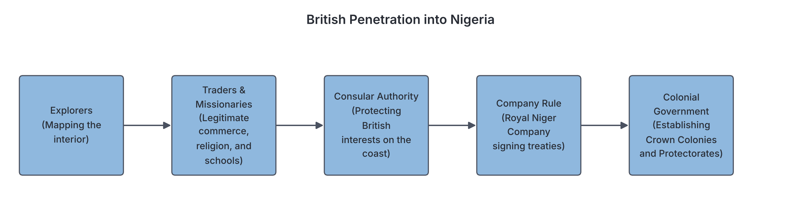
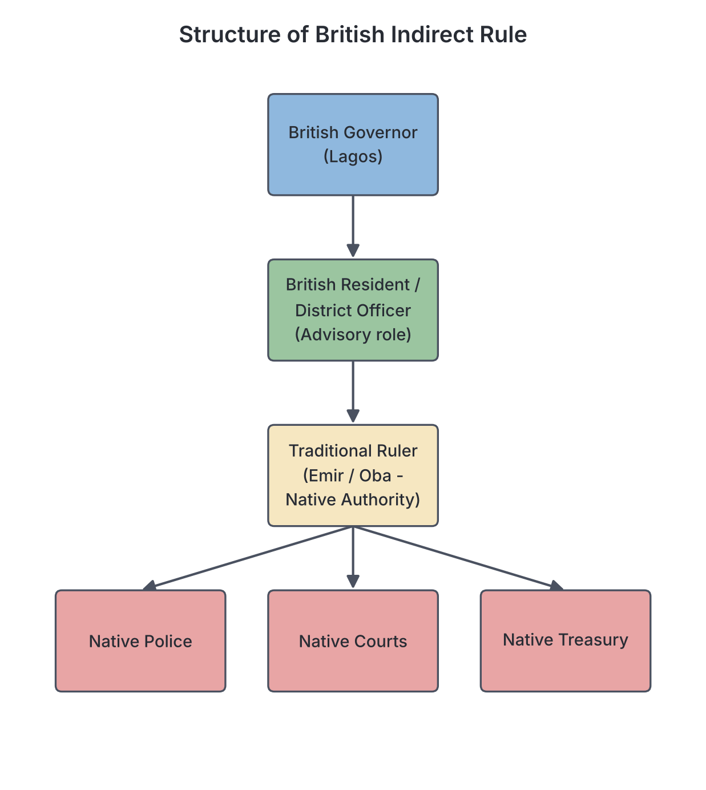

# JAMB Government Notes: Imperialists Penetration

## What JAMB expects

This topic is Section B, Topic 2 of the JAMB Government syllabus: Imperialists Penetration. It covers the ways European powers (especially Britain and France) took over African territories, how they governed them, and the lasting effects of their rule.

It covers the following content items:
- **a.** The British process of acquisition – trade, missionary activities, company rule, crown colony, protectorate;
- **b.** The British colonial administrative policy – direct and indirect rule;
- **c.** The French colonial administrative policy – assimilation and association;
- **d.** Impact of British colonial rule - economic, political, socio-cultural;
- **e.** Comparison of British and French colonial administration.

By the end of these notes, you should be able to:
1. trace the processes of imperialists penetration;
2. assess the impact of British and French colonial policies;
3. distinguish between British and French colonial practices.

**Note on the syllabus wording:** In the syllabus, content item (d) is printed as "rule-economic"; this is clearly a typing error for "rule - economic". Also, Objective (ii) asks you to assess the impact of *British and French* policies, while content item (d) only asks for the impact of *British* rule. These notes focus heavily on the British impact (since it applies directly to Nigeria) but also explain the French impact so you are fully prepared for the exam.

## The process of imperialist penetration

**Objective i: trace the processes of imperialists penetration.**
**Content a: The British process of acquisition – trade, missionary activities, company rule, crown colony, protectorate.**

**Imperialism** is the policy of extending a country's power and influence over other nations, often through military force, political control, or economic dominance. In the late 19th and early 20th centuries, European powers (like Britain, France, Germany, and Portugal) "scrambled" for Africa, partitioning it into colonies. 

The British did not just wake up one day and conquer Nigeria in a single battle. The acquisition (taking over) of territories was a gradual, step-by-step process involving different groups of people and methods.

### 1. Trade (Legitimate trade)
After the British abolished the trans-Atlantic slave trade in 1807, they shifted to "legitimate trade"—trading in natural resources like palm oil, cocoa, groundnut, and cotton to feed the factories of the Industrial Revolution in Europe. 
- British merchants arrived on the coast of West Africa to trade. 
- To protect their economic interests, they often interfered in local politics. For example, they appointed Consuls (like John Beecroft) to oversee trade in the Bight of Biafra and the Bight of Benin.
- Local rulers who resisted British terms of trade or tried to keep their monopolies (like King Jaja of Opobo and Nana Olomu of Itsekiri) were fought, defeated, and exiled.

### 2. Missionary activities
Christian missionaries (like the Church Missionary Society, Methodists, and Catholics) came to West Africa to spread Christianity, stop the remnants of the slave trade, and introduce Western education.
- They arrived in places like Abeokuta and Calabar (e.g., Mary Slessor).
- While their main goal was religious, they paved the way for colonial rule. When they faced hostility from local chiefs or inter-tribal wars, the missionaries often called on the British government for military protection. 
- They also created a class of Western-educated Africans who became clerks and interpreters for the British administration.

### 3. Company rule
Before the British government officially took full control, it often used British trading companies to govern territories on its behalf.
- The most famous in Nigeria was the **Royal Niger Company (RNC)**, led by Sir George Goldie. 
- The British government gave the RNC a Royal Charter in 1886. This charter allowed the company to trade, sign treaties with local chiefs, administer justice, and maintain a police force in the areas around the River Niger.
- The company successfully kept other European powers (like the French and Germans) out of the Nigerian hinterland. In 1900, the British government revoked the charter and took direct control of the territory.

### 4. Crown colony
A **Crown Colony** was a territory that was directly annexed, owned, and ruled by the British Crown. 
- The land belonged to the British government, and the inhabitants legally became **British subjects** (citizens of the British Empire).
- **Lagos** is the prime example. The British bombarded Lagos in 1851 (under the pretext of stopping the slave trade) and officially annexed it as a Crown Colony in **1861**. It was administered directly by a British Governor.

### 5. Protectorate
A **Protectorate** was a territory where the local rulers were allowed to remain in place and manage local affairs, but they surrendered their external relations, defense, and ultimate authority to the British.
- The land did not legally belong to the British Crown, and the inhabitants were called **"British protected persons"**, not British subjects.
- The British used this method for the vast hinterlands because it was cheaper and required fewer officials.
- Examples include the **Oil Rivers Protectorate** (created in 1885, later the Niger Coast Protectorate) and the **Protectorates of Northern and Southern Nigeria** (proclaimed in 1900).

**The step-by-step summary of penetration:**
1. **Explorers** (like Mungo Park and Richard Lander) mapped the rivers and geography.
2. **Traders** established posts for legitimate commerce.
3. **Missionaries** built churches and schools, asking for British protection.
4. **Chartered Companies** (like the RNC) signed treaties and secured the land against rival European powers.
5. The **British Government** stepped in with military force to establish formal **Colonies** and **Protectorates**.

## The British colonial administrative policy

**Objective ii: assess the impact of British and French colonial policies.**
**Content b: The British colonial administrative policy – direct and indirect rule.**

Once the British secured these territories, they had to figure out how to govern them. They used two main policies: Indirect Rule and Direct Rule.

### Indirect Rule
**Indirect Rule** is a system of administration in which the British colonial government ruled the people through their traditional rulers and existing traditional institutions. It is heavily associated with **Lord Frederick Lugard**, who introduced it in Northern Nigeria around 1900.

#### Reasons for adopting Indirect Rule
The British did not use Indirect Rule just because they respected African culture. They used it for practical reasons:
1. **Shortage of personnel:** Britain did not have enough white officials to administer the vast territories of Nigeria.
2. **Lack of funds:** The British government insisted that colonies must pay for their own administration. Indirect Rule was cheap because local rulers were paid a fraction of what a British official would earn.
3. **Vast landmass and poor infrastructure:** Northern Nigeria was huge, with very few roads or railways, making direct control impossible.
4. **Language barrier:** British officials did not speak the local languages, so they needed the traditional rulers to act as intermediaries.
5. **Existing centralized systems:** In the North, there was already a highly organized system of government (the Emirates) with a working taxation system and Islamic courts. It was easier to use what was already working.

#### Features of Indirect Rule
- **Native Authority:** The traditional ruler (Emir or Oba) was recognized as the head of local government.
- **Native Treasury:** Taxes were collected locally. A portion went to the British colonial government, and the rest was kept in the Native Treasury to pay the traditional rulers and fund local projects.
- **Native Courts:** Traditional laws and customs (like Sharia in the North) were used to judge minor cases, as long as they did not conflict with British laws.
- **The British Resident/District Officer (D.O.):** British officials stayed in the background. They acted as "advisers" to the traditional rulers, but their advice had to be followed.

#### How Indirect Rule worked in different regions of Nigeria
Indirect Rule was not equally successful across Nigeria because pre-colonial societies were structured differently (see `B1-pre-colonial-polities.md`).

| Region | Success level | Reasons |
| --- | --- | --- |
| **Northern Nigeria** | Highly successful | The Fulani Empire already had a highly centralized administration. The Emirs had absolute power, there was an existing taxation system (*Haraji* and *Jangali*), and a uniform legal system (Sharia). The British just replaced the Sultan of Sokoto at the top of the pyramid. |
| **Western Nigeria** | Partially successful | The Yoruba kingdoms were centralized, but the Obas did not have absolute power (they were checked by institutions like the Oyomesi in Oyo). When the British gave the Obas absolute power to collect taxes, it broke the traditional checks and balances. Also, the educated elite in the West strongly opposed the system because it excluded them from government. |
| **Eastern Nigeria** | Failed completely | The Igbo society was decentralized, egalitarian, and stateless (they had no kings). The British tried to force the system by appointing artificial kings called **"Warrant Chiefs"**. These Warrant Chiefs were corrupt, oppressive, and hated by the people. This led to massive protests, most notably the **Aba Women’s Riot of 1929**, which protested against the Warrant Chiefs and the rumored taxation of women. |

### Direct Rule
**Direct Rule** is a system where the colonial masters governed the people directly through European officials, without using traditional rulers as intermediaries. Traditional institutions were either destroyed or completely ignored.

The British mostly used Indirect Rule in Nigeria, but **Direct Rule was used in the Crown Colony of Lagos**. In Lagos, the British Governor and his officials administered the area directly, English law applied fully, and traditional rulers (like the Oba of Lagos) were stripped of their political power, remaining only as cultural figureheads. 

## The French colonial administrative policy

**Objective ii: assess the impact of British and French colonial policies.**
**Content c: The French colonial administrative policy – assimilation and association.**

France acquired vast territories in West Africa (such as Senegal, Ivory Coast, Guinea, Mali, and Niger). Unlike the British, who saw Africans as separate and ruled them through local customs, the French wanted to turn Africans into Frenchmen. 

### Assimilation
**Assimilation** was the French colonial policy aimed at imposing French culture, language, law, and civilization on the colonized people. The goal was to culturally and politically "assimilate" Africans so that they would behave exactly like French citizens and consider themselves French.

#### Features of Assimilation
1. **Highly Centralized Administration:** All major decisions for the colonies were made in Paris, France, or in the capital at Dakar (Senegal). French colonies were seen as overseas provinces of France, not separate countries.
2. **Direct Rule:** The French ruled directly through French officials (Commandants). Traditional rulers were deposed, ignored, or reduced to ordinary tax collectors.
3. **Cultural superiority:** African culture, religion, and languages were viewed as inferior and were suppressed. Only the French language was taught in schools.
4. **Citizenship and the Évolués:** Africans who embraced French culture, learned the language, and converted to Christianity could become French citizens. These assimilated Africans were called ***évolués*** (the evolved ones). They enjoyed the same rights as white Frenchmen, including the right to vote for deputies in the French parliament.
5. **The Indigénat system:** The vast majority of Africans who could not qualify as citizens remained "subjects". They were subjected to the *indigénat*—a harsh legal code that allowed French administrators to arrest, imprison, and force them into hard labor without trial.

Assimilation was practiced most deeply in the **Four Communes of Senegal** (Dakar, Gorée, Rufisque, and Saint-Louis), where residents were granted full French citizenship.

#### Reasons for the failure of Assimilation
By the 1920s, France realized Assimilation was failing and practically abandoned it. Why?
1. **Strong African culture:** Africans (especially in heavily Islamic areas) had deep-rooted cultures and religions and resisted becoming "French".
2. **Financial cost:** To truly assimilate Africans, France would have had to build thousands of schools, hospitals, and modern facilities. This was far too expensive.
3. **Fear in France:** If all millions of Africans became equal voting citizens, they would eventually outnumber the French in the national parliament in Paris and could theoretically take over the French government.
4. **Resentment:** The strict divide between the privileged *évolués* and the oppressed subjects caused deep resentment. 

### Association
Because Assimilation failed, the French replaced it with the policy of **Association**. 

Association was a more realistic policy that recognized African culture to some extent. It accepted that Africans and French people were different, but insisted that they could "associate" to develop the colonies for the benefit of France.

#### Features of Association
- It abandoned the idea of turning every African into a French citizen.
- It respected some local customs and allowed Africans to remain Africans, rather than trying to force French culture on everyone.
- It looked a little bit like the British Indirect Rule because the French started to use traditional rulers. **However**, unlike British Indirect Rule where traditional rulers kept real power and prestige, the French used traditional chiefs merely as low-level civil servants who took orders directly from the French Commandant. If a chief was disobedient, the French simply fired him and appointed anyone else, regardless of royal bloodlines.
- The harsh *indigénat* (forced labor and arbitrary arrest) remained in place for most people until after World War II.

## Impact of British colonial rule

**Objective ii: assess the impact of British and French colonial policies.**
**Content d: Impact of British colonial rule - economic, political, socio-cultural.**

Colonial rule radically changed the trajectory of African societies. The impacts were both positive and negative.

### 1. Economic impact

**Positive impacts:**
- **Development of infrastructure:** The British built railways (e.g., Lagos to Kano, Port Harcourt to Enugu), roads, and deep-water seaports (Apapa and Port Harcourt) to transport goods.
- **Introduction of modern currency:** The confusing trade-by-barter system and local currencies (cowries, manillas) were replaced with a standard, portable monetary system (the West African pound), which boosted commerce.
- **Integration into the global economy:** Nigeria became a major exporter of cash crops (cocoa, groundnuts, palm oil, cotton), bringing wealth to some local farmers and merchants.

**Negative impacts:**
- **Exploitation of resources:** The primary goal of the British was to extract raw materials cheaply for British factories. The economy was designed to benefit Britain, not Nigeria.
- **Neglect of industrialization:** The British deliberately discouraged manufacturing in Nigeria. Nigeria was forced to export cheap raw materials and buy back expensive, imported finished goods. 
- **Monopoly:** Foreign trading companies (like UAC - United Africa Company) dominated the economy, pushing local merchants out of large-scale trade.
- **Cash crop dependency:** Farmers were encouraged to abandon food crops (like yam and cassava) to plant cash crops, which sometimes led to food shortages. 

### 2. Political impact

**Positive impacts:**
- **Creation of modern Nigeria:** Through the 1914 Amalgamation of the Northern and Southern Protectorates, the British created the geographical entity known as Nigeria.
- **End of inter-tribal wars:** The imposition of colonial rule stopped the frequent wars between pre-colonial states (such as the Yoruba civil wars).
- **Introduction of modern government:** The British introduced modern bureaucracies, constitutional development, civil service, and a modern legal system (magistrate and high courts).

**Negative impacts:**
- **Loss of sovereignty:** Pre-colonial empires and kingdoms (like the Sokoto Caliphate, Benin Empire, and Oyo Empire) lost their independence and freedom to govern themselves.
- **Divide and Rule:** To keep Nigerians from uniting against them, the British emphasized ethnic and regional differences, setting the stage for the intense ethnic politics and tribalism that plague Nigeria today.
- **Artificial boundaries:** The British and French drew colonial borders on maps in Europe without caring about the ethnic groups living there. This split some groups (like the Yoruba across Nigeria and Benin) and forced hostile groups to live in the same country.

### 3. Socio-cultural impact

**Positive impacts:**
- **Western education:** Missionaries and the colonial government built schools. This created a new literate class and provided the foundation for modern careers in medicine, law, and engineering.
- **Common language:** The introduction of the English language provided a medium of communication among Nigeria’s 250+ distinct linguistic groups.
- **Eradication of harmful practices:** The colonial government and missionaries worked to stop practices such as human sacrifice and the killing of twins (e.g., Mary Slessor's work in Calabar).
- **Modern healthcare:** Dispensaries, hospitals, and modern medicine were introduced, which reduced infant mortality and cured diseases.

**Negative impacts:**
- **Erosion of African culture:** Western education and religion taught Africans to look down on their own culture, languages, names, and traditional religions, labeling them as "backward" or "demonic."
- **Loss of respect for traditional rulers:** Because traditional rulers were used as agents of colonial taxation and oppression (especially under Indirect Rule), many lost the spiritual respect and loyalty of their people.
- **Rural-urban migration:** The concentration of amenities and government jobs in a few administrative centers (like Lagos, Kaduna, and Enugu) caused people to abandon villages, leading to overcrowding and slums in cities.

*Note on French impact:* The French economic and political impacts were similar to the British (exploitation, infrastructure, loss of sovereignty). However, the French socio-cultural impact was far more destructive because **Assimilation** aggressively tried to erase African culture entirely, creating an elite class (*évolués*) who viewed themselves as black Frenchmen rather than Africans.

## Comparison of British and French colonial administration

**Objective iii: distinguish between British and French colonial practices.**
**Content e: Comparison of British and French colonial administration.**

The British and French had entirely different philosophies on how to run a colony. 

| Feature | British Colonial Administration (Indirect Rule) | French Colonial Administration (Assimilation) |
| :--- | :--- | :--- |
| **System of Rule** | **Indirect Rule**: Ruled through traditional rulers and existing institutions. | **Direct Rule**: Ruled directly by French officials (Commandants). |
| **Administrative Structure** | **Decentralized**: Each colony (e.g., Nigeria, Gold Coast) had its own governor, budget, and legislative council. | **Highly Centralized**: Colonies were treated as provinces of France. Orders came directly from Paris or Dakar. |
| **Attitude to Culture** | **Preserved African culture**: Local languages, customs, and Islamic laws were respected and used in administration. | **Destroyed African culture**: African culture was seen as inferior. French culture and language were forced upon the people. |
| **Traditional Rulers** | **High prestige**: Emirs and Obas were highly respected, kept real power, and managed local affairs. | **Low prestige**: Traditional rulers were discarded or used as mere low-level civil servants who could be easily fired. |
| **Education Policy** | **Gradual & Local**: Early education was often in the local mother tongue; aimed at producing clerks and craftsmen. | **French only & Elitist**: Strictly in French from day one; aimed at producing a few highly brainwashed black Frenchmen (*évolués*). |
| **Citizenship** | Colonized people were **British subjects** (in colonies) or **protected persons** (in protectorates), but never seen as equal to white Britons. | Provided a pathway to **French citizenship** for those who fully assimilated (the *évolués*), making them legally equal to white Frenchmen. |
| **Legal System** | Ran a dual system: **British law** for the central government/elites, and **Customary/Native law** for local people. | One law: **French law** applied to citizens. Non-citizens were subjected to the harsh, arbitrary **Indigénat** system. |

## Key terms

| Term | Meaning |
| --- | --- |
| **Crown Colony** | A territory directly owned and ruled by the British government, whose people were British subjects (e.g., Lagos, 1861). |
| **Protectorate** | A territory protected and controlled by the British, but where local rulers were allowed to exist, and the land was not legally Crown property. |
| **Indirect Rule** | A British system of administration that governed colonized people through their own traditional rulers and institutions. |
| **Direct Rule** | A system of administration where the colonial power rules the people directly through its own European officials, ignoring traditional rulers. |
| **Warrant Chiefs** | Artificial chiefs appointed by the British to administer stateless societies (like the Igbo in Eastern Nigeria) under Indirect Rule. |
| **Assimilation** | A French colonial policy aimed at transforming Africans into Frenchmen by forcing them to adopt French culture, language, and civilization. |
| **Association** | The French policy that replaced Assimilation; it respected African culture slightly more but still treated traditional rulers merely as government servants. |
| **Évolués** | Africans in French colonies who successfully adopted French culture and were granted full French citizenship. |
| **Indigénat** | A harsh legal code in French colonies that allowed French administrators to inflict arbitrary punishments and forced labor on African "subjects". |
| **Royal Niger Company** | A British chartered company led by George Goldie that governed parts of Nigeria before the British government formally took over in 1900. |

## Exam tips and common mistakes

*   **Crown Colony vs. Protectorate:** A common mistake is confusing these two. Lagos was a Crown Colony (Direct Rule, British subjects). Northern and Southern Nigeria were Protectorates (Indirect Rule, protected persons).
*   **The East and Warrant Chiefs:** JAMB loves asking why Indirect Rule failed in the East. The answer is almost always because of the egalitarian, stateless nature of Igbo society and the imposition of **Warrant Chiefs**.
*   **Assimilation vs. Association:** Remember that Assimilation came first. It failed because it was too expensive and Africans resisted losing their culture. Association was its replacement.
*   **French direct rule vs. British indirect rule:** If a question asks which system destroyed African culture more, it is the French Assimilation policy. The British system preserved traditional institutions.
*   **Lord Lugard:** Remember Frederick Lugard as the architect of Indirect Rule in Nigeria and the man who amalgamated the North and South in 1914.
*   **Economic Impact:** Do not choose options saying the British industrialized Nigeria. The British *prevented* industrialization to keep Nigeria as a market for their own manufactured goods.

## Quick summary

1. British penetration was a step-by-step process involving explorers, legitimate traders, missionaries, chartered companies (like the RNC), and eventually the establishment of Crown Colonies and Protectorates.
2. The British used **Indirect Rule** (governing through traditional rulers) because they lacked personnel, money, and language skills.
3. Indirect rule was highly successful in Northern Nigeria (due to the centralized Emirates), partially successful in the West, and a total failure in the East (leading to the Aba Women's Riot over Warrant Chiefs).
4. The French initially used **Assimilation** (trying to turn Africans into French citizens through direct rule and cultural destruction), but it failed due to cost and cultural resistance.
5. The French replaced Assimilation with **Association**, which recognized African culture but still used chiefs merely as low-level civil servants.
6. The economic impact of colonialism included infrastructure development and modern currency, but also intense exploitation and prevention of local industrialization.
7. The political impact included the creation of modern Nigeria and the introduction of a modern legal system, but it also resulted in loss of sovereignty, artificial borders, and "divide and rule" ethnic tensions.

## Practice questions

**1. The British process of acquiring territories in West Africa involved all the following EXCEPT**
- A. missionary activities
- B. signing treaties through chartered companies
- C. the policy of assimilation
- D. legitimate trade

**Answer: C.** Assimilation was a French colonial policy, not a method used by the British to acquire or govern territories.

**2. Which of the following best describes a British Crown Colony?**
- A. A territory ruled exclusively by the Royal Niger Company
- B. A territory directly annexed by the British Crown where the inhabitants are British subjects
- C. A territory where local kings maintain full independence
- D. A territory ruled jointly by the British and French

**Answer: B.** In a Crown Colony (like Lagos, annexed in 1861), the territory is officially owned by the British Crown and administered directly, making its inhabitants British subjects.

**3. The primary reason for the failure of indirect rule in Eastern Nigeria was the**
- A. influence of Islamic scholars
- B. lack of centralized traditional political authority
- C. poverty of the region
- D. language barrier between the British and the Igbo

**Answer: B.** Pre-colonial Igbo society was decentralized and egalitarian (stateless). The British attempt to impose artificial "Warrant Chiefs" crashed the system and led to riots.

**4. The French colonial policy of assimilation was aimed at**
- A. ruling the people through their traditional chiefs
- B. transferring French political and cultural lifestyle to Africans
- C. developing the colonies for independence
- D. protecting African culture and traditions

**Answer: B.** Assimilation aimed to culturally, socially, and politically absorb Africans so that they would think and act like Frenchmen.

**5. Which of the following was a major reason why the British adopted the system of indirect rule?**
- A. To prepare Nigerians for rapid independence
- B. To force Africans to adopt British culture
- C. Shortage of British administrative personnel and funds
- D. The request of the traditional rulers

**Answer: C.** The British did not have enough white officials or money to administer the vast territories directly, so they used existing traditional rulers to reduce costs and manpower.

**6. Africans who successfully embraced French culture and became French citizens were known as**
- A. Commandants
- B. Warrant Chiefs
- C. Évolués
- D. Residents

**Answer: C.** The *évolués* (the evolved ones) were the educated African elites who assimilated into French culture and gained the rights of French citizens.

**7. A major negative economic impact of British colonial rule in Nigeria was the**
- A. introduction of a common currency
- B. construction of the railway system
- C. emphasis on cash crop production at the expense of industrialization
- D. abolition of the slave trade

**Answer: C.** While railways and currency were positive, the colonial economy was structured to exploit raw materials (cash crops) and prevent local industrialization, making Nigeria dependent on Europe.

**8. Under the British indirect rule system, the British official who served as an adviser to the Emir or Oba was the**
- A. Governor-General
- B. Resident
- C. Warrant Chief
- D. Consul

**Answer: B.** The British Resident (or District Officer) stayed in the background to advise the traditional ruler, who was the recognized Native Authority.

**9. Why did the French eventually abandon the policy of assimilation for association?**
- A. Africans started rejecting French education completely
- B. It was too financially expensive and faced strong cultural resistance
- C. The British forced them to change their policy
- D. All Africans had already become French citizens

**Answer: B.** Assimilation failed because it was too costly to provide French-standard facilities for everyone, and Africans (especially in Islamic areas) strongly resisted losing their culture.

**10. When comparing British and French colonial administrations, a major difference was that**
- A. the British centralized their administration in London, while the French decentralized theirs
- B. the British used traditional rulers effectively, while the French reduced them to mere civil servants
- C. the French respected African languages, while the British banned them
- D. the British granted citizenship to colonized people, while the French did not

**Answer: B.** The British Indirect Rule system maintained the power and prestige of traditional rulers. The French Direct Rule (and Association) system stripped traditional rulers of prestige, using them only as disposable government agents.

<!-- COVERAGE
obj i | The process of imperialist penetration
obj ii | The British colonial administrative policy
obj ii | The French colonial administrative policy
obj ii | Impact of British colonial rule
obj iii | Comparison of British and French colonial administration
item a | The process of imperialist penetration
item b | The British colonial administrative policy
item c | The French colonial administrative policy
item d | Impact of British colonial rule
item e | Comparison of British and French colonial administration
-->
