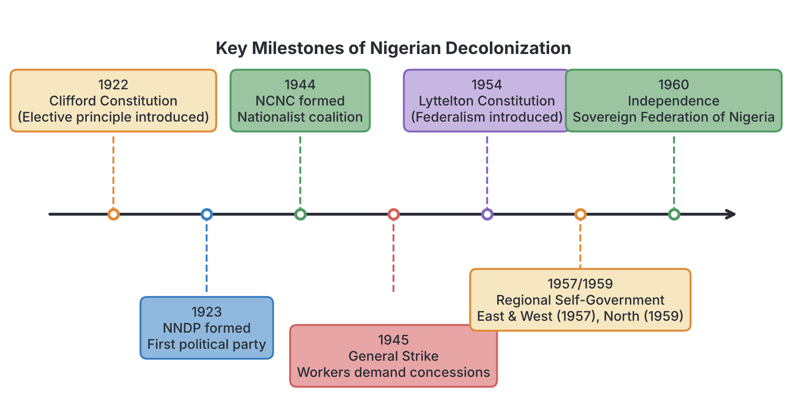

# JAMB Government Notes: Process of Decolonization

## What JAMB expects

This topic is Section B, Topic 3 of the JAMB Government syllabus: Process of Decolonization. It covers the history of how Nigeria gained its independence from British colonial rule. 

This file covers the following content items:
- **a.** Nationalism – Meaning, Types;
- **b.** Nationalist Movements – emergence, goals, strategies;
- **c.** Nationalist Leaders – Herbert Macaulay, Nnamdi Azikiwe, Obafemi Awolowo, Ahmadu Bello, Ladipo Solanke, Aminu Kano, J. S. Tarka, Tafawa Balewa and others;
- **d.** Emergence of Nationalist Parties;
- **e.** Influence of external factors.

By the end of these notes, you should be able to:
1. **evaluate the process of decolonization;** (Objective i)
2. **assess the roles of nationalist leaders and parties;** (Objective ii)
3. **assess the impact of external forces and ideas (Pan-Africanism, Back–to–Africa Movements, Second World War etc.).** (Objective iii)

## Evaluating the Process of Decolonization

**Objective i: evaluate the process of decolonization**

**Decolonization** is the process by which a colony (like Nigeria) gains its political and economic independence from a colonial power (like Britain), changing from a dependent territory into a sovereign nation. 

In Nigeria, the process of decolonization was mostly **peaceful and constitutional**, rather than violent or achieved through armed struggle (as was the case in Kenya or Algeria). It involved a gradual transfer of power. 

The evaluation of this process shows it went through distinct phases:
1. **Early resistance:** Traditional rulers fiercely but unsuccessfully fought the initial British invasion.
2. **Elite constitutional agitation:** Educated Nigerians began forming groups to demand participation in government, leading to the formation of political parties.
3. **Constitutional reforms:** Following continuous pressure, strikes, and newspaper campaigns, the British introduced a series of constitutions (Clifford in 1922, Richards in 1946, Macpherson in 1951, Lyttelton in 1954). Each constitution gave Nigerians a slightly larger share in government.
4. **Constitutional conferences:** Nigerian leaders and British officials met in London and Lagos (e.g., 1953, 1957, 1958 conferences) to negotiate the exact terms of independence.
5. **Self-government:** The Eastern and Western Regions achieved internal self-government in 1957, and the Northern Region in 1959.
6. **Independence:** On October 1, 1960, Nigeria became fully independent. 

## Nationalism: Meaning and Types

**Content a: Nationalism – Meaning, Types**

### Meaning of Nationalism
**Nationalism** is a strong feeling of love, pride, and loyalty toward one's country, along with the desire to see it free, united, and independent. 

In the context of colonial Africa, nationalism is defined as **the patriotic opposition to colonial rule** and the collective struggle by the people of a territory to achieve political independence and self-determination.

### Types of Nationalism
Textbooks usually classify Nigerian nationalism into two main types based on the period and the methods used:

| Feature | Early / Traditional Nationalism | Modern Nationalism |
| :--- | :--- | :--- |
| **Time Period** | Pre-1920s (during the initial British conquest) | 1920s to 1960 (the struggle for independence) |
| **Leaders** | Traditional rulers, chiefs, and local warriors (e.g., King Jaja of Opobo, Nana of Itsekiri, Attahiru of Sokoto, Oba Ovonramwen). | Western-educated elites, journalists, trade unionists, and youths (e.g., Herbert Macaulay, Nnamdi Azikiwe). |
| **Goals** | To prevent the British from taking over their kingdoms, protect traditional trade monopolies, and preserve local customs. | To participate in the colonial government, end racial discrimination, and ultimately gain full political independence for Nigeria. |
| **Methods/Strategies** | Armed resistance, wars, trade embargoes, and traditional diplomacy. | Peaceful/constitutional means, newspapers (the press), strikes, boycotts, political parties, and petitions. |

*Note: Some textbooks also use the terms "Pre-World War II Nationalism" (which focused on reforms and participation) and "Post-World War II Nationalism" (which aggressively demanded total independence).*

## Nationalist Movements

**Content b: Nationalist Movements – emergence, goals, strategies**

Nationalist movements were organized groups of individuals, unions, and associations that worked together to achieve self-government.

### Emergence (Why they started)
Nationalist movements emerged in Nigeria due to deep-seated grievances against the British colonial administration:
1. **Political exclusion:** Educated Nigerians were initially sidelined. The early Legislative Council had very few Africans, and traditional rulers (under Indirect Rule) were favoured over the educated elites.
2. **Economic exploitation:** The colonial economy benefited British trading companies (like the United Africa Company, UAC). Nigerians faced high taxes, low wages, and a lack of loans for local businesses.
3. **Social and racial discrimination:** Nigerians faced segregation in housing (the creation of "European Quarters" or GRAs), hospitals, and clubs. High-ranking civil service jobs were reserved exclusively for white expatriates.
4. **Cultural pride:** A growing awareness of African identity and a rejection of the European claim that African culture was inferior.

### Goals of the Nationalist Movements
The goals of these movements evolved over time:
*   **Initial goals (1920s-1930s):** They did not initially ask for full independence. They demanded a voice in government, better wages, more schools, the replacement of the hated Indirect Rule system, and the Africanization of the civil service (giving senior civil service jobs to Nigerians).
*   **Later goals (1940s-1960s):** After World War II, the goal shifted to **total political independence** and the complete transfer of sovereign power to Nigerians.

### Strategies Used by Nationalist Movements
The nationalists used non-violent, constitutional strategies to achieve their goals:
1. **The Press:** Newspapers were the most powerful weapon. Newspapers like the *Lagos Daily News* (Herbert Macaulay) and the *West African Pilot* (Nnamdi Azikiwe) exposed the evils of colonialism, educated the masses, and fiercely criticized British policies.
2. **Political Parties:** They formed political parties to contest elections and mobilize the masses.
3. **Trade Unions and Strikes:** Nationalists worked with labour unions to organize strikes. A major example is the **1945 General Strike**, led by Michael Imoudu, where workers paralyzed the country to demand a higher cost-of-living allowance (COLA), showing the British the power of the masses.
4. **Boycotts and Protests:** Refusal to buy European goods or pay unfair taxes. The **Aba Women’s Riot of 1929** was an early mass protest against taxation and colonial warrant chiefs.
5. **Petitions and Delegations:** Nationalists frequently wrote petitions and sent delegations to the British Secretary of State for the Colonies in London to protest unfavourable constitutions (like the Richards Constitution) and demand self-rule.

## Key Nationalist Leaders and Their Roles

**Content c: Nationalist Leaders; Objective ii: assess the roles of nationalist leaders...**

Different leaders played unique roles in the decolonization process. JAMB frequently tests your knowledge of who these individuals were and what specific contributions they made.

### 1. Herbert Macaulay
*   **Role:** Widely regarded as the **"Father of Nigerian Nationalism"**. 
*   **Key Contributions:** He founded Nigeria's first political party, the **Nigerian National Democratic Party (NNDP)**, in 1923. He used his newspaper, the *Lagos Daily News*, to fiercely criticize British policies. He fought for the rights of the Oba of Lagos and the masses. He later became the first president of the NCNC.

### 2. Dr. Nnamdi Azikiwe (Zik of Africa)
*   **Role:** The leading figure of modern, post-WWII nationalism and the first ceremonial President of Nigeria.
*   **Key Contributions:** He co-founded the **National Council of Nigeria and the Cameroons (NCNC)** in 1944. He established a chain of newspapers, most notably the ***West African Pilot***, which was highly influential in mobilizing Nigerian youths and workers for the independence struggle. He advocated for national unity and a federal structure.

### 3. Chief Obafemi Awolowo
*   **Role:** A key intellectual of the nationalist movement and the first Premier of the Western Region.
*   **Key Contributions:** He founded the **Action Group (AG)** in 1951 from a Yoruba cultural group, *Egbe Omo Oduduwa*. Awolowo established the *Nigerian Tribune* newspaper to propagate nationalist ideas. As Premier, he proved that Nigerians could govern effectively by introducing free primary education and free healthcare in the West, accelerating the push for self-government.

### 4. Sir Ahmadu Bello
*   **Role:** The *Sardauna of Sokoto*, undisputed leader of Northern Nigeria, and the first Premier of the Northern Region.
*   **Key Contributions:** He led the **Northern People’s Congress (NPC)**. While more conservative than Azikiwe or Awolowo (initially delaying the push for independence to allow the North to catch up educationally), he was crucial in unifying the vast Northern Region and ensuring it successfully transitioned to self-government in 1959.

### 5. Ladipo Solanke
*   **Role:** A pioneer of diaspora nationalism.
*   **Key Contributions:** While studying in Britain, he co-founded the **West African Students' Union (WASU)** in London in 1925. WASU served as a training ground for future West African leaders and a powerful pressure group that lobbied the British Parliament for constitutional reforms in the colonies. 

### 6. Mallam Aminu Kano
*   **Role:** The symbol of radical, progressive nationalism in the North.
*   **Key Contributions:** He founded the **Northern Elements Progressive Union (NEPU)** in 1950. Aminu Kano uniquely focused his nationalist struggle on fighting for the rights of the ***talakawa*** (the commoners) against both the British colonialists and the oppressive traditional Native Authority system in the North.

### 7. Joseph Sarwuan Tarka (J.S. Tarka)
*   **Role:** Champion of minority rights.
*   **Key Contributions:** He was the leader of the **United Middle Belt Congress (UMBC)**. Tarka realized that decolonization might leave minority ethnic groups at a disadvantage. He fought for the creation of a Middle Belt State to protect the minorities from the political dominance of the Hausa-Fulani majority in the Northern Region.

### 8. Sir Abubakar Tafawa Balewa
*   **Role:** A pragmatic northern leader and Nigeria's first Prime Minister.
*   **Key Contributions:** As the deputy leader of the NPC, he was a skilled orator and negotiator. He moved a pivotal motion for self-government in the federal parliament and played a critical role in the constitutional conferences that negotiated the final terms of Nigeria's independence.

[IMAGE: A 2x4 grid showing simple, recognizable portraits of the 8 nationalist leaders mentioned above (Macaulay, Azikiwe, Awolowo, Bello, Solanke, Aminu Kano, Tarka, Balewa), each with a small label indicating their name and their most famous political party or newspaper. Style: Clean flat textbook illustration, white background.]

## The Emergence of Nationalist Parties

**Content d: Emergence of Nationalist Parties; Objective ii: assess the roles of... parties**

Political parties were the main vehicles used by nationalists to organize the masses and contest elections. The syllabus expects you to know how they emerged and their roles in the decolonization process.

### Major Nationalist Parties
1. **Nigerian National Democratic Party (NNDP):** Formed in **1923** by Herbert Macaulay. It was the first political party in Nigeria. It emerged specifically to contest the three seats allocated to Lagos in the Legislative Council under the newly introduced Clifford Constitution.
2. **Nigerian Youth Movement (NYM):** Formed in **1936** (originating from the Lagos Youth Movement). It was the first truly nationalist party with a broader, national outlook, challenging the Lagos-centric NNDP. Leaders included H.O. Davies, Ernest Ikoli, and later Nnamdi Azikiwe and Obafemi Awolowo.
3. **National Council of Nigeria and the Cameroons (NCNC):** Formed in **1944** by students and youths, with Herbert Macaulay as its first President and Nnamdi Azikiwe as its first Secretary. It was the first party to heavily organize nationwide branches and include trade unions and women's associations as corporate members. (It was later renamed the National Council of Nigerian Citizens).
4. **Action Group (AG):** Formed in **1951** under the leadership of Obafemi Awolowo. It emerged from the pan-Yoruba cultural association *Egbe Omo Oduduwa*. It was dominant in the Western Region and highly organized.
5. **Northern People’s Congress (NPC):** Formed in **1951** from the northern cultural group *Jamiyyar Mutanen Arewa*. Led by Ahmadu Bello and Tafawa Balewa, it dominated the Northern Region.
6. **Minority / Radical Parties:**
    *   **Northern Elements Progressive Union (NEPU, 1950):** Led by Aminu Kano, focused on peasant rights in the North.
    *   **United Middle Belt Congress (UMBC, 1955):** Led by J.S. Tarka, focused on minority rights in the Middle Belt.

### Roles of Nationalist Parties in Decolonization
*   **Political Education:** They organized rallies, used newspapers, and held campaigns to educate Nigerians on their political rights and the evils of colonial rule.
*   **Leadership Training:** They served as training grounds where young politicians learned how to debate, organize, and administer modern governments.
*   **Negotiation:** The leaders of these parties represented Nigeria at the various constitutional conferences (1950, 1953, 1954, 1957, 1958), forcing the British to repeatedly review and rewrite the constitution.
*   **Forming Pre-Independence Governments:** By winning regional elections, parties like the AG (West), NCNC (East), and NPC (North) took charge of regional governance in the 1950s, proving to the British that Nigerians were ready for full independence.

## External Factors Influencing Decolonization

**Content e: Influence of external factors; Objective iii: assess the impact of external forces and ideas...**

The struggle for independence was not fought in isolation. Several external events, organizations, and global ideological shifts heavily impacted the process of decolonization in Nigeria.

### 1. The Second World War (1939–1945)
World War II was arguably the most significant external catalyst for decolonization. 
*   **The Atlantic Charter (1941):** Signed by US President Franklin D. Roosevelt and British Prime Minister Winston Churchill, the charter stated that all peoples had the right to choose the form of government under which they live (the right to self-determination). Nigerian nationalists demanded that this rule must apply to Africa too.
*   **Shattering the Myth of White Supremacy:** Thousands of Nigerian soldiers (ex-servicemen) fought for the British in places like Burma and India. Fighting alongside white soldiers, they saw that Europeans could bleed, cry, and die just like anyone else. This destroyed the psychological myth that the white man was an invincible, superior being. When the soldiers returned, they were bold, dissatisfied, and ready to join nationalist movements.

### 2. Pan-Africanism
**Pan-Africanism** is the belief that all people of African descent share a common bond and should unite to fight for their freedom and dignity.
*   Leaders like **W.E.B. Du Bois** organized Pan-African Congresses globally.
*   **The 5th Pan-African Congress in Manchester (1945)** was a turning point. It was attended by African leaders like Kwame Nkrumah (Ghana) and Jomo Kenyatta (Kenya). At this congress, the strategy changed from politely asking for colonial reforms to aggressively demanding immediate, absolute independence, sometimes using the threat of strikes and boycotts.

### 3. Back-to-Africa Movements (Garveyism)
Led by the Jamaican-born **Marcus Garvey**, who founded the Universal Negro Improvement Association (UNIA) in the USA. He promoted the idea of "Africa for Africans" and racial pride. His militant newspaper, *The Negro World*, was smuggled into West Africa and deeply inspired early nationalists like Nnamdi Azikiwe to believe in black dignity and self-reliance.

### 4. The Role of International Organizations (The UN)
The **United Nations (UN)**, formed in 1945, was fundamentally anti-colonial.
*   The UN Charter explicitly emphasized human rights and the self-determination of all peoples.
*   The UN General Assembly became a global platform where independent nations could condemn British and French colonialism. 
*   The UN Trusteeship Council supervised trust territories (like the British Cameroons) and pressured colonial powers to prepare them for independence.

### 5. Influence of the Superpowers (USA and USSR)
After World War II, the USA and the Soviet Union (USSR) emerged as the two dominant world powers. Both superpowers were opposed to old European colonialism (though for different reasons) and put diplomatic pressure on Britain and France to grant independence to their colonies.

### 6. The British Labour Party
In 1945, the Labour Party won the elections in Britain, replacing Winston Churchill's Conservative Party. The Labour Party was historically socialist, sympathetic to trade unions, and much more favourably disposed to granting independence to colonies than the Conservatives were.

### 7. Independence of Other Nations
*   **India’s Independence (1947):** India breaking free from British rule showed Nigerian nationalists that the British Empire was not invincible.
*   **Ghana’s Independence (1957):** Ghana (under Kwame Nkrumah) became the first sub-Saharan African country to gain independence. This created a massive ripple effect, inspiring and pressuring Nigerian leaders to accelerate their own push for 1960.

## Key terms

| Term | Meaning |
| :--- | :--- |
| **Decolonization** | The process by which a colony achieves political independence from a colonial power. |
| **Nationalism** | A strong patriotic feeling and collective struggle by a colonized people to achieve political independence. |
| **Constitutional Conference** | Meetings held between colonial masters and nationalist leaders to draft and negotiate new constitutions. |
| **Pan-Africanism** | A movement promoting the unity, solidarity, and political freedom of all people of African descent worldwide. |
| **Self-determination** | The right of a people to freely choose their own political status and form of government. |
| **Ex-servicemen** | Africans who were drafted into the colonial military to fight in global conflicts like WWII. |
| **Talakawa** | A Hausa term for the commoners or masses, whose rights were fiercely championed by Aminu Kano's NEPU. |
| **WASU** | West African Students' Union, formed in London to advocate for the rights of West Africans. |

## Exam tips and common mistakes

*   **Common mistake:** Confusing the founding dates and founders of early parties. **NNDP** = Herbert Macaulay (1923). **NCNC** = Students/Youths led by Macaulay and Azikiwe (1944). **NYM** = 1936.
*   **Common mistake:** Thinking the nationalists fought a bloody war for independence. Nigeria's decolonization was **peaceful and constitutional** (using the press, strikes, and conferences).
*   **Party matching:** JAMB often asks you to match a leader to their party or region. Awolowo -> AG (West). Ahmadu Bello -> NPC (North). Azikiwe -> NCNC (East/National). Aminu Kano -> NEPU (North, radical). J.S. Tarka -> UMBC (Middle Belt).
*   **External vs Internal factors:** If a question asks for an *external* factor, look for World War II, Pan-Africanism, the UN, or the Labour Party. Strikes and newspapers are *internal* factors.
*   **The Atlantic Charter:** Remember that this 1941 WWII document popularized the concept of "self-determination," which deeply inspired African nationalists.

## Quick summary

1. Decolonization in Nigeria was a gradual, constitutional process involving press agitation, strikes, party formation, and constitutional conferences.
2. Traditional nationalism involved early chiefs resisting colonial conquest by force, while modern nationalism was led by educated elites using peaceful, constitutional means.
3. Nationalist movements used newspapers (like the *West African Pilot*), political parties, and organized labour strikes to push for self-government.
4. Herbert Macaulay is the "Father of Nigerian Nationalism" and formed the first party, the NNDP, in 1923.
5. Other key leaders included Azikiwe (NCNC), Awolowo (AG), Ahmadu Bello (NPC), Aminu Kano (champion of the *talakawa*), and Ladipo Solanke (who organized students abroad via WASU).
6. Nationalist political parties mobilized the masses, trained leaders, and negotiated the terms of independence with the British.
7. External factors heavily accelerated independence. World War II destroyed the myth of white supremacy, while the UN, Pan-Africanism, and the USA/USSR pushed globally for self-determination.

## Practice questions

**1. The primary aim of early traditional nationalism in Nigeria was to:**
- A. form political parties to contest elections in the Legislative Council
- B. demand for the Africanization of the civil service
- C. resist British penetration and preserve local sovereignty
- D. attend constitutional conferences in London

**Answer: C.** Early traditional nationalism (led by kings and chiefs) used armed resistance to try and stop the British from taking over their kingdoms, whereas modern nationalism used political parties and demanded civil service reforms.

**2. The political party that emerged primarily to contest the three seats allocated to Lagos by the Clifford Constitution of 1922 was the:**
- A. Nigerian Youth Movement (NYM)
- B. National Council of Nigeria and the Cameroons (NCNC)
- C. Action Group (AG)
- D. Nigerian National Democratic Party (NNDP)

**Answer: D.** Herbert Macaulay founded the NNDP in 1923 specifically to take advantage of the new elective principle introduced for Lagos in the 1922 Clifford Constitution.

**3. Which of the following nationalist leaders is correctly matched with his political focus?**
- A. Ladipo Solanke — Formation of the Action Group in the West
- B. Mallam Aminu Kano — Defense of the *talakawa* (commoners) in the North
- C. J.S. Tarka — Leading the Northern People's Congress
- D. Herbert Macaulay — Organizing the 1945 General Strike

**Answer: B.** Aminu Kano formed the NEPU specifically to fight for the rights of the commoners (*talakawa*) against the conservative Native Authority system. J.S. Tarka led the UMBC, and Macaulay founded the NNDP. 

**4. A major external factor that accelerated the pace of decolonization in British West Africa was the:**
- A. Aba Women's Riot of 1929
- B. formation of the Nigerian Youth Movement
- C. experience of ex-servicemen during the Second World War
- D. introduction of the Lyttelton Constitution

**Answer: C.** The experiences of soldiers in WWII is an external factor because they fought abroad, realizing Europeans were not invincible, which destroyed the myth of white supremacy. The others are internal factors or events.

**5. The West African Students' Union (WASU) in London, which played a major role in mobilizing students for the nationalist struggle, was co-founded by:**
- A. Nnamdi Azikiwe
- B. Ladipo Solanke
- C. Obafemi Awolowo
- D. Tafawa Balewa

**Answer: B.** Ladipo Solanke was a pioneer of diaspora nationalism who co-founded WASU in 1925 in London.

**6. Which of the following was a widely used strategy by Nigerian nationalists to fight colonial rule?**
- A. Guerrilla warfare and armed rebellion
- B. The use of newspapers to educate the masses and criticize the government
- C. Assassination of colonial governors
- D. Secession from the British Empire before 1950

**Answer: B.** Modern Nigerian nationalism was constitutional and peaceful. Nationalists like Azikiwe and Macaulay relied heavily on the press (newspapers) to agitate for independence.

**7. The 1945 Pan-African Congress, which aggressively demanded an end to colonial rule, was held in:**
- A. Lagos
- B. Accra
- C. Manchester
- D. New York

**Answer: C.** The crucial 5th Pan-African Congress, attended by leaders such as Nkrumah and Kenyatta, was held in Manchester, UK, in 1945.

**8. Which of the following parties was formed specifically to advocate for the rights of minority ethnic groups in the Northern Region?**
- A. Northern People's Congress (NPC)
- B. United Middle Belt Congress (UMBC)
- C. Northern Elements Progressive Union (NEPU)
- D. Action Group (AG)

**Answer: B.** The UMBC, led by J.S. Tarka, fought for the creation of a Middle Belt state to protect minorities from the Hausa-Fulani majority in the North.

**9. The principle of "self-determination" which greatly inspired African nationalists was heavily popularized during World War II by the:**
- A. Yalta Conference
- B. League of Nations
- C. Atlantic Charter
- D. Treaty of Versailles

**Answer: C.** The 1941 Atlantic Charter, signed by the US and UK, declared the right of all peoples to choose their form of government.

**10. By 1959, just before independence, what key milestone had been achieved in the process of decolonization in Nigeria?**
- A. Nigeria was declared a republic
- B. All regions had achieved internal self-government
- C. The military took over to prepare the nation for independence
- D. The colonial governor completely left the country

**Answer: B.** The Eastern and Western regions achieved internal self-government in 1957, and the Northern region followed in 1959, setting the stage for full national independence in 1960. 

<!-- COVERAGE
obj i | Evaluating the Process of Decolonization
obj ii | Key Nationalist Leaders and Their Roles
obj ii | The Emergence of Nationalist Parties
obj iii | External Factors Influencing Decolonization
item a | Nationalism: Meaning and Types
item b | Nationalist Movements
item c | Key Nationalist Leaders and Their Roles
item d | The Emergence of Nationalist Parties
item e | External Factors Influencing Decolonization
-->
