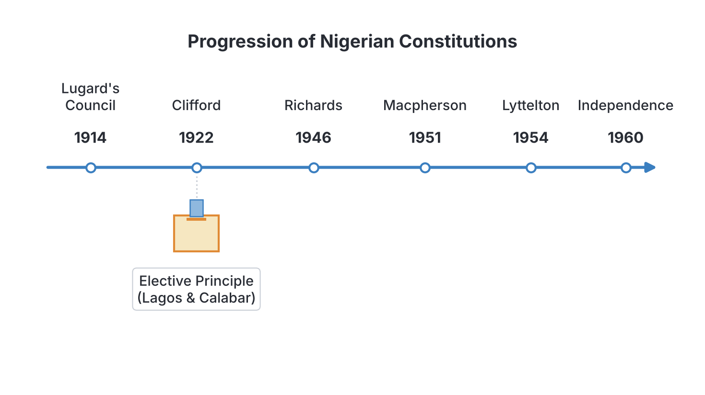
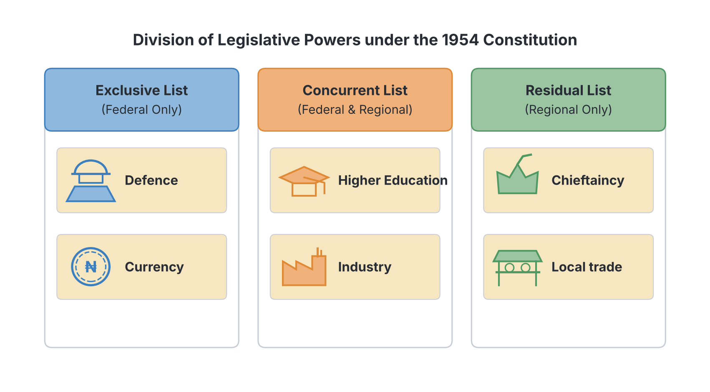

# JAMB Government Notes: Constitutional Development in Nigeria

## What JAMB expects

This topic is Section B, Topic 4 of the JAMB Government syllabus: Constitutional Development in Nigeria. It covers the pre-independence constitutions that shaped Nigeria's political history. 

In the syllabus, the contents are:
- a. Hugh Clifford Constitution (1922)
- b. Arthur Richards Constitution (1946)
- c. John Macpherson Constitution (1951)
- d. Oliver Lyttleton Constitution (1954)
- e. Independence Constitution (1960)

By the end of these notes, you should be able to:
1. compare the various constitutional developments;
2. analyse the merits and demerits of each of the constitutions.

**Note on the syllabus wording:** The syllabus spells the 1954 constitution as "Oliver Lyttleton". However, in most standard Government textbooks, the British Colonial Secretary's name is spelled **Lyttelton**. These notes use the standard textbook spelling, but you should recognize both in your exam. Also, post-independence constitutions (1963, 1979, 1989, 1999) are covered separately in `B5-post-independence-constitutions.md`.

## Hugh Clifford Constitution (1922)

**Content a: Hugh Clifford Constitution (1922)**

Sir Hugh Clifford took over as Governor of Nigeria in 1919, succeeding Lord Lugard. In 1922, he introduced a new constitution that replaced Lugard's 1914 Nigerian Council, which Nigerians had heavily criticized because it had no real power and its Nigerian members were merely nominated by the Governor. 

### Features of the Clifford Constitution
1. **The Elective Principle:** This was the most important feature. For the first time in British West Africa, Africans were allowed to elect their representatives into the Legislative Council. However, it was limited to only four seats: **three for Lagos** and **one for Calabar**.
2. **High Franchise Qualification:** To be eligible to vote, an adult male had to be a British subject or protected person, have resided in the area for at least a year, and earn a gross income of at least **£100 per annum**. This was a huge sum at the time, meaning very few Nigerians could vote.
3. **The Legislative Council:** It had 46 members. 27 were "official" members (British civil servants), and 19 were "unofficial" members (including the 4 elected Nigerians and 15 nominated members representing various commercial and ethnic interests). 
4. **The Executive Council:** This was an advisory body to the Governor. It had no Nigerian members; it was made up entirely of senior British officials.
5. **Exclusion of the North:** The Northern Provinces were excluded from the Legislative Council. The Governor ruled the North directly by issuing **proclamations** (decrees).

### Merits and demerits of the Clifford Constitution

**Objective ii: analyse the merits and demerits of each of the constitutions.**

**Merits:**
- It introduced the **elective principle**, which paved the way for democratic elections in Nigeria.
- It stimulated political activities in Nigeria. Because there were now elections to win in Lagos, Herbert Macaulay formed Nigeria's first political party, the **Nigerian National Democratic Party (NNDP)**, in 1923.
- It created a better Legislative Council compared to Lugard’s ineffective Nigerian Council.
- It allowed for the establishment of more newspapers (like the *Lagos Daily News*) to drive political campaigns.

**Demerits:**
- **Sectionalism:** It excluded Northern Nigeria from the Legislative Council, treating the North and South differently.
- **Limited Franchise:** The £100 income requirement was too high, disenfranchising the vast majority of Nigerians.
- **European Dominance:** The Executive Council was purely European, and the Legislative Council had a majority of British officials, meaning Nigerians could not outvote the colonial masters.
- The Governor retained **veto power**, meaning he could reject any law passed by the Legislative Council.

## Arthur Richards Constitution (1946)

**Content b: Arthur Richards Constitution (1946)**

Sir Arthur Richards designed this constitution to promote the unity of Nigeria while allowing for its diverse elements, and to secure greater participation by Africans in discussing their own affairs. It came into effect in 1946.

### Features of the Richards Constitution
1. **Division into Regions:** The constitution officially divided Nigeria into three regions: **Northern, Western, and Eastern Regions**. This laid the foundation for federalism in Nigeria (often called "regionalism").
2. **Integration of the North:** For the first time, Northern Nigeria was brought into the central Legislative Council to sit alongside the South.
3. **Regional Assemblies:** It created Regional Houses of Assembly for the three regions. However, these assemblies were only **advisory**; they could not make laws. They only discussed bills and passed them on to the central Legislative Council.
4. **House of Chiefs:** A bicameral (two-house) legislature was introduced in the Northern Region only, consisting of a House of Assembly and a House of Chiefs. 
5. **Unofficial Majority:** The central Legislative Council was expanded and, for the first time, had a majority of "unofficial" members (Nigerians) over the official British members. 
6. **Reduced Franchise:** The income qualification for voting in Lagos and Calabar was reduced from £100 to **£50**.

[IMAGE: A map of Nigeria divided into three bold distinct sections: Northern Region (largest, top), Western Region (bottom left), and Eastern Region (bottom right). The boundaries should be clear. Labels to add later: "Northern Region", "Western Region", "Eastern Region", "Foundation of Regionalism (1946)". Clean flat textbook style, white background.]

### Merits and demerits of the Richards Constitution

**Objective ii: analyse the merits and demerits of each of the constitutions.**

**Merits:**
- It brought the North and the South together in a single Legislative Council, promoting national unity.
- It introduced **regionalism**, which became the stepping stone to Nigeria's federal system.
- It gave Nigerians an **unofficial majority** in the central legislature.
- It reduced the voting qualification, allowing slightly more people in Lagos and Calabar to vote.

**Demerits:**
- **Lack of Consultation:** The most famous criticism of this constitution was that it was drafted by the Governor and imposed on Nigerians without any consultation. This caused massive protests by nationalist leaders (especially the NCNC).
- The Regional Assemblies had **no legislative powers**; they were merely talking shops that debated issues.
- The Governor still retained his veto power.
- The elective principle was still restricted only to Lagos and Calabar, despite the nationalist demands to extend it across the country.

## John Macpherson Constitution (1951)

**Content c: John Macpherson Constitution (1951)**

Learning from the bitter rejection of the Richards Constitution, Governor John Macpherson decided to consult Nigerians extensively before drafting a new one. Consultations began at the village level, moved to the provincial and regional levels, and finally ended with a national conference: the **Ibadan General Conference of 1950**.

### Features of the Macpherson Constitution
1. **Quasi-Federal Structure:** It introduced a quasi-federal system (a system that looks federal but still has a very strong central government controlling the regions).
2. **Legislative Powers for Regions:** Unlike the Richards constitution, the Regional Assemblies were now given actual powers to make laws on specific local matters (like agriculture, education, and local government). 
3. **Central House of Representatives:** A new central legislature called the House of Representatives was created, with 136 elected Nigerian members. However, members of this central house were not elected directly by the people; they were selected by the Regional Assemblies from among their own members.
4. **Council of Ministers:** The old Executive Council was renamed the Council of Ministers. For the first time, Nigerian politicians were appointed as **Ministers** at the center (four from each of the three regions). 
5. **Bicameral Legislature in the West:** The Western Region was given a House of Chiefs, joining the North in having a bicameral regional legislature. The East remained unicameral (only a House of Assembly).

### Merits and demerits of the Macpherson Constitution

**Objective ii: analyse the merits and demerits of each of the constitutions.**

**Merits:**
- **Wide Consultation:** It was the first Nigerian constitution drafted after thorough consultation with the people at all levels.
- It gave real **law-making powers** to the Regional Assemblies.
- It introduced Nigerians to the executive arm of government by making them **Ministers**.
- It stimulated the formation of major political parties, such as the Action Group (AG) and the Northern People's Congress (NPC), to contest the new regional elections.

**Demerits:**
- **No Executive Responsibility:** The Nigerian Ministers were only given portfolios but had no real executive control over their ministries; the actual power remained with the British permanent secretaries.
- **Friction between Center and Regions:** Because it was quasi-federal, a regional law could only become valid if the central government approved it. This caused massive political tension.
- **Dual Membership:** Legislators were members of both the Regional Assembly and the central House of Representatives, which was exhausting and divided their loyalties.
- The constitution collapsed quickly due to major crises, notably the 1953 Eastern Region crisis, the 1953 motion for self-government by Chief Anthony Enahoro, and the Kano riots of 1953. 

## Oliver Lyttelton Constitution (1954)

**Content d: Oliver Lyttelton Constitution (1954)**

Following the breakdown of the Macpherson Constitution, Nigerian leaders and the British Colonial Secretary, Oliver Lyttelton, held Constitutional Conferences in London (1953) and Lagos (1954). These conferences produced the 1954 Constitution.

### Features of the Lyttelton Constitution
1. **True Federalism:** This is the constitution's most famous feature. It made Nigeria a **true federation** by clearly sharing powers between the central government and the regional governments.
2. **Division of Powers:** Powers were divided into:
   - *Exclusive Legislative List:* Matters only the Federal government could legislate on (e.g., currency, foreign affairs, defence).
   - *Concurrent Legislative List:* Matters both Federal and Regional governments could legislate on (e.g., higher education, industrial development). In case of a clash, federal law prevailed.
   - *Residual List:* Matters not on the first two lists were left exclusively for the regions.
3. **Executive Powers for Ministers:** Ministers were finally made heads of their departments with full executive responsibility. 
4. **Regional Premiers:** The office of the Premier (head of regional government) was created. The leaders of the majority parties in the regions became Premiers (Ahmadu Bello in the North, Obafemi Awolowo in the West, Nnamdi Azikiwe in the East).
5. **Regionalization of the Civil Service and Judiciary:** Each region was allowed to have its own civil service and judiciary. 
6. **Lagos separated from the West:** Lagos was carved out of the Western Region and made the Federal Capital Territory.

### Merits and demerits of the Lyttelton Constitution

**Objective ii: analyse the merits and demerits of each of the constitutions.**

**Merits:**
- It established a **true federal system of government**, which suited Nigeria's diverse ethnic composition.
- It resolved the conflict between the center and regions by clearly defining their powers.
- Ministers were given genuine executive powers to control their ministries.
- It paved the way for regions to attain self-government (the East and West gained self-government in 1957, and the North in 1959).
- It removed the exhausting dual-membership system; politicians now had to choose between sitting in the regional or central legislature.

**Demerits:**
- **No Central Prime Minister:** Although there were regional Premiers, the constitution failed to provide for a Prime Minister at the federal level (this was later fixed in 1957).
- **Regional Loyalty:** By regionalizing the civil service and judiciary, it encouraged politicians to be more loyal to their regions than to the Nigerian nation, fueling ethnic politics.
- The Governor-General still retained veto power over certain national legislation. 
- It did not establish a uniform electoral system for the whole country.

## Independence Constitution (1960)

**Content e: Independence Constitution (1960)**

After the 1958 Constitutional Conference in London and the 1959 federal elections, the British Parliament passed the Nigeria Independence Act. On October 1, 1960, the Independence Constitution came into force. 

### Features of the Independence Constitution
1. **Political Independence:** It granted Nigeria full political independence as a sovereign nation within the British Commonwealth. 
2. **Parliamentary System:** It established a British-style parliamentary system of government at both the federal and regional levels. 
3. **Head of State vs. Head of Government:** At the federal level, the **Prime Minister** (Sir Abubakar Tafawa Balewa) was the Head of Government. However, the British monarch (Queen Elizabeth II) remained the ceremonial Head of State, represented in Nigeria by a Nigerian **Governor-General** (Dr. Nnamdi Azikiwe).
4. **Fundamental Human Rights:** Following the recommendation of the 1958 Willink Commission to protect minority groups, fundamental human rights were written directly into the constitution.
5. **Bicameral Federal Legislature:** The federal legislature became fully bicameral, comprising the **Senate** (Upper House) and the **House of Representatives** (Lower House).
6. **Privy Council:** The highest court of appeal for Nigeria was not within the country; it was the Judicial Committee of the Privy Council in London.

### Merits and demerits of the Independence Constitution

**Objective ii: analyse the merits and demerits of each of the constitutions.**

**Merits:**
- It successfully ushered Nigeria into full political independence, ending decades of British colonial rule.
- It protected citizens and minority groups by clearly defining **Fundamental Human Rights** (such as the right to life, freedom of expression, and freedom of association).
- It created a rigid amendment process, which prevented politicians from easily changing the constitution to suit their selfish interests.
- It provided a clear procedure for the creation of new regions and the alteration of regional boundaries.

**Demerits:**
- **Not Fully Sovereign:** Nigeria was not a republic. The Queen of England was still the Head of State, which meant true sovereignty was not completely achieved.
- The highest court of appeal was in London (the Privy Council), meaning the Nigerian judiciary was not fully independent.
- It did not solve the problem of political imbalance, as the Northern region was politically larger and more populous than the Eastern and Western regions combined, causing political friction.

## Comparing the constitutional developments

**Objective i: compare the various constitutional developments.**

JAMB often asks you to track the evolution of specific concepts (like the elective principle, federalism, or the role of Nigerians) across these constitutions. Use this table to easily compare their core features.

| Feature | Clifford (1922) | Richards (1946) | Macpherson (1951) | Lyttelton (1954) | Independence (1960) |
| :--- | :--- | :--- | :--- | :--- | :--- |
| **Structure of State** | Unitary (North excluded from legislature) | Unitary with administrative Regionalism | Quasi-Federal | True Federalism | Federal, independent nation |
| **Legislature** | Legislative Council (majority British officials) | Legislative Council (Unofficial Nigerian majority) | Central House of Reps (chosen from regions) | Federal House of Reps (directly elected) | Bicameral Federal Parliament (Senate & House of Reps) |
| **Regional Power** | None | Regional Assemblies created but **advisory only** | Regional Assemblies could make some local laws | Regions fully autonomous with Premiers | Regions self-governing with Premiers |
| **Electoral System** | Elective principle for Lagos (3) and Calabar (1). £100 franchise | Elective principle retained. Franchise reduced to £50 | Electoral college system. Widespread voting for regional houses | Direct elections into both federal and regional houses | Universal adult suffrage in the South; male suffrage in the North |
| **Executive Arm** | Executive Council (All European) | Executive Council (Still British-dominated) | Council of Ministers (Nigerians given portfolios but no power) | Ministers given full executive responsibility over departments | Prime Minister as Head of Government with full executive powers |
| **Drafting Process** | Imposed by Governor | Imposed by Governor (Caused massive protest) | Extensive consultation (Ibadan Conference 1950) | London & Lagos Conferences 1953/1954 | London Conference 1958 |

## Key terms

| Term | Meaning |
| :--- | :--- |
| **Elective Principle** | A democratic concept introduced in 1922 allowing citizens to vote for representatives, initially limited to Lagos and Calabar. |
| **Franchise** | The right to vote in public elections. Early constitutions had "income franchise" qualifications. |
| **Regionalism** | Dividing a country into regions for administrative or political purposes. Introduced by Richards in 1946. |
| **Federalism** | A system where power is constitutionally shared between a central government and regional/state governments. Established in 1954. |
| **Unofficial Members** | Members of the legislative council who were not British civil servants. They included nominated and elected Nigerians. |
| **Bicameral Legislature** | A law-making body with two houses or chambers (e.g., Senate and House of Representatives, or House of Chiefs and House of Assembly). |
| **Veto Power** | The constitutional right of a ruler (like the Colonial Governor) to reject a decision or proposal made by a law-making body. |
| **Privy Council** | The highest court of appeal in London, which served as the final court for Nigeria under the 1960 Constitution. |

## Exam tips and common mistakes

- **Common Mistake:** Confusing the constitution that introduced *Regionalism* with the one that introduced *Federalism*. **Richards (1946)** introduced Regionalism (divided Nigeria into 3 regions). **Lyttelton (1954)** introduced True Federalism (shared powers between center and regions).
- **Common Mistake:** Forgetting the numbers for the elective principle. Clifford (1922) granted **3 seats to Lagos** and **1 to Calabar**. 
- Remember the income franchises: **£100** for Clifford (1922), reduced to **£50** under Richards (1946).
- If a question asks which constitution was widely consulted upon, the answer is always **Macpherson (1951)**.
- If a question asks why the Independence Constitution was not fully sovereign, the answer is usually because the **Queen of England** was still the Head of State, or because the **Privy Council** was the highest court.
- Know the legislative lists: **Exclusive** (Federal), **Concurrent** (Federal and Region), and **Residual** (Region). They were introduced by Lyttelton (1954).

## Quick summary

1. The **Clifford Constitution (1922)** introduced the elective principle for Lagos and Calabar but isolated Northern Nigeria and demanded a high £100 voting qualification.
2. The **Richards Constitution (1946)** brought the North into the central legislature, introduced regionalism by dividing the country into three, and created an unofficial majority, but was heavily criticized for lacking consultation.
3. The **Macpherson Constitution (1951)** was drafted after wide consultation. It created a quasi-federal system where Nigerians became Ministers, but they lacked real executive power, leading to regional friction and its rapid collapse.
4. The **Lyttelton Constitution (1954)** established true federalism in Nigeria, clearly sharing powers (Exclusive, Concurrent, Residual lists) and granting regional autonomy with Premiers.
5. The **Independence Constitution (1960)** granted Nigeria political freedom with a parliamentary system and entrenched fundamental human rights, though the British Queen remained the ceremonial Head of State.
6. The evolution of the Nigerian legislature went from an advisory council with no elected members (1914) to a fully elected bicameral parliament by 1960. 
7. Regional power grew from mere advisory assemblies in 1946, to limited law-making in 1951, to full executive autonomy by 1954.

## Practice questions

**1. The elective principle was first introduced in Nigeria by the**
- A. Richards Constitution
- B. Macpherson Constitution
- C. Clifford Constitution
- D. Lyttelton Constitution

**Answer: C.** The Hugh Clifford Constitution of 1922 was the first to introduce the elective principle in British West Africa, granting 3 seats to Lagos and 1 to Calabar.

**2. A major demerit of the Richards Constitution of 1946 was that it**
- A. excluded the Northern Provinces from the central legislature
- B. was imposed on Nigerians without prior consultation
- C. established a true federal system of government
- D. made the Queen of England the Head of State

**Answer: B.** The nationalist leaders intensely criticized Governor Richards for drafting the constitution secretly and imposing it without consulting Nigerians. Option A refers to Clifford; Option C refers to Lyttelton.

**3. Which of the following constitutions organized wide consultations from the village level up to the Ibadan General Conference?**
- A. Lyttelton Constitution
- B. Independence Constitution
- C. Richards Constitution
- D. Macpherson Constitution

**Answer: D.** Governor John Macpherson wanted to avoid the mistake of Richards, so he initiated widespread grassroots consultations culminating in the 1950 Ibadan Conference.

**4. Under the Lyttelton Constitution of 1954, matters upon which both the federal and regional governments could make laws were placed on the**
- A. Concurrent List
- B. Exclusive List
- C. Residual List
- D. Advisory List

**Answer: A.** The Concurrent List contains items both levels of government can legislate on. The Exclusive list is for the federal government only, and the Residual list is for the regional governments.

**5. Which constitution is credited with firmly establishing true federalism in Nigeria?**
- A. 1922 Clifford Constitution
- B. 1946 Richards Constitution
- C. 1951 Macpherson Constitution
- D. 1954 Lyttelton Constitution

**Answer: D.** While Richards (1946) introduced regions, it was the Lyttelton Constitution (1954) that gave true federalism by constitutionally sharing powers between the center and the autonomous regions.

**6. Under the 1922 Clifford Constitution, an adult male in Lagos could only vote if he had a gross annual income of at least**
- A. £10
- B. £50
- C. £100
- D. £150

**Answer: C.** The franchise qualification was set at a high £100 under Clifford. It was later reduced to £50 by the Richards Constitution.

**7. A significant feature of the 1960 Independence Constitution was the**
- A. establishment of a presidential system of government
- B. retention of the British monarch as the Head of State
- C. abolition of the fundamental human rights clause
- D. creation of twelve states in Nigeria

**Answer: B.** In 1960, Nigeria operated a parliamentary system where Queen Elizabeth II remained the ceremonial Head of State. A presidential system (Option A) and state creation (Option D) came much later.

**8. The first political party in Nigeria, the NNDP, was formed primarily to take advantage of the elections provided by the**
- A. Richards Constitution
- B. Clifford Constitution
- C. Lyttelton Constitution
- D. Independence Constitution

**Answer: B.** Herbert Macaulay formed the Nigerian National Democratic Party (NNDP) in 1923 to contest the new Lagos Legislative Council seats created by the 1922 Clifford Constitution.

**9. The introduction of Nigerian Ministers who were given portfolios but no real executive power was a feature of the**
- A. Clifford Constitution
- B. Richards Constitution
- C. Macpherson Constitution
- D. Lyttelton Constitution

**Answer: C.** The 1951 Macpherson Constitution created the Council of Ministers, but the ministers did not have full executive control over their departments until the 1954 Lyttelton Constitution.

**10. Which of the following constitutions first introduced the concept of regionalism by dividing Nigeria into three regions?**
- A. Richards Constitution
- B. Macpherson Constitution
- C. Lyttelton Constitution
- D. Independence Constitution

**Answer: A.** Sir Arthur Richards divided Nigeria into the Northern, Western, and Eastern Regions in his 1946 constitution. This regional division laid the groundwork for Nigeria's future federal structure.

<!-- COVERAGE
obj i | Comparing the constitutional developments
obj ii | Merits and demerits of the Clifford Constitution
obj ii | Merits and demerits of the Richards Constitution
obj ii | Merits and demerits of the Macpherson Constitution
obj ii | Merits and demerits of the Lyttelton Constitution
obj ii | Merits and demerits of the Independence Constitution
item a | Hugh Clifford Constitution (1922)
item b | Arthur Richards Constitution (1946)
item c | John Macpherson Constitution (1951)
item d | Oliver Lyttelton Constitution (1954)
item e | Independence Constitution (1960)
-->
