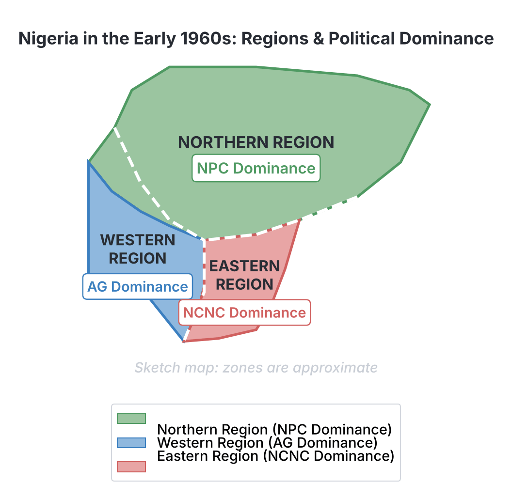
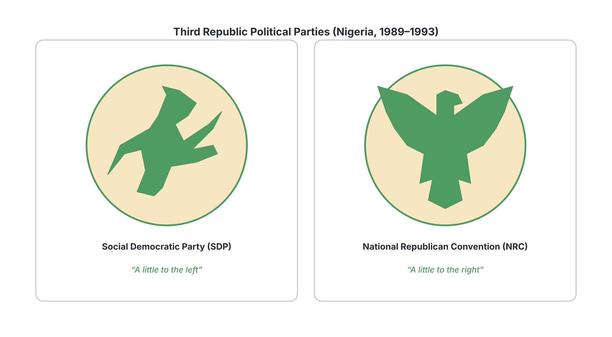
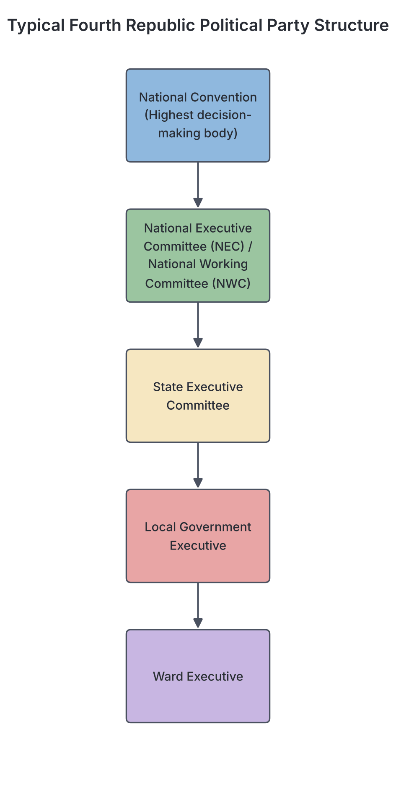

# JAMB Government Notes: Political Parties and Party Politics in Post-Independence Nigeria

## What JAMB expects

This topic is Section B, Topic 8 of the JAMB Government syllabus: Political Parties and Party Politics in Post-Independence Nigeria. It covers the evolution, membership spread, structure and ideologies of political parties from independence to the current democratic era.

This file covers:
- a. First Republic
- b. Second Republic
- c. Third Republic
- d. Fourth Republic

By the end of these notes, you should be able to:
1. contrast political processes in the republics;
2. evaluate the ideologies, structure and composition of the political parties.

**Note on the syllabus wording:** Nigeria has had four distinct periods of democratic civilian rule, known as "Republics", separated by periods of military rule. The syllabus refers to the "Third Republic", which was initiated by the military in the early 1990s but was aborted (cancelled) before a civilian president could take office. However, party politics actively took place during this transition, so it is studied as a Republic in JAMB.

## First Republic

**Content a: First Republic**

The First Republic lasted from Nigeria's independence on 1st October 1960 until the first military coup on 15th January 1966. It operated a **parliamentary system** of government, similar to the British system, where the Prime Minister was the head of government and the President (from 1963) was the ceremonial head of state.

### Evolution and Structure
Political parties in the First Republic evolved directly from the nationalist movements that fought for independence (which you can read about in `B3-process-of-decolonization.md`). 
Because the 1960 Constitution retained a strong regional structure (Northern, Western, and Eastern Regions), the political parties were structurally tied to these regions. They were highly decentralised and relied on local and ethnic leaders to gather votes.

### Membership Spread and Composition
The membership of First Republic parties was heavily **regional and ethnic**. A party would completely dominate its home region but struggle to win seats elsewhere. 
- **Northern People's Congress (NPC):** Dominated the Northern Region. It was composed mostly of the Hausa-Fulani aristocracy, traditional rulers, and conservative elites. Its motto was literally "One North, One People", showing it did not even pretend to be a national party. It was led by Sir Ahmadu Bello (the Sardauna of Sokoto), while Sir Abubakar Tafawa Balewa served as its Prime Minister in Lagos.
- **National Council of Nigerian Citizens (NCNC):** Dominated the Eastern Region and had strong pockets of support in the West (especially in Lagos and Ibadan). Led by Dr. Nnamdi Azikiwe, its composition was predominantly Igbo, though it started as the most nationalistic of all the parties.
- **Action Group (AG):** Dominated the Western Region. Led by Chief Obafemi Awolowo, it was largely composed of Yoruba professionals, businessmen, and traditional leaders, evolving from the Yoruba cultural group, *Egbe Omo Oduduwa*.
- **Minority Parties:** There were smaller parties fighting for the rights of ethnic minorities, such as the Northern Elements Progressive Union (NEPU) led by Aminu Kano (representing commoners in the North) and the United Middle Belt Congress (UMBC) led by J.S. Tarka (fighting for a separate Middle Belt state).

## Second Republic

**Content b: Second Republic**

The Second Republic lasted from 1st October 1979 to 31st December 1983. Following military rule, the 1979 Constitution introduced the **presidential system** of government (like the USA).

### Evolution and Structure
To avoid the ethnic divisions of the First Republic, the military government under General Olusegun Obasanjo laid down strict rules. The electoral body, the Federal Electoral Commission (FEDECO), required any new political party to have a **national spread**. A party had to have branches in at least two-thirds of the states in the federation to be registered.

### Membership Spread and Composition
Despite FEDECO's rules, the Second Republic parties ended up looking like "reborn" versions of the First Republic parties, though they tried to include politicians from across the country in their executive structures.
- **National Party of Nigeria (NPN):** The ruling party, which produced President Shehu Shagari. It was an evolution of the old NPC, but it successfully attracted elites, businessmen, and politicians from all over Nigeria. It had the widest national spread.
- **Unity Party of Nigeria (UPN):** Led by Chief Obafemi Awolowo, it was essentially the rebirth of the Action Group. Its membership was completely dominant in the Yoruba-speaking Western states.
- **Nigerian People's Party (NPP):** Led by Dr. Nnamdi Azikiwe, it was seen as the rebirth of the NCNC. Its stronghold was in the Igbo-speaking Eastern states and parts of the Middle Belt (Plateau State).
- **Great Nigeria People's Party (GNPP):** Led by Alhaji Waziri Ibrahim, this was a breakaway faction of the NPP. Its stronghold was in the North-East (Borno and Gongola states).
- **People's Redemption Party (PRP):** Led by Malam Aminu Kano, this was the rebirth of the old NEPU. It appealed to the poor masses (*talakawa*) and won elections in Kano and Kaduna states.
- **Nigeria Advance Party (NAP):** Led by Tunji Braithwaite, this party was registered later in 1982. It appealed to radical intellectuals and youths but did not win any major elections.

## Third Republic

**Content c: Third Republic**

The Third Republic (roughly 1992–1993) was a transitional republic engineered by the military government of General Ibrahim Babangida. It is famous for the June 12, 1993, presidential election, which was annulled (cancelled) by the military before the winner could take office.

### Evolution and Structure
Unlike previous republics where citizens freely formed parties, General Babangida's government cancelled all the political associations formed by politicians. Instead, the military **decreed (created) a two-party system**. The government built the party secretariats, funded them, wrote their constitutions, and even chose their colours and logos. 

### Membership Spread and Composition
Because there were only two choices, politicians from all ethnic groups and former political blocks were forced to join one of the two parties. This created a genuine national spread, breaking the ethnic pattern of the First and Second Republics.
- **Social Democratic Party (SDP):** Created by the military to lean "a little to the left" (progressive/welfarist). It was led by Chief M.K.O. Abiola, who won the annulled June 12, 1993, presidential election. It was composed of progressive politicians from the North, the Middle Belt, the West, and the East.
- **National Republican Convention (NRC):** Created to lean "a little to the right" (conservative/capitalist). Its presidential candidate was Alhaji Bashir Tofa. It attracted conservative elites and businessmen from across the country.

## Fourth Republic

**Content d: Fourth Republic**

The Fourth Republic began on 29th May 1999 when the military handed over power to a civilian government under President Olusegun Obasanjo. It operates a presidential system under the 1999 Constitution (as amended). At the time of writing, Nigeria is still in its Fourth Republic, making it the longest unbroken period of democratic rule in the country's history.

### Evolution and Structure
The transition to the Fourth Republic was supervised by General Abdulsalami Abubakar. The Independent National Electoral Commission (INEC) registered political parties. Like the Second Republic, parties were required to demonstrate a national structure, with headquarters in the Federal Capital Territory (Abuja) and executive committee members drawn from at least two-thirds of the states. 

### Membership Spread and Composition
The Fourth Republic operates a **multi-party system**. While there are many registered parties, a few large parties have dominated the landscape. The membership of these mega-parties is truly national, driven more by elite consensus and access to power than by ethnicity.
- **People's Democratic Party (PDP):** The dominant party from 1999 to 2015. It was formed by a broad coalition of politicians, military elites, and activists (the G-34). It had a massive national spread and produced Presidents Obasanjo, Yar'Adua, and Jonathan.
- **Opposition Parties (1999-2013):** Initially, the **All People's Party (APP)** (later ANPP) dominated the far North, while the **Alliance for Democracy (AD)** (later evolving into ACN) dominated the South-West. 
- **All Progressives Congress (APC):** Formed in 2013 through a historic merger of major opposition parties (ACN, CPC, ANPP, and a faction of APGA). It became the first opposition party to defeat a ruling party in Nigeria (in 2015, producing President Muhammadu Buhari).
- **Other Parties:** Parties like the **Labour Party (LP)**, the **New Nigeria Peoples Party (NNPP)**, and the **All Progressives Grand Alliance (APGA)** have also won governorship and legislative seats, showing the dynamic nature of Fourth Republic composition.

A major feature of Fourth Republic composition is **"cross-carpeting" or defection**, where politicians frequently switch from one party to another based on personal ambition rather than ideological differences.

## Contrasting political processes in the republics

**Objective i: contrast political processes in the republics.**

The political processes—how parties were formed, how elections were contested, and the systems of government—varied significantly across the four republics. 

| Feature | First Republic (1960–1966) | Second Republic (1979–1983) | Third Republic (1992–1993) | Fourth Republic (1999–Present) |
| :--- | :--- | :--- | :--- | :--- |
| **System of Government** | Parliamentary (Prime Minister as head of govt) | Presidential (Executive President) | Presidential (planned) | Presidential (Executive President) |
| **Party System** | Multi-party | Multi-party | Strict Two-party (by military decree) | Multi-party |
| **Party Formation** | Formed freely; mostly based on regional/cultural groups | Formed freely; FEDECO demanded national spread | Formed, funded and structured entirely by the military government | Formed freely; INEC demands strict national spread |
| **Electoral Body** | Electoral Commission of Nigeria (ECN) | Federal Electoral Commission (FEDECO) | National Electoral Commission (NEC) | Independent National Electoral Commission (INEC) |
| **Nature of Politics** | Intense regional and ethnic rivalry; zero-sum game | Ethnic loyalty remained, but with emerging national alliances | National alliances forced by the two-party system | Elite-driven; heavy use of money ("godfatherism"); frequent party switching |

## Evaluating the ideologies, structure and composition of the political parties

**Objective ii: evaluate the ideologies, structure and composition of the political parties.**

An **ideology** is a set of beliefs about how society and the economy should be run. Looking closely at the parties across Nigeria's history reveals an interesting pattern in their ideologies, structures, and composition.

### 1. Ideologies
- **Clear Ideologies (First & Second Republics):** Early political parties had relatively clear ideologies. For example, the AG and UPN strictly followed **democratic socialism**, offering free education and free healthcare. The NPC and NPN were openly **conservative**, favouring gradual change and protecting traditional institutions. Aminu Kano's NEPU and PRP were purely **radical/Marxist**, fighting for the emancipation of the poor (*talakawa*).
- **Decreed Ideologies (Third Republic):** The government forced ideologies onto the parties. The SDP was made welfarist ("a little to the left"), and the NRC was made capitalist ("a little to the right").
- **Blurred Ideologies (Fourth Republic):** Today, Nigerian political parties have very weak ideologies. The PDP and APC both operate mixed economies and capitalist policies. Because there is no strong ideological difference, politicians easily cross-carpet (defect) from one party to another without feeling they have betrayed any core beliefs.

### 2. Structure
- **Regional to National:** Party structure evolved from being tightly controlled by regional governments (First Republic) to constitutionally mandated national structures. In the Fourth Republic, the 1999 Constitution legally forbids parties from having logos, names, or mottoes that suggest ethnic or religious exclusivity. A party must maintain a functioning headquarters in Abuja.
- **Centralisation:** First Republic parties were highly decentralised (regional leaders had the final say). Fourth Republic parties are highly centralised, with the "National Working Committee" (NWC) in Abuja wielding enormous power over state branches.

### 3. Composition
- **Ethnicity:** First Republic party composition was almost entirely ethnic (Hausa/Fulani in NPC, Yoruba in AG, Igbo in NCNC). The Second Republic tried to change this but largely failed. By the Third and Fourth Republics, national composition became a reality. Today, the major parties contain a mix of all ethnic groups.
- **Elite and Wealth Dominance:** The composition of modern Nigerian parties is heavily dominated by wealthy elites. Politics in the Fourth Republic is highly "monetised" (expensive). This has led to the phenomenon of **"Godfatherism"**, where wealthy, influential individuals sponsor candidates and then expect to control the government and resources if their candidate wins.

## Key terms

| Term | Meaning |
| :--- | :--- |
| **Parliamentary System** | A system of government where the executive power is derived from the legislature, led by a Prime Minister (used in the First Republic). |
| **Presidential System** | A system where the head of state and head of government are the same person (President), elected directly by the people (Second, Third, and Fourth Republics). |
| **Cross-carpeting / Defection** | The act of politicians leaving one political party to join another, very common in the Fourth Republic. |
| **Godfatherism** | A system where powerful and wealthy individuals sponsor politicians for office, expecting political and financial returns. |
| **National Spread** | A constitutional requirement (since 1979) that political parties must have branches and members across the majority of Nigerian states to prevent ethnic parties. |
| **Two-party system** | A system where only two political parties have a real chance of winning elections; strictly decreed by the military in the Third Republic (SDP and NRC). |
| **FEDECO** | Federal Electoral Commission, the body that conducted elections in the Second Republic. |
| **INEC** | Independent National Electoral Commission, the body conducting elections in the Fourth Republic. |

## Exam tips and common mistakes

- **Know your leaders and parties:** JAMB frequently asks you to match a leader to their party across the republics. 
  - *First Republic:* Awolowo (AG), Azikiwe (NCNC), Ahmadu Bello/Tafawa Balewa (NPC), Aminu Kano (NEPU).
  - *Second Republic:* Awolowo (UPN), Azikiwe (NPP), Shagari (NPN), Aminu Kano (PRP), Waziri Ibrahim (GNPP).
- **The Third Republic was unique:** Remember that the military government *created* the two parties (SDP and NRC). Politicians did not form them.
- **Do not confuse electoral commissions:**
  - ECN/FEC = First Republic
  - FEDECO = Second Republic
  - NEC = Third Republic
  - INEC = Fourth Republic
- **Common mistake:** Students often think the First Republic operated a presidential system. It did not. It operated a *parliamentary* system. The presidential system started in 1979 (Second Republic).

## Quick summary

1. The **First Republic (1960-1966)** operated a parliamentary system. Its political parties (NPC, NCNC, AG) were regionally and ethnically based.
2. The **Second Republic (1979-1983)** introduced the presidential system. Parties (NPN, UPN, NPP, PRP, GNPP, NAP) were required to have national spread, though they still had strong regional flavours.
3. The **Third Republic (1992-1993)** featured a strict two-party system (SDP and NRC) created and funded entirely by the military government.
4. The **Fourth Republic (1999-Present)** features a multi-party presidential system dominated by mega-parties (like PDP and APC) with strong national composition.
5. While First and Second Republic parties had clear ideologies (e.g., UPN's democratic socialism, PRP's radicalism), Fourth Republic parties have blurred ideologies, leading to frequent defection.
6. To prevent ethnic division, modern constitutions mandate that parties must have headquarters in Abuja and executive members from at least two-thirds of the states.
7. A major feature of modern party composition is the influence of wealthy elites and "godfatherism".

## Practice questions

**1. The political party that dominated the Western Region during the First Republic was the**
- A. National Council of Nigerian Citizens (NCNC)
- B. Northern People's Congress (NPC)
- C. Action Group (AG)
- D. Unity Party of Nigeria (UPN)

**Answer: C.** The Action Group (AG), led by Chief Obafemi Awolowo, dominated the Western Region in the First Republic. The UPN was his party in the Second Republic.

**2. Which of the following electoral bodies conducted the elections in the Second Republic?**
- A. Independent National Electoral Commission (INEC)
- B. Federal Electoral Commission (FEDECO)
- C. National Electoral Commission (NEC)
- D. Electoral Commission of Nigeria (ECN)

**Answer: B.** FEDECO conducted elections in the Second Republic. INEC is for the Fourth Republic, NEC for the Third, and ECN for the First.

**3. The two political parties created by the military government in the Third Republic were the**
- A. PDP and APC
- B. NPN and UPN
- C. SDP and NRC
- D. APP and AD

**Answer: C.** General Ibrahim Babangida's military government decreed a two-party system, creating the Social Democratic Party (SDP) and the National Republican Convention (NRC).

**4. A major difference between political parties in the First Republic and the Fourth Republic is that First Republic parties**
- A. were highly centralised in the federal capital
- B. were built strictly on ethnic and regional lines
- C. had very blurred ideologies
- D. were created and funded by the military

**Answer: B.** First Republic parties were highly regional and ethnic (e.g., NPC for the North, AG for the West). Fourth Republic parties are required by law to have national spread.

**5. Which of the following Second Republic political parties was known for its radical ideology and appeal to the poor masses (*talakawa*)?**
- A. National Party of Nigeria (NPN)
- B. Nigerian People's Party (NPP)
- C. People's Redemption Party (PRP)
- D. Great Nigeria People's Party (GNPP)

**Answer: C.** The PRP, led by Malam Aminu Kano, was known for its radical socialist ideology defending the poor (*talakawa*), primarily in Kano and Kaduna.

**6. Which system of government was practiced in Nigeria's First Republic?**
- A. Presidential system
- B. Federal military system
- C. Unitary system
- D. Parliamentary system

**Answer: D.** The First Republic practiced the parliamentary system (modelled after the British system), with a Prime Minister as the head of government. The presidential system began in the Second Republic.

**7. In the Fourth Republic, the frequent movement of politicians from one political party to another is primarily due to**
- A. a lack of clear ideological differences between the parties
- B. strict constitutional rules forcing them to change parties
- C. the adoption of a two-party system
- D. the regional nature of the new parties

**Answer: A.** Because modern major parties (like PDP and APC) have very similar or blurred ideologies, politicians easily "cross-carpet" or defect based on personal ambition rather than ideological conflict.

**8. To ensure political parties have a national spread in the Fourth Republic, the constitution requires them to have their headquarters in**
- A. Lagos
- B. all 36 states
- C. Abuja
- D. the region of their presidential candidate

**Answer: C.** The 1999 Constitution requires registered political parties to maintain a functioning headquarters in the Federal Capital Territory, Abuja, to prove they are national entities.

**9. The Second Republic political party led by Alhaji Waziri Ibrahim, which campaigned on the philosophy of "politics without bitterness", was the**
- A. GNPP
- B. NAP
- C. UPN
- D. NPN

**Answer: A.** The Great Nigeria People's Party (GNPP) was led by Waziri Ibrahim and is famous for its slogan "politics without bitterness".

**10. The phenomenon where wealthy and powerful individuals sponsor candidates for elections in order to control government resources is best described as**
- A. welfarism
- B. cross-carpeting
- C. godfatherism
- D. progressive politics

**Answer: C.** "Godfatherism" is the term used in Nigerian politics for wealthy elites sponsoring candidates and demanding control or returns after the election.

<!-- COVERAGE
obj i | Contrasting political processes in the republics
obj ii | Evaluating the ideologies, structure and composition of the political parties
item a | First Republic
item b | Second Republic
item c | Third Republic
item d | Fourth Republic
-->
