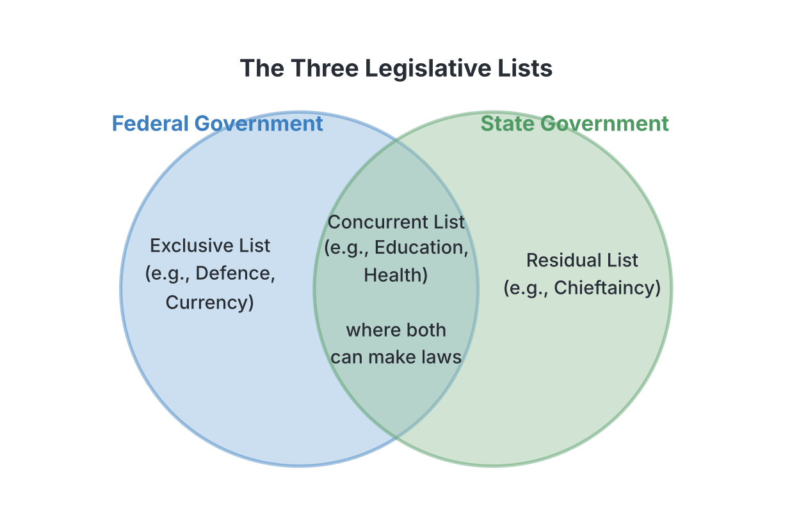
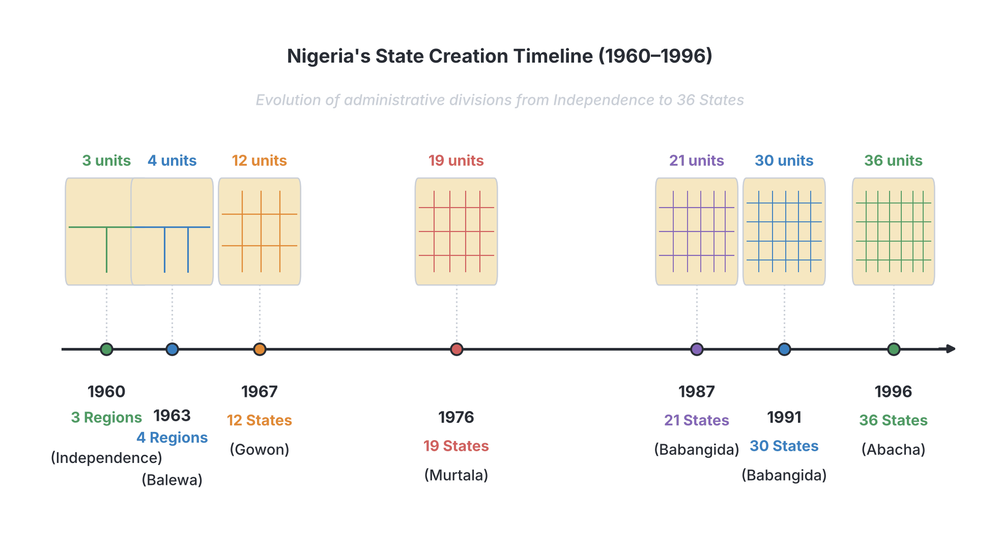

# JAMB Government Notes: The Structure and Workings of Nigerian Federalism

## What JAMB expects

This topic is Section B, Topic 9 of the JAMB Government syllabus: The Structure and Workings of Nigerian Federalism. It covers the following content areas:

*   **a. Rationale for a Federal System**
*   **b. Tiers of Government and their relationship**
*   **c. Creation of States – 1963, 1967, 1976, 1987, 1991, 1996**
*   **d. Problems of Nigerian Federalism – Census, Revenue Allocation, Conflicts etc. solutions e.g. The Federal Character Principle, etc.**

By the end of these notes, you should be able to:
1. Examine the workings of Nigerian federalism.
2. Identify its problems.
3. Evaluate the corrective measures to be adopted.

*Note: The general concept of a federal system of government (its definition, features, merits, and demerits) is covered in `A5-structures-of-governance.md`. These notes focus specifically on how federalism works in **Nigeria**, its history, its challenges, and its unique solutions.*

## The Workings of Nigerian Federalism

**Objective i: examine the workings of Nigerian federalism**

Nigeria operates a **federal system of government**. In a federal system, political power is shared between a central (federal) government and component units (state and local governments) according to a written constitution. 

Federalism in Nigeria formally started with the **Lyttelton Constitution of 1954** during the colonial era, which shared powers between the central government in Lagos and the three regions (Northern, Western, and Eastern). Today, Nigeria is a federation of 36 states, one Federal Capital Territory (Abuja), and 774 local government areas.

### Rationale for a Federal System in Nigeria

**Content a: Rationale for a Federal System**

Why did Nigeria adopt a federal system instead of a unitary one (where all power is at the centre)? The rationale (reasons) include:

1. **Cultural and Ethnic Diversity:** Nigeria is made up of over 250 different ethnic groups (such as Hausa-Fulani, Yoruba, Igbo, Ijaw, Tiv, and Kanuri), each with its own language, customs, and traditions. Federalism allows these diverse groups to stay together as one country while keeping their unique identities.
2. **Fear of Ethnic Domination:** Before independence, minority ethnic groups feared that the three major ethnic groups would dominate them. A federal system helps to protect minority interests by giving them a level of autonomy (self-rule) in their own states.
3. **Large Population and Landmass:** Nigeria is huge. A single central government in Abuja cannot easily understand or solve the local problems of someone living in a remote village in Borno or Bayelsa State. Federalism brings the government closer to the people.
4. **Historical Differences and Colonial Legacy:** The British colonial masters administered the North and South differently before the 1914 Amalgamation. This created differences in education, administration, and economic development. Federalism was adopted to allow each region to develop at its own pace.
5. **Economic Viability:** A federal system allows different states to pool their diverse human and natural resources together to build a stronger national economy.

### Tiers of Government and their Relationship

**Content b: Tiers of Government and their relationship**

Nigeria currently has three tiers (levels) of government. They are not strictly master and servant; they are coordinates, meaning each derives its powers directly from the Constitution. 

1. **The Federal Government:** The highest tier, located in Abuja. It handles matters that affect the whole country.
2. **The State Governments:** The 36 states (e.g., Kano, Lagos, Enugu), which handle matters specific to their geographical areas.
3. **The Local Governments:** The lowest tier (774 in number, at the time of writing), closest to the grassroots. *(Note: Local governments are discussed in full detail in `B11-local-government.md`).*

#### Constitutional Division of Powers
The relationship between the federal and state governments is defined by how the Constitution shares legislative powers between them. In the 1999 Constitution (as amended), powers are divided into three lists:

| Legislative List | Who has the power? | Examples in Nigeria |
| :--- | :--- | :--- |
| **Exclusive Legislative List** | **Only the Federal Government** (National Assembly). | Defence (military), foreign affairs, currency (Naira), immigration, customs, police, aviation. |
| **Concurrent Legislative List** | **Both Federal and State Governments.** (If a state law clashes with a federal law on the same issue, the federal law prevails). | Education, health, agriculture, road construction. |
| **Residual Legislative List** | **Only State Governments** (and by extension, Local Governments). *Note: The 1999 Constitution does not have a heading named "Residual", but any matter not found on the Exclusive or Concurrent lists is automatically Residual.* | Chieftaincy affairs, local markets, motor parks, primary healthcare. |

#### Intergovernmental Relations
The tiers of government relate with each other in three main ways:
*   **Financial Relationship:** The federal government collects major revenues (like oil money, customs duties) into a central pool called the **Federation Account**. This money is then shared among the federal, state, and local governments according to a strict formula.
*   **Administrative/Political Relationship:** State governors often meet with the President (e.g., in the National Economic Council or National Council of State) to align policies.
*   **Judicial Relationship:** If there is a dispute between the federal government and a state government (for example, a disagreement over revenue sharing), the **Supreme Court of Nigeria** is the only court with the original jurisdiction (power) to hear and settle the case.

### Creation of States in Nigeria

**Content c: Creation of States – 1963, 1967, 1976, 1987, 1991, 1996**

To solve the problems of ethnic rivalry, minority fears, and unequal development, Nigeria’s federal structure has been broken down from three large regions into 36 smaller states over several decades. JAMB expects you to know the exact years, the number of states created, and the Head of State in power.

*   **1963 (The Mid-Western Region):** 
    Nigeria became a republic in 1963. During the civilian administration of **Prime Minister Sir Abubakar Tafawa Balewa**, the **Mid-Western Region** was carved out of the Western Region following a plebiscite (referendum). This brought the total number of regions to **four** (Northern, Eastern, Western, and Mid-Western). It is the only state/region creation in Nigeria done through a democratic, constitutional process rather than a military decree.
*   **1967 (12 States):** 
    Just before the Nigerian Civil War, military Head of State **General Yakubu Gowon** abolished the four regions and created **12 states**. This was partly a political strategy to break the solidarity of the Eastern Region and weaken the secessionist Republic of Biafra led by Odumegwu Ojukwu.
*   **1976 (19 States):** 
    Military Head of State **General Murtala Mohammed** created 7 new states, bringing the total to **19 states**. His administration also decided to move the federal capital from Lagos to Abuja, though the actual move happened years later.
*   **1987 (21 States):** 
    Military President **General Ibrahim Babangida** created 2 new states (Katsina and Akwa Ibom), bringing the total to **21 states**.
*   **1991 (30 States):** 
    **General Ibrahim Babangida** created 9 more states, bringing the total to **30 states**.
*   **1996 (36 States):** 
    Military Head of State **General Sani Abacha** created 6 new states (Ebonyi, Bayelsa, Nasarawa, Zamfara, Gombe, and Ekiti), bringing the total to the current **36 states**.

## Problems of Nigerian Federalism

**Objective ii: identify its problems**
**Content d: Problems of Nigerian Federalism – Census, Revenue Allocation, Conflicts etc.**

Despite the benefits of federalism, the system in Nigeria has faced severe, ongoing challenges. 

### 1. The Census (Population) Problem
In Nigeria, population figures are used to share national revenue (money) and to allocate seats in the House of Representatives. Because of this, population censuses are highly politicised. 
*   Different states and ethnic groups often inflate their numbers to get more money and political power.
*   This led to massive controversies and violence during the **1962/1963 census** and the **1973 census** (which was eventually cancelled). To this day, conducting an accepted, accurate census remains a major challenge in Nigerian federalism.

### 2. Revenue Allocation
Revenue allocation is the formula used to share the nation's wealth (mainly from crude oil, taxes, and customs) among the tiers of government. It is one of the most bitter problems in Nigeria. 
*   **The Conflict:** Oil-producing states (mostly in the Niger Delta) argue that the money should be shared based on the **principle of derivation** (meaning the area where the wealth comes from should keep the lion's share). 
*   Other states argue for principles like **population** (states with more people get more) or **even development/need** (states that are poorer get more to catch up).
*   This disagreement has led to endless arguments and sometimes violent agitations for "resource control."

### 3. Ethnic Conflicts and Rivalry
Because Nigeria consists of many ethnic groups forced together by colonial rule, there is constant competition for power at the centre. Minorities often complain of marginalisation (being pushed aside) by the majority Hausa-Fulani, Yoruba, and Igbo groups. This rivalry has caused electoral violence, religious riots, and even the Nigerian Civil War (1967–1970).

### 4. Over-concentration of Power at the Centre
Many political scientists argue that Nigeria operates a "unitary-federalism." During long years of military rule, the federal government took over many powers that used to belong to the states. Today, the Exclusive Legislative List is very long, making the federal government too powerful and leaving state governments financially dependent on Abuja.

### 5. Demand for the Creation of More States
Even with 36 states, many minority groups still feel marginalized and constantly demand the creation of new states. However, creating more states makes the component units weaker and more dependent on federal allocations, as many of the current states cannot generate enough internal revenue to survive.

## Corrective Measures and Solutions

**Objective iii: evaluate the corrective measures to be adopted**
**Content d: solutions e.g. The Federal Character Principle, etc.**

To solve the problems of ethnic rivalry, fear of domination, and inequality, Nigeria has introduced several constitutional and administrative measures.

### 1. The Federal Character Principle
The **Federal Character Principle** was formally introduced in the **1979 Constitution** and retained in the 1999 Constitution (as amended). 
*   **Meaning:** It is a policy that ensures that appointments into public offices, government agencies, and the armed forces reflect the diverse linguistic, ethnic, and geographic makeup of Nigeria. 
*   **Purpose:** It prevents any single ethnic group or state from dominating the government. For example, the Constitution states that the President's cabinet must include at least one Minister from each of the 36 states.
*   To enforce this, the government established the **Federal Character Commission (FCC)**.

### 2. The Quota System
While Federal Character applies mainly to government appointments and amenities, the **Quota System** is largely applied in education (such as admissions into federal "Unity Schools" and federal universities) and military recruitment. 
*   It reserves a certain number of slots (a quota) for candidates from educationally less developed states, ensuring they are not left behind. 
*   **Criticism:** Both the Federal Character Principle and the Quota System are often criticized for sacrificing **merit** (choosing the absolute best candidate) on the altar of geographical spread.

### 3. The Derivation Principle in Revenue Allocation
To calm conflicts in the oil-producing regions (the Niger Delta), the 1999 Constitution (as amended) guarantees a **minimum of 13% derivation fund**. This means that 13% of the revenue generated from natural resources must be paid back to the state where the resources were extracted, before the rest is shared among all states. Additional bodies like the Niger Delta Development Commission (NDDC) were also created to develop these areas.

### 4. The National Youth Service Corps (NYSC)
Introduced in 1973 by General Yakubu Gowon after the Civil War, the NYSC scheme is a mandatory one-year service for Nigerian graduates. They are deployed to states outside their geo-political zones of origin. The goal is to promote national unity, cultural integration, and peaceful coexistence among youths from different backgrounds.

### 5. Creation of Local Governments
To bring government even closer to the grassroots and ensure even development across rural areas, the federal structure was deepened by creating 774 constitutionally recognized Local Government Areas (LGAs). 

## Key terms

| Term | Meaning |
| :--- | :--- |
| **Federalism** | A system of government where power is shared constitutionally between a central authority and component units (states and LGs). |
| **Exclusive List** | Matters that only the Federal Government can make laws on (e.g., Defence, Currency). |
| **Concurrent List** | Matters that both Federal and State governments can make laws on (e.g., Education, Health). |
| **Residual List** | Matters left exclusively for the State (and local) governments. |
| **Federal Character Principle** | A constitutional policy to ensure equitable representation of all states and ethnic groups in government appointments and agencies. |
| **Quota System** | Reserving a specific number of positions (especially in schools and the military) for individuals from specific states to ensure equal spread. |
| **Revenue Allocation** | The formula or method used to share national income among the Federal, State, and Local governments. |
| **Derivation Principle** | A revenue allocation formula where a percentage of wealth goes directly back to the state where the wealth was produced (currently 13% minimum in Nigeria). |

## Exam tips and common mistakes

*   **Year of State Creation vs. Head of State:** This is heavily tested in JAMB. Memorize the pairs: 1963 (Balewa/Civilian, 1 region), 1967 (Gowon, 12 states), 1976 (Murtala, 19 states), 1987 (Babangida, 21 states), 1991 (Babangida, 30 states), 1996 (Abacha, 36 states).
*   **Common Mistake:** Thinking the 1963 exercise created "states." It created the Mid-Western *Region*. The first time *states* were created was in 1967. 
*   **Exclusive vs. Concurrent:** If a JAMB question asks who has power over Defence or Currency, the answer is the Federal Government (Exclusive list). If it asks who controls Education or Agriculture, it is both (Concurrent list).
*   **Federal Character vs. Quota System:** Federal Character is constitutional and applies to public offices and appointments. The Quota System mostly applies to school admissions and recruitment. 
*   **The origin of Nigerian Federalism:** Remember that the **1954 Lyttelton Constitution** formally introduced federalism in Nigeria.

## Quick summary

1. Nigeria adopted federalism to accommodate its diverse ethnic groups, prevent the domination of minorities, and ensure even development across a large landmass.
2. Power is shared among three tiers: Federal, State, and Local Governments.
3. Legislative powers are divided into Exclusive (Federal only), Concurrent (Federal and State), and Residual (State only) lists.
4. To solve minority problems, Nigeria was divided from 3 regions into current 36 states between 1963 and 1996 by successive civilian and military governments.
5. Major problems of Nigerian federalism include politicized census figures, bitter disputes over revenue allocation, ethnic rivalry, and an overly powerful central government.
6. Solutions introduced to address these problems include the Federal Character Principle, the Quota System, the 13% derivation formula for revenue, and the NYSC scheme. 

## Practice questions

**1. The formal introduction of the federal system of government in Nigeria is credited to the**
- A. Richards Constitution
- B. Macpherson Constitution
- C. Lyttelton Constitution
- D. Independence Constitution

**Answer: C.** The Lyttelton Constitution of 1954 formally established a federal system of government in Nigeria, sharing power between the centre and the regions.

**2. Which of the following lists contains matters that only the Federal Government can legislate upon?**
- A. Concurrent list
- B. Residual list
- C. Exclusive list
- D. Reserved list

**Answer: C.** The Exclusive Legislative List contains matters (like defence and currency) reserved strictly for the Federal Government.

**3. In 1967, the number of states created in Nigeria to replace the regional arrangement was**
- A. 12
- B. 19
- C. 21
- D. 36

**Answer: A.** General Yakubu Gowon abolished the four regions and created 12 states in 1967, right before the Civil War.

**4. A major reason for adopting a federal system of government in Nigeria is to**
- A. concentrate all wealth in the capital
- B. prevent minority domination by the majority
- C. accommodate the diverse ethnic and cultural groups
- D. make the military stronger

**Answer: C.** The primary rationale for federalism in Nigeria is to keep its culturally, linguistically, and ethnically diverse population united under one country while allowing for local autonomy.

**5. The policy introduced to ensure that there is no predominance of persons from a few states or ethnic groups in government agencies is known as the**
- A. Principle of Derivation
- B. Federal Character Principle
- C. Rule of Law
- D. Separation of Powers

**Answer: B.** The Federal Character Principle ensures fair and equitable representation of all geographical areas in government appointments. 

**6. If a law passed by a State House of Assembly on a concurrent matter conflicts with a law passed by the National Assembly on the same matter, what happens?**
- A. The state law is completely deleted from the constitution.
- B. Both laws become void.
- C. The matter is moved to the residual list.
- D. The federal law prevails, and the state law is void to the extent of its inconsistency.

**Answer: D.** On the Concurrent list, both federal and state governments can make laws, but the federal law is supreme in case of a clash. 

**7. Population census in Nigeria is often highly controversial mainly because it is used for**
- A. military recruitment and foreign policy
- B. revenue allocation and political representation
- C. dividing the country into local governments
- D. establishing the federal character commission

**Answer: B.** Census figures determine how much money a state gets from the federation account and how many seats it gets in the House of Representatives, making it a bitter political contest.

**8. The Mid-Western Region was carved out of the Western Region during the administration of**
- A. General Yakubu Gowon
- B. Dr. Nnamdi Azikiwe
- C. Sir Abubakar Tafawa Balewa
- D. General Murtala Mohammed

**Answer: C.** The Mid-Western Region was created in 1963 during the civilian administration of Prime Minister Sir Abubakar Tafawa Balewa.

**9. The allocation of revenue based on the resources extracted from a particular area is known as the**
- A. Principle of Need
- B. Principle of Derivation
- C. Principle of Population
- D. Principle of Even Development

**Answer: B.** The Derivation Principle ensures that a percentage of wealth (currently 13% minimum in Nigeria) is returned directly to the resource-producing state. 

**10. General Ibrahim Babangida increased the number of states in Nigeria to 30 in which year?**
- A. 1976
- B. 1987
- C. 1991
- D. 1996

**Answer: C.** General Babangida created 9 new states in 1991, increasing the total number of states from 21 to 30. (He previously created 2 states in 1987).

<!-- COVERAGE
obj i | The Workings of Nigerian Federalism
obj i | Rationale for a Federal System in Nigeria
obj i | Tiers of Government and their Relationship
obj i | Creation of States in Nigeria
obj ii | Problems of Nigerian Federalism
obj iii | Corrective Measures and Solutions
item a | Rationale for a Federal System in Nigeria
item b | Tiers of Government and their Relationship
item c | Creation of States in Nigeria
item d | Problems of Nigerian Federalism
item d | Corrective Measures and Solutions
-->
