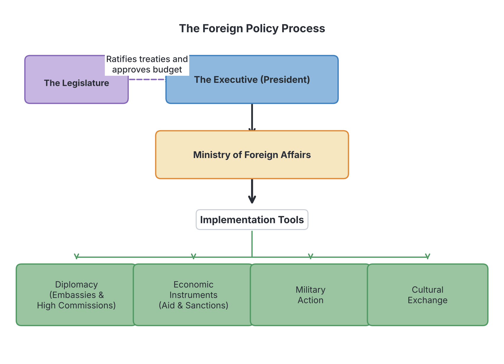

# JAMB Government Notes: Foreign Policy

## What JAMB expects

This topic is Section C, Topic 1 of the JAMB Government syllabus: Foreign Policy.

This file covers the following content items:
- Definition, purpose, determining factors; formulation and implementation.

By the end of these notes, you should be able to:
1. Define foreign policy, identify and explain its determinants.

*(Note: Specific details of Nigeria's foreign policy over the years are covered in the next file, `C2-nigerias-foreign-policy.md`. These notes explain the general principles of foreign policy that apply to all countries.)*

## Definition of foreign policy

**Foreign policy** can be defined as the set of goals, principles, and strategies that guide a country's interactions with other countries and international organisations. 

Just as a country has a **domestic policy** to govern what happens inside its borders (such as education, health, and roads), it must have a foreign policy to manage its relationships outside its borders. We live in an interconnected world where no country can exist entirely on its own; countries must trade, share borders, and solve global problems together. Foreign policy is the plan a government uses to navigate this international system.

At the heart of every foreign policy is the **national interest**. The national interest represents the core goals a nation seeks to protect and achieve, such as its survival, security, economic wealth, and global respect. A country will only adopt a foreign policy if its leaders believe it will serve the national interest.

## Purpose of foreign policy

Why do countries bother to formulate foreign policies? The main purposes include:

1. **Protection of national security and territorial integrity:** A country's survival is its most important goal. Foreign policy aims to protect the nation's borders from external attack, prevent wars, and build peaceful alliances with neighbours.
2. **Promotion of economic interests:** Countries use foreign policy to find international markets for their goods, secure access to raw materials they lack, and attract foreign direct investment (FDI) to grow their economy.
3. **Protection of citizens abroad:** A state has a duty to protect its citizens living, studying, or travelling in other countries. Foreign policy ensures that embassies are set up to offer them help (consular services) and defend their rights.
4. **Enhancement of national prestige:** Countries want to be respected globally. A strong foreign policy can build a country's image, making it a leader in its region or the world.
5. **Promotion of global peace and cooperation:** Many countries aim to contribute to international stability by fighting terrorism, tackling climate change, and participating in United Nations peacekeeping missions.

## Determining factors of foreign policy

A country does not just wake up and choose a foreign policy at random. Several factors force a government to behave in a certain way internationally. These are called **determinants**, and they are divided into **internal (domestic)** and **external** factors.

### Internal (domestic) determinants

These are factors inside the country that shape its behaviour abroad.

1. **Geographical location and size:** A country's physical position on the map is a permanent determinant. A landlocked country (like Chad or Niger) must maintain friendly relations with coastal neighbours to access seaports. A country's size and terrain also matter. For example, Nigeria is surrounded by Francophone (French-speaking) countries—Benin, Niger, Chad, and Cameroon. This geographical reality forces Nigeria to prioritise good neighbourliness to keep its borders secure.
2. **Economic resources and strength:** A wealthy nation with abundant resources has more influence internationally than a poor one. In the 1970s, the oil boom gave Nigeria massive financial power, allowing it to fund liberation movements in Southern Africa. Conversely, a country that relies heavily on foreign aid cannot easily oppose the countries feeding it.
3. **Population (Demographics):** A large, educated, and skilled population can boost a country's economic and military strength. Nigeria's position as the most populous black nation gives it a natural leadership role in Africa. However, if a huge population is poor and unemployed, it becomes a domestic weakness that distracts from foreign ambitions.
4. **Military strength:** A strong, well-equipped military allows a country to project power and defend its interests. For instance, Nigeria’s military size and experience allowed it to lead the ECOMOG peacekeeping forces in Liberia and Sierra Leone.
5. **Nature of government and leadership:** The type of government (democracy, military rule, or monarchy) affects how the world reacts to a country. When Nigeria was under military rule in the 1990s, it faced international isolation and sanctions. When it returned to democracy in 1999, it was welcomed back into the global community. Additionally, the personality of the leader matters; a bold leader will pursue an assertive foreign policy, while a cautious leader will be more reserved.
6. **Public opinion and pressure groups:** In a democracy, the government must listen to its citizens. Trade unions, students, religious groups, and the press can force the government to change a policy. A famous Nigerian example occurred in 1962, when massive protests by university students forced the Nigerian government to cancel the Anglo-Nigerian Defence Pact with Britain.
7. **Historical background:** A country's past shapes its present relationships. Nigeria’s history as a British colony naturally led to close economic and cultural ties with Britain and membership in the Commonwealth after independence.

### External determinants

These are factors outside the country, in the international environment, that influence its policy.

1. **The International System (Balance of Power):** The way global power is distributed affects all countries. During the Cold War, the world was divided into two rival blocs (the USA and the Soviet Union). This forced newly independent African and Asian countries to adopt a policy of **Non-Alignment** to avoid being dragged into the superpowers' conflicts.
2. **International organisations:** Membership in bodies like the United Nations (UN), the African Union (AU), the Economic Community of West African States (ECOWAS), and the Organization of the Petroleum Exporting Countries (OPEC) requires countries to align their policies with the rules and goals of these groups.
3. **International law and treaties:** Countries must respect international laws, conventions, and agreements they have signed. Breaking these laws can lead to global sanctions or isolation.
4. **Actions and policies of other states:** A country must react to what others do. If a neighbouring state suddenly becomes hostile or builds up its military, the country must adjust its own foreign policy and defense strategy in response.

[IMAGE: A split diagram titled "Determinants of Foreign Policy". The left side (Internal Factors) shows icons for Geography (a map), Economic Resources (an oil drop and coins), Military (a shield), and Population (a group of people). The right side (External Factors) shows icons for International Organizations (a globe surrounded by flags), International Law (a judge's gavel), and the Global Power Structure (balancing scales). Clean flat textbook style, white background.]

## Formulation of foreign policy

**Formulation** is the process of deciding what the foreign policy should be and planning how to achieve it. It is an internal process involving several actors:

1. **The Executive:** The President or Head of State is the chief architect of foreign policy. The executive branch sets the overall direction based on the ruling party’s manifesto and the national interest. 
2. **The Ministry of Foreign Affairs:** This government ministry is the engine room of foreign policy. It is staffed by experts and diplomats who research issues, advise the President, and draft the actual policy documents. The Minister of Foreign Affairs acts as the President's chief representative on international matters.
3. **The Legislature (National Assembly/Parliament):** The legislature acts as a check on the executive. While the President negotiates and signs international treaties, the legislature must **ratify** (approve) them before they become part of national law. The legislature also controls the budget (denying funds can stop a policy) and approves the appointment of ambassadors.
4. **Advisory bodies and Think-Tanks:** Experts provide research to guide the government. In Nigeria, bodies like the **Nigerian Institute of International Affairs (NIIA)** study global trends and advise the government on the best actions to take. Intelligence agencies (like the National Intelligence Agency, NIA) also provide secret information to guide decisions.

## Implementation of foreign policy

**Implementation** is the actual execution of the policy. Once formulated, the policy must be put into action on the global stage. 

1. **Diplomacy:** This is the primary and most peaceful tool. Diplomacy involves negotiations, dialogue, state visits, and attending international conferences to persuade other countries to support your interests.
2. **Diplomatic missions (Embassies and High Commissions):** Countries establish permanent offices in other countries to carry out day-to-day relations. 
   - **Embassies** are established in non-Commonwealth countries and are headed by an **Ambassador**.
   - **High Commissions** are established in Commonwealth countries (former British colonies) and are headed by a **High Commissioner**.
   - **Consulates** are smaller branch offices in specific cities that deal mostly with trade and citizens' welfare, headed by a Consul-General.
3. **Economic instruments:** A country can use its economic wealth to reward friends or punish enemies. Tools include **foreign aid** (giving money or food to poorer nations), **trade agreements**, and **economic sanctions or embargoes** (refusing to trade with a country to force it to change its behaviour, as the world did to apartheid South Africa).
4. **Military instruments:** When diplomacy fails, a country might use force. This can range from the threat of force, supplying weapons to allies, joining peacekeeping missions, to actual warfare. Military action is usually seen as the last resort of foreign policy.
5. **Cultural and information instruments:** Countries use propaganda, international broadcasting (like Voice of Nigeria, or the BBC), sports, arts, and educational scholarships to build a positive image abroad.

## Key terms

| Term | Meaning |
| --- | --- |
| **Foreign policy** | The strategies and principles that guide a state's interactions with other nations and international bodies. |
| **National interest** | The core goals (security, wealth, survival) that a country seeks to protect and achieve in international relations. |
| **Determinants** | The internal and external factors that influence and shape a country's foreign policy. |
| **Formulation** | The process of deciding and planning a foreign policy, led mainly by the Executive and the Legislature. |
| **Implementation** | The execution or carrying out of a foreign policy on the world stage, done mainly by diplomats and the Ministry of Foreign Affairs. |
| **Diplomacy** | The peaceful management of international relations through negotiation and dialogue. |
| **Ambassador** | The highest-ranking diplomat representing their country in a non-Commonwealth country. |
| **High Commissioner** | The highest-ranking diplomat representing their country in a Commonwealth country. |
| **Ratification** | The formal approval of an international treaty by a country's legislature, making it binding. |

## Exam tips and common mistakes

*   **Formulation vs Implementation:** A very common mistake in JAMB is confusing who makes the policy with who carries it out. Remember: The **Executive** (President) formulates it; the **Legislature** ratifies/approves it; the **Ministry of Foreign Affairs/Diplomats** implement it day-to-day.
*   **Embassy vs High Commission:** This is frequently tested. Nigeria has a *High Commission* in the UK and Ghana (because they are Commonwealth members), but an *Embassy* in the USA and France (because they are not). 
*   **National Interest:** If a question asks for the primary reason or main driver behind a country's foreign policy, the answer is always **national interest**.
*   **Internal vs External Determinants:** Be able to classify them. Natural resources, military size, and public opinion are *internal*. The United Nations, global power dynamics, and international law are *external*.

## Quick summary

1. Foreign policy is the strategy a country uses to guide its interactions with the rest of the world.
2. The ultimate goal of any foreign policy is to protect and promote the country's national interest, including its security and economy.
3. Foreign policy is shaped by internal determinants (such as geography, economic resources, population, and military strength) and external determinants (such as international organisations and global power structures).
4. The formulation (making) of foreign policy is driven by the Executive (President), with support from the Ministry of Foreign Affairs, think-tanks, and the Legislature.
5. The Legislature plays a vital role by ratifying treaties, approving budgets, and vetting diplomatic appointments.
6. The implementation (carrying out) of foreign policy is done through diplomacy, economic tools, military action, and cultural exchanges.
7. Diplomatic missions are called Embassies in non-Commonwealth countries and High Commissions in Commonwealth countries.

## Practice questions

**1. The primary objective of any country's foreign policy is to**
- A. promote the ruling political party globally
- B. protect and promote its national interest
- C. ensure that all countries have democratic governments
- D. increase the size of its armed forces

**Answer: B.** The core driver of any country's actions on the international stage is the protection and promotion of its own national interest (security, economic prosperity, survival).

**2. Which organ of government is principally responsible for formulating a country's foreign policy?**
- A. The Judiciary
- B. The Executive
- C. The Civil Service Commission
- D. The Police Force

**Answer: B.** The Executive, led by the President or Head of State, takes the lead in formulating foreign policy, often setting the direction based on the government's agenda.

**3. Which of the following is considered an external determinant of a country's foreign policy?**
- A. The size of its population
- B. Its geographical location
- C. The structure of the international system
- D. Its natural resources

**Answer: C.** The international system (such as global power balances and international laws) exists outside the country, making it an external determinant. The others are domestic (internal) factors.

**4. The diplomatic representative of a Commonwealth country stationed in another Commonwealth country is officially called a**
- A. Consul-General
- B. Ambassador
- C. Diplomatic Attaché
- D. High Commissioner

**Answer: D.** In the Commonwealth, member states exchange High Commissioners, whereas they send Ambassadors to non-Commonwealth countries. 

**5. What role does the Legislature play in the foreign policy process?**
- A. It ratifies international treaties and approves budgets
- B. It manages day-to-day diplomatic relations
- C. It issues visas to foreign visitors
- D. It commands the armed forces during peacekeeping

**Answer: A.** The Legislature acts as a check on the Executive by ratifying treaties to make them law, approving funds, and screening ambassadorial nominees. Day-to-day relations are managed by the Ministry of Foreign Affairs.

**6. When a country uses economic sanctions or trade embargoes against another state, it is engaging in the**
- A. formulation of international law
- B. implementation of foreign policy
- C. violation of territorial integrity
- D. creation of an international organisation

**Answer: B.** Economic sanctions are an instrument used to implement foreign policy, usually to force another country to change an unacceptable behaviour.

**7. How does a country's geographical location act as a determinant of its foreign policy?**
- A. It dictates what language the diplomats must speak at the UN
- B. It determines which neighbours it must maintain peaceful relations with for border security
- C. It forces the country to become a member of OPEC
- D. It decides the type of constitution the country will use

**Answer: B.** Geography is a permanent reality. A country must tailor its foreign policy to manage relations with the specific countries it shares borders with to ensure security and trade.

**8. Which of the following best describes the role of the Ministry of Foreign Affairs?**
- A. It passes laws regarding international trade
- B. It implements day-to-day foreign policy and coordinates diplomatic missions
- C. It arrests citizens who violate international treaties
- D. It funds political parties in neighbouring countries

**Answer: B.** The Ministry of Foreign Affairs is the administrative body responsible for executing foreign policy, managing diplomats, and running embassies worldwide.

**9. The abrogation of the Anglo-Nigerian Defence Pact in 1962 is an example of how foreign policy can be influenced by**
- A. the United Nations
- B. military weakness
- C. public opinion and pressure groups
- D. international law

**Answer: C.** Massive protests by Nigerian university students and pressure groups forced the government to cancel the pact, proving that domestic public opinion is a powerful determinant of foreign policy.

**10. The Nigerian Institute of International Affairs (NIIA) contributes to the country's foreign policy primarily by**
- A. deploying troops for peacekeeping operations
- B. signing treaties on behalf of the President
- C. appointing High Commissioners
- D. conducting research and providing advisory services

**Answer: D.** The NIIA is a think-tank that researches global affairs and advises the government, helping to shape the formulation of foreign policy.

<!-- COVERAGE
obj i | Definition of foreign policy
obj i | Determining factors of foreign policy
Definition | Definition of foreign policy
purpose | Purpose of foreign policy
determining factors | Determining factors of foreign policy
formulation | Formulation of foreign policy
implementation | Implementation of foreign policy
-->
