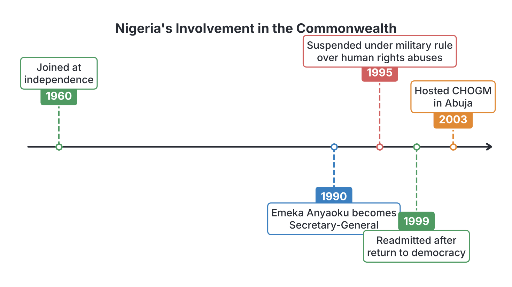
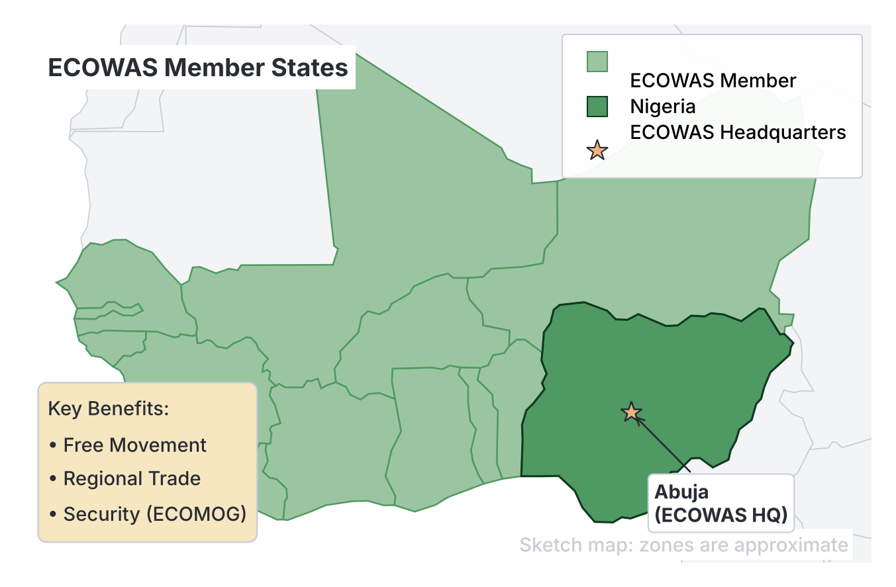

# JAMB Government Notes: Nigeria in International Organizations

## What JAMB expects

This topic is Section C, Topic 4 of the JAMB Government syllabus: Nigeria in International Organizations. It covers Nigeria's relationship with six major global and regional bodies:

*   **a. The United Nations;**
*   **b. The Commonwealth;**
*   **c. The Organization of African Unity;**
*   **d. The African Union;**
*   **e. The Economic Community of West African States (ECOWAS);**
*   **f. The Organization of Petroleum Exporting Countries (OPEC).**

By the end of these notes, you should be able to:

1.  **Analyse the dynamics of Nigeria’s involvement in international organizations;**
2.  **Assess their contribution to the development of Nigeria.**

**Note on the syllabus structure:** This file focuses strictly on *Nigeria’s* specific role, its changing involvement over time, and what the country has gained from these bodies. The general history, structure, achievements, and problems of the organizations themselves are covered in `D1-international-organizations.md`. 

## Analysing the dynamics of Nigeria's involvement

**Objective i: analyse the dynamics of Nigeria’s involvement in international organizations.**

In international relations, "dynamics" refers to how active a country is and what forces drive its behaviour over time. Nigeria’s involvement in international organizations is highly active and is shaped by several dynamic factors:

1.  **Afrocentric foreign policy:** Africa is the "centrepiece" of Nigeria's foreign policy. Because of this, Nigeria acts as a "Big Brother" in African organizations (like the AU and ECOWAS), often providing the heaviest funding and taking the lead in resolving conflicts.
2.  **Economic interests:** Nigeria’s economy relies heavily on crude oil exports. Therefore, its involvement in OPEC is driven by the need to protect its revenue. In ECOWAS, its goal is to expand the market for Nigerian businesses.
3.  **Domestic politics:** Nigeria's domestic political situation heavily affects its international standing. During periods of military dictatorship (especially under General Sani Abacha in the 1990s), Nigeria became isolated and was even suspended from the Commonwealth. When Nigeria returned to democracy in 1999, it became highly active and respected again on the global stage.
4.  **Non-alignment and peacekeeping:** Since independence, Nigeria has maintained a non-aligned posture (not permanently tying itself to Western or Eastern powers). Instead, it focuses on global peace, becoming one of the world's largest contributors of troops to United Nations peacekeeping missions.

## Assessing contributions to Nigeria's development

**Objective ii: assess their contribution to the development of Nigeria.**

Nigeria does not just give money and troops to international bodies; it also receives massive benefits that aid its national development:

*   **Economic stability:** Organizations like OPEC help keep the price of Nigeria's main export (oil) stable, ensuring the government has revenue to build infrastructure. 
*   **Security and territorial integrity:** By fighting rebels in neighbouring countries through ECOWAS (ECOMOG), Nigeria prevents wars from spilling over its own borders. Historically, the OAU also helped keep Nigeria united during its Civil War.
*   **Health and social welfare:** UN agencies provide direct intervention in Nigeria, funding mass vaccinations, fighting diseases like malaria and polio, and providing food to internally displaced persons (IDPs).
*   **Trade and movement:** Treaties like the ECOWAS free movement protocol and the AU's free trade area allow Nigerians to travel, live, and sell their goods across borders without extreme restrictions.

---

## The United Nations (UN)

**Content a: The United Nations.**

The United Nations is the world's largest intergovernmental organization, created in 1945 to promote peace and cooperation. Nigeria joined the UN on **October 7, 1960**, just days after gaining independence.

### Nigeria's involvement
*   **Peacekeeping:** Nigeria is a globally recognized peacekeeping power. Just days after joining the UN in 1960, Nigeria sent troops to the Congo (ONUC). Since then, Nigerian troops and police have served in UN missions in Lebanon, Darfur (Sudan), Rwanda, and Yugoslavia.
*   **Leadership roles:** Nigeria has frequently been elected to hold a non-permanent seat on the UN Security Council. Nigerians have also attained top administrative positions; for example, Prof. Ibrahim Gambari served as a senior UN diplomat, and Amina J. Mohammed attained the rank of UN Deputy Secretary-General.
*   **Anti-apartheid struggle:** For decades, Nigeria chaired the UN Special Committee against Apartheid, using the UN as a microphone to campaign against white minority rule in South Africa.

### Benefits to Nigeria's development
*   **Public health:** The World Health Organization (WHO) and UNICEF have spent millions of dollars in Nigeria. Their massive vaccination campaigns helped Nigeria finally eradicate the wild poliovirus (officially declared polio-free in **2020**).
*   **Humanitarian aid:** The UN High Commissioner for Refugees (UNHCR) and the World Food Programme (WFP) provide vital food, shelter, and medical care to millions of Nigerians displaced by the Boko Haram insurgency in the North-East.
*   **Socio-economic development:** The United Nations Development Programme (UNDP) and UNESCO provide funding and technical expertise for poverty alleviation, democratic elections, and educational reforms in Nigeria.

## The Commonwealth

**Content b: The Commonwealth.**

The Commonwealth is a voluntary association primarily made up of former British colonies. Nigeria joined upon independence on **October 1, 1960**. 

### Nigeria's involvement
Nigeria’s relationship with the Commonwealth has seen dramatic highs and lows:
*   **Leadership:** A Nigerian diplomat, **Chief Emeka Anyaoku**, served as the Secretary-General of the Commonwealth from 1990 to 2000, bringing great pride to the country.
*   **The 1995 Suspension:** The dynamics changed sharply in 1995. The military government of General Sani Abacha executed nine environmental activists from the Niger Delta (the "Ogoni Nine", including the writer Ken Saro-Wiwa). In response to this human rights violation, the Commonwealth suspended Nigeria.
*   **Readmission:** After Abacha's death and the return to democratic civilian rule under Olusegun Obasanjo, Nigeria was readmitted in May 1999.
*   **Hosting:** To cement its return to the global stage, Nigeria hosted the Commonwealth Heads of Government Meeting (CHOGM) in Abuja in 2003.

### Benefits to Nigeria's development
*   **Education and training:** Thousands of Nigerians have benefited from the **Commonwealth Scholarship and Fellowship Plan**, gaining advanced degrees in the UK, Canada, and other member states.
*   **Technical assistance:** The Commonwealth Fund for Technical Co-operation (CFTC) sends experts to Nigeria to help build capacity in agriculture, justice, and public administration.
*   **Democratic pressure:** The Commonwealth's strict rules on democracy helped pressure the Nigerian military to hand over power to civilians, contributing to the political stability Nigeria enjoys today.

## The Organization of African Unity (OAU)

**Content c: The Organization of African Unity.**

The OAU was formed on **May 25, 1963**, to promote unity among African states and eradicate colonialism. Nigeria was a founding member.

### Nigeria's involvement
*   **Founding influence:** Nigeria's Prime Minister, Sir Abubakar Tafawa Balewa, was a leading voice in the "Monrovia Group". This group argued for a gradual, cooperative approach to African unity, which ultimately formed the basis of the OAU Charter (defeating the "Casablanca Group" which wanted an immediate United States of Africa).
*   **Liberation funding:** Nigeria was a massive financial contributor to the OAU Liberation Committee. Despite being geographically far from Southern Africa, Nigeria was officially recognized as a "Frontline State" because it provided passports, funding, and training to freedom fighters battling apartheid in South Africa and colonial rule in Angola and Zimbabwe.

### Benefits to Nigeria's development
*   **Survival of the nation:** During the Nigerian Civil War (1967–1970), the OAU supported the Federal Military Government. The organization refused to recognize the secessionist state of Biafra, stating that Nigeria's borders must remain intact. This diplomatic backing was crucial for keeping Nigeria united.
*   **Regional prestige:** Nigeria's heavy financial and political involvement in the OAU earned it the title of the "Giant of Africa", making it a respected voice in global affairs.

## The African Union (AU)

**Content d: The African Union.**

By the late 1990s, the OAU had achieved its goal of ending colonialism, but Africa faced new problems like poverty, coups, and civil wars. The OAU was disbanded and replaced by the African Union (AU) in **2002**.

### Nigeria's involvement
*   **Architect of change:** Nigerian President Olusegun Obasanjo (along with leaders from South Africa and Algeria) was a driving force behind the creation of the AU.
*   **NEPAD and APRM:** Nigeria spearheaded the creation of the New Partnership for Africa's Development (NEPAD) to attract foreign investment. Nigeria also voluntarily submitted itself to the African Peer Review Mechanism (APRM), allowing other African nations to evaluate its democratic governance.
*   **Financial and military anchor:** Nigeria remains one of the top five financial contributors to the AU and provides troops for AU peacekeeping missions, such as those in Sudan (AMIS).

### Benefits to Nigeria's development
*   **Economic integration:** The AU launched the **African Continental Free Trade Area (AfCFTA)**. For Nigeria, this means access to a market of over 1.3 billion people across the continent, allowing Nigerian banks, manufacturers, and tech companies to expand massively.
*   **Security cooperation:** The AU provides political and strategic backing for the Multinational Joint Task Force (MNJTF), which allows Nigeria, Chad, Niger, and Cameroon to legally cross each other's borders to fight Boko Haram terrorists.

### Comparison: OAU vs AU (Nigeria's perspective)

| Feature | OAU (Organization of African Unity) | AU (African Union) |
| --- | --- | --- |
| **Era** | 1963 to 2002 | 2002 to present |
| **Primary focus** | Decolonization, fighting apartheid, defending state sovereignty | Economic integration, democratic governance, intervening in crises |
| **Nigeria's major contribution** | Funding liberation movements; leading the anti-apartheid struggle | Spearheading NEPAD; funding the AU budget; promoting AfCFTA |
| **Stance on internal affairs** | Principle of **non-interference** (could not intervene if a dictator abused citizens) | Principle of **non-indifference** (can intervene to stop war crimes or military coups) |

## The Economic Community of West African States (ECOWAS)

**Content e: The Economic Community of West African States (ECOWAS).**

ECOWAS is a regional bloc formed on **May 28, 1975**, through the Treaty of Lagos, designed to integrate the economies of West African countries. 

### Nigeria's involvement
*   **The Founding Father:** The creation of ECOWAS was personally championed by Nigeria’s Head of State, General Yakubu Gowon, alongside Togo’s President, Gnassingbé Eyadéma.
*   **Headquarters:** To reflect Nigeria's dominance, the ECOWAS Commission, Parliament, and Court of Justice are all located in Abuja, Nigeria. 
*   **ECOMOG (Peacekeeping):** In the 1990s, when brutal civil wars broke out in Liberia and Sierra Leone, ECOWAS formed a military arm called the **ECOWAS Monitoring Group (ECOMOG)**. Nigeria provided the vast majority of the soldiers, the commanders, and the funding to stop the wars. 

### Benefits to Nigeria's development
*   **Free movement:** The ECOWAS Protocol on Free Movement of Persons, Residence, and Establishment is highly beneficial to Nigerians. It allows Nigerian traders and professionals to travel, live, and work in 14 other West African countries without requiring a visa.
*   **Business expansion:** West Africa serves as a natural extension for Nigerian businesses. Nigerian banks (like UBA and Access Bank), cement companies (like Dangote), and airlines rely heavily on the ECOWAS market for profit.
*   **Border security:** By intervening in Liberia, Sierra Leone, and Mali, Nigeria has prevented West Africa from collapsing into total chaos, which would have flooded Nigeria with refugees and illegal weapons.

## The Organization of Petroleum Exporting Countries (OPEC)

**Content f: The Organization of Petroleum Exporting Countries (OPEC).**

OPEC is an intergovernmental cartel of oil-producing nations that coordinates policies to manage the global supply and price of crude oil. The organization was founded in 1960, but Nigeria joined in **1971**.

### Nigeria's involvement
*   **Quota compliance:** OPEC assigns a "production quota" to each member (a limit on how many barrels of oil they can pump per day). Nigeria actively participates in OPEC meetings and adjusts its daily oil production to meet these quotas, helping to prevent the global market from being flooded with cheap oil.
*   **Leadership:** Nigerians have been highly trusted within the organization. Dr Rilwanu Lukman served as OPEC Secretary-General and President for many years. More recently, Mohammed Barkindo served as the Secretary-General, steering the organization through difficult global economic crises.

### Benefits to Nigeria's development
*   **Revenue stability:** Crude oil accounts for the vast majority of Nigeria's foreign exchange earnings and government revenue. By keeping global oil prices stable and profitable, OPEC ensures that the Nigerian government has the money required to pay civil servants, build roads, and fund education.
*   **Technical expertise:** Through OPEC, Nigeria gains access to high-level data, research, and technical cooperation regarding the global energy market, helping the Ministry of Petroleum Resources make better economic plans.

---

## Key terms

| Term | Meaning |
| --- | --- |
| **Afrocentric** | A foreign policy approach that places Africa's interests as the primary focus of a country's international relations. |
| **Non-alignment** | A policy where a country refuses to formally ally with either the Western bloc (USA) or the Eastern bloc (Soviet Union), focusing instead on global peace. |
| **Peacekeeping** | The deployment of international troops (usually by the UN or ECOWAS) to help maintain peace in a country recovering from war. |
| **ECOMOG** | The ECOWAS Monitoring Group; a West African military peacekeeping force heavily funded and manned by Nigeria. |
| **Production quota** | A strict limit set by OPEC on how much crude oil a member country is allowed to produce daily, in order to control global prices. |
| **NEPAD** | New Partnership for Africa's Development; an economic development program spearheaded by Nigeria and others to attract investment to Africa. |
| **AfCFTA** | African Continental Free Trade Area; an AU agreement creating a single, borderless market for goods and services across Africa. |
| **Frontline State** | A title given to countries that actively supported the liberation struggles against apartheid and colonialism in Southern Africa. |

## Exam tips and common mistakes

*   **Common mistake:** Confusing the founding dates. Remember: UN (1945, Nigeria joined 1960), Commonwealth (Nigeria joined 1960), OAU (1963), OPEC (founded 1960, Nigeria joined **1971**), ECOWAS (1975).
*   **Common mistake:** Confusing ECOMOG with ECOWAS. ECOWAS is the economic parent body; ECOMOG is the military peacekeeping arm created by ECOWAS. 
*   **Exam tip:** If asked why Nigeria was suspended from the Commonwealth in 1995, look for options mentioning "human rights violations" or the "execution of the Ogoni Nine / Ken Saro-Wiwa".
*   **Exam tip:** Know the difference between the OAU and the AU. The OAU focused on political liberation (ending colonialism/apartheid) and non-interference. The AU focuses on economic integration, democracy, and allows for intervention in member states.
*   **Exam tip:** Remember that OPEC does not control Nigeria's oil fields; it only sets *production quotas* to stabilize the global price of oil. 

## Quick summary

1.  Nigeria's involvement in international organizations is driven by its Afrocentric foreign policy, economic interests, and a desire to promote global peace through non-alignment and peacekeeping.
2.  The United Nations provides massive developmental aid to Nigeria, including health interventions by WHO and UNICEF (which helped eradicate polio), while Nigeria supplies the UN with peacekeeping troops.
3.  Nigeria joined the Commonwealth at independence, was suspended in 1995 over human rights abuses under military rule, and readmitted in 1999, benefiting from educational scholarships and technical aid.
4.  Nigeria was a founding member of the OAU (1963) and heavily funded anti-apartheid movements. In return, the OAU supported Nigeria's territorial integrity during its Civil War.
5.  The AU (2002) replaced the OAU. Nigeria spearheaded AU initiatives like NEPAD and benefits from the AfCFTA, which opens up continental trade.
6.  Nigeria and Togo championed the creation of ECOWAS (1975). Nigeria houses its headquarters and led its peacekeeping force (ECOMOG). Nigerians benefit massively from the ECOWAS visa-free travel protocol.
7.  Nigeria joined OPEC in 1971 to help stabilize global crude oil prices, which is vital because oil revenue funds Nigeria's national development.

## Practice questions

**1. Which of the following best describes the primary focus of Nigeria's foreign policy since independence?**
- A. Eurocentric integration
- B. Afrocentricity
- C. Complete isolationism 
- D. Alignment with the Eastern bloc

**Answer: B.** Afrocentricity. Africa has always been the "centrepiece" of Nigeria's foreign policy, driving its active participation in the OAU, AU, and ECOWAS.

**2. Nigeria was suspended from the Commonwealth of Nations in 1995 primarily due to:**
- A. its failure to pay annual membership dues.
- B. a military dispute with a neighbouring country.
- C. human rights violations and the execution of environmental activists.
- D. its decision to join OPEC.

**Answer: C.** The military government of General Sani Abacha executed the "Ogoni Nine" (including Ken Saro-Wiwa), prompting the Commonwealth to suspend Nigeria for severe human rights abuses.

**3. In which year did Nigeria become a member of the Organization of Petroleum Exporting Countries (OPEC)?**
- A. 1960
- B. 1963
- C. 1971
- D. 1975

**Answer: C.** OPEC was founded in 1960, but Nigeria joined the organization 11 years later, in 1971.

**4. The military intervention force established by West African states to restore peace in Liberia and Sierra Leone is known as:**
- A. ECOMOG
- B. NEPAD
- C. MNJTF
- D. INTERPOL

**Answer: A.** ECOMOG (ECOWAS Monitoring Group) is the military arm of ECOWAS, which Nigeria heavily funded and manned to end the civil wars in Liberia and Sierra Leone.

**5. Which two countries spearheaded the formation of the Economic Community of West African States (ECOWAS) in 1975?**
- A. Nigeria and Ghana
- B. Nigeria and Togo
- C. Senegal and Ivory Coast
- D. Ghana and Togo

**Answer: B.** General Yakubu Gowon of Nigeria and President Gnassingbé Eyadéma of Togo were the principal founding fathers of ECOWAS.

**6. A major economic benefit Nigeria derives from its membership in OPEC is the:**
- A. provision of free military equipment.
- B. stabilization of global crude oil prices.
- C. eradication of absolute poverty in rural areas.
- D. free movement of its citizens to the Middle East.

**Answer: B.** OPEC regulates global oil production through quotas to prevent price crashes, ensuring Nigeria earns stable revenue from its oil exports.

**7. Which United Nations agencies played the most crucial role in helping Nigeria eradicate the wild poliovirus by 2020?**
- A. UNESCO and UNHCR
- B. WHO and UNICEF
- C. IMF and the World Bank
- D. UNDP and WFP

**Answer: B.** The World Health Organization (WHO) and the United Nations Children's Fund (UNICEF) coordinate global health and child welfare programs, including mass vaccination campaigns.

**8. During the Nigerian Civil War (1967–1970), the Organization of African Unity (OAU) contributed to Nigeria's development by:**
- A. sending a joint African army to fight the rebels.
- B. suspending Nigeria from the organization until the war ended.
- C. refusing to recognize the secessionist state of Biafra.
- D. funding the creation of new states in Nigeria.

**Answer: C.** The OAU stood by the principle of territorial integrity, diplomatically supporting the Federal Government and refusing to recognize Biafra, which helped keep Nigeria united.

**9. The transition from the OAU to the African Union (AU) in 2002 marked a shift in focus from decolonization towards:**
- A. economic integration and democratic governance.
- B. the creation of a single African religion.
- C. supporting military dictatorships.
- D. moving the headquarters of the union to Abuja.

**Answer: A.** Having achieved political liberation, the AU was created to tackle economic development (like the AfCFTA) and promote good governance (intervening against coups and abuses).

**10. A Nigerian who brought international prestige to the country by serving as the Secretary-General of the Commonwealth is:**
- A. Prof. Ibrahim Gambari
- B. Dr Rilwanu Lukman
- C. Chief Emeka Anyaoku
- D. Amina J. Mohammed

**Answer: C.** Chief Emeka Anyaoku served as the Secretary-General of the Commonwealth from 1990 to 2000. Rilwanu Lukman served in OPEC, while Gambari and Mohammed held high positions in the UN.

<!-- COVERAGE
obj i | Analysing the dynamics of Nigeria's involvement
obj ii | Assessing contributions to Nigeria's development
item a | The United Nations (UN)
item b | The Commonwealth
item c | The Organization of African Unity (OAU)
item d | The African Union (AU)
item e | The Economic Community of West African States (ECOWAS)
item f | The Organization of Petroleum Exporting Countries (OPEC)
-->
