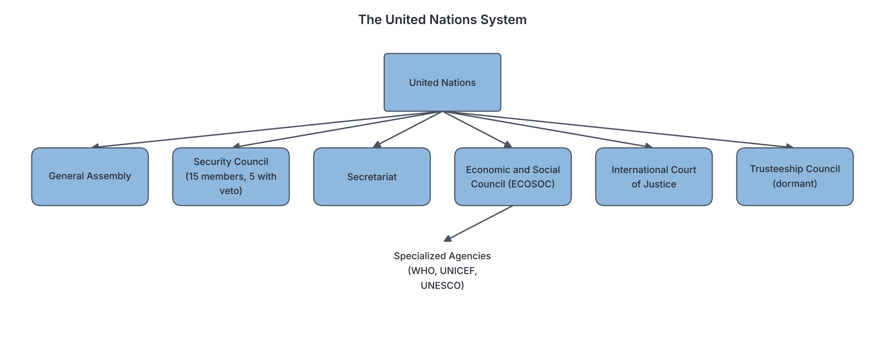

# JAMB Government Notes: International Organizations

## What JAMB expects

This topic is Part 4, Topic 1 of the JAMB Government syllabus: International Organizations. It covers the origin, objectives, structure, functions, achievements, problems, and prospects of major international bodies.

*Note: This file focuses on the organizations themselves. For details on Nigeria's specific involvement and foreign policy regarding these bodies, see `C4-nigeria-in-international-organizations.md`.*

This file covers the following content items:
- a. ECOWAS (Economic Community of West African States)
- b. OAU (Organization of African Unity), AU (African Union)
- c. Commonwealth
- d. OPEC (Organization of the Petroleum Exporting Countries)
- e. UNO (United Nations Organization)
- f. African Petroleum Producers Association (APPA)

By the end of these notes, you should be able to:
1. evaluate the operations of these international organizations;
2. assess the role of these organizations in world affairs;
3. appreciate the challenges of these organizations and how they can be overcome.

## Evaluating the Operations of International Organizations

**Objective i: evaluate the operations of these international organizations.**

An **international organization** is a body made up of member states (countries) that come together to achieve common goals, such as peace, economic growth, or technical cooperation. 

To evaluate how these organizations operate, we look at their methods of working:
- **Treaties and Charters:** They are established by a founding document (a treaty, charter, or constitution) which outlines their rules. Member states must sign and ratify these treaties.
- **Funding:** Operations are funded by annual contributions (dues) from member states. A major operational problem is that many countries fail to pay their dues on time.
- **Decision-Making:** They usually operate through a supreme organ (like an Assembly of Heads of State) that makes broad policies, and a Secretariat or Commission that handles daily administrative work. Decisions are often made by majority vote or consensus, but powerful nations sometimes hold veto powers (e.g., in the UN).
- **Sovereignty vs. Supranationalism:** Most organizations respect the **sovereignty** of member states, meaning they cannot force a country to do something against its will. This makes their operations rely on diplomacy and voluntary cooperation rather than force.

## Assessing the Role of these Organizations in World Affairs

**Objective ii: assess the role of these organizations in world affairs.**

International organizations play several vital roles in shaping global events:
1. **Maintaining Peace and Security:** Bodies like the UN and AU deploy peacekeeping forces (like ECOMOG or AMISOM) to conflict zones to separate fighting factions and protect civilians.
2. **Economic Integration:** Organizations like ECOWAS and the AU create free trade zones, aiming to remove tariffs and border restrictions to boost the wealth of their regions.
3. **Protecting Human Rights:** They set global standards for human rights, condemn abuses, and sometimes place economic sanctions on dictatorships or racist regimes (as the Commonwealth and OAU did against apartheid South Africa).
4. **Social and Humanitarian Aid:** Through specialized agencies (like the World Health Organization or UNICEF), they eradicate diseases, provide disaster relief, and support education.
5. **Regulating Global Markets:** Organizations like OPEC coordinate the production of vital resources to ensure stable prices in the global market.

## Economic Community of West African States (ECOWAS)

**Content a: ECOWAS.**

### Origin
ECOWAS was established on **May 28, 1975**, when 15 West African countries signed the **Treaty of Lagos**. The formation was heavily spearheaded by General Yakubu Gowon of Nigeria and President Gnassingbé Eyadéma of Togo. Currently, there are 15 member states (though political events occasionally lead to suspensions or threats of withdrawal by some military-led nations).

### Objectives
- To promote economic cooperation and integration in West Africa.
- To eliminate customs duties and tariffs among member states.
- To establish a common market and a single currency (proposed as the *Eco*).
- To ensure the free movement of persons, goods, and services across borders.
- To promote regional peace and security.

### Structure
1. **The Authority of Heads of State and Government:** The supreme decision-making body, consisting of the presidents/rulers of member states. They meet at least once a year.
2. **The Council of Ministers:** Made up of ministers (usually foreign affairs or regional integration ministers) from member states. They prepare the agenda for the Authority and oversee subordinate institutions.
3. **The ECOWAS Commission:** Formerly called the Secretariat. Based in Abuja, Nigeria, it handles the day-to-day administration and implements decisions. It is headed by a President of the Commission.
4. **The Community Parliament:** Provides a democratic forum for representatives from member states, though its powers are mostly advisory.
5. **The Community Court of Justice:** Settles disputes over the interpretation of the ECOWAS treaty and handles human rights cases.
6. **ECOMOG (ECOWAS Monitoring Group):** The military arm established in 1990 for peacekeeping.

### Achievements
- **Free Movement Protocol:** Citizens can travel within the region without visas for up to 90 days.
- **Peacekeeping (ECOMOG):** Successfully intervened to restore peace during civil wars in Liberia and Sierra Leone.
- **Trade Promotion:** Elimination of some tariffs and the creation of the ECOWAS Trade Liberalization Scheme (ETLS).

### Problems and Prospects
- **Problems:** Language barriers (Anglophone vs. Francophone vs. Lusophone), over-reliance on Nigeria for funding and troops, frequent political instability (military coups), similarities in agricultural products (which limits internal trade), and border closures despite the free movement protocol.
- **Prospects:** If the single currency (Eco) is fully realized and the West African railway/highway networks are completed, economic integration will vastly improve.

[IMAGE: A map of West Africa with all ECOWAS member states highlighted in a single color (e.g., green). Surrounding countries are pale grey. A clear legend says "ECOWAS Member States". Clean flat textbook style, white background.]

## Organization of African Unity (OAU) and African Union (AU)

**Content b: OAU, AU.**

### The OAU (Origin and Objectives)
The **Organization of African Unity (OAU)** was formed on **May 25, 1963**, in Addis Ababa, Ethiopia. Before its formation, African nations were divided into rival blocs (the Casablanca group, which wanted immediate political union, and the Monrovia/Brazzaville groups, which wanted a gradual, economic approach). The OAU was a compromise.

**Main Objectives of the OAU:**
- To promote the unity and solidarity of African states.
- To eradicate all forms of colonialism and white-minority rule (apartheid) from Africa.
- To defend the sovereignty, territorial integrity, and independence of African states.
- Strict **non-interference** in the internal affairs of member states.

### The AU (Origin and Objectives)
By the late 1990s, the OAU had achieved its main goal (the decolonization of Africa). However, it was heavily criticized as a "dictators' club" because its non-interference rule stopped it from intervening when African leaders abused their own citizens. 

Driven by Libyan leader Muammar Gaddafi and others, the Sirte Declaration was signed in 1999 to replace the OAU. The **African Union (AU)** was officially launched in **2002** in Durban, South Africa.

**Main Objectives of the AU:**
- To achieve greater unity and integration of African economies (focusing on globalization).
- To promote democratic principles and institutions.
- To protect human rights (replacing "non-interference" with **"non-indifference"**, meaning the AU can intervene in a country to stop war crimes or genocide).

### Comparing the OAU and the AU

| Feature | OAU (Organization of African Unity) | AU (African Union) |
| --- | --- | --- |
| **Year Established** | 1963 | 2002 |
| **Primary Focus** | Political liberation, decolonization, fighting apartheid | Economic integration, globalization, peace, human rights |
| **Intervention Policy** | Strict **non-interference** in internal affairs | **Non-indifference**; right to intervene in grave circumstances (e.g., genocide) |
| **Administrative Body** | OAU Secretariat | AU Commission (more powerful) |
| **Economic Ambition** | Loose economic cooperation | Aiming for an African Central Bank, single currency, and Continental Free Trade Area |

### Structure of the AU
1. **The Assembly of the Union:** The supreme organ, comprising Heads of State and Government.
2. **The Executive Council:** Made up of Foreign Ministers; prepares decisions for the Assembly.
3. **The AU Commission:** The administrative branch based in Addis Ababa, Ethiopia.
4. **The Pan-African Parliament:** The legislative body, currently based in South Africa.
5. **The Peace and Security Council (PSC):** Responsible for conflict prevention and peacekeeping operations.
6. **The African Court of Justice / Court on Human and Peoples' Rights:** Handles judicial and rights matters.

### Achievements of the OAU/AU
- **OAU:** Successfully supported liberation movements, leading to the independence of countries like Zimbabwe, Angola, and the end of apartheid in South Africa.
- **AU:** Established the African Continental Free Trade Area (AfCFTA) to boost intra-African trade. Deployed peacekeeping forces (e.g., AMISOM in Somalia). Suspended member states following unconstitutional changes of government (military coups).

### Problems
- **Funding:** The AU relies heavily on foreign donors (like the EU) to fund its peacekeeping operations.
- **Lack of a Standing Army:** The African Standby Force is not fully operational, causing delays in crisis response.
- **Political Instability:** Poverty, civil wars, and recent waves of military coups in West and Central Africa challenge the AU's democratic goals.

## The Commonwealth of Nations

**Content c: Commonwealth.**

### Origin
The Commonwealth is a voluntary association of independent sovereign states, mostly consisting of the United Kingdom and its former colonies. It evolved from the British Empire. The **Statute of Westminster (1931)** gave legal equality to the "Dominions" (like Canada and Australia). The modern Commonwealth was born with the **London Declaration of 1949**, which allowed republics (like India, and later Nigeria) to remain members without owing allegiance to the British monarch, though they recognize the monarch as the symbolic Head of the Commonwealth.

*(Note: A few countries with no British colonial ties, such as Rwanda and Mozambique, have joined in recent years).*

### Objectives
- To promote democracy, human rights, and the rule of law among member states.
- To encourage trade and economic cooperation.
- To provide technical assistance and educational exchanges.

### Structure
1. **Head of the Commonwealth:** A ceremonial role held by the British Monarch (currently King Charles III).
2. **Commonwealth Heads of Government Meeting (CHOGM):** A summit held every two years where member presidents and prime ministers discuss policies.
3. **The Commonwealth Secretariat:** Established in 1965 and located at Marlborough House in London. It is headed by a Secretary-General and manages daily administration.

### Achievements
- **Education and Sports:** The Commonwealth Scholarship scheme has trained thousands of professionals. The Commonwealth Games foster cultural unity.
- **Political Pressure:** Played a major role in isolating the apartheid regime in South Africa.
- **Technical Aid:** Provides agricultural, legal, and electoral assistance through the Commonwealth Fund for Technical Co-operation (CFTC).

### Problems
- **No Enforcement Power:** It has no military or economic power to enforce its decisions; it relies entirely on moral persuasion and the threat of suspension.
- **Neo-colonialism Concerns:** Critics sometimes view it as a tool for Britain to maintain influence over its former colonies.
- **Internal Conflicts:** Economic and political differences between wealthy nations (UK, Canada, Australia) and developing African/Asian nations often cause friction.

## Organization of the Petroleum Exporting Countries (OPEC)

**Content d: OPEC.**

### Origin
OPEC was formed at the **Baghdad Conference in September 1960**. The five founding members were Iran, Iraq, Kuwait, Saudi Arabia, and Venezuela. It was created to challenge the "Seven Sisters" (a group of powerful Western multinational oil companies) that were controlling oil prices and paying very little to the producing countries. Nigeria joined in **1971**.

### Objectives
- To coordinate and unify the petroleum policies of member countries.
- To ensure the stabilization of oil markets in order to secure an efficient, economic, and regular supply of petroleum to consumers.
- To secure a steady income for oil-producing nations and a fair return on capital for those investing in the petroleum industry.

### Structure
1. **The Conference:** The supreme authority, consisting of delegations headed by the Ministers of Oil, Mines, and Energy of member countries. They meet to set production **quotas**.
2. **The Board of Governors:** Manages the affairs of the organization and implements Conference decisions.
3. **The Secretariat:** Located in Vienna, Austria, it handles research, administration, and public relations, headed by a Secretary-General.

### Achievements
- **Price Control:** Successfully shifted the power to determine crude oil prices from Western multinational companies to the producing nations.
- **Revenue Increase:** Vastly increased the national wealth of member states, especially during the oil boom of the 1970s.
- **Global Influence:** Made oil-producing developing nations significant players in world politics.

### Problems
- **Quota Cheating:** Members sometimes secretly produce more oil than their assigned quota to make extra money, which drives global oil prices down.
- **Political Rivalries:** Conflicts between major members (e.g., the Iran-Iraq War, tensions between Saudi Arabia and Iran) disrupt cooperation.
- **Non-OPEC Producers:** The rise of oil production in non-member countries (like the USA and Russia) weakens OPEC's control over global prices.
- **Alternative Energy:** The global shift towards renewable energy threatens the long-term relevance of oil.

## United Nations Organization (UNO)

**Content e: UNO.**

### Origin
The UNO (usually just called the UN) was established to replace the failed **League of Nations** after World War II. The UN Charter was signed at the **San Francisco Conference**, and the UN officially came into existence on **October 24, 1945**. 

### Objectives
- To maintain international peace and security.
- To develop friendly relations among nations based on respect for the principle of equal rights and self-determination.
- To achieve international cooperation in solving global economic, social, cultural, and humanitarian problems.
- To promote respect for human rights and fundamental freedoms.

### Structure (The Six Principal Organs)
1. **The General Assembly:** The "town hall" of the world. All member states have a seat and one vote. It passes resolutions and discusses global issues, but its decisions are usually non-binding recommendations.
2. **The Security Council:** The most powerful organ, responsible for maintaining peace. It has **15 members**: 10 are elected for two-year terms, and **5 are Permanent Members (USA, Russia, China, UK, France)**. The permanent members hold **Veto Power**, meaning if just one of them votes "no" on a substantial resolution (like sending peacekeepers or imposing sanctions), the resolution fails.
3. **The Secretariat:** The administrative heart of the UN, located in New York. It is headed by the **Secretary-General** (e.g., António Guterres).
4. **The Economic and Social Council (ECOSOC):** Coordinates the economic and social work of the UN and its specialized agencies.
5. **The International Court of Justice (ICJ):** Known as the World Court, located in The Hague, Netherlands. It settles legal disputes submitted by states.
6. **The Trusteeship Council:** Originally managed trust territories transitioning to independence. It suspended operations in 1994 after the last territory became independent, so it is currently dormant.

**Specialized Agencies:** The UN does much of its practical work through agencies such as the World Health Organization (WHO), UNICEF (Children's Fund), UNESCO (Education, Science, and Culture), and the IMF (International Monetary Fund).

### Achievements
- **Preventing World War III:** It has provided a forum for diplomacy that has prevented another global conflict between major powers.
- **Decolonization:** Supported the independence of over 80 nations since 1945.
- **Humanitarian Success:** Eradicated smallpox (through the WHO), provides food aid to millions (World Food Programme), and protects refugees (UNHCR).

### Problems
- **The Veto Power:** The veto power of the 5 permanent members is often abused to protect their own interests or their allies, paralyzing the UN during major crises (e.g., conflicts in Syria or Ukraine).
- **Financial Crisis:** It struggles with funding because many member states delay paying their dues.
- **Lack of a Permanent Army:** The UN relies on members to volunteer troops for peacekeeping, causing delays in responding to emergencies.

## African Petroleum Producers Association (APPA)

**Content f: African Petroleum Producers Association.**

### Origin
The **African Petroleum Producers Association (APPA)** was formed in **January 1987** in Lagos, Nigeria. Its founding was driven by a need for African oil-producing nations to collaborate and share technical knowledge. 
*Note on terminology: In 2017, the organization officially changed its name to the **African Petroleum Producers' Organization (APPO)**, but JAMB textbooks and the syllabus frequently still use the original acronym APPA.*

### Objectives
- To foster cooperation among African petroleum-producing countries.
- To share knowledge and technical expertise in the exploration, production, refining, and marketing of petroleum.
- To reduce dependence on foreign multinational oil companies.
- To coordinate energy policies to benefit the African continent.

### Structure
1. **The Council of Ministers:** The supreme policy-making body, consisting of the petroleum/energy ministers of member states.
2. **The Committee of Experts:** Technical professionals who advise the Council of Ministers on industry trends and policies.
3. **The Secretariat:** Handles the daily administration. It is headquartered in Brazzaville, Republic of the Congo.

### Achievements
- **Information Sharing:** Has successfully created a platform for African nations to share geological data and technical studies.
- **Capacity Building:** Established a fund to support technical cooperation and training for indigenous workers in the oil sector.

### Problems
- **Underfunding:** Like many regional bodies, it suffers from the irregular payment of contributions by its members.
- **Overlapping Memberships:** Many key members (like Nigeria, Algeria, Angola, and Libya) are also members of OPEC, which often takes priority over APPA in shaping their oil policies.
- **Technological Dependence:** Despite its aims, most member countries still heavily rely on Western or Asian multinational companies for the technology and capital to extract and refine oil.

## Appreciating the Challenges of these Organizations and How to Overcome Them

**Objective iii: appreciate the challenges of these organizations and how they can be overcome.**

When we look across ECOWAS, the AU, the Commonwealth, OPEC, the UNO, and APPA, they share several common challenges. 

### Key Challenges
1. **Clash with State Sovereignty:** International bodies cannot easily force a sovereign state to obey their rules. If a member state refuses to comply with a resolution, the organization is often powerless.
2. **Inadequate Funding:** Operations, administrative staff, and peacekeeping missions are expensive. Member states frequently owe arrears (unpaid dues), crippling the organizations' abilities to function.
3. **Ideological and Political Differences:** Member states often have opposing foreign policies or are in conflict with one another (e.g., Saudi Arabia vs. Iran in OPEC; East vs. West in the UN Security Council), leading to deadlock.
4. **Lack of Independent Military Force:** The UN, AU, and ECOWAS have no standing armies. When genocide or war breaks out, they lose precious time begging member states to supply troops.
5. **Structural Imbalance:** In bodies like the UN Security Council, power is heavily concentrated in the hands of a few nations (the veto powers), making the organization seem undemocratic and resistant to the needs of developing nations.

### How These Challenges Can Be Overcome (Prospects)
- **Automatic Funding Mechanisms:** Organizations could implement mandatory levies on specific regional imports to fund operations (the AU has proposed a 0.2% levy on eligible imports to reduce reliance on foreign donors).
- **Sanctions and Strict Compliance:** Member states that fail to pay dues or abide by democratic rules should face strict, immediate economic and political sanctions, without favoritism.
- **Reform of Outdated Structures:** Expanding the UN Security Council to include permanent members from Africa and South America, and abolishing or limiting the veto power, would make the UN fairer and more effective.
- **Establishment of Standing Forces:** Fully funding and operationalizing regional military forces (like the African Standby Force) would allow for rapid response to regional crises.

## Key terms

| Term | Meaning |
| --- | --- |
| **Treaty** | A formal, legally binding written agreement between sovereign states. |
| **Sovereignty** | The supreme power of a state to make and enforce laws within its territory without external interference. |
| **Supranational** | Having power or influence that transcends national boundaries or governments (e.g., a union whose laws override state laws). |
| **Veto Power** | The constitutional right of a single entity (like the 5 Permanent Members of the UN Security Council) to reject a decision or proposal. |
| **Quota** | A fixed limit on the amount of something that can be produced or exported; OPEC sets oil production quotas for its members. |
| **Peacekeeping** | The active maintenance of a truce between nations or communities, usually by an international military force. |
| **Secretariat** | The administrative office or department that manages the day-to-day running of an international organization. |

## Exam tips and common mistakes

- **Common Mistake:** Confusing the UN General Assembly with the UN Security Council. The General Assembly has all member states but cannot force action. The Security Council has only 15 members, but its decisions on security are binding.
- **Common Mistake:** Thinking the British monarch commands the Commonwealth. The monarch is only a symbolic head; the association is entirely voluntary, and all members are sovereign equals.
- **Common Mistake:** Assuming OPEC sets the *price* of oil directly. OPEC sets *production quotas*; the price is determined by the global market based on how much oil is supplied versus how much is demanded.
- **Dates to remember:** OAU (1963), ECOWAS (1975), AU (2002), UN (1945).
- **OAU vs. AU:** Remember that the OAU's biggest flaw was "non-interference" which protected dictators, whereas the AU allows "non-indifference" (intervention).
- **Name Change:** If you see African Petroleum Producers Association (APPA) in an exam, remember it is the exact same body as the African Petroleum Producers' Organization (APPO).

## Quick summary

1. **ECOWAS** (formed 1975) aims for West African economic integration and free movement, but faces language barriers and funding issues. It has succeeded in peacekeeping through ECOMOG.
2. **OAU** (formed 1963) focused on eradicating colonialism and apartheid with a strict rule of non-interference. It was replaced by the **AU** in 2002, which focuses on economic integration and allows for intervention in severe crises.
3. **The Commonwealth** is a voluntary association of mostly former British colonies promoting democracy and technical cooperation, relying on moral pressure rather than force.
4. **OPEC** (formed 1960) coordinates the petroleum policies and production quotas of member states to stabilize global oil prices and ensure steady revenue.
5. **UNO** (formed 1945) replaced the League of Nations to maintain global peace. Its most powerful organ is the Security Council, where 5 permanent members hold veto power.
6. **APPA** (formed 1987 in Lagos, now APPO) promotes technical cooperation and policy alignment among African oil-producing nations.
7. Major challenges of all international organizations include state sovereignty overriding collective rules, poor funding due to unpaid dues, and ideological rivalries.

## Practice questions

**1. The primary objective of the OAU when it was formed in 1963 was the**
- A. establishment of an African single currency
- B. creation of a permanent African standing army
- C. total eradication of colonialism and minority rule in Africa
- D. promotion of free trade with European nations

**Answer: C.** The OAU was primarily founded to liberate the continent from colonial rule and dismantle the apartheid system in South Africa. Economic integration became a major focus later, leading to the creation of the AU.

**2. Which of the following is a major organ of the United Nations responsible for maintaining global peace and security?**
- A. The Trusteeship Council
- B. The Security Council
- C. The Economic and Social Council
- D. The Secretariat

**Answer: B.** The Security Council is the organ charged with maintaining international peace and security, and it has the power to authorize peacekeeping forces and sanctions.

**3. The original member states of OPEC included all the following EXCEPT**
- A. Nigeria
- B. Iran
- C. Saudi Arabia
- D. Venezuela

**Answer: A.** The five founding members in 1960 were Iran, Iraq, Kuwait, Saudi Arabia, and Venezuela. Nigeria did not join until 1971.

**4. A major difference between the OAU and the AU is that the AU**
- A. has its headquarters in London
- B. has the right to intervene in the internal affairs of member states in grave circumstances
- C. excludes North African countries
- D. focuses exclusively on fighting colonialism

**Answer: B.** The OAU practiced strict non-interference, whereas the AU's Constitutive Act allows for "non-indifference," meaning it can intervene in cases of war crimes, genocide, or crimes against humanity.

**5. The administrative headquarters of ECOWAS is located in**
- A. Lome, Togo
- B. Accra, Ghana
- C. Abuja, Nigeria
- D. Dakar, Senegal

**Answer: C.** The ECOWAS Commission (formerly the Secretariat) is headquartered in Abuja, Nigeria.

**6. The veto power in the United Nations is exercised by**
- A. all member states of the General Assembly
- B. the Secretary-General
- C. the 15 members of the Security Council
- D. the five permanent members of the Security Council

**Answer: D.** Only the five permanent members (USA, UK, France, Russia, and China) possess veto power, allowing any one of them to block a substantive resolution.

**7. Which of the following organizations was established in Lagos in 1987 to promote cooperation among African oil producers?**
- A. OPEC
- B. APPA
- C. ECOWAS
- D. OAU

**Answer: B.** The African Petroleum Producers Association (APPA), now APPO, was formed in Lagos in 1987 to foster technical cooperation among African oil-producing states.

**8. A common challenge faced by international organizations like the AU and ECOWAS is**
- A. possessing too much supranational power over member states
- B. irregular payment of financial dues by member states
- C. having too many standing armies
- D. over-reliance on the veto power of African nations

**Answer: B.** Inadequate funding due to member states failing to pay their annual contributions is a chronic problem that limits the operations of these bodies.

**9. ECOMOG was established by ECOWAS primarily to**
- A. introduce a single West African currency
- B. regulate the price of agricultural products
- C. serve as a regional peacekeeping force
- D. conduct elections in member states

**Answer: C.** ECOMOG (ECOWAS Monitoring Group) was created as a military arm to maintain peace and security, first intervening in the Liberian civil war.

**10. The modern Commonwealth of Nations allows member states to**
- A. become republics without owing allegiance to the British monarch
- B. use the British Pound as their official currency
- C. send representatives to the UK Parliament
- D. avoid paying any dues to the organization

**Answer: A.** The London Declaration of 1949 allowed countries to remain in the Commonwealth as republics, recognizing the British Monarch only as a symbolic Head of the Commonwealth, rather than as their Head of State.

<!-- COVERAGE
obj i | Evaluating the Operations of International Organizations
obj ii | Assessing the Role of these Organizations in World Affairs
obj iii | Appreciating the Challenges of these Organizations and How to Overcome Them
item a | Economic Community of West African States (ECOWAS)
item b | Organization of African Unity (OAU) and African Union (AU)
item c | The Commonwealth of Nations
item d | Organization of the Petroleum Exporting Countries (OPEC)
item e | United Nations Organization (UNO)
item f | African Petroleum Producers Association (APPA)
-->
