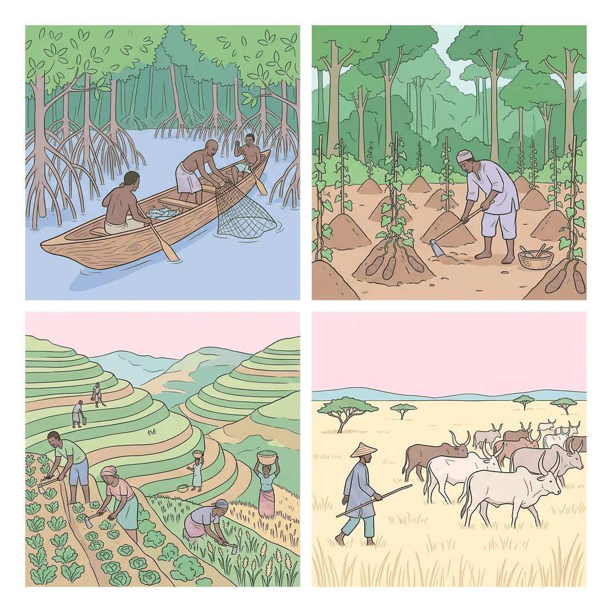
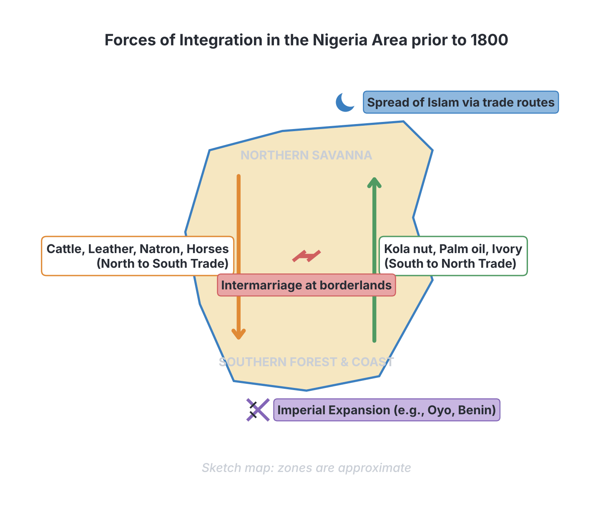

# JAMB History Notes: Land and Peoples of the Nigeria Area

## What JAMB expects

This topic is Section A, Topic 1 of the JAMB History syllabus: The Nigeria Area Up to 1800 – Land and Peoples of the Nigeria Area. It covers:

- **a.** Geographical zones and the people.
- **b.** The people’s relationship with the environment.
- **c.** Main physical features and the impact of geography on human activity e.g., hunting, fishing, farming etc.
- **d.** Relations and integration among the peoples of different zones.

By the end of these notes, you should be able to:

1. **identify** the geographical zones and the people within them (Objective i);
2. **establish** the relationship between the people and the environment (Objective ii);
3. **relate** the impact of geography on human activity in the specific zones (Objective iii);
4. **Comprehend** the relationships among the various peoples of the Nigeria area (Objective iv).

**Note on terminology:** The syllabus refers to the "Nigeria Area" because the country we now call Nigeria did not exist as a single political unit with that name before 1914. Prior to 1800, the area was home to many different independent communities, states, kingdoms, and empires. However, these groups were never completely isolated; their geography forced them to interact, trade, and intermingle.

## Geographical Zones and the People

**Objective i: identify the geographical zones and the people within them.**
**Content a: Geographical zones and the people.**

The Nigeria area is shaped by a variety of climates and vegetation types. As you move from the Atlantic Ocean in the south towards the Sahara Desert in the north, the rainfall decreases, and the vegetation changes from dense forests to open grasslands. 

These geographical zones largely determined where different ethnic groups settled over thousands of years. The zones can be broadly classified into the **Mangrove Swamps**, the **Tropical Rainforest**, the **Guinea Savanna (Middle Belt)**, the **Sudan Savanna**, and the **Sahel Savanna**.

### 1. The Mangrove Swamps and Coastal Region
This is the southernmost zone, bordering the Atlantic Ocean and the Gulf of Guinea. It consists of saltwater and freshwater swamps, creeks, and the vast Niger Delta. It experiences the highest rainfall in the area, often lasting for most of the year.
- **The Peoples:** The groups in this zone are primarily water-faring communities. They include the **Ijo (Ijaw)** in the core of the Niger Delta, the **Itsekiri** in the western delta, the **Efik** and **Ibibio** along the southeastern coast (Cross River estuary), and some coastal **Yoruba** groups (like the Awori and Ilaje) in the southwest.

### 2. The Tropical Rainforest
Just north of the mangrove swamps lies the tropical rainforest belt. It is characterized by tall trees, thick undergrowth, and a long rainy season (roughly from April to October). The dense vegetation historically provided protection against external cavalry attacks (soldiers on horseback).
- **The Peoples:** This zone is home to some of the most populous groups in the Nigeria area. In the west are the **Yoruba**; in the central-western area are the **Edo (Benin)** people; and in the east, the **Igbo** people. Parts of the **Ibibio** and **Efik** communities also extend into the rainforest.

### 3. The Guinea Savanna (The Middle Belt)
Moving further north, the tall trees thin out, giving way to tall grasses with scattered short trees. This transitional zone between the forest and the drier north is known as the Guinea Savanna. It has distinct wet and dry seasons of almost equal length.
- **The Peoples:** This area, often called the "Middle Belt," is the most ethnically diverse region in the Nigeria area. Major groups include the **Nupe**, **Igala**, **Idoma**, and **Tiv** in the central and eastern parts; the **Jukun** (founders of the Kwararafa empire) further east; and the **Gbagyi (Gwari)** in the central region.

### 4. The Sudan Savanna
North of the Guinea Savanna is the Sudan Savanna. The landscape here features short grasses and fewer, drought-resistant trees (like the baobab and acacia). The dry season is much longer than the rainy season, making the environment suitable for large-scale cereal farming and livestock rearing, and easy for human movement and trade routes.
- **The Peoples:** The dominant groups in this wide zone are the **Hausa** peoples (spread across numerous historic city-states like Kano, Katsina, and Zaria), the **Kanuri** (in the northeast around the Lake Chad basin), and the pastoral **Fulani** who historically migrated through the region with their cattle.

### 5. The Sahel Savanna
The extreme northeastern part of the Nigeria area falls into the Sahel Savanna. This is a semi-arid zone bordering the Sahara Desert, with very sparse rainfall, short, thorny bushes, and sandy soils.
- **The Peoples:** The **Kanuri** of the Kanem-Borno empire and various nomadic **Fulani** and **Shuwa Arab** groups operate in this harsh environment, relying heavily on pastoralism and trans-Saharan trade.

[IMAGE: Map of the Nigeria area showing horizontal bands of vegetation. From bottom to top: a dark green coastal strip (Mangrove Swamp), a wider green band (Tropical Rainforest), a light green/yellow band (Guinea Savanna), an orange band (Sudan Savanna), and a thin red band at the very top right (Sahel). Labels indicate the zones and the major ethnic groups within them: "Ijo, Itsekiri, Efik" in the coastal strip; "Yoruba, Edo, Igbo" in the rainforest; "Nupe, Igala, Tiv, Jukun" in the Guinea Savanna; "Hausa, Kanuri, Fulani" in the Sudan and Sahel savannas. Clean flat textbook illustration, white background.]

### Summary of Zones and Peoples

| Geographical Zone | Main Characteristics | Major Peoples |
| --- | --- | --- |
| **Mangrove/Coastal** | Creeks, swamps, heavy rain, salt water | Ijo, Itsekiri, Efik, Ibibio, Awori (Yoruba) |
| **Tropical Rainforest** | Tall trees, thick vegetation, heavy rain | Yoruba, Edo, Igbo |
| **Guinea Savanna** | Tall grass, scattered trees, transition zone | Nupe, Igala, Idoma, Tiv, Jukun, Gbagyi |
| **Sudan Savanna** | Short grass, open plains, long dry season | Hausa, Kanuri, Fulani |
| **Sahel Savanna** | Semi-arid, thorny bushes, very low rainfall | Kanuri, nomadic Fulani, Shuwa Arabs |

## Physical Features and Their Impact on Human Activity

**Objective iii: relate the impact of geography on human activity in the specific zones.**
**Content c: Main physical features and the impact of geography on human activity e.g., hunting, fishing, farming etc.**

Physical features—such as rivers, highlands, and plains—directly dictated how the early peoples of the Nigeria area survived and built their economies. Geography determined what people could eat, how they travelled, and how they defended themselves.

### 1. Rivers and Water Bodies
The most prominent physical features in the Nigeria area are the **River Niger** and the **River Benue**, which meet at a "Y" shaped confluence at Lokoja. Other major rivers include the Cross River in the southeast and the Ogun River in the southwest. In the extreme northeast lies **Lake Chad**.

- **Impact on Human Activity:**
  - **Fishing:** For groups like the Ijo in the Delta, the Igala and Nupe along the Niger-Benue, and the Kanuri near Lake Chad, fishing was the primary occupation. 
  - **Salt Boiling:** Coastal and swamp peoples boiled seawater or brackish creek water to produce salt, a highly prized commodity for trade with the hinterland.
  - **Transportation and Trade:** Rivers acted as ancient highways. The Niger and Benue allowed for the movement of heavy goods (using large canoes) over long distances, facilitating trade between the Guinea Savanna and the coast. Canoe-building became a major industry for the Ijo and riverine Igbo.
  - **Agriculture:** The floodplains of rivers (known as *fadama* in the north) left rich, fertile soil when waters receded, allowing for excellent farming.

### 2. Highlands, Mountains and Plateaus
Significant highlands include the **Jos Plateau** in the center of the country, the **Mandara Mountains** in the northeast, and the **Obudu/Adamawa highlands** in the east. 

- **Impact on Human Activity:**
  - **Refuge and Defense:** Historically, open plains were vulnerable to powerful cavalry (horse-riding) armies and slave raiders from centralized empires (like the Sokoto Caliphate later on, or Kanem-Borno). Highlands provided natural fortresses. Many smaller, non-centralized groups survived by retreating to the rocky hills of the Jos Plateau or the Mandara mountains.
  - **Terrace Farming:** Because flat land was scarce on the hills, peoples of the Jos Plateau and eastern highlands developed "terrace farming"—cutting flat steps into the sides of mountains to grow crops without soil washing away.
  - **Mining and Smelting:** Highlands were rich in minerals. The Jos Plateau area was famous for tin and iron mining. The ancient **Nok culture** (around 500 BC to 200 AD) developed early iron-smelting technology in the valleys and hills of central Nigeria.

### 3. Rainforest Plains
The thick tropical rainforest had fertile, albeit easily exhausted, soils. It lacked large open spaces.

- **Impact on Human Activity:**
  - **Root Crop Farming:** The environment was perfect for root crops. The peoples of the rainforest (Igbo, Yoruba, Edo) were primarily farmers, with **yam** being the most prestigious and culturally significant crop (hence the widespread "New Yam Festivals"). Cocoyam and indigenous vegetables were also grown.
  - **Tree Crops and Forest Products:** The forest provided timber for housing and renowned wood-carving traditions (e.g., in Benin and Oyo). Most importantly, the **oil palm** grew abundantly. Palm oil was essential for food, cosmetics, and medicine long before it became an international export.
  - **Hunting:** The dense forest housed wildlife, making hunting a prestigious occupation, though livestock rearing was limited due to the tsetse fly (which spreads sleeping sickness to cattle and horses).

### 4. Savanna Plains
The vast, open, grassy plains of the Guinea and Sudan savannas dominate the northern half of the Nigeria area.

- **Impact on Human Activity:**
  - **Cereal Farming:** The drier climate with a long dry season is ideal for grain crops. The Hausa and Kanuri were expert farmers of **millet**, **sorghum (guinea corn)**, and later, cotton and groundnuts.
  - **Livestock Rearing:** The open grassland, free from the deadly forest tsetse fly, supported millions of cattle, sheep, and goats. The pastoral Fulani specialized in moving their herds across these plains to find pasture and water.
  - **Crafts and Industries:** The abundance of livestock led to a booming **leatherwork** industry among the Hausa (especially in Kano). Cotton farming gave rise to excellent weaving and dyeing industries (famous indigo dye pits in Kano and Zaria).

## Relationship Between the People and the Environment

**Objective ii: establish the relationship between the people and the environment.**
**Content b: The people’s relationship with the environment.**

Before modern technology, the peoples of the Nigeria area were entirely dependent on their natural environment. Their relationship with the land went beyond mere survival; it shaped their architecture, their clothing, and their religious beliefs.

### 1. Adaptation in Shelter and Architecture
People built houses using the materials nature provided, adapting to the weather of their specific zones.
- **The Swamps:** In the flooded creeks of the Niger Delta, communities like the Ijo built their houses on **stilts** (wooden poles) driven into the riverbed to stay above the water level, using raffia palm for roofing.
- **The Rainforest:** To cope with heavy rainfall, forest peoples (Yoruba, Igbo, Edo) built houses with thick mud walls and steep, pitched roofs thatched with large palm leaves. The steep angle allowed the heavy rain to run off quickly without destroying the roof.
- **The Savanna:** In the drier north, where rain was scarce but the sun was fiercely hot, the Hausa developed the famous ***tubali* architecture** (sun-baked mud bricks). They built flat-roofed, thick-walled houses that stayed remarkably cool inside during the day and warm at night.

### 2. Adaptation in Clothing
- In the hot, humid south, heavy clothing was uncomfortable and unnecessary. Early peoples used light materials, such as bark cloth or raffia woven into wrappers. 
- In the north, especially during the cold Harmattan season on the open savanna, the environment required warmer clothing. The peoples here grew cotton and wove thick fabrics. The expansion of Islam also influenced the wearing of large, flowing gowns (like the *Babban Riga*), which protected the skin from the harsh savanna sun and blowing sand.

### 3. Resource Management and Agricultural Practices
- **Shifting Cultivation / Bush Fallowing:** Because the heavy rains in the south would wash away nutrients if the soil was over-used (leaching), farmers practiced bush fallowing. They would clear a piece of land, farm it for a few years, and then move to a new piece of land, allowing the old forest to grow back and recover its fertility naturally.
- **Nomadism / Transhumance:** In the north, because rainfall was seasonal and pasture dried up, the Fulani herdsmen practiced transhumance—moving their cattle south towards the Guinea Savanna during the dry season for water and pasture, and moving back north during the rainy season to avoid the tsetse flies that multiplied in the wet south.

### 4. Religious and Cultural Ties to the Land
The early peoples viewed the environment not just as a resource, but as a spiritual entity. Animism—the belief that spirits inhabit natural features—was widespread.
- **Earth Deities:** The land itself was sacred because it provided food and held the ancestors. Among the Igbo, the earth goddess, **Ala** (or Ani), is the most important deity. Crimes like murder or stealing yams were considered "abominations against the land," requiring complex cleansing rituals.
- **Water Spirits:** For communities whose lives depended on rivers and oceans, water deities were supreme. The Edo and Yoruba worshipped **Olokun** (the deity of the sea and wealth). The Ijo and riverine Igbo worshipped various water spirits (*Owu*, *Mami Wata*).
- **Sacred Groves and Forests:** In the rainforest zone, certain parts of the forest were preserved as sacred groves where hunting or farming was strictly forbidden. These areas served as shrines for local gods (e.g., the Osun-Osogbo sacred grove) and unintentionally acted as early forms of environmental conservation.

## Relations and Integration Among the Peoples

**Objective iv: Comprehend the relationships among the various peoples of the Nigeria area.**
**Content d: Relations and integration among the peoples of different zones.**

A common mistake in history is thinking that before the British amalgamation of 1914, the ethnic groups of Nigeria lived in total isolation from one another. This is completely false. The peoples of the Nigeria area were deeply interconnected long before 1800. 

Because of the different geographical zones, no single group could produce everything they needed. The environment *forced* them to interact. They integrated through **trade**, **migrations**, **diplomacy, warfare**, and **cultural exchange**.

### 1. Economic Relations: Trade
Trade was the strongest factor integrating the peoples of the Nigeria area. A massive North-South trade network existed because the ecological differences meant the North had what the South lacked, and vice versa.

| Region | What they produced and exported | What they needed (imported) |
| --- | --- | --- |
| **Savanna (North)** | Cattle, horses, leather goods, cotton cloth, natron (potash), onions, smoked fish (from Lake Chad), iron tools. | Kola nuts (highly valued in the north for chewing, especially as Islam forbade alcohol), palm oil, ivory, yams. |
| **Rainforest (South)** | Kola nuts, palm oil, yams, ivory, woven cloth, wood carvings. | Horses (for Oyo cavalry), cattle (beef), leather, natron (for medicine/cooking), salt. |
| **Coastal (South-South)**| Salt (from sea water), dried fish, imported European goods (after 15th century). | Agricultural produce (yams, grains), iron tools, woven cloth. |

- **Trade Routes and Traders:** Professional trading groups emerged. The Hausa ***fatake*** (itinerant merchants) travelled long distances with donkeys into the Middle Belt and Yorubaland. Down south, groups like the **Aro** (an Igbo subgroup from Arochukwu) established a massive trade network across southeastern Nigeria, using the famous *Ibini Ukpabi* oracle to guarantee safe passage for traders. The **Nupe** and **Igala** acted as middlemen on the River Niger, ferrying goods between the north and south.
- **Currencies:** Before modern money, trade moved beyond simple barter. Peoples integrated economically by accepting regional currencies. **Cowrie shells** (imported from the Indian Ocean) became a widely accepted currency across both the Savanna and the Rainforest. Iron bars, brass bars, and manillas were also used in the south.

### 2. Social Integration: Migration and Intermarriage
- **Migrations:** Harsh environments, droughts, or the search for better farmland caused groups to move. As they moved, they settled among other people and assimilated. The nomadic Fulani migrated from Senegambia across the West African savanna, settling peacefully among the Hausa and Kanuri for centuries before 1800. 
- **Borderland Blending:** In border areas where different zones met, cultures blended completely. The area around the Niger-Benue confluence (Lokoja area) is a prime example. The Igala, Nupe, Igbira, and northern Edo interacted so much that their languages and political systems borrowed heavily from each other. 
- **Intermarriage:** Traders who travelled long distances often took wives in the towns on their routes, creating family ties across ethnic lines. Kings also used intermarriage for alliances; for example, royalty from the Benin Empire married into neighboring Yoruba, western Igbo, and Itsekiri ruling houses.

### 3. Political Relations: Diplomacy, Warfare, and Empires
Integration was not always peaceful. Competition for land, trade routes, and resources led to warfare, which paradoxically brought peoples closer together politically.
- **The Oyo Empire:** Based in the northern edge of the Yoruba rainforest and Guinea Savanna, Oyo used its environment (favorable for horses) to build a powerful cavalry. Before 1800, Oyo expanded its borders to conquer parts of Nupe, Borgu, and the Dahomey Kingdom, integrating them into a tributary system (where conquered peoples paid regular taxes to Oyo).
- **The Benin Empire:** The Edo people of the Benin Empire expanded deep into the rainforest and coastal swamps. By the 1500s and 1600s, Benin controlled an area stretching to Lagos (which they called *Eko*, founded as a Benin war camp) and eastwards to the River Niger. This spread Edo cultural and political influence across southern Nigeria.
- **Kanem-Borno:** In the northeast, the Kanuri empire of Kanem-Borno exerted huge political influence over the Hausa city-states, often demanding tribute and serving as the dominant political force in the Savanna.

### 4. Cultural and Religious Exchange
As people traded and migrated, ideas moved with them.
- **Islam:** Introduced across the Sahara Desert by North African traders around the 11th century, Islam spread through Kanem-Borno and the Hausa states. Hausa traders then carried Islam southward into the Middle Belt and Yorubaland long before the 1800s. Religion became a unifying factor that crossed ethnic boundaries.
- **Shared Traditions:** Cultural practices often crossed borders. The Yoruba system of **Ifa divination** (consulting an oracle to solve problems) was adopted and adapted by the Edo and by the Igbo (where it is known as *Afa*). 
- **Linguistic Borrowing:** Languages heavily influenced each other. The Hausa language absorbed many Arabic words due to Islam. In the south, coastal languages borrowed from Portuguese (the first Europeans to arrive in the 1400s), and borderland groups often spoke multiple indigenous languages to facilitate trade.

## Key terms

| Term | Meaning |
| --- | --- |
| **Mangrove Swamps** | Coastal wetland zone characterized by saltwater, heavy rain, and creeks; home to the Ijo, Itsekiri, and Efik. |
| **Tropical Rainforest** | Zone of dense, tall trees and heavy rainfall; home to the Yoruba, Edo, and Igbo. |
| **Guinea Savanna** | The "Middle Belt" transition zone of tall grass and scattered trees; home to the Nupe, Igala, and Tiv. |
| **Sudan Savanna** | Drier, open grassland zone in the north ideal for cereal farming; home to the Hausa. |
| **Transhumance** | The seasonal movement of livestock (e.g., by the Fulani) between wet and dry season pastures. |
| **Terrace Farming** | Cutting step-like flat areas into mountain slopes for farming, practiced on the Jos Plateau to stop soil erosion. |
| **Bush Fallowing** | An agricultural system where land is left unplanted for a few years to regain its natural fertility. |
| **Animism** | The belief that non-human entities (like rivers, forests, and earth) possess spiritual essence. |
| **Cowrie Shells** | Small white shells historically imported from the Indian Ocean, used as a standard currency across the Nigeria area. |
| **Confluence** | The meeting point of two rivers; specifically, where the Niger and Benue rivers meet at Lokoja. |
| **Tributary System** | A political relationship where a weaker community pays regular taxes (tribute) in goods or slaves to a stronger empire (e.g., to Oyo or Benin) to maintain peace. |

## Exam tips and common mistakes

- **Mistake:** Assuming the name "Nigeria" and its current borders existed before 1800.
  - **Tip:** Remember that before 1800, it was a region of independent groups interacting through trade and war. Use "the Nigeria area."
- **Mistake:** Thinking different ethnic groups lived in total isolation.
  - **Tip:** JAMB frequently asks *why* groups interacted. The primary reason was **ecological differences**—no single geographical zone produced everything people needed, so they *had* to trade.
- **Mistake:** Mixing up the vegetation zones.
  - **Tip:** Memorize the order from South to North: Mangrove → Rainforest → Guinea Savanna → Sudan Savanna → Sahel Savanna. 
- **Mistake:** Placing ethnic groups in the wrong zones.
  - **Tip:** Ijo = Mangrove/Coastal. Igbo/Yoruba/Edo = Rainforest. Tiv/Igala/Nupe = Guinea Savanna (Middle Belt). Hausa = Sudan Savanna. 
- **Mistake:** Forgetting the main exports of each zone.
  - **Tip:** North exported livestock (cattle, horses), leather, and natron. South exported kola nuts, palm oil, and yams.
- **Tip:** If asked about refuge from cavalry or slave raiders, look for highland/mountain areas like the **Jos Plateau**.

## Quick summary

1. The Nigeria area is divided into five main geographical zones from south to north: Mangrove Swamps, Tropical Rainforest, Guinea Savanna, Sudan Savanna, and Sahel Savanna.
2. Each zone housed specific groups: the coastal Ijo and Efik; the rainforest Yoruba, Edo, and Igbo; the Middle Belt Nupe, Igala, and Tiv; and the northern Hausa, Kanuri, and Fulani.
3. Physical features dictated occupations: riverine peoples fished and made canoes; plateau peoples mined and used terrace farming; rainforest peoples grew root crops (yam); savanna peoples grew grains and reared livestock.
4. People adapted to their environment physically (building stilt houses in swamps, mud-and-thatch in the forest, flat-roofed *tubali* in the north) and spiritually (worshipping earth and water deities).
5. Despite cultural differences, the peoples were deeply integrated before 1800.
6. The strongest factor for integration was trade, driven by ecological differences. The North traded livestock, leather, and natron for the South's kola nut, ivory, and palm oil.
7. Integration also occurred through migrations, intermarriage at border towns, the spread of religion (Islam), and imperial expansion (e.g., Oyo and Benin empires).

## Practice questions

**1. Which of the following ethnic groups is primarily located in the Mangrove Swamp zone of the Nigeria area?**

- A. Nupe
- B. Ijo
- C. Tiv
- D. Hausa

**Answer: B.** The Ijo (Ijaw) are a water-faring people located in the core of the Niger Delta, which falls within the Mangrove Swamps. The Nupe and Tiv are in the Guinea Savanna, and the Hausa are in the Sudan Savanna.

**2. The main reason for the extensive pre-colonial trade between the northern and southern peoples of the Nigeria area was:**

- A. the introduction of European currencies.
- B. the spread of Islamic religion.
- C. differences in ecological zones and products.
- D. the construction of the railway by the British.

**Answer: C.** Ecological differences meant that the savanna produced different goods (cattle, leather) from the rainforest (kola nut, palm oil). This forced them to trade. (Railways and British influence did not exist in the pre-1800 era).

**3. In which geographical zone was the rearing of large herds of cattle and the cultivation of cereal crops like millet most common?**

- A. Mangrove Swamps
- B. Tropical Rainforest
- C. Sudan Savanna
- D. Coastal Creeks

**Answer: C.** The Sudan Savanna has the open grassland and long dry season suitable for cereals, and it is largely free from the tsetse fly, making it ideal for cattle rearing. 

**4. The physical feature that historically provided a natural fortress and refuge for smaller communities against cavalry attacks was the:**

- A. Niger Delta
- B. Jos Plateau
- C. Confluence of the Niger and Benue
- D. Lake Chad basin

**Answer: B.** The rugged, rocky, and elevated terrain of the Jos Plateau (and other highlands) made it difficult for horse-riding armies (cavalry) to attack, providing a safe refuge for many smaller groups.

**5. Which of the following was a highly valued commodity exported from the Southern rainforest to the Northern savanna before 1800?**

- A. Natron (potash)
- B. Kola nut
- C. Leather goods
- D. Horses

**Answer: B.** Kola nut grows in the rainforest and was highly prized in the north for chewing, particularly among Muslims who could not consume alcohol. Natron, leather, and horses were exports *from* the North *to* the South.

**6. The architectural adaptation most common in the hot, dry Sudan Savanna of the Nigeria area is:**

- A. Stilt houses made of bamboo.
- B. Houses with steep, thatched roofs.
- C. *Tubali* flat-roofed mud-brick houses.
- D. Temporary tents made of animal skins.

**Answer: C.** The Hausa of the Sudan savanna developed *tubali* (sun-baked mud block) architecture with flat roofs, which is excellent at keeping interiors cool in the harsh sun and warm at night. Steep roofs are for the rainforest to shed heavy rain.

**7. Which of these groups acted as prominent middlemen in the trade along the River Niger between the northern and southern zones?**

- A. Kanuri and Shuwa Arabs
- B. Igala and Nupe
- C. Efik and Ibibio
- D. Jukun and Tiv

**Answer: B.** Located around the Niger-Benue confluence and along the Niger, the Igala and Nupe used their geographic position to control canoe traffic and act as middlemen between northern and southern traders.

**8. The worship of the earth goddess, Ala (or Ani), is an example of environmental relationship predominantly found among the:**

- A. Fulani
- B. Kanuri
- C. Igbo
- D. Ijo

**Answer: C.** Ala (or Ani) is the supreme earth deity of the Igbo people of the rainforest, reflecting their deep agricultural reliance on the land, particularly for growing yams.

**9. Transhumance in the Nigeria area is best described as:**

- A. The process of burning forests to create fertile ash.
- B. The seasonal migration of livestock herders in search of pasture and water.
- C. The system of paying tribute to a central empire.
- D. The cutting of steps into mountains for farming.

**Answer: B.** Transhumance is the seasonal movement of pastoralists (like the Fulani) who move their cattle south during the dry season and north during the rainy season. Option D describes terrace farming.

**10. Before 1800, political integration across different geographical zones was sometimes achieved through:**

- A. the establishment of a single national government.
- B. the use of a uniform written constitution.
- C. imperial expansion and the tributary system.
- D. the trans-Atlantic slave trade agreements.

**Answer: C.** Empires like Oyo and Benin expanded beyond their immediate ethnic borders, conquering other groups and integrating them politically through a tributary system (making them pay regular taxes). There was no single national government before 1914.

<!-- COVERAGE
obj i | Geographical Zones and the People
obj ii | Relationship Between the People and the Environment
obj iii | Physical Features and Their Impact on Human Activity
obj iv | Relations and Integration Among the Peoples
item a | Geographical Zones and the People
item b | Relationship Between the People and the Environment
item c | Physical Features and Their Impact on Human Activity
item d | Relations and Integration Among the Peoples
-->
