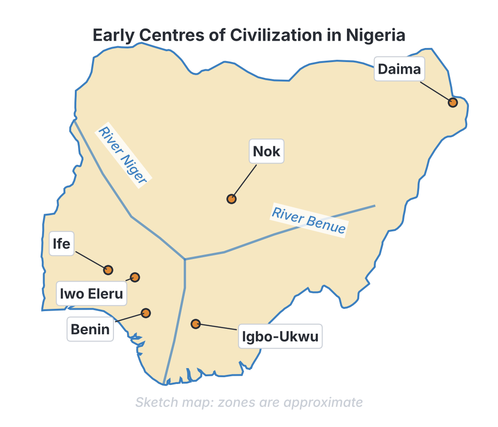
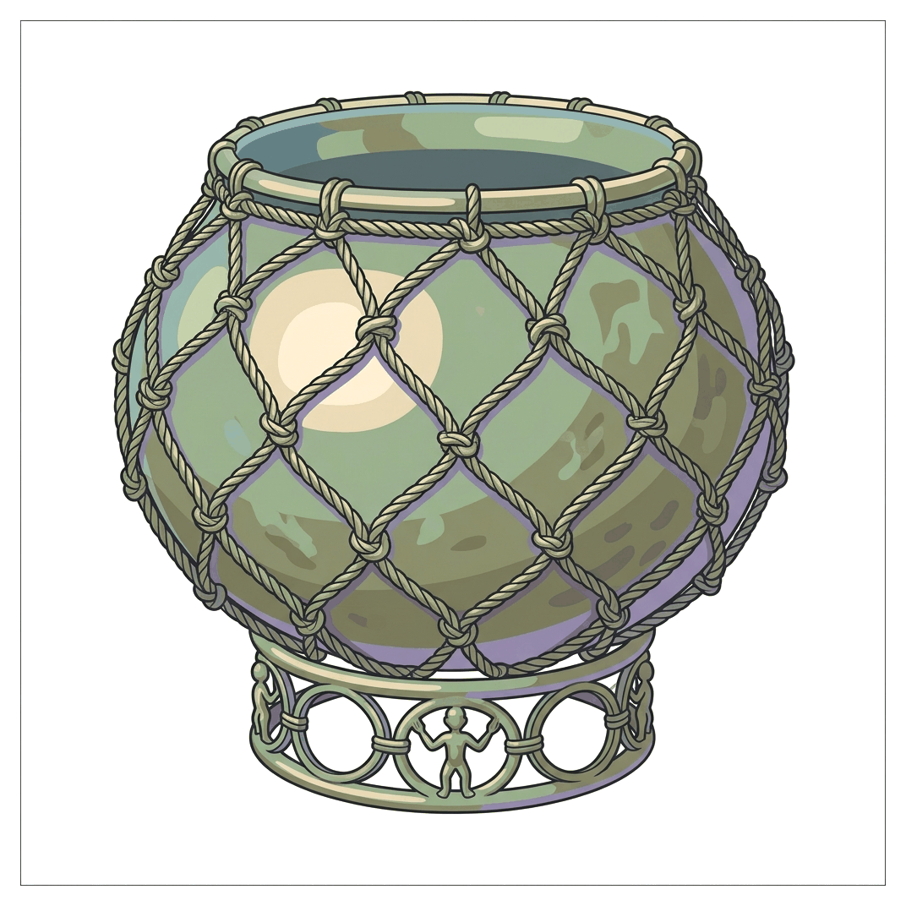
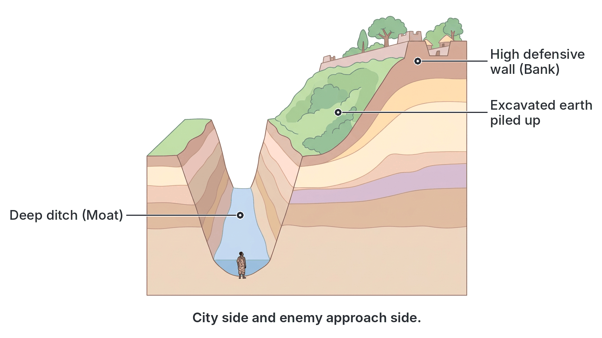

# JAMB History Notes: Early Centres of Civilization

## What JAMB expects

This topic is Section A, Topic 2 of the JAMB History syllabus: Early Centres of Civilization. It covers the following content items:

- **a.** Nok, Daima, Ife, Benin, Igbo Ukwu and Iwo Eleru
- **b.** Monuments and shelter systems: (Kuyambana, Durbi-ta-Kusheyi, city walls, moats and palaces)

By the end of these notes, you should be able to:

1. highlight the main features of the early centres of civilization.
2. examine the significance of various centres.
3. establish the historical significance of the various monuments such as caves and rocky formations.

**Note on the syllabus wording:** Objective iii asks you to establish the significance of "monuments such as caves and rocky formations", while Content b explicitly lists "Kuyambana, Durbi-ta-Kusheyi, city walls, moats and palaces". These notes cover all of them together, as they are all examples of early monuments, defensive structures and shelter systems.

## Main features and significance of early centres of civilization

**Objective i: highlight the main features of the early centres of civilization.**
**Objective ii: examine the significance of various centres.**
**Content a: Nok, Daima, Ife, Benin, Igbo Ukwu and Iwo Eleru.**

Before modern states and empires emerged, the area that is now Nigeria was home to several advanced early cultures. Archaeologists have discovered tools, weapons, art, and human remains that show how early people lived, developed technology, and organised their societies. 

### 1. Iwo Eleru (Late Stone Age)

**Main features:**
Iwo Eleru is a large rock shelter located near Isarun, in present-day Ondo State. It was excavated in 1965 by the archaeologist Thurstan Shaw. 
*   **Human Remains:** The most famous discovery at Iwo Eleru is a human skeleton. Radiocarbon dating suggests the skeleton dates back to about **9000 BC** (over 11,000 years ago), though dates in textbooks sometimes vary slightly.
*   **Stone Tools:** The site contained thousands of **microliths** (tiny, shaped stone tools) used for scraping, cutting, and hunting. 
*   **Pottery:** In the upper (newer) layers of the soil, archaeologists found early pieces of pottery, showing a gradual change in how people lived.

**Historical significance:**
*   It provides the **oldest known skeletal remains of a human** in West Africa, proving that humans have lived in the forest region of Nigeria for over 10,000 years.
*   It shows the transition from the Late Stone Age (hunting and gathering) to early stages of settled life (making pottery).

### 2. Nok Culture (Early Iron Age)

**Main features:**
The Nok culture was discovered in central Nigeria (covering parts of present-day Kaduna, Plateau, and Nasarawa states). It is named after the village of Nok, where the first artifacts were found in a tin mine in 1928. It flourished between about **500 BC and AD 200**.
*   **Terracotta Art:** Nok is famous for its highly skilled **terracotta** (baked clay) sculptures of human and animal figures. The human figures have distinct features: pierced eyes, lips, and ears; triangular or semi-circular eyes; and elaborate hairstyles or headdresses.
*   **Iron Smelting:** Archaeologists found iron-smelting furnaces, iron tools, and stone tools side by side at sites like **Taruga** and **Samun Dukiya**. 

**Historical significance:**
*   Nok provides some of the **earliest evidence of iron smelting** in sub-Saharan Africa. 
*   It shows that the people of the Nigeria area transitioned directly from the Stone Age to the Iron Age, without going through a "Bronze Age" (which happened in Europe and Asia).
*   The high quality of the terracotta art suggests a complex society with specialised craftsmen and religious beliefs (the figures were likely used as shrine objects).

[IMAGE: A classic Nok terracotta human head. It has triangular eyes with deep holes for the pupils, flared nostrils, parted lips, and an elaborate bun-like hairstyle with carved geometric patterns. The clay is reddish-brown and textured to look old and slightly weathered. Labels: "Triangular eyes", "Pierced pupils and lips", "Elaborate hairstyle". Clean flat textbook style, white background.]

### 3. Daima (Lake Chad Region)

**Main features:**
Daima is an archaeological mound located in present-day Borno State, south of Lake Chad. It was excavated by Graham Connah in the 1960s. The mound was formed by layers of human settlement building up over thousands of years, from around the **6th century BC to the 11th century AD**.
*   **Three phases of settlement:** The bottom layers show Late Stone Age people who used bone and wood (because stone is rare in that sandy region) and kept cattle. The middle layers show the introduction of iron. The top layers show more advanced iron tools and built mud structures.
*   **Animal Figurines:** The site contained many simple, fired clay figurines of animals, especially cows.

**Historical significance:**
*   Daima shows a **long, continuous record of human occupation** in the harsh environment of the Chad Basin.
*   It provides clear evidence of the slow, steady transition from Stone Age technology to Iron Age technology in a single location.
*   The animal figurines highlight the early economic importance of cattle rearing and pastoralism in northern Nigeria.

### 4. Igbo-Ukwu (Early Bronze Age)

**Main features:**
Igbo-Ukwu is located in present-day Anambra State. In 1938, a man digging a toilet pit found bronze objects. The archaeologist Thurstan Shaw later excavated three sites there (Igbo-Isaiah, Igbo-Richard, and Igbo-Jonah) in 1959 and 1964. The artifacts date to the **9th century AD**.
*   **Bronze Artifacts:** The sites contained highly intricate bronze objects made using the **cire perdue** (lost-wax) casting method. These included a beautiful roped bronze pot, bronze bowls, and staffs.
*   **Burial Chamber:** One site was a burial chamber of an important person, buried sitting on a stool, wearing copper wire, a beaded headdress, and holding a fan. Many historians believe this was an early **Eze Nri** (a priest-king).
*   **Trade Goods:** Over 100,000 glass and stone beads were found, which were not made locally.

**Historical significance:**
*   Igbo-Ukwu provides the **oldest known evidence of bronze casting** in West Africa, showing incredible technical skill long before European contact.
*   The presence of thousands of beads suggests that the people of Igbo-Ukwu were involved in **long-distance trade**, possibly reaching as far as North Africa or the Middle East.
*   The wealthy burial shows that complex, centralised socio-religious institutions (like the Nri hegemony) existed in Igboland by the 9th century.

### 5. Ife (Classical Period)

**Main features:**
Ile-Ife, in present-day Osun State, is regarded in oral tradition as the spiritual homeland and origin of the Yoruba people. The most famous archaeological finds date to between the **12th and 15th centuries AD**.
*   **Naturalistic Art:** Unlike the stylized art of Nok, Ife artists created incredibly realistic, life-like (**naturalistic**) heads of rulers (the Ooni) and important figures. 
*   **Materials:** They used terracotta, stone, and copper alloys (brass and bronze), also using the lost-wax method. Many heads feature faint vertical lines on the face, which might represent royal scarification or a veil.
*   **Opa Oranmiyan:** A tall, carved granite monolith (stone pillar) standing in Ife, traditionally said to be the walking stick of Oranmiyan, a legendary Yoruba warrior and prince.

**Historical significance:**
*   Ife art shocked early European explorers (like Leo Frobenius in 1910), who initially refused to believe Africans could produce such realistic and technically perfect masterpieces.
*   The art provides historical evidence of a highly organised, wealthy state with powerful divine kingship (the Ooni) and a rich court culture.

### 6. Benin (Empire Period)

**Main features:**
Benin City, in present-day Edo State, was the center of the powerful Benin Empire. Its peak period of art production was between the **13th and 19th centuries**.
*   **Brass and Bronze Art:** Benin is world-famous for its cast brass and bronze art. According to Benin oral tradition, the Oba of Benin, Oguola, asked the Ooni of Ife to send a master brass caster (Iguegha) to teach the people of Benin. However, Benin art has its own unique, slightly more stylized character compared to Ife.
*   **Plaques and Commemorative Heads:** Benin artists cast hundreds of rectangular brass plaques that decorated the wooden pillars of the Oba’s palace. They also cast commemorative heads of past Obas and Queen Mothers (Iyoba), which were placed on royal ancestral altars.
*   **The Guild System:** Art was strictly controlled by the Oba. The brass casters belonged to a special royal guild called **Igun Eronmwon**, and they lived and worked in a specific quarter of the city.

**Historical significance:**
*   Benin art serves as a **historical record**. Because the plaques depict Portuguese soldiers, animals, court officials, and battles, they act like a visual history book of the empire before written records.
*   It demonstrates the immense power, wealth, and divine authority of the Oba, who had total monopoly over the production of these precious metals.

| Centre | Location | Key Period | Main Material / Discovery | Identifying Feature |
| :--- | :--- | :--- | :--- | :--- |
| **Iwo Eleru** | Ondo State | c. 9000 BC | Human skeleton, stone tools | Oldest human skeleton in West Africa |
| **Nok** | Central Nigeria | 500 BC – AD 200 | Terracotta, iron | Pierced eyes, earliest iron smelting |
| **Daima** | Borno State | 6th C. BC – 11th C. AD | Clay animal figurines, bone/iron | Continuous transition from Stone to Iron Age |
| **Igbo-Ukwu** | Anambra State | 9th Century AD | Bronze, glass beads | Oldest bronze casting, intricate roped pots |
| **Ife** | Osun State | 12th – 15th Century AD | Terracotta, brass/bronze | Highly naturalistic (realistic) human heads |
| **Benin** | Edo State | 13th – 19th Century AD | Brass plaques, bronze heads | Court art decorating the Oba's palace |

## Monuments and shelter systems

**Objective iii: establish the historical significance of the various monuments such as caves and rocky formations.**
**Content b: Monuments and shelter systems: (Kuyambana, Durbi-ta-Kusheyi, city walls, moats and palaces).**

Early societies left behind large physical structures and adapted natural formations to survive, defend themselves, and bury their leaders. 

### 1. Caves and rocky formations (Kuyambana and others)

Caves and rock shelters were some of the earliest forms of human habitation and defense. 
*   **Kuyambana:** Located in the present-day Zamfara region, Kuyambana is a major rocky formation and ancient settlement site. Throughout history, rocky hills and caves in northern and central Nigeria (such as the Kufena hills or the Jos Plateau rocks) were used by communities as strongholds.
*   **Significance:** Caves and rocky formations provided natural **protection and shelter**. During periods of unrest, warfare, or slave raiding, communities retreated into these rocky hills where cavalry (men on horses) could not easily follow. They also preserve archaeological evidence (like the Iwo Eleru rock shelter) because the environment inside a cave protects bones and tools from rain and rapid decay.

### 2. Durbi-ta-Kusheyi

**Features:**
Durbi-ta-Kusheyi is an important archaeological and historical site located in Katsina State. The name translates to "Tombs of the Chief Priest" or "Tombs of the Durbi" (the Durbi was a senior royal title in ancient Katsina). The site contains several large **burial mounds** (earth piled up over graves) belonging to the early, pre-Islamic rulers of Katsina. 

**Significance:**
*   Excavations of these tombs revealed rich grave goods, including local pottery and imported items like brass bowls, gold jewelry, and cowrie shells dating to around the **13th to 15th centuries**. 
*   This establishes the historical significance of Durbi-ta-Kusheyi as proof that Hausa city-states like Katsina were powerful, wealthy, and heavily involved in **trans-Saharan trade** centuries before the Sokoto Jihad. It shows the existence of a strong, centralized political system.

### 3. City walls and moats

As early settlements grew into towns and empires, they built massive defensive perimeters.

*   **Kano City Walls:** Originally started by Sarki Gijimasu in the 11th century and expanded by later rulers, these were massive earthworks surrounding the city of Kano, featuring large gates (kofofi).
*   **Benin City Walls and Moats (Iya):** The Benin Empire was surrounded by one of the largest man-made earthworks in the world. The *Iya* consisted of deep ditches (moats) with the dug-out earth piled up to form a high wall.
*   **Sungbo's Eredo:** A massive system of defensive walls and ditches built in the Ijebu region of Yorubaland, traditionally linked to a wealthy, childless widow named Oloye Bilikisu Sungbo.

**Significance:**
*   **Security and Defense:** The primary purpose of walls and moats was to protect citizens and the king from external invasions and surprise attacks.
*   **Political Power:** The ability to build such massive structures shows that the rulers had the authority and economic power to organize thousands of laborers over long periods. 
*   **Boundary Demarcation:** They clearly marked the physical and spiritual boundaries of the capital city.

### 4. Palaces

**Features:**
In centralized states, the palace (such as the *Afin* in Yorubaland, the Oba's palace in Benin, or the Emir's palace in Hausaland) was the most prominent building in the city. Palaces were usually built using the best available local materials (thick mud walls, carved wooden pillars, courtyards) and were much larger than regular houses.

**Significance:**
*   **Seat of Government:** The palace was not just a home; it was the administrative, judicial, and spiritual headquarters of the kingdom. Courtyards were used for public meetings, trials, and festivals.
*   **Cultural Preservation:** Palaces were the primary storehouses of the people's art and history. The Oba of Benin's palace housed the brass plaques and ancestral shrines.
*   **Symbol of Authority:** The massive size and complex layout of a palace physically separated the king from the common people, reinforcing his status as a divine or supreme ruler.

## Key terms

| Term | Meaning |
| :--- | :--- |
| **Terracotta** | Baked clay used to make pottery and sculptures; famously used by the Nok and Ife cultures. |
| **Microlith** | Small, shaped stone tools typical of the Late Stone Age, found at Iwo Eleru. |
| **Cire perdue (Lost-wax)** | A method of metal casting where a wax model is covered in clay, baked to melt the wax, and filled with molten bronze. |
| **Naturalistic** | Art that looks highly realistic and lifelike, typical of Ife sculptures. |
| **Durbi-ta-Kusheyi** | Ancient burial mounds in Katsina containing the tombs of early rulers and trade goods. |
| **Kuyambana** | A rocky formation and ancient settlement area in Zamfara, used for shelter and defense. |
| **Moat** | A deep, wide trench or ditch dug around a town or palace for defense, often paired with a wall (e.g., Benin Iya). |
| **Guild** | An association of craftsmen. In Benin, the *Igun Eronmwon* was the exclusive royal guild of brass casters. |

## Exam tips and common mistakes

*   **Mixing up Nok, Ife, and Benin art:** This is the most common mistake. 
    *   **Nok** = Terracotta only, pierced eyes, earliest (Iron Age).
    *   **Ife** = Terracotta and brass/bronze, incredibly *naturalistic* (realistic).
    *   **Benin** = Brass/bronze, *plaques* depicting court life, slightly stylized.
*   **Igbo-Ukwu's defining features:** Always associate Igbo-Ukwu with **Thurstan Shaw**, the **9th century**, and the **oldest bronze casting** in West Africa.
*   **Daima's location and significance:** Students often forget Daima. Remember it is in the **Lake Chad area (Borno)** and shows a *continuous sequence* of occupation from the Stone Age to the Iron Age.
*   **Iwo Eleru vs. Nok:** Iwo Eleru is Stone Age (oldest human skeleton); Nok is Iron Age. 
*   **Function of Walls/Moats:** While they look like borders, JAMB expects you to know their primary historical significance is **security and defense**.

## Quick summary

1.  **Iwo Eleru** in Ondo State provides the oldest evidence of human skeletal remains (c. 9000 BC) and Late Stone Age microliths in West Africa.
2.  **Nok Culture** (central Nigeria) is famous for its terracotta figures with pierced eyes and provides the earliest evidence of iron smelting in the region, skipping the Bronze Age.
3.  **Daima** (Lake Chad basin) shows thousands of years of continuous human settlement and the transition from bone/wood tools to iron tools, alongside animal figurines.
4.  **Igbo-Ukwu** (Anambra State) contains the oldest bronze artifacts in West Africa (9th century AD), made using the lost-wax method, showing early complex society and long-distance trade.
5.  **Ife** produced highly naturalistic terracotta and brass heads, representing divine kingship, while **Benin** produced brass plaques and heads that served as historical records of the Oba's court.
6.  **Caves and rocky formations** (like Kuyambana) served as natural shelters and defensive strongholds against invaders and slave raiders.
7.  **Durbi-ta-Kusheyi** consists of ancient burial mounds in Katsina, proving the existence of early centralized wealth and trans-Saharan trade links.
8.  **City walls, moats, and palaces** were massive engineering projects that provided security, demarcated boundaries, and served as the administrative and spiritual centers of empires.

## Practice questions

**1. The earliest evidence of iron smelting in Nigeria is associated with the**
- A. Ife culture
- B. Benin empire
- C. Nok culture
- D. Igbo-Ukwu civilization

**Answer: C.** The Nok culture provides the earliest evidence of iron smelting (at sites like Taruga) alongside their famous terracotta figures.

**2. Which of the following archaeologists is credited with excavating the Igbo-Ukwu sites?**
- A. Graham Connah
- B. Thurstan Shaw
- C. Leo Frobenius
- D. Bernard Fagg

**Answer: B.** Thurstan Shaw excavated Igbo-Ukwu (and also Iwo Eleru). Graham Connah excavated Daima, and Bernard Fagg is associated with Nok. 

**3. A major characteristic of Ife art is that it is**
- A. highly stylized and abstract
- B. made only of iron
- C. highly naturalistic and realistic
- D. found entirely in burial mounds

**Answer: C.** Ife art is famous worldwide for its highly naturalistic (lifelike/realistic) representation of human faces.

**4. The archaeological site that provides a continuous record of settlement from the Late Stone Age to the Iron Age in the Lake Chad region is**
- A. Daima
- B. Taruga
- C. Iwo Eleru
- D. Kuyambana

**Answer: A.** Daima is an excavated mound south of Lake Chad that shows a continuous sequence of human occupation over thousands of years.

**5. The ancient burial mounds containing trade goods and early rulers in Katsina State are known as**
- A. Sungbo's Eredo
- B. Durbi-ta-Kusheyi
- C. Opa Oranmiyan
- D. Igun Eronmwon

**Answer: B.** Durbi-ta-Kusheyi are the ancient tombs of Katsina rulers. Igun Eronmwon is a Benin brass-casting guild, and Opa Oranmiyan is a stone pillar in Ife.

**6. The primary historical significance of city walls and moats in early Nigerian centres was to**
- A. prevent citizens from migrating
- B. provide irrigation for farming
- C. serve as burial sites for commoners
- D. provide security and defense against external attacks

**Answer: D.** Massive earthworks like the Kano walls and Benin moats were built primarily to defend the city and its rulers from invaders.

**7. In ancient Benin, the art of brass casting was**
- A. practiced by every citizen
- B. strictly controlled by the Oba through a royal guild
- C. used primarily for agricultural tools
- D. imported entirely from the Portuguese

**Answer: B.** Brass casting was a royal monopoly controlled by the Oba, produced by a specific guild called the Igun Eronmwon. 

**8. Which of the following sites yielded the oldest known human skeleton in West Africa?**
- A. Samun Dukiya
- B. Igbo-Jonah
- C. Iwo Eleru
- D. Kuyambana

**Answer: C.** Iwo Eleru, a rock shelter in Ondo State, yielded a human skeleton dated to around 9000 BC, the oldest found in the region.

**9. The technique used by Igbo-Ukwu, Ife, and Benin craftsmen to cast bronze and brass objects is known as**
- A. iron smelting
- B. cire perdue (lost-wax)
- C. microlith chipping
- D. terracotta baking

**Answer: B.** The cire perdue or lost-wax method was the sophisticated technique used across these centres to cast hollow metal sculptures. 

**10. Rocky formations and caves such as Kuyambana were historically significant because they**
- A. were the only places iron could be mined
- B. provided natural shelter and defensive strongholds during conflicts
- C. served as the official palaces of Islamic emirs
- D. were used to store cowrie shells for trans-Saharan trade

**Answer: B.** Caves and rocky hills provided natural protection for communities retreating from cavalry attacks, slave raiders, and warfare.
