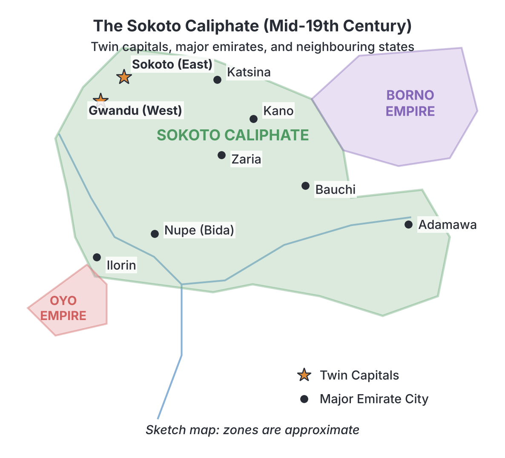

# JAMB History Notes: The Sokoto Caliphate

## What JAMB expects

This topic is Section B, Topic 1 of the JAMB History syllabus: The Nigeria Area 1800 – 1900 – The Sokoto Caliphate. It covers the following content items:

- **a.** The causes and the process of the jihad
- **b.** The establishment and administration of the caliphate and relations with neighbours
- **c.** The achievements and impact of the caliphate.
- **d.** The collapse of the caliphate.

By the end of these notes, you should be able to:

1. examine the causes, and the course of the Jihad;
2. determine the factors that led to the rise of the caliphate;
3. examine the administrative set-up of the caliphate and its relations with its neighbours;
4. examine the impact of the caliphate;
5. trace the internal and external factors that led to the collapse of the caliphate.

**Note on spellings:** The leader of the Jihad is widely known in Nigerian textbooks as **Usman dan Fodio**, though his Arabic name is often spelt **Uthman dan Fodio** or **Uthman ibn Fudi**. These notes use Usman dan Fodio, as it is the most common form in UTME exams. The old Hausa kingdoms overthrown during the Jihad are referred to as the **Habe** kingdoms.

## The causes and the process of the jihad

**Objective i: examine the causes, and the course of the Jihad; and Content a: The causes and the process of the jihad**

To understand how the Sokoto Caliphate was born, we must look at the event that created it: the **Sokoto Jihad of 1804**. A *jihad*, in Islamic terms, is a struggle or holy war to defend or spread the faith, or to reform society according to Islamic principles.

### Background to the Jihad
Before 1804, Northern Nigeria was made up of several independent Hausa states (such as Gobir, Kano, Katsina, Zazzau, and Daura). Islam had been introduced to Hausaland centuries earlier (around the 14th century), but by the late 18th century, the Hausa kings (the Habe rulers) practiced a mixed form of religion. They claimed to be Muslims but still worshipped traditional idols, performed non-Islamic rituals, and tolerated practices contrary to strict Islamic law (Sharia). This mixing of religions is called **syncretism**.

**Usman dan Fodio** was born in 1754 in Maratta (in the Hausa state of Gobir) into a family of Toronkawa Fulani scholars. He grew up to become a highly respected Islamic teacher and preacher of the **Qadiriyya** brotherhood. He settled in the town of Degel and began preaching against the un-Islamic practices of the Hausa kings. His message attracted a massive following of students, devout Muslims, and oppressed ordinary people (the *talakawa*). The kings of Gobir—first Bawa, then Nafata, and finally Yunfa—became threatened by his growing power. 

### Causes of the Sokoto Jihad

Historians debate whether the Jihad was purely a religious movement, an ethnic conflict (Fulani versus Hausa), or a class struggle (the poor versus the rich). Most textbooks agree that the causes were a mixture of all these factors.

**1. Religious Causes**
- **Eradication of syncretism:** The primary stated aim of Usman dan Fodio was to purify Islam. He wanted to stop the Habe kings from mixing Islam with traditional African religions.
- **Enforcement of Sharia Law:** The jihadists wanted the states to be governed strictly by Islamic law rather than by the arbitrary decisions of the kings or traditional customs.
- **Ending pagan practices:** Usman dan Fodio preached against practices such as the drinking of alcohol, music, and the ill-treatment of women, which were common in the Habe courts.

**2. Political Causes**
- **Oppressive rule:** The Habe kings were absolute rulers who often oppressed their subjects. They forced men into military service and seized property without justice.
- **Hostility of the Gobir kings:** King Nafata of Gobir tried to stop the spread of Islam by passing laws that banned anyone except Usman dan Fodio from preaching, and ordered new converts to return to their old religions. 
- **Attempt on Usman's life:** Nafata's successor, King Yunfa (who had once been Usman's student), became even more hostile. According to tradition, Yunfa attempted to assassinate Usman dan Fodio, and later attacked the Muslims at Gudu.

**3. Economic and Social Causes**
- **Unjust taxation:** The Habe kings imposed heavy and un-Islamic taxes on the people. One of the most hated was the *jangali* (cattle tax), which fell heavily on the pastoral Fulani herdsmen.
- **Corruption:** Judges collected bribes, and market officials cheated the traders. The ordinary Hausa peasants (the *talakawa*) supported the Jihad because they wanted relief from economic oppression.
- **Enslavement of Muslims:** The Habe kings frequently raided neighbouring territories and enslaved free Muslims, which is forbidden in Islam.

**4. Intellectual Causes**
- Usman dan Fodio, his brother **Abdullahi dan Fodio**, and his son **Muhammed Bello** were brilliant scholars. They wrote hundreds of books and poems in Arabic, Hausa, and Fulfulde. These writings provided a strong intellectual and legal justification for the Jihad, convincing Muslims that it was their duty to rebel against unjust rulers.

### The Course (Process) of the Jihad

The Jihad did not happen overnight; it was a process of escalating tension that broke into open war.

1. **The Flight (Hijra) in 1804:** Tensions reached a breaking point when King Yunfa attacked a group of Muslims and threatened to destroy Usman's community at Degel. In **February 1804**, Usman dan Fodio and his followers fled from Degel to Gudu. This flight is known as the **Hijra**, mirroring the Prophet Muhammad's flight from Mecca to Medina.
2. **Declaration of Jihad:** At Gudu, Usman's followers declared him the **Amir al-Muminin** (Commander of the Faithful). When Yunfa sent an army to crush them at Gudu, Usman declared a defensive Jihad.
3. **The Battle of Tabkin Kwatto (June 1804):** This was the first major battle. Despite being outnumbered and poorly equipped, the jihadists defeated the heavy cavalry of the Gobir army. This victory proved to the Muslims that God was on their side and encouraged others to join them.
4. **The Distribution of Flags:** Usman dan Fodio did not fight in the battles himself; he provided spiritual and strategic leadership. He gave "flags of victory" to trusted scholars and Fulani clan leaders, authorising them to launch jihads in their respective territories across Hausaland. These leaders became the **flag bearers**.
5. **Conquest of Hausaland (1804–1808):** Between 1804 and 1808, the jihadists conquered most of the major Hausa states. Zaria (Zazzau) fell in 1804, Katsina in 1805, and Kano in 1807. 
6. **The Fall of Alkalawa (1808):** In 1808, the jihadist forces finally captured Alkalawa, the capital of Gobir. King Yunfa was killed. This effectively marked the end of the major Habe kingdoms and the triumph of the Jihad in Hausaland.
7. **Expansion beyond Hausaland:** After 1808, the Jihad spread southwards to Nupe and Ilorin (Yorubaland), eastwards towards Borno, and westwards into the Senegambia region, though not all these campaigns were successful (e.g., Borno resisted successfully).

## Factors that led to the rise of the caliphate

**Objective ii: determine the factors that led to the rise of the caliphate**

Why was Usman dan Fodio able to defeat the powerful, established Hausa kingdoms so quickly? Several factors contributed to the rise of the Sokoto Caliphate:

- **Disunity among the Hausa States:** The Habe kings did not unite against the jihadists. They were historic rivals who had spent centuries fighting each other. When Gobir was attacked, the other states did not send help, allowing the jihadists to defeat them one by one.
- **Military Superiority:** The Hausa armies relied on heavy cavalry (knights in thick armour), which was slow and clumsy. The Fulani jihadists used light cavalry and archers, which gave them speed, mobility, and the ability to outmanoeuvre the enemy.
- **Support of the Masses:** The Jihad had massive popular support. The oppressed Hausa peasants (talakawa) saw the jihadists as liberators from the wicked Habe kings and unjust taxes. 
- **Strong, Unified Leadership:** Usman dan Fodio was a charismatic and deeply respected leader. His followers were fiercely loyal to him, whereas the Habe kings often faced rebellion from their own subjects.
- **Religious Zeal:** The jihadists were fighting a holy war. They believed that if they died in battle, they would go straight to heaven as martyrs. This gave them incredible courage and high morale.
- **The Fulani Network:** The Fulani people were spread all over Hausaland. When the Jihad was declared, Fulani herdsmen and scholars across the region rose up simultaneously, overwhelming the Habe authorities from within.

## The establishment and administration of the caliphate and relations with neighbours

**Objective iii: examine the administrative set-up of the caliphate and its relations with its neighbours; and Content b: The establishment and administration of the caliphate and relations with neighbours**

### Establishment and Division of the Caliphate

After the major conquests were completed by 1809, Muhammed Bello (Usman's son) supervised the building of a new permanent capital city called **Sokoto**. The vast new empire became known as the Sokoto Caliphate.

Usman dan Fodio was a scholar, not a politician. In **1812**, he retired from the daily administration of the state to focus on teaching and writing. He divided the massive Caliphate into two administrative halves:
1. **The Eastern Sector:** Governed from Sokoto by his son, **Muhammed Bello**. This included emirates like Kano, Katsina, Zaria, Bauchi, and Adamawa.
2. **The Western Sector:** Governed from Gwandu by his brother, **Abdullahi dan Fodio**. This included emirates like Ilorin, Nupe, and parts of modern-day Niger Republic.

Usman dan Fodio died in **1817**. After a brief succession dispute, Muhammed Bello became the next Caliph (Sultan), and the dual structure of Sokoto and Gwandu was maintained, though the Sultan in Sokoto remained the supreme spiritual and political head.

### The Administrative Set-up

The Sokoto Caliphate was not a tightly controlled, centralized state. It was a **confederation** or a federal system of semi-independent **emirates** that pledged loyalty to the Caliph in Sokoto. 

**1. The Caliph (Sultan)**
- The Caliph, based in Sokoto, was the *Amir al-Muminin* (Commander of the Faithful). 
- He was the supreme spiritual, political, and judicial authority. 
- He had the final say in the appointment of Emirs.

**2. The Emirs**
- Each conquered territory (or newly created province) became an **Emirate** ruled by an **Emir**.
- Emirs were usually chosen from the families of the original flag bearers, making the leadership mostly Fulani.
- The Emirs had broad powers to run their emirates daily, but they had to rule according to Sharia law and the directives of the Caliph.
- **Obligations to Sokoto:** Emirs were required to visit Sokoto regularly, send an annual tribute (often in the form of slaves, crops, and local crafts), provide soldiers for the Caliph's wars, and seek the Caliph's approval before taking office.

**3. State Officials**
The Caliph and the Emirs ruled with the help of a council of state officials, adopting some titles from the old Habe system. Key positions included:
- **Waziri:** The Prime Minister or chief adviser to the Caliph/Emir.
- **Galadima:** A senior administrator, often in charge of the capital city.
- **Madawaki:** The commander of the cavalry/army.
- **Alkali (Qadi):** The Islamic judges who administered justice strictly according to Sharia law in the courts.

### Relations with Neighbours

The Caliphate's foreign policy was largely determined by its desire to expand Islam, secure trade routes, and acquire slaves. 

**1. Relations with Kanem-Borno**
The jihadists attacked the ancient Muslim empire of Kanem-Borno to the east, claiming its rulers were also guilty of syncretism. Borno was nearly conquered, and its capital was sacked. However, a brilliant Islamic scholar and warrior, **Muhammad al-Amin al-Kanemi** (El-Kanemi), rallied the Borno forces and pushed the Fulani back. 
El-Kanemi engaged in a famous exchange of letters with Muhammed Bello, arguing that Borno was already a true Islamic state and that the Fulani invasion was an illegal land grab, not a true jihad. Borno successfully resisted the Caliphate and remained independent. (See `B2-kanem-borno.md`).

**2. Relations with Yorubaland (Oyo)**
In the south-west, the Caliphate expanded into the declining Oyo Empire. Afonja, a rebellious Oyo general based in Ilorin, allied with a Fulani scholar named **Mallam Alimi**. After Afonja's death, Alimi's sons took over Ilorin, turned it into a Fulani Emirate, and pledged allegiance to Gwandu. The jihadist cavalry pushed deep into Yorubaland, destroying the old Oyo capital (Oyo-Ile), but were finally stopped by Ibadan forces at the **Battle of Osogbo in 1840**. (See `B3-yorubaland.md`).

**3. Relations with Nupe**
The jihadists took advantage of a succession dispute in the Nupe kingdom. Mallam Dendo, a Fulani scholar, intervened and eventually established a Fulani emirate over Nupe, with its capital later at Bida. Nupe fell under the control of the Gwandu sector. (See `B5-nupe.md`).

**4. Relations with Non-Muslim Groups (The Middle Belt)**
To the south of the Caliphate lay the hills and forests of the Middle Belt (areas like the Jos Plateau, Tivland, and parts of modern Nasarawa and Kogi). The Caliphate frequently raided these non-Muslim, decentralized societies to capture slaves, who were used as domestic labour, soldiers, or tribute to Sokoto. However, the rugged terrain and the fierce resistance of the local peoples prevented the Caliphate from fully conquering these areas.

## The achievements and impact of the caliphate

**Objective iv: examine the impact of the caliphate; and Content c: The achievements and impact of the caliphate.**

The creation of the Sokoto Caliphate was the most important political event in 19th-century West Africa. Its impact was profound and lasting.

### 1. Political Impact
- **Unification:** The Jihad swept away the independent, warring Habe kingdoms and united a vast geographical area into a single political entity—the largest state in Africa in the 19th century. 
- **Pax Islamica:** After the initial wars of conquest, the Caliphate brought a long period of internal peace and stability (often called the *Pax Islamica*) to Hausaland, putting an end to the centuries of wars between Kano, Katsina, and Gobir.
- **Fulani Aristocracy:** The Jihad replaced the old Hausa (Habe) ruling class with a new Fulani aristocracy. To this day, the traditional rulers in most Northern Nigerian states trace their descent to the Fulani flag bearers of 1804.

### 2. Socio-Religious and Educational Impact
- **Spread and Purification of Islam:** Islam was firmly established as the state religion. Syncretism was officially banned, and Sharia law was applied uniformly across the emirates. The Jihad also pushed Islam further south into Yorubaland and the Middle Belt.
- **Growth of Education and Literacy:** The leaders of the Jihad were scholars who prioritized education. Thousands of Quranic schools were established. Literacy in Arabic and **Ajami** (Hausa written in Arabic script) flourished. 
- **Women’s Education:** Usman dan Fodio strongly advocated for the education of women, criticizing men who left their wives in ignorance. His daughter, **Nana Asma'u**, became a celebrated poet and scholar who organized a network of female teachers (the *Yan Taru*) to educate women across the Caliphate.

### 3. Economic Impact
- **Economic Prosperity:** With internal peace secured, agriculture and industry (such as weaving, dyeing, and leatherwork) boomed. 
- **Growth of Trade:** Trade routes became safer. **Kano** emerged as the commercial and industrial capital of the Caliphate and the terminus of the Trans-Saharan trade, famous for its indigo-dyed cloth and leather (Moroccan leather). 
- **Standardized Administration:** The Caliphate introduced a unified system of taxation and a common currency (cowrie shells), which made internal trade much easier.

## The collapse of the caliphate

**Objective v: trace the internal and external factors that led to the collapse of the caliphate; and Content d: The collapse of the caliphate.**

Despite its power and size, the Sokoto Caliphate collapsed at the beginning of the 20th century. This was due to a combination of internal weaknesses and external British aggression.

### Internal Factors Weakening the Caliphate
By the late 19th century, the Caliphate was no longer as strong or unified as it had been under Muhammed Bello.

1. **Vast Size and Poor Communication:** The Caliphate was too large. Without modern transport or communication, it took weeks for the Caliph in Sokoto to send messages or troops to distant emirates like Adamawa or Ilorin.
2. **Decline in Religious Purity:** Over the decades, the religious zeal that sparked the 1804 Jihad faded. Later Emirs became corrupt and lived in luxury, much like the Habe kings they had overthrown. Oppressive taxation returned, making the common people unhappy.
3. **Independence of the Emirs:** As Sokoto’s central control weakened, some powerful Emirs (like those of Kano and Bauchi) began to act independently, sometimes fighting border disputes with each other or ignoring the Caliph's orders.
4. **Mahdist Uprisings:** In the late 19th century, Islamic prophecies about the coming of a "Mahdi" (a redeemer) caused unrest. Radical preachers, such as **Hayatu ibn Said** and **Jibril Gaini**, led Mahdist rebellions that severely disrupted the eastern emirates and weakened the state's military power.
5. **Succession Disputes:** Rivalries over who would become the next Caliph or Emir often led to civil wars, the most famous being the **Kano Civil War (Basasa)** in the 1890s, which deeply divided the Caliphate right before the British arrived.

### External Factors: The British Conquest
The fatal blow to the Caliphate came from the outside. During the European "Scramble for Africa," Britain claimed the Nigeria area.

1. **Economic Motives:** The British, initially represented by George Goldie's **Royal Niger Company (RNC)**, wanted control over the rich trade of the Niger River and the interior of the Caliphate. The RNC signed treaties with some Emirs (often tricking them regarding the terms) to monopolise trade.
2. **Military Incursions by the RNC (1897):** When Emirs resisted the trade monopolies, the British used force. In 1897, the Royal Niger Company's army attacked and defeated the emirates of **Ilorin** and **Nupe (Bida)** in the south.
3. **Frederick Lugard and the WAFF:** In 1900, the British government took over from the RNC and declared the Protectorate of Northern Nigeria. **Frederick Lugard** was appointed High Commissioner. He created the **West African Frontier Force (WAFF)**, a modern army equipped with Maxim machine guns and artillery, weapons the Fulani cavalry could not match.
4. **The Fall of Kano and Sokoto (1903):** Lugard claimed the Caliphate was dealing in slaves and refusing to honor earlier treaties. 
   - In **February 1903**, British forces marched on Kano and captured it after a brief resistance.
   - In **March 1903**, the British attacked Sokoto. The Caliph's army, relying on swords, spears, and outdated muskets, was massacred by British machine guns. 
5. **The Flight and Death of Attahiru (1903):** The ruling Caliph, **Attahiru I**, refused to surrender to the Christian invaders. He fled eastwards, hoping to perform a *hijra* (migration) to Mecca. Thousands of followers joined him. The British pursued him, and in **July 1903**, at the **Battle of Burmi**, Caliph Attahiru was killed in combat. 

With the death of Attahiru, the independent Sokoto Caliphate officially collapsed. The British installed a new, cooperative Sultan and absorbed the emirates into the British Empire, though they kept the Emirate structure alive through the system of **Indirect Rule**. (See `C1-establishment-of-colonial-rule-up-to-1914.md`).

## Key terms

| Term | Meaning |
| --- | --- |
| **Jihad** | An Islamic holy war or struggle; in this context, the 1804 war to purify Islam in Hausaland. |
| **Caliphate** | An Islamic state ruled by a Caliph (a supreme spiritual and political leader). |
| **Emirate** | A province or state within the Caliphate, ruled by an Emir. |
| **Habe** | The name given to the original Hausa kings and dynasties that ruled before the Fulani Jihad. |
| **Syncretism** | The mixing of different religious beliefs; here, mixing Islam with traditional African religions. |
| **Hijra** | A religious flight or migration from persecution; Usman dan Fodio's flight from Degel to Gudu in 1804. |
| **Amir al-Muminin** | "Commander of the Faithful," the title given to Usman dan Fodio and the subsequent Sultans of Sokoto. |
| **Jangali** | A tax on cattle that was deeply resented by the Fulani herdsmen. |
| **Talakawa** | The Hausa word for the commoners or peasants. |
| **Mahdist** | A follower of a Mahdi (a prophesied redeemer of Islam). Mahdist revolts weakened the Caliphate in its later years. |

## Exam tips and common mistakes

- **Do not confuse the causes:** The *stated* primary cause was religious (purifying Islam), but JAMB often asks questions that highlight the economic (jangali tax) or political (oppressive Habe kings) causes. Be sure to read the options carefully.
- **Know the leaders:** Usman dan Fodio started the Jihad (1804) but did not build the empire's administration. His son, Muhammed Bello, ruled from Sokoto (East), and his brother, Abdullahi, ruled from Gwandu (West).
- **Borno was not conquered:** A common mistake is thinking the Sokoto Caliphate conquered Borno. Borno successfully resisted under El-Kanemi.
- **The collapse was both internal and external:** While British Maxim guns (Lugard, 1903) ended the state, JAMB questions often ask about the *internal* factors (Mahdist revolts, vast size, corrupt later Emirs) that made it easy for the British to win.
- **The WAFF vs RNC:** Remember that the Royal Niger Company defeated Nupe and Ilorin (1897), but Frederick Lugard and the WAFF defeated Kano and Sokoto (1903).

## Quick summary

1. Before 1804, Hausa (Habe) kings practiced syncretism and oppressed their people, leading to widespread dissatisfaction.
2. Usman dan Fodio, a Fulani scholar, launched a Jihad in 1804 to purify Islam, end unjust taxation, and establish Sharia law, beginning with a flight (hijra) to Gudu.
3. The jihadists won due to Fulani light cavalry, the disunity of the Hausa kings, high morale, and the support of the oppressed commoners (talakawa).
4. The conquered lands became the Sokoto Caliphate, divided into a Western sector (Gwandu) and an Eastern sector (Sokoto), ruled as a confederation of emirates.
5. The Caliphate brought political unity, widespread literacy in Arabic and Hausa (Ajami), increased trade (Kano), and a long period of peace to northern Nigeria.
6. It failed to conquer Borno (which resisted under El-Kanemi) and was halted in Yorubaland by Ibadan forces at Osogbo in 1840.
7. The Caliphate collapsed in 1903 when internal weaknesses (corruption, Mahdist revolts, size) combined with the military conquest by the British WAFF under Frederick Lugard.

## Practice questions

**1. The primary religious reason given by Usman dan Fodio for the 1804 Jihad was the**

- A. desire to introduce Western education
- B. need to force Christians to convert to Islam
- C. practice of syncretism by the Habe rulers
- D. refusal of the Fulani to pay the cattle tax

**Answer: C.** Usman dan Fodio launched the Jihad primarily to purify Islam and stop the Habe kings from mixing Islamic practices with traditional pagan rituals (syncretism). The most tempting wrong option might be B, but forcing Christians to convert was not the primary reason, as the region was already largely Muslim but practicing syncretism.

**2. The Sokoto Caliphate was administratively divided into two sectors with capitals at**

- A. Kano and Katsina
- B. Sokoto and Gwandu
- C. Sokoto and Borno
- D. Ilorin and Bida

**Answer: B.** In 1812, Usman dan Fodio divided the administration between his son Muhammed Bello in Sokoto (East) and his brother Abdullahi in Gwandu (West). Option A is a common confusion because Kano and Katsina were very important commercial centres, but they were not the administrative capitals.

**3. Which of the following states successfully resisted the military expansion of the Sokoto jihadists in the 19th century?**

- A. Gobir
- B. Nupe
- C. Zazzau
- D. Borno

**Answer: D.** Borno, under the leadership of Muhammad al-Amin al-Kanemi, successfully defended itself against the jihadist invasions. The others were conquered and turned into emirates. Option A (Gobir) is a common confusion as it was the initial state Usman dan Fodio fought, but it eventually fell.

**4. The common people (talakawa) of Hausaland supported the Jihad of 1804 mainly because they**

- A. wanted a Fulani king to rule them
- B. were promised shares in the Royal Niger Company
- C. desired relief from the oppressive taxes of the Habe kings
- D. wanted to migrate to Mecca

**Answer: C.** The Habe kings were oppressive and levied arbitrary, heavy taxes. The ordinary peasants saw the jihadists as liberators who would bring justice. Option A is a common confusion because the Fulani did end up ruling, but the commoners were Hausa and their primary motivation was relief from oppression, not changing the ethnicity of their rulers.

**5. One of the major economic impacts of the establishment of the Sokoto Caliphate was the**

- A. introduction of the transatlantic slave trade
- B. decline of Kano as a commercial centre
- C. creation of a safe, unified trading area
- D. discovery of crude oil in the Niger Delta

**Answer: C.** By uniting the previously warring Hausa states, the Caliphate created a large area of peace (*Pax Islamica*), which allowed trade, agriculture, and industry to flourish, especially in Kano. Option B is factually incorrect because Kano actually grew rapidly as a commercial centre during this period.

**6. The flight of Usman dan Fodio and his followers from Degel to Gudu in 1804 is known as the**

- A. Zakat
- B. Hijra
- C. Sharia
- D. Jangali

**Answer: B.** This event is called the Hijra, matching the Prophet Muhammad's historical flight. Option D (*Jangali*) is a common confusion among terms, but it refers to the cattle tax that angered the Fulani herdsmen, not the flight.

**7. In the administrative structure of the Sokoto Caliphate, the commander of the army was the**

- A. Waziri
- B. Alkali
- C. Madawaki
- D. Galadima

**Answer: C.** The Madawaki was the commander of the cavalry/army. Option A (Waziri) is a common confusion, but the Waziri served as the prime minister or chief adviser to the Caliph.

**8. An internal factor that contributed to the weakening and collapse of the Sokoto Caliphate was**

- A. the invasion by French forces from Dahomey
- B. Mahdist uprisings in the late 19th century
- C. the immediate outbreak of the Aba Women's Riot
- D. the unification of the Habe kings

**Answer: B.** Mahdist revolts led by figures like Jibril Gaini caused massive internal disruption, weakening the Caliphate before the British arrived. Option A is a common confusion regarding external factors, but the primary European invaders of the Caliphate were the British, not the French.

**9. The British official responsible for the final military conquest of Kano and Sokoto in 1903 was**

- A. George Goldie
- B. Frederick Lugard
- C. John Beecroft
- D. Mungo Park

**Answer: B.** Frederick Lugard, as High Commissioner of the Protectorate of Northern Nigeria, led the West African Frontier Force (WAFF) to conquer Kano and Sokoto in 1903. Option A (George Goldie) is a common confusion; Goldie led the Royal Niger Company which attacked earlier (1897), but Lugard completed the conquest.

**10. The advance of the Sokoto Caliphate's forces into Yorubaland was finally halted in 1840 at the Battle of**

- A. Kiriji
- B. Ilorin
- C. Osogbo
- D. Oyo-Ile

**Answer: C.** The Ibadan army decisively defeated the Ilorin Fulani cavalry at the Battle of Osogbo in 1840, stopping the jihadists from penetrating deeper into Yorubaland. Option A (Kiriji) is a common confusion because it was another major 19th-century war in Yorubaland, but it was fought among the Yoruba states themselves, not against the Fulani.

<!-- COVERAGE
obj i | The causes and the process of the jihad
obj ii | Factors that led to the rise of the caliphate
obj iii | The establishment and administration of the caliphate and relations with neighbours
obj iv | The achievements and impact of the caliphate
obj v | The collapse of the caliphate
item a | The causes and the process of the jihad
item b | The establishment and administration of the caliphate and relations with neighbours
item c | The achievements and impact of the caliphate
item d | The collapse of the caliphate
-->
