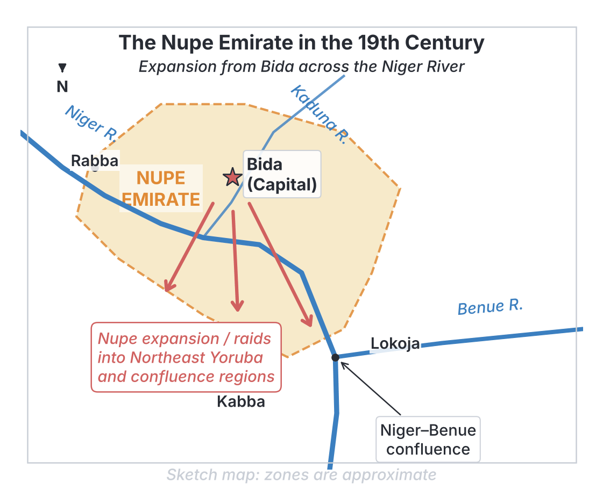
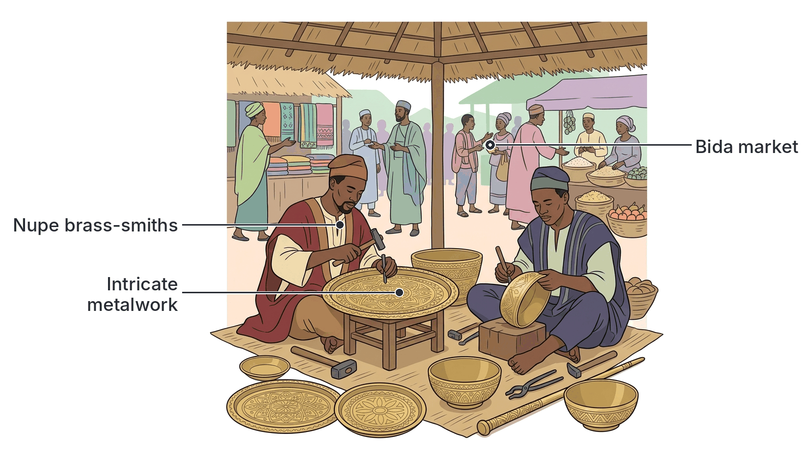

# JAMB History Notes: Nupe in the 19th Century

## What JAMB expects

This file covers Section B, Topic 5 of the JAMB History syllabus: Nupe. It covers the following content items:
* a. Internal political and cultural development
* b. Relations with neighbours.
* c. Nupe Imperialism.

By the end of these notes, you should be able to:
1. examine Nupe internal political and cultural development;
2. assess her relations with her neighbours;
3. highlight the scope and nature of Nupe Imperialism.

## Internal Political and Cultural Development

**Objective i: examine Nupe internal political and cultural development.**

The 19th century was a period of massive transformation for the Nupe people, who live mainly in the middle belt of Nigeria along the Niger River. Before this century, Nupe was an independent kingdom originally founded (according to oral tradition) by the legendary hero **Tsoede**. However, the events of the 19th century completely changed its political structure and culture. 

### The Political Crisis and the Fulani Takeover
At the end of the 18th century and the beginning of the 19th century, the Nupe kingdom was weakened by a severe internal succession dispute. Two rival indigenous princes, **Etsu Majiya II** and **Etsu Jimada**, fought for the throne, dividing the kingdom into two warring halves.

1. **The Arrival of Mallam Dendo:** During this civil war, a Fulani Islamic scholar and preacher named **Mallam Dendo** (also known locally as Manko) arrived in Nupeland. He was a flag-bearer of the Sokoto Jihad, representing the Gwandu division of the Caliphate. 
2. **Intervention in the Civil War:** Mallam Dendo and his Fulani followers took advantage of the division. At first, they allied with Majiya to defeat and kill Jimada. Later, when Majiya turned against the growing Fulani influence, the Fulani allied with Jimada’s son, Idrisu, to defeat Majiya. 
3. **Loss of Indigenous Control:** Through these shifting alliances, Mallam Dendo established himself as the real power in Nupeland. Although Dendo never officially took the title of *Etsu* (King) himself, choosing to rule from behind the scenes as a religious leader, his intervention marked the end of the indigenous Nupe dynasty's true power.

### The Establishment of the Bida Emirate
After Mallam Dendo died (around 1832 or 1833), his sons pushed aside the indigenous Nupe rulers completely and took the title of **Etsu Nupe** for themselves. Nupeland was transformed into an emirate under the Sokoto Caliphate.

* **The Rotational Succession:** Dendo's sons, primarily **Usman Zaki**, **Masaba**, and later **Umaru Majigi** (a grandson), established a highly centralized administration. To prevent destructive wars among themselves, the Fulani ruling class of Nupe created a **tripartite (three-part) rotational system** of succession. The throne of the Etsu Nupe rotated among the three ruling houses founded by Usman Zaki, Masaba, and Umaru Majigi. This system largely stabilized the politics of the emirate.
* **The New Capital, Bida:** Around 1859, Etsu Masaba moved the capital to **Bida**. Bida was heavily fortified with city walls and became the administrative, military, and commercial nerve centre of the Nupe Emirate.

### Cultural and Economic Development
The Fulani conquest brought significant cultural and economic changes to Nupeland:

* **Islamization:** While Islam had existed in Nupe before the 19th century, the establishment of the Bida Emirate made it the official state religion. Islamic law (Sharia) was implemented, and Islamic education flourished. However, a unique **syncretic culture** developed, where Islamic practices blended with traditional Nupe customs. The Fulani rulers adopted the Nupe language and the traditional title of *Etsu*.
* **Arts and Crafts:** Bida became famous across West Africa for its highly organized craft guilds. The Nupe people were celebrated for their exceptional skills in:
  * **Glassmaking:** The *masaga* (glassmakers) of Bida produced beads and bangles that were traded widely.
  * **Metalwork:** Nupe brass-smiths and silversmiths created beautiful bowls, trays, and jewellery.
  * **Weaving and Canoe Building:** They were also renowned cloth weavers and expert canoe builders, controlling transport along the Niger River.
* **Economic Prosperity:** The 19th-century Nupe state was very wealthy. The Etsu controlled a vast agricultural plantation system worked by enslaved people, producing food to support the large army and the craftsmen in the cities.

## Relations with Neighbours

**Objective ii: assess her relations with her neighbours.**

As a powerful state located at the crossroads of northern and southern Nigeria, the Nupe Emirate had complex relations with its neighbours.

### 1. Relations with the Sokoto Caliphate (Gwandu)
Nupe was officially a subordinate emirate of the Sokoto Caliphate. Specifically, it fell under the western half of the Caliphate, which was administered from **Gwandu**. 
* **Loyalty and Tribute:** Nupe maintained a respectful and submissive relationship with Gwandu. The Etsu Nupe regularly sent heavy annual tributes (which included slaves, horses, and local crafts) to the Emir of Gwandu.
* **Military Support:** Gwandu occasionally provided political backing and military support to the Nupe rulers during internal crises. In return, Nupe acted as the powerful southern frontier of the Caliphate.

### 2. Relations with Yorubaland
Nupe's relationship with its Yoruba neighbours to the south and west was a mix of diplomacy, alliance, and warfare.
* **Ilorin Emirate:** Nupe generally maintained friendly relations with the neighbouring emirate of Ilorin (another outpost of the Sokoto Jihad). They sometimes allied in military campaigns.
* **Northern Yoruba States:** Nupe launched aggressive slave raids and military expeditions against the northern Yoruba groups, such as the Yagba, Igbomina, and Kabba. These areas were heavily exploited by the Nupe army for slaves and tribute.

### 3. Relations with European Traders (The British)
Because Nupe controlled a large stretch of the Niger River, it was a crucial partner for European merchants trading in palm oil, shea butter, and ivory.
* **Initial Trade:** For most of the late 19th century, Etsu Masaba and his successors encouraged trade with British merchants. They bought imported European firearms, which they used to strengthen their army.
* **The Royal Niger Company (RNC):** Relations turned hostile in the 1880s and 1890s when the British Royal Niger Company, led by George Goldie, began to push for political control and a monopoly over the river trade. 
* **The Fall of Bida (1897):** Tensions over trade monopolies and Nupe's continued slave raiding in areas the RNC claimed to protect led to war. In **1897**, the heavily armed RNC forces, using Maxim machine guns, attacked and captured Bida, severely weakening the Nupe Emirate and forcing the Etsu into exile.

## Nupe Imperialism

**Objective iii: highlight the scope and nature of Nupe Imperialism.**

**Nupe Imperialism** refers to the aggressive military expansion and domination of weaker neighbouring societies by the Bida Emirate during the 19th century. Once the Fulani consolidated power in Bida, they turned the Nupe state into a formidable imperial power.

### The Scope of Expansion (Where they conquered)
Nupe imperialism was directed mainly towards the south and southeast, into the Niger-Benue confluence area. The Nupe cavalry and infantry conquered and dominated several non-Muslim, decentralized societies, including:
* The **Ebira** (Igbirra) and **Kakanda**.
* The **Owe (Kabba)**, **Yagba**, and **Bunu** peoples in northeastern Yorubaland.
* Parts of the **Akoko** and **Afenmai** (Kukuruku) territories in present-day Ondo and Edo states.

### The Nature of Nupe Imperialism (How and why they ruled)
Nupe imperialism was characterized by military aggression, economic exploitation, and a harsh system of administration.

1. **Military Superiority:** The Nupe army was highly organized. It relied heavily on a powerful cavalry (men on horseback) to run down opponents in the open savanna. Later in the 19th century, they bought thousands of modern rifles from European traders, which made their army virtually unstoppable against smaller groups armed with traditional weapons.
2. **Economic Motives (Slave Raiding):** The primary goal of Nupe imperialism was to acquire wealth. They needed captives to work on the massive agricultural plantations around Bida, to serve in the army, and to be sent as tribute to Gwandu. Entire villages in the confluence area were raided and destroyed to capture people.
3. **The *Ajele* System:** To govern the conquered territories, the Etsu Nupe used an administrative system based on resident representatives called ***ajele*** (or *ajia*). 
   * The *ajele* were stationed in the conquered towns.
   * Their main job was to ensure the local people paid their heavy annual taxes and tribute (usually in the form of slaves, cowries, and agricultural produce).
   * The *ajele* were often ruthless and oppressive, living lavishly at the expense of the local population.
4. **Revolts and Resistance:** The harshness of the *ajele* system caused deep resentment. In the 1890s, several conquered groups, particularly the Kabba and other northern Yoruba groups, formed the **Ogidi Alliance** to fight for their independence from Bida. The Royal Niger Company used this local resentment to their advantage, allying with the rebels when they attacked Bida in 1897.

## Key terms

| Term | Meaning |
| --- | --- |
| **Etsu** | The traditional title of the ruler (king) of the Nupe people. |
| **Bida** | The capital city of the Nupe Emirate, established in the mid-19th century. |
| **Mallam Dendo (Manko)** | The Fulani Islamic scholar who intervened in Nupe politics and paved the way for the Fulani takeover. |
| **Rotational succession** | A system where the throne passes in turn between different ruling families (in Bida, three houses) to prevent conflict. |
| **Syncretism** | The blending of different religious or cultural beliefs (e.g., Islamic practices with traditional Nupe customs). |
| **Ajele** | Resident administrators or tax collectors placed in conquered territories by the Nupe Emirate to extract tribute. |
| **Royal Niger Company (RNC)** | A British trading company that dominated the Niger River trade and eventually conquered Bida in 1897. |
| **Gwandu** | The western headquarters of the Sokoto Caliphate, to which the Nupe Emirate paid tribute. |

## Exam tips and common mistakes

* **Common mistake:** Confusing Mallam Dendo with Usman dan Fodio. While Usman dan Fodio started the Sokoto Jihad, it was his flag-bearer, Mallam Dendo, who established Fulani influence in Nupeland. 
* **Note on titles:** The Fulani rulers of Nupe did not use the title "Emir" locally; they adopted the indigenous Nupe title of **Etsu** (e.g., Etsu Masaba).
* **Imperialism focus:** Remember that Nupe was an *imperial power* in its own right in the middle belt. Their main targets were the decentralized groups in the Niger-Benue confluence (Kabba, Ebira).
* **The Ajele system:** This is a frequent exam topic. Know that it was a system of indirect control and heavy taxation that caused local revolts. Do not confuse it with the British "Indirect Rule" system.
* **Key industries:** Always associate Bida with **glassmaking** and **brass-smithing**.

## Quick summary

1. In the early 19th century, a succession dispute between Nupe princes Majiya and Jimada allowed Mallam Dendo, a Fulani jihadist, to intervene and seize political control.
2. Dendo's sons pushed aside the indigenous rulers, establishing the Nupe Emirate with its capital at Bida and adopting the title of Etsu.
3. To prevent internal wars, the Fulani rulers created a three-house rotational system of succession.
4. Bida became a major economic and cultural centre, famous for Islamic scholarship, glassmaking, and brass-smithing.
5. Nupe was subservient to Gwandu (part of the Sokoto Caliphate) but acted as an aggressive imperial power towards its southern neighbours.
6. Nupe imperialism targeted the Niger-Benue confluence (e.g., Kabba, Ebira), using cavalry and firearms to raid for slaves and exact tribute.
7. Conquered areas were ruled harshly using the *ajele* (resident tax collector) system, which sparked rebellions like the Ogidi alliance.
8. The Nupe Emirate's power was broken in 1897 when a trade dispute led to its conquest by the British Royal Niger Company.

## Practice questions

**1. The Fulani jihadist who played a major role in the overthrow of the indigenous Nupe dynasty was**
- A. Usman dan Fodio
- B. Sultan Bello
- C. Mallam Dendo
- D. Etsu Masaba

**Answer: C.** Mallam Dendo (also known as Manko) was the Fulani scholar who used the civil war between Nupe princes to establish Fulani dominance in Nupeland.

**2. To prevent constant succession disputes, the Fulani rulers of the Bida Emirate established a system of**
- A. primogeniture, where the eldest son always inherits the throne
- B. tripartite rotational succession among three ruling houses
- C. electing rulers through a council of indigenous Nupe elders
- D. allowing the Emir of Gwandu to appoint the Etsu

**Answer: B.** The throne rotated among three ruling houses descended from Mallam Dendo's family (Usman Zaki, Masaba, and Umaru Majigi) to maintain peace.

**3. Which city became the capital and the commercial centre of the Nupe Emirate in the mid-19th century?**
- A. Lokoja
- B. Ilorin
- C. Rabba
- D. Bida

**Answer: D.** Etsu Masaba established Bida as the new, heavily fortified capital around 1859, and it became a major centre of trade and crafts.

**4. The Nupe Emirate paid its allegiance and sent annual tributes to which headquarters of the Sokoto Caliphate?**
- A. Gwandu
- B. Kano
- C. Katsina
- D. Borno

**Answer: A.** The Sokoto Caliphate was divided into two halves; the western half, which included Nupe and Ilorin, was administered from Gwandu. 

**5. Nupe imperialism in the 19th century was primarily directed towards the**
- A. Hausa states to the north
- B. Kanem-Borno empire to the northeast
- C. Niger-Benue confluence and northern Yorubaland
- D. coastal states of the Niger Delta

**Answer: C.** Nupe expanded south and southeast into the confluence area, conquering groups like the Kabba, Ebira, and Akoko. 

**6. In the 19th century, the Nupe people were widely celebrated across West Africa for their skills in**
- A. sculpting terracotta heads
- B. glassmaking and brass-smithing
- C. gold mining and exporting
- D. building stone pyramids

**Answer: B.** The *masaga* (glassmakers) and brass-smiths of Bida were famous for their intricate and highly organized craftwork. Terracotta heads are associated with Nok or Ife.

**7. The administrative officials stationed by the Etsu Nupe in conquered territories to collect taxes and tribute were known as**
- A. Hakimi
- B. Ajele
- C. Bashorun
- D. Oba

**Answer: B.** The *ajele* (or *ajia*) were resident representatives placed in conquered towns to ensure tribute was paid. *Hakimi* is a Hausa term for a district head, and *Bashorun* is a Yoruba title.

**8. The primary economic motive behind Nupe military raids into the confluence area was to**
- A. acquire slaves for plantations and tribute
- B. find new sources of crude oil
- C. secure land for planting cocoa
- D. capture coastal ports for the transatlantic slave trade

**Answer: A.** The Nupe economy and their tribute obligations to Gwandu relied heavily on the mass capture of slaves from neighbouring weaker societies.

**9. The military power of the Nupe Emirate in the late 19th century was greatly enhanced by their acquisition of**
- A. iron chariots
- B. European firearms from river traders
- C. armed steamships
- D. trained elephants

**Answer: B.** While cavalry was traditional, Nupe's later military dominance over confluence peoples was heavily aided by imported European rifles bought from traders on the Niger River.

**10. The Nupe Emirate's control over the Niger River trade eventually led to its military defeat in 1897 by the**
- A. French colonial army
- B. Sokoto Caliphate forces
- C. Royal Niger Company
- D. Ogidi Alliance

**Answer: C.** In 1897, the British Royal Niger Company (RNC), seeking total control over the river trade and wishing to stop Nupe slave raiding, attacked and conquered Bida. The Ogidi Alliance rebelled, but it was the RNC that defeated Bida.

<!-- COVERAGE
obj i | Internal Political and Cultural Development
obj ii | Relations with Neighbours
obj iii | Nupe Imperialism
item a | Internal Political and Cultural Development
item b | Relations with Neighbours
item c | Nupe Imperialism
-->
