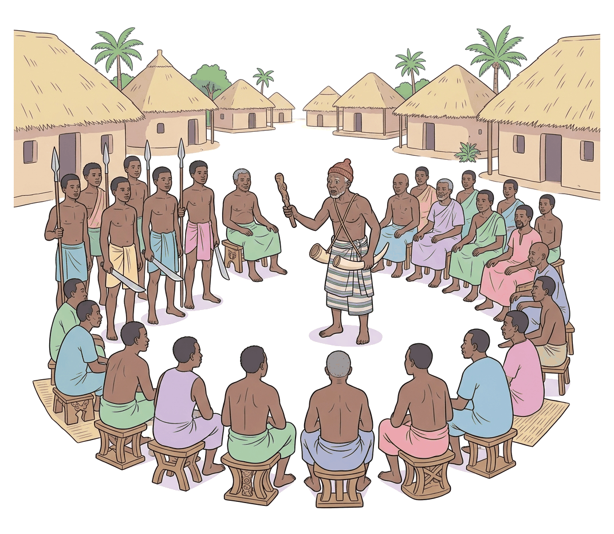
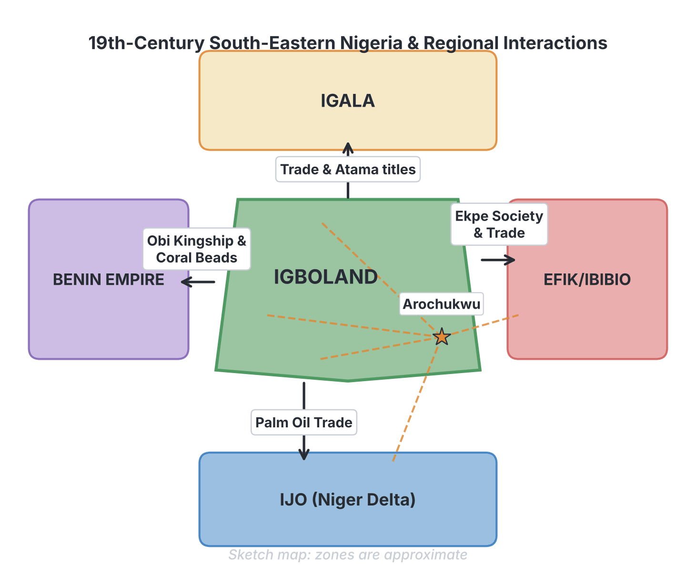

# JAMB History Notes: Igbo Society in the 19th Century

## What JAMB expects

This topic is Section B, Topic 6 of the JAMB History syllabus: Igbo (The Nigeria Area 1800 – 1900). It has two main content items:

- **a. Internal political and cultural development**
- **b. Relations with neighbours.**

By the end of these notes, you should be able to:

1. Examine Igbo internal political and cultural development.
2. Assess her relations with her neighbours.

In the 19th century, the Igbo-speaking people inhabited the forest region of south-eastern Nigeria, mostly east of the lower River Niger, with some groups (the Western Igbo) living west of the river. Unlike the highly centralized Sokoto Caliphate or the Benin Empire, most Igbo communities operated a unique system of direct village democracy. These notes explore how they governed themselves, their cultural and economic lives, and how they interacted with the peoples around them during a century of massive economic change.

---

## Internal Political and Cultural Development

**Objective i: examine Igbo internal political and cultural development.**
**Content a: Internal political and cultural development.**

To understand the Igbo in the 19th century, we must look at how they organized power (politics) and how they lived, worshipped, and survived (culture and economy).

### Political Development: The Acephalous System

The most defining feature of 19th-century Igbo political organization was that it was generally **non-centralized**, **segmentary**, or **acephalous** (a word meaning "without a head"). 

Unlike the Hausa, Yoruba, or Edo who had powerful kings (Emirs, Obas) ruling over large territories, the Igbo believed in decentralized power. This is captured in the popular saying ***"Igbo enwe eze"*** ("the Igbo have no king"). This does not mean they had no leaders; it means they did not have absolute monarchs who ruled over wide empires. Instead, each village was an independent republic, and power rested with the people. This is often called **village democracy**.

The political structure was built from the bottom up, based on the family and blood ties (kinship).

#### 1. The Family and the Umunna
The smallest unit of society was the nuclear family (a man, his wives, and children), living in a compound. A group of related families formed the extended family. 
Several extended families that traced their descent to a common male ancestor made up the ***Umunna*** (patrilineage). The *Umunna* was the foundation of the Igbo political system. It was headed by the oldest male, known as the *Okpara* (or *Opara*). He held the ***Ofo***, a sacred staff of office made from a branch of the *Ofo* tree, which symbolized truth, justice, and the authority of the ancestors. The *Okpara* settled minor disputes within the family.

#### 2. The Village and the Village Assembly (Oha-na-eze)
Several *Umunna* came together to form a village (*Obodo*). The village was the highest sovereign political unit. 
Government at the village level was a **direct democracy**. When important decisions needed to be made (such as going to war, clearing paths, or making new laws), all adult males gathered at the village square (*Ilo*). This gathering was the **Village Assembly** (*Oha-na-eze*). Every man had the right to speak, and decisions were reached by consensus (general agreement), not by a single leader dictating orders.

#### 3. The Council of Elders (Ndichie / Ama-ala)
While everyone could speak at the assembly, the actual day-to-day administration and preparation of issues was handled by the **Council of Elders** (*Ndichie* or *Ama-ala*). These were the heads of the various *Umunna*, recognized for their age, wisdom, and possession of the *Ofo*. They acted as the executive and judicial council. They listened to disputes, cross-examined witnesses, and pronounced judgments based on the customs of the land (*Omenala*). However, their decisions could be challenged by the general assembly if the people felt they were unfair.

#### 4. Age Grades (Uke or Ebiri)
Age grades were associations of young men (and sometimes women) born within a few years of each other (usually a 3-to-5-year age bracket). They were the "workforce" and "police" of the village.
*   **Executive duties:** They executed the decisions of the elders and the village assembly.
*   **Public works:** They cleared paths, swept the village square, and built markets or shrines.
*   **Defense and policing:** The younger, stronger age grades served as the village army to defend against attacks, and as police to arrest criminals, collect fines, and enforce laws.

#### 5. Title Societies (e.g., Ozo)
Igbo society highly respected personal achievement, especially in farming and wealth. Successful men could buy their way into prestigious **Title Societies**, the most famous being the ***Ozo*** (or *Nze na Ozo*) society. 
Taking a title was expensive; a man had to feast the entire community and pay heavy initiation fees. In return, he gained immense social respect, wore special regalia (like the red cap and ankle threads), and enjoyed immunity from physical assault. Title holders were seen as upright men who could not tell lies, so they played a major role in settling serious disputes and shaping village policies.

#### 6. Women's Institutions
Women had significant political power in 19th-century Igboland, operating parallel to the men's organizations.
*   ***Umuada* (Daughters of the lineage):** These were all the adult women born into a particular village, whether married within it or married out to other villages. The *Umuada* were highly respected. They settled quarrels among women, disciplined abusive husbands, and were the ultimate peace-makers. If a serious conflict arose in the village that the men could not solve, the *Umuada* could intervene and force a resolution.
*   ***Otu Inyom* (Wives of the lineage):** These were the women married into the village. They controlled the markets, regulated prices, and managed women's agricultural affairs.

#### 7. Secret Societies (Mmanwu)
Secret societies, often represented by masquerades (*Mmanwu*), were seen as the spirits of the ancestors visiting the living. They were used for social control. If a person committed a taboo or ignored the elders' judgment, a masquerade would be sent at night to sing insulting songs at their house, fine them, or destroy their property. Because the masquerade was considered a spirit, no one could fight back against it.

#### Exceptions: Centralized Igbo Communities
While the acephalous system was the standard, a few Igbo groups had centralized governments with kings, largely due to contact with powerful neighbours:
1.  **The Western Igbo (e.g., Onitsha, Asaba, Agbor):** Because of their closeness to the Benin Empire, they adopted the Benin kingship system. They had kings known as the ***Obi***, who ruled with a council of red-capped chiefs (Ndichie), wearing coral beads and operating a more hierarchical government.
2.  **Arochukwu:** The Aro people operated a unique system that was a mix of an oligarchy (rule by a powerful few) and a theocracy (rule based on religion). They had a king, the *Eze Aro*, who governed a highly organized trading network backed by a powerful oracle.

### Cultural and Economic Development

Igbo culture in the 19th century was deeply intertwined with their religious beliefs and their economic survival.

#### Religion and the Oracles
Religion was not separate from daily life; it guided laws, farming, and politics.
*   **Chukwu / Chineke:** The Igbo believed in one Supreme Creator God. However, *Chukwu* was seen as too great and distant to be bothered with minor human affairs.
*   **Minor Deities:** People worshipped minor gods who acted as messengers to *Chukwu*. The most important was ***Ala*** (or *Ani*), the Earth Goddess. She was the goddess of fertility, morality, and custom. Crimes like murder, stealing yams, or incest were abominations against the earth (*nso ala*), and the offender had to perform sacrifices to appease her. Other deities included *Amadioha* (god of thunder) and *Idemmili* (water goddess).
*   **Chi:** The Igbo believed strongly in the *Chi*, a personal guardian spirit given to every individual by the Creator. A person's success or failure was often tied to their *Chi*. This belief encouraged hard work, individualism, and a drive to achieve, because a person could "negotiate" with their *Chi* through determination.
*   **Oracles:** Where human wisdom failed, the Igbo turned to oracles to settle difficult cases (like land disputes, murder, or witchcraft accusations). Oracles were seen as the final court of appeal. The most famous 19th-century oracles were:
    1.  **Ibini Ukpabi (The Long Juju)** of Arochukwu.
    2.  **Agbala** of Awka.
    3.  **Igwekala** of Umunneoha.
    4.  **Kamalu** of Ozuzu.

#### The Aro and the Oracles in the 19th Century Economy
The 19th century was a time of massive economic change. In 1807, Britain abolished the transatlantic slave trade and began pushing for "legitimate commerce" (trade in palm oil and agricultural goods). 

However, the internal slave trade continued for a long time. The **Aro people** of Arochukwu used their oracle, the *Ibini Ukpabi*, to dominate this trade. People from all over Igboland brought their difficult disputes to the Long Juju. The priests of the oracle would pronounce judgment. Those found guilty were supposedly "eaten by the gods." In reality, they were secretly sold into slavery and transported through the Aro trade network to the coast.

As the century progressed, the Igbo economy shifted heavily towards **palm oil and palm kernels**. The region became the largest producer of palm oil in West Africa, exchanging it for European goods like guns, cloth, gin, and iron. 

#### Agriculture and Craftsmanship
*   **Agriculture:** Yam was the "king of crops." It was a man's crop, tied to prestige, wealth, and the title system. A man's greatness was often measured by the size of his yam barn. The **New Yam Festival** (*Iri ji*) was the most important cultural festival, thanking the gods for a good harvest. Women grew crops like cocoyam, vegetables, and later, cassava.
*   **Craftsmanship:** Certain Igbo communities specialized in specific crafts and travelled widely to sell their skills. 
    *   **Awka and Nkwerre people** were famous blacksmiths, making hoes, cutlasses, and local guns.
    *   **Akwete people** (in Ndoki) were renowned for their highly skilled textile weaving (Akwete cloth).
    *   **Uburu and Okposi people** specialized in salt making from local salt lakes.

---

## Relations with Neighbours

**Objective ii: assess her relations with her neighbours.**
**Content b: Relations with neighbours.**

The Igbo did not live in isolation. Despite being heavily forested, Igboland was connected to its neighbours through a vast web of trade routes, cultural exchanges, intermarriages, and sometimes warfare. Their main neighbours were the **Igala** to the north, the **Benin Empire** to the west, and the **Ijo, Efik, and Ibibio** to the south and east (the Niger Delta and Cross River regions).

Relations in the 19th century were driven largely by the shift from the slave trade to the palm oil trade.

### 1. Relations with the Igala (North)
The Igbo and the Igala shared a long border and interacted heavily along the River Niger and in the Nsukka region.
*   **Trade:** They traded actively. The Igbo supplied agricultural produce, Awka iron tools, and slaves, while the Igala brought horses, glass beads, and textiles from further north. The River Niger was a major highway for this commerce.
*   **Cultural Exchange:** There was significant cultural borrowing. In the northern Igbo areas (like Nsukka), Igala influence was very strong. Some Igbo communities adopted Igala-style masquerades and weaving techniques. Furthermore, some political titles in the Nsukka area, such as the ***Atama*** (priests of local deities), are believed to have Igala origins. 
*   **Conflict:** Relations were not always peaceful. In earlier centuries and into the 19th century, Igala warriors (like the legendary Onoja Oboni) sometimes raided northern Igbo border towns, leading to skirmishes.

### 2. Relations with the Benin Empire (West)
The relationship between the Igbo and the Benin Empire was profound, particularly for the Western Igbo (communities west of the Niger, known today as the Anioma people, including Asaba, Agbor, and Ibusa) and riverine towns like Onitsha.
*   **Political Influence:** The most visible impact of this relationship was political. Benin was a powerful, centralized empire. To deal with Benin, or because they were founded by migrants fleeing from Benin (according to some oral traditions), many Western Igbo communities abandoned the pure acephalous system and adopted the **Benin kingship system**. They instituted the title of the ***Obi*** (king), complete with royal regalia, coral beads, a hierarchical council of chiefs, and court rituals similar to the Oba of Benin.
*   **Warfare and Trade:** The Benin army occasionally invaded Western Igbo territories to exact tribute or control trade routes. However, there was also vibrant trade, with Benin trading specialized crafts, brass, and cloth for Igbo agricultural goods.

### 3. Relations with the Ijo, Efik, and Ibibio (South and East)
The southern and eastern neighbours lived in the Niger Delta and the Cross River basin. These were the coastal middlemen who connected the Igbo hinterland to the European ships on the Atlantic Ocean.
*   **The Palm Oil Trade:** In the 19th century, the Igbo were the primary producers of palm oil, but they did not have direct access to the sea. The **Ijo** city-states (like Bonny, Kalabari, and Nembe) and the **Efik** (in Calabar) acted as middlemen. The Aro trade network bought oil from the Igbo interior, transported it down the rivers (using large canoes), and sold it to the coastal middlemen, who then sold it to European merchants. This created a highly interdependent, symbiotic economic relationship.
*   **Cultural Exchange:** Because of this intense trade, cultures mixed. The most notable example was the ***Ekpe*** (or *Mgbe*) **secret society**. Originally developed by the Efik and Ejagham people, the Ekpe society was adopted by the Aro and other Igbo groups. It served as a powerful tool for enforcing trade debts and maintaining law and order across different ethnic groups. If an Igbo trader owed an Efik trader, the Ekpe society (which both belonged to) could punish the defaulter.
*   **Intermarriage and Language:** To cement trade alliances, wealthy Aro and Igbo traders often married women from the Delta and Cross River communities. Bilingualism (speaking two languages) was common along the trade routes.

### The Role of the Aro Trade Network and Warfare
When assessing Igbo relations with their neighbours, the **Aro of Arochukwu** cannot be ignored. The Aro established trade settlements (colonies) throughout Igboland and in neighboring non-Igbo territories (like Ibibioland). 

To protect their trade monopolies and enforce the judgments of the Long Juju, the Aro needed military muscle. Since the Aro were traders, not soldiers, they formed alliances with warlike eastern Igbo groups—specifically the **Abam, Ohafia, and Edda**. 
The Aro hired these warriors as mercenaries. If an Igbo village or a neighboring non-Igbo community refused to trade with the Aro, attacked Aro messengers, or disrespected the oracle, the Aro would bring in the Abam or Ohafia warriors to raid and destroy the community. These raids provided a steady supply of captives for the slave trade, even deep into the 19th century.

### Summary of Relations
Overall, 19th-century Igbo relations with their neighbours were a complex mix of:
1.  **Economic dependence:** Relying on coastal states to export their palm oil and on northern states for specialized goods.
2.  **Cultural borrowing:** Adopting kingship from Benin, titles from Igala, and secret societies from the Efik.
3.  **Strategic warfare:** Using mercenaries (like the Abam) to maintain trade routes and monopolies.

---

## Key terms

| Term | Meaning |
| --- | --- |
| Acephalous / Segmentary | A decentralized political system without a single ruling head or king; "stateless". |
| *Igbo enwe eze* | "The Igbo have no king"; a philosophy describing their decentralized, democratic village system. |
| *Umunna* | The patrilineage or extended family; the basic unit of Igbo political and social organization. |
| *Ofo* | A sacred wooden staff symbolizing truth, justice, and the authority of the ancestors. |
| *Oha-na-eze* | The village assembly where all adult males met to make decisions via direct democracy. |
| *Ndichie* | The Council of Elders who handled day-to-day administration and justice. |
| Age Grades (*Uke*) | Associations of people of similar age who performed executive, policing, and public works duties. |
| *Ozo* | A prestigious title society for wealthy and successful men, giving them political influence. |
| *Umuada* | The association of the daughters of the lineage, possessing strong political and peace-making powers. |
| *Ala / Ani* | The Earth Goddess, the most important deity responsible for morality and custom. |
| *Chi* | The personal guardian spirit given to every individual by the Creator. |
| *Obi* | The title of the king in centralized Western Igbo communities (e.g., Onitsha), adopted from Benin. |
| *Ibini Ukpabi* | The Long Juju oracle of Arochukwu, used by the Aro to dominate trade and justice. |
| *Ekpe* | A secret society originating from the Efik/Cross River area, adopted by the Igbo to regulate trade. |

## Exam tips and common mistakes

*   **Common mistake:** Assuming all Igbo communities had no kings. While the *acephalous* system was the norm, **always remember the exceptions**: Western Igbo (Onitsha, Asaba) had the *Obi* influenced by Benin, and Arochukwu had a centralized system led by the *Eze Aro*.
*   **Mixing up oracles:** JAMB often asks which oracle belongs to which town. Memorize them: *Ibini Ukpabi* (Arochukwu), *Agbala* (Awka), *Igwekala* (Umunneoha), *Kamalu* (Ozuzu).
*   **Direct vs Indirect Democracy:** Understand that the Igbo Village Assembly (*Oha-na-eze*) was a **direct democracy** (everyone speaks for themselves), unlike representative systems where people elect someone to speak for them.
*   **The highest judicial body:** In daily matters, the Council of Elders (*Ndichie*) was the highest. But for cases too difficult for humans to solve, the **Oracles** were the supreme court of appeal.
*   **Aro military:** The Aro were traders and priests. They did not fight their own wars; they used **Abam, Ohafia, and Edda** warriors as mercenaries.
*   **Benin and Igala influence:** Remember that Benin gave the Western Igbo their kingship (*Obi*) system, while the Igala influenced the Northern Igbo (*Atama* titles).

## Quick summary

1.  In the 19th century, most Igbo communities operated a decentralized, acephalous political system characterized by direct village democracy (*"Igbo enwe eze"*).
2.  Political power was shared among the *Umunna* (patrilineage), the Village Assembly (*Oha-na-eze*), the Council of Elders (*Ndichie*), Age Grades, Title Societies (*Ozo*), and Women's groups (*Umuada*).
3.  Western Igbo communities (like Onitsha) were an exception; they operated a centralized kingship system (*Obi*) due to the influence of the Benin Empire.
4.  Religion guided daily life. *Ala* (the Earth Goddess) was the guardian of morality, while Oracles (like the Long Juju of Arochukwu and Agbala of Awka) served as the highest courts of justice.
5.  Economically, the 19th century saw a massive shift to the palm oil trade. Specialized craftsmen like the Awka blacksmiths and Akwete weavers played vital roles in the economy.
6.  The Igbo traded heavily with their neighbours: selling palm oil to the Ijo and Efik coastal middlemen in exchange for European goods.
7.  Cultural exchange with neighbours was strong: the Igbo adopted the *Ekpe* secret society from the Efik/Ibibio, and experienced cultural blending with the Igala in the north.
8.  The Aro of Arochukwu dominated regional trade using the *Ibini Ukpabi* oracle and hired Abam/Ohafia mercenaries to attack rival communities and capture slaves.

## Practice questions

**1. The fundamental unit of political and social organization in 19th-century Igbo society was the:**
- A. Age grade
- B. Umunna
- C. Ozo society
- D. Ndichie

**Answer: B.** The *Umunna* (patrilineage or extended family) was the foundation of the Igbo political system, from which villages and larger groups were formed.

**2. Which of the following groups executed the laws and carried out public works in traditional Igbo society?**
- A. The Ndichie
- B. The Umuada
- C. The Age Grades
- D. The Ozo title holders

**Answer: C.** Age grades served as the executive arm of the village government, acting as police, fighting wars, and doing public works like clearing paths. The *Ndichie* made decisions, while the age grades executed them.

**3. The centralized kingship system headed by an *Obi* in Western Igbo communities was primarily a result of the influence of the:**
- A. Igala Kingdom
- B. Benin Empire
- C. Arochukwu Oligarchy
- D. Efik Kingdom

**Answer: B.** Western Igbo communities (like Onitsha and Asaba) adopted the *Obi* kingship system, coral beads, and court rituals due to their proximity to and historical contact with the Benin Empire.

**4. In 19th-century Igbo religion, the deity responsible for morality, custom, and agricultural fertility was:**
- A. Amadioha
- B. Chi
- C. Chukwu
- D. Ala

**Answer: D.** *Ala* (or *Ani*), the Earth Goddess, was the most important deity concerning daily life, morality, and custom. Crimes like murder were abominations against her (*nso ala*).

**5. The highest court of appeal in traditional Igbo society for disputes that human elders could not resolve was the:**
- A. Village Assembly
- B. Oracles
- C. Ozo society
- D. Umuada

**Answer: B.** When cases were too difficult, such as land disputes or witchcraft accusations, they were referred to powerful Oracles like the *Ibini Ukpabi* or *Agbala* for final judgment.

**6. The Aro of Arochukwu maintained their 19th-century trade monopoly and enforced their oracle's judgments by:**
- A. Building a massive standing army of Aro citizens
- B. Hiring Abam, Ohafia, and Edda mercenaries
- C. Signing treaties with the British
- D. Using the Ekpe society to fight wars

**Answer: B.** The Aro were traders and priests, not soldiers. They hired warlike groups like the Abam and Ohafia as mercenaries to raid uncooperative communities and capture slaves.

**7. Which of the following secret societies was adopted by the Aro and other Igbo groups from the Efik/Ibibio to help regulate trade?**
- A. Mmanwu
- B. Ozo
- C. Ekpe
- D. Ogboni

**Answer: C.** The *Ekpe* (or *Mgbe*) society originated in the Cross River (Efik/Ejagham) area and was adopted by the Aro and others to enforce trade debts and maintain order across different ethnic groups.

**8. The symbol of authority, truth, and justice held by the Okpara and the elders in Igboland is the:**
- A. Ofo
- B. Ikenga
- C. Omu
- D. Alo

**Answer: A.** The *Ofo* is the sacred wooden staff held by the head of the family or the elders, symbolizing their authority and connection to the ancestors. 

**9. During the 19th century, the Igbo economy shifted largely to meet European demands for:**
- A. Groundnuts
- B. Cocoa
- C. Palm oil
- D. Cotton

**Answer: C.** Following the abolition of the transatlantic slave trade, the region transitioned to "legitimate commerce," with the Igbo becoming the major producers of palm oil and palm kernels.

**10. The powerful women's organization made up of the daughters of a lineage, known for their peace-making abilities, is called the:**
- A. Otu Inyom
- B. Umuada
- C. Ndichie
- D. Uke

**Answer: B.** The *Umuada* refers to the daughters born into a lineage. They possessed significant political power and were the ultimate arbiters of peace in the community. (*Otu Inyom* refers to the wives).

<!-- COVERAGE
obj i | Internal Political and Cultural Development
obj ii | Relations with Neighbours
item a | Internal Political and Cultural Development
item b | Relations with Neighbours
-->
