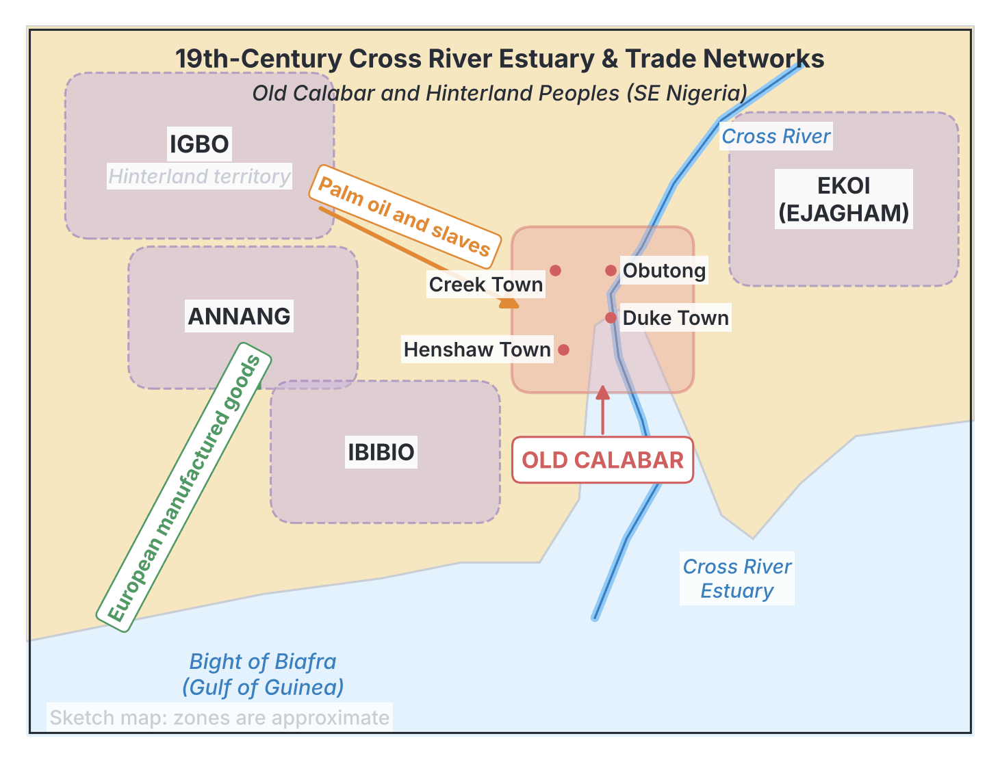
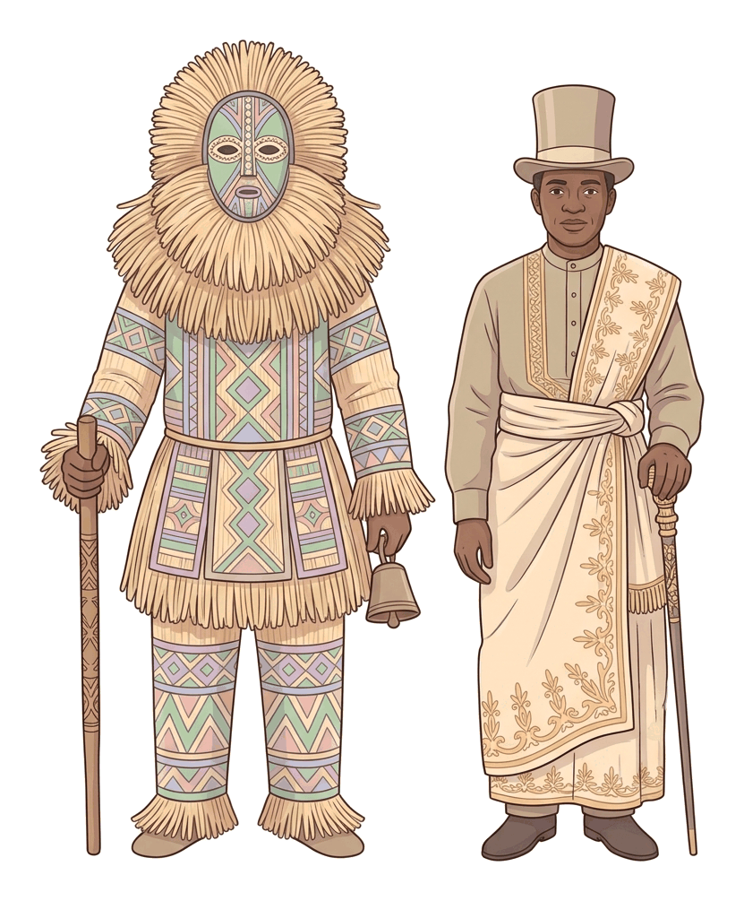

# JAMB History Notes: Efik Society in the 19th Century

## What JAMB expects

This topic is Section B, Topic 7 of the JAMB History syllabus: Efik. It covers the following content items:
- a. Internal political and cultural development
- b. Relations with neighbours

By the end of these notes, you should be able to:
1. Examine Efik internal political and cultural development.
2. Assess her relations with her neighbours.

## Introduction to the Efik and Old Calabar

The **Efik** are a major ethnic group located in the south-eastern coastal region of Nigeria, primarily in present-day Cross River State. Their major settlement area is commonly known in history as **Old Calabar**, situated along the Cross River estuary. 

According to oral tradition, the Efik migrated from the hinterland (around Arochukwu, Umuahia, or the Ibibio mainland) and settled near the coast over several centuries. By the 19th century, the Efik had established several powerful city-states or towns along the rivers, the most prominent being **Duke Town**, **Creek Town**, **Henshaw Town**, and **Obutong** (Old Town). 

Because of their coastal location at the mouth of the Cross River, the Efik became the dominant **middlemen** in the trade between the European merchants on the Atlantic Ocean and the peoples of the hinterland. This economic power deeply shaped their internal politics, their culture, and how they interacted with their neighbours throughout the 1800s.

## Objective i: Examine Efik internal political and cultural development

**Content a: Internal political and cultural development.**

The 19th century was a time of massive change for Efik society. The British had abolished the transatlantic slave trade in 1807, forcing the Efik to transition their economy from selling human beings to selling **palm oil** and palm kernels (often called the transition to **"legitimate trade"**). This economic shift caused major political and cultural developments.

### The Political Structure: The House System (Ufok)

Efik society was decentralised; there was no single empire, but rather a collection of city-states. Their political and social organisation was based on the **House System** (known as *Ufok*).

1. **The Ufok (House):** A House was originally a large family or lineage group, but because of the coastal trade, it evolved into a powerful trading corporation. A House included the free-born members of the family, as well as hundreds of domestic slaves, trading agents, and labourers who were all considered members of the House.
2. **The Etubom (Head of the House):** Each House was led by an *Etubom*. He was usually the wealthiest and most successful trader, chosen for his business skills rather than just his age. He controlled the trade canoes, managed the wealth of the House, and protected its members.
3. **The Obong (King):** The various Houses in an Efik town recognised a central monarch called the **Obong**. The Obong was the paramount ruler of the town, but his power was not absolute. He ruled with the advice of a council made up of the *Etubom* of the different Houses. Two of the most famous 19th-century Efik kings were **King Eyo Honesty II** of Creek Town and **King Eyamba V** of Duke Town.

### The Ekpe Secret Society

The most important institution for political and social control in Efik society was the **Ekpe (Leopard) Society**. Because Efik towns were fiercely competitive in trade, the Ekpe society acted as the central government that united them and kept peace.

**What was Ekpe?**
Ekpe was a male secret society. The word "Ekpe" means Leopard, an animal symbolising power, stealth, and authority. The society was divided into grades, and members paid high fees to move up to the highest grades (such as *Ambo* and *Nyampa*). Only the wealthiest traders, kings, and free-born men could afford to reach the top. Interestingly, European traders (supercargoes) were also allowed to buy their way into the lower grades of Ekpe to protect their business interests.

**Functions of the Ekpe Society:**
*   **Executive and Judicial:** It was the highest court in the land. Ekpe made laws and punished offenders. Punishments ranged from heavy fines to execution.
*   **Economic (Debt Collection):** In the 19th-century trade, Europeans gave Efik middlemen goods on credit (the **"trust" system**) to go inland and buy palm oil. If a trader refused to pay his debt, Ekpe could boycott his business, seize his property, or place his House under a trade ban (known as "blowing Ekpe"). This made Ekpe essential for economic stability.
*   **Social Control:** Ekpe enforced respect for elders and rulers. During Ekpe festivals, masquerades (representing the spirit of the leopard) would patrol the streets to enforce curfews and maintain order.
*   **Integration:** Ekpe brought the leaders of rival Efik towns (like Duke Town and Creek Town) together into one supreme council, preventing full-scale wars between them.

### Cultural Developments

The 19th century saw a rich blending of indigenous traditions and new foreign influences in Efik culture.

#### 1. Nsibidi Script
The Efik, drawing from their Ekoi (Ejagham) neighbours, heavily utilised **Nsibidi**, an ancient system of indigenous ideographic writing. Nsibidi was not an alphabet, but a set of symbols that represented concepts, warnings, or stories. It was a secret knowledge controlled by the Ekpe society. It was used to record court cases, send secret messages across long distances, and decorate traditional cloth (Ukara cloth) and calabashes.

#### 2. The Nkuho (Fattening Room)
A major cultural practice was the *Nkuho* (fattening room) for young women. Before marriage, a young Efik woman of noble birth was kept in seclusion for several months or even years. During this time:
*   She was fed rich foods to make her plump, which was considered a sign of beauty, wealth, and health.
*   She was taught the cultural duties of a wife, how to manage a home, traditional dances, and folklore.
*   She was pampered and not allowed to do hard labour. After her seclusion, she was paraded in the town in a grand coming-out ceremony before her wedding.

#### 3. The Order of Blood Men (Nka Iyip)
The transition to the palm oil trade created a massive social crisis. Unlike the slave trade, where captives were shipped away, the palm oil trade required the Efik to keep thousands of slaves on large agricultural plantations to harvest and process palm fruits. 
*   Soon, the population of slaves vastly outnumbered the free-born Efik.
*   By Efik custom, when an *Obong* or a wealthy *Etubom* died, many slaves were killed (human sacrifice) to accompany and serve him in the afterlife. 
*   In the 1840s and 1850s, the plantation slaves revolted. They swore a blood oath to protect each other and formed the **Order of Blood Men** (*Nka Iyip*). 
*   When a prominent master died, the Blood Men would march armed into the Efik towns to prevent any of their members from being sacrificed. This development forced Efik rulers to gradually abandon the practice of human sacrifice.

#### 4. The Arrival of Christian Missionaries
The Efik kings themselves invited European missionaries to teach their children how to read, write, and understand modern business. In **1846**, the **Church of Scotland Mission (Presbyterian)**, led by **Reverend Hope Masterton Waddell**, arrived in Old Calabar. 
*   They established schools and introduced the printing press.
*   They created a written alphabet for the Efik language and translated the Bible, making Efik one of the first Nigerian languages to be written down in Roman script.
*   They campaigned against traditional practices such as the killing of twins (which the Efik believed were an evil omen) and human sacrifice. The famous Scottish missionary **Mary Slessor**, who arrived later in 1876, played a massive role in finally stopping the killing of twins in the region.

## Objective ii: Assess her relations with her neighbours

**Content b: Relations with neighbours.**

The survival and wealth of the Efik depended entirely on their relations with the people around them. They were bordered by the **Ibibio** and **Annang** to the west, the **Ekoi (Ejagham)** to the north and east, and the **Igbo** (specifically the Arochukwu network) further inland.

### The Efik as Economic Middlemen

The most defining feature of Efik relations with their neighbours was their role as coastal **middlemen**. 
1. **The Monopoly:** The Efik strictly controlled the Cross River. They refused to allow European merchants (supercargoes) to sail inland, and they refused to allow hinterland producers (the Ibibio, Ekoi, and Igbo) to come directly to the coast. This forced all trade to pass through Efik hands.
2. **The Trade Process:** Efik traders received manufactured goods (cloth, guns, gunpowder, iron bars, gin, and manillas) on **trust** (credit) from the Europeans. They loaded these goods into massive war-canoes—some carrying up to a hundred armed men and mounted with small cannons—and rowed up the Cross River.
3. **The Hinterland Markets:** In the hinterland, they exchanged the European goods for slaves (in the early 19th century) and later palm oil, palm kernels, and ivory. They then transported these goods back to Old Calabar to sell to the Europeans at a high profit.

### Interactions and Alliances with Neighbours

To maintain this profitable system, the Efik had to carefully manage their relations with the hinterland communities through both peaceful diplomacy and force.

| Type of Relation | How it worked between the Efik and their neighbours |
| :--- | :--- |
| **Commercial alliances** | The Efik formed strong trading partnerships with the **Aro**, the dominant Igbo trading group in the hinterland. The Aro collected goods and slaves from the deep interior using their Chukwu oracle network and brought them to central markets where Efik traders bought them. |
| **Cultural exchange** | Efik culture heavily influenced the region. The **Efik language** became the *lingua franca* (common trade language) of the entire Cross River basin. Elements of Efik dress, architecture, and music were adopted by hinterland chiefs. |
| **The spread of Ekpe** | The Ekpe society (which the Efik originally adopted from the Ekoi) was exported by the Efik to other neighbouring communities. Hinterland chiefs bought the rights to establish Ekpe lodges in their own towns. This created a shared legal and political system across different ethnic groups, making it safe for Efik traders to travel through foreign lands, as Ekpe members were bound to protect each other. |
| **Inter-marriage** | Efik merchants frequently married the daughters of powerful chiefs among the Ibibio, Annang, and Ekoi. This cemented political alliances, guaranteed safe passage for trade canoes, and established blood ties that prevented wars. |

### Conflict and Warfare

Relations were not always peaceful. Because the stakes were so high, economic disputes frequently led to violence.

1. **Protecting the Monopoly:** If a hinterland community tried to bypass the Efik to trade directly with Europeans, or if they attacked Efik trade canoes, the Efik would respond ruthlessly. They used their wealth to maintain large fleets of war-canoes armed with European cannons and muskets. 
2. **Trade Blockades:** The most common Efik weapon against uncooperative neighbours was the trade blockade. If an inland group refused to pay debts or threatened Efik traders, the Efik would seal off the river, cutting the community off from salt, guns, and European goods until they surrendered.
3. **Internal Disputes spilling over:** Sometimes, civil disputes within Efik towns affected their neighbours. When factions within Old Calabar fought over trade advantages, they would sometimes ally with different hinterland groups, pulling the neighbours into Efik political struggles.

### Relations with European Supercargoes and Consuls

While the Europeans were not "hinterland neighbours," they were permanent fixtures on the coast and central to Efik relations. 
*   The Efik initially held the upper hand, making the Europeans pay "comey" (customs duties) for the right to trade. 
*   However, by the mid-19th century, the British Navy arrived to enforce the ban on the slave trade. In **1849**, the British appointed **John Beecroft** as the Consul for the Bights of Benin and Biafra. 
*   The British consuls gradually began to interfere in Efik internal politics, using the threat of naval bombardment to settle disputes between Efik kings and to force the Efik to sign treaties. By the end of the 19th century, this interference led to the total loss of Efik independence when the British established the Oil Rivers Protectorate.

## Key terms

| Term | Meaning |
| :--- | :--- |
| **Old Calabar** | The coastal settlement area of the Efik people; a major centre of 19th-century trade. |
| **Ufok** | The Efik House system; a social and trading corporation headed by an Etubom. |
| **Etubom** | The head of an Efik House (Ufok). |
| **Obong** | The title of the paramount king of an Efik town (e.g., Obong of Calabar). |
| **Ekpe (Egbo)** | A powerful secret society in Efik land that controlled trade, made laws, and maintained peace. |
| **Nsibidi** | An indigenous ideographic writing system used by the Ekpe society for secret communication. |
| **Nkuho** | The traditional Efik fattening room where young women were prepared for marriage. |
| **Middleman** | A trader who buys goods from producers in the hinterland and sells them to merchants on the coast. |
| **Trust system** | A credit system where European merchants gave Efik traders goods in advance to buy palm oil from the interior. |
| **Nka Iyip (Blood Men)** | An organisation formed by Efik plantation slaves who swore a blood oath to stop being used for human sacrifice. |
| **Supercargoes** | European merchants and ship captains who anchored at the coast to trade. |

## Exam tips and common mistakes

*   **Do not confuse Efik and Ijo titles:** This is a very common JAMB trap. The paramount ruler of the Efik is the **Obong**. The ruler of the Ijo (like Bonny or Kalabari) is the **Amanyanabo**. 
*   **Do not confuse Ekpe and Ekpo:** The Efik secret society is **Ekpe** (Leopard). The Ibibio secret society is **Ekpo** (Ghost/Ancestor). JAMB often mixes these up in multiple-choice options.
*   **Remember the House System:** Both the Efik and the Ijo used the House System to organise their trade and politics. In Efik, it is called *Ufok*.
*   **Know the role of the Blood Men:** The *Nka Iyip* (Blood Men) were not warriors who drank blood; they were a society of slaves who rebelled to stop the cultural practice of human sacrifice upon the death of an *Obong*.
*   **The Missionaries:** Remember that the Efik kings invited the Church of Scotland Mission (Presbyterian) in 1846 (Hope Masterton Waddell) to teach them modern skills. Mary Slessor is famous for stopping the killing of twins, which was an Efik cultural practice.
*   **Geography:** Old Calabar is the Efik territory. Do not confuse it with New Calabar (Kalabari), which is Ijo.

## Quick summary

1. The Efik of Old Calabar were the dominant coastal middlemen in south-eastern Nigeria during the 19th century, controlling trade between European merchants and hinterland peoples.
2. Efik society was organised around the House System (*Ufok*), where large trading corporations were led by an *Etubom*, with an *Obong* as the paramount king.
3. The Ekpe (Leopard) society was the supreme political, judicial, and economic authority, uniting the different Efik towns and enforcing the payment of trade debts.
4. Efik cultural developments included the use of the Nsibidi secret script, the *Nkuho* (fattening room) for young brides, and traditional religious practices that were later challenged by Christian missionaries.
5. The shift from the slave trade to the palm oil trade led to a massive increase in domestic slaves on plantations, who eventually formed the "Blood Men" to resist human sacrifice.
6. The Efik maintained their trade monopoly with neighbours (Ibibio, Annang, Ekoi, Igbo) through diplomacy, inter-marriage, the spread of the Ekpe society, and the use of armed war-canoes to block rivers.

## Practice questions

**1. The traditional political and trading unit in 19th-century Efik society was known as the**
- A. Age-grade system
- B. Ufok (House) system
- C. Ekpo society
- D. Ogboni fraternity

**Answer: B.** The Ufok (House system) was the fundamental social and economic unit of Efik society, adapting family lineages into powerful trading corporations.

**2. The supreme authority that enforced laws, recovered debts, and united the Efik towns was the**
- A. Nka Iyip
- B. Amanyanabo
- C. Ekpe society
- D. Arochukwu oracle

**Answer: C.** The Ekpe (Leopard) society was a powerful secret society that served as the executive, legislative, and judicial organ of the Efik, and ensured the smooth running of the coastal trade.

**3. In the 19th century, the Efik maintained a strict trade monopoly by acting as middlemen between the Europeans on the coast and the**
- A. Sokoto Caliphate
- B. Nupe and Borgu
- C. Ibibio, Ekoi, and Igbo
- D. Yoruba and Edo

**Answer: C.** The Efik blocked Europeans from going inland and blocked hinterland groups like the Ibibio, Ekoi, and Igbo from coming to the coast, forcing all trade through Efik hands.

**4. The indigenous system of ideographic writing used by the Ekpe society for secret communication is called**
- A. Ajami
- B. Nsibidi
- C. Hieroglyphics
- D. Nkuho

**Answer: B.** Nsibidi is the indigenous ideographic script used by the Efik and neighbouring groups, largely controlled by the Ekpe society. Ajami is Arabic script used for African languages.

**5. The title of the paramount ruler of an Efik town is the**
- A. Obong
- B. Amanyanabo
- C. Obi
- D. Etubom

**Answer: A.** The paramount king of an Efik town is the Obong. Amanyanabo is an Ijo title; Etubom is the head of a House; Obi is an Igbo title.

**6. Which of the following groups was formed by plantation slaves in Old Calabar to protect themselves from being used for human sacrifice?**
- A. The Ekpe Society
- B. The Ekumeku Movement
- C. The Blood Men (Nka Iyip)
- D. The Supercargoes

**Answer: C.** The Order of Blood Men was an oath-bound society of slaves who marched on Efik towns to stop the traditional sacrifice of slaves when a king or noble died. 

**7. Efik kings invited European missionaries in the mid-19th century primarily to**
- A. help them conquer the Igbo hinterland
- B. acquire Western education and modern business skills
- C. establish a British colonial government
- D. drive away the European supercargoes

**Answer: B.** Efik leaders like King Eyo Honesty II invited the Scottish missionaries to establish schools so their children could learn reading, writing, and accounting to compete better in the changing Atlantic trade.

**8. To ensure peaceful trade and safe passage in the hinterland, the Efik heavily relied on**
- A. British military escorts
- B. the spread of the Ekpe society and inter-marriage
- C. building a railway from Calabar to Umuahia
- D. paying taxes to the Sokoto Caliphate

**Answer: B.** The Efik exported the Ekpe society to hinterland chiefs and married women from hinterland communities to build strong political and commercial alliances.

**9. The cultural practice of secluding a young Efik woman to prepare her for marriage is known as**
- A. Nsibidi
- B. Nkuho
- C. Ufok
- D. Comey

**Answer: B.** Nkuho is the Efik fattening room tradition, where a bride-to-be is secluded, fed well, and taught domestic skills and cultural traditions.

**10. Which Christian missionary is most famously associated with the campaign to stop the Efik cultural practice of killing twins?**
- A. Samuel Ajayi Crowther
- B. Hope Masterton Waddell
- C. Mary Slessor
- D. Thomas Birch Freeman

**Answer: C.** Mary Slessor, a Scottish Presbyterian missionary, lived among the Efik and neighbouring peoples and successfully campaigned to end the traditional practice of twin-killing. (Waddell arrived earlier and started the mission).

<!-- COVERAGE
obj i | Objective i: Examine Efik internal political and cultural development
obj ii | Objective ii: Assess her relations with her neighbours
item a | Objective i: Examine Efik internal political and cultural development
item b | Objective ii: Assess her relations with her neighbours
-->
