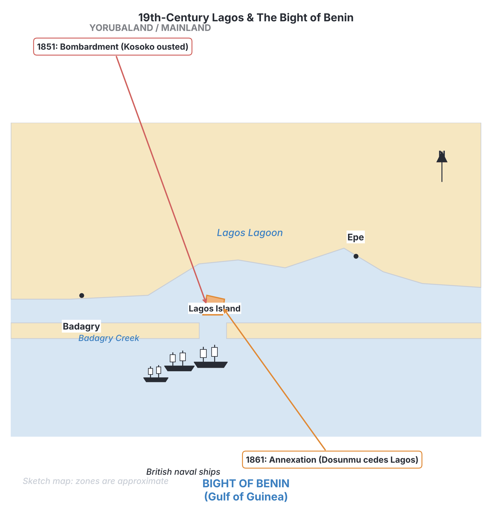
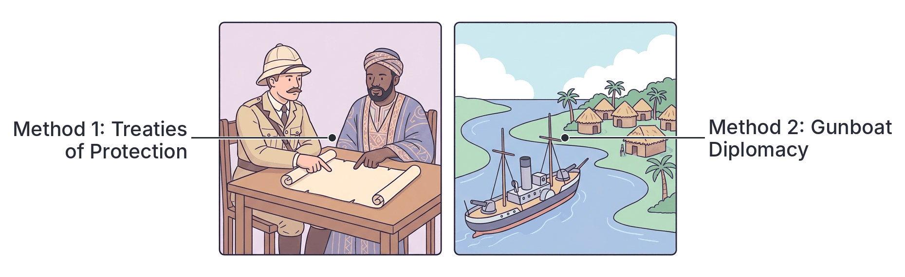
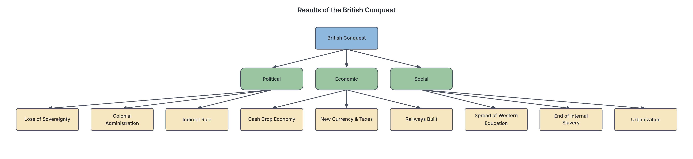

# JAMB History Notes: British Conquest of the Nigeria Area

## What JAMB expects

This topic covers Section B, Topic 9 of the JAMB History syllabus: British Conquest of the Nigeria Area. It spans the period from the mid-19th century into the early 20th century. 

The syllabus includes the following content items:
* a. The first phase of the British conquest of Nigeria 1851 – 1900
* b. Second phase of the conquest and motives
* c. Methods of the conquest and its result
* d. Resistance to and aftermath of the conquest

By the end of these notes, you should be able to:
1. highlight the factors responsible for the bombardment and annexation of Lagos;
2. determine the reasons for the conquest and the methods used during the second phase;
3. examine the various acts of resistance to the conquest;
4. evaluate the results and the aftermath of the conquest.

**Note on the syllabus wording:** The syllabus divides the conquest into a "first phase" (1851–1900) and a "second phase" (post-1900). In reality, the conquest was a continuous process that started on the coast and moved inland. The year 1900 is the dividing line because it was the year the British government took over direct control of the Nigerian interior from a private company (the Royal Niger Company) and officially declared the Protectorates of Northern and Southern Nigeria.

---

## The First Phase of the British Conquest (1851–1900)

**Objective i: highlight the factors responsible for the bombardment and annexation of Lagos.**

The first phase of the British conquest of the Nigeria area began in the mid-19th century, focused primarily on the coastal areas. The most significant early event in this phase was the British intervention in Lagos. 

By the 1840s, Britain had abolished the trans-Atlantic slave trade and was trying to stop it along the West African coast using naval patrols. They wanted to replace the slave trade with "legitimate commerce" (the trade in goods like palm oil, which British factories needed). Lagos was a major slave-trading port, and this drew British attention.

### The Bombardment of Lagos (1851)

In 1851, the British Royal Navy attacked Lagos. This is known as the **Bombardment of Lagos** or the Reduction of Lagos. Several factors led to this violent intervention:

1. **The Dynastic Dispute in Lagos:** There was a bitter struggle for the throne (Obaship) of Lagos between two royals: **Akitoye** and his nephew **Kosoko**. Akitoye became Oba in 1841 but was overthrown by Kosoko in 1845. Akitoye fled to Badagry and sought British help to regain his throne.
2. **The Slave Trade vs. Legitimate Trade:** Kosoko was heavily involved in the slave trade and refused to sign a treaty with the British to end it. Akitoye, seeking British support, promised to abolish the slave trade and promote legitimate commerce if he was restored to power.
3. **Protection of British Missionaries:** Christian missionaries, who had established themselves in Abeokuta and Badagry, felt threatened by Kosoko and his allies (including the Dahomey kingdom). They pressured the British government to intervene and remove Kosoko to make the region safe for spreading Christianity.
4. **Economic Ambitions:** The British wanted to control the lucrative trade routes into the Yoruba hinterland. Removing an independent, uncooperative ruler like Kosoko and installing a "puppet" (Akitoye) would give British merchants a major advantage over their European rivals.

**What happened:** In December 1851, a British naval force led by Commander H.W. Bruce attacked Lagos. After heavy fighting, Kosoko was defeated and fled to Epe. The British restored Akitoye to the throne. On 1 January 1852, Akitoye signed a treaty with Britain agreeing to abolish the slave trade, encourage legitimate trade, and protect missionaries.

### The Annexation of Lagos (1861)

Bombarding Lagos did not make it a British colony; it only made Lagos an ally. However, ten years later, Britain took full control.

After Akitoye died in 1853, his son **Dosunmu** became Oba. The British eventually decided that indirectly controlling Lagos through a weak Oba was not enough. In August **1861**, the British forced Oba Dosunmu to sign the **Treaty of Cession**, which handed the ownership and sovereignty of Lagos over to the British Crown.

**Factors responsible for the Annexation (1861):**
* **Inability of Dosunmu to Maintain Order:** The British claimed Dosunmu was too weak to stop the secret continuation of the slave trade and maintain the stability needed for British commerce.
* **Threat from Kosoko:** Kosoko, operating from Epe, remained a constant threat to Lagos. The British wanted direct military control to secure the island.
* **French Rivalry:** The French were expanding their influence in nearby Porto-Novo (modern-day Republic of Benin). Britain annexed Lagos to block the French from taking it.

Lagos officially became a British Crown Colony in 1862. From this coastal base, the British gradually expanded their influence into the Yoruba hinterland over the next forty years, using treaties, military threats, and mediation in the Yoruba civil wars to secure trade routes.

---

## Second Phase of the Conquest and Motives (Post-1900)

**Objective ii: determine the reasons for the conquest and the methods used during the second phase.**

While the first phase (1851–1900) was largely coastal and heavily driven by merchants and the Royal Niger Company (RNC) along the Niger Delta and rivers, the **second phase (from 1900 onwards)** involved the formal British government taking direct control of the vast inland territories. 

On 1 January 1900, the British government revoked the charter of the Royal Niger Company and declared two new colonial territories: the **Protectorate of Northern Nigeria** and the **Protectorate of Southern Nigeria**. The second phase involved military campaigns to make these paper declarations a reality on the ground—a process the British called "pacification."

### Reasons and Motives for the Second Phase

1. **Economic Exploitation (Raw Materials and Markets):** The Industrial Revolution in Europe created a massive demand for raw materials (cotton, groundnuts, tin, rubber, palm oil). The British wanted direct political control of the hinterland to organize large-scale production, build railways, and force locals to buy British manufactured goods without relying on coastal middlemen.
2. **The Scramble for Africa and Effective Occupation:** During the Berlin Conference (1884–1885), European powers agreed that claiming a territory required "effective occupation"—meaning a physical administrative and military presence. To prevent France (advancing from the west and north) and Germany (advancing from the east in Kamerun) from claiming the Nigerian interior, Britain had to militarily conquer the inland areas.
3. **Establishing Formal Colonial Administration:** The Royal Niger Company was mainly a trading business. It did not have the money or military manpower to govern the vast, heavily populated Northern Emirates or the Igbo hinterland. The British government took over to set up a formal, standardized administration (which would become Indirect Rule under Sir Frederick Lugard).
4. **The "Civilizing Mission":** The British used the excuse of stopping internal practices they deemed barbaric. They claimed their conquests were morally justified to end the internal slave trade (which was still practiced in the Sokoto Caliphate), stop human sacrifice (used as a justification for the Benin Expedition), and destroy powerful local religious oracles (such as the Aro Chukwu oracle).

---

## Methods of the Conquest

**Objective ii: determine the reasons for the conquest and the methods used during the second phase.** (Also covers Content c)

The British did not conquer the Nigeria area in a single battle. They used a combination of different methods depending on the region and the situation.

| Method | How it was used | Example |
| :--- | :--- | :--- |
| **Treaties of Protection** | British agents (like George Goldie or Frederick Lugard) persuaded local rulers to sign treaties promising British protection in exchange for exclusive trading rights. The British treated these as surrenders of sovereignty, though local rulers often did not understand the English terms and thought they were only signing trade agreements. | Treaties signed with the Sultan of Sokoto and various Niger Delta chiefs. |
| **Gunboat Diplomacy** | Anchoring heavily armed British warships (gunboats) near the coast or on rivers to intimidate local rulers into agreeing to British terms without firing a shot. | Frequently used in the Niger Delta against rulers who tried to increase trade prices. |
| **Divide and Rule** | Exploiting existing conflicts between local states. The British would support one faction with weapons or diplomatic backing to weaken a strong rival, then eventually conquer both. | Supporting Akitoye against Kosoko in Lagos; exploiting rivalries during the Yoruba civil wars. |
| **Military Expeditions (Force)** | When rulers refused treaties or resisted British trade monopolies, the British launched violent military campaigns. They possessed vastly superior weapons, particularly the **Maxim gun** (an early machine gun) and artillery, which devastated local armies armed with older muskets, bows, or swords. | The Ijebu Expedition (1892), the Benin Punitive Expedition (1897), the Anglo-Aro War (1901-1902), and the Kano-Sokoto campaigns (1903). |
| **Deportation and Exile** | Removing strong, independent traditional rulers from their domains and exiling them to distant places. This broke the spirit of local resistance. | Jaja of Opobo exiled to the West Indies; Ovonramwen of Benin exiled to Calabar. |

---

## Resistance to the Conquest

**Objective iii: examine the various acts of resistance to the conquest.**

The people of the Nigeria area did not surrender their independence willingly. Throughout both phases of the conquest, traditional rulers and local communities fiercely resisted British penetration through economic blockades, diplomacy, and armed combat. 

Because the region was made up of many independent states and societies rather than one single empire, the resistance was scattered and uncoordinated, which ultimately allowed the British to defeat them one by one.

### 1. Resistance in the Niger Delta and Coastal Regions

The earliest and most prominent resistance came from wealthy merchant-kings in the Niger Delta who wanted to protect their monopoly as middlemen between the interior producers and European buyers.

* **King Jaja of Opobo:** Jaja was a brilliant former slave who rose to found the wealthy state of Opobo. He strictly controlled the palm oil trade in his region and blocked European merchants from trading directly with the interior. When he refused to back down, the British consul, Harry Johnston, lured Jaja onto a warship in **1887** under a false promise of safe conduct. Jaja was captured, tried, and exiled to the West Indies. 
* **Nana Olomu of Itsekiri:** Nana was the powerful Governor of the Benin River. Like Jaja, he built a massive trading empire and blocked British merchants from accessing the Urhobo hinterland. The British accused him of disrupting trade. In **1894**, British forces attacked his heavily fortified capital at Ebrohimi. After a fierce resistance, Nana was defeated, captured, and exiled to Calabar, and later to Accra.
* **King Koko of Nembe (The Akassa Raid):** Angry that the Royal Niger Company had excluded his people from their traditional trading grounds, King Koko of Nembe led a surprise armed raid on the RNC’s headquarters at Akassa in **1895**. The British retaliated by destroying Nembe towns (the Brass War).

### 2. Resistance in Benin (Oba Ovonramwen)

**Oba Ovonramwen** of the Benin Kingdom sought to maintain his empire's independence and placed trade embargoes on British merchants to protect Benin’s economy. 
* In **1897**, an unarmed British delegation led by Acting Consul-General James Phillips tried to enter Benin during a sacred festival, ignoring warnings to stay away. Benin chiefs ambushed and killed Phillips and most of his party.
* The British quickly retaliated with the devastating **Benin Punitive Expedition of 1897**. A massive British force attacked, looted the famous Benin bronzes, burned the city, and captured Oba Ovonramwen, who was exiled to Calabar, where he died in 1914.

### 3. Resistance in Igboland (The East)

Because much of Igboland was non-centralized (acephalous), the British could not conquer the region by simply defeating a central king. They had to fight community by community, making the conquest of the East very prolonged.

* **The Aro Confederacy and the Anglo-Aro War (1901–1902):** The Aro people controlled a massive trading network across the East, backed by their powerful oracle, the **Ibini Ukpabi** (Long Juju). The Aro strongly resisted British attempts to penetrate the interior, as it would destroy their trade and religious influence. The British launched the Aro Expeditionary Force in 1901. After heavy fighting, the British captured Arochukwu and blew up the oracle in 1902.
* **The Ekumeku Movement (c. 1898–1911):** *(Note: Textbooks sometimes vary on the exact end date of the Ekumeku wars, ranging from 1910 to 1914, but the syllabus notes 1911).* In the Western Igbo area (present-day Delta State, around Asaba), a secret society known as the **Ekumeku** organized a brilliant and prolonged resistance. Rather than fighting open battles against Maxim guns, the Ekumeku used **guerrilla warfare**—launching surprise attacks on British outposts and missionaries, then fading into the forests. It took the British over a decade of repeated military campaigns and the destruction of whole villages to finally suppress the Ekumeku.

### 4. Resistance in Northern Nigeria (The Sokoto Caliphate)

When Frederick Lugard became High Commissioner of Northern Nigeria in 1900, he set out to conquer the powerful Sokoto Caliphate. The Emirs fiercely resisted, seeing the British not just as political invaders, but as infidels threatening Islam.

* **Kano and Sokoto (1903):** Emir Aliyu Babba of Kano fortified his great city walls, but British artillery breached them in February 1903. Lugard’s forces then marched on Sokoto, the spiritual capital. 
* **Sultan Attahiru I** organized the Caliphate's defense. At the Battle of Sokoto (March 1903), the Caliphate's brave cavalry charged the British but were mowed down by Maxim guns. 
* Sultan Attahiru refused to surrender. He fled eastward, gathering thousands of followers in a migration (Hijra). The British pursued him, resulting in a final, bloody battle at **Burmi** (July 1903), where Sultan Attahiru was killed. With his death, the resistance of the Sokoto Caliphate was broken.

### 5. Resistance in Yorubaland

While some Yoruba states allied with the British due to internal civil wars, others resisted. The most notable was the **Ijebu**. The Ijebu kingdom strictly controlled the trade routes to the coast and refused to let European merchants and missionaries pass. In **1892**, the British launched the **Ijebu Expedition**. Despite putting up a brave fight, the Ijebu army was defeated by the British use of the Maxim gun—one of the first times this deadly weapon was used in Africa.

**Common Mistakes to Avoid:**
Do not mix up the resisters and their locations. Jaja is Opobo; Nana is Itsekiri; Ovonramwen is Benin; Attahiru is Sokoto; Ekumeku is Western Igbo.

---

## Results and Aftermath of the Conquest

**Objective iv: evaluate the results and the aftermath of the conquest.**

The British conquest fundamentally changed the political, economic, and social landscape of the Nigeria area.

### Political Results

1. **Loss of Sovereignty:** Independent kingdoms, empires, and city-states lost their independence and sovereignty. Traditional rulers became subordinates to British colonial officers.
2. **Establishment of Colonial Administration:** The conquered territories were reorganized into the Protectorate of Northern Nigeria, the Protectorate of Southern Nigeria, and the Lagos Colony. This paved the way for the **Amalgamation of 1914**, which created the modern state of Nigeria.
3. **Introduction of Indirect Rule:** Because they lacked enough British staff and funds, the British adopted the system of "Indirect Rule" (governing through traditional rulers), heavily modifying how local chiefs exercised power.

### Economic Results

1. **Shift to a Colonial Economy:** The economy was restructured to serve British interests. The emphasis shifted entirely to producing cash crops (cocoa, groundnuts, cotton, palm produce) for export to British factories, rather than growing food crops for local consumption.
2. **Decline of Local Industries:** The influx of cheap, mass-produced British manufactured goods (like textiles and iron goods) led to the decline of traditional local industries, such as indigenous weaving and blacksmithing.
3. **New Currency and Taxation:** The British banned local currencies (like cowries and manillas) and introduced British currency. They also introduced new, compulsory taxation systems to force local people to work for cash wages on colonial projects (like railways) or to grow cash crops.
4. **Development of Infrastructure:** To transport raw materials easily from the interior to the coastal ports, the British built new infrastructure, particularly railways (e.g., the Lagos-Kano line) and harbors.

### Social and Cultural Results

1. **Spread of Christianity and Western Education:** In the South, the pacification allowed Christian missionaries to move freely into the hinterland. They established churches and Western-style schools, which created a new educated elite. In the North, the British restricted Christian missionaries to avoid provoking Islamic unrest, leading to an educational imbalance between North and South.
2. **Abolition of Certain Practices:** The conquest ended the internal slave trade and stopped practices the British found objectionable, such as human sacrifice and the killing of twins.
3. **Urbanization and Migration:** The colonial economy and new administrative centers caused rapid urbanization. People began migrating to new colonial cities like Lagos, Port Harcourt, Kaduna, and Jos looking for wage labor.

---

## Key terms

| Term | Meaning |
| :--- | :--- |
| **Bombardment** | A continuous attack with bombs, shells, or other missiles. (e.g., Bombardment of Lagos, 1851). |
| **Annexation** | The formal act of seizing a territory and making it part of another country. (e.g., Annexation of Lagos, 1861). |
| **Legitimate commerce** | Trade in natural products (like palm oil) rather than human beings, promoted by Europeans after the abolition of the slave trade. |
| **Pacification** | The colonial term for military conquest and forcing a resisting population to submit to British rule. |
| **Maxim gun** | The first fully automatic machine gun, used extensively by the British to defeat much larger African armies. |
| **Gunboat diplomacy** | Foreign policy supported by the use or threat of naval military force. |
| **Royal Niger Company (RNC)** | A British mercantile company led by George Goldie that governed the Niger River area until the British government took over in 1900. |
| **Protectorate** | A territory that is politically protected and controlled by a stronger foreign power, though not officially annexed as a colony. |
| **Ekumeku** | A secret resistance movement by the Western Igbo that used guerrilla warfare against the British (c. 1898–1911). |
| **Anglo-Aro War** | The British military campaign (1901-1902) to conquer the Aro Confederacy and destroy the Ibini Ukpabi oracle. |

---

## Exam tips and common mistakes

* **Lagos timeline:** Always remember that the **bombardment** (Kosoko ousted, Akitoye installed) happened in **1851**, while the **annexation** (Dosunmu forced to cede Lagos) happened in **1861**. 
* **The dividing line:** The year **1900** marks the transition from company rule (RNC) and coastal influence to formal British government control of the vast interior (the Protectorates).
* **Guerrilla warfare:** If a question asks which group used guerrilla tactics to resist the British over a long period, the answer is the **Ekumeku movement** in Western Igboland.
* **Economic resisters:** Jaja of Opobo and Nana of Itsekiri were both rich merchants deported because they blocked British economic access to the interior.
* **Sokoto resistance:** The final battle of the Sokoto Caliphate took place at **Burmi** (1903), where Sultan Attahiru was killed.

---

## Quick summary

1. The first phase of conquest (1851–1900) focused on the coast, beginning with the bombardment of Lagos in 1851 due to dynastic disputes, missionary lobbying, and the desire to replace the slave trade with legitimate commerce.
2. Lagos was officially annexed as a Crown Colony in 1861 because the British felt Oba Dosunmu was too weak to maintain order.
3. The second phase (post-1900) aimed at taking direct administrative control of the interior to secure raw materials, stop rival European powers (Scramble for Africa), and establish formal colonial rule.
4. British methods of conquest included deceptive Treaties of Protection, gunboat diplomacy, divide and rule tactics, and direct military force using superior weapons like the Maxim gun.
5. Coastal resistance was led by middleman merchants like King Jaja of Opobo and Nana of Itsekiri, who were both eventually defeated and deported by the British.
6. Inland resistance was fierce but uncoordinated. Notable examples include the Aro Confederacy, the guerrilla tactics of the Ekumeku movement, Oba Ovonramwen of Benin, and Sultan Attahiru of the Sokoto Caliphate.
7. The aftermath of the conquest resulted in the total loss of sovereignty for traditional rulers, the restructuring of the economy to produce cash crops for export, and the introduction of new currencies and taxation.
8. Socially, the conquest paved the way for Christian missionary expansion and Western education in the South, while halting the internal slave trade.

---

## Practice questions

**1. The bombardment of Lagos by British naval forces took place in**
- A. 1851
- B. 1861
- C. 1885
- D. 1914

**Answer: A.** The British bombarded Lagos in 1851 to remove Kosoko and install Akitoye. Option B is when Lagos was annexed, Option C is the Berlin Conference, and Option D is the Amalgamation.

**2. Which of the following was a major factor responsible for the British annexation of Lagos in 1861?**
- A. The discovery of crude oil on Lagos Island
- B. The threat of French expansion from Porto-Novo and Kosoko's activities
- C. Oba Dosunmu's direct attack on British missionaries
- D. The desire to create the Royal Niger Company

**Answer: B.** The British annexed Lagos to secure their commercial interests against the French in nearby Porto-Novo and the lingering threat of Kosoko from Epe, claiming Oba Dosunmu was too weak to maintain stability. 

**3. The primary reason for the second phase of the British conquest (post-1900) was to**
- A. establish trading posts on the coast
- B. take direct administrative and political control of the interior
- C. support the spread of Islamic education
- D. hand over administration to the Royal Niger Company

**Answer: B.** After revoking the Royal Niger Company's charter in 1900, the British government launched the second phase to assert direct political control over the Protectorates and exploit raw materials.

**4. A major method used by the British to secure early claims over Nigerian territories without initial fighting was**
- A. guerrilla warfare
- B. signing Treaties of Protection
- C. the Amalgamation of 1914
- D. the introduction of a new currency

**Answer: B.** The British heavily utilized Treaties of Protection, getting local chiefs to sign away their sovereignty, often without the chiefs fully understanding the legal terms.

**5. King Jaja of Opobo was exiled by the British mainly because he**
- A. refused to convert to Christianity
- B. allied with the French against the British
- C. monopolized the palm oil trade and blocked British access to the interior
- D. attacked the Royal Niger Company headquarters at Akassa

**Answer: C.** Jaja of Opobo was a powerful middleman who resisted British attempts to trade directly with the hinterland producers, leading to his deportation in 1887. (King Koko led the Akassa raid).

**6. Which of the following movements used guerrilla warfare to resist British conquest for over a decade?**
- A. The Aro Confederacy
- B. The Ekumeku movement
- C. The Sokoto Jihadists
- D. The Ijebu army

**Answer: B.** The Ekumeku movement in Western Igboland successfully used guerrilla tactics (hit-and-run attacks from the forests) to frustrate the British from around 1898 to 1911. 

**7. Oba Ovonramwen was the ruler of which kingdom during its conquest by the British?**
- A. Benin
- B. Opobo
- C. Itsekiri
- D. Nembe

**Answer: A.** Oba Ovonramwen was the ruler of the Benin Kingdom. He was deported to Calabar following the British Punitive Expedition of 1897.

**8. The spiritual center of the Aro resistance to British penetration in Eastern Nigeria was the**
- A. Sokoto Caliphate
- B. Ebrohimi fort
- C. Ibini Ukpabi oracle
- D. Zazzau emirate

**Answer: C.** The Aro Confederacy's power was heavily tied to their Long Juju oracle, Ibini Ukpabi. The British specifically targeted and destroyed it during the Anglo-Aro War (1901-1902).

**9. Sultan Attahiru I of the Sokoto Caliphate was finally defeated and killed by the British at the Battle of**
- A. Akassa
- B. Kwatarkwashi
- C. Burmi
- D. Asaba

**Answer: C.** After fleeing Sokoto, Sultan Attahiru I made his final stand and was killed at the Battle of Burmi in July 1903, marking the end of the Caliphate's formal resistance.

**10. An immediate economic result of the British conquest of the Nigeria area was the**
- A. rapid industrialization of Northern Nigeria
- B. shift towards producing raw cash crops for European factories
- C. strengthening of indigenous weaving and blacksmithing industries
- D. total elimination of all taxes

**Answer: B.** The colonial economy forced a shift from food crops to cash crops (like cocoa, palm oil, and groundnuts) to supply British industries. Local industries declined due to cheap British imports, and new taxes were introduced.

<!-- COVERAGE
obj i | The First Phase of the British Conquest (1851–1900)
obj ii | Second Phase of the Conquest and Motives (Post-1900)
obj ii | Methods of the Conquest
obj iii | Resistance to the Conquest
obj iv | Results and Aftermath of the Conquest
item a | The First Phase of the British Conquest (1851–1900)
item b | Second Phase of the Conquest and Motives (Post-1900)
item c | Methods of the Conquest
item c | Results and Aftermath of the Conquest
item d | Resistance to the Conquest
item d | Results and Aftermath of the Conquest
-->
