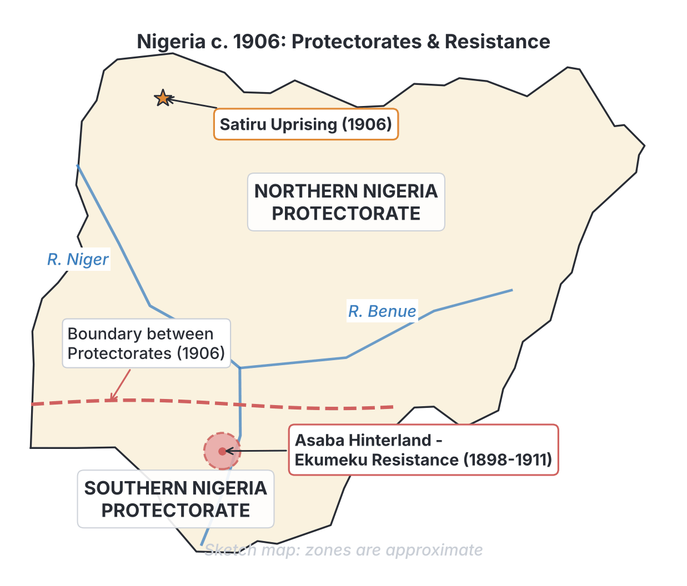
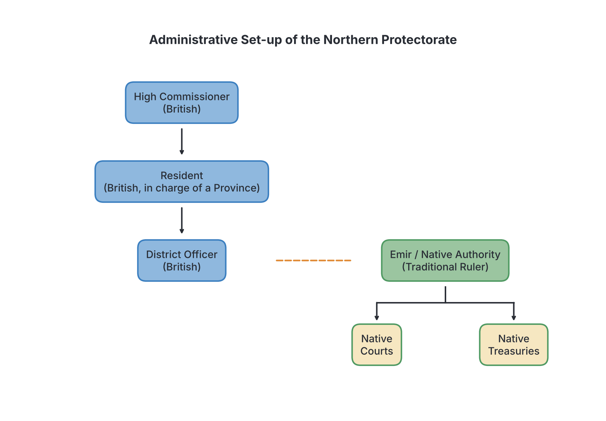

# JAMB History Notes: The Establishment of Colonial Rule up to 1914

## What JAMB expects

This topic is part of Section C: Nigeria 1900 – 1960. It covers the period after the initial British conquest, focusing on how the British stabilized their control and set up their government before uniting the country in 1914.

This file covers the following content items from the syllabus:
- **a.** Pacification and occupation of the territories.
- **b.** Resistance to the pacification and occupation i.e. The Ekumeku Movement in Asaba hinterland 1898 – 1911, The Satiru uprising of 1906.
- **c.** Administration of the Protectorates.

By the end of these notes, you should be able to:
- **i.** outline the various features and methods of the British pacification and occupation of the territories;
- **ii.** examine the administrative set-up of the Protectorates.

*(Note: The initial military conquests of the various states, such as the fall of Benin, the Aro Expedition, and the conquest of the Sokoto Caliphate, are covered in `B9-british-conquest-of-the-nigeria-area.md`. The amalgamation of 1914 is covered in `C2-amalgamation-of-1914.md`.)*

## Outline the various features and methods of the British pacification and occupation

**Objective i: outline the various features and methods of the British pacification and occupation of the territories**

By 1900, the British government officially took over the administration of the Nigerian area from the Royal Niger Company (RNC). However, declaring a protectorate on paper was very different from having actual control on the ground. The process of forcing indigenous groups to accept British authority, putting down rebellions, and establishing effective colonial administration was termed **"pacification"**. 

"Pacification" was a colonial euphemism (a mild word used to hide a harsh reality). The British called it "bringing peace," but for the people of the Nigeria area, it meant military occupation, loss of independence, and the suppression of their traditional ways of life.

### Content a: Pacification and occupation of the territories

The pacification and occupation of the territories had several distinct features and used various methods:

#### 1. Military Expeditions and Patrols
The primary method of pacification was military force. The British formed the **West African Frontier Force (WAFF)** in 1897, largely commanded by Frederick Lugard. The WAFF was made up of African soldiers (mainly Hausa and Yoruba recruits) heavily armed with modern European weapons, such as the Maxim machine gun and artillery, and led by British officers.
- **Punitive expeditions:** When a community resisted British orders, attacked colonial officials, or refused to trade on British terms, the British sent heavily armed military columns to destroy their towns, burn their crops, and confiscate their weapons. 
- **Administrative patrols:** Once an area was defeated, small detachments of soldiers or colonial police would regularly patrol the region to ensure the people remained obedient and paid their taxes.

#### 2. Deposition and Exile of Traditional Rulers
A key feature of the occupation was removing any traditional ruler who refused to submit. If a king or chief showed independence or organized resistance, the British would depose (remove) him and often exile him far from his homeland so he could not inspire further rebellion. 
- Though earlier examples include King Jaja of Opobo (exiled in 1887) and Oba Ovonramwen of Benin (exiled in 1897), this method continued throughout the pacification era. Rulers who collaborated or surrendered quickly were usually allowed to keep their thrones as long as they obeyed British "Residents" (colonial advisors).

#### 3. Gunboat Diplomacy
In the coastal and riverine areas (like the Niger Delta and along the River Niger), the British used Royal Navy gunboats. They would anchor a heavily armed warship near a coastal town and threaten to bombard it into ruins unless the local leaders signed treaties of protection or surrendered trade monopolies.

#### 4. Divide and Rule Tactics
The British carefully studied the rivalries between different African states and groups. During the pacification phase, they used these divisions to their advantage. They would ally with one group to defeat another, promising them protection or power. Once the stronger rival was defeated, the British would then easily impose their will on their "allies."

#### 5. Confiscation of Firearms
To prevent future uprisings, the British strictly controlled the importation of modern weapons into the Nigeria area. During pacification patrols, a major objective was to seize and destroy local armouries, leaving the indigenous people with only outdated flintlock muskets or no firearms at all, making it impossible for them to fight back against the WAFF.

## Resistance to the pacification and occupation

**Content b: Resistance to the pacification and occupation i.e. The Ekumeku Movement in Asaba hinterland 1898 – 1911, The Satiru uprising of 1906.**

The people of the Nigeria area did not accept British pacification peacefully. Because the British lacked the manpower to conquer everywhere at once, resistance often took the form of localized uprisings, guerrilla warfare, and religious movements. Two prominent examples specifically highlighted by JAMB are the Ekumeku Movement and the Satiru Uprising.

### The Ekumeku Movement in the Asaba hinterland (1898 – 1911)

The Ekumeku movement was one of the longest and most organized anti-colonial resistance movements in Nigerian history. It took place among the Western Igbo (Anioma) people in the hinterland of Asaba, west of the River Niger.

> **Note on textbook dates:** The JAMB syllabus specifies the dates for the Ekumeku movement as **1898 to 1911**. You must use these dates for the exam. However, if you read different history textbooks, you might see the dates listed as 1883–1914. This is because the Western Igbo first began clashing with the Royal Niger Company around 1883, and final pockets of resistance were not crushed until 1914. JAMB focuses on the most intense phase of the conflict against formal British colonial government.

#### Causes of the Ekumeku Movement
1. **Resentment of the Royal Niger Company:** Before 1900, the RNC forcefully took over trade and dictated prices to the Western Igbo.
2. **British Administrative Control:** The British began setting up Native Courts ruled by British-appointed warrant chiefs, which bypassed the traditional democratic institutions of the Igbo communities.
3. **Christian Missionaries:** The people feared that European missionaries, specifically the Society of African Missions (SMA), were destroying their traditional religion, customs, and secret societies.

#### Nature and Course of the Resistance
- **Secret Society:** "Ekumeku" roughly translates to "the silent ones" or "the invisible ones." It was a secret, well-coordinated military alliance among various independent Western Igbo towns (such as Igbuzo, Ogwashi-Uku, and Ubulu-Uku). 
- **Guerrilla Warfare:** Because the British had superior weapons (Maxim guns), the Ekumeku fighters avoided open battles. Instead, they used the thick forest to their advantage. They set up ambushes, attacked British administrative outposts and mission stations at night, and then melted back into the bush.
- **Oath of Secrecy:** Members took strict oaths of secrecy. This made it very difficult for the British to use spies to find their leaders or predict their attacks.

#### The Suppression of the Movement
The British found the Ekumeku very difficult to defeat. They launched a series of brutal military patrols between 1898 and 1911. The British strategy involved destroying towns suspected of supporting the movement, burning crops to starve the fighters, and using collective punishment. By 1911, after heavy bombardments and the capture of key leaders (who were imprisoned or executed), the major phase of the Ekumeku resistance was finally broken.

### The Satiru Uprising of 1906

While the Ekumeku movement was fought in the southern forests, the Satiru uprising took place in the open savannah of the Northern Protectorate. Satiru was a village located just a few miles south of Sokoto.

#### Causes of the Satiru Uprising
1. **Hatred of British Rule:** Following Lugard's conquest of the Sokoto Caliphate in 1903, resentment boiled among the Muslim population who saw the British as "infidel" (non-Muslim) conquerors.
2. **Mahdist Ideology:** The rebellion was inspired by **Mahdism**, a messianic Islamic movement that believed a savior (the Mahdi) would arrive to rid the land of unbelievers and injustice. 
3. **Anger at the Sultan:** The British had appointed Sultan Attahiru II after killing his predecessor in 1903. Many people in Satiru viewed the new Sultan as a British puppet and traitor to Islam.

#### The Course of the Uprising (1906)
- The rebellion was led by a man named **Dan Makafo** and a local religious leader named **Mallam Isa**. 
- In February 1906, they declared a jihad (holy war) against the British and the Sultan of Sokoto. 
- When the local British Resident and a small detachment of the WAFF rode into Satiru to peacefully disperse the gathering, the Satiru rebels immediately attacked them. Using only hoes, axes, and swords, the rebels wiped out the British force, killing the Resident and several soldiers.

#### The Brutal Suppression
The defeat of a British force by poorly armed villagers shocked Frederick Lugard. He feared this might spark a massive Mahdist revolt across the entire Northern Protectorate. 
- The Sultan of Sokoto, fearing the rebels would attack him next, allied firmly with the British and offered his own cavalry to help put down the uprising.
- In March 1906, Lugard sent a heavily armed WAFF column to Satiru. The British response was ruthless. The village was completely destroyed, and hundreds of men, women, and children were killed. 
- Dan Makafo was captured, tried, and publicly executed in Sokoto. Lugard ordered that the village of Satiru be erased from the map and the land cursed so that no one would ever settle there again.

## Examine the administrative set-up of the Protectorates

**Objective ii: examine the administrative set-up of the Protectorates;**
**Content c: Administration of the Protectorates.**

In 1900, the British government formally created two massive administrative units in the Nigerian area: the **Protectorate of Northern Nigeria** and the **Protectorate of Southern Nigeria**. (Lagos remained a separate Colony until 1906, when it was merged with the Southern Protectorate to form the Colony and Protectorate of Southern Nigeria).

Because the societies in the North and South were different, and because the British had different economic interests in each region, the two Protectorates were administered differently up until their amalgamation (merger) in 1914.

### Administration of the Northern Protectorate (1900 – 1914)

The Northern Protectorate was placed under the control of **Sir Frederick Lugard** as High Commissioner. The North was vast, heavily populated, and the British had very few European officials and limited funds to run it.

To solve this problem, Lugard established the system of **Indirect Rule**. This meant the British would rule the masses *through* their existing traditional rulers (the Emirs) and traditional institutions.

#### Key Features of the Northern Administrative Set-Up:
1. **The High Commissioner:** At the top was the British High Commissioner (Lugard), who made the laws by proclamation.
2. **Provinces and Residents:** The protectorate was divided into Provinces. A British official called a **Resident** was put in charge of each province. His job was not to rule directly, but to "advise" and guide the local Emir. 
3. **The Native Authority (The Emirs):** The traditional rulers were officially recognized as the "Native Authority." As long as they remained loyal to the British, collected taxes, and stopped practices like slavery, they were allowed to rule their people day-to-day.
4. **Native Courts:** The traditional Islamic (Sharia) legal system was kept in place. Alkali (Muslim judges) presided over these courts. The British only banned punishments they considered "repugnant" (such as cutting off hands for theft).
5. **Native Treasuries (Beit-el-Mal):** This was a central pillar of the system. Direct taxes were collected from the people. A portion (usually half) went to the British colonial government, and the other half was kept in the Native Treasury to pay the Emir's salary and fund local projects. 

### Administration of the Southern Protectorate (1900 – 1914)

The Southern Protectorate was administered quite differently. High Commissioners like **Sir Ralph Moor** and later **Sir Walter Egerton** focused heavily on trade, building infrastructure (like roads and railways), and exporting cash crops like palm oil. 

The South was highly diverse. It included the centralized Yoruba kingdoms (in the west) and the non-centralized, acephalous societies of the Igbo, Ibibio, and others (in the east). Therefore, a uniform system of Indirect Rule was much harder to apply before 1914.

#### Key Features of the Southern Administrative Set-Up:
1. **Direct and Mixed Administration:** In places like Lagos and some coastal areas, administration was much more direct. British officials had a heavier hand in day-to-day governance compared to the North.
2. **The Warrant Chief System (in the East):** Because the Igbo and Ibibio societies did not have powerful kings (Emirs) like the North, the British struggled to find people to use for Indirect Rule. The British arbitrarily picked local men and gave them "warrants" (certificates) making them chiefs. These **Warrant Chiefs** were given powers they never traditionally had, making them very unpopular and corrupt.
3. **Legislative Council (in Lagos):** The Lagos Colony had a Legislative Council where a few educated Africans and British officials could debate laws. The Northern Protectorate had nothing like this; the High Commissioner simply issued decrees.
4. **Revenue through Customs Duties:** Unlike the North, which relied on direct taxation of the people, the Southern administration made most of its money from customs duties (taxes on imported and exported goods, especially liquor). This made the Southern Protectorate much richer than the North.

### Comparing the Northern and Southern Administration (Pre-1914)

| Feature | Northern Protectorate | Southern Protectorate |
| :--- | :--- | :--- |
| **Main Philosophy** | Strict Indirect Rule, preserving traditional society. | Mixed administration, heavier focus on economic development and European trade. |
| **Traditional Leaders** | Emirs (powerful, respected, historical legitimacy). | Obas in the West (respected); Warrant Chiefs in the East (unpopular, appointed by British). |
| **Legal System** | Islamic (Sharia) law via Native Courts. | Mixture of British law, customary courts, and Native Courts. |
| **Source of Revenue** | Direct taxation on the population. | Customs duties on imports (especially alcohol) and exports (palm oil). |
| **Education Policy** | Christian missionaries severely restricted to prevent Muslim anger. | Christian missionaries encouraged to build schools and hospitals. |
| **Financial Status** | Poor (relied on a grant-in-aid from the British government). | Wealthy (surplus budget from booming coastal trade). |

The stark differences in wealth and administrative style between these two massive protectorates—particularly the North's lack of money and the South's surplus—was a major reason why the British decided to amalgamate (join) them in 1914.

## Key terms

| Term | Meaning |
| :--- | :--- |
| **Pacification** | A colonial term for the military conquest, suppression of resistance, and forceful establishment of control over a territory. |
| **WAFF** | West African Frontier Force; the British colonial army made up of African soldiers and British officers used to conquer and pacify the region. |
| **Ekumeku** | A secret resistance movement formed by the Western Igbo (Asaba hinterland) to fight British rule using guerrilla tactics. |
| **Satiru Uprising** | A 1906 Mahdist (Islamic) anti-colonial rebellion near Sokoto, which was brutally crushed by the British. |
| **Mahdism** | An Islamic messianic movement believing in the coming of a Mahdi (redeemer) to cleanse the world of injustice and unbelievers. |
| **Protectorate** | A territory that is formally protected and controlled by a stronger foreign power, while retaining some of its own local structures. |
| **Indirect Rule** | A system of colonial administration where the British ruled the masses through existing traditional rulers and institutions. |
| **Resident** | A senior British colonial official placed in charge of a province to advise and oversee the local traditional rulers. |
| **Warrant Chief** | An individual appointed by the British to rule over non-centralized societies (like the Igbo), given authority via a written warrant. |

## Exam tips and common mistakes

- **Dates matter for Ekumeku:** While some books say 1883, the JAMB syllabus explicitly prints **1898 – 1911** for the Ekumeku movement. Use these dates if asked.
- **Location of uprisings:** Remember that *Ekumeku* was in the *Asaba hinterland* (Western Igbo/South), and *Satiru* was in *Sokoto* (North). Do not mix them up.
- **Nature of the uprisings:** Ekumeku was a *secret society* using *guerrilla warfare* in the forests. Satiru was a *religious (Mahdist)* uprising in the open savannah. 
- **Warrant Chiefs vs. Emirs:** Remember that Warrant Chiefs were an artificial creation by the British in the East because there were no central kings. Emirs already existed in the North before the British arrived.
- **Source of Revenue:** A very common JAMB question asks why the South was richer. The answer is **customs duties** (taxes on trade). The North relied on direct taxation.
- **Do not confuse pacification with the initial conquest:** Conquest is the initial battle (e.g., capturing a city). Pacification is the long, ongoing process of putting down smaller rebellions and forcing the people to obey British laws.

## Quick summary

1. "Pacification" was the forceful method the British used to suppress local resistance and establish their colonial authority, using the West African Frontier Force (WAFF), gunboats, and the deposition of uncooperative rulers.
2. The indigenous people did not surrender easily; they mounted various forms of resistance to protect their sovereignty, trade, and culture.
3. The Ekumeku movement (1898–1911) was a prolonged guerrilla war fought by a secret society of Western Igbo towns in the Asaba hinterland against British encroachment.
4. The Satiru Uprising (1906) was a Mahdist religious rebellion near Sokoto directed at both the British "infidels" and the collaborating Sultan of Sokoto, which Lugard brutally destroyed.
5. Up until 1914, the area was administered as two main units: the Northern Protectorate and the Southern Protectorate (which merged with Lagos in 1906).
6. The North was administered by Frederick Lugard using strict Indirect Rule through Emirs, Native Courts, and Native Treasuries, relying on direct taxation.
7. The South had a mixed administration, focused heavily on coastal trade (funded by customs duties), and struggled to implement Indirect Rule in the East, leading to the creation of unpopular Warrant Chiefs. 

## Practice questions

**1. The primary military force used by the British to pacify the Nigerian territories was the:**
- A. Royal West African Company
- B. West African Frontier Force (WAFF)
- C. British Royal Marines
- D. Native Authority Police

**Answer: B.** The West African Frontier Force (WAFF) was created by the British, using African recruits under British officers, to conquer and pacify the territories.

**2. According to the JAMB syllabus, the Ekumeku resistance movement against British rule lasted between:**
- A. 1885 and 1900
- B. 1898 and 1911
- C. 1906 and 1914
- D. 1851 and 1861

**Answer: B.** The syllabus explicitly dates the Ekumeku movement in the Asaba hinterland as 1898 – 1911, the period of most intense resistance against colonial forces.

**3. The Ekumeku movement was largely organized by which group of people?**
- A. The Efik of Calabar
- B. The Western Igbo in the Asaba hinterland
- C. The Nupe in the Middle Belt
- D. The Itsekiri of the Niger Delta

**Answer: B.** The Ekumeku was a secret resistance society formed by the Western Igbo (Anioma) people in the hinterland of Asaba. 

**4. The 1906 Satiru uprising occurred in which province of the Northern Protectorate?**
- A. Kano
- B. Borno
- C. Sokoto
- D. Zaria

**Answer: C.** Satiru was a village located just south of Sokoto, where Mahdist rebels revolted against the British and the Sultan of Sokoto.

**5. A major cause of the Satiru uprising of 1906 was:**
- A. the British attempt to introduce Christian missionaries into the village
- B. the introduction of Warrant Chiefs by Lord Lugard
- C. Mahdist religious beliefs and anger at the Sultan's collaboration with the British
- D. a dispute over palm oil trade routes

**Answer: C.** The uprising was inspired by Mahdism (a belief in an Islamic messiah) and hatred for both the British conquerors and the Sultan of Sokoto, whom the rebels viewed as a British puppet.

**6. In the administrative set-up of the Northern Protectorate, a British official placed in charge of a province to advise the Emir was called a:**
- A. Warrant Chief
- B. Governor-General
- C. Resident
- D. High Commissioner

**Answer: C.** The Resident was the senior British official at the provincial level whose role was to guide and advise the local Emir under the Indirect Rule system. 

**7. Why did the British introduce the Warrant Chief system in the Eastern part of the Southern Protectorate?**
- A. Because the traditional Obas refused to cooperate with the British
- B. To reward African soldiers who fought in the WAFF
- C. Because the societies were non-centralized and lacked powerful traditional kings
- D. To stop the spread of Islam from the North

**Answer: C.** Igbo and Ibibio societies were largely acephalous (without a single central king). The British had to artificially create "Warrant Chiefs" to have someone to govern through.

**8. Before the 1914 amalgamation, the major source of government revenue for the Southern Protectorate was:**
- A. Direct taxation on cattle
- B. Customs duties on imports and exports
- C. Financial grants from the Northern Emirs
- D. The trans-Saharan trade

**Answer: B.** The Southern Protectorate was wealthy because it heavily taxed the booming coastal trade, collecting customs duties on exports (like palm oil) and imports (especially liquor).

**9. Which of the following was a common feature of British pacification?**
- A. Allowing resistant kings to remain on their thrones to keep the peace
- B. The deposition and exile of traditional rulers who refused to submit
- C. Withdrawing military forces if a community refused to sign a treaty
- D. Promoting local arms manufacturing to aid self-defense

**Answer: B.** A key feature of pacification was deposing and exiling uncooperative rulers to break local resistance and serve as a warning to others.

**10. The administrative system adopted by Frederick Lugard in the Northern Protectorate, which utilized existing traditional institutions, is known as:**
- A. Assimilation
- B. Direct Rule
- C. Indirect Rule
- D. Association

**Answer: C.** Indirect Rule was the system of governing the colonized people through their existing traditional rulers (like the Emirs) and local institutions.
