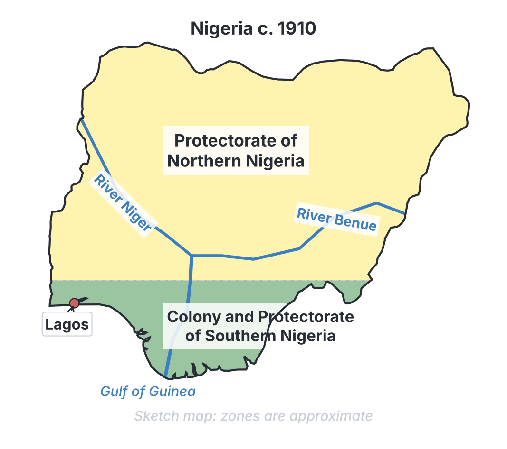
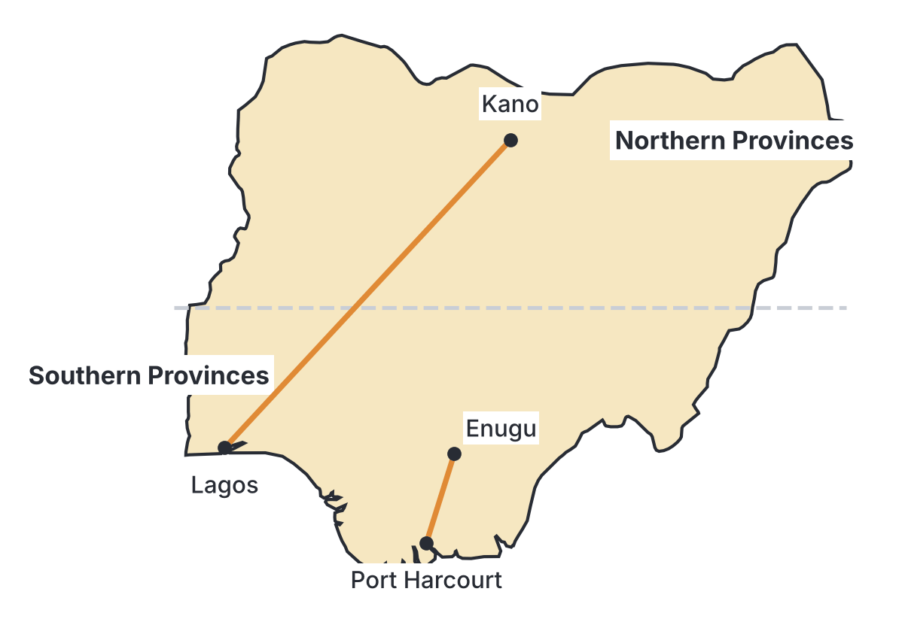

# JAMB History Notes: The Amalgamation of 1914

## What JAMB expects

This topic is Section C, Topic 2 of the JAMB History syllabus: The Amalgamation of 1914. It has two content items:

- **a.** Reasons
- **b.** Effects

By the end of these notes, you should be able to:
1. Examine the reasons for the 1914 Amalgamation and its effects.

## Background to the Amalgamation

Before 1914, the area we now call Nigeria was not a single country. After the British conquered different parts of the region (see `B9-british-conquest-of-the-nigeria-area.md`), they administered them as separate territories because they were acquired at different times and in different ways.

By 1900, the British controlled three separate administrative units in the area:
1. The **Lagos Colony**
2. The **Protectorate of Southern Nigeria**
3. The **Protectorate of Northern Nigeria**

The idea of bringing these territories together was first officially proposed in **1898** by a British government committee known as the **Niger Committee** (often called the Selborne Committee, after its chairman, Lord Selborne). The committee recommended that all British territories in the Niger basin should eventually be united (amalgamated) to make them easier and cheaper to rule.

The unification happened in two major stages:
- **The 1906 Amalgamation:** The British merged the Lagos Colony and the Protectorate of Southern Nigeria to form the **Colony and Protectorate of Southern Nigeria**. This left two large British territories: the North and the South.
- **The Appointment of Lugard:** In **1912**, Sir Frederick Lugard (later Lord Lugard) was appointed as Governor of both the Northern and Southern protectorates at the same time. The British Secretary of State for the Colonies, Lewis Harcourt, gave Lugard a specific mandate: to study the two territories and prepare a plan to merge them.
- **The 1914 Amalgamation:** On **1 January 1914**, the two territories were formally joined to create a single entity called the **Colony and Protectorate of Nigeria**, with Lugard serving as its first Governor-General.

### Contrasting the North and South before 1914

To understand why the British amalgamated the territories, it is helpful to contrast their situations before 1914.

| Feature | Protectorate of Northern Nigeria | Colony and Protectorate of Southern Nigeria |
| --- | --- | --- |
| **Geography** | Vast, landlocked, largely dry savannah | Smaller, coastal, dense forests, direct access to the sea |
| **Financial status** | Deficit (poor); relied heavily on British funds | Surplus (wealthy); high revenue from customs duties |
| **Economy** | Groundnuts, cotton, hides and skins | Palm oil, palm kernels, rubber |
| **Administration** | Centralized Indirect Rule through Emirs | Mix of direct administration and local systems |
| **Western Education** | Heavily restricted by the colonial government to protect Islamic culture | Widespread and growing rapidly, led by Christian missionaries |

## Reasons for the 1914 Amalgamation

**Objective i: examine the reasons for the 1914 Amalgamation...**

**Content a: Reasons**

Historians agree that the amalgamation was not done to create a unified, prosperous nation for the benefit of Nigerians. The people were not consulted. It was done primarily for British administrative and economic convenience. The main reasons can be grouped into economic, administrative, infrastructural, and imperial factors.

### 1. Economic Reasons (The Financial Gap)

Most textbooks agree that economics was the most important reason for the amalgamation. The British government wanted its colonies to be self-sufficient and not burden the British taxpayer. 

- **The Northern Deficit:** The Northern Protectorate was huge and landlocked. Because it had no coastline, it could not collect customs duties (taxes on imported and exported goods), which was the main way colonial governments made money. The Northern administration could not pay for its own governance or infrastructure. To keep it running, the British parliament had to provide an annual financial bailout, known as a **grant-in-aid**, of about £300,000 a year. British taxpayers were unhappy about this expense.
- **The Southern Surplus:** The Southern Protectorate was very wealthy. With its busy coastal ports (like Lagos and Calabar), it collected huge revenues from taxes on thriving trade, especially import duties on spirits (liquor) and the export of palm produce. The South frequently had a budget surplus.
- **The Solution:** By amalgamating the two territories, the British could use the wealth of the South to balance the financial deficit of the North. In simple terms, the Southern surplus would subsidize the Northern administration, making the unified colony financially independent and relieving the British government of a major expense.

### 2. Administrative Reasons (Efficiency and Cost)

Running two separate governments side by side in the same region was expensive, duplicated effort, and caused friction.

- **Duplication of Departments:** Before 1914, both the North and the South had their own separate departments for the military, police, medical services, postal services, and customs. Amalgamation meant combining these departments. For example, instead of employing two Directors of Medical Services or two postal chiefs, the British would only need one for the whole country.
- **Reducing European Personnel:** Centralizing the administration reduced the number of British officials needed to run the colony. This saved money, reduced the risks to British personnel (who often suffered from malaria), and simplified the chain of command. 

### 3. Infrastructural Reasons (Railways and Ports)

The North and South had conflicting transport policies, which hindered the efficient extraction of raw materials.

- **Rival Railway Systems:** Before amalgamation, the two territories were building separate and competing railway lines. The South was building a railway starting from Lagos and pushing northwards. The North, wanting to be independent of the South, was building its own railway from Baro (a port on the River Niger) to Kano. The two administrations often argued over transport policies, railway gauges, and the use of the River Niger.
- **A Unified Transport Network:** The British needed a single, logical railway and port network to transport raw materials (like groundnuts and cotton from the North) to the coast for export to Europe. Amalgamating the territories allowed Lugard to centralize the railway system and direct all transport development under one unified plan.

### 4. British Imperial Policy

The amalgamation fit perfectly into the broader British colonial policy of the era: to maximize the economic exploitation of the colonies while spending as little as possible on their administration. A single, large, and financially independent Nigeria was a much more valuable and easily controlled asset for the British Empire than two quarreling protectorates.

[IMAGE: A portrait-style illustration of Lord Frederick Lugard, wearing a colonial governor's uniform with medals and a high collar. He has a prominent mustache. The style is a clean flat textbook illustration, neutral expression, white background.]

## Effects of the 1914 Amalgamation

**Objective i: ...and its effects.**

**Content b: Effects**

The amalgamation had immediate effects on how the territory was governed and deep, long-term effects on the political and social development of Nigeria. 

### 1. Administrative Reorganization

On 1 January 1914, the unified country was structured into a new administrative system.

- **The Three Units:** Nigeria was divided into three main units:
  1. The **Northern Provinces**
  2. The **Southern Provinces**
  3. The **Colony of Lagos**
- **Lieutenant-Governors:** The Northern and Southern Provinces were each placed under a British Lieutenant-Governor, who reported directly to the Governor-General (Lugard) based in Lagos. 
- **Continued Separation:** A major effect of the amalgamation was that it was mostly a unification "at the top." In practice, the North and South were still administered quite differently. Lugard did not merge the local administrations; the regions kept their separate laws, land policies, and native courts. 

### 2. The Creation of the Nigerian Council

To give the new country a form of central advisory body, Lugard created the **Nigerian Council** in 1914. 

- **Composition:** It consisted of 36 members, the vast majority of whom were British officials and European businessmen. Lugard nominated six Nigerians to represent the local population (including traditional rulers like the Sultan of Sokoto, the Alaafin of Oyo, and the Obong of Calabar).
- **Failure of the Council:** The Nigerian Council was highly ineffective. It had no legislative power (it could not make laws) and no control over government spending; it was purely advisory. Furthermore, the traditional rulers rarely attended the meetings in Lagos because they did not speak English and the distances were too far to travel. Because it was merely a "talking shop," it was eventually abolished in 1922.

### 3. Expansion of Indirect Rule

Lord Lugard was the chief architect of **Indirect Rule**—a system of ruling the local people through their own traditional leaders—which he had used very successfully in Northern Nigeria. 

- **Imposing the System on the South:** After the amalgamation, Lugard decided to impose this Northern system of Indirect Rule uniformly across the Southern Provinces, with mixed results.
- **In Yorubaland (the West):** The system had some success because the Yoruba already had centralized states and powerful Obas. However, the British system gave the Obas more autocratic power than their traditions allowed, which upset the local people and led to protests, such as the Iseyin riots of 1916.
- **In Igboland (the East):** The attempt to force Indirect Rule on the East failed disastrously. Igbo societies were mostly non-centralized (acephalous) and did not have kings. To make Indirect Rule work, the British appointed artificial rulers called **Warrant Chiefs**. These chiefs were often corrupt, lacked traditional authority, and were deeply unpopular. This resentment eventually exploded into major anti-colonial revolts, most notably the Aba Women's Riot of 1929.

### 4. Economic Integration

Economically, the amalgamation achieved exactly what the British wanted.

- **Unified Treasury:** The colonial treasury was unified. The revenues generated from the Southern ports successfully covered the administrative costs of the Northern Provinces. The British government was able to stop paying the annual grant-in-aid.
- **Harmonized Infrastructure:** The railway networks were linked and expanded under a single railway department. This allowed goods to flow smoothly from the Northern hinterland to the Southern ports for export.

### 5. Long-term Political and Social Consequences (Regionalism)

The most significant and lasting effect of the amalgamation was its impact on nation-building. 

- **An Amalgamation of Administrations, Not Peoples:** The British amalgamated the territory on paper but made no effort to unite the diverse ethnic groups culturally or politically. Lugard and his successors actively discouraged interaction between the Northern and Southern populations. They believed that keeping the groups apart would prevent a united Nigerian resistance against colonial rule.
- **The Developmental Gap:** Because the British wanted to protect the Northern Emirates and the Islamic culture that made Indirect Rule easy, they heavily restricted Christian missionaries from operating in the Muslim North. At the time, missionaries provided almost all Western education. As a result, the South rapidly gained Western education, modern skills, and a growing class of educated professionals, while the North was deliberately left behind.
- **Seeds of Regionalism:** This educational gap, combined with the separate administrative styles, bred fear, suspicion, and intense regionalism. The North and South developed at different paces and with different worldviews. This disunity caused major political challenges during the struggle for independence and laid the groundwork for the ethnic and regional conflicts that plagued Nigeria in the First Republic, ultimately contributing to the Nigerian Civil War (see `D2-nigerian-civil-war.md`).

## Key terms

| Term | Meaning |
| --- | --- |
| Amalgamation | The joining together of two or more territories into a single political and administrative unit |
| Deficit | A financial situation where expenses are greater than income; a shortage of money |
| Surplus | An amount of money left over when requirements have been met; an excess of income over expenses |
| Grant-in-aid | Financial assistance given by the British government to support a poor colony (used for Northern Nigeria before 1914) |
| Governor-General | The chief British administrative officer in charge of the unified Nigeria from 1914 (Lord Lugard) |
| Nigerian Council | An advisory body created by Lugard in 1914 that had no real legislative power |
| Indirect Rule | A system of colonial administration where the British ruled the local people through their traditional leaders |
| Warrant Chiefs | Leaders appointed by the British in parts of Eastern Nigeria where there were no traditional kings, to make Indirect Rule work |
| Regionalism | A political system or feeling where people are more loyal to their specific region than to the central country |

## Exam tips and common mistakes

- **Mistake:** Thinking the amalgamation was done to build a strong, united Nigerian nation for the benefit of the local people. **Correction:** It was done purely for British economic and administrative convenience, without consulting Nigerians.
- **Mistake:** Confusing the 1906 amalgamation with the 1914 amalgamation. **Correction:** The 1906 amalgamation merged Lagos and the Protectorate of Southern Nigeria. The 1914 amalgamation merged the Northern and Southern protectorates.
- **Tip:** Remember the main economic reason for 1914: the North had a deficit (needed British money) and the South had a surplus (made money from trade). Amalgamation allowed the Southern surplus to pay for the Northern deficit.
- **Tip:** Lord Lugard's Nigerian Council of 1914 was completely powerless. Do not confuse it with later constitutions (like the Clifford Constitution of 1922) that introduced the elective principle.
- **Tip:** A major administrative effect of the amalgamation was Lugard's attempt to force the Northern style of Indirect Rule onto the South (especially the East), which led to the creation of unpopular Warrant Chiefs and future conflicts.

## Quick summary

1. Before 1914, Nigeria was administered as two separate territories: the Protectorate of Northern Nigeria and the Colony and Protectorate of Southern Nigeria.
2. The primary reason for the 1914 amalgamation was economic: the British wanted to use the financial surplus of the South to offset the financial deficit of the North, ending the need for British grants-in-aid.
3. Administrative reasons included the need to reduce the duplication of colonial government departments and decrease the number of European officials required.
4. Infrastructural reasons included the need to end the rivalry between Northern and Southern railway projects and create a unified transport network for exporting raw materials.
5. On 1 January 1914, Lord Frederick Lugard officially amalgamated the territories and became the first Governor-General, dividing the country into the Northern Provinces, Southern Provinces, and the Colony of Lagos.
6. The amalgamation was mostly "at the top." The North and South continued to be administered differently, with Lugard attempting to spread Indirect Rule to the South (which failed disastrously in the East).
7. The amalgamation created the Nigerian Council (1914), an advisory body with no real legislative power.
8. The long-term effect of the amalgamation was intense regionalism. The failure to integrate the peoples and the restriction of Western education in the North created a developmental gap that caused severe political problems after independence.

## Practice questions

**1. The primary economic reason for the 1914 amalgamation of Nigeria was to**
- A. promote free trade between the North and the South
- B. use the financial surplus of the South to offset the deficit of the North
- C. create a large market for British manufactured goods
- D. ensure equal distribution of wealth among Nigerians

**Answer: B.** The North relied on British grants-in-aid, while the South was wealthy from customs duties. The British amalgamated them so the South could subsidize the North, saving British taxpayers money.

**2. Before the 1914 amalgamation, the British government supported the administration of Northern Nigeria financially through**
- A. customs duties collected in Lagos
- B. taxes paid by the Emirs
- C. an annual grant-in-aid
- D. loans from the Royal Niger Company

**Answer: C.** Because the North was landlocked and could not collect coastal customs duties, it ran at a deficit and relied on an annual grant-in-aid (about £300,000) from the British parliament.

**3. The British official who oversaw the amalgamation of Northern and Southern Nigeria in 1914 was**
- A. Sir Hugh Clifford
- B. Sir Arthur Richards
- C. Lord Frederick Lugard
- D. Lord Selborne

**Answer: C.** Lord Frederick Lugard was given the mandate in 1912 to unite the territories and became the first Governor-General of the amalgamated Nigeria on 1 January 1914.

**4. One of the major administrative reasons for the 1914 amalgamation was the need to**
- A. reduce the duplication of colonial government departments
- B. create more civil service jobs for educated Nigerians
- C. establish a democratic government in Nigeria
- D. prepare Nigeria for immediate independence

**Answer: A.** Running two separate sets of medical, postal, railway, and military departments was expensive. Amalgamation allowed the British to centralize these departments and reduce the number of European staff.

**5. In 1906, an early amalgamation took place which merged the**
- A. Northern Protectorate and Lagos Colony
- B. Lagos Colony and the Protectorate of Southern Nigeria
- C. Northern Protectorate and the Southern Protectorate
- D. Eastern Region and Western Region

**Answer: B.** The first phase of amalgamation occurred in 1906 when the British merged the Lagos Colony with the Protectorate of Southern Nigeria.

**6. An immediate administrative effect of the 1914 amalgamation was the division of the country into the**
- A. Northern, Eastern, and Western Regions
- B. Colony of Lagos, Northern Provinces, and Southern Provinces
- C. Sokoto Caliphate and the Southern Protectorate
- D. Hausa, Yoruba, and Igbo provinces

**Answer: B.** After the amalgamation, Lugard restructured the country into the Northern Provinces, the Southern Provinces (each under a Lieutenant-Governor), and the Colony of Lagos.

**7. Following the amalgamation, Lord Lugard established the Nigerian Council in 1914 primarily to**
- A. serve as an advisory body for the Governor-General
- B. make laws for the newly united Nigeria
- C. manage the finances of the North and South
- D. organize elections for traditional rulers

**Answer: A.** The Nigerian Council had no legislative or financial powers; it was purely a "talking shop" or advisory body, which made it highly ineffective.

**8. A significant long-term social and political effect of the 1914 amalgamation on Nigeria was that it**
- A. completely erased ethnic differences
- B. led to the immediate end of colonial rule
- C. sowed the seeds of regionalism and ethnic tension
- D. forced all Nigerians to adopt a single religion

**Answer: C.** Because the British kept the regions administratively separate and restricted Western education in the North, a massive developmental gap emerged, leading to deep regionalism and political conflict.

**9. After 1914, Lord Lugard's attempt to extend the Northern system of Indirect Rule to the non-centralized societies of the East resulted in the**
- A. creation of the Nigerian Council
- B. appointment of unpopular Warrant Chiefs
- C. abolition of all traditional titles
- D. immediate success of colonial taxation

**Answer: B.** Because Igbo societies lacked traditional kings, the British artificially created "Warrant Chiefs" to make Indirect Rule work. These chiefs were highly unpopular and triggered future revolts.

**10. From an infrastructural point of view, amalgamation was necessary to resolve the rivalry between the North and South over the**
- A. construction of schools and hospitals
- B. control of the military forces
- C. building of separate and competing railway systems
- D. location of the country's new capital

**Answer: C.** Before 1914, the North and South were building competing railway lines (Baro-Kano vs. the Lagos railway). Amalgamation allowed for a unified transport policy to move raw materials to the coast.

<!-- COVERAGE
obj i | Reasons for the 1914 Amalgamation
obj i | Effects of the 1914 Amalgamation
item a | Reasons for the 1914 Amalgamation
item b | Effects of the 1914 Amalgamation
-->
