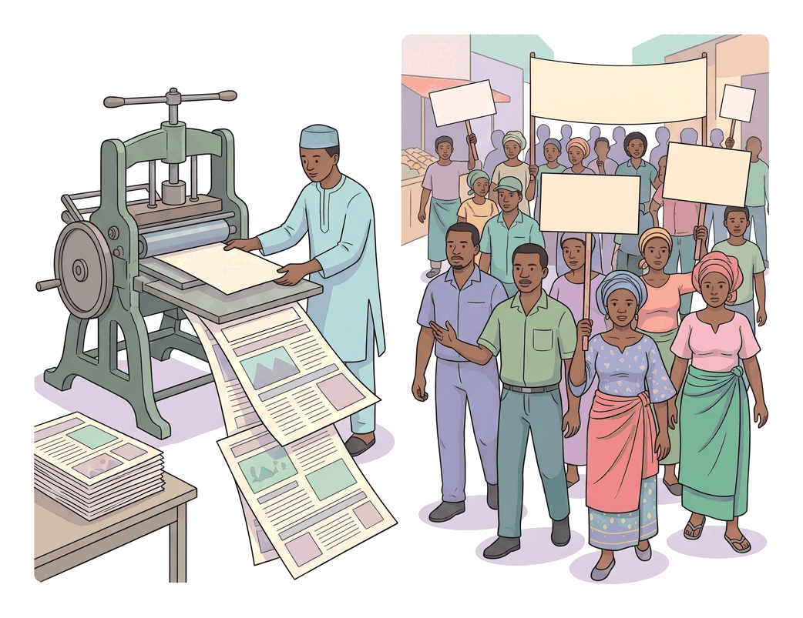
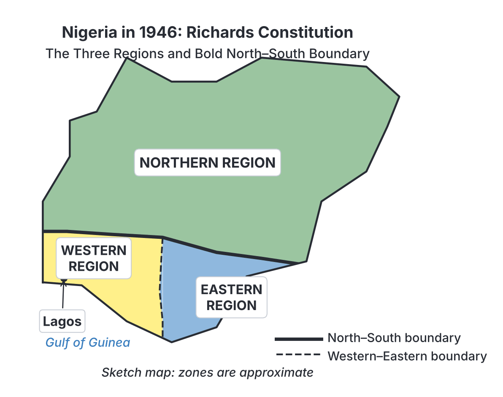
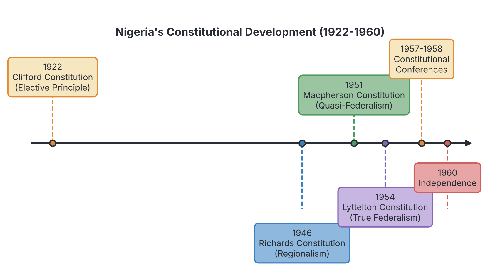

# JAMB History Notes: Constitutional Developments, Nationalism and Independence

## What JAMB expects

This topic covers Section C, Topic 6 of the JAMB History syllabus: Constitutional Developments, Nationalism and Independence. It includes:

*   **a.** The 1922 Clifford Constitution and the rise of Nigeria’s first political party.
*   **b.** World War II and the agitation for independence.
*   **c.** The rise of nationalist movements.
*   **d.** The Richards Constitution of 1946.
*   **e.** The Macpherson Constitution of 1951.
*   **f.** Party politics – regionalism, federalism and minority question.
*   **g.** Lyttleton Constitution of 1954.
*   **h.** Constitutional Conferences in Lagos in 1957 and London in 1958.
*   **i.** The general elections of 1959 and independence in 1960.

By the end of these notes, you should be able to:
1.  highlight the significance of the Clifford constitution of 1922;
2.  examine the effect of World War II on the agitations for independence and constitutional developments;
3.  trace the emergence of the nationalist movement;
4.  assess the roles of the different constitutions in constitutional development;
5.  trace the development of party politics and its impact on regionalism and the minority question;
6.  examine the impact of the constitutional conferences on the move towards independence;
7.  determine the factors that aided the attainment of independence.

**Note on the syllabus wording:**
*   The syllabus spells the 1954 constitution as "Lyttleton". Standard historical texts usually spell it "Lyttelton" (after Sir Oliver Lyttelton). We will use the common textbook spelling, but be aware of the syllabus spelling for your exam. 
*   For the constitutional conferences, the syllabus mentions "Lagos in 1957 and London in 1958". Historically, the major 1957 conference was held in London, and the 1958 resumed conference was also in London (though minor discussions happened in Lagos). We will use the syllabus phrasing as our heading but explain the historical facts.

## The Rise of Nationalist Movements

**Nationalism** in colonial Nigeria was the strong feeling of national consciousness and the struggle by Nigerians to free themselves from British colonial rule, gain participation in government, and eventually achieve independence. 

### Phases of Nigerian Nationalism

1.  **Early Nationalism (Pre-1939):** Before World War II, the movement was mostly led by the educated elite in Lagos and Calabar. Their goal was not immediate independence but **reforms**. They wanted better jobs in the civil service, representation in the legislative councils, and an end to racial discrimination. They used newspapers and peaceful petitions.
2.  **Militant Nationalism (Post-1939):** After World War II, the demand changed from mere reforms to **self-government** and complete independence. The movement spread beyond Lagos, involving trade unions, market women, ex-servicemen, and students. The language became bolder, and political parties became mass movements.

### Factors that led to the rise of Nationalist Movements

The emergence of nationalism was driven by both internal conditions inside Nigeria and external events in the wider world.

**Internal Factors:**
*   **Western Education:** Educated Nigerians (like Nnamdi Azikiwe, Obafemi Awolowo, and H.O. Davies) read about democracy and freedom, and realized that colonialism was unjust. They became the leaders of the movement.
*   **Newspapers (The Press):** Nationalist newspapers such as the *West African Pilot* (founded by Nnamdi Azikiwe in 1937) and the *Lagos Daily News* (by Herbert Macaulay) educated the masses, exposed colonial abuses, and stirred up anti-colonial feelings.
*   **Economic Exploitation and Hardship:** Nigerians were paid low wages, European trading companies held monopolies (buying raw materials cheaply and selling manufactured goods dearly), and colonial taxation was burdensome. This angered the people.
*   **Discrimination:** Nigerians were excluded from the senior cadre of the civil service and were segregated in housing (Europeans lived in separate, well-maintained "Government Reservation Areas" or GRAs).
*   **Trade Unions:** Workers formed unions (like the Railway Workers Union led by Michael Imoudu) to fight for better conditions. Their struggles, especially the **General Strike of 1945**, became part of the nationalist fight.

**External Factors:**
*   **The Pan-African Movement:** Leaders like W.E.B. Du Bois and Marcus Garvey in the Americas advocated for the dignity and freedom of black people worldwide, inspiring Nigerian leaders.
*   **The West African Students' Union (WASU):** Formed in London in 1925 by Ladipo Solanke, this group became a training ground for West African nationalists studying abroad, helping them coordinate their demands for independence.
*   **World War II:** The war was a massive turning point (explained in detail below).
*   **Independence of other nations:** The independence of India in 1947 and Ghana in 1957 proved to Nigerians that freedom from British rule was possible.

## The 1922 Clifford Constitution and the First Political Party

In 1914, Lord Lugard amalgamated Northern and Southern Nigeria and created a body called the **Nigerian Council**. It was heavily criticized because it had no real power, and the few Nigerians on it were traditional rulers appointed by the British who rarely attended meetings. 

In **1922**, a new governor, **Sir Hugh Clifford**, introduced a new constitution to replace Lugard’s system. 

### Key Features of the Clifford Constitution

1.  **The Elective Principle:** This was the most important feature. For the first time in British West Africa, Africans were allowed to **elect** their representatives. 
2.  **The Legislative Council:** A new Legislative Council was created for the South. It had 46 members. Out of these, **four** were elected Nigerians: **three** represented Lagos, and **one** represented Calabar. (The right to vote was not for everyone; only adult males earning an income of at least £100 a year could vote).
3.  **Northern Exclusion:** The new Legislative Council made laws only for the Southern Provinces and Lagos. The Northern Provinces were governed directly by the Governor using proclamations.

### Significance of the Clifford Constitution

*   **Introduction of Elections:** The elective principle was a major constitutional milestone. It planted the seed of modern democracy in Nigeria.
*   **Stimulated Political Activity:** Because there were four seats to be won in Lagos and Calabar, Nigerians had to organize themselves to campaign and vote. This directly led to the birth of political parties and newspapers.
*   **Division of Nigeria:** By legislating for the South while the Governor ruled the North by decree, the constitution widened the political gap between the North and the South.

### The Rise of Nigeria's First Political Party

Because the Clifford Constitution allowed Lagos to elect three representatives, politicians needed a platform to contest the elections. 

In **1923**, **Herbert Macaulay** (often called the father of Nigerian nationalism) founded the **Nigerian National Democratic Party (NNDP)**. 
*   It was Nigeria's first political party.
*   It dominated Lagos politics, winning all three Lagos seats in the Legislative Council elections of 1923, 1928, and 1933.
*   The party relied on its newspaper, the *Lagos Daily News*, to criticize colonial policies.

## World War II and the Agitation for Independence

The Second World War (1939–1945) dramatically changed the pace of Nigerian nationalism. Before the war, nationalists asked for reforms; after the war, they demanded self-government. The war affected constitutional development in several ways:

1.  **The Myth of White Superiority was Broken:** Thousands of Nigerian soldiers (in the Royal West African Frontier Force) were drafted to fight in places like Burma and India. They fought alongside British and European soldiers, saw them show fear, get wounded, and die. They realized that the white man was not a "superman". When these veterans returned home, they were no longer afraid to challenge colonial authorities.
2.  **The Atlantic Charter (1941):** During the war, US President Franklin D. Roosevelt and British Prime Minister Winston Churchill signed a document stating the right of all peoples to choose the form of government under which they live (self-determination). Educated Nigerians argued that if Britain was fighting Germany for freedom in Europe, then Nigerians deserved freedom from Britain too.
3.  **Economic Hardship:** The war caused high inflation, scarcity of goods, and strict price controls in Nigeria. The British government bought Nigerian crops at very low prices to support the war effort. This economic suffering angered the population, making them more willing to support nationalist leaders and strikes.
4.  **Growth of Trade Unions:** Because of the harsh economic conditions, workers organized themselves. In 1945, led by Michael Imoudu, Nigerian workers staged a massive **General Strike** lasting over a month, paralyzing the economy and showing the colonial government the power of organized Nigerians.
5.  **Formation of a Mass Movement:** The momentum of the war years led to the creation of a broader nationalist organization. In **1944**, the **National Council of Nigeria and the Cameroons (NCNC)** was formed (later renamed the National Council of Nigerian Citizens). Herbert Macaulay was its first president, and Nnamdi Azikiwe its first secretary. It was the first party aiming to unite the whole country to fight for independence.

## The Richards Constitution of 1946

By the end of World War II, the British realized the 1922 constitution was outdated. In **1946**, the Governor, **Sir Arthur Richards**, introduced a new constitution.

### Aims and Features of the Richards Constitution

Sir Arthur Richards stated his aims were to promote the unity of Nigeria, provide adequately for its diverse elements, and secure greater participation of Africans in discussing their own affairs.

1.  **Integration of the North:** For the first time since 1914, Northern and Southern Nigeria sat together in a single **central Legislative Council** in Lagos. The North was no longer ruled just by the Governor's decrees.
2.  **Introduction of Regionalism:** The constitution divided Nigeria into **three regions**: the Northern, Western, and Eastern Regions. This was a turning point in Nigerian history, laying the foundation for regional politics.
3.  **Regional Assemblies:** Each of the three regions was given a Regional House of Assembly. The North also got a House of Chiefs. However, these regional assemblies had no real power to make laws; they only advised the Governor and discussed issues.
4.  **Unofficial Majority:** In the central Legislative Council, there were more "unofficial" members (Nigerians, mostly traditional rulers appointed by the government) than "official" members (British colonial officers). 
5.  **Retention of the Elective Principle:** The four elected seats (3 for Lagos, 1 for Calabar) were kept, but the principle was not expanded to other parts of the country.

### Criticisms and Nationalist Reaction

The Richards Constitution was deeply unpopular among nationalists. 
*   **Lack of Consultation:** Sir Arthur Richards drafted it secretly and imposed it on the people without consulting Nigerian leaders.
*   **Weak Regional Assemblies:** The regional houses were merely "talking shops" that could not pass laws.
*   **False Unofficial Majority:** Nationalists argued that the "unofficial majority" was a trick, because most of those members were traditional rulers (chiefs and emirs) who depended on the British for their positions and would never vote against the Governor.
*   **Limited Franchise:** The elective principle was not extended beyond Lagos and Calabar, and the income restriction meant most Nigerians still could not vote.

Because of these flaws, the NCNC, led by Nnamdi Azikiwe, toured the country to collect money and sent a delegation to London in 1947 to protest against the constitution.

## The Macpherson Constitution of 1951

Because of the massive opposition to the Richards Constitution, it was replaced earlier than planned. The new Governor, **Sir John Macpherson**, decided not to repeat Richards' mistake.

### The Consultation Process

Macpherson ensured there was **unprecedented consultation**. He asked the people what kind of constitution they wanted. Discussions were held at the village, district, provincial, and regional levels, culminating in a general conference in Ibadan in 1950. This made the Macpherson Constitution the first to be widely debated by Nigerians.

### Key Features of the Macpherson Constitution (1951)

1.  **Quasi-Federalism:** It introduced a system that was half-way between a unitary system and a true federal system. It gave real powers to the regions, but the central government in Lagos could still override regional laws.
2.  **Regional Legislatures with Law-Making Powers:** Unlike Richards' "talking shops," the Regional Assemblies could now make laws on specific matters (like agriculture, health, and local government). Both the North and the West had a House of Assembly and a House of Chiefs, while the East had only a House of Assembly.
3.  **Regional Executives:** Executive Councils were created in each region, with Nigerian ministers chosen from the political parties. 
4.  **Central Legislature and Executive:** The central Legislative Council was renamed the House of Representatives, with 136 elected Nigerian members. A central Council of Ministers was also created.
5.  **Elections:** The constitution vastly expanded elections, but they were mostly indirect (via electoral colleges) rather than direct voting by the masses.

### The Collapse of the Macpherson Constitution

Despite the wide consultation, the Macpherson constitution broke down within two years because of severe political crises:

1.  **The Eastern Region Crisis (1953):** A severe internal conflict within the NCNC led to a breakdown of government in the Eastern Region, showing that the constitutional machinery was fragile.
2.  **The 1953 Motion for Self-Government:** In the central House of Representatives, Chief Anthony Enahoro (of the Action Group) moved a motion demanding self-government for Nigeria in 1956. The Northern delegates, feeling the North was not yet ready, opposed it and amended the motion to "as soon as practicable". 
3.  **The Kano Riots (1953):** Following the bitter debate over Enahoro's motion, Northern delegates were jeered by hostile crowds in Lagos, and an Action Group-led delegation then toured the North to campaign for self-government. This sparked violent clashes between Northerners and Southerners in Kano in May 1953, leaving many dead.
4.  **Flaws of Quasi-Federalism:** Regional ministers felt they owed loyalty to their regional party leaders rather than the central government. The system was unworkable.

## The Lyttelton Constitution of 1954

Because the Macpherson constitution collapsed in 1953, Nigerian leaders and the Colonial Secretary, **Oliver Lyttelton**, held conferences in London (1953) and Lagos (1954) to draft a new one.

### Key Features of the Lyttelton Constitution

The Lyttelton Constitution is historically significant because it **formally established a true federal system** in Nigeria.

1.  **True Federalism:** It completely separated the powers of the regional governments from the central government. Regional laws could no longer be overridden by Lagos.
2.  **Division of Powers:** Law-making powers were divided into:
    *   **Exclusive List:** Only the federal government could make laws on these (e.g., defense, foreign affairs, currency).
    *   **Concurrent List:** Both federal and regional governments could make laws (e.g., higher education, industrial development). If there was a clash, the federal law prevailed.
    *   **Residual List:** Anything not on the first two lists belonged entirely to the regions (e.g., primary education, local healthcare).
3.  **Regional Premiers:** The post of **Premier** was created for the regions. Nnamdi Azikiwe became Premier of the East, Obafemi Awolowo Premier of the West, and Ahmadu Bello Premier of the North. (The Governor-General remained the head of the center; there was no federal Prime Minister yet).
4.  **Federal Capital Territory:** Lagos was separated from the Western Region and made a neutral Federal Capital Territory. 
5.  **Regionalization of Institutions:** The civil service, the judiciary, and the marketing boards were all regionalized. A Federal Supreme Court was established to settle disputes between regions.

## Assessing the Roles of the Constitutions in Development

The steady progression of these constitutions laid the step-by-step groundwork for Nigeria's independence, gradually transferring power from British officials to Nigerian representatives.

| Feature / Constitution | 1922 Clifford | 1946 Richards | 1951 Macpherson | 1954 Lyttelton (Lyttleton) |
| :--- | :--- | :--- | :--- | :--- |
| **System of Government** | Unitary | Unitary (with regional framework) | Quasi-Federal | **True Federal** |
| **Key Significance** | Introduced the **Elective Principle** (Lagos & Calabar) | Introduced **Regionalism** (3 Regions) and brought North and South into one council | Unprecedented **consultation**; gave regions limited law-making power | Formally established a **federal structure**; division of powers; regional Premiers |
| **Main Criticism** | Excluded the North from the Legislative Council | Governor imposed it without consulting Nigerians | Quasi-federal structure caused friction between regions and center | Weakened the center by making regions too powerful and regionalizing the civil service |

## Party Politics, Regionalism and the Minority Question

As constitutional changes gave more power to Nigerians, the focus shifted from fighting the British to competing against each other for control.

### The Rise of Major Political Parties

1.  **NNDP (1923):** Formed by Herbert Macaulay; limited mainly to Lagos.
2.  **NYM (Nigerian Youth Movement, 1936):** Formed by Ernest Ikoli, Dr J.C. Vaughan, and H.O. Davies (later joined by Azikiwe and Awolowo). It tried to be a truly national party but broke apart due to internal ethnic and leadership squabbles in 1941.
3.  **NCNC (National Council of Nigeria and the Cameroons, 1944):** Led by Nnamdi Azikiwe. It started as a national movement but, over time, its power base shrank mostly to the **Eastern Region**, dominated by the Igbo.
4.  **AG (Action Group, 1951):** Founded by Obafemi Awolowo from a Yoruba cultural group, *Egbe Omo Oduduwa*. Its primary goal was to win political power in the **Western Region**.
5.  **NPC (Northern People's Congress, 1951):** Founded by Sir Ahmadu Bello and Abubakar Tafawa Balewa from a Northern cultural group, *Jamiyyar Mutanen Arewa*. Its motto was "One North, One People", and it aimed to control the **Northern Region**, dominated by the Hausa-Fulani.
6.  **NEPU (Northern Elements Progressive Union, 1950):** Founded by Aminu Kano as a radical opposition to the conservative NPC, championing the rights of the commoners (*talakawa*) in the North.

### Regionalism and Ethnic Politics

The Richards Constitution of 1946 created the three regions, and the Macpherson Constitution of 1951 gave political power to those regions. Because the three main parties (NCNC, AG, NPC) each captured the government of their respective region (East, West, North), Nigerian politics became strictly **regionalized**. 

Politicians focused on developing their own regions and securing ethnic interests rather than building a united nation. Federalism in Nigeria developed as a way to keep these three distinct, powerful regions together in one country.

### The Minority Question

Nigeria was not just made up of the Igbo, Yoruba, and Hausa-Fulani. Each of the three regions had numerous smaller ethnic groups (minorities) who feared they would be marginalized, oppressed, or culturally swallowed by the major ethnic group controlling their region once the British left.

*   **In the North:** The Middle Belt ethnic groups (largely non-Muslim) feared Hausa-Fulani domination. They formed the **United Middle Belt Congress (UMBC)** to demand their own state.
*   **In the East:** The Efik, Ibibio, Ijaw, and others feared Igbo domination. They formed the **Calabar-Ogoja-Rivers (COR) State Movement**.
*   **In the West:** The Edo, Urhobo, Itsekiri, and Igbo speaking peoples feared Yoruba domination. They formed the **Mid-West State Movement**.

**The Willink Commission (1957):** 
To address these fears before independence, the British government set up the **Minorities Commission** in 1957, headed by Sir Henry Willink. The minorities begged for new states to be created for them.
However, in 1958, the Commission reported that creating new states would cause more problems and delay independence. Instead, they recommended:
1.  Including a list of **Fundamental Human Rights** in the independence constitution to protect all individuals.
2.  Setting up special development boards for neglected areas (like the Niger Delta).
As a result, no new states were created before 1960.

## The Constitutional Conferences on the Eve of Independence

*(Note: As mentioned, historians record the main 1957 conference as taking place in London, followed by a resumed conference in London in 1958. However, follow the syllabus prompts).*

These late-stage conferences were meant to iron out the final details before Nigeria became a sovereign nation.

### The 1957 Conference
Nigerian political leaders of all major parties travelled to London to demand independence. The major impacts and decisions were:
1.  **Self-Government for the South:** The Eastern and Western regions were granted internal self-government immediately in 1957. (The North chose to wait until 1959, feeling they needed more time to prepare their civil service).
2.  **Creation of the Office of the Prime Minister:** The conference agreed to create a federal Prime Minister. Shortly after, **Abubakar Tafawa Balewa** (NPC) was appointed as Nigeria's first Prime Minister.
3.  **Minorities:** The conference recognized the fears of the minorities and agreed to set up the Willink Commission to investigate them (as discussed above).
4.  **House of Chiefs:** A House of Chiefs was agreed upon for the Eastern region, meaning all three regions now had bicameral (two-chamber) legislatures.

### The 1958 Conference
This conference was convened to review the Willink Commission report and finalize the transition.
1.  **Independence Date:** The British government firmly agreed to grant Nigeria independence on **1st October 1960**, provided the Nigerian parliament passed a resolution asking for it after the 1959 elections.
2.  **Self-Government for the North:** The Northern Region was granted internal self-government in 1959.
3.  **The State Creation Issue:** The leaders accepted the Willink Commission’s advice not to create new states, but agreed to add a chapter on Fundamental Human Rights into the independence constitution to protect minorities.

## The 1959 Elections and Independence in 1960

### The 1959 General Elections
The 1959 general elections were the most crucial in Nigeria's colonial history because the winners would form the government that would receive independence from Britain.
*   **The Campaign:** The campaigns were intense and heavily ethnic/regional. The AG campaigned aggressively in the North (hoping to win Middle Belt minority votes) and East. The NPC focused entirely on locking down the North. The NCNC campaigned in the East and West.
*   **The Result:** Because the North had a larger population, it was allocated more than half the seats in the federal House of Representatives. The NPC won 134 seats (all in the North), the NCNC won 89 seats, and the AG won 73 seats.
*   **The Coalition:** No single party won an absolute majority. To form a government, the **NPC and the NCNC formed a coalition**. 
*   **The Government:** Abubakar Tafawa Balewa (NPC) remained the Prime Minister, and Nnamdi Azikiwe (NCNC) resigned as Premier of the East to become the President of the Senate (and later the Governor-General). The AG, led by Obafemi Awolowo, became the official opposition in the federal parliament.

### Independence (October 1, 1960)
On **1st October 1960**, Nigeria officially gained its independence. The Union Jack (British flag) was lowered, and the Nigerian green-and-white flag was hoisted.
*   Nigeria adopted a parliamentary system of government at independence.
*   The British Queen (Elizabeth II) remained the ceremonial Head of State, represented in Nigeria by the Governor-General (Dr. Nnamdi Azikiwe). 
*   Sir Abubakar Tafawa Balewa was the Head of Government (Prime Minister).

### Factors that Aided the Attainment of Independence
Why did Nigeria achieve independence in 1960 without a bloody revolutionary war (unlike Kenya or Algeria)?
1.  **The Work of Nationalist Leaders:** The relentless press campaigns, petitions, and mobilization by leaders like Macaulay, Azikiwe, Awolowo, and Ahmadu Bello pressured the British.
2.  **Constitutional Evolution:** The British adopted a policy of gradual transfer of power. By negotiating step-by-step through the constitutions (1922 to 1954), politicians learned how to govern and avoiding outright war.
3.  **The Impact of World War II:** Returning soldiers, trade unions, and the economic reality weakened British control and emboldened Nigerians.
4.  **International Pressure:** The formation of the United Nations (which advocated for self-determination), and pressure from anti-colonial superpowers like the USA and the Soviet Union, made it hard for Britain to hold onto its empire.
5.  **The Independence of Other Nations:** The independence of India (1947) and especially Ghana (1957) accelerated the timeline, as Nigerian leaders refused to be left behind.

## Key terms

| Term | Meaning |
| :--- | :--- |
| **Nationalism** | The strong feeling of national consciousness and the struggle by indigenous people to free themselves from foreign colonial rule. |
| **Elective Principle** | A system introduced in 1922 allowing a specific population (in Lagos and Calabar) to vote for their representatives. |
| **Franchise** | The right to vote in political elections. |
| **Regionalism** | Dividing a country into distinct political regions, often leading to people identifying with their region rather than the nation. |
| **Quasi-Federalism** | A system of government that has some features of federalism but still gives the central government the power to override the regions. |
| **Federalism** | A system where power is constitutionally divided and shared between a central government and regional/state governments. |
| **Minority Question** | The fears of smaller ethnic groups that they would be oppressed by the dominant ethnic groups in their regions. |
| **Willink Commission** | A 1957 inquiry set up by the British to look into the fears of Nigerian minorities and the demand for new states. |
| **Coalition Government** | A government formed jointly by two or more political parties when no single party wins an absolute majority. |

## Exam tips and common mistakes

*   **Clifford Constitution (1922):** Always associate this with the **Elective Principle** and the formation of the **NNDP** (Nigeria's first party). Do not confuse it with Richards.
*   **Richards Constitution (1946):** Always associate this with **Regionalism** (creation of 3 regions) and bringing the North and South together. Remember the heavy criticism it faced for lack of consultation.
*   **Macpherson Constitution (1951):** Associate this with **wide consultation** and the introduction of **quasi-federalism**. 
*   **Lyttelton Constitution (1954):** Associate this with **True Federalism** and the creation of **Regional Premiers**. (Watch out for the syllabus spelling: "Lyttleton").
*   **Minorities and States:** A common trick question asks when the Willink Commission created new states. **It did not create any states.** It recommended fundamental human rights instead.
*   **1959 Elections:** No party won an absolute majority. The government was formed by an NPC-NCNC coalition, leaving the AG as the opposition.
*   **First Political Party vs. Mass Movement:** NNDP (Macaulay, 1923) is the first political party. NCNC (1944) is the first nationwide mass political party.

## Quick summary

1.  Nationalism grew in Nigeria due to western education, the press, economic hardship, and external factors like World War II and the Pan-African movement.
2.  The 1922 Clifford Constitution introduced the elective principle for Lagos and Calabar, sparking the formation of the NNDP, Nigeria's first political party.
3.  World War II accelerated the push for independence by breaking the myth of white superiority, inspiring trade union strikes, and popularizing self-determination.
4.  The 1946 Richards constitution introduced regionalism but was rejected because the governor did not consult Nigerians.
5.  The 1951 Macpherson constitution involved wide consultation and introduced quasi-federalism, but collapsed due to regional friction.
6.  The 1954 Lyttelton constitution firmly established a true federal system, dividing powers between the center and the regions.
7.  The three dominant parties (NPC, NCNC, AG) controlled the North, East, and West respectively, causing smaller ethnic groups to demand their own states—a fear addressed by the Willink Commission through human rights rather than state creation.
8.  Following the 1959 elections, an NPC-NCNC coalition formed the government, leading Nigeria to independence on October 1, 1960.

## Practice questions

**1. The most significant feature of the Clifford Constitution of 1922 was the**

- A. introduction of regionalism
- B. introduction of the elective principle
- C. creation of the post of Prime Minister
- D. establishment of a federal system

**Answer: B.** The elective principle allowed Nigerians in Lagos and Calabar to vote for their representatives for the first time. The confusion often lies with option A, which was introduced by Richards in 1946.

**2. Which of the following constitutional arrangements formalized a federal system of government in Nigeria?**

- A. Richards Constitution
- B. Macpherson Constitution
- C. Lyttelton Constitution
- D. Independence Constitution

**Answer: C.** The 1954 Lyttelton constitution divided powers (exclusive, concurrent, residual lists) and formalized true federalism. Macpherson only introduced a flawed quasi-federalism.

**3. World War II aided the nationalist struggle in Nigeria primarily because it**

- A. made Britain too poor to rule Africa
- B. destroyed the myth of white racial superiority among returning soldiers
- C. forced the British to hand over power to traditional rulers
- D. led to the immediate creation of political parties

**Answer: B.** African soldiers saw white soldiers showing fear and dying, which erased the psychological intimidation of colonial rule.

**4. The Richards Constitution of 1946 was widely condemned by Nigerian nationalists mainly because**

- A. it abolished the elective principle
- B. it was drafted without consulting the Nigerian people
- C. it gave too much power to the Northern region
- D. it separated Lagos from the Western region

**Answer: B.** Sir Arthur Richards drafted it secretly. Nationalists like Azikiwe fiercely opposed it for this lack of consultation. Option D happened under Lyttelton.

**5. Which political party was founded by Herbert Macaulay in 1923 to contest elections in Lagos?**

- A. Action Group (AG)
- B. Nigerian Youth Movement (NYM)
- C. Nigerian National Democratic Party (NNDP)
- D. National Council of Nigeria and the Cameroons (NCNC)

**Answer: C.** The NNDP was Nigeria's first political party, formed to take advantage of the elective principle in the Clifford constitution.

**6. The Willink Commission was set up in 1957 to**

- A. decide the date for independence
- B. look into the fears of ethnic minorities
- C. draft the independence constitution
- D. divide Nigeria into new states

**Answer: B.** It investigated minority fears of domination by the major ethnic groups but ultimately advised against creating new states before independence.

**7. Under which constitution did Nigerian regions first get their own Premiers?**

- A. Clifford Constitution
- B. Richards Constitution
- C. Macpherson Constitution
- D. Lyttelton Constitution

**Answer: D.** The 1954 Lyttelton constitution established true federalism and created the posts of regional Premiers (Azikiwe, Awolowo, Bello).

**8. The outcome of the 1959 general elections in Nigeria resulted in**

- A. a sweeping victory for the Action Group
- B. a military takeover of the government
- C. an absolute majority for the NCNC
- D. a coalition government between the NPC and the NCNC

**Answer: D.** No single party won enough seats to rule alone. The NPC (with the most seats) allied with the NCNC to form the independence government.

**9. A major crisis that led to the collapse of the Macpherson Constitution was the**

- A. Aba Women's Riot
- B. General Strike of 1945
- C. 1953 Enahoro motion for self-government and the Kano riots
- D. formation of the Nigerian Youth Movement

**Answer: C.** The friction over the 1953 self-government motion highlighted the flaws of quasi-federalism and triggered the Kano riots, showing the constitution was unworkable.

**10. Which constitution is famous for undergoing wide and unprecedented consultation at village, district, and regional levels before it was drafted?**

- A. Clifford Constitution
- B. Richards Constitution
- C. Macpherson Constitution
- D. Lyttelton Constitution

**Answer: C.** Governor John Macpherson ensured wide consultation (culminating in the 1950 Ibadan conference) precisely because Nigerians hated the Richards constitution for lacking consultation.

<!-- COVERAGE
obj i | The 1922 Clifford Constitution and the First Political Party
obj ii | World War II and the Agitation for Independence
obj iii | The Rise of Nationalist Movements
obj iv | Assessing the Roles of the Constitutions in Development
obj v | Party Politics, Regionalism and the Minority Question
obj vi | The Constitutional Conferences on the Eve of Independence
obj vii | The 1959 Elections and Independence in 1960
item a | The 1922 Clifford Constitution and the First Political Party
item b | World War II and the Agitation for Independence
item c | The Rise of Nationalist Movements
item d | The Richards Constitution of 1946
item e | The Macpherson Constitution of 1951
item f | Party Politics, Regionalism and the Minority Question
item g | The Lyttelton Constitution of 1954
item h | The Constitutional Conferences on the Eve of Independence
item i | The 1959 Elections and Independence in 1960
-->
