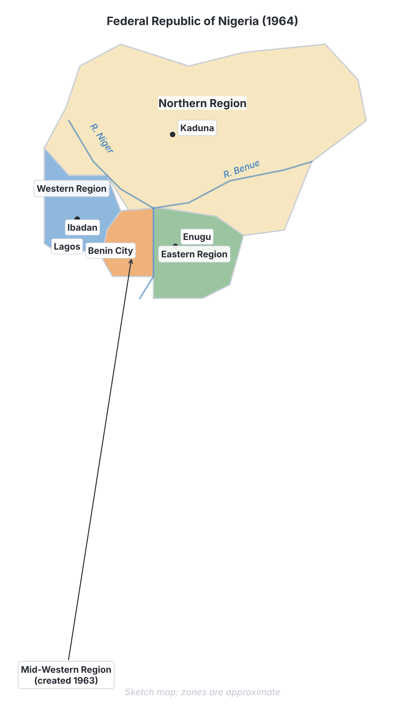

# JAMB History Notes: The Politics of the First Republic and Military Intervention

## What JAMB expects

This topic is Section D, Topic 1 of the JAMB History syllabus: Nigeria Since Independence – The Politics of the First Republic and Military intervention. It covers the political crises that led to the collapse of Nigeria's first democratic government and the beginning of military rule.

The syllabus lists the following content items:
- a. Struggle for the control of the centre;
- b. Issue of revenue allocation
- c. The 1962/63 census controversies
- d. The 1963 Republican constitution
- e. Minority agitations
- f. The Action Group crisis and the General Elections of 1964/65.
- g. The coup d’etat of January 1966 and the counter coup of July, 1966
- h. The Ironsi Regime.

By the end of these notes, you should be able to:
1. give reasons behind the struggle for the control of the centre;
2. account for the controversies in revenue allocation;
3. account for the controversies generated by the 1962/63 census;
4. highlight the key features and significance of the 1963 constitution;
5. account for the controversies generated by minority agitations and the quest for creation of states;
6. examine the problems created by the Action Group crisis and the General Elections of 1964/65;
7. analyse the consequences of the 1966 military intervention.

**Note on neutrality:** The events of this period are sensitive and historians sometimes disagree on the motives of the key actors. These notes report the established facts neutrally, focusing on what happened, what was announced, and the stated reasons, as expected in standard Nigerian textbooks.

## Struggle for the control of the centre

**Objective i: give reasons behind the struggle for the control of the centre.**
**Content a: Struggle for the control of the centre.**

Nigeria became independent on **1 October 1960** with a federal system of government. The country was divided into three large regions: the Northern Region, the Western Region, and the Eastern Region. 

At independence, the central (federal) government in Lagos was controlled by a coalition between the **Northern People's Congress (NPC)** and the **National Council of Nigerian Citizens (NCNC)**. Alhaji Sir Abubakar Tafawa Balewa (NPC) was the Prime Minister, and Dr Nnamdi Azikiwe (NCNC) became the Governor-General in November 1960. The **Action Group (AG)**, led by Chief Obafemi Awolowo, formed the official opposition.

However, the politics of the First Republic was dominated by a fierce and bitter struggle among the regional political parties to control the federal government (the centre). 

### Reasons for the struggle

1. **The immense power and wealth of the centre:** The federal government controlled national resources, the armed forces, foreign affairs, and major infrastructure. Controlling the centre meant having the power to distribute national wealth, jobs, and development projects to one's own region or ethnic group.
2. **"Winner-takes-all" politics:** The political system operated in a way where the winning party took all the benefits, leaving the opposition with very little. No region wanted to be left out of power, because being in opposition was seen as a disadvantage.
3. **Fear of domination:** Because the three major political parties were based on ethnic and regional lines (NPC for the Hausa-Fulani North, NCNC for the Igbo East, AG for the Yoruba West), each group feared that if another group controlled the centre, they would use federal power to oppress the others.
4. **Structural imbalance of the federation:** The Northern Region was larger in landmass and population than the Eastern and Western regions combined. This meant the North was allocated more than half of the seats in the federal parliament. Southern politicians feared permanent Northern political domination, while Northern politicians feared Southern domination in the civil service and economy due to the South's early advantage in Western education.
5. **Regionalism over nationalism:** Most politicians were more loyal to their regions than to the newly independent Nigerian nation. The leaders of the major parties (like Sir Ahmadu Bello of the NPC) often preferred to stay in their regions as Premiers rather than go to the centre, sending their deputies to Lagos instead.

## The issue of revenue allocation

**Objective ii: account for the controversies in revenue allocation.**
**Content b: Issue of revenue allocation.**

Revenue allocation is the method used to share the money earned by the country between the federal government and the regional (or state) governments. In the First Republic, this was a major source of conflict because regions depended heavily on this money.

### Why revenue allocation was controversial

The core of the controversy was deciding **which criteria** should be used to share the national wealth. The regions argued for different formulas depending on what favoured them most at the time:

1. **Derivation principle:** This principle states that a large share of the revenue produced in a region should be given back to that region. In the 1950s, when regions were exporting cash crops (cocoa in the West, groundnuts and cotton in the North, palm produce in the East), derivation was the main formula used. Regions with highly profitable exports supported this.
2. **Need and Population:** Other principles argued that revenue should be shared based on the population size or the developmental needs of a region. The Northern Region, with its large population and vast landmass, often argued that population and need should be the main criteria.
3. **National Interest/Even Development:** This principle argued that money should be used to develop all parts of the country equally, regardless of where the revenue was generated.

### Revenue Allocation Commissions

To solve these arguments, several commissions were set up before and after independence. The most important for this period were:
*   **The Raisman Commission (1958):** It reduced the emphasis on derivation to balance the wealth across the country. It created the **Distributable Pool Account (DPA)**, a central pot of money to be shared among the regions based on population, basic responsibilities, and balanced development. 
*   **The Binns Commission (1964):** It increased the money going into the DPA and adjusted the sharing formula, but controversies continued as regions constantly felt they were being cheated by the others.

The shift in the economy (and later, the discovery of crude oil in the Niger Delta) made the arguments over derivation versus population a permanent feature of Nigerian politics.

## The 1962/63 census controversies

**Objective iii: account for the controversies generated by the 1962/63 census.**
**Content c: The 1962/63 census controversies.**

A national census (counting the population) is meant to be a simple demographic exercise, but in Nigeria, it became explosive. 

### Why the census was important

In the First Republic, population figures determined two crucial things:
1. **Political power:** The number of seats a region got in the Federal House of Representatives was based on its population.
2. **Revenue allocation:** Population was a major factor in sharing the national wealth.

Therefore, every region wanted to record the highest possible population figures to gain more money and political power.

### The 1962 Census
A national census was conducted in 1962. When the preliminary results were compiled, it was discovered that the Southern regions had recorded a massive population increase compared to the previous 1952/53 census, potentially giving the South a majority over the North. Northern leaders rejected the figures, and there were widespread accusations from all sides that the numbers had been inflated and that counting was fraudulent. The federal government cancelled the 1962 census results.

### The 1963 Census
A new census was ordered and held in 1963. The results announced were:
*   **North:** 29.8 million
*   **East:** 12.4 million
*   **West:** 10.3 million
*   **Mid-West:** 2.5 million
*   **Lagos:** 0.6 million
*   **Total:** 55.6 million (approx.)

The 1963 figures showed massive increases for all regions, but crucially, it maintained the Northern Region's numerical majority over the South. 

### The controversies generated
1. **Rejection by the East:** The Eastern Region government (controlled by the NCNC) fiercely rejected the 1963 figures, accusing the North of inflating its numbers. The Northern Region government accepted them, and so did the Western Region government under Premier Akintola, an ally of the North. The Premier of the Eastern Region, Dr Michael Okpara, called the figures "worse than useless."
2. **Legal battles:** The Eastern Region took the Federal Government to the Supreme Court to try and nullify the census, but the court ruled that it had no jurisdiction over the matter.
3. **Deepened ethnic tension:** The census crisis destroyed trust between the regions. The political alliance between the NPC (North) and NCNC (East) broke down, setting the stage for the chaotic 1964 elections. 

## The 1963 Republican constitution

**Objective iv: highlight the key features and significance of the 1963 constitution.**
**Content d: The 1963 Republican constitution.**

At independence in 1960, Nigeria was still a Dominion within the British Commonwealth. The British Monarch (Queen Elizabeth II) was Nigeria's Head of State, represented locally by a Governor-General (Dr Nnamdi Azikiwe from November 1960). On **1 October 1963**, exactly three years after independence, Nigeria adopted a new constitution and became a **Republic**. 

### Key features of the 1963 Republican Constitution

1. **The President replaced the Queen:** The Queen of England ceased to be the Head of State. An indigenous, ceremonial **President** (Dr Nnamdi Azikiwe) became the Head of State, elected by a joint session of the federal parliament for a five-year term.
2. **Parliamentary system retained:** The Prime Minister (Sir Abubakar Tafawa Balewa) remained the Head of Government, wielding the real executive power. (Nigeria did not switch to a presidential system until 1979).
3. **Supreme Court as the highest court:** Under the 1960 constitution, the highest court of appeal for Nigeria was the Judicial Committee of the Privy Council in London. The 1963 Constitution abolished this; the **Supreme Court of Nigeria** became the final court of appeal.
4. **Creation of regions:** The constitution laid down the formal procedures for creating new regions (which had just been used, under the 1960 Constitution, to create the Mid-Western Region in August 1963).
5. **Emergency powers:** It maintained the federal government's power to declare a state of emergency in any part of the country if law and order broke down.

### Significance of the 1963 Constitution
The 1963 Constitution was significant because it severed the final political and judicial ties to Great Britain. It made Nigeria fully sovereign and politically independent in every sense, with Nigerians holding all symbols of national authority.

| Feature | 1960 Independence Constitution | 1963 Republican Constitution |
| :--- | :--- | :--- |
| **Head of State** | Queen Elizabeth II (represented by Governor-General) | The President of Nigeria |
| **Highest Court of Appeal** | Privy Council (in London) | Supreme Court (in Nigeria) |
| **Status of the Country** | A Dominion within the Commonwealth | A sovereign Republic |

## Minority agitations and the quest for state creation

**Objective v: account for the controversies generated by minority agitations and the quest for creation of states.**
**Content e: Minority agitations.**

The three massive regions of the First Republic were dominated by the three major ethnic groups: the Hausa-Fulani in the North, the Igbo in the East, and the Yoruba in the West. However, each region contained millions of people from minority ethnic groups.

### The core of the agitation
Minority groups felt marginalized. They complained of:
*   Discrimination in civil service jobs and government appointments.
*   Lack of infrastructure and economic development in their areas.
*   Cultural and political domination by the majority ethnic groups.

To escape this, minorities agitated for the creation of their own separate states/regions before and after independence.
*   **In the North:** The Tiv, Birom, and others agitated for a **Middle Belt State**. The United Middle Belt Congress (UMBC) led by Joseph Tarka championed this.
*   **In the East:** The Efik, Ibibio, Ijaw, and others agitated for a **Calabar-Ogoja-Rivers (COR) State**.
*   **In the West:** The Edo, Urhobo, Itsekiri, and Igbo speaking groups agitated for a **Mid-Western State**.

Before independence, the British set up the **Willink Commission (1958)** to look into these fears. The Commission admitted the fears were real but refused to create new states, arguing that it would delay independence. Instead, they recommended writing Fundamental Human Rights into the constitution to protect minorities.

### Controversies and outcomes in the First Republic
After independence, minority agitations caused intense political tension. 

1. **The Creation of the Mid-Western Region (1963):** Because the federal government was controlled by a North-East alliance (NPC and NCNC), they successfully supported the creation of the Mid-Western Region out of the Action Group-controlled Western Region in 1963. This was the *only* region created through constitutional means in the First Republic. 
2. **Refusal in other regions:** The NPC and NCNC refused to allow the creation of the Middle Belt or COR states in their own regions, showing that state creation was being used as a political weapon against the opposition Action Group rather than a genuine effort to help all minorities.
3. **The Tiv Riots:** In the Middle Belt, frustration over the failure to create a state, coupled with perceived oppression by the regional government, led to violent uprisings known as the Tiv Riots (1960 and 1964). The federal government had to deploy the army to restore order.

## The Action Group crisis and the 1964/65 elections

**Objective vi: examine the problems created by the Action Group crisis and the General Elections of 1964/65.**
**Content f: The Action Group crisis and the General Elections of 1964/65.**

The series of crises that ultimately destroyed the First Republic began in the Western Region with a split in the ruling party, the Action Group.

### 1. The Action Group Crisis (1962)
Chief Obafemi Awolowo, the founder of the AG, had stepped down as Premier of the Western Region to go to the federal parliament as Leader of the Opposition. He handed over the premiership to his deputy, **Chief Samuel Ladoke Akintola**. 

Soon, a bitter rivalry broke out between them, driven by two main factors:
1. **Ideological differences:** Awolowo wanted the AG to adopt "Democratic Socialism" and stay as a strong opposition party to fight for progressive ideals. Akintola was a conservative who believed the Yoruba were losing out by being in opposition and wanted to ally with the ruling Northern People's Congress (NPC) to get a share of federal resources.
2. **Party control:** Awolowo tried to control the Western Regional government from Lagos, which Akintola resented, asserting his authority as Premier.

**The Climax:**
*   At the AG party convention in Jos in early 1962, the party split into two factions. The Awolowo faction attempted to dismiss Akintola as Premier and replace him with Alhaji D.S. Adegbenro.
*   When the Western House of Assembly met in Ibadan in May 1962 to pass a vote of no confidence in Akintola, a massive fight broke out on the floor of the House. Chairs and maces were thrown, and the police had to use teargas.
*   The Federal Government (led by Prime Minister Balewa) declared a **State of Emergency** in the Western Region, suspended the regional government, and appointed an Administrator, **Dr M.A. Majekodunmi**, to rule the region for six months.
*   Awolowo and several of his supporters were subsequently arrested, charged with treasonable felony (plotting to overthrow the federal government), and sentenced to prison.
*   When the emergency period ended, Akintola was restored as Premier. He formed a new party, the **Nigerian National Democratic Party (NNDP)**, which allied with the Northern NPC.

### 2. The General Elections of 1964/65
By 1964, the crisis over the census and the Action Group split had completely reshaped political alliances. For the 1964 Federal Elections, the political parties formed two massive coalitions:

| Coalition | Parties involved | Main aim |
| :--- | :--- | :--- |
| **Nigerian National Alliance (NNA)** | NPC (Ahmadu Bello) + NNDP (S.L. Akintola) | To maintain Northern control of the centre and Akintola's control of the West |
| **United Progressive Grand Alliance (UPGA)** | NCNC (M. Okpara) + AG (Adegbenro) + UMBC (J. Tarka) | To break Northern dominance and release Awolowo from prison |

**The 1964 Federal Election Crisis:**
The election campaign was violent. UPGA complained that its candidates in the North and West were prevented from registering, arrested, or harassed. In protest, UPGA ordered its supporters to **boycott** the election in December 1964. The election went ahead anyway, and the NNA won a massive, though controversial, majority. 

President Azikiwe (who leaned towards UPGA) initially refused to invite Prime Minister Balewa (NNA) to form a new government, creating a constitutional standoff that almost brought the military in. After a few days, a compromise was reached, and Balewa formed a broad-based government, but the bitterness remained.

**The 1965 Western Region Election Crisis:**
The final straw for the republic was the Western Regional election in October 1965. UPGA (backing the AG) was determined to vote Akintola's NNDP out of power. However, the election was characterized by massive and open rigging, smuggling of ballot papers, and intimidation by the ruling NNDP. 

When Akintola was declared the winner, the region erupted into total chaos. UPGA supporters took to the streets, burning houses, vehicles, and opponents in a campaign of violence locally called **"Operation Wetie"** (wet it with petrol and set it on fire). Law and order completely broke down in the West, and the federal government seemed unable or unwilling to stop it. This chaos was the immediate excuse for military intervention.

## The 1966 military intervention and its consequences

**Objective vii: analyse the consequences of the 1966 military intervention.**
**Content g: The coup d’etat of January 1966 and the counter coup of July, 1966.**
**Content h: The Ironsi Regime.**

### The January 1966 Coup d'etat
On **15 January 1966**, a group of young army officers, led by **Major Chukwuma Kaduna Nzeogwu** and Major Emmanuel Ifeajuna, struck. They cited the extreme corruption of the politicians, the rigging of elections, and the chaos in the Western Region as their reasons for overthrowing the civilian government.

The coup plotters assassinated several key political and military leaders, including:
*   Sir Abubakar Tafawa Balewa (Prime Minister)
*   Sir Ahmadu Bello (Premier of the North)
*   Chief S.L. Akintola (Premier of the West)
*   Chief Festus Okotie-Eboh (Finance Minister)
*   Top military officers, mainly of Northern and Western origin (e.g., Brigadier Zakariya Maimalari, Col. Kur Mohammed, Brigadier Samuel Ademulegun).

**The controversy of the January Coup:**
Although the plotters claimed to be nationalistic, the pattern of killings caused deep suspicion. Most of the plotters were of Igbo extraction, and no major Igbo political leaders (like Dr Nnamdi Azikiwe or Dr Michael Okpara) were killed. Many Northerners interpreted the coup as an Igbo plot to seize control of the country.

The coup failed to take full control of Lagos. The highest-ranking army officer, **Major-General J.T.U. Aguiyi-Ironsi**, rallied loyal troops, forced the surviving civilian cabinet to hand over power to him, and became Nigeria's first military Head of State. The First Republic was dead.

### The Ironsi Regime (January - July 1966)
Major-General Ironsi (an Igbo) faced the difficult task of calming a suspicious nation. 

**Achievements and Actions:**
*   He suspended the regional and federal parliaments and the political parts of the 1963 Constitution.
*   He appointed military governors for the four regions.
*   He appointed commissions to look into corruption and the administrative setup of the country.

**Challenges and Controversies:**
Ironsi's undoing was his failure to try the January coup plotters (whom Northern soldiers wanted executed for treason) and his issuance of **Decree No. 34 of 1966** (the Unification Decree). 

Decree No. 34 abolished the federal system and the regions, turning Nigeria into a **unitary state**. It also unified the regional civil services. Northern elites and civil servants feared this was a deliberate move to allow the more educationally advanced Southerners (especially Igbo) to take over Northern jobs and dominate the country. The decree triggered violent riots against Igbo people residing in the North in May 1966.

### The July 1966 Counter-Coup
On **29 July 1966**, about six months after the first coup, Northern army officers struck back in what is often called a "return match". Officers such as Major Murtala Muhammed, Major Theophilus Danjuma, and Captain Martin Adamu led a mutiny against Ironsi.

Ironsi, who was visiting Ibadan, was arrested and killed along with his host, the Military Governor of the Western Region, **Lt. Col. Adekunle Fajuyi**. The counter-coup resulted in the deaths of many Igbo officers and soldiers. 

After days of tension and negotiations, a young, Northern, Middle-Belt officer, **Lt. Col. Yakubu Gowon**, emerged as the new Head of State. He immediately cancelled the Unification Decree, restoring Nigeria's federal structure.

### Consequences of the 1966 military interventions
The events of 1966 fundamentally changed Nigeria. The consequences included:
1. **End of Democracy:** The coups brought an end to the democratic First Republic and ushered in 13 continuous years of military dictatorship (and firmly embedded the military in Nigerian politics).
2. **Ethnic Polarization and Hatred:** The pattern of killings in January and July deepened ethnic suspicion, hatred, and fear of domination to a point of no return. 
3. **Massacres and Exodus:** Following the July counter-coup, there were massive pogroms (killings) of Easterners residing in the North in September and October 1966, leading to a mass exodus of Igbo people fleeing back to the East.
4. **The Nigerian Civil War:** The failure to resolve the grievances caused by the 1966 coups directly led to the Eastern Region declaring independence as the Republic of Biafra in 1967, plunging Nigeria into a devastating Civil War. (See `D2-nigerian-civil-war.md`).
5. **Centralization of Power:** Although Gowon restored federalism in name, the military chain of command naturally centralized power. The federal government became much stronger at the expense of the regions/states, a legacy that affects Nigeria's federalism to this day.

## Key terms

| Term | Meaning |
| :--- | :--- |
| First Republic | The period of democratic civilian government in Nigeria from independence in 1960 to the first military coup in January 1966. |
| Zero-sum politics | A situation where one side's win is seen exactly as the other side's loss, creating high-stakes, bitter political rivalry. |
| Derivation principle | A formula for revenue allocation where a significant portion of revenue goes back to the region that generated it. |
| Distributable Pool Account | A central fund created by the Raisman Commission into which certain revenues were paid and then shared among the regions. |
| State of Emergency | A period of crisis where the federal government suspends normal democratic rules to restore order (used in the West in 1962). |
| Operation Wetie | The nickname for the violent riots, arson, and chaos in the Western Region following the rigged 1965 elections. |
| Coup d'etat | The sudden, illegal overthrow of a government, usually by the military. |
| Unitary state | A system of government where all major power is held by a single central government, without autonomous regions (attempted by Ironsi's Decree 34). |

## Exam tips and common mistakes

*   **1960 vs 1963 Constitutions:** A common mistake is confusing them. Remember: 1960 = Queen as Head of State, Privy Council. 1963 = Republic, President as Head of State, Supreme Court. 
*   **AG Crisis core characters:** The crisis was fundamentally a clash between Chief Obafemi Awolowo and his deputy, Chief S.L. Akintola.
*   **Only one region was created:** The Mid-Western Region (1963) was the *only* region created democratically in the First Republic. The others were agitations that failed until military rule.
*   **The 1964 Election Boycott:** Know that UPGA boycotted the federal elections, which caused a constitutional crisis between President Azikiwe and PM Balewa.
*   **Ironsi's fatal mistake:** Be prepared for questions asking why Ironsi's regime was overthrown. Decree 34 (Unification Decree) is the primary answer, as it abolished federalism.
*   **January vs July 1966:** January was led by Nzeogwu/Ifeajuna and killed Northern/Western political leaders. July was a Northern counter-coup that killed Ironsi and Fajuyi.

## Quick summary

1. The politics of the First Republic were defined by bitter struggles among regional parties (NPC, NCNC, AG) to control the powerful federal centre, driven by fears of ethnic domination.
2. Revenue allocation was highly controversial, with regions shifting their support between the derivation principle, population, and need, depending on what favoured them economically.
3. The 1962/63 censuses were heavily disputed because population figures determined parliamentary seats and revenue shares. The accepted 1963 census gave the North a numerical majority, angering the Southern regions.
4. The 1963 Republican Constitution removed the British Queen as Head of State, replaced her with an indigenous President, and made the Supreme Court the final court of appeal.
5. Minorities agitated for their own states to avoid marginalization. The Mid-Western Region was created in 1963, but demands for Middle Belt and COR states were blocked by the ruling regional parties.
6. The Action Group crisis in 1962 split the party between Awolowo and Akintola, leading to a state of emergency in the West. This, combined with massive rigging in the 1964 and 1965 elections, caused total breakdown of law and order ("Operation Wetie").
7. The military intervened in January 1966, assassinating key leaders and ending the First Republic. Major-General Ironsi took over but provoked a backlash with Decree 34 (Unification Decree), leading to a Northern counter-coup in July 1966, mass killings, and ultimately the Civil War.

## Practice questions

**1. A major reason for the struggle for the control of the centre in the First Republic was the**
- A. desire to establish a one-party state in Nigeria
- B. fear of ethnic domination and the desire to control national resources
- C. attempt to push out British colonial administrators still in power
- D. plan to amend the 1963 Constitution to a presidential system

**Answer: B.** The regional parties wanted to control the centre to secure federal resources for their regions and prevent other ethnic groups from dominating them.

**2. Which of the following principles of revenue allocation was most favoured by regions with high agricultural export earnings?**
- A. Principle of population
- B. Principle of even development
- C. Principle of derivation
- D. Principle of need

**Answer: C.** The derivation principle meant regions kept a large share of the wealth they produced, heavily favouring regions exporting cocoa, groundnuts, or palm produce.

**3. The 1962/63 census in Nigeria generated controversy mainly because**
- A. the enumerators were mostly foreigners
- B. population figures were tied to revenue allocation and political representation
- C. the British government refused to fund the exercise
- D. the military interfered with the counting process

**Answer: B.** Because population size determined how many seats a region got in parliament and how much federal money it received, the regions accused each other of inflating numbers.

**4. Under the 1963 Republican Constitution of Nigeria, the highest court of appeal was the**
- A. Privy Council
- B. Federal Court of Appeal
- C. High Court of Parliament
- D. Supreme Court

**Answer: D.** The 1963 Constitution abolished appeals to the British Privy Council and established the Nigerian Supreme Court as the final appellate court.

**5. The only region created through constitutional means during the First Republic was the**
- A. Middle Belt Region
- B. Mid-Western Region
- C. Calabar-Ogoja-Rivers Region
- D. Eastern Region

**Answer: B.** The Mid-Western Region was carved out of the Western Region in 1963 following minority agitations. The Middle Belt and COR state demands were ignored during this period.

**6. The crisis that engulfed the Action Group in 1962 was primarily caused by a clash between**
- A. Obafemi Awolowo and Nnamdi Azikiwe
- B. Samuel Akintola and Ahmadu Bello
- C. Obafemi Awolowo and Samuel Akintola
- D. Tafawa Balewa and Nnamdi Azikiwe

**Answer: C.** The crisis was caused by ideological and power struggles between the party leader, Awolowo, and his deputy, Akintola, the Premier of the Western Region.

**7. In the 1964 Federal Elections, the political alliances formed were the**
- A. NNA and UPGA
- B. NPC and NCNC
- C. AG and NNDP
- D. UMBC and NEPU

**Answer: A.** The parties merged into two mega-coalitions: the Nigerian National Alliance (NNA) and the United Progressive Grand Alliance (UPGA).

**8. The breakdown of law and order in the Western Region following the 1965 elections was popularly known as**
- A. Aba Women's Riot
- B. Operation Wetie
- C. Agbekoya Revolt
- D. The Tiv Riot

**Answer: B.** "Operation Wetie" referred to the violent practice of dousing opponents and properties with petrol and setting them on fire after the rigged 1965 Western regional election.

**9. Major-General J.T.U. Aguiyi-Ironsi became highly unpopular in the North mainly because of his**
- A. refusal to arrest Chief Obafemi Awolowo
- B. promulgation of Decree 34 which introduced a unitary system
- C. decision to move the federal capital to Enugu
- D. alliance with the Action Group

**Answer: B.** Decree 34 abolished the federal regions and unified the civil service, which Northern elites feared would lead to Southern domination of the entire country.

**10. A direct consequence of the January and July 1966 military coups was the**
- A. immediate return of power to civilian politicians
- B. adoption of a presidential system of government
- C. end of the First Republic and the slide towards the Nigerian Civil War
- D. peaceful resolution of the revenue allocation crisis

**Answer: C.** The 1966 coups destroyed the democratic system, caused massive ethnic killings, and polarized the country, leading directly to the Civil War in 1967. 

<!-- COVERAGE
obj i | Struggle for the control of the centre
obj ii | The issue of revenue allocation
obj iii | The 1962/63 census controversies
obj iv | The 1963 Republican constitution
obj v | Minority agitations and the quest for state creation
obj vi | The Action Group crisis and the 1964/65 elections
obj vii | The 1966 military intervention and its consequences
item a | Struggle for the control of the centre
item b | The issue of revenue allocation
item c | The 1962/63 census controversies
item d | The 1963 Republican constitution
item e | Minority agitations and the quest for state creation
item f | The Action Group crisis and the 1964/65 elections
item g | The 1966 military intervention and its consequences
item h | The 1966 military intervention and its consequences
-->
