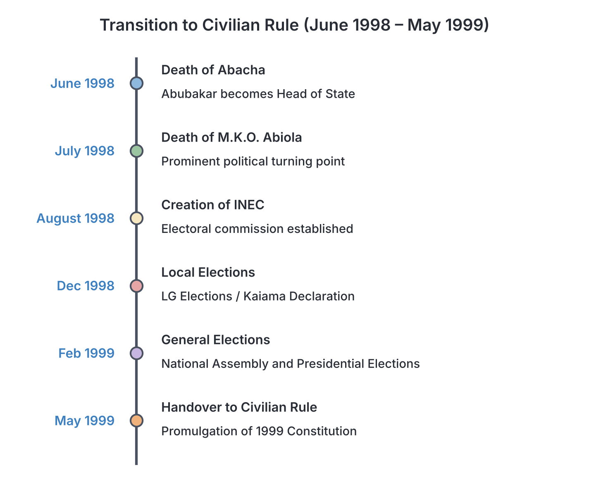
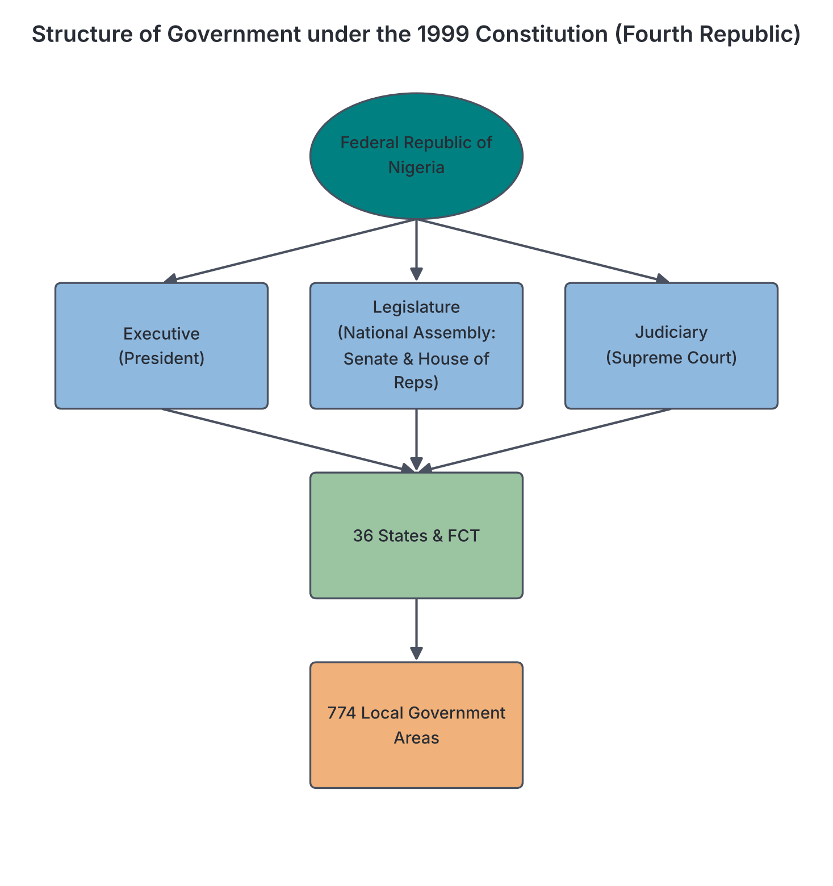

# JAMB History Notes: Transition to the Fourth Republic

## What JAMB expects

This topic is Topic 10 of Section D: Nigeria Since Independence. The syllabus lists no specific content items for this topic, only objectives. Following the syllabus structure, these notes use the topic title and the objectives to define the scope.

By the end of these notes, you should be able to:

1. Assess the challenges and achievements of the Abdulsalami Regime.
2. Examine the role of the key actors in the transition process and the growth and development of the Fourth Republic.

**Note on the syllabus scope:** Topics covering recent history rely on facts that are sometimes debated. Following JAMB guidelines, these notes focus on documented events, official policies, and established outcomes. The Fourth Republic is the current political era in Nigeria, beginning in 1999. To maintain strict historical neutrality, these notes do not evaluate current events, party politics, or living office-holders, but focus on the transition itself and the broad historical development of the republic.

## Background to the Transition

On 8 June 1998, the Head of State, General Sani Abacha, died suddenly. At the time of his death, Nigeria was undergoing a controversial transition programme that many believed was designed to allow General Abacha to transition into a civilian president. His death created a sudden power vacuum.

The highest ruling body of the military government, the **Provisional Ruling Council (PRC)**, held an emergency meeting and appointed the Chief of Defence Staff, **General Abdulsalami Abubakar**, as the new Head of State. General Abubakar immediately cancelled the ongoing Abacha transition programme, dissolved the five existing political parties, and announced a new, short transition programme that would return Nigeria to civilian democratic rule on **29 May 1999**. 

## Objective i: Assess the challenges and achievements of the Abdulsalami Regime

To assess a government in history means to look at its stated aims, the actions it took, the outcomes of those actions, and the difficulties it faced, presenting the evidence neutrally. General Abubakar's primary stated aim was to organise a brief, credible transition to civilian rule.

### Achievements of the Regime

The achievements of the Abubakar regime are generally assessed by historians based on the policies it implemented during its short eleven-month lifespan.

**1. The Handover to Civilian Rule**
The most widely recognised achievement of the regime was keeping its promise to hand over power. Despite pressures and a history of extended or cancelled transitions by previous military governments, General Abubakar’s administration conducted nationwide elections and transferred power to an elected civilian president on 29 May 1999, effectively inaugurating the Fourth Republic.

**2. Release of Political Prisoners and Human Rights**
The regime improved the human rights situation by repealing several restrictive military decrees, most notably **Decree 2 of 1984**, which had allowed the government to detain citizens without trial. The government released numerous political detainees and activists who had been jailed during the previous administration, including General Olusegun Obasanjo (a former military head of state), Dr Beko Ransome-Kuti, and prominent journalists.

**3. Creation of an Independent Electoral Body**
In August 1998, the government established the **Independent National Electoral Commission (INEC)** to replace the National Electoral Commission of Nigeria (NECON). INEC was given the authority to register new political parties and conduct the elections without the intense government interference that had characterised some past commissions.

**4. The 1999 Constitution**
The administration oversaw the drafting and promulgation of the Constitution that would guide the Fourth Republic. General Abubakar set up the **Constitution Debate Coordinating Committee (CDCC)**, headed by Justice Niki Tobi. The committee was tasked with reviewing the 1995 draft constitution created under General Abacha and gathering public views. Based on the CDCC's recommendations, the government promulgated the **1999 Constitution** through **Decree No. 24 of 1999**. It retained a federal structure and a presidential system of government.

**5. Restoration of International Relations**
Under the previous regime, Nigeria had faced international isolation and economic sanctions, including suspension from the **Commonwealth of Nations** following the execution of Ken Saro-Wiwa and eight other Ogoni leaders in 1995. General Abubakar’s commitment to a democratic transition led to the lifting of sanctions by the European Union and the United States, and Nigeria was readmitted into the Commonwealth shortly after the handover in 1999.

### Challenges of the Regime

Despite its achievements, the administration faced severe political, social, and economic challenges.

**1. The Death of Chief M.K.O. Abiola**
The most critical crisis occurred just a month into the new administration. Chief M.K.O. Abiola, the presumed winner of the annulled 12 June 1993 presidential election, had been in detention since 1994. General Abubakar’s government engaged in negotiations with international diplomats (including the UN Secretary-General, Kofi Annan) to secure his release. However, on **7 July 1998**, Chief Abiola collapsed and died of a sudden heart attack during a meeting with a US delegation. His death sparked massive riots and protests, particularly in the South-West, threatening to derail the transition programme. The government had to carefully manage the tension to keep the transition on track.

**2. Economic Difficulties and Labour Unrest**
In 1998, global oil prices dropped significantly, drastically reducing Nigeria's foreign exchange earnings. The economy suffered from depleted foreign reserves and severe fuel scarcities. Additionally, civil servants demanded a new minimum wage. The government initially approved a wage increase but later had to reduce it due to a lack of funds, leading to strikes and unrest among labour unions.

**3. The Niger Delta Crisis**
Tensions in the oil-producing Niger Delta escalated during this period. In December 1998, youths from the Ijaw ethnic group gathered in Bayelsa State and issued the **Kaiama Declaration**. They demanded greater control of the region's oil resources and the withdrawal of military forces. The government responded with military deployments, leading to clashes, casualties, and a tense security situation that the civilian government would inherit.

**4. Criticisms of the 1999 Constitution**
Because the transition was rushed (lasting only eleven months), the CDCC had limited time to consult the public. When the 1999 Constitution was promulgated shortly before the handover, critics and civil society groups argued that it was imposed by the military. A common criticism was that its opening phrase, *"We the People of the Federal Republic of Nigeria..."*, was inaccurate, as the document had not been subjected to a national referendum.

## Objective ii: Examine the role of the key actors in the transition process and the growth and development of the Fourth Republic

### Key Actors in the Transition Process (1998–1999)

Several individuals and institutions played crucial roles in ensuring the transition was successful.

**1. General Abdulsalami Abubakar and the Military**
As Head of State, General Abubakar provided the political will to follow through on the transition. The military establishment, aware of its growing unpopularity and international isolation, supported the swift return to the barracks.

**2. The Independent National Electoral Commission (INEC)**
INEC, under the chairmanship of **Justice Ephraim Akpata** (a retired Supreme Court judge), was responsible for the logistics of the transition. INEC released the electoral timetable and set strict rules for the registration of political parties, requiring them to demonstrate national spread. Out of many political associations, INEC registered three main political parties for the elections:
*   **Peoples Democratic Party (PDP)**
*   **All Peoples Party (APP)** (later changed to All Nigeria Peoples Party, ANPP)
*   **Alliance for Democracy (AD)**

**3. Political Parties and the Candidates**
The political class quickly organised to participate in the elections. To appease the South-West region following the annulment of the 1993 elections and the death of M.K.O. Abiola, the major parties intentionally fielded presidential candidates from that region.
*   The **PDP** fielded **Chief Olusegun Obasanjo**, a retired general and former military head of state.
*   The **AD** and **APP** formed an electoral alliance and fielded **Chief Olu Falae**, a former Secretary to the Military Government and former Finance Minister.
Following a series of elections (local, state, and national legislature), the presidential election was held on **27 February 1999**. Chief Olusegun Obasanjo of the PDP was declared the winner.

**4. Civil Society and Pro-Democracy Groups**
Groups such as the **National Democratic Coalition (NADECO)**, various human rights organisations, student unions, and the press maintained immense pressure on the military to leave power. Though some boycotted the process initially, their persistent demands shaped the transition.

**5. The International Community**
International bodies, including the United Nations, the Commonwealth, and foreign governments, acted as observers and mediators. Their presence during elections added credibility to the process, and their promises to lift sanctions encouraged the military government to stick to the handover date.

### Growth and Development of the Fourth Republic (1999 to Present)

The Fourth Republic was officially inaugurated on **29 May 1999**. At the time of writing, it is the longest continuous period of democratic, civilian rule in Nigeria's history. To examine its growth and development, historians look at institutional milestones, political transitions, and ongoing national challenges.

#### Milestones in Democratic Growth

**1. Survival and Unbroken Continuity**
The most significant achievement of the Fourth Republic is its survival. Unlike the First Republic (1963–1966, about three years; some books date it from independence in 1960), the Second Republic (four years), and the aborted Third Republic, the Fourth Republic has experienced multiple election cycles without military overthrow. 

**2. Peaceful Transfers of Power**
The republic has witnessed significant milestones in the transfer of power:
*   In **2007**, the country experienced its first successful handover of power from one elected civilian president to another, following the end of the first administration's two-term limit.
*   In **2015**, an incumbent president lost a general election and conceded defeat, marking the first time in Nigerian history that power was peacefully transferred from a ruling political party to an opposition party.

**3. Independence of Democratic Institutions**
Over the years, the separate arms of government have tested their powers:
*   **The Legislature:** The National Assembly has occasionally asserted its independence. A historical example occurred in 2006 when the legislature debated and ultimately rejected a proposed constitutional amendment that would have allowed a president to serve a third term in office.
*   **The Judiciary:** The courts have played a major role in the Fourth Republic. They have frequently been called upon to resolve electoral disputes, sometimes overturning the elections of state governors and ordering reruns, which has helped to manage political grievances without violence.

**4. Electoral Reforms**
Early elections in the Fourth Republic were heavily criticised by local and international observers for irregularities, violence, and rigging. In response, successive administrations and INEC have introduced electoral reforms. This has included the introduction of permanent voter cards (PVCs) and technological devices—such as the Smart Card Reader and the Bimodal Voter Accreditation System (BVAS)—aimed at improving the transparency and credibility of the voting process.

#### Ongoing Challenges of the Fourth Republic

Despite its longevity, the Fourth Republic has faced persistent historical and structural challenges:

*   **Security Crises:** The republic has struggled with severe security threats. These include the long-running insurgency by Boko Haram in the North-East, militancy and oil theft in the Niger Delta, violent clashes between farmers and herders across the Middle Belt and other regions, and widespread kidnapping.
*   **Economic Instability:** The economy remains heavily dependent on crude oil exports. Fluctuations in global oil prices have led to periodic economic recessions, high inflation, and unemployment, prompting widespread protests by citizens and labour unions over the cost of living.
*   **Corruption and Governance:** Allegations of corruption in public office have remained a central theme in Nigerian politics. While anti-graft agencies such as the Economic and Financial Crimes Commission (EFCC) and the Independent Corrupt Practices and Other Related Offences Commission (ICPC) were created in the early years of the Fourth Republic, debates continue over their effectiveness and political independence.
*   **Constitutional Debates:** The debate over the 1999 Constitution has never fully ended. Various groups continue to call for "restructuring," arguing for a new constitution or significant amendments that would transfer more powers and resources from the federal government to the states.

## Key terms

| Term | Meaning |
| --- | --- |
| **Transition Programme** | A scheduled plan by a military government to transfer political power to an elected civilian administration. |
| **INEC** | Independent National Electoral Commission; the body established in 1998 to conduct elections in Nigeria. |
| **CDCC** | Constitution Debate Coordinating Committee; the body headed by Niki Tobi that reviewed the draft of the 1999 Constitution. |
| **Promulgation** | The act of officially publishing a new law or constitution and putting it into effect, often done by a military decree. |
| **Fourth Republic** | The current period of democratic civilian rule in Nigeria, which began on 29 May 1999. |
| **Kaiama Declaration** | A 1998 document issued by Ijaw youths demanding resource control and political autonomy in the Niger Delta. |
| **NADECO** | National Democratic Coalition; a prominent pro-democracy group that pressured the military to hand over power. |
| **Decree** | A law made by a military government without the approval of a legislature. |

## Exam tips and common mistakes

*   **Do not confuse the Republics:** The First Republic was 1963–1966. The Second Republic was 1979–1983. The Third Republic was aborted (1993). The Fourth Republic began in **1999** and is ongoing.
*   **The Chairman of INEC in 1998/1999:** Remember that **Justice Ephraim Akpata** conducted the 1999 elections, not Humphrey Nwosu (who conducted the 1993 elections) or Michael Ani (who conducted the 1979 elections).
*   **Parties of 1999:** Know the three political parties registered for the 1999 elections: **PDP, APP, and AD**. Do not mix them up with parties of the First or Second Republic (like NCNC, AG, NPN, UPN) or later Fourth Republic parties (like APC).
*   **Abiola's Death:** A common mistake is thinking M.K.O. Abiola died during Abacha's regime. Abacha died in June 1998; Abiola died a month later, in **July 1998**, during Abubakar's regime.
*   **The 1999 Constitution:** Remember that it was promulgated by a military decree (Decree 24 of 1999) under General Abdulsalami Abubakar, which is why critics say it lacked a public referendum.

## Quick summary

1. General Abdulsalami Abubakar became Head of State in June 1998 after the sudden death of General Sani Abacha. He immediately initiated an 11-month transition to civilian rule.
2. Major achievements of the regime included releasing political prisoners, lifting military decrees, drafting the 1999 Constitution, and successfully handing over power on 29 May 1999.
3. The regime faced significant challenges, including the sudden death of M.K.O. Abiola in detention (which caused riots), labour unrest over minimum wage, and early militancy in the Niger Delta (Kaiama Declaration).
4. INEC, chaired by Justice Ephraim Akpata, registered three parties (PDP, APP, AD) and conducted the elections. Chief Olusegun Obasanjo (PDP) won the presidential election.
5. The 1999 Constitution was reviewed by the CDCC under Justice Niki Tobi. It retained a presidential system but was criticised for being imposed by the military without a referendum.
6. The Fourth Republic (1999 to present) is Nigeria's longest-lasting democratic era. It has seen historical milestones, such as the first civilian-to-civilian handover in 2007 and a peaceful transfer to an opposition party in 2015.
7. Despite institutional growth and electoral reforms, the Fourth Republic continues to face challenges such as security insurgencies, economic instability, and debates over constitutional restructuring.

## Practice questions

**1. General Abdulsalami Abubakar became the Head of State of Nigeria following the sudden death of:**
- A. General Ibrahim Babangida
- B. General Sani Abacha
- C. Chief M.K.O. Abiola
- D. General Murtala Mohammed

**Answer: B.** General Abubakar was appointed by the PRC in June 1998 immediately after the sudden death of General Sani Abacha.

**2. The electoral body responsible for conducting the 1999 transition elections was the:**
- A. Federal Electoral Commission (FEDECO)
- B. National Electoral Commission of Nigeria (NECON)
- C. Independent National Electoral Commission (INEC)
- D. National Electoral Commission (NEC)

**Answer: C.** Abubakar's government created INEC in August 1998 to replace NECON. FEDECO belongs to the Second Republic, and NEC belongs to the Babangida era.

**3. Which of the following political parties was NOT registered by INEC for the 1999 elections?**
- A. Peoples Democratic Party (PDP)
- B. Alliance for Democracy (AD)
- C. All Peoples Party (APP)
- D. Social Democratic Party (SDP)

**Answer: D.** The SDP was a party from the aborted Third Republic (Babangida's era). The three parties registered for the 1999 elections were PDP, AD, and APP.

**4. A major political crisis faced by the Abdulsalami Abubakar regime in July 1998 was the:**
- A. annulment of the presidential election
- B. outbreak of the Nigerian Civil War
- C. sudden death of Chief M.K.O. Abiola in detention
- D. execution of Ken Saro-Wiwa

**Answer: C.** Chief Abiola died of a heart attack in July 1998 during negotiations for his release, sparking riots. The annulment was in 1993, the Civil War in 1967, and Saro-Wiwa's execution in 1995.

**5. The committee established to review the draft constitution ahead of the Fourth Republic was headed by:**
- A. Justice Ephraim Akpata
- B. Justice Niki Tobi
- C. Chief Bola Ige
- D. Justice Udo Udoma

**Answer: B.** Justice Niki Tobi headed the Constitution Debate Coordinating Committee (CDCC). Ephraim Akpata was the chairman of INEC.

**6. A common criticism of the 1999 Constitution at the inception of the Fourth Republic was that:**
- A. it abolished the federal structure of Nigeria
- B. it did not provide for a presidential system of government
- C. it was promulgated by a military decree without a national referendum
- D. it banned political parties from operating in the North

**Answer: C.** Critics often argue that the constitution lacks legitimacy because it was rushed and imposed by the military (Decree 24) rather than being agreed upon through a referendum by "we the people".

**7. The Fourth Republic of Nigeria was officially inaugurated on:**
- A. 1 October 1999
- B. 29 May 1999
- C. 12 June 1999
- D. 29 May 1998

**Answer: B.** General Abubakar handed over power to the elected civilian president on 29 May 1999, officially beginning the Fourth Republic.

**8. Which of the following describes a major democratic milestone achieved by the Fourth Republic in 2015?**
- A. The successful amalgamation of the Northern and Southern protectorates
- B. The first peaceful transfer of presidential power to an opposition party
- C. The writing of a completely new constitution by the National Assembly
- D. The end of the Nigerian Civil War

**Answer: B.** In 2015, an incumbent ruling party lost the presidential election and handed over to the opposition, a first in Nigerian history.

**9. The Kaiama Declaration of December 1998 primarily dealt with issues concerning:**
- A. resource control and autonomy in the Niger Delta
- B. the introduction of Sharia law in northern states
- C. the creation of new local government areas in the South-West
- D. the demand for a sovereign national conference by NADECO

**Answer: A.** The Kaiama Declaration was issued by Ijaw youths demanding greater control of their oil resources and the withdrawal of military troops from the Niger Delta.

**10. Which international organisation lifted its suspension of Nigeria shortly after the 1999 transition to civilian rule?**
- A. The Economic Community of West African States (ECOWAS)
- B. The United Nations (UN)
- C. The African Union (AU)
- D. The Commonwealth of Nations

**Answer: D.** Nigeria was suspended from the Commonwealth in 1995 under Abacha following the execution of the Ogoni nine, and was readmitted upon the return to democracy in 1999.

<!-- COVERAGE
obj i | Objective i: Assess the challenges and achievements of the Abdulsalami Regime
obj ii | Objective ii: Examine the role of the key actors in the transition process and the growth and development of the Fourth Republic
-->
