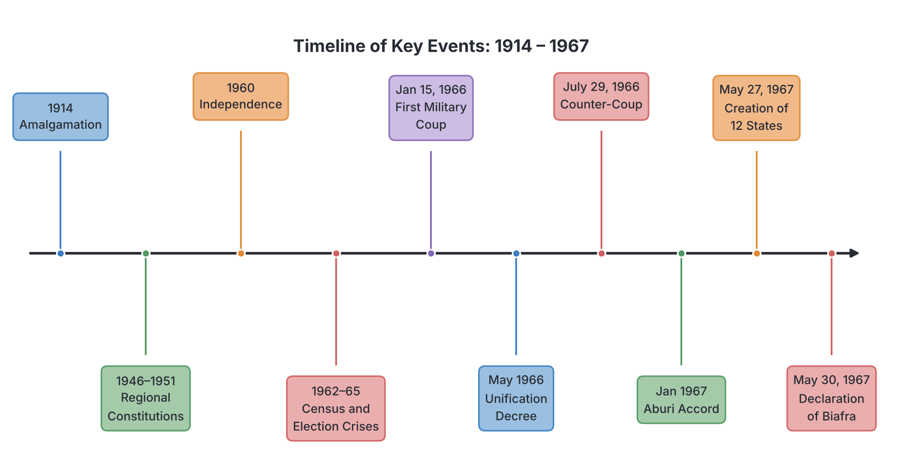

# JAMB History Notes: The Nigerian Civil War

## What JAMB expects

This topic is Section D, Topic 2 of the JAMB History syllabus: The Nigerian Civil War. It has three content items:

- **a. Causes**
- **b. Course**
- **c. Effects**

By the end of these notes, you should be able to:

1. examine the remote and immediate causes of the war;
2. examine the course;
3. assess the effects of the war;

**Note on the syllabus wording:** This file covers the complete story of the Nigerian Civil War (1967–1970). For a deeper look into the political crises of the 1960s and the military coups of 1966 that preceded the war, see also `D1-politics-of-first-republic-and-military-intervention.md`.

## Introduction

The Nigerian Civil War, also known as the Biafran War, was fought between the government of Nigeria (the Federal side) and the secessionist state of Biafra (the Eastern Region). It began on **July 6, 1967**, and ended on **January 15, 1970**. It was one of the most defining and traumatic events in modern African history, deeply altering Nigeria's political structure, economy, and social relations. 

Historians usually divide the causes of the war into **remote causes** (long-term problems that built up over decades) and **immediate causes** (the specific events in 1966 and 1967 that sparked the fighting). 

## Causes of the Nigerian Civil War

**Objective i: examine the remote and immediate causes of the war.**
**Content a: Causes**

### Remote Causes

The remote causes of the war stem from how Nigeria was created and how its politics were managed before and immediately after independence.

1. **The Amalgamation of 1914:** 
   The British brought the Northern and Southern Protectorates together in 1914 mainly for administrative convenience and economic reasons. However, the diverse ethnic and religious groups were not integrated into a single nation. The regions developed at different paces, creating deep-seated suspicions.

2. **Regionalism and Constitutional Development:** 
   Constitutions introduced by the British, particularly the **Richards Constitution of 1946** and the **Macpherson Constitution of 1951**, divided the country into three distinct regions (North, West, and East). This encouraged political parties to be based on ethnic and regional lines rather than national interests. 
   - The **NPC** (Northern People’s Congress) dominated the North.
   - The **AG** (Action Group) dominated the West.
   - The **NCNC** (National Council of Nigeria and the Cameroons, later National Convention of Nigerian Citizens) dominated the East.
   This regionalism meant that political leaders often prioritized their region over the Nigerian nation.

3. **Pre-Independence Friction (e.g., 1953 Kano Riots):** 
   When Southern politicians moved a motion for self-government in 1956, Northern leaders felt their region was not yet ready and asked for the date to be left open. This led to booing of Northern delegates in Lagos and sparked the **Kano Riots of 1953**, showing the deep mistrust between the North and the South.

4. **The Crises of the First Republic (1960–1965):**
   Shortly after independence in 1960, Nigeria faced a series of severe political crises that broke down trust in the democratic system:
   - **The Action Group Crisis (1962):** A split in the Western Region's ruling party led to violence in the regional parliament and the declaration of a state of emergency by the Federal Government.
   - **The Census Crises (1962/1963):** Population figures determined how many seats each region had in the federal parliament and how much revenue they received. The results of the 1962 and 1963 censuses were heavily disputed, with Southern politicians accusing the North of inflating its figures to maintain political dominance.
   - **The Federal Election Crisis (1964/1965):** Massive rigging, boycotts, and violence marred the elections, leading to a brief standoff between the President (Nnamdi Azikiwe) and the Prime Minister (Abubakar Tafawa Balewa).
   - **The Western Region Election Crisis (1965):** Blatant rigging in the Western Region elections led to widespread rioting, looting, and arson (a period often called "Operation Wetie"). The federal government seemed unable or unwilling to restore order.

### Immediate Causes

The events of 1966 and early 1967 were the direct triggers that led to the secession of the East and the outbreak of the war.

1. **The First Military Coup (January 15, 1966):**
   A group of young army officers, led by Major Chukwuma Kaduna Nzeogwu, overthrew the civilian government. Prime Minister Abubakar Tafawa Balewa, the Premier of the North (Ahmadu Bello), the Premier of the West (Samuel Akintola), and several senior military officers (mostly of Northern origin) were killed. 
   - **Disputed views:** Some historians and participants argued the coup was a nationalist attempt to end the corruption and violence of the First Republic. However, because the leaders of the coup were mostly Igbo, and no major Igbo politicians were killed, many Northern leaders and citizens viewed it as an ethnic plot to achieve Igbo dominance.

2. **General Aguiyi-Ironsi and the Unification Decree (May 1966):**
   Major General Johnson Thomas Umunnakwe Aguiyi-Ironsi, the highest-ranking army officer (also an Igbo), took control of the government after the coup failed to establish a new regime. To solve the problem of regionalism, he issued **Decree No. 34 of 1966**, which abolished Nigeria's federal structure and made it a unitary state. This deeply angered Northern leaders, who feared Southern domination in the civil service and economy. Riots broke out in the North targeting Igbo residents.

3. **The Counter-Coup (July 29, 1966):**
   Northern military officers launched a revenge coup. General Aguiyi-Ironsi and the Military Governor of the Western Region, Lt. Col. Adekunle Fajuyi, were assassinated in Ibadan. Many Igbo officers and soldiers were also killed. **Lt. Col. Yakubu Gowon** (a Northerner from the Middle Belt) emerged as the new Head of State, but the Military Governor of the Eastern Region, **Lt. Col. Chukwuemeka Odumegwu Ojukwu**, refused to recognize his authority, arguing that the chain of command had been broken.

4. **The Massacres (Pogroms) of 1966:**
   Following the July coup, widespread violence broke out in the North against people from the Eastern Region (mostly Igbos). Thousands were killed, and an estimated one million Easterners fled back to the Eastern Region as refugees. Ojukwu and Eastern leaders argued that the Federal Government could no longer protect their lives and property.

5. **The Aburi Accord and its Breakdown (January 1967):**
   To avoid war, Nigerian military leaders met in Aburi, Ghana, in January 1967. They agreed to a decentralized system (a confederation) where the regions would have more power. However, upon returning to Nigeria, the Federal Government and the Eastern Region disagreed on how to interpret the agreement. Gowon's government passed a decree that gave the federal government more power than Ojukwu believed was agreed upon at Aburi. The agreement broke down.

6. **Creation of 12 States (May 27, 1967):**
   To weaken the Eastern Region and protect the rights of minority ethnic groups, General Gowon announced the division of Nigeria's four regions into 12 states. The Eastern Region was split into three (East Central, South-Eastern, and Rivers). This move deprived the Igbo-majority East Central state of direct access to the sea and the region's main oil reserves, angering the Eastern leadership.

7. **The Declaration of Biafra (May 30, 1967):**
   Three days after the creation of states, Ojukwu, backed by the Eastern Region's Consultative Assembly, declared the Eastern Region an independent, sovereign state named the **Republic of Biafra**. The Federal Government rejected this, declaring it an act of rebellion.

## The Course of the War

**Objective ii: examine the course.**
**Content b: Course**

The war progressed through several distinct phases over 30 months. 

### Phase 1: Police Action (July 1967)
The Federal Government initially treated the secession as a rebellion that could be quickly crushed. On **July 6, 1967**, Federal troops crossed into Biafran territory from the north (the Garkem and Nsukka fronts). General Gowon described this as a "police action" intended to arrest the rebel leaders. However, Biafran forces put up strong resistance, and it quickly became clear that a full-scale war had begun.

### Phase 2: The Biafran Mid-West Offensive (August 1967)
On August 9, 1967, Biafran forces launched a surprise attack across the Niger River into the Mid-Western State. Led by Brigadier Victor Banjo, they captured Benin City and pushed as far as Ore in the Western State, threatening Lagos (the federal capital). 
This bold move shocked the Federal Government and caused Gowon to declare total war. The Federal Army, led by officers like Col. Murtala Mohammed, reorganized and launched a counter-offensive, pushing the Biafran troops out of the Mid-West by late September.

[IMAGE: Map of Nigeria in 1967 showing the 12 states created by Gowon. A highlighted section in the southeast shows the borders of the Republic of Biafra (comprising East Central, South-Eastern, and Rivers states). Arrows show the initial Federal advance from the North into Nsukka, and a sweeping arrow shows the Biafran Mid-West offensive towards Benin and Ore. Labels: "Lagos", "Ore", "Benin City", "Enugu", "Nsukka", "Port Harcourt", "Biafra", "Mid-Western State". Clean flat textbook style, white background.]

### Phase 3: Federal Capture of Key Cities (Late 1967 – 1968)
The Federal forces, superior in numbers and weapons, began to encircle Biafra. They advanced on multiple fronts, led by commanders such as Col. Mohammed Shuwa (North), Col. Murtala Mohammed (Mid-West), and Col. Benjamin Adekunle (South/Coastal).
- **October 1967:** The Biafran capital, **Enugu**, fell to Federal troops. Biafra moved its capital to Umuahia.
- **Early 1968:** Federal forces captured important towns like Onitsha and Aba.
- **May 1968:** The coastal city of **Port Harcourt** fell to the Federal army. This was a critical turning point because it cut Biafra off from the sea, sealing a total economic and military blockade.

### Phase 4: Blockade, Starvation, and Humanitarian Crisis (1968 – 1969)
With Port Harcourt lost, Biafra was completely landlocked and surrounded. The Federal Government enforced a strict economic blockade, preventing food, weapons, and medical supplies from entering the region. 
- **Starvation and Kwashiorkor:** Severe food shortages led to widespread starvation. Thousands of children suffered from **kwashiorkor** (a severe protein-deficiency disease). Images of starving Biafran children shocked the world.
- **The Uli Airstrip:** Biafra's only link to the outside world was a widened stretch of road at Uli, which served as a secret airstrip. Relief organizations (like the Red Cross, Caritas, and Joint Church Aid) flew in food and medicine at night, braving anti-aircraft fire. Weapons were also smuggled in via these flights.

### International Involvement
The war attracted significant international attention and intervention.

| Side | International Support | Details |
| :--- | :--- | :--- |
| **Federal Government** | Britain (UK), Soviet Union (USSR), Egypt, OAU (Organization of African Unity) | Britain supplied arms and diplomatic support to maintain a united Nigeria. The USSR supplied jet fighters (MiGs). Egypt provided pilots. The OAU firmly opposed the break-up of African states. |
| **Biafra** | France, Portugal, Joint Church Aid, Red Cross, Tanzania, Gabon, Ivory Coast, Zambia, Haiti | France provided covert arms shipments and political support. Portugal allowed its territories (like Sao Tome) to be used for relief flights. Five nations (Tanzania, Gabon, Ivory Coast, Zambia, and Haiti) officially recognized Biafra as an independent country. |

*Note: The OAU (Organization of African Unity) was the predecessor to the modern African Union (AU).*

### Phase 5: The Collapse of Biafra (Late 1969 – January 1970)
By late 1969, Biafran forces were severely depleted, starving, and out of ammunition, yet they fought fiercely under commanders like Col. Joseph Achuzie. The Federal Army (now under the overall command of officers like Col. Olusegun Obasanjo, who took over the 3rd Marine Commando from Adekunle) launched a final offensive.
- In late December 1969 and early January 1970, Federal troops broke through the last Biafran defenses.
- **Umuahia and Owerri** (the last major Biafran strongholds) fell. The Uli airstrip was captured.
- On January 10, 1970, General Ojukwu handed over power to his deputy, **Major General Philip Effiong**, and fled to exile in the Ivory Coast.
- On **January 15, 1970**, Philip Effiong formally surrendered to General Yakubu Gowon at Dodan Barracks in Lagos, ending the war.

## The Effects of the War

**Objective iii: assess the effects of the war.**
**Content c: Effects**

The Nigerian Civil War had profound and lasting effects on the nation, reshaping it politically, economically, and socially.

### 1. Human Cost and Humanitarian Impact
The war was devastating. While historians and sources differ on the exact figures, it is widely estimated that between **1 million and 3 million people died**, mostly on the Biafran side. The vast majority of these deaths were civilians—particularly women and children—who died not from bullets, but from starvation and disease caused by the blockade. The war left deep psychological trauma and a massive refugee crisis that took years to resolve.

### 2. The Policy of "No Victor, No Vanquished" and the 3Rs
At the end of the war, General Gowon announced a policy of **"No Victor, No Vanquished."** He rejected the idea of punishing the Igbos or treating them as a conquered people. Instead, he introduced a policy known as the **3Rs**:
- **Reconciliation:** Healing the wounds of the war and reintegrating the secessionists into the Nigerian nation.
- **Rehabilitation:** Restoring the lives of those displaced by the war, getting them back to work, and reabsorbing former Biafran soldiers (who were not involved in the January 1966 coup) into the Nigerian military.
- **Reconstruction:** Rebuilding damaged infrastructure, schools, roads, and hospitals in the war-torn areas.
While praised internationally, many people in the East felt that the implementation of the 3Rs was too slow and underfunded.

### 3. Economic Consequences
- **Destruction of Infrastructure:** The Eastern Region suffered massive destruction of roads, bridges, factories, and homes. The economy of the region was devastated.
- **Financial Policies:** During the war, the Nigerian currency was changed to prevent Biafra from using seized Nigerian money to buy weapons. After the war, a controversial policy mandated that all Biafrans who handed in rebel currency were given a flat sum of **20 Nigerian pounds**, regardless of what they owned before the war. This left many Easterners impoverished.
- **Shift to an Oil Economy:** During and immediately after the war, Nigeria's economy shifted heavily away from agriculture to crude oil, which was mostly located in the former Eastern Region and the Mid-West. Oil revenue fueled Nigeria's post-war reconstruction but also led to corruption and the neglect of other economic sectors.

### 4. Political Centralization and Military Dominance
The war ended the regionalism of the First Republic. The creation of 12 states by Gowon broke the power of the old giant regions. To prosecute the war, the Federal Military Government took on immense powers. Revenue collection (especially oil wealth) was centralized in Lagos. This marked the beginning of a very strong central government and a weak state structure, a system that characterizes Nigerian politics to this day. Furthermore, the military became deeply entrenched in Nigerian politics, leading to decades of military rule.

### 5. Social Effects and "Abandoned Properties"
Millions of people were displaced. A major post-war controversy was the **"Abandoned Properties"** issue. When Easterners fled the North and the West (and particularly Port Harcourt in the Rivers State) during the crises and the war, they left behind houses and businesses. After the war, many struggled to reclaim their properties from the new occupants or the state governments, causing long-lasting bitterness, especially in Port Harcourt.

### 6. Preservation of Nigeria's Unity
The primary political effect of the war was that it kept Nigeria together as a single sovereign entity. The OAU’s principle of respecting colonial borders was upheld, and secession was firmly removed as a viable political option in Nigeria for decades.

## Key terms

| Term | Meaning |
| :--- | :--- |
| **Amalgamation** | The bringing together of the Northern and Southern Protectorates of Nigeria in 1914 by the British. |
| **Pogrom** | An organized massacre of a particular ethnic group (referring to the killings of Easterners in the North in 1966). |
| **Secession** | The act of withdrawing formally from a federation or state (what Biafra attempted to do). |
| **Biafra** | The independent state declared by the Eastern Region of Nigeria from 1967 to 1970. |
| **Unitary State** | A system of government where power is concentrated at the center, as decreed by Ironsi in May 1966. |
| **Blockade** | Sealing off a place to prevent goods, food, or people from entering or leaving. |
| **Kwashiorkor** | A severe form of malnutrition caused by a lack of protein, which affected many Biafran children during the war. |
| **The 3Rs** | General Gowon's post-war policy of Reconciliation, Rehabilitation, and Reconstruction. |
| **Abandoned Properties** | Houses and businesses left behind by Easterners who fled their homes in other parts of Nigeria during the crisis. |

## Exam tips and common mistakes

- **Causes Timeline:** Do not confuse the remote and immediate causes. The Amalgamation and First Republic census/election crises are *remote* causes. The coups of 1966, the pogroms, and the creation of 12 states are *immediate* causes.
- **The Coups of 1966:** Remember the order and leaders. January 15, 1966 (led by Nzeogwu, brought Ironsi to power); July 29, 1966 (the counter-coup, brought Gowon to power).
- **The 3Rs:** Always remember that Gowon’s post-war policy was Reconciliation, Rehabilitation, and Reconstruction (not "Revenge" or "Restitution").
- **International Support:** It is a common mistake to think the UK supported Biafra. The UK and USSR supported the *Federal Government*. France supported Biafra.
- **Who surrendered?** Ojukwu did not surrender; he fled to Ivory Coast. Major General Philip Effiong signed the surrender document on January 15, 1970.

## Quick summary

1. The Nigerian Civil War (July 1967 – January 1970) was fought to prevent the secession of the Eastern Region (Biafra).
2. Remote causes included the 1914 amalgamation without integration, regional politics, and the election and census crises of the First Republic (1960–1965).
3. Immediate causes included the January and July 1966 military coups, the massacres of Easterners in the North, the failure of the Aburi Accord, and Gowon's creation of 12 states.
4. The war began as a "police action" but escalated. A major turning point was the Federal capture of Port Harcourt, which allowed a total blockade of Biafra.
5. Biafra suffered heavily from starvation (kwashiorkor) due to the economic blockade, relying on night relief flights into the Uli airstrip.
6. The Federal side was backed by Britain and the USSR, while Biafra was backed by France and recognized by five nations (including Tanzania and Ivory Coast).
7. The war ended on January 15, 1970, when Philip Effiong surrendered to General Gowon.
8. Gowon declared "No Victor, No Vanquished" and launched the 3Rs (Reconciliation, Rehabilitation, Reconstruction), though challenges like the "Abandoned Properties" issue lingered. The war centralized political power in Nigeria.

## Practice questions

**1. Which of the following was an immediate cause of the Nigerian Civil War?**
- A. The Amalgamation of 1914
- B. The creation of 12 states in May 1967
- C. The Kano Riots of 1953
- D. The Richard's Constitution of 1946

**Answer: B.** The creation of 12 states by General Gowon in May 1967 directly triggered Ojukwu's declaration of Biafra three days later. The other options are remote causes.

**2. The peace meeting held in January 1967 by Nigerian military leaders to avert the civil war took place in:**
- A. Lagos, Nigeria
- B. London, UK
- C. Aburi, Ghana
- D. Kampala, Uganda

**Answer: C.** The leaders met in Aburi, Ghana. The failure to agree on how to implement the Aburi Accord was a major step toward the war.

**3. During the Nigerian Civil War, which of these countries officially recognized Biafra as an independent state?**
- A. Britain
- B. Soviet Union
- C. Egypt
- D. Tanzania

**Answer: D.** Tanzania (along with Gabon, Ivory Coast, Zambia, and Haiti) officially recognized Biafra. Britain, the USSR, and Egypt supported the Federal Government.

**4. The Republic of Biafra was formally declared by:**
- A. Major Kaduna Nzeogwu
- B. General Aguiyi-Ironsi
- C. Lt. Col. Chukwuemeka Odumegwu Ojukwu
- D. Major General Philip Effiong

**Answer: C.** Lt. Col. Ojukwu, the Military Governor of the Eastern Region, declared the Republic of Biafra on May 30, 1967. 

**5. The policy introduced by General Gowon at the end of the civil war to heal the nation's wounds is known as:**
- A. Operation Feed the Nation
- B. Structural Adjustment Programme
- C. The 3Rs
- D. The Unitary Decree

**Answer: C.** Gowon introduced the 3Rs (Reconciliation, Rehabilitation, and Reconstruction) under the slogan "No Victor, No Vanquished." 

**6. The capture of which city in May 1968 effectively cut Biafra off from the sea and completed the federal blockade?**
- A. Enugu
- B. Port Harcourt
- C. Benin City
- D. Aba

**Answer: B.** The fall of Port Harcourt was a turning point because it made Biafra landlocked, allowing the Federal Government to enforce a devastating economic blockade. 

**7. In August 1967, Biafran forces launched a surprise offensive into which territory?**
- A. The Northern Region
- B. The Mid-Western State
- C. Lagos State
- D. Cameroon

**Answer: B.** Led by Victor Banjo, Biafran forces invaded the Mid-Western State, capturing Benin and reaching Ore before being pushed back.

**8. The formal surrender of Biafran forces on January 15, 1970, was conducted by:**
- A. Chukwuemeka Odumegwu Ojukwu
- B. Nnamdi Azikiwe
- C. Philip Effiong
- D. Victor Banjo

**Answer: C.** General Ojukwu fled to Ivory Coast, leaving his deputy, Major General Philip Effiong, to sign the surrender papers in Lagos.

**9. A major political effect of the Nigerian Civil War was the:**
- A. weakening of the federal government
- B. introduction of parliamentary democracy
- C. centralization of power in the federal government
- D. immediate end of military rule

**Answer: C.** To prosecute the war and manage the 12 new states, the Federal Military Government assumed immense centralized powers, ending the era of strong, autonomous regions.

**10. Which decree issued in 1966 caused widespread riots in the North because it abolished Nigeria's federal structure?**
- A. Decree No. 34 (Unification Decree)
- B. The State Creation Decree
- C. The Land Use Decree
- D. The Amnesty Decree

**Answer: A.** General Aguiyi-Ironsi's Decree No. 34 (Unification Decree) of May 1966 turned Nigeria into a unitary state, heightening Northern fears of Southern domination and sparking riots.

<!-- COVERAGE
obj i | Causes of the Nigerian Civil War
obj ii | The Course of the War
obj iii | The Effects of the War
item a | Causes of the Nigerian Civil War
item b | The Course of the War
item c | The Effects of the War
-->
