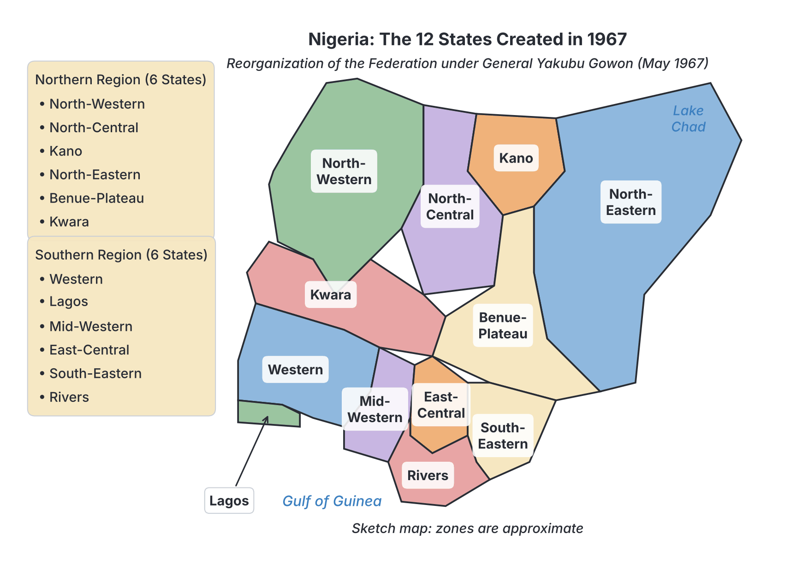

# JAMB History Notes: The Gowon Regime

## What JAMB expects

This topic is Section D, Topic 3 of the JAMB History syllabus: The Gowon Regime.

The syllabus gives only one broad objective for this topic:
- **i.** assess the challenges and achievements of the Gowon Regime.

By the end of these notes, you should be able to describe General Yakubu Gowon's rise to power, outline his major policies and achievements (such as the creation of states, post-war reconciliation, the NYSC and ECOWAS), and explain the challenges and controversies (such as the 1973 census, the Udoji Award inflation, and the delayed transition to civilian rule) that led to his overthrow.

**Note on the syllabus wording:** The syllabus does not list specific content items (like dates or decrees) for this topic. Therefore, these notes cover the major events, policies and outcomes of the Gowon regime (1966–1975) as they are established in standard Nigerian history textbooks, allowing you to fully "assess" the period. The military events of the Nigerian Civil War (1967–1970) are covered separately in `D2-nigerian-civil-war.md`.

## Background: Gowon's Rise to Power

General Yakubu Gowon became Nigeria's Head of State on **August 1, 1966**, following the bloody counter-coup of July 29, 1966, which overthrew and killed Major General J.T.U. Aguiyi-Ironsi. (The events of the First Republic and the 1966 coups are explained in `D1-politics-of-first-republic-and-military-intervention.md`).

At the time, Gowon (then a Lieutenant Colonel) was the Chief of Army Staff. At just 31 years old, he became the youngest Head of State in Nigerian history. He inherited a deeply divided country on the edge of collapse, with extreme inter-ethnic tension, especially between the North and the East. 

Gowon’s primary goal upon taking power was to keep Nigeria united. He reversed Ironsi's Unification Decree, restoring Nigeria’s federal system, but the country soon slid into a devastating Civil War.

## Achievements and Major Policies

The Gowon administration was in power for nine years (1966–1975). Standard history textbooks generally list the following as the regime's main achievements and major policies.

### 1. The Creation of 12 States (1967)

One of Gowon’s most significant actions was the abolition of the four existing regions (Northern, Western, Mid-Western, and Eastern) and the creation of **12 states** on **May 27, 1967**.

**Why were they created?**
- To break the massive power of the regional governments, which had threatened the central government during the First Republic.
- To address the long-standing fears of minority ethnic groups who felt dominated by the major ethnic groups in the old regions.
- **Strategic Civil War aim:** To weaken the Eastern Region's attempt to secede as the Republic of Biafra. By carving the Eastern Region into three states (East-Central, South-Eastern, and Rivers), Gowon gave the oil-rich minority areas their own states, separating them from the Igbo majority (East-Central state) and reducing support for the secession.

The 12 states were:
1. North-Western
2. North-Central
3. Kano
4. North-Eastern
5. Benue-Plateau
6. Kwara
7. Western
8. Lagos
9. Mid-Western
10. East-Central
11. South-Eastern
12. Rivers

### 2. Winning the Civil War and Post-War Reconciliation

The Nigerian Civil War ended in **January 1970** when Biafran forces surrendered. Gowon is widely credited in textbooks for his handling of the war's end. 

He declared that there were **"No Victors, No Vanquished"** (meaning no winners and no losers), a statement intended to prevent the victimization of the Igbo people and promote national healing.

To achieve this, he launched the **3Rs Programme**:
- **Reconciliation:** Healing the psychological wounds of the war and reuniting the country.
- **Rehabilitation:** Restoring jobs, homes, and normal lives to people displaced by the war, particularly in the war-torn East.
- **Reconstruction:** Rebuilding roads, bridges, schools, and hospitals destroyed during the fighting.

While textbooks note that the physical reconstruction was slow and many individuals lost their pre-war savings, the policy successfully prevented post-war massacres or organized revenge against the former secessionists.

### 3. Creation of the NYSC (1973)

To further promote national unity and integration after the Civil War, Gowon's government established the **National Youth Service Corps (NYSC)** in **1973**. 

The programme required Nigerian university (and later polytechnic) graduates to serve the nation for one year. Crucially, graduates were posted to states outside their own cultural and geographical backgrounds to encourage them to mix with other ethnic groups, understand different cultures, and build a unified nation.

### 4. The Oil Boom and Infrastructural Expansion

The early 1970s saw a massive increase in global oil prices (partly due to the 1973 Arab-Israeli War). Nigeria, which had discovered commercial oil in the late 1950s, experienced an **"Oil Boom."** Government revenue multiplied rapidly.

Gowon’s regime used this wealth to launch the **Second National Development Plan (1970–1974)**. Achievements during this period included:
- Expansion of the road network, including the construction of major highways connecting different parts of the country.
- Construction of bridges, seaports, and airports.
- Expansion of education, including the establishment of new federal universities.
- The beginning of the construction of the National Theatre in Lagos to host the Festival of Arts and Culture (FESTAC).

### 5. The Indigenization Decree (1972)

To give Nigerians more control over their economy, Gowon promulgated the **Nigerian Enterprises Promotion Decree** (commonly known as the Indigenization Decree) in 1972. 

This law aimed to reduce foreign control of the economy. It divided businesses into two lists (schedules):
- **Schedule 1:** Enterprises exclusively reserved for Nigerians (such as retail trade, local transportation, and baking).
- **Schedule 2:** Enterprises where Nigerians must own at least 40% of the shares (such as manufacturing and banking).

### 6. Foreign Policy and ECOWAS (1975)

Under Gowon, Nigeria played a leading role in African affairs. His most lasting foreign policy achievement was the spearheading of the **Economic Community of West African States (ECOWAS)**. 

Working closely with President Gnassingbé Eyadéma of Togo, Gowon travelled across West Africa to persuade both English-speaking and French-speaking nations to form an economic bloc. The ECOWAS treaty was successfully signed in **Lagos in May 1975**. (ECOWAS is covered further in `D11-nigeria-in-international-organizations.md`).

## Challenges and Controversies

Despite the oil wealth and post-war unity, Gowon's regime faced severe challenges, many of which made the government unpopular and eventually led to its downfall.

### 1. Delay in the Transition to Civilian Rule

In 1970, Gowon had promised the nation that the military would hand power back to a democratically elected civilian government in **1976**. 

However, in a broadcast in **October 1974**, Gowon announced that the 1976 date was "unrealistic" because the country was not yet ready for partisan politics. He cancelled the transition without setting a new date. This angered politicians, students, the press, and even some military officers, who felt the military was clinging to power. Textbooks cite this broken promise as the primary political reason for his overthrow.

### 2. Corruption and Overstaying Governors

By 1974, there were widespread allegations of massive corruption and abuse of office against many of Gowon's military state governors and federal commissioners. The public demanded their removal. Gowon, however, refused to change the governors, which made him appear weak and protective of corrupt officials.

### 3. The Udoji Award and Inflation (1974)

In 1972, Gowon set up a commission headed by Chief Jerome Udoji to review the salaries of public servants. Its report came in 1974, and the government implemented the **Udoji Award**, which gave civil servants massive salary increases along with large back-payments (arrears).

Because too much money was suddenly injected into the economy without a corresponding increase in local goods, it caused **severe inflation**. The cost of living skyrocketed, which wiped out the benefits of the salary increases and caused hardship for those not in government jobs.

### 4. Port Congestion (The "Cement Armada")

The oil boom led to massive government spending on construction. The government ordered millions of tonnes of cement from abroad. However, the ports in Lagos were too small to handle the traffic. Hundreds of ships carrying cement arrived at the same time, causing a massive traffic jam at the seaports known as the **"Cement Armada."** This paralyzed shipping, cost the country millions in delay fines (demurrage), and highlighted poor government planning.

### 5. The Controversial 1973 Census

Population figures in Nigeria determine revenue sharing and political representation. Gowon’s government conducted a national census in 1973. When the provisional figures were released in 1974, they showed a massive population increase in the North and minimal growth in the South. The figures were heavily disputed, causing deep political tension. (The succeeding regime eventually cancelled the 1973 census results entirely).

## The Overthrow of the Gowon Regime

By mid-1975, the broken promise to return to civilian rule, economic mismanagement, port congestion, and public anger over corrupt governors had severely weakened Gowon's government.

On **July 29, 1975**, just under nine years after he became Head of State (on 1 August 1966), Gowon was overthrown in a **bloodless military coup**. At the time, he was out of the country attending an Organization of African Unity (OAU) summit in **Kampala, Uganda**. 

The coup plotters announced Brigadier (later General) **Murtala Mohammed** as the new Head of State. (The policies of the new government are covered in `D4-murtala-obasanjo-regime.md`). Gowon accepted his removal peacefully and went into exile in the United Kingdom, where he enrolled in university.

## Summary Assessment Table

To assess the regime as the syllabus requires, historians balance the following points:

| Area of Assessment | Achievements (Positives) | Challenges / Criticisms (Negatives) |
| --- | --- | --- |
| **National Unity** | Successfully kept Nigeria one; ended the Civil War; 3Rs policy; created 12 states; established NYSC. | Post-war reconstruction was uneven; some areas felt abandoned; the 1973 census heightened ethnic tensions. |
| **Economy** | Oil boom infrastructure (roads, universities); Indigenization Decree to empower local business. | Poor economic planning; massive inflation (Udoji Award); severe port congestion (Cement armada). |
| **Politics & Governance** | Provided stability during the war years; peaceful foreign policy (founding ECOWAS). | Failed to return power to civilians in 1976; tolerated alleged corruption among state governors. |

## Key terms

| Term | Meaning |
| --- | --- |
| **Secession** | The act of a region breaking away from a country to form a new, independent state (e.g., Biafra). |
| **3Rs** | Reconciliation, Rehabilitation, and Reconstruction—Gowon's post-war policy to heal the nation. |
| **NYSC** | National Youth Service Corps, created in 1973 to foster national unity among graduates. |
| **Indigenization Decree** | A 1972 law designed to transfer the ownership of specific foreign businesses to Nigerians. |
| **Udoji Award** | A 1974 massive salary increase for public servants that resulted in severe inflation. |
| **Cement Armada** | A severe port congestion crisis in Lagos caused by the uncoordinated ordering of millions of tonnes of cement. |
| **ECOWAS** | Economic Community of West African States, co-founded by Nigeria and Togo in 1975. |
| **Demurrage** | Fines paid to ship owners when their ships are delayed at a port, a major financial loss during the port congestion. |

## Exam tips and common mistakes

- **Do not confuse state creations:** Gowon created **12 states** in 1967. (Murtala Mohammed later created 19 states in 1976, and Babangida and Abacha created more).
- **Remember the NYSC date:** The NYSC was established in **1973**. It is a very common JAMB question.
- **The Broken Promise:** If asked for the main political reason for Gowon's overthrow, it was his 1974 announcement that the 1976 transition to civilian rule was "unrealistic."
- **The Overthrow Location:** Gowon was overthrown peacefully while attending an OAU meeting in Kampala, Uganda, in July 1975.
- **Udoji Award context:** While the Udoji Award was meant to be a good thing (more money for workers), in historical assessment, it is remembered as a challenge because it caused massive **inflation**.
- **No Victor, No Vanquished:** Remember this exact phrase; it represents the "Reconciliation" part of the 3Rs.

## Quick summary

1. Yakubu Gowon became Head of State in August 1966 and led Nigeria through the Civil War (1967–1970).
2. To weaken the secessionists and calm minority fears, he divided Nigeria's four regions into 12 states in May 1967.
3. After the war, he launched the 3Rs (Reconciliation, Rehabilitation, Reconstruction) and declared "No Victor, No Vanquished."
4. He established the NYSC in 1973 to promote national unity and integration among Nigerian youths.
5. Economically, his regime used oil boom revenues to build infrastructure and passed the Indigenization Decree (1972) to give Nigerians control of local businesses.
6. In foreign policy, Gowon was instrumental in the formation of ECOWAS in May 1975.
7. His government fell out of favour due to massive inflation (Udoji Award), port congestion, a controversial census, and his refusal to change allegedly corrupt governors.
8. The major trigger for his overthrow was his 1974 announcement cancelling the promised 1976 return to civilian rule. He was ousted in a bloodless coup in July 1975 while in Uganda.

## Practice questions

**1. General Yakubu Gowon created 12 states in Nigeria primarily to**
- A. increase the number of military governors
- B. prepare the country for the 1973 census
- C. weaken the secessionist bid of the Eastern Region and address minority fears
- D. implement the Indigenization Decree

**Answer: C.** Creating states out of the old regions broke the power of the majority groups and specifically separated the oil-rich minority areas of the East from the Igbo majority, weakening the Biafran secession effort.

**2. The post-Civil War policy introduced by the Gowon regime to heal the wounds of the war is known as the**
- A. Structural Adjustment Programme
- B. Universal Basic Education
- C. 3Rs (Reconciliation, Rehabilitation, Reconstruction)
- D. Operation Feed the Nation

**Answer: C.** The 3Rs program was Gowon's strategy to heal and rebuild the country after the war, guided by the philosophy of "No Victor, No Vanquished."

**3. The National Youth Service Corps (NYSC) was established by the Gowon regime in**
- A. 1967
- B. 1970
- C. 1973
- D. 1976

**Answer: C.** The NYSC was established in 1973 to promote national integration by posting graduates to regions outside their cultural backgrounds.

**4. A major economic challenge that plagued the later years of the Gowon administration was**
- A. the introduction of the Naira
- B. massive inflation caused by the Udoji Award
- C. the collapse of the global oil market
- D. the privatization of federal universities

**Answer: B.** The Udoji Award of 1974 injected massive amounts of money into the economy through salary increases and arrears, which triggered severe inflation.

**5. Which of the following international organizations was successfully established largely due to the efforts of General Yakubu Gowon and President Gnassingbé Eyadéma?**
- A. The Organization of African Unity (OAU)
- B. The Economic Community of West African States (ECOWAS)
- C. The Non-Aligned Movement (NAM)
- D. The African Union (AU)

**Answer: B.** Gowon and Eyadéma were the principal drivers behind the creation of ECOWAS, which was formed in Lagos in May 1975.

**6. The primary aim of the Nigerian Enterprises Promotion Decree (Indigenization Decree) of 1972 was to**
- A. expel all foreign workers from Nigeria
- B. transfer control of key sectors of the economy from foreigners to Nigerians
- C. promote the export of agricultural cash crops
- D. nationalize all oil companies in the country

**Answer: B.** The decree aimed to increase Nigerian participation and ownership in the local economy by restricting certain businesses to Nigerians and mandating joint ownership in others.

**7. A major political reason for the overthrow of General Yakubu Gowon in 1975 was his**
- A. decision to execute military governors
- B. failure to win the Nigerian Civil War
- C. announcement that the 1976 date for return to civilian rule was unrealistic
- D. refusal to join the Organization of Petroleum Exporting Countries (OPEC)

**Answer: C.** In October 1974, Gowon cancelled the promised 1976 handover date, leading the military, politicians, and the public to conclude he intended to hold on to power indefinitely.

**8. Where was General Yakubu Gowon when he was overthrown in July 1975?**
- A. London, United Kingdom
- B. New York, USA
- C. Lagos, Nigeria
- D. Kampala, Uganda

**Answer: D.** Gowon was attending an Organization of African Unity (OAU) summit in Kampala, Uganda, when the bloodless coup took place.

**9. The crisis known as the "Cement Armada" during Gowon's regime refers to**
- A. the use of cement to block the Niger River during the war
- B. the massive congestion at Lagos seaports caused by the uncoordinated ordering of cement
- C. a government policy to build free houses for all civil servants
- D. the smuggling of building materials across the borders

**Answer: B.** The oil boom led to massive uncoordinated government orders for cement, causing hundreds of ships to block the ports, paralyzing shipping and resulting in huge demurrage fees.

**10. The 1973 census conducted under the Gowon administration was considered a challenge because**
- A. the results were widely accepted by everyone
- B. the United Nations refused to fund it
- C. the figures were heavily disputed and generated severe political tension
- D. it only counted people living in urban areas

**Answer: C.** The provisional figures showed massive growth in the North and very little in the South. This was heavily disputed, worsening ethnic and political tensions before the succeeding regime eventually cancelled the results.

<!-- COVERAGE
obj i | ## What JAMB expects
obj i | ## Background: Gowon's Rise to Power
obj i | ## Achievements and Major Policies
obj i | ### 1. The Creation of 12 States (1967)
obj i | ### 2. Winning the Civil War and Post-War Reconciliation
obj i | ### 3. Creation of the NYSC (1973)
obj i | ### 4. The Oil Boom and Infrastructural Expansion
obj i | ### 5. The Indigenization Decree (1972)
obj i | ### 6. Foreign Policy and ECOWAS (1975)
obj i | ## Challenges and Controversies
obj i | ### 1. Delay in the Transition to Civilian Rule
obj i | ### 2. Corruption and Overstaying Governors
obj i | ### 3. The Udoji Award and Inflation (1974)
obj i | ### 4. Port Congestion (The "Cement Armada")
obj i | ### 5. The Controversial 1973 Census
obj i | ## The Overthrow of the Gowon Regime
obj i | ## Summary Assessment Table
-->
