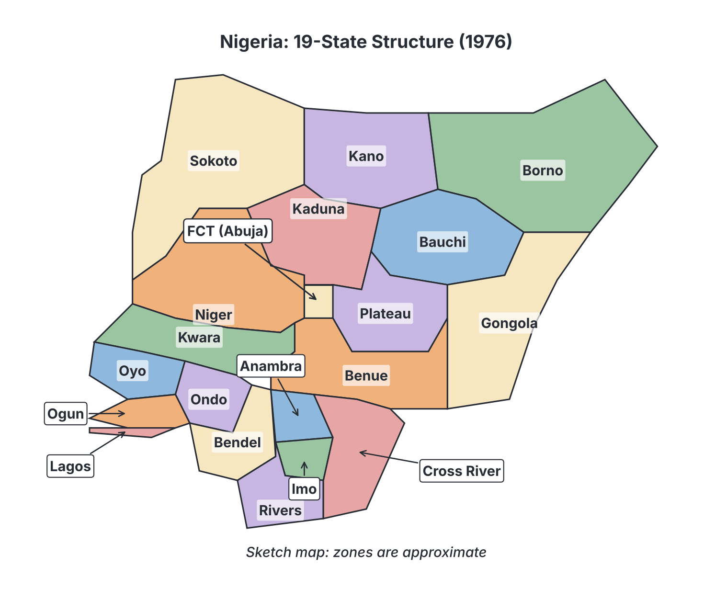

# JAMB History Notes: The Murtala/Obasanjo Regime

## What JAMB expects

This topic is Section D, Topic 4 of the JAMB History syllabus: The Murtala/Obasanjo Regime. The syllabus has no listed content items for this topic, only a general objective.

By the end of these notes, you should be able to:

1. Assess the challenges and achievements of the Murtala/Obasanjo Regime.

**Note on the syllabus scope:** Because the syllabus provides only the main objective, these notes cover the events, reforms and policies most commonly tested in UTME. This includes the government's rise to power, the civil service purge, state creation, the 1976 Local Government Reforms, the dynamic foreign policy, economic policies, the challenges faced, and the successful transition to the Second Republic.

## Introduction to the Regime

The Murtala/Obasanjo regime was a military administration that ruled Nigeria from **July 1975 to October 1979**. It is treated as a single continuous regime in Nigerian history because after the assassination of the Head of State, **General Murtala Muhammed**, in February 1976, his deputy, **General Olusegun Obasanjo**, took over and continued the same policies and transition programme.

### How the regime came to power

On **July 29, 1975**, the government of General Yakubu Gowon was overthrown in a bloodless military coup while Gowon was attending an Organization of African Unity (OAU) summit in Kampala, Uganda. 

The coup plotters announced Brigadier (later General) Murtala Muhammed as the new Head of State, with Brigadier (later General) Olusegun Obasanjo as his Chief of Staff, Supreme Headquarters (his deputy). The military officers who carried out the coup stated that Gowon's government had become slow to act, was affected by corruption, and had failed to keep its promise to return the country to civilian rule by 1976 (Gowon had announced in 1974 that the 1976 date was "unrealistic").

The new government immediately promised a swift return to civilian rule and introduced a series of rapid reforms to restructure the country.

## Achievements and Reforms

**Objective i: assess the challenges and achievements of the Murtala/Obasanjo Regime.**

The government is remembered in Nigerian textbooks for its fast-paced decision-making and widespread reforms. Its actions can be assessed across several areas.

### 1. The Civil Service Purge (1975)

One of the very first actions of Murtala Muhammed's government was a massive "purge" (cleaning out) of the public service. Between August and November 1975, over 10,000 public officials were retired or dismissed. This included civil servants, police officers, diplomats, judges, and university staff.

*   **Stated aims:** The government said the purge was necessary to remove "deadwood" (unproductive workers), eliminate corruption, restore discipline, and make the civil service more efficient.
*   **Outcomes:** It successfully showed that the new government was serious about discipline and willing to take tough actions. However, historians and critics note that many dismissals were arbitrary (done without proper investigation), and it created a culture of fear. It also led to a loss of experienced and skilled manpower, and some argue it damaged the long-term security of the Nigerian civil service.

### 2. Creation of States and the New Federal Capital

To address the fears of ethnic domination and bring government closer to the people, the regime set up the **Justice Ayo Irikefe Panel** to look into the creation of new states.
*   On **February 3, 1976**, based on the panel's report, the government created seven new states. This increased the number of states in Nigeria from **12 to 19**. 

The government also set up the **Justice Akinola Aguda Panel** to advise on a new federal capital, because Lagos had become terribly congested, lacked space for expansion, and was geographically in the corner of the country.
*   The panel recommended moving the capital to a central, neutral location. In **1976**, the government accepted the recommendation and announced the creation of the **Federal Capital Territory (FCT), Abuja**.

### 3. The 1976 Local Government Reforms

Before 1976, local governments in Nigeria were run differently depending on the region (e.g., Native Authorities in the North, county councils in the East). 
The Murtala/Obasanjo regime introduced the **1976 Local Government Reforms**, which were a major achievement in Nigeria's political history.

*   **Uniform System:** It introduced a single, uniform system of local government across the whole country.
*   **Third Tier of Government:** Local governments were officially recognized as a distinct third tier of government (after the Federal and State governments).
*   **Direct Funding:** The reforms ensured that local governments received statutory financial allocations directly from the federal and state governments.
*   **Elected Councils:** It provided for local government councils that were mostly elected, giving people at the grassroots a voice in choosing their leaders.

### 4. Dynamic Foreign Policy

The regime is famous for its "dynamic" and assertive foreign policy, which made **Africa the centerpiece** of Nigeria's international relations.

*   **Support for Angola (1975/1976):** Against the wishes of Western powers like the United States, Nigeria strongly supported the MPLA (People's Movement for the Liberation of Angola) government. Murtala Muhammed gave a famous speech at the OAU declaring that "Africa has come of age" and would no longer take orders from foreign powers. Nigeria provided financial and diplomatic backing to Angola.
*   **Anti-Apartheid Stance:** The government heavily supported liberation movements in Southern Africa (Zimbabwe, Namibia, and South Africa). 
*   **Nationalization:** To pressure the British government over its policies in South Africa and Zimbabwe (then Rhodesia), the Obasanjo government nationalized British petroleum interests (creating African Petroleum) and Barclays Bank (renamed Union Bank) in Nigeria.

### 5. Economic and Social Policies

*   **Operation Feed the Nation (OFN):** Launched by General Obasanjo in 1976, this programme aimed to increase local food production, reduce food imports, and encourage Nigerians (including students and civil servants) to farm.
*   **Indigenization Decree (1977):** The Nigerian Enterprises Promotion Decree of 1977 expanded on Gowon's 1972 decree. It grouped businesses into categories, forcing foreign companies to sell a larger percentage of their shares to Nigerians, aiming to give citizens more control over the economy.
*   **Land Use Decree (1978):** This decree vested all land in the territory of a state solely in the Governor of that state, who held it in trust for the people. Its aim was to make it easier for the government and businesses to acquire land for development.
*   **Universal Primary Education (UPE):** Although announced by Gowon in 1974, the nationwide UPE scheme was officially launched by the Obasanjo administration in **September 1976**, massively increasing primary school enrolment.

### 6. The Transition to Civil Rule

The most praised achievement of the regime was keeping its promise to hand over power to elected civilians, which it did precisely on its deadline. The transition programme included several steps:
1.  **Constitution Drafting Committee (CDC):** Set up in 1975 and headed by Chief F.R.A. Williams, it consisted of 50 members (often called the "49 wise men" after Chief Obafemi Awolowo declined to serve). It drafted a new constitution.
2.  **Constituent Assembly (1977):** Elected and appointed representatives debated and amended the CDC's draft.
3.  **The 1979 Constitution:** Promulgated by the military, this constitution made a historic change: it abandoned the British Parliamentary system used in the First Republic and introduced the **American-style Presidential system**, with an executive President.
4.  **Lifting the ban on politics (1978):** Political parties were allowed to form. Five major parties were registered by the Federal Electoral Commission (FEDECO).
5.  **1979 Elections:** FEDECO, headed by Chief Michael Ani, conducted local, state, and federal elections.
6.  **Handover:** On **October 1, 1979**, General Obasanjo handed over power to **Alhaji Shehu Shagari**, marking the beginning of the Second Republic.

## Challenges of the Regime

Despite its achievements, the Murtala/Obasanjo administration faced severe challenges and crises.

### 1. The Abortive Coup of February 1976

The most tragic challenge was the failed military coup of **February 13, 1976**, led by **Lt. Col. Buka Suka Dimka**. 
*   **The Event:** While the coup failed to overthrow the government, the plotters succeeded in assassinating the Head of State, General Murtala Muhammed, in traffic in Lagos. 
*   **The Impact:** The assassination caused widespread national mourning and shock. General Olusegun Obasanjo, who reluctantly took over, had to stabilize the country, execute the coup plotters after military trials, and reassure the public that the transition to civil rule would continue.

### 2. The "Ali Must Go" Student Protests (1978)

In 1978, the government faced a major nationwide crisis involving university students. 
*   **The Cause:** The Minister of Education, Colonel Ahmadu Ali, announced an increase in student boarding and feeding fees (the cost of a meal ticket was increased). 
*   **The Event:** Students, led by the National Union of Nigerian Students (NUNS), launched massive protests known as the "Ali Must Go" riots. 
*   **The Outcome:** The government responded forcefully, deploying the police and the army. Several students were killed, universities were temporarily closed, and NUNS was banned. This severely damaged the government's popularity among students and activists.

### 3. Economic and Administrative Challenges

*   **Port Congestion:** The regime inherited the "cement armada" crisis from the Gowon era, where hundreds of ships carrying imported cement were stranded at the Lagos ports. The government had to take emergency measures to clear the ports.
*   **Inflation:** High government spending, the UPE scheme, and the aftermath of the civil service purge led to rising inflation. The government had to introduce strict price controls and import bans (such as banning the importation of lace and champagne) to manage the economy.
*   **Effects of the Purge:** The mass dismissal of civil servants challenged the administration of government. It created insecurity among workers and deprived the government of many experienced professionals.

## Key terms

| Term | Meaning |
| --- | --- |
| **Purge** | The mass dismissal or forced retirement of public servants by the government in 1975. |
| **FCT** | Federal Capital Territory. The neutral, central area chosen in 1976 to replace Lagos as Nigeria's capital. |
| **CDC** | Constitution Drafting Committee, formed in 1975 to write the draft of the 1979 Constitution. |
| **FEDECO** | Federal Electoral Commission, the body that conducted the 1979 elections. |
| **Presidential System** | A system of government where the head of the executive branch (the President) is separate from the legislature; introduced in Nigeria in 1979. |
| **OFN** | Operation Feed the Nation; an agricultural programme launched in 1976 to boost food production. |
| **UPE** | Universal Primary Education; a scheme launched nationwide in 1976 to provide free primary education. |

## Exam tips and common mistakes

*   **Understand the succession:** Murtala Muhammed and Olusegun Obasanjo led the *same* regime. If a UTME question asks who handed over power to civilians in 1979, the answer is Obasanjo. If it asks who was assassinated in 1976, it is Murtala Muhammed.
*   **The Constitution change:** A highly tested fact is that the 1979 Constitution (created under this regime) changed Nigeria from a **Parliamentary system** (Prime Minister) to a **Presidential system** (Executive President).
*   **Local Government Reforms:** Remember the year **1976**. The main significance is that it made local government a uniform **third tier** of government.
*   **States created:** The regime created **7** new states in 1976, bringing the total to **19**. Do not confuse this with Gowon's creation of 12 states in 1967.
*   **Foreign Policy:** The regime is famous for making Africa the "centerpiece" of its foreign policy, specifically heavily supporting the MPLA in **Angola**.
*   **Common mistake:** Confusing OFN (Operation Feed the Nation - Obasanjo, 1976) with the Green Revolution (Shehu Shagari, 1980). Keep them separate!

## Quick summary

1.  The Murtala/Obasanjo regime came to power via a bloodless coup on July 29, 1975, overthrowing General Yakubu Gowon.
2.  The regime began with a massive purge of the civil service to fight corruption, though it led to fear and loss of experienced manpower.
3.  In 1976, the government increased the number of states from 12 to 19, decided to move the federal capital to Abuja, and introduced uniform Local Government Reforms.
4.  The regime pursued a dynamic foreign policy, heavily supporting anti-colonial and anti-apartheid movements in Africa, particularly in Angola.
5.  Economic and social programmes included Operation Feed the Nation (OFN), the Indigenization Decree of 1977, the Land Use Decree of 1978, and the rollout of Universal Primary Education (UPE).
6.  The government survived the traumatic assassination of General Murtala Muhammed in a failed coup in February 1976, after which General Obasanjo took over.
7.  Other major challenges included the 1978 "Ali Must Go" student protests over increased fees, which resulted in student fatalities, and economic inflation.
8.  The regime successfully supervised the drafting of the 1979 Constitution (introducing the Presidential system) and voluntarily handed power to a civilian government on October 1, 1979.

## Practice questions

**1. The military coup that brought General Murtala Muhammed to power occurred in**

- A. January 1966
- B. July 1975
- C. February 1976
- D. December 1983

**Answer: B.** General Murtala Muhammed took power in a bloodless coup on July 29, 1975, overthrowing General Yakubu Gowon. January 1966 was the first military coup, and December 1983 was Buhari's coup.

**2. A major achievement of the 1976 Local Government Reforms in Nigeria was that it**

- A. established local governments as a uniform third tier of government
- B. replaced the state governments with local councils
- C. appointed traditional rulers as the heads of all local governments
- D. abolished the payment of taxes at the local level

**Answer: A.** The 1976 reforms standardized local administration nationwide and officially made it the third tier of government with direct statutory funding.

**3. How many states were created by the Murtala/Obasanjo regime in 1976?**

- A. 12
- B. 7
- C. 19
- D. 21

**Answer: B.** The regime created 7 new states in 1976. This brought the total number of states in Nigeria from 12 to 19.

**4. The panel set up by the Murtala Muhammed regime to advise on a new Federal Capital Territory was headed by**

- A. Justice Ayo Irikefe
- B. Chief F.R.A. Williams
- C. Justice Akinola Aguda
- D. Chief Michael Ani

**Answer: C.** Justice Akinola Aguda headed the panel that recommended moving the capital to Abuja. Justice Ayo Irikefe headed the panel on state creation.

**5. Which of the following was a major feature of Nigeria's foreign policy under the Murtala/Obasanjo regime?**

- A. Total alignment with the Western Bloc
- B. The expulsion of all foreign diplomats
- C. Non-interference in African affairs
- D. Strong support for liberation movements in Africa, especially Angola

**Answer: D.** The regime's "dynamic" foreign policy made Africa its centerpiece, notably backing the MPLA in Angola and opposing apartheid in South Africa.

**6. The agricultural programme launched by the Obasanjo administration in 1976 to boost food production was called**

- A. The Green Revolution
- B. Operation Feed the Nation
- C. The National Accelerated Food Production Programme
- D. Directorate of Food, Roads and Rural Infrastructure (DFRRI)

**Answer: B.** Operation Feed the Nation (OFN) was launched by Obasanjo in 1976. The Green Revolution was later launched by President Shehu Shagari.

**7. A major constitutional change introduced by the Murtala/Obasanjo transition programme was the**

- A. adoption of a Presidential system of government
- B. introduction of a unitary system of government
- C. creation of a one-party state
- D. adoption of a Parliamentary system of government

**Answer: A.** The 1979 Constitution drafted during this regime replaced the British-style Parliamentary system with an American-style Presidential system.

**8. The widespread student protests that challenged the Obasanjo regime in 1978 were commonly known as the**

- A. Aba Women's Riot
- B. Agbekoya Revolt
- C. Ali Must Go crisis
- D. Anti-SAP riots

**Answer: C.** The "Ali Must Go" protests were sparked by an increase in student feeding and boarding fees, leading to a clash between students and the military government.

**9. General Murtala Muhammed was assassinated in an abortive military coup led by**

- A. Major Chukwuma Nzeogwu
- B. Lt. Col. Buka Suka Dimka
- C. Major Gideon Orkar
- D. General Ibrahim Babangida

**Answer: B.** Lt. Col. B.S. Dimka led the failed February 13, 1976 coup that resulted in the death of General Murtala Muhammed. Major Nzeogwu led the 1966 coup.

**10. What was a negative consequence of the 1975 civil service purge carried out by the regime?**

- A. It led to the immediate collapse of the military government
- B. It resulted in a loss of experienced manpower and created insecurity among workers
- C. It forced the government to abandon the transition to civil rule
- D. It caused the outbreak of the Nigerian Civil War

**Answer: B.** While aimed at fighting corruption and removing "deadwood," the massive and sometimes arbitrary dismissals led to a loss of skilled professionals and fear within the civil service.

<!-- COVERAGE
obj i | Achievements and Reforms
obj i | Challenges of the Regime
-->
