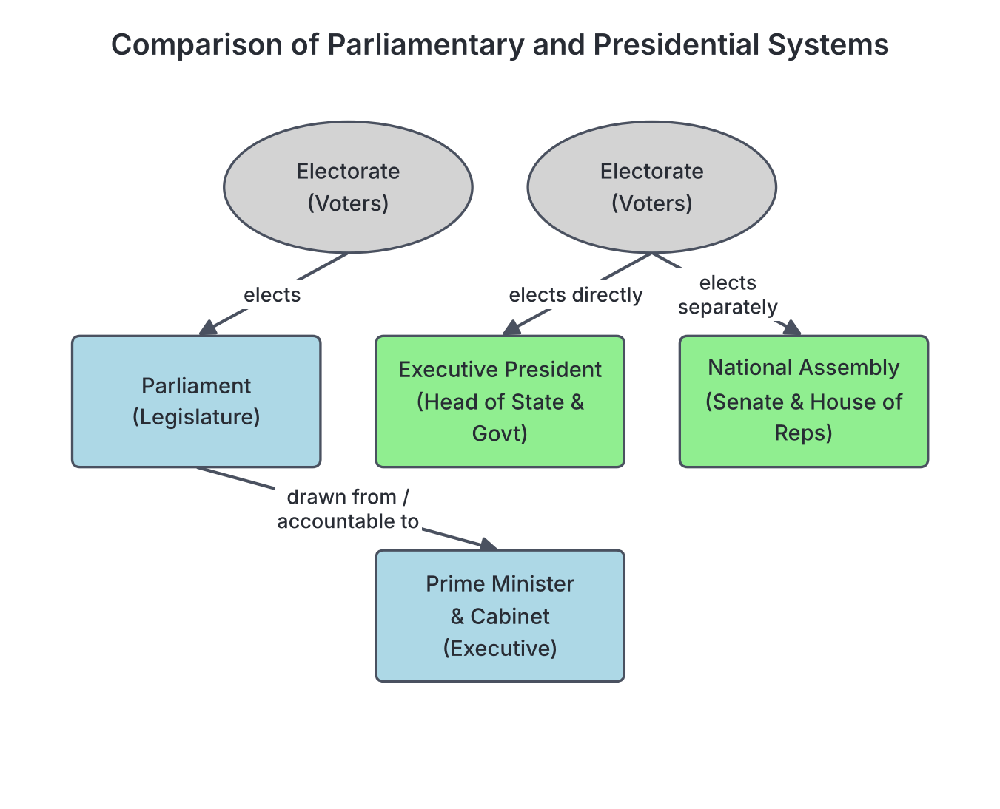
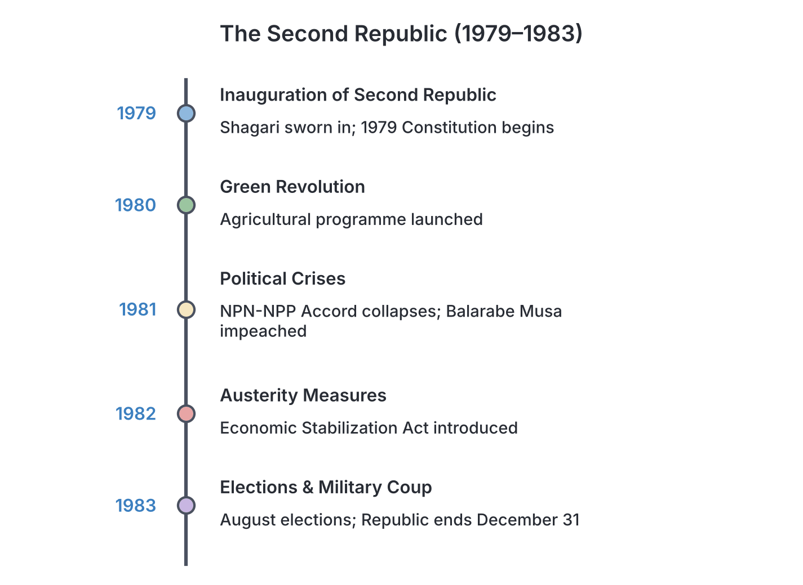

# JAMB History Notes: The Second Republic

## What JAMB expects

This topic is Section D, Topic 5 of the JAMB History syllabus: The Second Republic. 

The syllabus does not list specific content items for this topic, but gives one overarching objective. Based on this objective and standard Nigerian history textbooks, these notes cover the events, politics, economy, and ultimate collapse of the regime.

By the end of these notes, you should be able to:
1. Evaluate the challenges and achievements of the Second Republic.

**Note on the syllabus wording:** Because this topic has no printed contents, the scope of these notes is built to cover the establishment of the presidential system under Shehu Shagari, party politics, economic policies (including the Green Revolution and Austerity Measures), the 1983 elections, and the factors that led to the military coup of December 1983.

## The Birth of the Second Republic

The **Second Republic** refers to the period of civilian democratic rule in Nigeria that lasted from **October 1, 1979**, to **December 31, 1983**. It followed thirteen years of military rule that began with the first coup in January 1966. 

The transition to the Second Republic was organised by the military government of General Olusegun Obasanjo, who handed over power to the newly elected civilian president, **Alhaji Shehu Shagari**, on October 1, 1979.

### The Shift to a Presidential System

A major feature of the Second Republic was the introduction of a new constitution in 1979, which abandoned the British-style **parliamentary system** used in the First Republic. Instead, Nigeria adopted an American-style **presidential system**.

| Feature | First Republic (Parliamentary System) | Second Republic (Presidential System) |
| --- | --- | --- |
| **Head of State vs. Head of Government** | Separated: Dr. Nnamdi Azikiwe (President/Head of State) and Sir Abubakar Tafawa Balewa (Prime Minister/Head of Government). | Combined: Alhaji Shehu Shagari was the **Executive President** (both Head of State and Head of Government). |
| **The Executive and the Legislature** | The Prime Minister and ministers were members of the parliament. | The Executive was separate from the Legislature. Ministers were not members of the National Assembly. |
| **Elections** | The leader of the party with the most seats in parliament became Prime Minister. | The President was elected directly by the whole country and had to win at least 25% of the votes in two-thirds of the 19 states. |

## Party Politics in the Second Republic

To prevent the rise of purely regional or ethnic parties that caused crises in the First Republic, the 1979 Constitution required political parties to have a national spread. A party's headquarters had to be in the federal capital, and its executive committee had to reflect the "federal character" of the country.

The Federal Electoral Commission (FEDECO) registered **five political parties** for the 1979 elections:

1. **National Party of Nigeria (NPN):** Led by Chief A.M.A. Akinloye, with Alhaji Shehu Shagari as its presidential candidate. It was seen as a broad national coalition, though its strongest base was in the North. It won the presidency and the most seats in the National Assembly.
2. **Unity Party of Nigeria (UPN):** Founded and led by Chief Obafemi Awolowo. Its support was overwhelmingly based in the West (the Yoruba-speaking states and Bendel State). It ran on a manifesto of free education and free health services.
3. **Nigerian People's Party (NPP):** Led by Dr. Nnamdi Azikiwe. It had a strong following in the East (Igbo-speaking states) and parts of the Middle Belt (Plateau State).
4. **Great Nigeria People's Party (GNPP):** Led by Alhaji Waziri Ibrahim, famous for his slogan "politics without bitterness." Its main base was in Borno and Gongola states.
5. **People's Redemption Party (PRP):** Led by Malam Aminu Kano. It appealed to the masses (the *talakawa*) and won the governorships of Kano and Kaduna states.

**Note:** A sixth party, the **Nigeria Advance Party (NAP)** led by Mr. Tunji Braithwaite, was registered later by FEDECO to contest the 1983 elections.

### The NPN-NPP Accord
In the 1979 elections, Alhaji Shehu Shagari (NPN) won the presidency, but the NPN did not win an absolute majority of seats in the National Assembly. To form a stable government and pass laws easily, the NPN entered into an alliance with the NPP. Under this **NPN-NPP Accord**, NPP members were given ministerial appointments and positions in the legislature. 

The accord broke down in 1981 due to disagreements over political appointments and policies, leading the NPP ministers to resign, though some chose to stay and switched their party allegiance to the NPN.

## Achievements of the Second Republic

**Objective i: evaluate the challenges and achievements of the Second Republic.**

Despite its short life and later collapse, the government of the Second Republic recorded several achievements. 

1. **Restoration of Democracy:** The successful transition from military to civilian rule, and the operation of the new 1979 Constitution, restored civil liberties, freedom of the press, and democratic participation after 13 years of military dictatorship.
2. **The Green Revolution:** Launched in April 1980, this agricultural programme aimed to make Nigeria self-sufficient in food production and to boost export crops. It replaced the military era's Operation Feed the Nation (OFN). The government supplied farmers with fertilizers, tractors, and improved seeds.
3. **Housing Schemes:** The Shagari administration launched a massive National Housing Programme. Low-cost housing estates (often called "Shagari Estates") were built in all the 19 states of the federation to provide affordable shelter for low-income earners.
4. **Industrial and Infrastructural Development:** 
   - Work accelerated on the **Ajaokuta Steel Mill** and the **Delta Steel Company** (Aladja), which was commissioned in 1982. 
   - The administration continued the development of the new **Federal Capital Territory (Abuja)**, laying the groundwork for the future relocation from Lagos.
   - New federal highways and river basin development authorities were constructed.
5. **Education:** Several new Federal Universities of Technology were established across the country (such as those in Bauchi, Makurdi, and Owerri), and the UPN-controlled states implemented free primary and secondary education programs.

## Challenges of the Second Republic

The Second Republic faced severe political, social, and economic difficulties that eventually led to its downfall.

### 1. The Economic Crisis and Austerity Measures
The Nigerian economy during this period relied almost entirely on the export of crude oil. In the early 1980s, the world experienced an **oil glut** (an oversupply of oil globally), causing oil prices and Nigeria's revenue to drop sharply. 

Because the country imported most of its food and manufactured goods, the sudden drop in foreign exchange earnings caused a massive economic crisis. To manage the crisis, the government passed the **Economic Stabilization Act of 1982**, which introduced **Austerity Measures**. These policies included:
- Banning or restricting the importation of many goods.
- Cutting government spending.
- Increasing tariffs and import duties.

The austerity measures caused hardship. Factories closed down due to a lack of imported raw materials, leading to high unemployment, scarcity of essential goods, and inflation.

### 2. Allegations of Corruption and Mismanagement
Critics, opposition parties, and the military later alleged that the economic crisis was worsened by massive corruption. Politicians and contractors were accused of inflating contract costs, over-invoicing imports, and abusing the system of **import licenses**. An import license was a government permit needed to bring foreign goods into the country; critics claimed they were given to political allies who sold them for huge profits.

### 3. Political Friction and the Impeachment Crisis
The presidential system was new, and politicians often clashed over how it should operate. The relationship between the Executive and the Legislature was sometimes hostile. 
The most famous political conflict occurred in **Kaduna State in 1981**. The governor, Alhaji Balarabe Musa (of the PRP), faced a State House of Assembly heavily dominated by the NPN. After prolonged disagreements, the House of Assembly impeached Governor Musa and removed him from office—the first impeachment of a governor in Nigerian history.

### 4. Religious Unrest (Maitatsine Riots)
In December 1980, violent religious riots erupted in Kano, led by an unorthodox Islamic preacher named Muhammadu Marwa, widely known as **Maitatsine**. The clashes between his followers and the Nigerian military resulted in thousands of deaths and massive destruction of property. The riots highlighted underlying social tensions and security challenges in the north.

### 5. Revenue Allocation Disputes
The different states and the federal government argued fiercely over the **Revenue Allocation Formula** (how national income, mostly from oil, should be shared). States controlled by opposition parties often felt the federal government (controlled by the NPN) was withholding funds or using federal resources for political advantage.

## The 1983 Elections and Electoral Malpractice

The general elections of August and September 1983 were a critical test for the Second Republic. Alhaji Shehu Shagari sought a second term against strong challenges, particularly from Chief Obafemi Awolowo (UPN) and Dr. Nnamdi Azikiwe (NPP). 

The elections were marred by widespread allegations of **electoral malpractice**, including:
- Smuggling of ballot boxes and falsification of results.
- Underage voting and manipulation of the voter register.
- Use of thugs to intimidate voters and political opponents.

FEDECO declared Alhaji Shehu Shagari the winner of the presidential election, and the NPN was declared to have won governorship seats in states traditionally held by the opposition (such as Oyo, Ondo, and Anambra). 

The announcement of these results led to violent protests, especially in the western states of Ondo and Oyo, resulting in arson, destruction of property, and the loss of many lives. The judiciary was flooded with election petitions, and public confidence in the democratic process was deeply damaged.

## The Collapse of the Second Republic

On **December 31, 1983**, the military struck again. A bloodless coup overthrew President Shehu Shagari and brought the Second Republic to an end. 

The coup plotters, who installed **Major-General Muhammadu Buhari** as the new Head of State, cited several reasons for taking over:
1. **Economic mismanagement:** The crippling effects of the oil glut, inflation, and the failure of the austerity measures.
2. **Endemic corruption:** The alleged looting of the treasury by political office holders and the abuse of import licenses.
3. **Electoral fraud:** The massive rigging and violence of the 1983 elections, which the military claimed showed that politicians had not learned from the mistakes of the First Republic.
4. **General insecurity:** The violence following the elections and religious disturbances like the Maitatsine riots.

The military suspended the 1979 Constitution, banned all political parties, and began arresting and trying former politicians for corruption.

## Key terms

| Term | Meaning |
| --- | --- |
| **Second Republic** | The period of civilian democratic rule in Nigeria from 1979 to 1983. |
| **Presidential System** | A system of government where the executive branch is separate from the legislature, led by an Executive President (e.g., USA, Nigeria from 1979). |
| **FEDECO** | Federal Electoral Commission; the body responsible for organizing elections during the Second Republic. |
| **Green Revolution** | An agricultural programme launched by Shagari in 1980 to boost food production. |
| **Oil Glut** | An oversupply of crude oil in the global market in the early 1980s, which caused prices and Nigeria's revenue to fall sharply. |
| **Austerity Measures** | Strict economic policies (Economic Stabilization Act, 1982) designed to reduce government spending and restrict imports during the economic crisis. |
| **Import License** | A government permit required to import goods, which became a source of alleged political patronage and corruption. |
| **Impeachment** | The process of charging and removing a high official from office (e.g., Governor Balarabe Musa in 1981). |
| **Maitatsine** | The name given to Muhammadu Marwa and his followers, whose religious uprisings caused severe violence in the early 1980s. |

## Exam tips and common mistakes

- **Do not confuse agricultural programmes:** Operation Feed the Nation (OFN) was created by the military (Obasanjo) in 1976. The **Green Revolution** was created by the civilian government (Shagari) in 1980.
- **Know the parties and their leaders:** Be able to match NPN to Shagari/Akinloye, UPN to Awolowo, NPP to Azikiwe, GNPP to Waziri Ibrahim, PRP to Aminu Kano, and NAP to Tunji Braithwaite.
- **Remember the systems of government:** The First Republic was Parliamentary; the Second Republic was the first time Nigeria used the **Presidential** system.
- **Identify the cause of the economic crisis:** The root cause of the Second Republic's economic crash was the global **oil glut** because Nigeria relied heavily on oil exports.
- **1979 vs 1983 elections:** The 1979 elections were organised by the military to hand over power. The 1983 elections were organised by the civilian government and were marred by severe rigging and violence, leading to the 1983 coup.

## Quick summary

1. The Second Republic began on October 1, 1979, and ended on December 31, 1983.
2. It operated under the 1979 Constitution, which introduced an American-style Executive Presidential system, with Alhaji Shehu Shagari as President.
3. Five political parties (NPN, UPN, NPP, GNPP, PRP) contested the 1979 elections; a sixth (NAP) was added in 1983.
4. Achievements of the regime included the Green Revolution, federal housing schemes, educational expansion, and the development of Abuja.
5. The global oil glut of the early 1980s caused a severe drop in government revenue, forcing the government to introduce Austerity Measures in 1982.
6. The regime faced major challenges, including political friction (e.g., the impeachment of Governor Balarabe Musa), the Maitatsine riots, and allegations of massive corruption.
7. The highly controversial and violent general elections of 1983 led to widespread protests and a loss of public confidence in the government.
8. The military, citing economic mismanagement, corruption, and electoral fraud, overthrew the government on December 31, 1983, installing Major-General Muhammadu Buhari.

## Practice questions

**1. The system of government adopted during the Second Republic in Nigeria was the**
- A. Parliamentary system
- B. Presidential system
- C. Unitary system
- D. Confederal system

**Answer: B.** The 1979 Constitution introduced the American-style Presidential system, replacing the British Parliamentary system used in the First Republic.

**2. Which of the following political parties won the presidential election in 1979?**
- A. Unity Party of Nigeria (UPN)
- B. Nigerian People's Party (NPP)
- C. National Party of Nigeria (NPN)
- D. People's Redemption Party (PRP)

**Answer: C.** The NPN, with its candidate Alhaji Shehu Shagari, won the 1979 presidential election.

**3. To manage the economic crisis of the early 1980s, the Shagari administration introduced the**
- A. Structural Adjustment Programme
- B. Operation Feed the Nation
- C. Austerity Measures
- D. Indigenization Decree

**Answer: C.** The Economic Stabilization Act of 1982 introduced Austerity Measures to curb imports and reduce spending. The Structural Adjustment Programme (SAP) was later introduced by Babangida.

**4. The agricultural programme launched by the civilian government of the Second Republic was the**
- A. Green Revolution
- B. Operation Feed the Nation
- C. Directorate of Food, Roads and Rural Infrastructure
- D. Agricultural Development Project

**Answer: A.** The Green Revolution was launched by Shagari in 1980. Operation Feed the Nation was an earlier military policy by Obasanjo.

**5. The first state governor to be impeached in Nigeria's history during the Second Republic was**
- A. Chief Bola Ige
- B. Alhaji Lateef Jakande
- C. Alhaji Balarabe Musa
- D. Chief Jim Nwobodo

**Answer: C.** Alhaji Balarabe Musa of the PRP was impeached by the NPN-dominated Kaduna State House of Assembly in 1981.

**6. Which external economic factor severely affected the revenue of the Second Republic?**
- A. The collapse of the gold standard
- B. The global oil glut
- C. Economic sanctions by the United Nations
- D. The ban on Nigerian agricultural exports

**Answer: B.** The global oil glut caused a sharp drop in oil prices, heavily reducing Nigeria's revenue since the economy depended almost entirely on oil.

**7. The leader of the Unity Party of Nigeria (UPN) in the Second Republic was**
- A. Dr. Nnamdi Azikiwe
- B. Alhaji Waziri Ibrahim
- C. Malam Aminu Kano
- D. Chief Obafemi Awolowo

**Answer: D.** Chief Obafemi Awolowo founded and led the UPN. Azikiwe led the NPP, Ibrahim the GNPP, and Kano the PRP.

**8. Which political party was registered to join the existing five parties for the 1983 general elections?**
- A. Nigeria Advance Party (NAP)
- B. Social Democratic Party (SDP)
- C. National Republican Convention (NRC)
- D. Action Group (AG)

**Answer: A.** The Nigeria Advance Party (NAP), led by Tunji Braithwaite, was registered for the 1983 elections, bringing the number of parties to six.

**9. The military coup that ended the Second Republic took place on**
- A. January 15, 1966
- B. October 1, 1979
- C. December 31, 1983
- D. August 27, 1985

**Answer: C.** The military overthrew President Shehu Shagari on December 31, 1983. October 1, 1979 was when the Republic began.

**10. One of the major political crises that weakened public confidence in the Second Republic shortly before its collapse was the**
- A. creation of twelve new states
- B. controversial and violent 1983 general elections
- C. civil war in the eastern region
- D. annulment of the presidential election

**Answer: B.** The 1983 elections were marked by allegations of massive rigging and widespread violence, which the military cited as a reason for the coup. The annulment refers to the 1993 election under Babangida.

<!-- COVERAGE
obj i | Achievements of the Second Republic
obj i | Challenges of the Second Republic
-->
