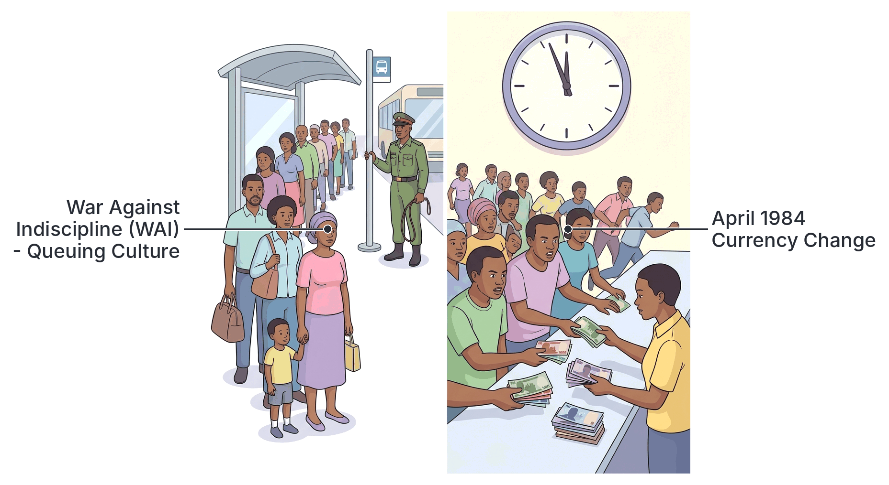

# JAMB History Notes: The Buhari Regime

## What JAMB expects

This topic is Section D, Topic 6 of the JAMB History syllabus: The Buhari Regime. The syllabus does not list specific content items for this topic, so these notes use the single objective to cover the events, policies, and outcomes of this military government. 

By the end of these notes, you should be able to:

1. Assess the challenges and achievements of the Buhari Regime.

**Note:** Major-General Muhammadu Buhari later served as Nigeria’s civilian President in the Fourth Republic (2015–2023). However, this JAMB topic strictly covers his **military regime from December 31, 1983, to August 27, 1985**. 

## Assessing the challenges and achievements of the Buhari Regime

**Objective i: assess the challenges and achievements of the Buhari Regime.**

To assess the challenges and achievements of this regime, historians look at the problems the government faced when it took power, the actions it took to solve them, and the outcomes of those actions. 

On **December 31, 1983**, the military overthrew the civilian government of the Second Republic led by President Shehu Shagari. The coup plotters announced that they took over because of severe economic mismanagement, high-level corruption, and the disputed 1983 general elections. 

**Major-General Muhammadu Buhari** became the Head of State and Commander-in-Chief of the Armed Forces. His second-in-command was **Brigadier (later Major-General) Tunde Idiagbon**, who held the title of Chief of Staff, Supreme Headquarters. The highest ruling body was the **Supreme Military Council (SMC)**.

The government immediately faced significant challenges and introduced several strict policies, which are detailed below.

### 1. Economic Challenges and Austerity Measures

When the regime came into power, Nigeria faced a severe economic crisis. Oil prices had fallen worldwide, inflation was high, factories were closing because they could not import raw materials, and the country had a massive external debt. 

The government’s stated aim was to reduce spending, stop waste, and pay off debts.
*   **Rejection of the IMF Loan:** The government negotiated with the International Monetary Fund (IMF) for a loan but refused to accept the IMF’s strict conditions (conditionalities). The IMF wanted Nigeria to devalue the Naira, remove petroleum subsidies, and open up trade. Buhari's government argued that these measures would cause too much suffering for ordinary Nigerians.
*   **Counter-trade:** Because Nigeria lacked foreign exchange (dollars) to buy imports, the government introduced "counter-trade." This was a barter system where Nigeria exchanged its crude oil directly for goods, machinery, and spare parts from countries like Brazil and France.
*   **Retrenchment:** To save money, the government carried out a massive "retrenchment" exercise. Tens of thousands of civil servants and public workers were sacked or forced to retire without warning. While the government said this reduced the wage bill and removed "dead woods" (inefficient workers), it created high unemployment and hardship for many families.
*   **Currency Change (April 1984):** The regime suddenly changed the colours of the Naira notes. Citizens were given a very short time to exchange their old notes for new ones at the banks. The government stated that this policy was to stop currency smuggling and to punish corrupt politicians who had hoarded millions of stolen Naira outside the banking system.

### 2. The War Against Indiscipline (WAI)

One of the most famous programmes of the Buhari-Idiagbon regime was the **War Against Indiscipline (WAI)**, launched in March 1984. The government believed that indiscipline, corruption, and a lack of patriotism were the root causes of Nigeria's problems.

WAI was introduced in different phases to change public behaviour:
1.  **Queuing (March 1984):** Nigerians were forced to form orderly queues at bus stops, banks, and post offices. 
2.  **Work Ethics (May 1984):** Aimed at public servants, enforcing punctuality and dedication to duty. Civil servants who arrived late were often locked out or punished.
3.  **Nationalism and Patriotism (August 1984):** Encouraged respect for the national flag and the recitation of the national anthem. 
4.  **Anti-Corruption and Economic Sabotage (May 1985):** Targeted bribery, fraud, hoarding of essential goods, and smuggling.
5.  **Environmental Sanitation (July 1985):** Introduced mandatory cleaning exercises, leading to the monthly environmental sanitation days where movement was restricted so people could clean their surroundings.

**Assessment of WAI:** Many textbooks note that WAI successfully brought orderliness to public places and cleaner environments in a short time. However, critics argued that the methods used to enforce it were harsh, as soldiers often used horsewhips (koboko) and public humiliation to force citizens into line.

### 3. Decrees, Tribunals and Human Rights Controversies

The regime ruled by military decrees, which are laws made by the military that bypass the normal parliamentary process. Some of these decrees suspended the constitution and severely restricted fundamental human rights.

*   **Decree No. 2 (State Security - Detention of Persons):** This decree allowed the government to arrest and detain anyone considered a security risk indefinitely, without trial. It was widely used to hold former politicians and critics.
*   **Decree No. 3 (Recovery of Public Property):** This set up special military tribunals to try former politicians and public officers for corruption. The tribunals handed down massive prison sentences, sometimes running into hundreds of years. The government argued this was necessary to punish looters, but lawyers criticized the use of military officers as judges and the lack of a proper appeals process.
*   **Decree No. 4 (Public Officers Protection Against False Accusation):** This was the most feared press law. It made it a crime for a journalist to publish any report—even if it was true—that embarrassed the government or a public officer. Two journalists from *The Guardian* newspaper, **Tunde Thompson and Nduka Irabor**, were jailed under this decree for publishing classified diplomatic postings.
*   **Decree No. 20 (Miscellaneous Offences):** This decree carried the death penalty for crimes like drug trafficking, oil bunkering, and arson. Controversially, it was made **retroactive**, meaning it applied to people who had committed the crime *before* the law was passed. Under this decree, three young men—Lawal Ojuolape, Bernard Ogedengbe, and Bartholomew Owoh—were executed by firing squad for drug offences committed before the decree existed. This caused international and local outrage.

### 4. Foreign Policy and the Umaru Dikko Affair

The regime's foreign policy was mostly focused on national security and protecting the economy. 
*   **Border Closures:** Land borders were closed to stop smuggling of goods and currency.
*   **Expulsion of Illegal Aliens:** In 1985, the government ordered immigrants living in Nigeria without valid papers (mostly from neighbouring West African countries) to leave, citing economic strain. (This followed a larger expulsion in 1983 under Shagari).
*   **Anti-Apartheid Stance:** The regime strongly supported the liberation struggles in Southern Africa and officially recognized the Sahrawi Arab Democratic Republic (SADR) in Western Sahara, defying Morocco and some Western powers.
*   **The Umaru Dikko Affair (July 1984):** Umaru Dikko was a powerful minister in the overthrown Shagari government who had fled to London. The military regime accused him of massive corruption. In a joint operation with Israeli intelligence, Nigerian agents kidnapped Dikko in London, drugged him, and packed him into a crate marked as "diplomatic baggage" to be flown back to Nigeria. British customs officers opened the crate and rescued him. The incident caused a severe diplomatic row, leading Nigeria and Britain to expel each other's diplomats.

### 5. The Overthrow of the Regime

As the economic hardship continued due to retrenchment and inflation, and as public anger grew over the strict decrees, human rights abuses, and lack of a plan to return the country to civilian rule, support for the regime fell. 

On **August 27, 1985**, the regime was overthrown in a peaceful palace coup (a takeover by members of the same military government). The coup was led by the Chief of Army Staff, **Major-General Ibrahim Babangida**, who then became the new Head of State. 

The new leaders stated that they overthrew Buhari because his leadership was too rigid, human rights were being abused, the Nigerian Security Organization (NSO) had become too powerful, and the SMC was not being consulted on major decisions.

## Key terms

| Term | Meaning |
| --- | --- |
| Supreme Military Council (SMC) | The highest decision-making body in Nigeria during the Buhari military regime. |
| Austerity Measures | Strict economic policies meant to reduce government spending and debt. |
| Retrenchment | The mass dismissal of workers to reduce the size and cost of the public service. |
| Counter-trade | A system of international trade where goods are exchanged for other goods (barter) rather than using currency; used by Nigeria to trade oil for machinery. |
| War Against Indiscipline (WAI) | A national campaign launched in 1984 to enforce public orderliness, patriotism, and a strong work ethic. |
| Decree | A law made by a military government without the need for a parliament. |
| Retroactive law | A law that makes an action illegal even if the action was committed before the law was passed. |
| Conditionalities | Strict conditions attached to a loan (e.g., the IMF loan). |

## Exam tips and common mistakes

*   **Dates:** Know that the Buhari military regime started on December 31, 1983, and ended on August 27, 1985. Do not confuse it with his civilian presidency (2015–2023).
*   **The Second-in-Command:** Remember the name Brigadier Tunde Idiagbon. The regime is often referred to in textbooks as the "Buhari-Idiagbon regime."
*   **Know the Decrees by number:** JAMB frequently tests Decree No. 4 (Press gag / journalists jailed) and Decree No. 2 (Detention without trial). Do not mix them up.
*   **WAI:** Be able to identify the core phases of the War Against Indiscipline (queuing, environmental sanitation, anti-corruption). 
*   **The Umaru Dikko crate incident:** This happened in 1984 under the Buhari regime in an attempt to recover stolen wealth.
*   **IMF Loan:** A common mistake is to think Buhari accepted the IMF loan. He *rejected* its conditionalities; it was the Babangida regime that followed which opened a national debate on the IMF loan.

## Quick summary

1. Major-General Muhammadu Buhari came to power on December 31, 1983, after overthrowing the civilian government of Shehu Shagari.
2. The regime faced a severe economic crisis and responded with austerity measures, retrenchment of workers, counter-trade (oil-for-goods), and a sudden change of the Naira's colours in 1984.
3. The government refused to accept the IMF loan conditionalities, such as the devaluation of the Naira.
4. It launched the War Against Indiscipline (WAI) to enforce public order, queuing, punctuality, and environmental sanitation.
5. The regime ruled with strict decrees. Decree No. 2 allowed detention without trial, and Decree No. 4 was used to jail journalists who published embarrassing reports.
6. Decree No. 20 (Miscellaneous Offences) controversially used the death penalty retroactively to execute three youths for drug trafficking.
7. In July 1984, the regime attempted to kidnap former minister Umaru Dikko in London inside a crate, causing a diplomatic crisis with Britain.
8. The regime was overthrown on August 27, 1985, by Major-General Ibrahim Babangida, who cited the regime's rigidity and human rights abuses as reasons.

## Practice questions

**1. The military overthrow of the Second Republic on December 31, 1983, brought which of the following to power?**
- A. Major-General Ibrahim Babangida
- B. General Murtala Mohammed
- C. Major-General Muhammadu Buhari
- D. General Sani Abacha

**Answer: C.** Major-General Muhammadu Buhari became the Head of State after the overthrow of President Shehu Shagari on December 31, 1983. Babangida took over in 1985.

**2. Which of the following was a prominent programme launched by the Buhari-Idiagbon regime to instil public order?**
- A. Operation Feed the Nation
- B. War Against Indiscipline (WAI)
- C. Mass Mobilization for Self Reliance, Social Justice, and Economic Recovery (MAMSER)
- D. Structural Adjustment Programme (SAP)

**Answer: B.** The War Against Indiscipline (WAI) was launched in 1984 to enforce orderliness, patriotism, and queuing. OFN was Obasanjo; MAMSER and SAP were Babangida.

**3. Under the Buhari military regime, Decree No. 4 of 1984 was used primarily to:**
- A. try corrupt politicians at military tribunals.
- B. detain security risks without a trial.
- C. execute drug traffickers.
- D. gag the press and protect public officers from false accusation.

**Answer: D.** Decree No. 4 (Public Officers Protection Against False Accusation) was used to control the press and resulted in the jailing of journalists. Decree 3 tried politicians, Decree 2 was for detention, and Decree 20 was for drug offences.

**4. The diplomatic crisis between Nigeria and Britain in 1984 was triggered by an attempt to kidnap:**
- A. Shehu Shagari
- B. Umaru Dikko
- C. Tunde Thompson
- D. Nduka Irabor

**Answer: B.** Umaru Dikko, a former minister, was the target of a failed kidnap attempt in London where he was found drugged in a crate. Thompson and Irabor were the journalists jailed in Nigeria.

**5. To combat currency hoarding and smuggling by corrupt politicians, the Buhari regime:**
- A. devalued the Naira by 50%.
- B. changed the colours of the Naira notes in April 1984.
- C. introduced the Naira to replace the Pound.
- D. banned the use of banks.

**Answer: B.** In April 1984, the government ordered a sudden change in the colours of the Naira to render hoarded money useless. 

**6. Why did the Buhari military administration reject the International Monetary Fund (IMF) loan?**
- A. The IMF refused to lend to a military government.
- B. The government refused the strict conditions such as the devaluation of the Naira.
- C. The IMF demanded that Nigeria leave OPEC.
- D. Nigeria had enough foreign exchange and did not need it.

**Answer: B.** The regime refused the IMF's conditionalities, which included devaluing the Naira, removing subsidies, and liberalizing trade, citing the hardship it would cause.

**7. The controversial execution of Lawal Ojuolape, Bernard Ogedengbe, and Bartholomew Owoh was criticized locally and internationally because:**
- A. they were journalists targeted by Decree 4.
- B. the law used to convict them of drug trafficking was retroactive.
- C. they were innocent bystanders at a protest.
- D. they were former state governors.

**Answer: B.** They were executed under Decree No. 20 for drug trafficking, a law that was applied retroactively (the offence was committed before the decree carrying the death penalty was passed).

**8. Which economic policy was adopted by the Buhari regime to trade Nigeria's crude oil directly for machinery and goods without using foreign exchange?**
- A. Retrenchment
- B. Austerity Measures
- C. Counter-trade
- D. Indigenisation

**Answer: C.** Counter-trade was a barter system used to exchange oil for needed goods from countries like Brazil and France. Retrenchment refers to sacking workers.

**9. Who was the Chief of Staff, Supreme Headquarters, and the second-in-command during the Buhari military regime?**
- A. Major-General Shehu Musa Yar'Adua
- B. Brigadier Tunde Idiagbon
- C. Major-General Ibrahim Babangida
- D. General Sani Abacha

**Answer: B.** Brigadier (later Major-General) Tunde Idiagbon was the Chief of Staff, Supreme Headquarters, and the face of the War Against Indiscipline. Yar'Adua was Obasanjo's second-in-command.

**10. The Buhari military regime was brought to an end on August 27, 1985, through a coup led by:**
- A. Shehu Shagari
- B. Sani Abacha
- C. Ibrahim Babangida
- D. Murtala Mohammed

**Answer: C.** The Chief of Army Staff, Major-General Ibrahim Babangida, led the palace coup that overthrew the regime on August 27, 1985.

<!-- COVERAGE
obj i | Assessing the challenges and achievements of the Buhari Regime
-->
