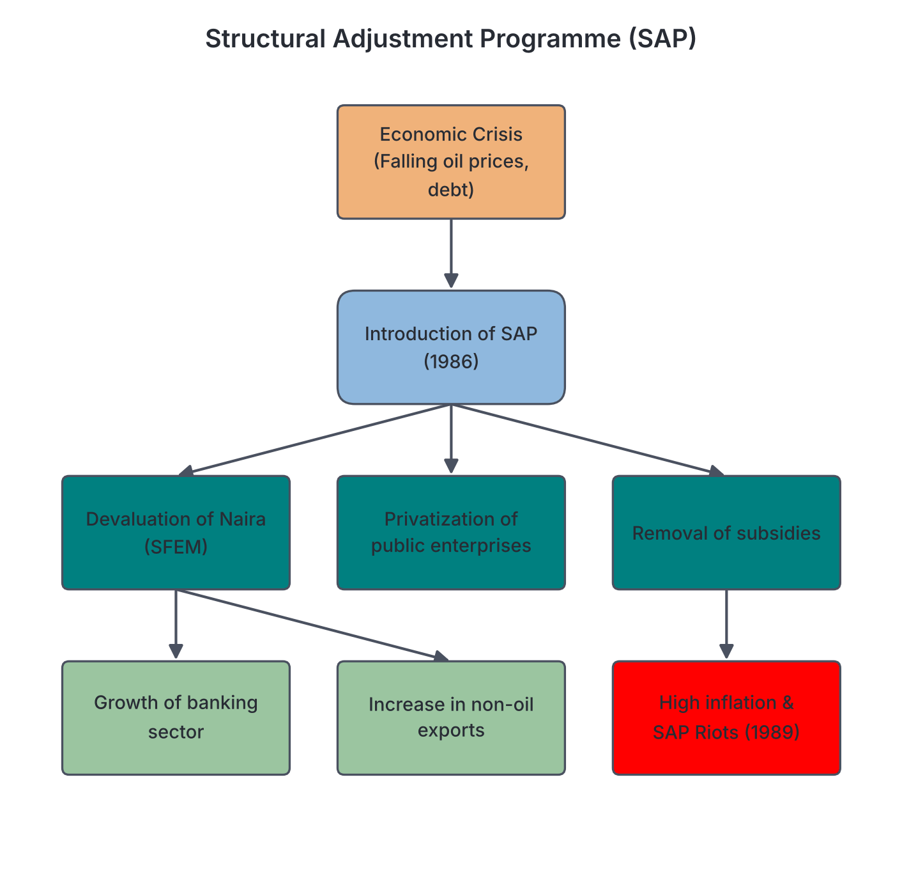

# JAMB History Notes: The Babangida Regime

## What JAMB expects

This topic is Section D, Topic 7 of the JAMB History syllabus: The Babangida Regime. The syllabus lists no specific content items for this topic, only the general objective. 

By the end of these notes, you should be able to:

1. assess the challenges and achievements of the Babangida Regime.

**Note on the syllabus and how to study this topic:** Because there are no printed content items, these notes use the topic title and the objective as the scope. To "assess" means to weigh the stated aims of a government against its actual actions and the results. In historical study, you assess a regime by looking neutrally at what it did—its economic policies, political programmes, administrative changes, and crises. These notes report the documented events of Major General Ibrahim Babangida’s administration from 1985 to 1993 in time order, without making judgments on whether the regime was good or bad. 

## The August 1985 Coup and the Structure of Government

On **August 27, 1985**, a group of senior military officers overthrew the government of Major General Muhammadu Buhari in a bloodless coup. The coup was led by the Chief of Army Staff, Major General **Ibrahim Badamasi Babangida** (often referred to as IBB). 

The leaders of the coup cited several reasons for taking over, including what they described as the rigid and uncompromising nature of the Buhari regime, human rights abuses (such as the detention of journalists and politicians without trial), and the continued decline of the Nigerian economy.

### Title and Structure

Babangida introduced changes to the way the military government was structured:

- **Military President:** Unlike previous military heads of state who used the title "Head of the Federal Military Government," Babangida took the title of **President** and Commander-in-Chief of the Armed Forces.
- **Armed Forces Ruling Council (AFRC):** The Supreme Military Council (SMC), which had been the highest ruling body under previous military regimes, was replaced by the **Armed Forces Ruling Council (AFRC)**.
- **State Security:** The regime reorganized the national security apparatus, creating the State Security Service (SSS), the National Intelligence Agency (NIA), and the Defence Intelligence Agency (DIA).

Early in his administration, Babangida repealed Decree No. 4 of 1984 (which had restricted press freedom) and released several detained politicians and journalists, stating that his government would respect human rights.

## Economic Policies: The Structural Adjustment Programme (SAP)

The most significant economic policy of the Babangida regime was the **Structural Adjustment Programme (SAP)**, introduced in **1986**. When Babangida took power, Nigeria was facing a severe economic crisis due to falling global oil prices and a heavy foreign debt burden.

### The IMF Debate

To get loans to fix the economy, the International Monetary Fund (IMF) gave Nigeria a list of strict conditions. The Babangida government opened the issue to a public debate. The Nigerian public largely rejected the IMF loan and its conditions. In response, the government announced it would not take the loan but would instead implement its own home-grown economic reform programme—the SAP. 

### Key Elements of SAP

The Structural Adjustment Programme aimed to reduce Nigeria's dependence on oil, encourage domestic production, and let market forces determine prices. Its main features were:

1. **Devaluation of the Naira:** The government stopped fixing the exchange rate of the Naira. It introduced the **Second-Tier Foreign Exchange Market (SFEM)**, where the value of the Naira was determined by supply and demand. This led to a significant drop in the Naira's value against the US Dollar.
2. **Deregulation and Trade Liberalization:** Import restrictions were relaxed, and price controls on goods were removed, allowing the market to set prices.
3. **Privatization and Commercialization:** The government set up the Technical Committee on Privatization and Commercialization (TCPC) to sell off loss-making government-owned companies to private individuals and make others run like profit-making businesses.
4. **Removal of Subsidies:** The government reduced subsidies on petroleum products and fertilizer.
5. **Promotion of Non-Oil Exports:** Farmers were encouraged to export cash crops like cocoa and rubber, keeping their foreign exchange earnings.

### Outcomes and Challenges of SAP

The SAP brought major changes to the Nigerian economy. It led to the rapid growth of the banking and financial sectors, and some farmers who exported cash crops made higher profits. However, the devaluation of the Naira and the removal of subsidies led to a sharp increase in the cost of imported goods, transport, and basic living expenses. 

High inflation caused severe hardship for many Nigerians, particularly the working class and the poor. This led to widespread student and worker protests, most notably the **"SAP Riots" of 1989**, which the government had to suppress using security forces.

## Social and Rural Development Programmes

To reduce the negative effects of the economic reforms and develop rural areas, the regime created several specialized agencies and programmes. 

- **DFRRI (Directorate of Food, Roads and Rural Infrastructure):** Established in 1986, DFRRI was tasked with opening up rural areas by constructing feeder roads, providing rural electrification, and supplying boreholes for clean water.
- **MAMSER (Mass Mobilization for Self Reliance, Social Justice, and Economic Recovery):** Launched in 1987, this agency aimed to re-orientate Nigerians towards patriotism, hard work, and political awareness. It organized rallies and campaigns across the country.
- **NDE (National Directorate of Employment):** Created to combat rising unemployment, especially among graduates and school leavers, by providing vocational training and small loans to start businesses.
- **The Better Life for Rural Women Programme:** Initiated by the First Lady, Maryam Babangida, this programme aimed to improve the living standards of rural women by encouraging them to form cooperatives, providing them with milling machines, and promoting local crafts.
- **Peoples Bank and Community Banks:** Established to provide small, collateral-free loans to artisans, traders, and farmers who could not get loans from traditional commercial banks.

## State Creation and the Move to Abuja

The Babangida regime altered the administrative map of Nigeria twice by creating new states, responding to long-standing demands from various ethnic and regional groups for closer government and a larger share of federal resources.

- **1987 State Creation:** Two new states were created from existing ones. **Akwa Ibom State** was carved out of Cross River State, and **Katsina State** was carved out of Kaduna State. This increased the number of states in Nigeria from 19 to **21**.
- **1991 State Creation:** Nine more states were created. These were Abia, Delta, Enugu, Jigawa, Kebbi, Kogi, Osun, Taraba, and Yobe. (Note: Because some old states were split or renamed, the total number of states increased from 21 to **30**).
- **Local Governments:** The regime also created hundreds of new Local Government Areas (LGAs) to bring administration closer to the grassroots.

**The Move to Abuja (1991):** On December 12, 1991, Babangida officially moved the seat of the Federal Government from Lagos to the new Federal Capital Territory, **Abuja**. Although the plan to move the capital was initiated by the Murtala/Obasanjo regime in 1976, it was the Babangida administration that completed the major infrastructure (like the Presidential Villa and National Assembly complexes) and executed the final transfer.

[IMAGE: A map of Nigeria in 1991 showing the 30-state structure. The borders of the 30 states are outlined, with their names labeled (e.g., Sokoto, Kebbi, Zamfara is not yet a state, Borno, Yobe, etc.). In the center, the Federal Capital Territory (FCT) is marked with a star and labeled "Abuja - New Federal Capital (1991)". Clean flat textbook style, white background.]

## Foreign Policy and ECOMOG

In foreign affairs, the regime took a leading role in West African security and international diplomacy.

- **ECOMOG Intervention in Liberia:** In **1990**, a brutal civil war broke out in Liberia. Under Babangida's leadership, the Economic Community of West African States (ECOWAS) formed a regional peacekeeping force called **ECOMOG** (ECOWAS Monitoring Group). Nigeria provided the vast majority of the troops, funding, and commanders for the operation. While the intervention saved lives and eventually helped stabilize Liberia, it was heavily criticized at home due to the high financial cost and the loss of Nigerian soldiers.
- **Technical Aid Corps (TAC):** Established in 1987, this scheme sent young Nigerian professionals (doctors, engineers, teachers) to work in other African, Caribbean, and Pacific countries, expanding Nigeria's soft power.

## Security and Internal Challenges

The regime faced several threats to its authority and national unity.

- **Coup Attempts:** The government announced two major attempted coups. In late 1985, Major General Mamman Vatsa, a close friend of Babangida and Minister of the FCT, was accused of plotting to overthrow the government. Vatsa and several other officers were executed in 1986. In **April 1990**, a more violent coup attempt was led by Major Gideon Orkar. The plotters attacked the military headquarters at Dodan Barracks in Lagos and briefly took over the national radio station, announcing the excision (cutting off) of some northern states from Nigeria. The coup was crushed, and Orkar and his co-conspirators were executed.
- **The OIC Controversy (1986):** A major religious and political challenge occurred in 1986 when it was revealed that Nigeria had upgraded its status from an observer to a full member of the **Organization of the Islamic Conference (OIC)** (renamed the Organisation of Islamic Cooperation in 2011). This sparked widespread protests from Christian leaders who argued it violated Nigeria's secular constitution. Muslim leaders defended the membership, pointing to economic benefits and existing ties. The controversy caused lasting religious tension, forcing the government to set up a religious advisory council to manage the fallout.

## The Political Transition Programme

A central feature of the Babangida regime was its complex and frequently amended transition programme to return Nigeria to civilian democratic rule.

### The Political Bureau

In 1986, the government set up the **Political Bureau**, headed by Dr. S.J. Cookey, to gather the views of Nigerians on the best political system for the future. The Bureau recommended a return to the presidential system and a two-party system to prevent ethnic-based parties.

### Banning of Old Politicians

To create a "new breed" of politicians, the regime issued decrees banning former politicians who had served in the First and Second Republics, as well as retired military officers, from participating in the transition elections.

### The Two-Party System

In 1989, after lifting the ban on political activities, several political associations applied for registration. The government rejected all of them, stating they were based on old ethnic and religious lines. Instead, the government created two political parties and wrote their manifestos and constitutions:

1. **The Social Democratic Party (SDP):** Described by the government as leaning "a little to the left" (progressive/welfare-focused).
2. **The National Republican Convention (NRC):** Described as leaning "a little to the right" (conservative/free-market-focused).

Every politician who wanted to contest had to join one of these two parties. The government also built party secretariats for them in every local government area.

### Option A4 and the Open Ballot System

To prevent electoral fraud, the head of the National Electoral Commission (NEC), Professor Humphrey Nwosu, introduced a unique voting method called **Option A4** and the **Modified Open Ballot System**. Voters had to queue openly behind the poster of their preferred candidate. Votes were counted on the spot in the presence of the voters.

Elections for local governments, state governors, and the National Assembly were successfully held between 1990 and 1992, and civilian governors took office while the military remained in charge at the federal level. 

The handover date for the presidency, originally set for 1990, was shifted to 1992, and then finally to 1993, earning the president the nickname "Maradona" in the Nigerian press (after the footballer Diego Maradona, known for his unpredictable dribbling).

## The June 12, 1993 Election and its Annulment

The transition programme culminated in the presidential election held on **June 12, 1993**. 

- **The Candidates:** Chief **M.K.O. Abiola**, a wealthy businessman from the South-West, ran on the platform of the SDP (with a Muslim-Muslim ticket, as his running mate, Babagana Kingibe, was also a Muslim). Alhaji **Bashir Tofa**, a businessman from the North, ran on the platform of the NRC.
- **The Election:** The election took place peacefully across the country. Local and international observers widely described it as the freest, fairest, and most peaceful election in Nigeria's history up to that point. 
- **The Results:** Early results released by the National Electoral Commission (NEC) showed Chief M.K.O. Abiola taking a commanding lead across all regions of the country, crossing traditional ethnic and religious divides.

### The Annulment

Before the final results could be officially announced, the Babangida government stopped the collation process. On **June 23, 1993**, the regime announced the total **annulment** (cancellation) of the election. 

**Stated reasons:** The government cited a court injunction obtained by a group called the Association for Better Nigeria (ABN) on the eve of the election, which ordered that the election should not hold. The government stated it acted to save the judiciary from ridicule and to protect national security.

**Public reaction and crisis:** The annulment triggered a massive political crisis. Pro-democracy groups, civil society organizations, and labour unions argued that the annulment was a denial of the will of the electorate. Widespread protests, strikes, and riots broke out, particularly in the South-West, bringing the economy to a halt. International organizations and foreign governments condemned the annulment and imposed limited sanctions on Nigeria.

## Exit and Handover to the Interim National Government

The pressure from the June 12 crisis made it impossible to organize fresh elections or to continue the military regime smoothly. Babangida announced that he would "step aside" as military president.

On **August 26, 1993**, Ibrahim Babangida formally resigned and handed over power to an unelected civilian administration known as the **Interim National Government (ING)**. The ING was headed by Chief **Ernest Shonekan**, a respected business executive. The mandate of the ING was to stabilize the country and organize fresh presidential elections, bringing the eight-year Babangida regime to an end.

## Assessing the Challenges and Achievements

As the syllabus asks you to evaluate the regime, you can organize the documented facts into categories.

**Documented Actions and Policies (Achievements):**
- Creation of 11 new states (bringing the total to 30) and numerous local governments.
- Completion of the move to the new Federal Capital Territory, Abuja.
- Establishment of lasting agencies such as the Federal Road Safety Corps (FRSC), NDLEA, and NDE.
- Construction of the Third Mainland Bridge in Lagos.
- Liberalization of the media and the licensing of private television and radio stations.
- Leading the ECOMOG peacekeeping mission that helped end the Liberian civil war.
- Holding successful elections at the local and state levels during the transition.

**Documented Crises and Unfinished Programmes (Challenges):**
- The economic hardship, high inflation, and SAP riots caused by the Structural Adjustment Programme.
- The execution of military officers following the Vatsa and Orkar coup attempts.
- The religious tensions sparked by the OIC membership controversy.
- The frequent changes to the handover date, which reduced public trust.
- The annulment of the June 12, 1993 presidential election, which resulted in a severe national political crisis and protests.

## Key terms

| Term | Meaning |
| --- | --- |
| Armed Forces Ruling Council (AFRC) | The highest ruling military body under the Babangida regime, replacing the Supreme Military Council. |
| Structural Adjustment Programme (SAP) | An economic policy introduced in 1986 to deregulate the economy, devalue the Naira, and reduce reliance on oil. |
| Deregulation | The removal of government controls over the economy, allowing market forces to determine prices. |
| MAMSER | Mass Mobilization for Self Reliance, Social Justice, and Economic Recovery; an agency created to promote patriotism and political awareness. |
| DFRRI | Directorate of Food, Roads and Rural Infrastructure; created to develop rural areas. |
| ECOMOG | ECOWAS Monitoring Group; a West African peacekeeping force led by Nigeria, deployed to Liberia in 1990. |
| Option A4 / Open Ballot System | A voting method used in the transition elections where voters queued openly behind the poster of their candidate. |
| Social Democratic Party (SDP) | One of the two government-created political parties, described as leaning "a little to the left." |
| National Republican Convention (NRC) | The other government-created political party, described as leaning "a little to the right." |
| Annulment | The official cancellation or invalidation of an event; famously applied to the June 12, 1993 presidential election. |
| Interim National Government (ING) | The unelected civilian government headed by Ernest Shonekan, which took over after Babangida stepped aside. |

## Exam tips and common mistakes

- **Title confusion:** Babangida was the only military ruler to officially use the title "Military President" instead of "Head of State".
- **The SAP:** Remember that the Structural Adjustment Programme (SAP) belongs to the Babangida regime, not Buhari or Abacha.
- **State Creation numbers:** Babangida created states twice. In 1987, he created 2 states (making 21). In 1991, he created 9 states (making 30). Do not confuse this with Gowon (12 states) or Murtala (19 states).
- **The Two Parties:** The government *created* the SDP and NRC. It did not just register them; it funded them and wrote their manifestos.
- **The Capital:** While Murtala announced Abuja as the capital in 1976, it was Babangida who actually moved the seat of government there in 1991.
- **June 12:** Chief M.K.O. Abiola was the candidate for the SDP, and Bashir Tofa was the candidate for the NRC. The election was annulled before a winner was officially declared by the electoral commission.

## Quick summary

1. Major General Ibrahim Babangida came to power in a coup on August 27, 1985, assumed the title of Military President, and ruled through the Armed Forces Ruling Council (AFRC).
2. In 1986, the regime introduced the Structural Adjustment Programme (SAP) to reform the economy by devaluing the Naira, removing subsidies, and privatizing companies, which led to growth in banking but also severe inflation and riots.
3. The government set up social agencies like DFRRI (for rural infrastructure), MAMSER (for mass mobilization), and the NDE (for employment).
4. The regime created 11 new states (2 in 1987 and 9 in 1991), bringing Nigeria to 30 states, and officially moved the capital from Lagos to Abuja in 1991.
5. In foreign policy, Babangida's government spearheaded the ECOMOG peacekeeping intervention in Liberia in 1990.
6. The political transition programme mandated a two-party system consisting of the government-created SDP and NRC.
7. The presidential election of June 12, 1993, widely regarded as free and fair, was annulled by the regime before all results were announced, causing a massive political crisis.
8. Under intense pressure, Babangida "stepped aside" in August 1993 and handed power to an Interim National Government headed by Ernest Shonekan.

## Practice questions

**1. The military ruler who assumed the title of "Military President" in Nigeria was**

- A. Murtala Mohammed
- B. Ibrahim Babangida
- C. Sani Abacha
- D. Muhammadu Buhari

**Answer: B.** Ibrahim Babangida took the title of Military President and Commander-in-Chief when he seized power in 1985. The others used the title Head of State.

**2. The economic policy introduced by the Babangida regime in 1986 to reform the Nigerian economy was the**

- A. Operation Feed the Nation
- B. Structural Adjustment Programme
- C. National Economic Empowerment and Development Strategy
- D. Green Revolution

**Answer: B.** The Structural Adjustment Programme (SAP) was introduced in 1986. Operation Feed the Nation was under Obasanjo, and the Green Revolution was under Shagari.

**3. How many states did Nigeria have after the state creation exercise of 1991 under Babangida?**

- A. 12
- B. 19
- C. 21
- D. 30

**Answer: D.** In 1991, Babangida created 9 new states, bringing the total number from 21 to 30.

**4. The agency created by the Babangida administration to provide rural roads, water, and electrification was**

- A. MAMSER
- B. NDE
- C. DFRRI
- D. NEC

**Answer: C.** The Directorate of Food, Roads and Rural Infrastructure (DFRRI) was specifically created to open up rural areas. MAMSER was for political mobilization, and NDE was for employment.

**5. Under the Babangida transition programme, the two recognized political parties were the**

- A. NPN and UPN
- B. SDP and NRC
- C. PDP and APC
- D. NCNC and AG

**Answer: B.** The government created the Social Democratic Party (SDP) and the National Republican Convention (NRC). NPN and UPN belong to the Second Republic.

**6. Which of the following was a major foreign policy achievement of the Babangida regime?**

- A. The formation of the Organization of African Unity (OAU)
- B. The initiation of the ECOMOG peacekeeping force in Liberia
- C. The nationalization of British Petroleum
- D. The signing of the Anglo-Nigerian Defence Pact

**Answer: B.** Babangida's government played the leading role in creating and funding ECOMOG to intervene in the Liberian civil war in 1990.

**7. The official relocation of Nigeria’s federal capital from Lagos to Abuja took place under the regime of**

- A. Yakubu Gowon
- B. Murtala Mohammed
- C. Ibrahim Babangida
- D. Olusegun Obasanjo

**Answer: C.** Although Murtala Mohammed decreed the move in 1976, it was Ibrahim Babangida who physically relocated the seat of government to Abuja in December 1991.

**8. The June 12, 1993 presidential election was heavily contested between**

- A. Shehu Shagari and Obafemi Awolowo
- B. M.K.O. Abiola and Bashir Tofa
- C. Olusegun Obasanjo and Olu Falae
- D. Ernest Shonekan and Sani Abacha

**Answer: B.** Chief M.K.O. Abiola ran for the SDP, and Alhaji Bashir Tofa ran for the NRC in the June 12 election.

**9. The unique voting system used during the transition elections of the Babangida regime, where voters queued behind candidates' posters, was called**

- A. the electoral college system
- B. the Option A4 open ballot system
- C. the electronic voting system
- D. the secret ballot system

**Answer: B.** Option A4 and the Modified Open Ballot System were introduced by the National Electoral Commission under Humphrey Nwosu to prevent rigging.

**10. After stepping aside in August 1993, Ibrahim Babangida handed over power to**

- A. General Sani Abacha
- B. Chief M.K.O. Abiola
- C. an Interim National Government headed by Ernest Shonekan
- D. the Senate President

**Answer: C.** Babangida handed power to the unelected Interim National Government (ING) led by Chief Ernest Shonekan to stabilize the country following the June 12 crisis. Abacha seized power from Shonekan months later.

<!-- COVERAGE
obj i | Assessing the Challenges and Achievements
-->
