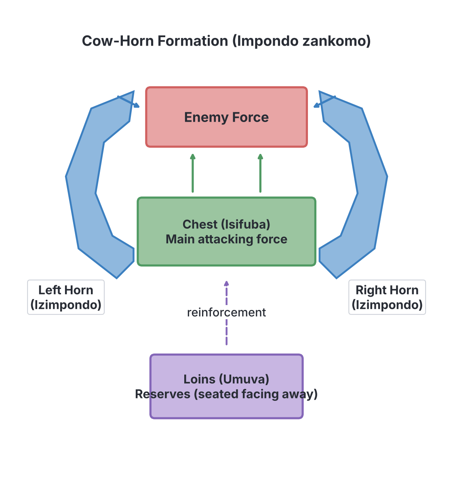
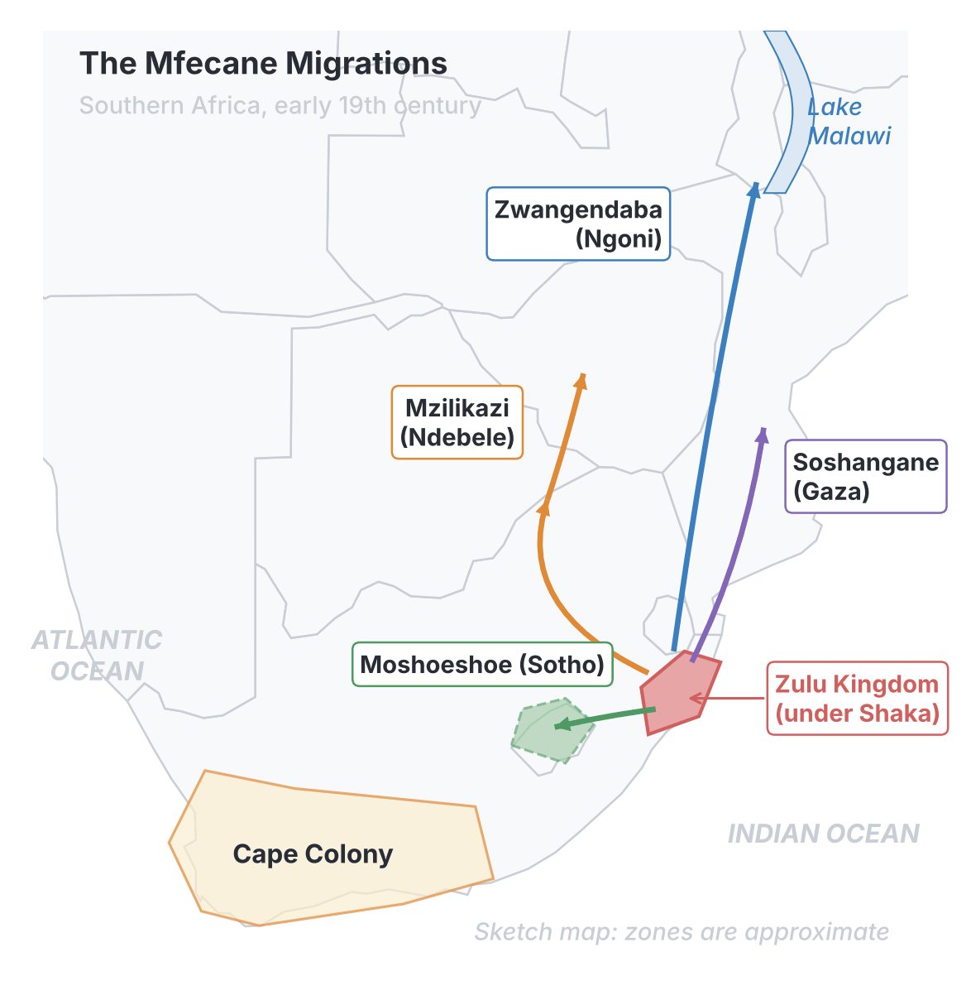

# JAMB History Notes: The Mfecane and the Rise of the Zulu Nation

## What JAMB expects

This topic is Section F, Topic 2 of the JAMB History syllabus: Horn of Africa and Southern Africa – The Mfecane. It has two content items:

- **a. The rise of the Zulu Nation**
- **b. Causes, Course and consequences of the Mfecane**

By the end of these notes, you should be able to:

1. trace events in Nguniland before the Mfecane;
2. determine the factors that led to the rapid rise of Shaka;
3. examine the causes, course and consequences of the Mfecane.

## Events in Nguniland before the Mfecane

**Objective i: trace events in Nguniland before the Mfecane**

**Nguniland** is the historical name for the coastal region of present-day South Africa, lying between the Drakensberg Mountains and the Indian Ocean. It was inhabited by the Nguni-speaking peoples (the ancestors of the Zulu, Xhosa, Swazi, and others). Before the 19th century, they lived in many small, independent chiefdoms, cultivating crops and keeping cattle, which were their main measure of wealth.

In the late 18th century, several major changes caused a severe crisis in the region:

1. **Population pressure and the introduction of maize:** Portuguese traders operating from Delagoa Bay (modern Maputo in Mozambique) introduced maize (corn) to the region. Maize produced much higher yields than traditional African grains like sorghum. This abundance of food led to a rapid increase in the human population.
2. **Ecological crisis:** Maize requires far more water than traditional crops and quickly drains nutrients from the soil. Around 1800 to 1808, a severe, decade-long drought known as the ***madlathule*** (meaning "let him eat and keep quiet") famine struck the region. Pastures dried up, crops failed, and there was intense, violent competition for scarce grazing land and water.
3. **Trade competition:** The small chiefdoms began fighting for control of the profitable trade routes to Delagoa Bay, where they exchanged ivory and cattle for European goods like brass and beads.
4. **Militarization:** To survive the crisis and defend their resources, chiefs began to transform the traditional circumcision age-groups into permanent, organized military regiments known as ***amabutho***. 

**The Rise of Three Major Powers**

By the early 19th century, the smaller chiefdoms had been swallowed up or merged into three large, rival kingdoms:
- **The Mthethwa** under King Dingiswayo.
- **The Ndwandwe** under King Zwide.
- **The Ngwane** under King Sobhuza (who were later pushed north to become the Swazi).

A fierce power struggle broke out among the three. First, Zwide's Ndwandwe defeated the Ngwane, pushing them out of the area. Then, around 1818, the Ndwandwe defeated the Mthethwa and captured and killed King Dingiswayo. The Mthethwa confederacy collapsed, leaving a power vacuum that set the stage for a new leader.

## The Rise of the Zulu Nation under Shaka

**Objective ii: determine the factors that led to the rapid rise of Shaka**  
**Content a: The rise of the Zulu Nation**

The rapid rise of the Zulu nation was the work of one of Africa's most famous military strategists, **Shaka**. Born around 1787, Shaka was the illegitimate son of Senzangakhona, the chief of the small Zulu clan, and a woman named Nandi. Due to his illegitimacy, Shaka and his mother were bullied and exiled. They eventually took refuge with the Mthethwa under King Dingiswayo.

Shaka joined Dingiswayo's *amabutho* and quickly distinguished himself as an exceptionally brave and brilliant warrior. When Shaka's father died around 1816, Dingiswayo helped Shaka claim the chieftaincy of the Zulu clan. Following Dingiswayo's death around 1818, Shaka took command of the shattered Mthethwa forces, merged them with his own Zulu fighters, and defeated Zwide's Ndwandwe at the decisive Battle of Gqokli Hill and the Battle of the Mhlatuze River. Shaka thus became the supreme ruler of Nguniland, forging the mighty Zulu Empire.

### Factors that led to the rapid rise of Shaka

Shaka's success was largely due to his revolutionary military innovations and his strict political control. He transformed warfare from mild skirmishes into total war.

| Aspect of Warfare | Before Shaka | Shaka's Innovation |
| --- | --- | --- |
| **Weaponry** | The long throwing spear (assegai). Warriors threw their spears and were often left unarmed. | The ***iklwa*** (a short stabbing spear). It was never thrown; it was used in close hand-to-hand combat. |
| **Defense** | Small, light shields. | Large, heavy cowhide shields that covered the whole body and were used to hook away the enemy's shield. |
| **Footwear** | Warriors wore leather sandals. | Warriors fought **barefoot** to increase their running speed and agility. |
| **Tactics** | Loose skirmishes with low casualties; battles often ended when one side retreated. | Highly disciplined, close-quarters combat aimed at the **total destruction** of the enemy. |
| **Formation** | Disorganized frontal attacks. | The **"cow-horn" formation** (*Impondo zankomo*) designed to encircle and trap the enemy. |
| **Army structure** | Temporary clan-based militias called up for specific raids. | Permanent, celibate, age-grade regiments (*amabutho*) living in military settlements (*amakhanda*). |

### Political and social factors

- **Total integration:** Shaka did not just defeat his enemies; he absorbed the conquered young men into his *amabutho* and young women into female regiments. They ceased to be members of their old clans and became entirely "Zulu".
- **National loyalty:** The *amabutho* system broke down clan loyalties. Warriors from different backgrounds lived, trained, and fought together, answering only to the king. A warrior could not marry until his regiment was granted permission by Shaka, usually after many years of service.
- **Absolute authority:** Shaka ruled with an iron fist. Disobedience, cowardice, or questioning the king resulted in instant execution. This created a highly disciplined society entirely focused on the military.

## The Mfecane: Causes, Course and Consequences

**Objective iii: examine the causes, course and consequences of the Mfecane**  
**Content b: Causes, Course and consequences of the Mfecane**

The term **Mfecane** is an Nguni word meaning "the crushing" or "the scattering". In the Sotho language, it is called the **Difaqane**. It refers to a period of unprecedented warfare, destruction, forced migration, and state formation in Southern Africa, lasting roughly from 1815 to 1840.

> **Note on historical debates:** While standard textbooks attribute the Mfecane entirely to Shaka Zulu and population pressure, some modern historians argue that European slave-raiding from Delagoa Bay and Griqua/Boer cattle and slave raids from the Cape Colony also caused the chaos. For JAMB exams, the standard view focusing on Shaka, the drought, and population pressure is the accepted answer.

### Causes of the Mfecane

1. **Population explosion and ecological crisis:** The introduction of maize led to overpopulation, which collided with the severe *madlathule* drought. As land and water became scarce, warfare became a matter of basic survival.
2. **The rise of Shaka Zulu:** Shaka's aggressive expansion, his policy of total warfare, and his creation of a highly militarized state displaced neighboring groups. Instead of submitting to Shaka's harsh rule, many groups chose to flee.
3. **The domino effect:** As groups fled from the Zulu, they lost their land and cattle. To survive, they became migrating, heavily armed hordes. They attacked other chiefdoms in their path to steal cattle and food, turning the victims into refugees who then attacked others, creating a chain reaction of violence across the continent.

### Course of the Mfecane (The Migrations)

The Mfecane spread violence far beyond Nguniland. Several leaders adopted Shaka's military tactics and led their followers on massive migrations, crushing those in their path:

- **Mzilikazi and the Ndebele:** Mzilikazi was a trusted commander under Shaka who rebelled, stole some of the king's cattle, and fled west in the early 1820s. Using Zulu tactics, he devastated the Highveld (the central plateau) and eventually founded the powerful **Ndebele (Matabele)** kingdom in present-day Zimbabwe.
- **Soshangane and the Gaza Empire:** After the Ndwandwe were defeated by Shaka, a commander named Soshangane fled north into modern Mozambique. He subjugated the local Tsonga people and built the **Gaza Empire**.
- **Zwangendaba and the Ngoni:** Another Ndwandwe commander, Zwangendaba, led his people on an epic 20-year migration thousands of miles north. They crossed the Zambezi River, destroying weaker groups along the way, and finally settled in areas covering modern Malawi, Zambia, and Tanzania, where they became known as the **Ngoni**.
- **Matiwane and the Ngwane:** Fleeing the Ndwandwe, Chief Matiwane led his people over the Drakensberg mountains onto the Highveld, clashing with Sotho communities and causing massive chaos before eventually being destroyed.
- **The Kololo:** A Sotho group under Chief Sebetwane, pushed out by the chaos, migrated as far north as modern Zambia and temporarily conquered the Lozi kingdom.

### Consequences of the Mfecane

The Mfecane completely redrew the map of Southern Africa. Its effects were profound and long-lasting:

1. **Massive loss of life and suffering:** Hundreds of thousands of people died from warfare, starvation, and disease. Whole communities were wiped out, and cannibalism occasionally occurred among starving refugees.
2. **Depopulation of the Highveld:** Large areas of the central plateau were left empty or sparsely populated as survivors fled to the mountains or deserts to hide. 
3. **The emergence of new, powerful African states:** To survive the chaos, wise leaders gathered refugees and used Zulu military methods to build strong, defensive nations. The most famous include:
   - **The Sotho Kingdom (Lesotho):** King **Moshoeshoe I** gathered refugees on a flat-topped, easily defended mountain called Thaba Bosiu. He used diplomacy and defensive tactics to build the Sotho nation.
   - **The Swazi Kingdom:** King **Sobhuza I** retreated to mountainous terrain and absorbed refugees, laying the foundation for modern Eswatini (Swaziland).
   - **The Ndebele and Gaza Kingdoms:** Created by migrating warlords (Mzilikazi and Soshangane) who built centralized states based on the Zulu model.
4. **Unification and strengthening of the Zulu:** The Mfecane removed Shaka's rivals, leaving the Zulu kingdom as the undisputed African superpower in the region.
5. **Spread of Nguni culture:** The Zulu *amabutho* system, the short stabbing spear, and Nguni languages spread as far north as East Africa through groups like the Ngoni.
6. **Facilitation of European expansion:** The destruction of older chiefdoms and the depopulation of prime farming land on the Highveld made it much easier for white Boers (Afrikaners) to advance into the interior during the Great Trek in the 1830s. The Boers found seemingly empty land, setting the stage for decades of bloody Boer-African conflicts (covered in `F3-great-trek.md`).

## Key terms

| Term | Meaning |
| --- | --- |
| Mfecane | An Nguni word meaning "the crushing" or "the scattering"; a period of widespread war and migration in Southern Africa (c. 1815–1840). |
| Difaqane | The Sotho word for the Mfecane. |
| Nguniland | The coastal region of South Africa, home to the Nguni-speaking peoples (Zulu, Xhosa, Swazi). |
| Amabutho | Age-grade military regiments introduced to replace traditional circumcision groups. |
| Iklwa | The short stabbing spear introduced by Shaka Zulu for close combat. |
| Impondo zankomo | The "cow-horn formation"; Shaka's military tactic to encircle the enemy using a chest, horns, and loins. |
| Madlathule | A severe, prolonged drought (c. 1800–1808) that caused famine and sparked conflicts over resources. |

## Exam tips and common mistakes

- **Common confusion:** JAMB frequently tests who founded which kingdom. Memorize the founders: **Mzilikazi** founded the Ndebele; **Moshoeshoe** founded the Sotho (Lesotho); **Soshangane** founded the Gaza empire; **Zwangendaba** led the Ngoni.
- **Do not confuse weapons and formations:** The *iklwa* is the short stabbing spear; the *Impondo zankomo* (cow-horn) is the military formation.
- **Cause vs Consequence:** The Great Trek (the Boer migration) is sometimes mistakenly chosen as a cause of the Mfecane. It was actually a *consequence*, as the Boers moved into the interior because the Mfecane had emptied the land.
- **Know the timeline of the three kingdoms:** Shaka's rise happened *after* the Ndwandwe (under Zwide) defeated the Mthethwa (under Dingiswayo).
- **Ecology matters:** The introduction of maize and the *madlathule* drought are key ecological causes of the Mfecane.

## Quick summary

1. Before the Mfecane, Nguniland experienced severe population pressure due to the introduction of maize, followed by a terrible drought (the *madlathule*), leading to intense competition for land and water.
2. In response to the crisis, chiefdoms merged into three main powers: the Mthethwa, the Ndwandwe, and the Ngwane.
3. Shaka rapidly rose to power by taking over the shattered Mthethwa forces and defeating the Ndwandwe, forging the unified Zulu Kingdom.
4. Shaka's military innovations included the short stabbing spear (*iklwa*), the cow-horn formation, barefoot warriors, large shields, and strict discipline in age-grade regiments (*amabutho*).
5. The Mfecane ("the crushing") was a period of massive warfare, migration, and state-building (c. 1815–1840), caused by population pressure, drought, and Shaka's violent expansion.
6. Fleeing commanders formed new empires to survive: Mzilikazi (Ndebele), Soshangane (Gaza), and Zwangendaba (Ngoni).
7. Defensive leaders built new nations from refugees: Moshoeshoe built the Sotho kingdom (Lesotho), and Sobhuza built Swaziland.
8. The Mfecane depopulated the central plateau (the Highveld), inadvertently making it easier for white Boers to claim the land during the Great Trek.

## Practice questions

**1. The severe ecological crisis that contributed to the Mfecane in early 19th-century Nguniland was the**

- A. Great Trek
- B. madlathule drought
- C. rinderpest epidemic
- D. locust invasion

**Answer: B.** The *madlathule* drought (c. 1800-1808) worsened competition for land and water, helping trigger the Mfecane. The most tempting wrong option is A (Great Trek), which is often confused as a cause, but it was a later event made easier by the Mfecane's depopulation.

**2. One of the military innovations that contributed to the rapid rise of Shaka Zulu was the introduction of the**

- A. long throwing assegai
- B. use of horses in cavalry
- C. short stabbing spear
- D. use of firearms

**Answer: C.** Shaka introduced the *iklwa* (short stabbing spear), forcing enemies into close-quarters combat. The most tempting wrong option is A, but Shaka deliberately discarded the long throwing spear because it left warriors unarmed.

**3. The term *Mfecane* refers to the**

- A. migration of Boer farmers into the interior of South Africa
- B. period of widespread warfare and displacement in Southern Africa
- C. peaceful unification of the Nguni chiefdoms
- D. British conquest of the Zulu kingdom

**Answer: B.** Mfecane means "the crushing" or "the scattering," referring to the massive wars, migrations, and state-formation in the early 19th century. Option A is tempting because it involves migration, but that describes the Boer Great Trek, not the African Mfecane.

**4. The new African nation built from refugees on a mountain stronghold by King Moshoeshoe during the Mfecane was the**

- A. Ndebele kingdom
- B. Swazi kingdom
- C. Sotho kingdom
- D. Gaza empire

**Answer: C.** Moshoeshoe gathered refugees at Thaba Bosiu and founded the Sotho kingdom (Lesotho). Option A is a common confusion because Mzilikazi also built a state from refugees, but he founded the Ndebele kingdom.

**5. Before Shaka's rise to power, he served as a warrior under which prominent leader?**

- A. Zwide of the Ndwandwe
- B. Dingane of the Zulu
- C. Moshoeshoe of the Sotho
- D. Dingiswayo of the Mthethwa

**Answer: D.** Shaka joined the *amabutho* of King Dingiswayo of the Mthethwa, who later helped him become chief of the Zulu. A common mistake is option A (Zwide), but Zwide was the enemy who killed Dingiswayo.

**6. The general who fled from Shaka and migrated west to found the Ndebele kingdom was**

- A. Mzilikazi
- B. Soshangane
- C. Zwangendaba
- D. Matiwane

**Answer: A.** Mzilikazi led his followers to present-day Zimbabwe to found the Ndebele. The most tempting wrong options are B and C, as they were also famous leaders who fled, but Soshangane founded the Gaza empire and Zwangendaba led the Ngoni.

**7. Shaka's famous military tactic, designed to encircle and crush the enemy, was known as the**

- A. scorched earth policy
- B. cow-horn formation
- C. guerilla warfare
- D. phalanx system

**Answer: B.** The cow-horn formation (*Impondo zankomo*) used a chest to engage the enemy head-on, horns to encircle them, and loins as a reserve. The wrong options are military terms from other historical periods or contexts.

**8. A major political consequence of the Mfecane in Southern Africa was the**

- A. total destruction of all African states
- B. immediate end to European colonization
- C. rise of new centralized states like Lesotho and Swaziland
- D. introduction of maize to the region

**Answer: C.** The chaos forced refugees to band together into new, strong defensive states like Lesotho (Sotho) and Swaziland. Option D is tempting because maize is related to the topic, but it was an earlier cause of population pressure, not a consequence.

**9. The military regiments introduced to replace traditional circumcision groups in Nguniland were called**

- A. amabutho
- B. amakhanda
- C. iklwa
- D. indunas

**Answer: A.** The *amabutho* were the permanent age-grade regiments. The most tempting wrong option is B (*amakhanda*), but those were the military settlements where the regiments lived, not the regiments themselves.

**10. A significant demographic consequence of the Mfecane was the**

- A. overpopulation of the Highveld
- B. peaceful integration of Boer and African communities
- C. massive depopulation of the central plateau
- D. migration of the Zulu to East Africa

**Answer: C.** War and starvation caused massive depopulation on the central plateau (Highveld), which later encouraged Boer settlement. Option A is a common confusion because overpopulation *caused* the crisis initially, but the *consequence* of the wars was depopulation.

<!-- COVERAGE
obj i | Events in Nguniland before the Mfecane
obj ii | The Rise of the Zulu Nation under Shaka
obj iii | The Mfecane: Causes, Course and Consequences
item a | The Rise of the Zulu Nation under Shaka
item b | The Mfecane: Causes, Course and Consequences
-->
