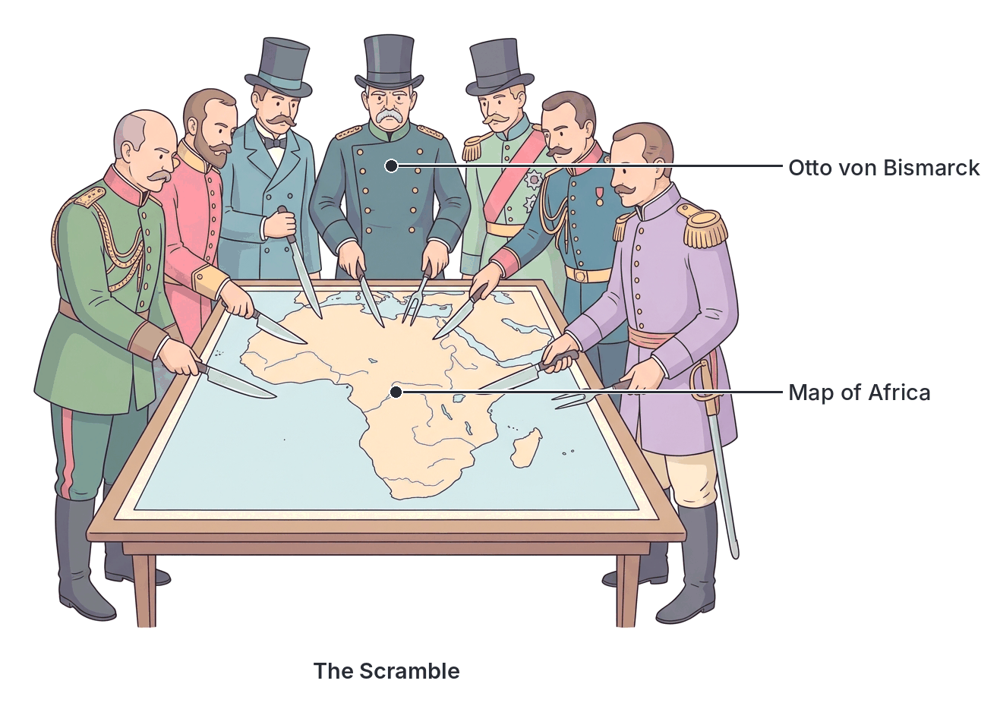

# JAMB History Notes: The New Imperialism and European Occupation of Africa

## What JAMB expects

This topic is Section G, Topic 1 of the JAMB History syllabus: The New Imperialism and European Occupation of Africa. It has four content items:

- **a.** The New Imperialism in Africa
- **b.** European scramble for Africa
- **c.** The Berlin Conference
- **d.** The occupation and resistance by Africans.

By the end of these notes, you should be able to:

1. understand the concept of the New Imperialism
2. assess the justifications for the New Imperialism
3. examine the causes of the scramble and the nations involved
4. account for the significance of the Berlin Conference
5. highlight African resistance to the occupation.

> **Note on the syllabus wording:** In the printed JAMB syllabus, the last two objectives are both numbered "iv". The first asks for the significance of the Berlin Conference, and the second asks to highlight African resistance. In these notes, the second "iv" is treated as Objective v.

## The Concept of the New Imperialism

**Objective i: understand the concept of the New Imperialism**
**Content a: The New Imperialism in Africa**

**Imperialism** is a policy or system where a strong country extends its power and influence over weaker countries or territories, often by using military force or gaining political and economic control.

To understand the **New Imperialism**, we must first look at the "Old Imperialism". For over three hundred years (from the 1400s to the early 1800s), European contact with Africa was mostly based on the coast. Europeans built forts and traded with African middlemen (first for gold and spices, and later for enslaved people). They generally did not conquer large inland territories or set up formal governments over African societies, because they did not need to, and because diseases like malaria killed Europeans who went inland.

The **New Imperialism** refers to a dramatic change in European behaviour that took place in the late 19th and early 20th centuries (roughly between 1870 and 1914). During this period, European powers aggressively pursued **formal political control** and direct territorial conquest over almost the entire continent of Africa, as well as parts of Asia.

Key features of the New Imperialism in Africa included:
- **Speed:** The takeover was incredibly fast. In 1870, Europeans controlled only about 10% of Africa (mostly on the coasts). By 1914, they controlled nearly 90%.
- **Direct Control:** Instead of just trading from ships or coastal forts, European nations sent armies to conquer the interior, drew borders on maps, and set up colonial governments (governors, district officers, police forces, and tax systems).
- **Intense Competition:** European nations fiercely competed with one another to grab as much territory as possible, treating the continent like a giant cake to be sliced up.

## Justifications for the New Imperialism

**Objective ii: assess the justifications for the New Imperialism**

When European governments sent armies to conquer Africa, they had to explain their actions to their own citizens to win their support. The reasons they gave publicly are called **justifications** (or excuses). These were often different from the real, hidden causes of the occupation.

According to most historians and textbooks, the main justifications were:

### 1. The "Civilizing Mission"
Many Europeans claimed that their culture, government, and technology were superior to those of Africans. They argued it was their moral duty to bring "civilization", education, western medicine, and good government to the "backward" peoples of the world. 
- The British called this the **"White Man's Burden"** (a phrase made famous by the poet Rudyard Kipling).
- The French called it the **"Mission civilisatrice"** (civilizing mission). 

### 2. The Spread of Christianity
European missionaries argued that taking over African territories would make it easier to spread the Christian gospel and protect missionaries from hostile local rulers. They justified conquest as a way to save African souls and stamp out local religious practices they considered "pagan" or barbaric, such as human sacrifice or the killing of twins.

### 3. The Abolition of the Slave Trade
Although Britain and other European countries had heavily participated in the transatlantic slave trade for centuries, they abolished it in the 19th century. However, internal slavery and the Arab-led trans-Saharan and East African slave trades were still going on. European leaders justified their military invasions by claiming they needed to march inland to stop these remaining slave trades and bring peace to the continent.

### 4. Scientific Exploration
Some imperialists claimed their presence was necessary to explore the "Dark Continent" (a term Europeans used because they knew very little about the African interior). They argued that bringing scientists, geographers, and explorers to map the rivers, mountains, and resources was for the benefit of all humanity.

### 5. Social Darwinism and Racism
In the late 19th century, some European thinkers twisted Charles Darwin's scientific theory of evolution into **Social Darwinism**. This was a racist belief that human races were competing in a "survival of the fittest". They argued that the "white race" was naturally stronger and more advanced, and therefore had a biological right—and destiny—to conquer and rule over the "weaker" races of Africa.

> **Common mistake:** Do not confuse the *justifications* (civilization, religion, ending slavery) with the *causes* (economic wealth, political power). Justifications were the noble-sounding reasons given to the public; the causes were the real, practical drivers of the scramble.

## Causes of the Scramble and the Nations Involved

**Objective iii: examine the causes of the scramble and the nations involved**
**Content b: European scramble for Africa**

The rapid, competitive rush by European powers to claim territories in Africa is known as the **Scramble for Africa**. The real causes of this scramble were mainly economic and political.

### Economic Causes
The most important driver was the **Industrial Revolution** in Europe. By the late 19th century, European factories were mass-producing goods at a huge scale. This created three major economic needs:
1. **Need for Raw Materials:** European factories desperately needed raw materials that could not grow in cold European climates. They wanted palm oil (to lubricate machines and make soap), rubber (for tyres), cotton (for textile mills), groundnuts, timber, and valuable minerals like gold and diamonds (discovered in South Africa in the 1860s and 1880s).
2. **Need for New Markets:** Because factories were producing more goods than European citizens could buy, European countries needed new, captive markets where they could sell their manufactured goods without facing taxes from rival nations.
3. **Investment of Surplus Capital:** Wealthy European businessmen had made huge profits from the Industrial Revolution. They wanted new places to invest this money (surplus capital) where they could get higher returns, such as building railways or starting mining companies in Africa. (This economic explanation was famously argued by thinkers like J.A. Hobson and Vladimir Lenin).

### Political and Strategic Causes
1. **National Prestige and Balance of Power:** After the Franco-Prussian War (1870–1871), the map of Europe was settled, and European nations could no longer expand their borders at home without starting a massive war. To show they were "great powers", countries like Britain, France, and newly unified Germany raced to conquer overseas empires. Having colonies became a status symbol.
2. **Strategic Security:** Britain wanted to protect its sea routes to its most valuable colony, India. This meant controlling the newly built Suez Canal in Egypt and the sea route around the Cape of Good Hope in South Africa. When Britain took control of these areas, other nations rushed to claim surrounding lands.

### Trigger Events of the Scramble
While the pressures above had been building, two specific events sparked the frantic rush:
1. **King Leopold II and the Congo:** King Leopold II of Belgium hired the explorer Henry Morton Stanley to secretly sign treaties with African chiefs in the vast, resource-rich Congo River basin. When word got out that Leopold was creating a massive private empire, France and Portugal panicked and rushed to claim the areas around him.
2. **The British Occupation of Egypt (1882):** To protect the Suez Canal and their financial interests, the British military occupied Egypt. This angered the French, who had built the canal. In response, France aggressively expanded into West Africa to make up for its loss in Egypt, forcing Britain and others to race against them.

### The Nations Involved
Seven main European nations were involved in the Scramble for Africa:
1. **Britain:** Wanted continuous territory from "Cape to Cairo" (South Africa to Egypt) and secured rich areas like Nigeria, Gold Coast (Ghana), and Kenya.
2. **France:** Claimed massive areas in West Africa, Equatorial Africa, and Madagascar.
3. **Germany:** A latecomer, but claimed Togoland, Kamerun (Cameroon), German East Africa (Tanganyika), and South West Africa (Namibia).
4. **Portugal:** Claimed Angola, Mozambique, and Guinea-Bissau.
5. **Italy:** Claimed Libya, Eritrea, and parts of Somalia (but famously failed to conquer Ethiopia).
6. **Belgium (King Leopold II):** Claimed the massive Congo Free State.
7. **Spain:** Claimed small territories like Rio de Oro (Western Sahara) and Equatorial Guinea.

*(Note: The United States and Russia were NOT involved in the Scramble for Africa).*

[IMAGE: A map of Africa in 1914, showing the continent carved up into differently coloured colonies. Britain is in red (Egypt, Sudan, Nigeria, South Africa, Kenya), France in blue (most of West and Northwest Africa, Madagascar), Germany in brown (Cameroon, Togo, Tanganyika, Namibia), Portugal in green (Angola, Mozambique), Belgium in yellow (the massive central Congo), Italy in purple (Libya, Somalia, Eritrea), and Spain in orange (Western Sahara). Only two countries, Ethiopia and Liberia, are shown in grey/uncolonized. Labels to add later: "Independent Ethiopia", "Independent Liberia", "British territories", "French territories". Clean flat textbook style, white background.]

## The Berlin West Africa Conference (1884–1885)

**Objective iv: account for the significance of the Berlin Conference**
**Content c: The Berlin Conference**

As European nations rushed to claim land, tensions rose. By 1884, there were bitter disputes between Britain, France, Portugal, and King Leopold II over who controlled the mouth of the Congo River and the Niger River. There was a real fear that European countries might go to war with each other over African territory.

To prevent war, the German Chancellor, **Otto von Bismarck**, invited 14 European nations and the United States to a conference in Berlin, Germany. The conference lasted from November 1884 to February 1885. 

**Crucially, not a single African leader or representative was invited to the Berlin Conference.** The fate of a continent was decided by foreigners looking at a map on a table.

### Key Agreements (The General Act of the Berlin Conference)
At the end of the conference, the nations signed an agreement containing several major rules:
1. **The Principle of Effective Occupation:** This was the most important rule. A European nation could not simply draw a line on a map and say "this is ours". To claim a territory, they had to prove they effectively occupied it. This meant they had to have a physical presence there—treaties with local rulers, a police force, a government administration, and a flag flying.
2. **Notification of Claims:** If a European nation claimed a new territory on the African coast, it had to inform the other European powers so they could object if they already had a claim.
3. **Freedom of Navigation:** The great rivers—the Niger and the Congo—were declared open and free for all European nations to navigate and trade on.
4. **Recognition of the Congo Free State:** King Leopold II's massive private claim in central Africa was officially recognized by the other powers, on the condition that he allow free trade.
5. **Abolition of the Slave Trade:** The nations agreed to work together to stamp out the remaining inland slave trades, largely to give the conference a moral justification in the eyes of their citizens.

### Significance of the Berlin Conference
1. **It prevented a European war:** It settled the immediate disputes peacefully among the Europeans.
2. **It accelerated the Scramble:** Because of the "Effective Occupation" rule, countries could no longer sit back and trade from the coast. They were forced to quickly send armies inland to physically occupy the land before their rivals did. This turned the scramble into a frantic military race.
3. **It formalized the partition:** It laid down the internationally accepted rules for carving up Africa. The arbitrary borders drawn on maps during and after the conference divided ethnic groups and forced enemy groups together, creating border problems that still affect African nations today.

## The Occupation and Resistance by Africans

**Objective v: highlight African resistance to the occupation**
**Content d: The occupation and resistance by Africans**

The European occupation of Africa did not happen peacefully. The popular European myth of the time was that Africans passively accepted colonial rule. In reality, Africans resisted the occupation fiercely, using both diplomacy and armed warfare.

The occupation usually happened in stages:
1. **Treaty Making:** Europeans would trick or persuade African chiefs into signing "treaties of protection". The Africans often thought they were signing trade and friendship agreements, while the Europeans interpreted them as Africans giving away their sovereignty.
2. **Pacification and Conquest:** When Africans realized what the treaties meant and refused to obey European orders, the Europeans sent in well-armed military expeditions to crush them. The Europeans called this "pacification".

### Forms of African Resistance
Africans reacted in different ways depending on their circumstances:
- **Diplomacy:** Some rulers tried to play one European power against another (e.g., trying to ally with the British to keep out the French).
- **Armed Resistance:** Many societies, both large empires and small village groups, took up arms and fought brave wars to defend their independence.

### Key Examples of African Resistance

The syllabus asks you to highlight resistance across the continent. Below are some of the most famous examples. *(Note: Nigerian specific resistance, such as King Jaja of Opobo, Nana of Itsekiri, the Ekumeku movement, and the Sokoto Caliphate's resistance, are covered in `B9-british-conquest-of-the-nigeria-area.md` and `C1-establishment-of-colonial-rule-up-to-1914.md`)*.

#### 1. Samori Toure (The Mandinka Empire)
**Samori Toure** (also spelled Samori Ture) built a powerful, modern Islamic state in West Africa known as the Mandinka (or Wassoulou) Empire, located in present-day Guinea, Mali, and Ivory Coast. When the French tried to occupy his territory, he resisted them for sixteen years (1882–1898). He used a well-trained army equipped with modern rifles (some of which his own blacksmiths manufactured) and employed "scorched earth" tactics (destroying food and shelter as his army retreated so the French could not use them). He was finally captured in 1898 and exiled to Gabon, where he died.

#### 2. The Asante Empire (Yaa Asantewaa)
In the Gold Coast (modern Ghana), the powerful Asante (Ashanti) Empire fought multiple wars against the British throughout the 19th century. In 1900, when the British Governor demanded to sit on the Golden Stool (the sacred symbol of the Asante nation), the Queen Mother of Ejisu, **Yaa Asantewaa**, led a massive armed rebellion against the British. The British eventually won and exiled her, but her resistance remains legendary.

#### 3. Menelik II and the Battle of Adwa (Ethiopia)
Ethiopia is one of the very few African nations that successfully resisted European conquest. In 1896, when Italy tried to conquer Ethiopia, Emperor **Menelik II** gathered a massive, united Ethiopian army armed with modern weapons he had bought from Russia and France. At the **Battle of Adwa (1896)**, the Ethiopian army decisively crushed the Italian invading force. This victory secured Ethiopia's independence and became a symbol of African pride.

#### 4. The Maji Maji Rebellion (Tanganyika)
In German East Africa (modern-day Tanzania), various ethnic groups united in 1905 to fight the harsh German rule, particularly the forced growing of cotton. A religious leader named Kinjikitile Ngwale gave the fighters sacred water (*maji*) mixed with millet, telling them it would turn German bullets into water. Although the people fought bravely, the magic water did not work against German machine guns, and the Germans crushed the rebellion by 1907, using starvation tactics that killed hundreds of thousands.

#### 5. The Zulu Resistance
In southern Africa, the powerful Zulu Kingdom fiercely resisted British expansion. In 1879, at the **Battle of Isandlwana**, Zulu warriors armed mostly with spears (assegais) and cowhide shields managed to outmanoeuvre and completely destroy a modern British army column. However, the British later returned with more troops and heavier weapons, eventually defeating the Zulu nation at the Battle of Ulundi.

### Why Most African Resistance Failed
Except for Ethiopia and Liberia (which was protected by its ties to the USA), almost all African resistance movements were eventually defeated by 1914. The main reasons for this include:
1. **Superior Technology:** The most decisive factor was weapons. Europeans had breach-loading rifles, artillery, and the deadly **Maxim gun** (the first fully automatic machine gun), which could mow down thousands of warriors in minutes. Africans mostly had outdated muskets or spears.
2. **Lack of Unity:** Africa was a vast continent with thousands of different states and ethnic groups. They rarely united against the Europeans. Some African groups even allied with the Europeans to defeat traditional local enemies.
3. **African Auxiliaries:** European armies in Africa were mostly made up of locally recruited African soldiers commanded by European officers. Europeans used African manpower to conquer Africa.
4. **Economic Weakness:** European countries had the wealth of the Industrial Revolution to fund long wars. African economies, many already weakened by the slave trade or local wars, could not sustain long military campaigns against continuous European reinforcements.

## Key terms

| Term | Meaning |
| --- | --- |
| **Imperialism** | Extending a country's power and influence through diplomacy or military force. |
| **New Imperialism** | The late 19th and early 20th-century wave of aggressive European conquests aimed at formal territorial control of Africa and Asia. |
| **Scramble for Africa** | The rapid, competitive invasion, partition, and colonization of Africa by European powers between approx. 1881 and 1914. |
| **Social Darwinism** | A racist pseudo-science claiming that the "fittest" races (Europeans) were biologically destined to rule over "weaker" ones. |
| **Surplus Capital** | Extra profits made by European industrialists that they wanted to invest overseas for higher returns. |
| **Berlin Conference (1884-1885)** | A meeting of European powers organized by Otto von Bismarck to set rules for the peaceful partition of Africa. No Africans were invited. |
| **Effective Occupation** | The rule established at Berlin stating that to claim an African territory, a European power had to physically control and administer it. |
| **Maxim Gun** | An early machine gun that gave European armies a massive technological advantage over African forces. |
| **Samori Toure** | Leader of the Mandinka Empire who resisted French conquest in West Africa for 16 years. |
| **Menelik II** | Emperor of Ethiopia who successfully defeated the Italians at the Battle of Adwa in 1896. |
| **Battle of Adwa (1896)** | The battle where Ethiopian forces decisively defeated the Italian army, keeping Ethiopia independent. |
| **Maji Maji Rebellion** | An uprising in Tanganyika (German East Africa) against harsh German colonial policies, united by a belief in sacred water. |

## Exam tips and common mistakes

- **The Berlin Conference date:** It was held in **1884–1885**. 
- **Africans at Berlin:** A very common JAMB trick question asks which African leader attended the Berlin Conference. The answer is **none**. No Africans were invited.
- **The trigger of the conference:** It was organized by Chancellor **Otto von Bismarck** of Germany.
- **Effective Occupation:** Remember this exact phrase. It is the most important rule that came out of the Berlin Conference and caused the scramble to speed up.
- **Justifications vs Causes:** If a question asks for a *justification*, look for civilizing mission, religion, or ending slavery. If it asks for a *cause*, look for raw materials, markets, or balance of power.
- **Ethiopia:** Remember that Ethiopia (under Menelik II) successfully resisted colonization by defeating Italy at the Battle of Adwa.
- **Why resistance failed:** The most common correct answer for why Europeans defeated Africans is "superior military technology" or "the Maxim gun".

## Quick summary

1. The New Imperialism was a period (late 19th century) when European powers rapidly sought formal political and territorial control over Africa.
2. Europeans justified their conquests to their citizens by claiming they were spreading civilization (the "White Man's Burden"), Christianity, and stopping the slave trade.
3. The true causes of the Scramble for Africa were economic (the Industrial Revolution's need for raw materials, markets, and investment areas) and political (national prestige and strategic security).
4. The Berlin Conference (1884–1885), organized by Bismarck, set the rules for the partition of Africa without any African representation.
5. The most important rule from Berlin was "Effective Occupation", which meant Europeans had to physically control a territory to claim it, speeding up the military conquest.
6. Africans did not submit peacefully; they fiercely resisted using diplomacy and war. Famous examples include Samori Toure against the French, Yaa Asantewaa against the British, and the Maji Maji rebellion against the Germans.
7. Most African resistance failed because of European technological superiority (like the Maxim gun) and a lack of unity among African states, though Ethiopia successfully defended its independence at the Battle of Adwa.

## Practice questions

**1. The "New Imperialism" in Africa was characterized mainly by**

- A. peaceful coastal trade for gold and ivory
- B. the aggressive pursuit of formal territorial and political control
- C. the withdrawal of European merchants from the interior
- D. the signing of equal treaties with African kings

**Answer: B.** Unlike the old coastal trade, the New Imperialism involved rapid military conquest and the setting up of formal colonial governments over African territories.

**2. Which of the following was a major economic cause of the Scramble for Africa?**

- A. The need to spread Christianity
- B. The desire to stop the internal slave trade
- C. The need for raw materials for European industries
- D. The European desire to learn African languages

**Answer: C.** The Industrial Revolution created a massive demand for raw materials (like rubber and palm oil) and new markets, which was the primary real cause of the scramble. Options A and B were justifications, not the underlying economic causes.

**3. The concept of the "White Man's Burden" was used to**

- A. justify European imperialism as a civilizing mission
- B. explain the economic benefits of the slave trade
- C. protest against the harsh treatment of Africans
- D. encourage Europeans to learn from African cultures

**Answer: A.** The "White Man's Burden" was a racist justification that claimed white Europeans had a moral duty to conquer and "civilize" the rest of the world.

**4. The Berlin West Africa Conference was convened in 1884 mainly to**

- A. invite African leaders to share their land peacefully
- B. end the transatlantic slave trade completely
- C. prevent a European war over territorial claims in Africa
- D. declare war on King Leopold II of Belgium

**Answer: C.** German Chancellor Otto von Bismarck called the conference to settle bitter disputes between European powers over the Congo and Niger rivers, preventing them from going to war with each other.

**5. Which important principle for claiming African territory was established at the Berlin Conference?**

- A. Principle of African Consent
- B. Principle of Effective Occupation
- C. Principle of Democratic Elections
- D. Principle of Religious Freedom

**Answer: B.** The Principle of Effective Occupation stated that a European nation had to physically establish authority and administration in a territory before it could claim it, which accelerated the military conquests.

**6. How many African representatives participated in the Berlin Conference of 1884-1885?**

- A. None
- B. Two
- C. Five
- D. Fourteen

**Answer: A.** No African leaders or representatives were invited to or attended the Berlin Conference, where the rules for dividing their continent were decided.

**7. Samori Toure is best remembered in African history for**

- A. selling the Mandinka Empire to the British
- B. his long and fierce military resistance against the French
- C. being the first African to attend the Berlin Conference
- D. inviting the Germans to colonize West Africa

**Answer: B.** Samori Toure built the powerful Mandinka Empire and successfully resisted French conquest for 16 years (1882–1898) before finally being captured.

**8. Which African nation successfully defeated a European invasion at the Battle of Adwa in 1896?**

- A. The Zulu Kingdom
- B. The Asante Empire
- C. Ethiopia
- D. Egypt

**Answer: C.** Under the leadership of Emperor Menelik II, Ethiopian forces decisively defeated the Italian army at Adwa, maintaining Ethiopia's independence during the Scramble for Africa.

**9. The primary reason why most African armed resistance against European occupation failed was**

- A. Africans did not know how to fight
- B. the overwhelming technological superiority of European weapons
- C. Africans willingly surrendered their lands
- D. European armies were much larger in numbers than African armies

**Answer: B.** The invention of modern weapons, particularly the Maxim machine gun and breach-loading rifles, gave Europeans a massive technological advantage that traditional African weapons (spears, old muskets) could not overcome.

**10. The Maji Maji rebellion was an uprising against colonial rule in**

- A. British Nigeria
- B. French West Africa
- C. German East Africa (Tanganyika)
- D. King Leopold's Congo

**Answer: C.** The Maji Maji rebellion (1905–1907) was a major uprising against harsh German colonial policies (like forced cotton cultivation) in Tanganyika. The fighters believed sacred water would protect them from bullets.

<!-- COVERAGE
obj i | The Concept of the New Imperialism
obj ii | Justifications for the New Imperialism
obj iii | Causes of the Scramble and the Nations Involved
obj iv | The Berlin West Africa Conference (1884–1885)
obj v | The Occupation and Resistance by Africans
item a | The Concept of the New Imperialism
item b | Causes of the Scramble and the Nations Involved
item c | The Berlin West Africa Conference (1884–1885)
item d | The Occupation and Resistance by Africans
-->
