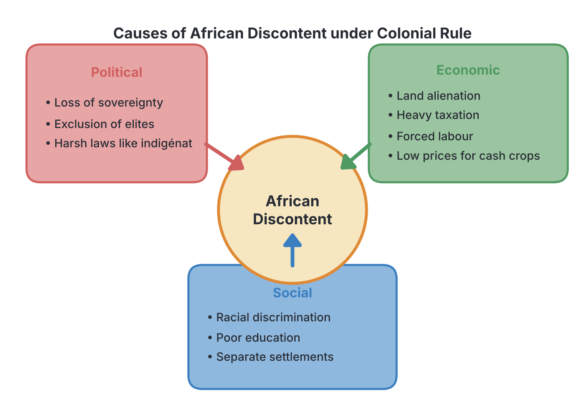
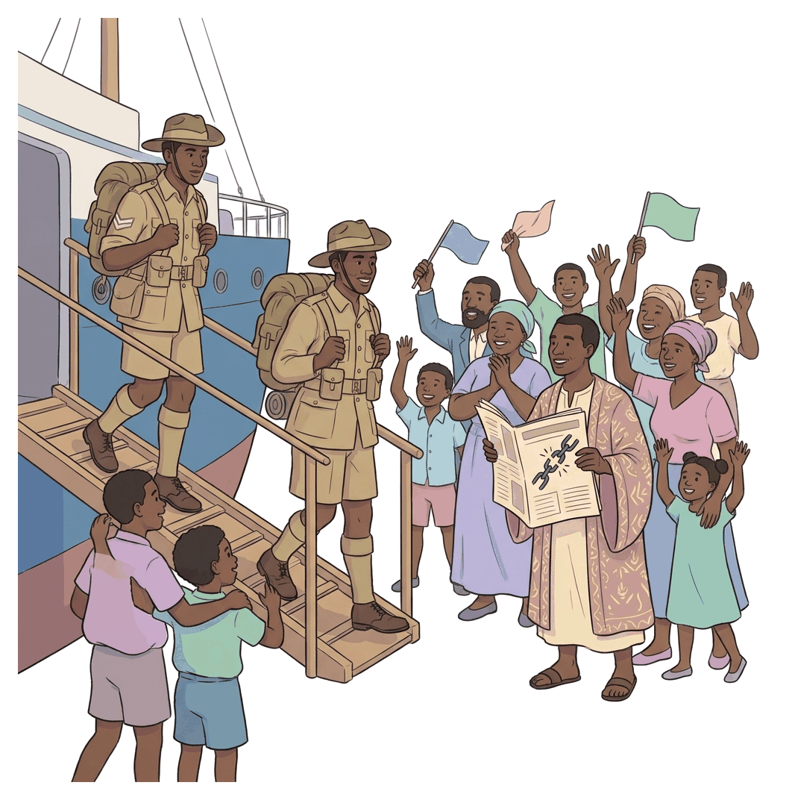
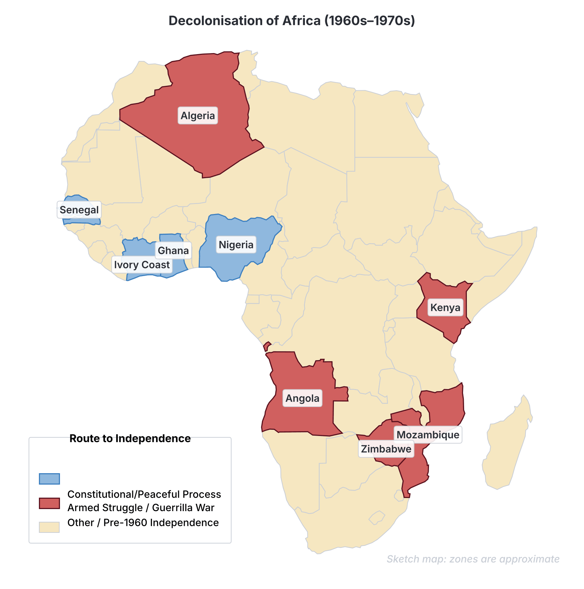

# JAMB History Notes: The Politics of Decolonization

## What JAMB expects

This topic is Section G, Topic 3 of the JAMB History syllabus: The Politics of Decolonization. It covers the long process by which African nations fought for and won their independence from European colonial rule.

The syllabus includes four content items:
- **a.** Colonial policies and African discontent
- **b.** The impact of the two World Wars
- **c.** Nationalist activities and the emergence of political parties and associations
- **d.** Strategies for attaining independence

By the end of these notes, you should be able to:
1. **examine** the policies employed by the colonial rulers and the magnitude of African discontent;
2. **assess** the impact of the First and Second World Wars on African nationalism;
3. **determine** the strategies used in the attainment of independence.

## Colonial policies and African discontent

**Objective i: examine the policies employed by the colonial rulers and the magnitude of African discontent.**
**Content a: Colonial policies and African discontent.**

Decolonization is the process by which colonies became independent of the colonizing country. In Africa, this process was driven by **nationalism**—a strong feeling of national pride and the desire of a people to be free from foreign rule and to govern themselves. 

African nationalism did not happen by accident. It was a direct reaction to the harsh, exploitative and discriminatory policies of the colonial rulers (Britain, France, Portugal, Belgium and others). 

### Colonial policies that caused discontent

The policies of the colonial masters can be grouped into political, economic, and social policies.

#### 1. Political policies
- **Loss of sovereignty:** Africans lost their independence. Traditional rulers were either deposed (like Jaja of Opobo or Oba Ovonramwen of Benin) or made to serve the colonial government.
- **Exclusion of the educated elite:** Under the British system of **Indirect Rule**, the colonial government ruled through traditional chiefs and emirs. Educated Africans (lawyers, doctors, teachers) were deliberately excluded from the administration because the British felt they were "troublemakers" who would demand modern democratic rights. 
- **Authoritarian rule:** In French and Portuguese colonies, the policy of **Direct Rule** and **Assimilation** meant that African cultures were disrespected. The French used a harsh legal system called the ***indigénat***, which allowed French administrators to arrest, fine, or imprison Africans without trial for minor offences.

#### 2. Economic policies
- **Land alienation:** In "settler colonies" (places where many Europeans came to live permanently, such as Kenya, Zimbabwe, South Africa, and Algeria), the colonial governments seized the most fertile lands for white farmers. Africans were pushed into barren, overcrowded reserves. 
- **Taxation:** Colonial governments introduced taxes, such as the **hut tax** and **poll tax**, which had to be paid in European currency. To get this money, Africans were forced to leave their farms and work for Europeans.
- **Forced labour:** Africans were frequently forced to work on European plantations, railways, and roads with little or no pay. The French called this *corvée*, while in Southern Africa it was known as *chibaro*.
- **Exploitation of cash crops:** Africans were encouraged (or forced) to grow cash crops (like cocoa, groundnuts, and cotton) instead of food crops. During and after the wars, colonial **Marketing Boards** bought these crops at very low prices and sold them in Europe at high prices, keeping the profit for the colonial state.
- **Monopolies:** European companies controlled all import and export trade. African businessmen were squeezed out of the economy and denied bank loans.

#### 3. Social and cultural policies
- **Racial discrimination:** Colonialism was built on the racist idea of white superiority. In many colonies, there were separate hospitals, schools, and even residential areas for whites and blacks (the most extreme example being Apartheid in South Africa).
- **Inadequate education:** The colonial governments spent very little on educating Africans. Most schools were run by Christian missionaries. The education provided was usually just enough to produce clerks, interpreters, and junior civil servants for the administration, but rarely engineers or scientists.

### The magnitude of African discontent

The magnitude (scale and intensity) of African discontent was massive. Africans did not accept colonial rule passively. Their discontent showed in various ways:

1. **Early armed revolts:** Before the 1920s, there were many local uprisings against taxation, forced labour, and land seizure (for example, the Ekumeku movement in Nigeria, the Maji Maji rebellion in Tanganyika, and the Bambatha rebellion in South Africa). 
2. **Mass protests and riots:** When economic hardship became unbearable, mass protests broke out. A famous example is the **Aba Women's Riot of 1929** in south-eastern Nigeria, where thousands of women protested against the fear of being taxed and the abuses of the British-appointed Warrant Chiefs.
3. **Strike actions:** African workers began to form trade unions and use strikes to protest low wages and bad working conditions. 
4. **Formation of associations:** Educated elites formed political groups to write petitions, send delegations to Europe, and publish newspapers criticizing the colonial governments. 

## The impact of the two World Wars

**Objective ii: assess the impact of the First and Second World Wars on African nationalism.**
**Content b: The impact of the two World Wars.**

The two World Wars—the First World War (1914–1918) and the Second World War (1939–1945)—acted as powerful catalysts for African nationalism. They changed how Africans saw their colonial masters and how the world viewed colonialism.

### The First World War (1914–1918)

1. **Shattering the myth of white invincibility:** Hundreds of thousands of Africans were drafted to fight or serve as carriers in the war (e.g., the West African Frontier Force, the *Tirailleurs Sénégalais*). By fighting alongside and against Europeans, Africans saw that white men could bleed, show fear, and die just like anyone else. This destroyed the myth that Europeans were super-humans who could not be challenged.
2. **The idea of self-determination:** After the war, US President Woodrow Wilson promoted the idea of "self-determination"—the right of people to choose their own government. Although Wilson meant this for European nations, educated Africans seized upon the idea and demanded it for Africa.
3. **The Mandate System:** Germany lost its African colonies (Togo, Cameroon, Tanganyika, South-West Africa) after the war. The newly formed League of Nations did not give these territories to Britain and France as permanent property; instead, it made them "Mandates" to be governed as a "sacred trust of civilization" until they were ready for self-rule. This established the legal principle that colonial rule was temporary.
4. **Economic hardship:** The war disrupted trade. Prices of imported goods shot up, while the colonial governments paid less for African cash crops to fund the war effort. This economic suffering increased anger against colonial rule.

### The Second World War (1939–1945)

The impact of the Second World War on African nationalism was even more profound than the First.

1. **The fall of colonial powers:** During the war, France and Belgium were defeated and occupied by Nazi Germany, while Britain was severely weakened. The sight of their "powerful" colonial masters being conquered heavily damaged European prestige in the eyes of Africans.
2. **The Atlantic Charter (1941):** In 1941, US President Franklin D. Roosevelt and British Prime Minister Winston Churchill signed the Atlantic Charter. One of its key clauses stated that they respected **"the right of all peoples to choose the form of government under which they will live."** Churchill later claimed this only applied to Europe, but African nationalists, like Nnamdi Azikiwe in Nigeria, used it as a powerful weapon to demand independence.
3. **The role of African Ex-Servicemen:** About a million Africans fought in WW2 (in Burma, India, North Africa, and Europe). In places like India, they saw strong nationalist movements fighting for independence. When these soldiers returned to Africa, they were often abandoned by the colonial governments, facing unemployment and poverty. Angry and military-trained, these ex-servicemen became the "shock troops" of nationalist movements. For example, in 1948 in the Gold Coast (Ghana), protesting ex-servicemen were shot by colonial police, sparking the Accra Riots which accelerated the push for independence.
4. **The rise of Anti-Colonial Superpowers:** After 1945, the global balance of power shifted from Britain and France to the United States and the Soviet Union (USSR). Both new superpowers were anti-colonial—the USA because of its own history of fighting British rule and its desire for open global markets, and the USSR because communist ideology opposed imperialism. They pressured European powers to decolonize.
5. **The United Nations (UN):** The UN replaced the League of Nations in 1945. It became a powerful international platform where anti-colonial views were loudly expressed, especially as Asian countries like India gained independence in 1947 and began supporting African nationalism at the UN.

## Nationalist activities, political parties and associations

**Content c: Nationalist activities and the emergence of political parties and associations.**

Following the grievances caused by colonial policies and the awakening sparked by the World Wars, African nationalism grew rapidly. It moved from being a small movement of the educated elite to a massive popular struggle involving millions of people.

### 1. Early Associations and the Press
In the early stages (1920s and 1930s), nationalism was led by a small group of Western-educated lawyers, doctors, and journalists. 
- **The Press:** Newspapers played a huge role in awakening political consciousness. In Nigeria, newspapers like Herbert Macaulay’s *Lagos Daily News* and Nnamdi Azikiwe’s *West African Pilot* fiercely criticized colonial policies and educated the masses on their rights.
- **Early Associations:** In 1920, Joseph Ephraim Casely Hayford of the Gold Coast formed the **National Congress of British West Africa (NCBWA)**. It brought together elites from Nigeria, Gold Coast, Sierra Leone, and The Gambia. They did not initially demand full independence; they only asked for more representation in the colonial government, better education, and an end to discrimination. 

### 2. Emergence of Political Parties
The introduction of early constitutions (such as the 1922 Clifford Constitution in Nigeria, which introduced the elective principle for Lagos and Calabar) led to the formation of the first political parties.
- **Nigeria:** The **Nigerian National Democratic Party (NNDP)** was formed by Herbert Macaulay in 1922. In the 1930s, the **Nigerian Youth Movement (NYM)** emerged with a more national outlook. By the 1940s and 50s, mass parties appeared: the **National Council of Nigeria and the Cameroons (NCNC)** led by Nnamdi Azikiwe (1944), the **Action Group (AG)** led by Obafemi Awolowo (1951), and the **Northern People's Congress (NPC)** led by Ahmadu Bello (1951).
- **Ghana (Gold Coast):** The United Gold Coast Convention (UGCC) was formed in 1947 by conservative elites. Kwame Nkrumah broke away in 1949 to form the more radical **Convention People's Party (CPP)**, demanding "Self-Government Now."
- **French West Africa:** In 1946, a massive cross-border political party called the **Rassemblement Démocratique Africain (RDA)** was formed in Bamako, led by Félix Houphouët-Boigny, to fight for the political rights of Africans in French colonies.

### 3. The role of Trade Unions and Mass Associations
Nationalist leaders realized they needed the masses—workers, market women, and farmers—to pressure the colonial masters. 
- **Trade Unions:** Workers organized to demand better pay, but their strikes often became political weapons against colonial rule. A major example is the **General Strike of 1945 in Nigeria**, led by Michael Imoudu, where railway and civil service workers paralyzed the country for weeks, shaking the colonial administration.
- **Women's Movements:** Women played a vital role. In Nigeria, the Abeokuta Women’s Union led by Funmilayo Ransome-Kuti organized massive protests in the late 1940s against taxation and colonial oppression.

### 4. Pan-Africanism
Pan-Africanism—the movement to unite people of African descent worldwide—greatly strengthened local nationalism. The **Fifth Pan-African Congress held in Manchester in 1945** was a turning point. It was attended by future African leaders like Kwame Nkrumah (Ghana), Jomo Kenyatta (Kenya), and Obafemi Awolowo (Nigeria). Unlike earlier congresses which only asked for reforms, the 1945 Congress boldly demanded immediate and complete political independence for all of Africa.

## Strategies for attaining independence

**Objective iii: determine the strategies used in the attainment of independence.**
**Content d: Strategies for attaining independence.**

African nations did not all achieve independence the same way. The strategy used depended largely on two factors: 
1. **The nature of the colony:** Whether it was a "settler colony" (with many white Europeans who claimed the land) or a "non-settler colony" (like West Africa, where few Europeans lived permanently).
2. **The attitude of the colonial power:** Whether the colonial power was willing to negotiate (like Britain in West Africa) or rigidly refused to leave (like Portugal).

There were two main strategies for attaining independence: **Constitutional (peaceful) Strategy** and **Armed Struggle (guerrilla warfare)**.

### 1. Constitutional and Peaceful Strategy

This strategy involved using legal, political, and non-violent methods to pressure the colonial masters into handing over power. It was the primary method used in most of **West Africa** (Nigeria, Ghana, Sierra Leone, Senegal).

**Methods used:**
- **Petitions and Delegations:** Nationalist leaders wrote petitions and travelled to London or Paris to negotiate with the colonial governments.
- **Elections and Parliaments:** Nationalists formed political parties, campaigned, and won elections into the colonial legislative councils. Once inside, they pushed for self-government.
- **Constitutional Conferences:** Leaders sat with colonial officials at conferences (such as the Ibadan Conference of 1950 or the London Conferences for Nigeria) to write new constitutions that gradually transferred power to Africans.
- **Strikes and Boycotts:** When colonial masters were slow to act, nationalists used economic pressure. In Ghana, Kwame Nkrumah launched a campaign of **"Positive Action"** in 1950, involving peaceful strikes, boycotts of European goods, and civil disobedience to force the British to grant self-government. 
- **Referendums:** In 1958, French President Charles de Gaulle held a referendum, giving French colonies the choice between joining a French Community or taking immediate, complete independence (Guinea, under Sékou Touré, voted for immediate independence).

**Examples:** Nigeria achieved independence peacefully on October 1, 1960, after a series of constitutional reforms (Richards in 1946, Macpherson in 1951, and Lyttelton in 1954). Ghana achieved it in 1957.

### 2. Armed Struggle (Guerrilla Warfare)

In some colonies, peaceful methods failed completely. White settlers refused to give up their stolen land, or the colonial government banned political parties, jailed nationalist leaders, and shot peaceful protesters. In these situations, Africans turned to **armed struggle** and guerrilla warfare.

**Methods used:**
- **Guerrilla Tactics:** Because they lacked heavy weapons, freedom fighters hid in forests, mountains, and rural areas. They launched surprise attacks on colonial military posts, settler farms, and infrastructure (railways, bridges), then melted back into the population.
- **Secret Oaths and Mass Mobilization:** Movements united the people through secret oaths and political education in the villages.
- **International Support:** Liberation movements received weapons, training, and money from communist countries (like the USSR, China, and Cuba) or from already independent African countries (like Egypt, Tanzania, and Zambia).

**Key Examples of Armed Struggle:**
- **Kenya:** British settlers had taken the best land (the White Highlands). When peaceful petitions failed, the **Mau Mau rebellion** (mostly Kikuyu people) broke out in the 1950s. Though the British military crushed the rebellion with great brutality, the war made Kenya ungovernable and forced Britain to grant independence in 1963 under Jomo Kenyatta.
- **Algeria:** Over a million French settlers lived in Algeria, and France considered it a part of France, not a colony. The Algerian **National Liberation Front (FLN)** fought a bloody, eight-year war of independence against the French army (1954–1962) before finally winning freedom.
- **Portuguese Colonies (Angola, Mozambique, Guinea-Bissau):** Portugal was ruled by a dictatorship that refused to even discuss decolonization, viewing its colonies as "overseas provinces." Africans formed liberation armies (like the MPLA in Angola, FRELIMO in Mozambique, and PAIGC in Guinea-Bissau) and fought long, bitter guerrilla wars from the 1960s until a revolution in Portugal in 1974 finally led to their independence in 1975.
- **Zimbabwe (Southern Rhodesia):** The white minority government under Ian Smith illegally declared independence from Britain in 1965 (UDI) to ensure permanent white rule. African nationalists (ZANU and ZAPU) fought a long "bush war" until the white government was forced to negotiate, leading to independence in 1980.

### Comparison of the two strategies

| Feature | Constitutional Strategy | Armed Struggle |
| :--- | :--- | :--- |
| **Where it was used** | Mainly non-settler colonies (West Africa, parts of East/Central Africa) | Settler colonies (Algeria, Kenya, Zimbabwe, South Africa) and Portuguese colonies |
| **Main methods** | Petitions, elections, strikes, boycotts, constitutional conferences | Sabotage, surprise attacks, guerrilla warfare in forests/mountains |
| **Attitude of Colonizer** | Willing to negotiate a gradual handover of power | Refused to negotiate; violently suppressed peaceful political parties |
| **Human cost** | Relatively low loss of life | High loss of life; massive destruction of property |
| **Speed of transition** | Often a planned, step-by-step transition over several years | Usually ended abruptly when the colonial power could no longer afford the war |
| **Examples** | Nigeria (1960), Ghana (1957), Senegal (1960) | Algeria (1962), Kenya (1963), Angola (1975), Zimbabwe (1980) |

**Note on dates:** Historians sometimes differ on the exact start dates of guerrilla wars, as they often began as small rural uprisings before becoming formal wars. Follow the general periods (e.g., 1950s for Mau Mau, 1960s/70s for Portuguese colonies).

## Key terms

| Term | Meaning |
| :--- | :--- |
| **Decolonization** | The process by which colonies become independent countries. |
| **Nationalism** | A strong feeling of national pride and the desire of a colonized people to govern themselves. |
| **Assimilation** | French policy of trying to turn Africans into "Black Frenchmen" by replacing African culture with French culture. |
| **Indigénat** | A harsh set of laws used by the French that allowed them to punish Africans without a fair trial. |
| **Land alienation** | The colonial practice of seizing the best, most fertile lands from Africans and giving them to white settlers. |
| **Self-determination** | The principle that a group of people have the right to form their own state and choose their own government. |
| **Atlantic Charter** | A 1941 document signed by the US and Britain stating all people have the right to choose their government. |
| **Ex-servicemen** | Africans who served in the colonial armies during the World Wars and returned home with military training and new political awareness. |
| **Settler colony** | A colony where a large number of Europeans moved to live permanently (e.g., Kenya, Algeria, Zimbabwe). |
| **Guerrilla warfare** | A type of fighting where small, mobile groups of irregular soldiers use hit-and-run tactics against a larger, regular army. |
| **Mau Mau** | A militant African nationalist movement in Kenya that fought a guerrilla war against British settlers and rule in the 1950s. |

## Exam tips and common mistakes

- **Do not confuse the World Wars:** WW1 introduced the *idea* of self-determination (Woodrow Wilson) and the Mandate system. WW2 had a much bigger physical impact: African soldiers fighting in Asia, the Atlantic Charter, the fall of France, and the rise of the US/USSR as anti-colonial superpowers.
- **Settler vs. Non-settler colonies:** This is the most important factor in how a country got independence. JAMB frequently asks why armed struggle was used in certain countries. The answer is almost always the presence of white settlers who refused to give up land/power, or a dictatorial colonial master (like Portugal).
- **The Atlantic Charter:** Remember this was a crucial document during WW2 (1941) that nationalists used to argue for independence, even though Churchill didn't intend it for Africa.
- **Constitutional steps:** Remember that strikes and boycotts (like Nkrumah's "Positive Action" or the 1945 Nigerian General Strike) fall under the *Constitutional/Peaceful* strategy, not armed struggle, because they did not involve military warfare.
- **Political parties:** Know the first political party in Nigeria (NNDP, 1922, formed by Herbert Macaulay) and the early regional association (NCBWA, 1920, Casely Hayford).

## Quick summary

1. African nationalism was a direct reaction to the political exclusion, economic exploitation (taxation, forced labour, land alienation), and social discrimination of colonial rule.
2. The First World War cracked the myth of white invincibility and introduced the concept of self-determination to educated Africans.
3. The Second World War massively accelerated decolonization through the Atlantic Charter, the experiences of returning ex-servicemen, the weakening of Britain and France, and the rise of the anti-colonial USA and USSR.
4. Nationalist activities evolved from early educated elites writing petitions and running newspapers, to mass political parties, trade union strikes, and youth movements mobilizing millions of people.
5. In non-settler colonies like Nigeria and Ghana, independence was achieved through constitutional strategies: elections, conferences, petitions, and peaceful protests.
6. In settler colonies (Kenya, Algeria, Zimbabwe) and Portuguese territories (Angola, Mozambique), where colonizers violently refused to hand over power, Africans were forced to use armed struggle and guerrilla warfare to win their freedom.

## Practice questions

**1. Armed struggle was adopted as a strategy for decolonization primarily in African countries where**

- A. the colonial masters were too poor to negotiate
- B. there was a high population of European settlers who refused to share power
- C. traditional rulers supported the colonial government
- D. the United Nations ordered the use of military force

**Answer: B.** In settler colonies (like Kenya, Algeria, and Zimbabwe), white settlers controlled the best land and the government, and violently suppressed peaceful political movements, leaving Africans with no choice but to fight.

**2. Which of the following documents, signed during the Second World War, gave African nationalists a strong legal argument to demand independence?**

- A. The Treaty of Versailles
- B. The Berlin Conference Act
- C. The Atlantic Charter
- D. The League of Nations Mandate

**Answer: C.** The Atlantic Charter (1941), signed by Roosevelt and Churchill, declared the right of all peoples to choose the form of government under which they will live. African nationalists seized upon this clause.

**3. The first political party to be formed in Nigeria to contest elections was the**

- A. Nigerian Youth Movement (NYM)
- B. National Council of Nigeria and the Cameroons (NCNC)
- C. Action Group (AG)
- D. Nigerian National Democratic Party (NNDP)

**Answer: D.** The NNDP was founded by Herbert Macaulay in 1922 to contest elections for the Lagos seats in the Legislative Council provided by the Clifford Constitution. Students often confuse it with the NYM, which came later in the 1930s.

**4. In the context of African history, nationalism is best described as**

- A. the desire of traditional chiefs to regain their lost kingdoms
- B. the movement by colonized peoples to end foreign rule and achieve self-government
- C. the process of European powers competing for African territories
- D. the attempt to merge all African countries into one single nation

**Answer: B.** Nationalism in colonial Africa was the political movement aiming to overthrow European colonial rule and establish independent, sovereign nation-states. Option C describes imperialism, not nationalism.

**5. Which of the following was a major economic grievance of Africans against French colonial rule?**

- A. The policy of Assimilation
- B. The introduction of Indirect Rule
- C. The use of the corvée system of forced labour
- D. The building of schools by missionaries

**Answer: C.** The *corvée* was a system of forced unpaid labour used by the French to build infrastructure, which caused immense suffering and resentment among Africans. Option A is a political and cultural grievance, not an economic one.

**6. A significant psychological impact of the World Wars on African soldiers was that it**

- A. made them want to become citizens of European countries
- B. shattered the myth of European superiority and invincibility
- C. proved that African traditional religions were superior to Christianity
- D. made them accept colonial rule as a permanent reality

**Answer: B.** Seeing Europeans express fear, suffer, and die on the battlefield destroyed the racist myth that white people were super-human and invincible, giving Africans the confidence to challenge them.

**7. Which of the following African countries had to wage a long guerrilla war against Portuguese colonial rule?**

- A. Angola
- B. Ghana
- C. Senegal
- D. Nigeria

**Answer: A.** Portugal refused to decolonize, treating its colonies as overseas provinces. This led to bitter armed struggles in Angola, Mozambique, and Guinea-Bissau. Ghana, Senegal, and Nigeria achieved independence constitutionally.

**8. The National Congress of British West Africa (NCBWA) formed in 1920 primarily used which of the following strategies?**

- A. Organizing armed rebellions in the forests
- B. Sending petitions and delegations to London to demand reforms
- C. Boycotting all British goods and services
- D. Seeking military aid from the Soviet Union

**Answer: B.** The NCBWA, an early nationalist association of educated elites led by J.E. Casely Hayford, used constitutional methods like petitions and delegations to demand reforms, not armed struggle or total boycotts.

**9. The Nigerian General Strike of 1945 is an example of how**

- A. traditional rulers fought against the British
- B. trade unions were used to exert political and economic pressure on the colonial government
- C. ex-servicemen demanded their pensions
- D. women protested against heavy taxation

**Answer: B.** Led by Michael Imoudu, the 1945 General Strike paralyzed the economy. It showed how organized labour (trade unions) became a powerful tool for mass nationalist action against the colonial state. Option D mixes this up with the Aba Women's Riot.

**10. Educated Africans strongly opposed the British policy of Indirect Rule primarily because it**

- A. forced them to learn traditional languages
- B. handed all economic power to French companies
- C. excluded them from participating in the administration of their own people
- D. abolished the collection of taxes

**Answer: C.** The British deliberately ruled through traditional chiefs and excluded the new class of Western-educated African elites from the government, which deeply frustrated the elites and fueled their nationalism.

<!-- COVERAGE
obj i | Colonial policies and African discontent
obj ii | The impact of the two World Wars
obj iii | Strategies for attaining independence
item a | Colonial policies and African discontent
item b | The impact of the two World Wars
item c | Nationalist activities, political parties and associations
item d | Strategies for attaining independence
-->
